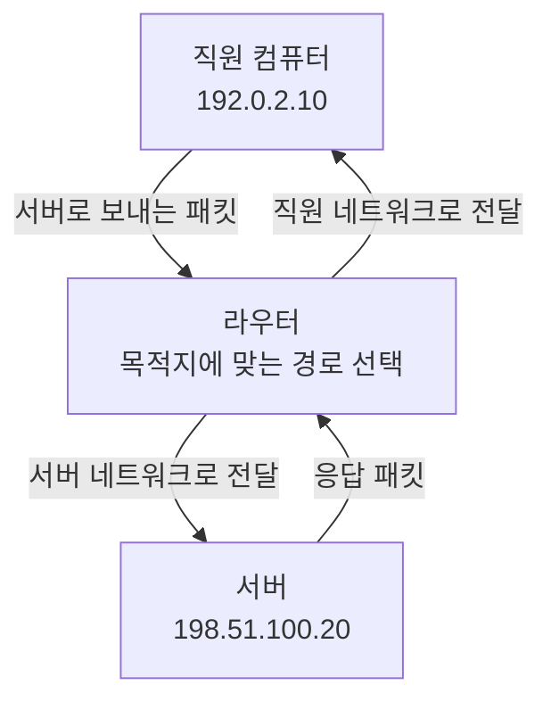
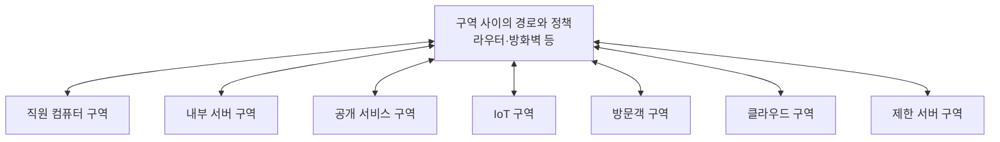
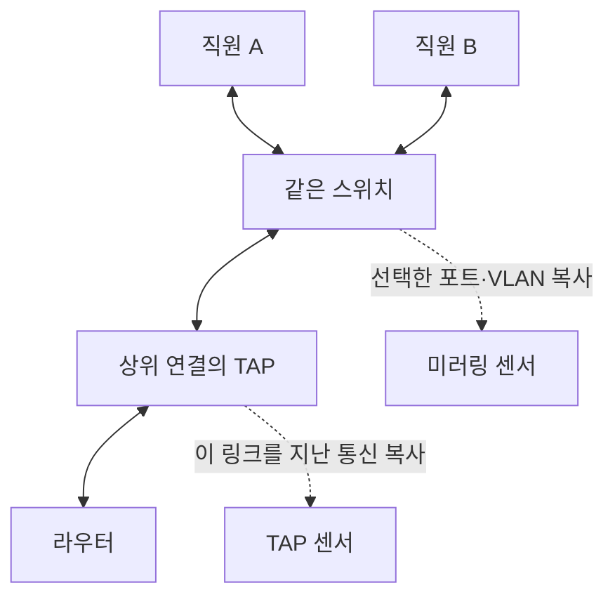
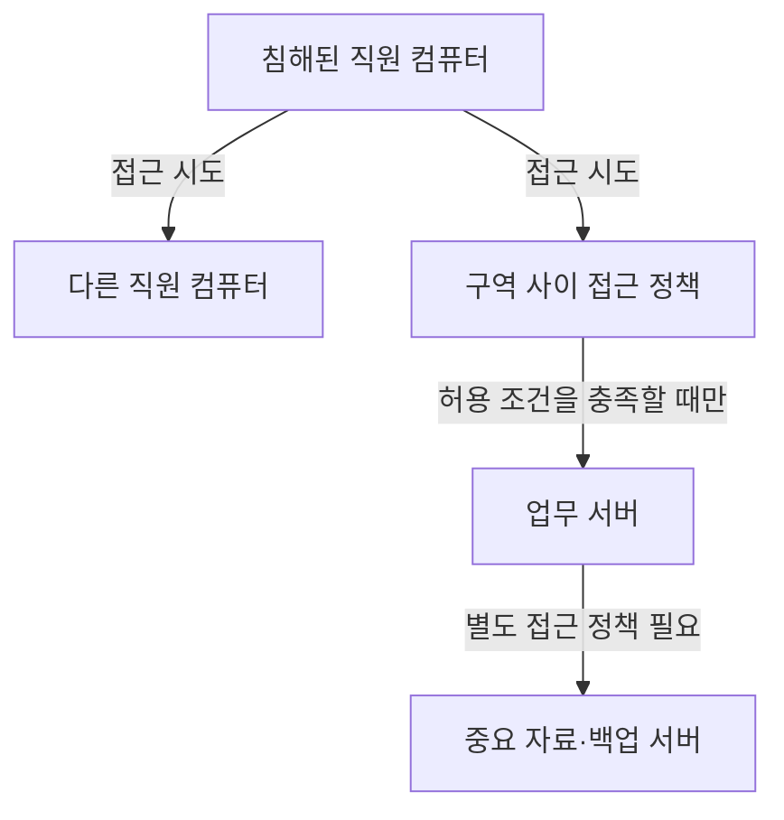

이번 회차에서는 네트워크 구조의 필요성부터 라우터, 보안 구역, 스위치, 트래픽 관측 위치, 방화벽, 제로 트러스트, 네트워크 분리의 효과와 한계까지 공부합니다. 다음 회차는 **트래픽 수집과 분석**입니다.

첫 회차이므로 네트워크를 이미 배웠다고 가정하지 않겠습니다. 다만 여기에서 소개하는 주소와 장비의 세부 동작은 뒤에서 패킷을 읽을 때 다시 더 깊게 살펴봅니다.

## 1. 침해 의심 신고를 받았습니다. 어디부터 볼까요?

직원 한 명이 이렇게 신고했다고 해봅시다.

“제 컴퓨터가 갑자기 느려졌어요. 다른 직원 컴퓨터에도 이상한 접속이 있었다고 하네요.”

우리는 보안 분석가입니다. 우선 네트워크 기록을 확인하려고 회사 인터넷 출입구의 기록을 열었습니다. 그런데 의심스러운 통신이 보이지 않습니다.

그러면 직원의 신고가 잘못된 것일까요?

아직 그렇게 판단할 수 없습니다. 두 직원의 컴퓨터가 회사 내부에서 직접 통신했다면, 그 통신은 인터넷 출입구까지 가지 않았을 수 있습니다. 우리가 보고 있는 기록이 애초에 그 통신을 볼 수 없는 위치에서 만들어졌을 가능성이 있는 거죠.

건물의 정문 CCTV를 떠올려보세요. 정문을 드나든 사람은 확인할 수 있지만, 같은 층 사무실 사이를 이동한 사람까지 모두 볼 수 있는 것은 아닙니다.

네트워크 조사도 비슷합니다. 다만 실제 네트워크에서는 통신 경로가 장비 설정에 따라 바뀌고, 같은 통신의 복사본을 별도 분석 장비로 보낼 수도 있습니다. CCTV의 위치만 보는 것보다 **통신 경로와 복사 설정을 함께 확인해야 한다**는 차이가 있습니다.

여기서 첫 번째 원리가 나옵니다.

**어떤 기록에 통신이 없다는 사실을 해석하려면, 그 기록이 어디에서 만들어졌는지부터 알아야 합니다.**

네트워크 구조를 배우는 이유가 바로 이것입니다. 우리는 다음 세 가지를 연결할 수 있어야 합니다.

- 컴퓨터들이 어떤 구역에 배치되어 있는가?
- 구역 안과 구역 사이의 통신은 어떤 길로 이동하는가?
- 그 길의 어느 지점에서 통신을 관측하거나 차단할 수 있는가?

이제 그 길을 하나씩 그려보겠습니다.

## 2. 네트워크를 구역으로 나누면 무엇이 달라질까요?

작은 사무실에서는 컴퓨터, 프린터, 서버가 모두 비슷한 위치에 연결되어 있을 수 있습니다. 하지만 회사 규모가 커지면 모든 장비를 한데 섞어놓기 어렵습니다.

방문객의 휴대전화와 급여 정보를 보관한 서버가 서로 자유롭게 통신할 수 있어도 될까요? 인터넷에서 접속받는 웹 서버와 내부 백업 서버를 같은 조건으로 취급해도 될까요?

각 장비의 역할과 위험이 다르므로, 통신할 수 있는 범위도 다르게 정할 필요가 있습니다.

이때 자주 등장하는 말이 **네트워크 세그먼트**, **서브넷**, **보안 구역**입니다. 비슷하게 들리지만 같은 뜻은 아닙니다.

| 용어 | 이번 강의에서 이해할 의미 |
|---|---|
| 네트워크 세그먼트 | 네트워크를 나눈 한 부분. 문맥에 따라 물리적 연결이나 논리적 구분을 가리킵니다. |
| 서브넷 | IP 주소와 네트워크 마스크로 구분하는 주소상의 네트워크 범위입니다. |
| 보안 구역 | 비슷한 보안 요구사항과 접근 정책을 적용하려고 묶은 범위입니다. |

**IP 주소**는 네트워크 통신에서 출발지와 목적지를 나타내는 주소입니다. 여기에서는 `192.0.2.10`처럼 점으로 나눈 네 숫자 형태의 IPv4 주소를 사용하겠습니다. 모든 예제 주소는 문서와 설명에 쓰도록 예약된 주소입니다.

작은 예를 들어보죠.

직원 컴퓨터를 `192.0.2.0/24`, 서버를 `198.51.100.0/24`라는 서로 다른 서브넷에 둡니다.

`/24`는 앞의 24비트를 네트워크 부분으로 사용한다는 뜻입니다. 비트는 0 또는 1을 담는 가장 작은 정보 단위입니다. IPv4 주소는 총 32비트이므로, 이 예에서는 앞의 세 숫자에 해당하는 부분이 네트워크 구분에 쓰입니다. 마스크로 표현하면 `255.255.255.0`입니다.

우선 다음 정도로 읽으면 됩니다.

“직원 컴퓨터와 서버가 서로 다른 IP 네트워크에 있구나.”

그런데 주소 범위를 나누기만 하면 보안도 자동으로 좋아질까요?

그렇지는 않습니다. 두 서브넷 사이의 통신을 모두 허용하면, 주소는 나뉘었어도 접근 제한은 거의 없는 상태일 수 있습니다.

**네트워크를 나누는 작업과, 나눈 경계에서 통신을 제한하는 작업을 구별해야 합니다.**

건물에 부서별 방을 만들었더라도 모든 문을 항상 열어놓으면 출입 통제 효과가 작겠죠. 실제 네트워크에서는 그 문 역할을 라우터의 접근 제어 규칙, 방화벽, 단말 자체의 방화벽 등이 맡습니다.

## 3. 라우터: 다른 네트워크로 가는 길을 정합니다

직원 컴퓨터 `192.0.2.10`이 서버 `198.51.100.20`에 접속하려고 합니다. 두 장비는 서로 다른 서브넷에 있습니다.

이때 목적지 네트워크로 패킷을 전달하는 역할을 하는 장비가 **라우터**입니다.

**패킷**은 네트워크로 데이터를 나누어 보내는 단위입니다. 실제로는 여러 종류의 주소와 제어 정보가 붙지만, 지금은 “목적지 주소를 붙여 보낸 데이터 조각”이라고 생각해보세요.

라우터는 목적지 IP 주소와 자신이 가진 경로 정보를 바탕으로 다음 전달 방향을 선택합니다. 이 경로 정보를 모아놓은 것이 **라우팅 테이블**입니다.

택배 분류소와 비슷합니다. 분류소가 목적지 지역을 보고 다음 물류 거점을 고르듯, 라우터도 목적지 네트워크에 맞는 다음 경로를 고릅니다. 다만 라우터가 매번 사람이 읽는 주소를 해석하는 것은 아니고, 정해진 주소와 경로 규칙으로 처리합니다.

**그림 1. 서로 다른 서브넷 사이의 통신 경로**  
화살표는 패킷의 이동 방향입니다. 주소는 설명용입니다.

이 그림에서 읽어야 할 것은 라우터가 두 주소 범위 사이의 전달 지점이라는 점입니다. 위 예제에서는 요청과 응답 모두 같은 라우터를 지나도록 그렸습니다. 실제 환경에서는 돌아오는 경로가 달라질 수도 있으므로, 조사할 때는 양방향 경로를 확인해야 합니다.

### 회사에는 라우터가 하나만 있을까요?

집에서는 한 장비가 인터넷 연결, 내부 연결, 무선 접속, 방화벽 기능을 함께 제공하는 경우가 많습니다. 그래서 “공유기 한 대가 네트워크 전체”라는 인상을 받기 쉽습니다.

회사에서는 인터넷 경계, 내부 구역 사이, 지사 연결, 클라우드 연결 등에 여러 라우터가 쓰일 수 있습니다. 장애가 나도 다른 경로로 통신하도록 중복 경로를 두기도 합니다. 이런 구성을 **이중화**라고 합니다.

장비가 여러 대라는 사실은 분석에도 영향을 줍니다. 한 라우터의 기록만 확인하면 다른 경로로 지나간 통신을 놓칠 수 있기 때문입니다.

또한 라우팅 기능은 라우터라는 이름의 장비에만 있는 것이 아닙니다. 방화벽이나 일부 스위치도 라우팅을 수행합니다. 실제 조사에서는 제품 이름보다 **어느 장비가 해당 구간의 경로를 결정하는지**를 확인해야 합니다.

### 라우터는 분석가에게 어떤 증거를 줄까요?

라우터는 통신의 요약 기록을 제공할 수 있습니다. 대표적인 예가 **NetFlow**입니다.

쉽게 말해 “누가 누구에게, 어떤 통신 방식으로, 얼마나 통신했는가?”를 살펴볼 수 있는 자료입니다. 이런 종류의 통신 요약을 **플로 데이터**라고 부르겠습니다. 정확히 어떤 항목을 기록하는지는 장비와 설정에 따라 다릅니다.

예를 들어 다음과 같은 정보를 얻을 수 있습니다.

> 직원 컴퓨터가 서버의 특정 서비스로 통신했고, 일정 시간 동안 일정량의 데이터를 보냈다.

하지만 이 기록에 보낸 파일의 내용까지 들어 있다고 생각하면 안 됩니다. **통신의 요약과 패킷 원본은 서로 다른 증거**입니다.

라우터에는 **ACL**, 즉 접근 제어 목록을 적용할 수도 있습니다. 출발지, 목적지, 통신 종류 등을 조건으로 전달을 허용하거나 거부하는 규칙입니다.

여기서 자주 쓰는 조건이 **포트 번호**입니다. IP 주소가 통신할 장비를 가리킨다면, TCP·UDP 같은 통신 방식에서 포트 번호는 그 장비 안의 통신 종단을 구분하는 데 쓰입니다. 흔히 서비스의 접수 창구에 비유하지만, 포트 번호만으로 실제 프로그램이나 사용자를 확정할 수는 없습니다.

교재는 라우터 제품에서 볼 수 있는 추가 보안 기능도 소개합니다.

- **802.1X**: 네트워크 접속을 허용하기 전에 사용자나 장비의 인증을 수행하는 데 쓰는 방식입니다.
- **VPN**: 떨어진 위치 사이에 논리적인 전용 연결을 만드는 기술입니다.
- **IPsec**: IP 통신을 인증·암호화하는 데 쓰는 프로토콜 모음으로, VPN 구현에도 사용됩니다.
- **콘텐츠 필터링**: 정책에 따라 특정 종류의 콘텐츠나 접속을 제한하는 기능입니다.
- **IPS**: 침입 방지 시스템으로, 공격으로 판단한 통신을 차단하는 기능입니다.

이 기능이 모든 라우터에 포함되는 것은 아닙니다. 특히 802.1X는 실제 환경에서 접속 스위치나 무선 접속 장비가 수행하는 경우도 많습니다. 장비의 지원 여부와 실제 활성화 상태를 따로 확인해야 합니다.

## 4. 보안 구역: “어느 방인가?”와 “누가 들어갈 수 있나?”를 함께 봅니다

이제 주소가 다른 네트워크 사이를 이동할 수 있다는 것을 배웠습니다. 다음 질문은 이겁니다.

“그 이동을 어디까지 허용해야 할까요?”

**보안 구역**, 영어로는 존(zone)은 비슷한 역할이나 보안 요구를 가진 시스템을 묶어 정책을 적용하는 범위입니다.

보통 직원 컴퓨터 구역, 내부 서버 구역, 방문객 구역 등을 생각할 수 있습니다. 하지만 회사에 필요한 구역은 그보다 다양합니다.

인터넷처럼 조직 외부에 있는 범위를 외부 구역으로 볼 수 있고, 외부 접속을 받아야 하는 공개 웹 서버 등은 **경계 네트워크**에 배치할 수 있습니다. 이 경계 네트워크는 흔히 **DMZ**라고도 부릅니다. 외부에 서비스를 제공하면서 내부의 민감한 시스템과는 접근 조건을 달리하려는 구역입니다.

프린터, 카메라, 센서 같은 **IoT**, 즉 네트워크에 연결되는 사물 장비도 별도 구역으로 둘 수 있습니다. 직원 컴퓨터와 관리 방식, 업데이트 가능성, 필요한 통신이 다르기 때문입니다.

협력사와 연결하는 구역, VPN으로 들어오는 원격 접속 구역, 클라우드 구역도 필요할 수 있습니다. 클라우드의 **VPC**는 가상 사설 클라우드로, 클라우드 안에서 논리적으로 구분한 네트워크 환경입니다.

아주 민감한 서버는 제한 구역에 둘 수 있습니다. 더 강하게 분리해야 하는 경우에는 다른 네트워크와 직접 연결하지 않는 **에어갭** 구조를 사용할 수도 있습니다. 다만 “에어갭”이라는 이름만 보고 완전한 단절을 가정해서는 안 됩니다. 관리 연결이나 이동식 저장장치를 통한 자료 반입 경로가 있는지도 확인해야 합니다.

### 구역 사이에는 필요한 통신만 열어둡니다

방문객에게 인터넷 사용은 허용하되 급여 서버 접근은 허용하지 않는다고 해봅시다.

이때 적용하는 생각이 **최소 권한**입니다. 업무에 필요한 대상과 동작만 허용하는 원칙이죠.

다음은 설명용 정책입니다.

| 출발 구역 | 목적 구역 | 정책 예시 |
|---|---|---|
| 방문객 | 외부 인터넷 | 필요한 인터넷 사용 허용 |
| 방문객 | 내부 서버 | 접근 거부 |
| 직원 컴퓨터 | 내부 업무 서버 | 업무에 필요한 서비스만 허용 |
| 공개 웹 서버 | 내부 서버 | 지정한 연계 대상과 서비스만 허용 |
| 관리 구역 | 제한 서버 | 승인된 관리 접근만 허용 |

표의 각 행은 완성된 장비 설정이 아닙니다. 실제 규칙에는 구체적인 주소, 서비스, 사용자 조건, 적용 순서 등이 필요합니다.

**그림 2. 구역 사이의 통신을 통제하는 논리 구조**  
양방향 선은 연결 관계를 뜻하며, 모든 통신이 허용된다는 뜻은 아닙니다.

이 그림은 구역 사이에 정책을 적용하는 전통적인 구조를 단순화한 것입니다. 실제로 모든 연결이 물리적인 중앙 장비 한 대를 통과한다는 뜻은 아닙니다.

여기서 중요한 질문이 하나 더 생깁니다.

**같은 구역 안의 두 컴퓨터 사이에도 이 정책이 적용될까요?**

구현에 따라 다릅니다. 같은 구역 안에서 직접 통신한다면 중앙 방화벽을 지나지 않을 수 있습니다. 반대로 단말 방화벽이나 별도 분리 정책이 있으면 같은 구역 안의 통신도 제한할 수 있습니다.

따라서 “같은 구역이니까 자유롭게 통신한다”와 “모든 통신은 방화벽을 지난다”는 생각 모두 실제 설정으로 확인해야 합니다.

## 5. 스위치: 가까운 장비 사이의 통신을 이해하는 열쇠입니다

한 사무실의 컴퓨터 여러 대가 스위치에 연결되어 있다고 해봅시다.

일반적인 이더넷 환경에서 **스위치**는 **MAC 주소**를 학습해 프레임을 전달합니다. MAC 주소는 같은 링크에서 통신할 인터페이스를 구분하는 주소이고, **프레임**은 이더넷에서 데이터를 주고받는 단위입니다. IP 패킷은 이 프레임 안에 실려 이동할 수 있습니다.

지금 단계에서는 이렇게 구분하면 충분합니다.

- 라우팅은 서로 다른 IP 네트워크 사이의 전달을 이해하는 데 중요합니다.
- 스위칭은 같은 네트워크 구간 안의 전달을 이해하는 데 중요합니다.

직원 A와 직원 B가 같은 서브넷과 같은 스위치에 연결되어 있다고 하죠. A가 B에게 보내는 통신은 스위치 안에서 전달될 수 있습니다. 인터넷 쪽 라우터까지 올라갈 필요가 없는 겁니다.

이것이 스위치가 보안 조사에서 중요한 이유입니다. 중앙 라우터가 보지 못한 통신을 스위치 가까이에서는 관측할 수 있기 때문입니다.

### 기업용 스위치는 연결만 해주지 않습니다

설정과 관리 기능을 제공하는 스위치를 **관리형 스위치**라고 부릅니다. 지원 기능에 따라 다음과 같은 일을 할 수 있습니다.

먼저 통신 복사본을 분석 장비로 보내는 **미러링**을 제공할 수 있습니다. 또 일부 제품은 플로 데이터를 생성합니다.

802.1X를 사용하면 접속 단계에서 인증을 요구할 수 있고, ACL을 사용하면 장비 사이의 통신을 제한할 수 있습니다.

또한 **VLAN**, 즉 가상 LAN으로 하나의 물리적 스위치 안에서도 논리적인 네트워크를 구분할 수 있습니다. 직원 컴퓨터와 방문객 장비가 같은 스위치에 꽂혀 있어도 서로 다른 VLAN에 둘 수 있는 것이죠.

다만 VLAN도 그 자체로 모든 보안 정책을 완성해주지는 않습니다. VLAN 사이의 경로와 허용 규칙을 함께 봐야 합니다.

마찬가지로 802.1X 인증을 통과한 컴퓨터가 항상 안전한 컴퓨터인 것도 아닙니다. 정상적으로 인증한 컴퓨터가 나중에 악성코드에 감염될 수도 있으니까요.

이렇게 여러 장비와 기능을 조합해 침해된 컴퓨터가 다른 컴퓨터로 접근하는 범위를 제한합니다. 공격자가 이미 확보한 시스템에서 다른 내부 시스템으로 접근을 넓히는 행동을 **측면 이동**이라고 합니다.

## 6. 통신을 보려면 복사본을 어디서 받아야 할까요?

이제 원래 통신이 지나가는 길을 배웠습니다. 분석가는 그 길을 흐르는 패킷을 어떻게 가져올까요?

대표적인 방법은 스위치의 **미러 포트**와 네트워크 **TAP**입니다.

### 미러 포트: 스위치가 통신 복사본을 보내줍니다

스위치에 이렇게 설정한다고 생각해보세요.

“직원 A가 연결된 포트에서 관측한 통신을 분석 장비가 연결된 포트에도 복사해줘.”

이런 방식을 포트 미러링이라고 합니다. Cisco에서는 **SPAN**, 즉 Switched Port Analyzer라는 이름을 사용합니다.

복사본을 받는 장비를 **센서**라고 부르겠습니다. 센서는 패킷을 저장하거나, 공격 탐지 규칙으로 검사하거나, 통신의 특징을 분석할 수 있습니다.

**그림 3. 스위치 내부 통신과 외부 연결의 관측 위치**  
실선은 원래 통신 경로, 점선은 분석용 복사 경로입니다. TAP은 스위치의 외부 연결에 설치한 것으로 가정합니다.

A와 B의 통신이 스위치 안에서 끝난다면 상위 연결의 TAP에는 나타나지 않습니다. 반면 해당 통신을 포함하도록 스위치 미러링을 설정했다면 미러링 센서에서는 볼 수 있습니다.

여기서 기억할 점은 미러링도 설정한 범위만 보여준다는 것입니다. 특정 포트만 복사하거나, 들어오는 방향만 복사하도록 되어 있다면 다른 통신은 빠질 수 있습니다.

### TAP: 통신 링크에서 복사본을 얻습니다

네트워크 TAP은 두 장비 사이의 링크에 설치해 통신 복사본을 얻는 장치입니다.

수동 광 TAP처럼 광 신호를 나누는 방식도 있고, 전원이 필요한 능동형 제품도 있습니다. 따라서 “TAP은 전부 전원이 필요 없고 설치 영향도 없다”고 생각하면 안 됩니다. 제품 종류, 설치 방식, 장애 시 동작을 확인해야 합니다. 제조사도 수동형과 능동형 TAP을 구분합니다. [Keysight 네트워크 TAP 설명](https://www.keysight.com/zz/en/products/network-visibility/network-taps.html)

무엇보다 TAP은 **자신이 설치된 링크를 지나가는 통신**을 봅니다. 위치가 맞지 않으면 좋은 장비를 설치해도 원하는 증거를 얻지 못합니다.

### 미러링과 TAP은 무엇을 비교해야 할까요?

| 비교 항목 | 스위치 미러링 | 링크의 TAP |
|---|---|---|
| 관측 범위 | 설정한 포트·VLAN·방향 | 설치한 링크를 지나는 통신 |
| 같은 스위치 안의 통신 | 해당 통신이 복사 범위에 포함되면 관측 가능 | 상위 연결 TAP이라면 관측 불가 |
| 주요 확인 사항 | 복사 범위, 방향, 출력 용량, 장비 제약 | 설치 위치, 방향별 출력, 집계 방식 |
| 추가 고려 사항 | 태그·오류 프레임 처리 방식 | 장비 비용, 설치 영향, 센서 연결 |

이 표에서 어느 방식이 무조건 우수한지 고르려 하지 마세요. 먼저 보고 싶은 통신 경로를 정하고, 그 경로를 관측할 수 있는 방법을 선택해야 합니다.

### 통신이 1Gbps인데 복사 포트도 1Gbps면 충분할까요?

조건을 하나 추가해보겠습니다.

원래 링크가 **전이중**으로 동작한다고 합시다. 전이중은 양방향으로 동시에 통신할 수 있다는 뜻입니다.

- A에서 B로 초당 최대 1기가비트
- B에서 A로 초당 최대 1기가비트

`Gbps`는 초당 기가비트라는 속도 단위입니다. 양방향이 동시에 가득 차 있다면 복사해야 할 총량은 다음과 같습니다.

\[
1\ \text{Gbps} + 1\ \text{Gbps}
= 2\ \text{Gbps}
\]

이것을 하나의 1Gbps 출력 포트로 보내면 어떻게 될까요?

지속적으로 2Gbps가 들어오는데 1Gbps만 내보낼 수 있으므로, 계속 모두 전달할 수는 없습니다. 일시적인 저장 공간이 있어도 지속적인 용량 부족을 해결하지는 못합니다.

관측용 출력의 용량보다 복사하려는 양이 많은 상태를 **과가입**, 또는 oversubscription이라고 합니다.

실제 업무 통신은 정상 전달됐는데, 분석용 복사본만 빠지는 상황도 가능합니다. Cisco IOS XE 17의 SPAN 문서도 이 가능성을 설명합니다. [Cisco SPAN 구성 문서](https://www.cisco.com/c/en/us/td/docs/switches/lan/c9000/mgmt/management-configuration-guide/span.html)

따라서 캡처에서 패킷이 빠졌다고 해서 원래 네트워크에서도 그 패킷이 유실됐다고 즉시 판단하면 안 됩니다.

TAP도 양방향을 각각 별도 출력으로 제공하면 이 집계 문제를 피하는 데 도움이 됩니다. 하지만 두 방향을 다시 하나의 낮은 속도 출력으로 합치면 같은 문제가 생길 수 있습니다. 센서의 처리·저장 능력도 충분해야 합니다. [Garland Technology의 집계 TAP 설명](https://www.garlandtechnology.com/2014/01/31/the-next-stage-all-about-aggregating-taps)

### 교재에서 현재 기준으로 구분해서 읽을 부분

교재는 미러링이 CPU를 사용하고 VLAN 태그나 오류 정보가 보존되지 않을 수 있다고 설명합니다.

여기서 CPU는 장비의 중앙 처리 장치입니다. 하지만 미러링 처리 방식은 제품마다 다릅니다. 예를 들어 Cisco는 Catalyst 9000의 SPAN을 CPU 조회 없이 동작하는 하드웨어 보조 기능으로 설명합니다. 따라서 **미러링이 항상 CPU에 큰 부담을 준다고 일반화하면 안 됩니다.** [Cisco Catalyst 9000 설명](https://spg.xgslb-v3.cisco.com/c/en/us/support/docs/switches/catalyst-9300-series-switches/225617-troubleshooting-network-latency-and.html)

VLAN 태그도 마찬가지입니다. 태그는 프레임이 어느 VLAN에 속하는지 나타내는 정보입니다. 확인한 Cisco IOS XE 17 문서에서는 로컬 SPAN이 원래의 태그 유무를 유지하는 동작을 설명합니다. 다른 제품까지 같다고 가정하지 말고 모델과 소프트웨어 버전에 맞는 문서를 확인해야 합니다. 오류 프레임의 복사 가능 여부도 별도 확인 대상입니다. [Cisco SPAN 구성 문서](https://www.cisco.com/c/en/us/td/docs/switches/lan/c9000/mgmt/management-configuration-guide/span.html)

이 보충의 확인 날짜는 **2026년 11월 2일**입니다.

## 7. 방화벽: 통신할 수 있는 길에 정책을 적용합니다

라우터가 전달할 길을 선택한다면, **방화벽**은 정책에 따라 통신을 허용하거나 차단합니다. 실제 제품은 두 역할을 함께 수행하기도 합니다.

집의 인터넷 공유기는 내부에서 시작한 통신은 허용하고, 외부에서 갑자기 들어오는 통신은 제한하는 식으로 구성되는 경우가 많습니다.

회사에서는 조건이 더 복잡합니다.

“직원 컴퓨터는 업무 서버에 접속할 수 있지만, 방문객은 안 된다.”

“공개 웹 서버는 지정된 내부 서버의 지정된 서비스에만 접속할 수 있다.”

이런 정책을 여러 구역 사이에 적용해야 하기 때문입니다.

### IP 주소와 포트만으로 충분하지 않은 이유

출발지 주소, 목적지 주소, 포트 번호만으로도 많은 통신을 제한할 수 있습니다.

그러나 어떤 프로그램이 익숙한 웹 통신용 포트를 사용한다고 해서 실제로 정상적인 웹 프로그램이라고 보장되지는 않습니다. 포트는 통신을 구분하는 값이지, 프로그램의 진위를 보증하는 증명서가 아니기 때문입니다.

그래서 교재는 **차세대 방화벽**, 줄여서 **NGFW**를 소개합니다. 제품과 기능에 따라 통신의 애플리케이션을 식별하고, 사용자 정보나 콘텐츠 정책을 함께 적용할 수 있습니다.

이때 등장하는 **계층**은 통신 기능을 역할에 따라 나눠 설명하는 방법입니다. 이번에는 필요한 부분만 연결해보겠습니다.

| 계층 | 이번 내용과의 연결 |
|---|---|
| 2계층 | 이더넷 프레임과 MAC 주소 |
| 3계층 | IP 주소와 네트워크 사이의 전달 |
| 4계층 | TCP·UDP와 포트 번호 |
| 7계층 | 웹, 파일 공유 등 애플리케이션의 동작 |

이것은 기능을 이해하기 위한 구분입니다. 실제 장비의 모든 기능이 한 계층에만 딱 맞아떨어진다고 생각할 필요는 없습니다.

### “무슨 포트인가?”에서 “누가 무엇을 하려는가?”로

예를 들어 다음과 같은 정책을 생각해볼 수 있습니다.

첫째, 승인된 IT 관리자만 지정 서버에 **SSH**로 접속하도록 합니다. SSH는 암호화된 원격 접속 등에 쓰이는 프로토콜, 즉 통신 규칙입니다.

둘째, 웹메일 열람은 허용하되 첨부파일 업로드나 다운로드를 제한하려고 합니다.

셋째, **SMB**라는 파일 공유 프로토콜을 지정된 서버와 공유 자원에 대해서만 허용하고, 승인된 사용자 그룹이라는 조건도 붙이려고 합니다.

첫 번째 정책은 주소와 포트뿐 아니라 사용자와 실제 프로토콜을 알아야 합니다. 두 번째와 세 번째는 애플리케이션 내부의 동작까지 구분해야 할 수 있습니다.

이때 사용되는 기술 중 하나가 **심층 패킷 검사**, DPI입니다. 패킷의 일부 주소 정보만 보는 것보다 더 깊게 통신 내용을 해석해 프로토콜과 동작을 판단하는 방식입니다.

사용자 정보는 단말의 보조 프로그램인 에이전트나 중앙 인증 시스템의 기록에서 가져올 수 있습니다. 교재에 나오는 **Active Directory**는 이런 사용자·컴퓨터·권한 정보를 중앙에서 관리하는 Microsoft의 디렉터리 서비스입니다.

그런데 사용자 정보가 연결됐다고 언제나 정확할까요?

공용 컴퓨터, 여러 사용자가 함께 쓰는 서버, 로그인 변경, 정보 갱신 지연 등의 조건을 확인해야 합니다. IP 주소와 사용자 사이의 대응 관계가 조사 시점에 정확했는지도 중요한 증거가 됩니다.

### 암호화된 내용도 방화벽이 전부 볼 수 있나요?

암호화는 통신 내용을 키 없이 읽기 어렵게 만드는 기술입니다. 방화벽이 경로에 있다고 해서 그 내용을 자동으로 읽을 수 있는 것은 아닙니다.

예를 들어 Palo Alto Networks는 App-ID가 암호화를 확인하고 복호화 정책이 적용되는 경우, 통신을 복호화한 뒤 애플리케이션 식별을 다시 수행하는 흐름을 설명합니다. **복호화**는 암호화된 내용을 읽을 수 있는 형태로 되돌리는 것입니다. [Palo Alto Networks App-ID 설명](https://docs.paloaltonetworks.com/ngfw/administration/app-id/app-id-overview)

따라서 앞의 웹메일·파일 공유 정책은 가능한 정책의 예이지, 모든 NGFW가 모든 환경에서 그대로 수행한다는 보장이 아닙니다. 제품, 지원 버전, 기능 설정, 복호화 가능 여부 등을 확인해야 합니다.

방화벽 로그의 “허용”도 해석에 주의해야 합니다.

허용은 해당 정책이 통신을 통과시켰다는 뜻입니다. 그것만으로 정상 업무였다는 결론이나 파일 전송이 성공했다는 결론까지 나오는 것은 아닙니다.

이 보충의 확인 날짜는 **2026년 11월 2일**입니다.

## 8. 제로 트러스트: 내부에서 왔다는 이유만으로 믿지 않습니다

이제 직원 컴퓨터에서 시작한 통신을 생각해봅시다.

그 컴퓨터가 사내에 있고, 정상 사용자 계정으로 로그인되어 있습니다. 그러면 다른 내부 서버로 가는 통신도 모두 신뢰해도 될까요?

컴퓨터가 이미 침해됐거나 계정이 도용됐다면 위험합니다.

그래서 **제로 트러스트**에서는 네트워크 안쪽에 있다는 이유만으로 접근을 신뢰하지 않습니다. 사용자와 장비, 접근하려는 자원, 요청 조건을 바탕으로 인증과 권한을 확인하는 방향을 취합니다.

여기서 **인증**은 누구인지 확인하는 것이고, **인가**는 그 대상이 해당 작업을 해도 되는지 판단하는 것입니다. 직원임을 확인했다고 해서 모든 서버의 관리자 작업까지 허용하는 것은 아니겠죠.

NIST SP 800-207도 네트워크 위치나 소유 관계만으로 자산과 사용자에게 암묵적인 신뢰를 부여하지 않는다는 원칙을 설명합니다. [NIST 제로 트러스트 아키텍처](https://csrc.nist.gov/pubs/sp/800/207/final)

### 실제로는 어떤 질문을 추가할까요?

재무팀 직원이 급여 시스템에 접속한다고 해봅시다.

“사내 IP 주소인가?”에서 멈추지 않고 다음 조건을 함께 볼 수 있습니다.

- 급여 업무를 수행할 권한이 있는 사용자인가?
- 승인된 장비인가?
- 장비의 보안 상태가 접근 조건을 충족하는가?
- 지금 요청한 자원과 작업이 허용 범위 안에 있는가?

권한과 장비 상태 같은 조건이 달라지면 정책 판단도 달라질 수 있습니다. 그래서 교재는 여러 자료를 바탕으로 동적으로 판단하는 정책을 강조합니다.

이때 사용하는 수단 중 하나가 **다중 요소 인증**입니다. 비밀번호만 확인하는 데서 더 나아가 서로 다른 종류의 인증 요소를 함께 요구하는 방식입니다.

하지만 다중 요소 인증 제품이나 NGFW 하나를 설치했다고 제로 트러스트가 완성되는 것은 아닙니다. 자산, 사용자, 접근 정책, 관측과 대응을 함께 설계해야 합니다.

### 마이크로세그멘테이션과는 어떤 관계일까요?

**마이크로세그멘테이션**은 큰 구역을 나누는 데서 더 나아가 개별 시스템이나 워크로드 단위로 접근을 세밀하게 제한하는 접근입니다. 워크로드는 서버나 가상 환경에서 실제 업무를 수행하는 프로그램과 실행 환경이라고 생각하면 됩니다.

직원 컴퓨터 구역 전체에 같은 정책을 적용하는 것보다, 특정 컴퓨터가 특정 업무 서버의 필요한 서비스에만 접근하도록 더 좁게 제한하는 식입니다.

다만 구역을 잘게 나누는 것만으로 제로 트러스트가 완성되지는 않습니다. 계정과 장비의 신뢰 조건, 자원별 권한도 함께 다뤄야 합니다.

교재는 Google의 BeyondCorp를 참고 사례로 소개합니다. 여기서는 특정 구현을 그대로 복제하기보다, 사내망 여부만으로 접근을 신뢰하지 않는다는 설계 방향에 주목하면 됩니다.

또 교재에 나오는 **Azure AD**는 현재 **Microsoft Entra ID**라는 이름을 사용합니다. 기존 Windows Server Active Directory와는 구분해야 합니다. [Microsoft의 명칭 변경 안내](https://www.microsoft.com/en-us/security/blog/2023/07/11/microsoft-entra-expands-into-security-service-edge-and-azure-ad-becomes-microsoft-entra-id/)

이번 보충의 확인 날짜는 **2026년 11월 2일**입니다.

## 9. 네트워크 분리는 공격의 진행 경로를 줄입니다

여기까지 배우면 이런 생각이 들 수 있습니다.

“한 컴퓨터만 잘 보호하면 되지, 왜 네트워크 구조까지 신경 써야 할까요?”

처음 침해된 컴퓨터가 공격자의 최종 목적지가 아닐 수 있기 때문입니다.

공격자는 직원 컴퓨터를 발판으로 내부 서버에 접근하고, 더 높은 권한을 얻고, 중요한 자료나 백업 시스템으로 이동하려고 할 수 있습니다.

여러 시스템 사이에 실질적인 접근 제한이 거의 없는 네트워크를 흔히 **평면적인 네트워크**, 또는 플랫 네트워크라고 부릅니다. 주소 범위가 여러 개이더라도 구간 사이를 거의 모두 허용한다면 비슷한 위험이 남을 수 있습니다.

이런 환경에서는 침해된 장비에서 접근 가능한 대상이 많아집니다. 취약한 서비스를 찾거나, 훔친 계정으로 다른 시스템에 로그인할 기회도 늘어납니다.

**그림 4. 침해된 컴퓨터에서 다른 자원으로 확산하려는 흐름**  
화살표는 접근 시도이며, 성공을 뜻하지 않습니다.

여기서 정책은 접근 가능한 경로를 줄입니다. 불필요한 경로가 차단되면 공격이 실패하거나 다른 경로를 찾아야 할 수 있고, 방어자는 관측과 대응 기회를 얻습니다.

다만 “구역을 많이 나눌수록 무조건 안전하고 공격도 반드시 느려진다”고 단정할 수는 없습니다. 구역 사이를 전부 허용하거나, 공격자가 이미 필요한 권한을 가지고 있다면 기대한 효과가 나오지 않을 수 있습니다.

**분리의 효과는 구역 개수보다 실제 허용 경로와 권한에 달려 있습니다.**

### WannaCry와 NotPetya 사례에서 무엇을 배워야 할까요?

교재는 2017년의 WannaCry와 NotPetya를 통해 내부 확산 위험을 설명합니다. **웜**은 다른 시스템으로 자동 확산하는 성질을 가진 악성코드를 가리키는 말입니다.

이 사례에서 외울 것은 악성코드 이름보다 다음 원리입니다.

“한 시스템에 들어온 공격이 다른 시스템에 도달할 수 있고, 그 대상에 취약점이나 악용 가능한 권한이 있으면 피해가 확대될 수 있다.”

여기에는 보충이 필요합니다. NotPetya의 확산을 SMB 취약점 악용만으로 설명하면 부족합니다. Microsoft의 분석은 자격 증명 탈취와 원격 실행 도구를 이용하는 방법도 설명합니다. **자격 증명**은 로그인과 권한 증명에 사용하는 비밀번호 등의 정보입니다. [Microsoft의 Petya 분석](https://www.microsoft.com/en-us/security/blog/2017/06/27/new-ransomware-old-techniques-petya-adds-worm-capabilities/)

따라서 당시 취약점 패치를 설치했는지만으로 모든 확산 경로가 사라졌다고 판단해서는 안 됩니다. 불필요한 원격 접근 제한과 계정 권한 관리도 함께 중요합니다.

이것은 과거 공격의 원리를 설명하는 사례입니다. 당시 수정 사항을 오늘의 모든 취약점에 대한 해결책처럼 받아들이면 안 됩니다.

이 보충의 확인 날짜는 **2026년 11월 2일**입니다.

## 10. 당장 네트워크를 분리할 수 없다면 어떻게 할까요?

실무에서는 구조를 바로 바꾸기 어려울 수 있습니다. 오래된 업무 시스템이 있거나, 어떤 통신이 필요한지 아직 파악하지 못했을 수도 있습니다.

그렇다고 분석과 방어를 멈출 수는 없습니다. 접근 범위가 넓다는 조건을 받아들이고, 다른 통제와 대응 능력을 강화해야 합니다.

먼저 단말 자체의 **호스트 방화벽**을 사용할 수 있습니다. 중앙 장비를 지나지 않는 통신도 해당 컴퓨터에서 제한할 수 있습니다.

다음으로 운영체제와 프로그램의 취약점을 수정하고, 공격 기법의 성공을 어렵게 만드는 보호 기능을 적용합니다. 악성코드 방지 제품과 **EDR**, 즉 단말 탐지·대응 도구로 실행 과정과 의심 행동을 관측하고 대응할 수 있습니다.

계정의 권한과 사용 범위도 줄여야 합니다. 네트워크 연결이 가능하더라도 다른 시스템을 관리할 권한까지 함께 주어지는 상황은 피해야 하기 때문입니다.

또 탐지 후 누가 판단하고 누구에게 전달하며 어떤 조건에서 격리할지 미리 정해야 합니다. 대응 목표 시간도 현실적인 업무 흐름에 맞춰야 합니다. 교재에서 말하는 **SLA**는 서비스 수준에 대한 합의로, 이런 대응 시간 등의 목표와 연결될 수 있습니다.

여기서 단말 격리란 해당 장비의 통신을 제한해 확산을 억제하는 조치입니다. 다만 업무 영향과 관리 연결 유지 여부를 고려해 설계해야 합니다.

### 교재의 EMET 권고는 현재 어떻게 읽어야 할까요?

교재는 공격 악용을 어렵게 만드는 도구의 예로 EMET와 Windows Exploit Guard를 언급합니다.

**EMET는 2018년 7월 31일 지원이 종료됐습니다.** 따라서 신규 방어 체계에 설치할 현행 권고로 받아들이면 안 됩니다. [Microsoft의 EMET 지원 종료 안내](https://www.microsoft.com/en-us/msrc/blog/2016/11/beyond-emet/)

Microsoft는 여러 EMET 기능이 Windows의 **Exploit protection**, 즉 악용 방지 기능에 포함되어 있다고 설명합니다. 공식 문서는 Windows 10 버전 1709부터의 지원과 Windows 11 등을 설명하지만, 특정 운영체제의 지원 상태와 실제 적용 가능성은 별도로 확인해야 합니다. [Microsoft Exploit protection 문서](https://learn.microsoft.com/en-us/defender-endpoint/exploit-protection)

보호 설정은 업무 프로그램과의 호환성도 확인해야 합니다. 문서에 기능이 있다는 사실과 현재 회사에서 효과적으로 적용되어 있다는 사실은 다릅니다.

이 보충의 확인 날짜는 **2026년 11월 2일**입니다.

## 11. 지금 배운 내용을 실제 조사 판단으로 연결해봅시다

다음은 교육용 가상 사례입니다. 실제 파일에서 얻은 결과가 아닙니다.

같은 스위치와 같은 서브넷에 있는 직원 컴퓨터 A `192.0.2.10`과 B `192.0.2.20`이 있습니다. A에서 B의 TCP 포트 445로 접근을 시도했다는 단말 경고가 발생했습니다.

**TCP**는 연결 상태와 데이터 전달을 관리하는 통신 프로토콜입니다. 포트 445는 SMB에서 일반적으로 사용하는 포트이지만, 번호만 보고 실제 프로토콜이나 악의성을 확정하지는 않겠습니다.

분석가는 인터넷 경계 센서에서 두 주소 사이의 패킷을 검색했습니다. 결과가 없습니다.

여기서 생각의 순서를 따라가보죠.

### 먼저 관측 사실을 좁게 적습니다

현재 직접 말할 수 있는 사실은 다음과 같습니다.

> 단말 경고에는 A에서 B의 TCP 445번 포트로 접근을 시도했다는 내용이 있다. 확인한 경계 센서의 검색에서는 해당 패킷을 찾지 못했다.

“경고가 있다”는 사실과 “경고가 주장한 행동이 실제로 일어났다”는 사실도 구분해야 합니다. 경고를 만든 원본 기록과 탐지 조건을 확인해야 하기 때문입니다.

### 그다음 가설을 세웁니다

A와 B가 같은 스위치 안에서 직접 통신했다면 인터넷 경계 센서에 보이지 않을 수 있습니다.

이것은 네트워크 구조가 지지하는 가설입니다. 아직 실제 경로를 확인한 것은 아닙니다.

다른 가능성도 있습니다. 검색 시간대가 틀렸거나, 센서의 수집 범위에서 제외됐거나, 패킷 복사본이 유실됐을 수도 있습니다.

### 가설을 확인할 자료를 고릅니다

이제 아무 기록이나 뒤지는 대신 질문에 맞는 자료를 찾습니다.

| 확인할 질문 | 대조할 자료 |
|---|---|
| A와 B가 실제로 같은 구간에 있었나? | 당시 IP 할당 정보, VLAN·스위치 구성 |
| 이 통신이 경계 센서를 지나야 했나? | 경로 구성, 센서 위치, 미러링 범위 |
| A에서 어떤 프로그램이 접속했나? | A의 EDR·프로세스·네트워크 연결 기록 |
| B에 요청이 도달했나? | B의 단말 방화벽·서비스 기록, 해당 구간 캡처 |
| 인증이나 원격 실행이 성공했나? | B의 인증·권한 사용·프로세스 생성 기록 |

시간도 맞춰야 합니다. 단말 기록과 센서 기록이 서로 다른 시간대를 사용하거나 장비 시계가 어긋나 있으면 같은 행동을 다른 시간에 찾게 됩니다.

### 어디까지 결론을 내릴 수 있을까요?

패킷에서 접속 요청 하나를 찾았다면 “접근 시도가 관측됐다”고 말할 수 있습니다.

응답까지 확인했다면 통신이 어느 단계까지 진행됐는지 더 판단할 수 있습니다. 하지만 네트워크 연결 성립, 사용자 인증 성공, 파일 접근 성공, 원격 프로그램 실행은 각각 다른 단계입니다.

따라서 포트 445 접근 하나만으로 “측면 이동에 성공했다”고 결론 내리면 안 됩니다.

반대로 경계 센서에서 아무것도 찾지 못했다고 “접근은 없었다”고 결론 내려서도 안 됩니다.

**증거가 말해주는 범위와 아직 확인하지 못한 범위를 함께 적는 것이 분석입니다.**

암호화 때문에 내용이 안 보일 수도 있고, 패킷 일부가 없어서 여러 조각을 합치는 **재조립**이 제대로 되지 않을 수도 있습니다. 수집 조건과 도구 설정은 다음 회차에서 더 자세히 살펴보겠습니다.

## 12. 분석가가 곁에 두어야 할 네트워크 지도

이번 단원을 배우고 나면 네트워크 도면에서 장비 아이콘만 보이지 않아야 합니다. 통신 경로, 정책의 위치, 증거의 위치를 함께 읽을 수 있어야 합니다.

분석용 지도에는 적어도 다음 관계가 드러나면 좋습니다.

어떤 구역이 있고, 어떤 주소와 시스템이 속하는지. 구역 사이를 연결하는 장비가 무엇이고, 통신을 제한하는 정책이 어디에 있는지. TAP과 미러링 센서가 어디에 있으며, 어떤 방향과 범위를 복사하는지. 라우터·스위치·방화벽이 어떤 플로와 로그를 남기는지입니다.

지도는 현재 상태를 반영해야 합니다. 구성이 바뀌었는데 도면이 갱신되지 않았다면, 잘못된 자료 위치를 찾아가게 될 수 있습니다.

이번 회차에서는 패킷을 읽기 전에 필요한 토대를 만들었습니다.

“이 패킷이 보였다”뿐 아니라, **“이 패킷이 왜 이 위치에 보였으며 다른 위치에서는 왜 보이지 않을 수 있는가?”**까지 설명하는 토대입니다.

## 13. 복습 질문과 해설

### 질문 1. 서로 다른 서브넷에 두면 통신도 자동으로 차단될까요?

**해설:** 아닙니다. 주소 범위를 나누는 것과 접근을 제한하는 것은 별도입니다. 서브넷 사이에 경로가 있고 정책이 모두 허용한다면 통신할 수 있습니다. 라우팅과 ACL·방화벽 정책을 함께 확인해야 합니다.

### 질문 2. 같은 스위치에 연결된 두 컴퓨터의 통신을 인터넷 경계 센서에서 찾지 못했습니다. 통신이 없었다고 판단해도 될까요?

**해설:** 아직 판단할 수 없습니다. 같은 구간 안에서 전달되어 경계 센서를 지나지 않았을 수 있습니다. 실제 VLAN과 경로, 센서의 복사 범위를 확인하고, 필요하면 스위치 가까운 수집 지점과 단말 기록을 봐야 합니다.

### 질문 3. 1Gbps 전이중 링크의 양방향 통신을 하나의 1Gbps 미러 포트로 복사합니다. 언제 문제가 생길까요?

**해설:** 양방향 합계가 지속적으로 출력 용량을 넘을 때입니다. 각 방향에서 1Gbps씩 통신하면 복사 대상은 합계 2Gbps입니다. 원래 통신은 정상이어도 분석용 복사본이 유실될 수 있습니다. 평균 사용량이 낮더라도 순간적인 집중 구간은 별도로 살펴봐야 합니다.

### 질문 4. 미러링 대신 TAP을 사용하면 패킷 유실 걱정은 없어질까요?

**해설:** 그렇게 보장할 수 없습니다. TAP 위치가 틀리면 원하는 통신 자체를 보지 못합니다. 방향별 출력을 낮은 속도의 한 포트로 집계하면 용량 부족이 생길 수 있고, 센서의 처리·저장 능력이 부족해도 캡처가 누락될 수 있습니다.

### 질문 5. 방화벽이 통신을 허용했고 포트도 정상 업무에서 쓰는 번호입니다. 정상 통신이라고 결론 내릴 수 있을까요?

**해설:** 아닙니다. 허용은 정책이 통과시켰다는 뜻이고, 포트는 통신을 구분하는 값입니다. 실제 프로그램, 사용자, 접속 목적과 행동을 추가로 확인해야 합니다. 애플리케이션 식별 결과도 식별에 사용한 자료와 암호화 조건을 함께 해석해야 합니다.

### 질문 6. 802.1X 인증을 통과한 회사 컴퓨터라면 다른 내부 서버에 자유롭게 접근하게 해도 될까요?

**해설:** 접속 단계의 인증과 개별 자원 접근 권한은 다릅니다. 정상 인증 뒤에 컴퓨터가 침해될 수도 있습니다. 대상 자원과 업무 필요에 맞는 인가, 단말 상태, 통신 제한을 함께 적용해야 합니다.

### 질문 7. VLAN을 많이 만들고 NGFW를 설치했습니다. 제로 트러스트를 완성했다고 볼 수 있을까요?

**해설:** 아닙니다. 분리와 방화벽은 수단입니다. 내부 위치만으로 신뢰하지 않는지, 사용자와 장비를 확인하는지, 자원별 권한을 제한하는지, 변화한 조건을 정책에 반영하는지를 확인해야 합니다. 제품 수나 VLAN 개수만으로 판단할 수 없습니다.

### 질문 8. TCP 445번 포트 접속 요청을 발견했습니다. 침해 성공을 확인하려면 무엇이 더 필요할까요?

**해설:** 먼저 실제 서비스와 통신 진행 단계를 확인합니다. 그다음 조사하려는 행동에 맞춰 인증 성공, 공유 자원 접근, 파일 생성, 프로세스 실행 등의 기록을 대조합니다. 접근 시도와 실행 성공 사이에는 여러 단계가 있으므로, 관측하지 않은 단계를 건너뛰어 결론 내리면 안 됩니다.

### 질문 9. NotPetya와 같은 과거 확산 사례를 공부했으니, 당시 취약점 패치만 확인하면 충분할까요?

**해설:** 충분하지 않습니다. 그 사례에는 훔친 자격 증명과 정상 원격 관리 기능을 이용한 확산도 포함됩니다. 패치뿐 아니라 계정 권한, 원격 접근 범위, 단말 보호와 탐지를 함께 봐야 합니다. 또한 과거 패치는 현재의 모든 취약점을 해결하는 기준이 아닙니다.

### 질문 10. 네트워크를 당장 분리할 수 없습니다. 우선 무엇을 준비해야 할까요?

**해설:** 넓은 접근 범위가 남아 있다는 조건에서 단말 방화벽, 취약점 수정, 권한 제한, 단말 탐지·대응, 관측 범위를 강화해야 합니다. 동시에 경고 확인과 격리를 실제로 수행할 담당자·절차·도구를 준비해야 합니다. 빠른 대응은 분리의 부재를 완전히 없애지는 못하지만, 피해를 줄이는 데 필요합니다.

---

**이번 회차 완료 범위:** 네트워크 구조 도입 → 기업용 라우터 → 보안 구역과 통신 흐름 → 기업용 스위치 → 미러링과 TAP → 기업용 방화벽과 사용자·애플리케이션 통제 → 제로 트러스트 → 네트워크 분리의 필요성 → 분리가 부족한 환경의 방어 → 분석가의 네트워크 지도.

**다음 회차:** 「트래픽 수집과 분석」. 이번에 배운 관측 위치를 바탕으로, 수집 자료의 종류와 패킷 분석 도구를 차례대로 연결합니다.
