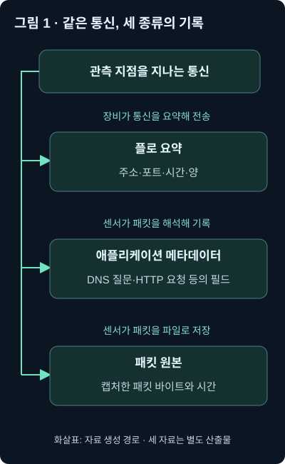
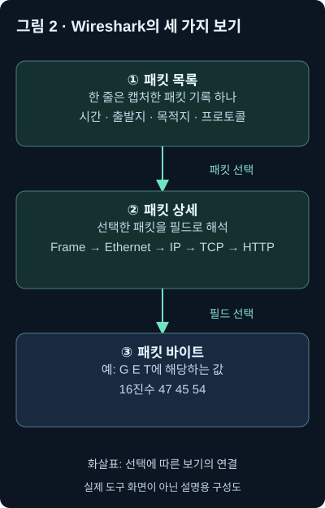
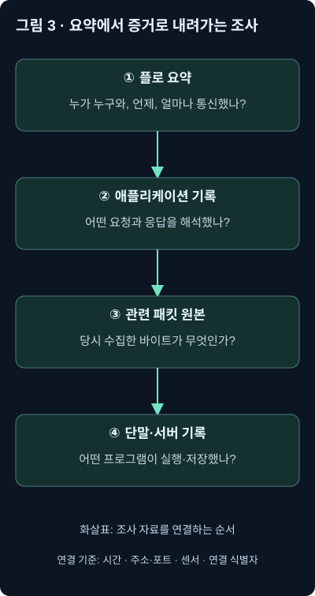

1강에서는 **통신이 지나가는 길과 관측 위치**를 배웠습니다. 인터넷 출입구의 센서가 같은 스위치 안에서 끝나는 통신까지 모두 볼 수 있는 것은 아니라는 점도 확인했죠.

이번에는 그 위치에서 얻은 자료를 살펴보겠습니다.

**누가 누구와 통신했는지를 알려주는 요약 기록, 어떤 요청을 했는지를 알려주는 애플리케이션 기록, 실제 전송된 바이트를 담은 패킷 파일은 각각 무엇이 다를까요?** 그리고 어떤 순서로 연결하면 조사가 쉬워질까요?

이번 범위는 「트래픽 수집과 분석」 단원 전체입니다.

본 교재의 해당 본문과 그림을 확인했습니다. 접근 가능한 자료 폴더와 앞선 대화에서는 이 단원에 사용할 별도 워크북·원본 패킷 파일을 찾지 못했습니다. 또한 현재 환경에서 TShark와 Zeek의 실행 환경을 확인하지 못했으므로, 아래 명령과 로그는 **공식 문서로 동작을 확인한 사용 예시 및 자체 구성 사례**입니다. 실제 교재 실습을 실행한 결과로 제시하는 것은 아닙니다.

---

## 1. “외부로 데이터를 보냈다는데, 어떤 자료부터 봐야 할까요?”

회사에서 이런 경고가 발생했다고 해봅시다.

> 직원 컴퓨터가 평소보다 많은 데이터를 외부로 전송했습니다.

분석가가 받은 자료에는 다음 정도가 적혀 있습니다.

```text
출발지: 192.0.2.10
목적지: 198.51.100.20
통신 방식: TCP
목적지 포트: 443
관측 구간: 10:00~10:10
출발지 → 목적지: 약 500MB
```

이것은 설명을 위해 만든 가상 기록입니다. 두 주소 모두 문서용 주소입니다.

처음 보면 꽤 많은 것을 알게 된 것 같습니다. 어느 컴퓨터가 어디로, 언제, 얼마나 통신했는지 나와 있으니까요.

그런데 다음 질문에 답하려면 어떨까요?

“무슨 파일을 보냈나요?”

“그 통신은 승인된 백업 작업이었나요?”

“어떤 프로그램이 접속했나요?”

위 기록만으로는 답하기 어렵습니다. **통신의 외형은 있지만 내용과 실행 주체가 없기 때문입니다.**

택배 배송 기록을 떠올려보세요. 발송인, 수령지, 배송 시각, 무게를 알 수 있어도 상자 안에 무엇이 들어 있었는지까지 알 수 있는 것은 아닙니다.

네트워크에서도 비슷하게 서로 다른 수준의 기록을 만듭니다.

- **플로 기록:** 통신의 주소·시간·양 같은 외형을 요약합니다.
- **애플리케이션 메타데이터:** 통신을 해석해서 요청과 응답의 주요 항목을 기록합니다.
- **패킷 캡처:** 관측하고 저장한 패킷의 바이트를 보관합니다.

**메타데이터**는 데이터의 내용이나 특성을 설명하는 정보입니다. 책의 본문과 목차를 비교하면 감이 옵니다. 목차는 본문 전체는 아니지만, 어디에 어떤 내용이 있는지 찾는 데 큰 도움이 되죠.

다만 네트워크 메타데이터는 사람이 작성한 목차가 아닙니다. 도구가 관측한 통신을 해석해 만든 기록이므로, 암호화와 누락, 도구의 지원 범위에 영향을 받습니다.



이 그림의 화살표는 자료가 만들어지는 경로를 나타냅니다. 세 자료가 반드시 차례대로 생성된다는 뜻은 아닙니다. 같은 통신에서 서로 다른 산출물을 만들 수 있다는 뜻입니다.

## 2. 세 자료를 구분하는 기준은 “어떤 질문에 답할 수 있나?”입니다

자료의 차이를 먼저 나란히 보겠습니다.

| 자료 | 주로 답하는 질문 | 단독으로 답하기 어려운 질문 |
|---|---|---|
| 플로 기록 | 누가 누구와, 언제, 얼마나 통신했나? | 어떤 요청·파일·사용자 행동이었나? |
| 애플리케이션 메타데이터 | 어떤 이름을 질의했고, 어떤 웹 요청을 했나? | 기록하지 않은 본문 전체는 무엇인가? |
| 패킷 캡처 | 수집 당시 어떤 바이트를 관측했나? | 암호화된 평문, 단말에서의 실제 실행 결과는 무엇인가? |

표를 보고 “플로 기록은 하급 자료이고 패킷은 상급 자료”라고 생각할 필요는 없습니다.

지난 석 달 동안 어느 컴퓨터가 외부 서버와 가장 오래 통신했는지 찾는다면, 가볍게 보관된 요약 기록이 훨씬 편할 수 있습니다. 반대로 특정 요청의 정확한 바이트를 확인하려면 패킷이 필요할 수 있습니다.

중요한 것은 **질문에 맞는 자료를 고르는 것**입니다.

또한 이 구분은 학습을 위한 기본 모델입니다. 실제 제품은 여러 기능을 섞어서 제공합니다. 확장된 플로 기록에 애플리케이션 정보가 들어갈 수도 있고, 애플리케이션 로그에 일부 본문을 선택적으로 저장할 수도 있습니다.

따라서 이름만 보고 내용물을 짐작하지 말고, 실제로 수집하는 필드와 설정을 확인해야 합니다.

## 3. 플로 기록: 통신의 주소·시간·양을 남깁니다

1강에서 IP 주소와 포트 번호를 배웠죠.

IP 주소는 통신할 장비를 가리키고, TCP·UDP의 포트 번호는 그 장비 안의 통신 종단을 구분하는 데 사용합니다. 여기에 통신 프로토콜을 더하면 기본적인 통신 구분 기준을 만들 수 있습니다.

다음 다섯 항목을 묶어 **5튜플**이라고 부릅니다. 튜플은 여러 값을 순서대로 묶은 것이라는 뜻입니다.

```text
출발지 IP
목적지 IP
출발지 포트
목적지 포트
전송 프로토콜
```

예를 들어 다음과 같습니다.

```text
192.0.2.10:51000 → 198.51.100.20:443 / TCP
```

콜론 뒤의 숫자는 포트 번호입니다. 여기서는 직원 컴퓨터의 51000번 종단에서 외부 서버의 443번 종단으로 TCP 통신을 한다는 뜻입니다.

이 기본 구분에 시작·종료 시각, 패킷 수, 바이트 수, 장비 인터페이스 같은 항목을 더하면 유용한 통신 요약이 됩니다. **인터페이스**는 장비가 네트워크와 연결되는 물리적 또는 논리적 접점입니다.

### 플로 한 줄이 TCP 연결 하나와 항상 같을까요?

그렇게 단정하면 곤란합니다.

장비가 긴 통신을 일정 시간마다 나눠 내보낼 수도 있고, 한 방향씩 따로 기록할 수도 있습니다. 반대로 분석 도구가 같은 주소·포트 쌍을 집계해 보여줄 수도 있습니다.

따라서 “플로 기록이 100줄이니까 사용자가 100번 접속했다”고 바로 계산하면 안 됩니다.

먼저 다음 조건을 알아야 합니다.

- 한 기록이 나타내는 단위가 무엇인가?
- 단방향인가, 양방향을 묶은 것인가?
- 언제 기록을 종료하고 새 기록을 만드는가?
- 샘플링이나 누락이 있는가?

**기록의 행 수와 실제 행동의 횟수는 같은 개념이 아닙니다.**

## 4. NetFlow는 처음부터 사람이 읽는 텍스트 로그일까요?

라우터가 관측한 통신을 이렇게 적어 보내는 모습을 상상하기 쉽습니다.

```text
10:00 직원 A가 서버 B에 접속함
```

하지만 NetFlow는 원래 이런 문장으로 된 파일을 뜻하지 않습니다. **장비가 관측한 통신 정보를 다른 시스템으로 전달하는 프로토콜**입니다.

정보를 만들어 보내는 쪽을 **익스포터(exporter)**, 받아서 해석·저장하는 쪽을 **컬렉터(collector)**라고 부릅니다.

```text
통신을 관측한 장비
        ↓ 통신 요약을 내보냄
      컬렉터
        ↓ 해석·저장
검색 화면·분석 도구·보안 관제 시스템
```

라우터나 스위치, 방화벽이 익스포터가 될 수 있습니다. 컬렉터는 받은 정보를 사람이 검색할 수 있는 형태로 저장합니다. `nfdump` 같은 도구도 이런 플로 자료를 다루는 도구의 예입니다.

**SIEM**은 여러 보안 기록을 모아 검색·연관 분석·경고 생성에 활용하는 시스템입니다. 제품과 설정에 따라 플로 자료를 직접 받아 해석하거나, 다른 수집기를 거쳐 받아들일 수 있습니다.

### 버전 이름은 구분해서 읽어야 합니다

교재는 NetFlow v5, v9, 그리고 IPFIX를 함께 소개합니다. 이번에는 다음 정도로 구별해두세요.

| 구분 | 알아둘 핵심 |
|---|---|
| NetFlow v5 | 정해진 레코드 구조를 사용하는 전통적인 형식 |
| NetFlow v9 | 템플릿으로 필드 구조를 설명하는 형식 |
| IPFIX | NetFlow v9의 설계에 기반을 둔 표준화된 정보 교환 프로토콜 |

**템플릿**은 “이후 데이터의 첫 번째 값은 출발지 주소, 다음 값은 목적지 주소…”처럼 자료의 구조를 알려주는 설명서입니다.

따라서 템플릿이 필요한 형식에서 컬렉터가 설명서를 받지 못하면, 데이터가 도착해도 제대로 해석하지 못할 수 있습니다.

NetFlow v9는 RFC 3954에서 설명하고, IPFIX는 RFC 7011의 표준 프로토콜입니다. IPFIX 메시지의 버전 필드는 10이지만, 현재 설명에서는 이를 단순히 “모든 NetFlow가 같은 제조사 전용 방식”이라고 묶지 않는 것이 정확합니다. [NetFlow v9 명세](https://www.rfc-editor.org/rfc/rfc3954.html), [IPFIX 명세](https://www.rfc-editor.org/rfc/rfc7011.html)

교재에는 J-Flow, NetStream 같은 제조사 명칭도 등장합니다. 비슷한 목적의 자료라는 점은 이해하되, 구체적인 전송 형식과 필드까지 모두 같다고 가정하지는 마세요.

전송 포트도 마찬가지입니다. 교재에는 UDP 2055·9995·9996 같은 운영 예가 나옵니다. **UDP**는 데이터그램 단위로 데이터를 보내는 전송 프로토콜입니다. 이런 포트 번호 하나를 봤다는 이유만으로 NetFlow임을 확정하지 말고 실제 장비 설정과 해석 결과를 확인해야 합니다.

## 5. 샘플링된 자료에서는 짧은 통신을 놓칠 수 있습니다

많은 통신 중 일부만 골라 관측하는 방식을 **샘플링**이라고 합니다.

사람이 많이 다니는 길에서 모든 사람을 세밀하게 기록하는 대신 일부를 표본으로 조사하는 것과 비슷합니다.

교재가 소개하는 **sFlow**는 패킷 샘플과 인터페이스 카운터 등의 정보를 전달합니다. 단순히 완전한 연결 기록을 작게 압축한 것과는 다릅니다. 패킷 헤더 일부가 포함될 수도 있습니다. [sFlow 설명을 담은 RFC 3176](https://www.rfc-editor.org/rfc/rfc3176.html)

예를 들어 평균적으로 1,000개 중 1개를 샘플링한다고 해봅시다.

큰 파일 전송처럼 패킷이 많이 발생한 행동은 표본에 잡힐 가능성이 상대적으로 높습니다. 반면 패킷 몇 개로 끝난 짧은 접근 시도는 표본에 전혀 들어오지 않을 수 있습니다.

여기서 “1,000개마다 정확히 하나씩 반드시 선택한다”고 생각해서는 안 됩니다. 실제 선택 방식과 통계적 특성은 구현에 따라 확인해야 합니다.

따라서 샘플 자료에서 특정 통신이 안 보일 때는 이렇게 적는 편이 정확합니다.

> 확인한 샘플 자료에서는 해당 통신을 관측하지 못했다. 짧은 통신이 샘플에 포함되지 않았을 가능성은 남아 있다.

샘플링은 sFlow만의 문제도 아닙니다. NetFlow·IPFIX 계열 자료를 볼 때도 샘플링 설정을 확인해야 합니다.

## 6. 내용이 없어도 플로 기록으로 찾을 수 있는 것이 많습니다

다시 가상 사례로 돌아가보겠습니다.

직원 컴퓨터가 외부로 500MB를 전송했습니다. 이 정보만으로 유출을 확정할 수는 없지만, 조사 대상을 고르는 데는 충분히 도움이 됩니다.

### 작은 예제: 평소와 다른 양을 찾습니다

해당 컴퓨터가 평소에는 하루에 외부로 수십 MB만 전송했다고 합시다. 그런데 오늘은 짧은 시간에 500MB를 전송했습니다.

이 변화는 조사할 이유가 됩니다.

그러나 프로그램 업데이트, 승인된 파일 전송, 백업 같은 설명도 가능합니다. 그러므로 다음으로 업무 일정과 프로그램 기록을 확인해야 합니다.

**평소 패턴을 뜻하는 기준선**이 있어야 “많다”는 판단에도 의미가 생깁니다.

### 조건을 추가하면 해석도 달라집니다

같은 500MB라도 다음 조건은 서로 다릅니다.

| 조건 | 조사에서 생각할 점 |
|---|---|
| 승인된 백업 서버가 정해진 저장소로 전송 | 업무 일정과 목적지 일치 여부 확인 |
| 일반 직원 컴퓨터가 처음 보는 목적지로 전송 | 실행 프로그램과 전송 목적 추가 확인 |
| 민감한 서버가 평소 없던 시간에 전송 | 자료 접근·계정 사용 기록까지 우선 대조 |

플로 기록은 전송량뿐 아니라 긴 통신, 많은 접속, 새로운 목적지, 예상하지 않은 포트도 찾는 데 쓸 수 있습니다.

예를 들어 일반 직원 컴퓨터가 여러 내부 서버의 원격 접속 포트로 접근했다면 측면 이동 가설을 세울 수 있습니다. 교재는 SMB, RDP, PowerShell 관련 원격 관리 통신을 살펴보는 활용도 소개합니다.

**RDP**는 원격 데스크톱 접속에 쓰는 프로토콜입니다. **PowerShell**은 시스템 관리와 자동화에 쓰는 명령 환경이며 원격 관리에도 사용할 수 있습니다. 이 통신들이 있다는 사실 자체가 공격을 뜻하지는 않습니다.

또 위협 정보에 있는 주소와 대조할 수 있습니다. **위협 정보**는 악성 활동과 관련된 주소·도메인·행동 등의 자료입니다. 주소가 일치해도 공유 서비스, 정보의 유효 시점, 실제 통신 내용 등을 추가로 살펴야 합니다.

플로 기록은 비교적 오래 보관할 수 있다는 장점도 있습니다. “이 목적지와 처음 통신한 날이 언제인가?”, “이 통신이 지난달에도 있었나?” 같은 질문에 유용하죠.

다만 보관 비용과 유용성은 환경에 따라 다릅니다. “가볍다”는 말이 무제한 보관이 가능하다는 뜻은 아닙니다.

## 7. 패킷 파일에서도 플로와 비슷한 요약을 만들 수 있습니다

장비에서 NetFlow를 받아두지 않았는데 패킷 파일은 남아 있다고 합시다.

그러면 통신 요약을 볼 수 없을까요?

패킷을 집계해서 비슷한 요약을 만들 수 있습니다. 이때 사용할 수 있는 도구가 **TShark**입니다. Wireshark와 관련된 명령줄 분석 도구로, 창을 클릭하는 대신 명령과 옵션으로 작업합니다.

다음은 사용 예시입니다. `lesson02.pcap`은 예시 파일명이며, 여기에서 실제로 실행한 명령은 아닙니다.

```bash
tshark -r lesson02.pcap -q -n -z conv,tcp
```

각 부분을 나눠보겠습니다.

| 부분 | 의미와 사용하는 이유 |
|---|---|
| `tshark` | 분석 도구 실행 |
| `-r lesson02.pcap` | 실시간 수집 대신 지정한 파일 읽기 |
| `-q` | 패킷마다 출력하는 요약을 줄이고 통계 중심으로 보기 |
| `-n` | 주소·포트를 이름으로 바꾸는 해석을 끄고 숫자로 확인 |
| `-z conv,tcp` | TCP 대화 통계 생성 |

`conv`는 conversation, 즉 통신 상대 사이의 대화를 뜻합니다. 이 통계에는 양방향 프레임·바이트 수, 시작 위치, 관측 지속 시간 등이 나옵니다. 현재 공식 설명에서도 이 사용법을 확인할 수 있습니다. [TShark 공식 설명](https://www.wireshark.org/docs/man-pages/tshark.html)

여기서 `-r` 등의 하이픈은 일반적인 짧은 `-`입니다. 문서 편집 과정에서 길어진 대시로 바뀐 명령을 그대로 복사하면 실행되지 않을 수 있습니다.

### 결과를 읽을 때 주의할 점

설명용으로 다음 상황을 생각해보겠습니다.

> A에서 B 방향의 집계가 2MB이고, B에서 A 방향은 100MB이다.

B가 A에게 더 많은 바이트를 보냈다는 것은 알 수 있습니다. 하지만 그 100MB를 곧바로 “100MB짜리 파일 하나”라고 읽으면 안 됩니다. 여러 요청·응답, 헤더, 재전송 등이 포함될 수 있기 때문입니다.

통계의 A와 B 표시만 보고 A가 사용자이고 B가 서버라고 단정해서도 안 됩니다. 실제 주소·포트와 연결 시작 패킷을 함께 확인해야 합니다.

또 이 통계는 **파일에 들어 있는 패킷에 대한 통계**입니다. 파일이 통신 중간부터 시작했다면 시작 시각과 지속 시간도 전체 통신이 아니라 관측 구간을 나타낼 수 있습니다.

이렇게 만든 통계는 NetFlow 전송 메시지를 그대로 재현한 것은 아닙니다. 패킷에서 계산한 유사한 분석 자료입니다.

그리고 `conv,tcp`는 TCP 대상입니다. UDP 통신까지 같은 표에 모두 들어오는 것은 아닙니다. UDP 통계를 보려면 `conv,udp`처럼 대상을 달리 지정합니다.

## 8. 애플리케이션 메타데이터: “얼마나”에서 “무엇을 요청했나”로

플로 기록에서 외부 통신을 하나 골랐습니다.

이제 궁금한 것은 다음과 같습니다.

“어떤 사이트에 접속했을까요?”

“어떤 경로를 요청했을까요?”

“서버는 성공 응답을 보냈을까요?”

이런 질문을 위해 애플리케이션 동작을 해석한 기록을 사용합니다.

대표적인 도구가 **Zeek**입니다. 과거에는 Bro라는 이름을 사용했습니다. 패킷을 관측하고 지원하는 프로토콜의 동작을 해석해 여러 종류의 로그를 생성합니다.

교재의 비유를 풀어보면, 여러 색이 섞인 빛을 프리즘으로 나누는 모습과 비슷합니다. 섞여 들어오는 통신을 연결 기록, DNS 기록, HTTP 기록 등으로 구분해 보여주는 것이죠.

다만 실제로는 모든 바이트를 빠짐없이 다른 로그로 옮기는 작업이 아닙니다. **해석할 수 있었던 동작 중 설정된 항목을 기록하는 작업**입니다.

여기서 프로토콜 이름도 먼저 짚어두겠습니다.

- **DNS:** 이름에 관한 정보를 질의·응답하는 통신입니다. 다음 강의에서 자세히 배웁니다.
- **HTTP:** 웹 요청과 응답을 주고받는 프로토콜입니다.
- **SMTP:** 이메일 전달에 쓰이는 프로토콜입니다.
- **TLS:** 통신의 암호화와 상대 확인 등에 사용하는 보안 프로토콜입니다.

Zeek는 이런 통신에서 연결·요청·응답 등의 정보를 기록할 수 있습니다. 하지만 암호화된 웹 통신에서 내부 HTTP 내용을 일반 센서가 그대로 읽을 수 있는 것은 아닙니다.

### Zeek 명령의 의미를 읽어봅시다

다음은 Zeek 8.2.0 공식 문서에 나온 형태를 적용한 예시입니다.

```bash
zeek -r lesson02.pcap LogAscii::use_json=T
```

`zeek`는 프로그램 이름이고, `-r lesson02.pcap`은 저장된 패킷 파일을 읽으라는 뜻입니다.

`LogAscii::use_json=T`는 로그 출력 설정입니다.

- `LogAscii`는 관련 로그 작성 설정이 속한 이름 공간입니다.
- `::`는 그 안의 항목을 구분하는 기호입니다.
- `use_json`은 JSON 출력 사용 여부입니다.
- `T`는 참, 즉 사용한다는 뜻입니다.

**JSON**은 항목 이름과 값을 짝지어 표현하는 자료 형식입니다. 로그를 수집 시스템에 전달하고 필드별로 검색하기에 편합니다. 다른 출력 방식으로는 탭으로 항목을 구분하는 TSV가 있습니다. [Zeek 8.2.0 시작 안내](https://docs.zeek.org/en/v8.2.0/quickstart.html)

명령을 실행하면 그 자리에서 로그 파일이 만들어질 수 있으므로, 실제 작업에서는 별도 분석 폴더를 사용하는 편이 기록을 관리하기 좋습니다.

### 로그마다 기록 단위가 다릅니다

예를 들어 `conn.log`는 연결을 요약합니다. `http.log`는 HTTP 트랜잭션을 기록합니다. **트랜잭션**은 여기서는 하나의 요청과 관련 응답 같은 논리적인 처리 단위를 뜻합니다.

하나의 TCP 연결 안에 HTTP 요청이 여러 번 들어갈 수 있으므로, 연결 로그 한 줄과 HTTP 로그 한 줄이 항상 일대일인 것은 아닙니다.

관련 기록을 연결할 때는 **`uid`**라는 연결 식별자를 활용할 수 있습니다. 같은 Zeek 분석에서 만들어진 연결 관련 로그를 따라가는 데 유용합니다. 다만 다른 센서나 재분석에서 만든 식별자까지 무조건 같다고 가정하면 안 됩니다. [Zeek 8.2.0 연결 로그 설명](https://docs.zeek.org/en/v8.2.0/reference/logs/conn.html)

또 `conn.log`가 있다고 라우터 플로 수집이 항상 불필요해지는 것도 아닙니다. 두 자료가 서로 다른 관측 위치와 범위를 가질 수 있기 때문입니다.

## 9. 로그를 읽을 때는 필드가 주장하는 범위까지만 읽습니다

다음은 **실제 Zeek 출력이 아니라, HTTP 로그의 주요 항목을 이해하도록 일부 필드만 구성한 예시**입니다.

```json
{
  "uid": "CExample01",
  "id.orig_h": "192.0.2.10",
  "id.orig_p": 51000,
  "id.resp_h": "198.51.100.20",
  "id.resp_p": 80,
  "method": "GET",
  "host": "download.example",
  "uri": "/tools/update.bin",
  "status_code": 200
}
```

중괄호 안에는 항목 이름과 값이 있습니다. 따옴표는 문자열을 표현하고, 콜론은 이름과 값을 구분하며, 쉼표는 항목 사이를 구분합니다.

`orig`는 연결을 시작한 쪽, `resp`는 응답한 쪽을 나타내는 이름입니다. 다만 캡처 시작 위치와 도구의 방향 판단 조건도 함께 확인해야 합니다.

`GET`은 HTTP에서 자원을 요청할 때 쓰는 메서드입니다. `host`는 요청에 나타난 서버 이름이고, `uri`는 여기서 요청 경로입니다. `status_code`의 200은 서버의 성공 응답 상태 코드입니다.

그러면 이 로그로 무엇을 말할 수 있을까요?

> 센서가 해당 연결에서 `download.example`의 `/tools/update.bin` 경로를 요청한 HTTP 동작과 200 응답을 해석했다.

여기까지는 로그가 지지합니다.

하지만 다음 결론은 추가 증거가 필요합니다.

> 파일 전체를 받았다.  
> 디스크에 저장했다.  
> 실행했다.  
> 실행 결과 침해가 발생했다.

200 응답이라는 사실과 그 뒤의 행동은 별개이기 때문입니다.

### Suricata는 어디에 들어갈까요?

**Suricata**도 네트워크 통신을 분석하는 도구입니다. 침입 탐지 규칙으로 경고를 만들 수 있고, 설정에 따라 HTTP·DNS·TLS·플로·파일 관련 정보도 기록할 수 있습니다.

Suricata 8.0.0의 **EVE JSON** 출력은 이런 경고와 메타데이터 등을 JSON 형태로 제공합니다. 다만 어떤 항목이 생성되는지는 활성화한 기록 종류와 설정을 확인해야 합니다. [Suricata 8.0.0 EVE 출력 설명](https://docs.suricata.io/en/suricata-8.0.0/output/eve/eve-json-output.html)

따라서 “경고가 없었으니 통신도 없었다”는 해석은 맞지 않습니다. 경고 기록과 일반 통신 기록은 역할이 다릅니다.

### 서버의 서비스 로그로 대신할 수도 있을까요?

웹 서버가 자체적으로 남긴 접근 기록도 좋은 자료입니다. 센서가 암호화 때문에 못 본 요청을 서버에서는 기록할 수도 있죠.

하지만 네트워크 센서 기록과 완전히 같은 자료는 아닙니다.

서버 로그는 해당 서버가 처리하고 기록한 행동을 보여주고, 센서 로그는 해당 위치에서 관측한 통신을 보여줍니다. 기록 설정, 프록시 경유, 시간, 누락 조건이 다를 수 있습니다.

**프록시**는 중간에서 통신을 받아 다른 쪽으로 전달하는 시스템입니다. 프록시가 있다면 서버가 보는 접속 주소와 원래 직원 컴퓨터의 주소가 다를 수 있습니다.

두 자료는 서로 보완하는 관계로 생각하는 것이 좋습니다.

## 10. 패킷 원본: 더 깊이 볼 수 있지만, 없던 정보를 만들어내지는 못합니다

**패킷 캡처**, 흔히 PCAP이라고 부르는 자료에는 수집한 패킷의 바이트와 시각 등이 들어갑니다.

앞에서 본 로그가 “HTTP GET 요청이 있었다”고 기록했다면, 패킷에서는 그 요청을 나타내는 실제 데이터가 어떻게 들어 있었는지 확인할 수 있습니다.

분석 도구를 바꾸어 다시 해석하거나, 나중에 추가된 탐지 규칙을 과거 자료에 적용할 수도 있습니다. 조건이 맞으면 전송된 파일을 복원할 수도 있고요.

그러나 “패킷 원본이 있으니 무슨 일이 있었는지 전부 알 수 있다”는 표현에는 조건이 붙습니다.

### 수집하지 못한 패킷은 파일에 없습니다

1강의 위치 문제를 기억해보세요. 센서를 지나지 않은 통신은 수집할 수 없습니다.

센서를 지났어도 미러링 출력, 수집 장비, 저장 장치의 용량 문제로 빠질 수 있습니다. 한 방향만 수집했거나, 필요한 시간대가 빠졌을 수도 있습니다.

### 패킷 전체가 아니라 앞부분만 저장했을 수 있습니다

**Snaplen**은 패킷마다 최대 몇 바이트를 캡처할지 정하는 길이입니다.

예를 들어 원래 길이가 1,500바이트인 패킷에서 128바이트만 저장했다면, 파일에는 나머지 부분이 없습니다. 헤더 일부는 읽을 수 있어도 뒤의 본문을 완전히 복원할 수는 없겠죠. [Wireshark 캡처 설정 설명](https://www.wireshark.org/docs/wsug_html_chunked/ChCapCaptureOptions.html)

바이트는 8비트로 이루어진 데이터 단위입니다.

### 암호문을 저장한 것과 평문을 읽을 수 있는 것은 다릅니다

TLS로 암호화한 웹 통신을 캡처하면 암호화된 데이터는 남습니다. 그러나 필요한 복호화 자료와 조건 없이 내부 요청·응답을 그대로 읽을 수 있는 것은 아닙니다.

또 패킷이 빠지면 여러 조각을 합치는 **재조립**이 실패하거나 불완전해질 수 있습니다.

따라서 패킷을 분석할 때는 다음 질문도 함께 해야 합니다.

> 어느 위치에서, 어느 기간을, 어느 방향으로, 어느 길이까지 수집했으며, 누락과 암호화 조건은 무엇인가?

이 질문에 답해야 패킷의 증거 가치도 정확히 설명할 수 있습니다.

## 11. PCAP과 PCAPNG, 그리고 수집 라이브러리를 구별합니다

파일 이름에 `.pcap`이나 `.pcapng`가 붙은 것을 볼 수 있습니다.

| 구분 | 이해할 점 |
|---|---|
| PCAP | 널리 지원되는 전통적인 패킷 저장 형식 |
| PCAPNG | 인터페이스 정보·주석 등 확장 정보를 담을 수 있는 형식 |

**PCAPNG는 단순히 확장자만 바꾼 파일이 아닙니다.** 내부 구조가 다릅니다. 이름을 바꾼다고 형식이 변환되는 것도 아니므로, 실제 파일 구조와 도구의 형식 인식을 확인해야 합니다.

교재는 PCAPNG의 정밀도 향상을 소개하지만, “PCAP은 무조건 마이크로초, PCAPNG는 무조건 나노초”처럼 외우면 정확하지 않습니다. 현재 Wireshark 안내는 두 형식에서 나노초 해상도를 지원할 수 있다고 설명하며, 실제 장치가 제공하는 시간 정보에도 영향을 받습니다. [Wireshark 사용자 안내](https://www.wireshark.org/docs/wsug_html/index)

마이크로초는 100만 분의 1초, 나노초는 10억 분의 1초입니다. 다만 **세밀한 자릿수와 정확한 시각은 별개**입니다. 시계가 틀렸다면 자릿수가 많아도 다른 장비의 기록과 어긋날 수 있습니다.

### libpcap·WinPcap·Npcap은 파일 형식 이름이 아닙니다

이 이름들은 프로그램이 패킷을 수집하는 데 사용하는 소프트웨어 구성 요소와 관련됩니다.

교재에는 libpcap과 Windows용 WinPcap이 나옵니다. 현재 Windows 환경을 설명할 때는 Npcap을 구분해야 합니다. WinPcap 공식 사이트는 개발·유지보수가 중단됐으며 Npcap을 권장한다고 안내합니다. [WinPcap 공식 안내](https://www.winpcap.org/install/)

오래된 도구 이름을 현재 설치 권고처럼 받아들이지 않도록 구별해두세요.

## 12. 패킷을 오래 저장하려면 얼마나 큰 공간이 필요할까요?

패킷 원본을 계속 보관하려면 저장 용량이 빠르게 늘어납니다.

다음 가정을 사용해 계산해보겠습니다.

- 링크 속도 기준: 1Gbps
- 실제로 합산해 저장하려는 평균 트래픽: 그 절반인 0.5Gbps
- 저장 기간: 7일
- 압축·파일 부가 정보·색인·복제·여유 공간은 일단 제외

`Gbps`는 초당 기가비트입니다. 0.5Gbps를 바이트로 바꾸면 다음과 같습니다.

```text
0.5 × 1,000,000,000비트/초 ÷ 8
= 62,500,000바이트/초
```

왜 8로 나눌까요? 1바이트가 8비트이기 때문입니다.

7일을 초로 바꾸면 다음과 같습니다.

```text
7일 × 24시간/일 × 60분/시간 × 60초/분
= 604,800초
```

그러면 일주일 동안의 데이터양은 다음과 같습니다.

```text
62,500,000바이트/초 × 604,800초
= 37,800,000,000,000바이트
= 37.8TB
```

여기서 TB는 1조 바이트를 뜻하는 십진 단위입니다. 이를 이진 단위인 TiB로 표현하면 약 **34.38TiB**입니다. 계산 결과는 실제로 별도 계산해 확인했습니다.

### “1Gbps 링크가 50% 사용된다”는 말에도 방향 조건이 필요합니다

1강에서 배운 전이중 통신을 적용해보죠.

각 방향이 각각 평균 0.5Gbps이고 둘 다 저장한다면 합계는 1Gbps입니다. 같은 계산에서 주당 **75.6TB**가 됩니다.

즉, 앞의 37.8TB는 **수집 대상 평균 트래픽 합계가 0.5Gbps라는 가정**에서 나온 값입니다.

실제 파일에는 패킷별 기록 정보가 추가되고, 검색용 색인이나 복제본도 필요할 수 있습니다. 반대로 압축과 저장 제한에 따라 달라질 수도 있습니다. 그러므로 계산값을 디스크 구매 용량으로 그대로 쓰면 안 됩니다.

교재는 메타데이터가 패킷보다 매우 작았던 특정 관측 사례와 제품 설명의 비율도 소개합니다. 그 숫자는 해당 환경의 사례입니다. 압축 방식, 트래픽 종류, 기록 필드, 본문 저장 설정이 달라지면 비율도 달라집니다.

따라서 수집 설계에서는 **대표 트래픽으로 일정 기간 실제 크기를 측정하는 것**이 중요합니다.

## 13. 도구는 이름보다 역할로 구분해두세요

교재는 여러 도구를 소개합니다. 여기서는 그 목록을 “지금 당장 전부 설치해야 하는 도구”로 받아들이기보다, 어떤 작업에 어떤 종류의 도구가 필요한지 연결해보겠습니다.

| 작업 | 교재에 등장하는 도구 예 | 읽어야 할 역할 |
|---|---|---|
| 화면에서 패킷 살펴보기 | Wireshark, PacketTotal | 로컬 분석기와 외부 서비스 방식은 구분 |
| 대규모 패킷 보관·검색 | Arkime | 통신을 찾아 관련 패킷으로 이동 |
| 파일·객체 추출 | NetworkMiner | 관측한 통신에서 복원 가능한 자료 추출 |
| 명령줄 수집·분석 | tcpdump, TShark | 파일·인터페이스·필터·통계 중심 작업 |
| 프로토콜 분석·메타데이터 | Zeek, CapTipper | 해석한 동작과 특징 정리 |
| 규칙 기반 침입 탐지 | Snort, Suricata | 규칙에 맞는 통신의 경고 생성 |
| 문자열 검색 | ngrep, strings | 문자열 단서를 찾되 문맥은 별도 검증 |
| 추출·복원 계열 | tcpxtract, chaosreader, scalpel, foremost, Xplico | 지원 형식과 재조립 조건에 따라 결과 차이 |

이 표에는 과거 목록의 도구도 포함되어 있습니다. 이번 회차에서 각 도구의 현행 지원 상태나 설치 방법까지 검증한 것은 아니므로, 표 전체를 현재의 설치 추천 목록으로 사용하지는 마세요.

실제 추출에서는 중요한 차이가 있습니다. 프로토콜과 연결을 해석해 복원하는 방식과, 특정 바이트 패턴을 찾아 파일 후보를 잘라내는 방식은 같은 작업이 아닙니다. 결과가 나온다고 자동으로 완전한 원본 파일이 되는 것도 아닙니다.

### Wireshark와 Arkime의 역할도 다릅니다

Wireshark는 범위를 좁힌 패킷을 깊게 살펴보기에 좋습니다. 반면 조직 전체의 장기간 패킷을 계속 저장하고 검색하는 일에는 별도의 보관·검색 체계가 필요합니다.

Arkime는 수집·세션 정보·패킷 접근을 연결하는 도구의 예입니다. 넓은 범위에서 통신을 찾고, 필요한 패킷을 꺼내 상세 분석으로 이어갈 수 있습니다. [Arkime 공식 안내](https://arkime.com/)

**세션**은 문맥에 따라 다르지만, 여기서는 분석 도구가 관련 통신을 묶어 다루는 단위라고 이해하면 됩니다.

따라서 “Wireshark가 패킷 분석 도구이니 모든 패킷을 한 파일로 열면 된다”는 접근보다, 먼저 시간과 통신 상대를 좁혀 필요한 자료를 꺼내는 흐름이 효율적입니다.

## 14. Wireshark의 세 화면은 같은 패킷을 다르게 보여줍니다

이제 조사할 패킷 파일 하나를 골랐다고 합시다.

Wireshark에서는 기본적인 세 보기를 연결해서 읽을 수 있습니다.



이 그림은 실제 도구 화면을 캡처한 것이 아니라 설명용 구성도입니다. 화살표는 통신 방향이 아니라 **선택에 따라 화면이 연결되는 관계**입니다.

첫째, **패킷 목록**에는 패킷 기록 하나가 한 줄로 나타납니다. 시간, 출발지, 목적지, 프로토콜, 길이 등을 보면서 대상을 고릅니다.

한 줄이 웹 요청 하나나 사용자 행동 하나를 뜻하는 것은 아닙니다. 한 요청이 여러 패킷으로 나뉘거나 한 패킷에 여러 논리적 메시지가 들어갈 수 있습니다.

둘째, **패킷 상세**는 선택한 패킷을 프로토콜과 필드별로 해석합니다. IP 주소나 TCP 포트, HTTP 메서드 등을 펼쳐볼 수 있습니다.

셋째, **패킷 바이트**는 해당 데이터의 바이트를 보여줍니다. 상세에서 필드를 고르면 관련 바이트가 강조되어, 도구의 해석과 실제 값을 연결할 수 있습니다. 화면 배치는 설정에 따라 달라질 수 있습니다. [Wireshark 기본 화면 안내](https://www.wireshark.org/docs/wsug_html_chunked/ChUseMainWindowSection.html)

### `Frame` 항목을 실제 1계층 신호라고 생각하면 안 됩니다

교재의 화면 설명에서 주의할 부분입니다.

상세 창의 `Frame` 항목에는 기록 번호, 시간, 길이 등 캡처 기록에 관한 정보가 들어갑니다. 이것을 케이블의 전기 신호나 광 신호가 그대로 기록된 물리 계층 데이터라고 이해하면 안 됩니다.

또 Wireshark의 모든 표시가 패킷에 원래 들어 있던 필드는 아닙니다. 응답 시간, 관련 패킷 번호처럼 도구가 계산해 추가하는 정보도 있습니다. [패킷 상세·바이트 설명](https://www.wireshark.org/docs/wsug_html/index)

### 16진수는 바이트를 짧게 적는 방법입니다

예를 들어 `GET`이라는 글자가 있다면 ASCII 문자 인코딩에서 다음 바이트에 대응합니다.

```text
문자:       G   E   T
16진수:    47  45  54
```

**인코딩**은 글자를 어떤 수치로 표현할지 정하는 규칙입니다. 16진수는 0~9와 A~F를 사용하는 수 표현 방식이고, 두 자리로 한 바이트를 표현할 수 있습니다.

이 단계에서는 값 전체를 암기할 필요가 없습니다. “상세 창의 GET이라는 해석이 실제 어떤 바이트와 연결되는지 확인할 수 있구나”를 이해하면 됩니다.

## 15. 먼저 전체를 보고, 그다음 필터로 좁힙니다

패킷을 열자마자 의심 단어부터 검색하고 싶을 수 있습니다. 하지만 파일에 무엇이 들어 있는지 모르면 검색 결과를 오해하기 쉽습니다.

다음 순서로 생각해보세요.

먼저 파일의 수집 시간과 범위를 확인합니다. 그다음 **Statistics → Protocol Hierarchy**, 즉 프로토콜 계층 통계에서 어떤 통신이 해석됐는지 살펴봅니다.

이어서 **Statistics → Conversations**, 즉 통신 상대별 대화 통계에서 관심 있는 주소·포트와 양방향 통신량을 확인합니다.

그 후 프로토콜, 주소, 포트 조건으로 범위를 좁히고 요청·응답과 원본 바이트를 읽습니다.

### 표시 필터는 파일에서 패킷을 삭제하는 기능이 아닙니다

**표시 필터**는 이미 있는 자료 중 화면에 보여줄 패킷을 고릅니다. 조건에 맞지 않는 패킷은 숨겨질 뿐입니다.

반면 **캡처 필터**는 수집 단계에서 어떤 패킷을 받을지 정합니다. 캡처 단계에서 제외한 자료는 표시 필터를 지운다고 되살아나지 않습니다.

두 기능은 문법도 다릅니다. 아래 예시는 모두 **Wireshark 표시 필터**입니다.

### 프로토콜 이름으로 좁히기

```text
http or http2 or http3
```

`or`는 또는입니다. 세 조건 중 하나라도 만족하는 패킷을 보여줍니다.

각 이름은 Wireshark가 해당 프로토콜로 해석한 필드가 있다는 조건입니다. 모든 웹 통신을 무조건 찾아주는 표현은 아닙니다. 암호화나 해석 조건 때문에 HTTP가 드러나지 않을 수 있습니다.

```text
dns
```

DNS로 해석한 패킷을 보여줍니다. 이 결과가 없다고 이름 조회가 없었다고 단정할 수는 없습니다. 캐시를 사용했거나 암호화된 이름 조회를 사용했을 수 있습니다.

```text
tls
```

TLS로 해석한 패킷을 보여줍니다. 이것만으로 내부 애플리케이션 내용이 복호화된다는 뜻은 아닙니다.

```text
http or dns
```

HTTP 또는 DNS로 해석한 자료를 함께 살펴보는 시작 조건입니다. 두 종류를 모두 포함해야 한다는 뜻은 아닙니다.

### 주소와 포트로 좁히기

```text
ip.addr == 192.0.2.10
```

`ip.addr`는 IPv4 출발지·목적지 주소를 대상으로 쓰는 필드입니다. `==`는 같다라는 비교입니다. 해당 주소가 관여한 패킷을 찾는 데 사용합니다.

```text
tcp.port == 80
```

TCP 출발지 또는 목적지 포트 중 80이 있는 패킷을 찾습니다. 실제 애플리케이션이 HTTP라는 보장은 아닙니다.

```text
ip.addr == 192.0.2.10 and tcp.port == 80
```

`and`는 그리고입니다. 두 조건을 같은 패킷이 모두 충족해야 합니다. 주소와 포트 조건을 결합해 범위를 더 좁힌 것이죠.

`eq`는 `==`, `&&`는 `and`와 같은 의미의 표기입니다. 처음에는 한 가지 표기를 일관되게 사용하는 편이 읽기 좋습니다. [Wireshark 표시 필터 설명](https://www.wireshark.org/docs/wsug_html_chunked/ChWorkBuildDisplayFilterSection.html)

IPv6 통신은 `ip.addr`만으로 찾을 수 없습니다. IPv6에는 `ipv6.addr` 같은 별도 필드를 사용합니다.

### 문자열로 찾기

```text
frame contains "search"
```

`contains`는 해당 데이터에 지정한 바이트열이 포함되는지 검사하는 조건입니다. 여기서는 `"search"`라는 문자열에 해당하는 바이트를 찾습니다.

이 조건으로 단서를 얻을 수는 있지만, 주의해야 합니다.

문자열이 여러 패킷에 나뉘어 있으면 한 패킷에서 온전하게 나타나지 않을 수 있습니다. 암호화되었거나 다른 인코딩으로 표현되어도 결과가 달라집니다. 발견된 문자열이 요청 내용인지, 응답 내용인지, 다른 위치의 우연한 값인지도 확인해야 합니다.

**문자열의 존재와 공격의 존재는 같은 판단이 아닙니다.**

## 16. 중요한 수정: `dns and tls`는 일반적인 DoH 탐지식이 아닙니다

교재에는 다음 조건을 DNS over HTTPS와 연결한 설명이 있습니다.

```text
dns and tls
```

이 부분은 그대로 외우지 않는 것이 좋습니다.

논리적으로 이 식은 다음 뜻입니다.

> 같은 패킷의 해석 결과에 DNS 조건도 있고 TLS 조건도 있는가?

“먼저 DNS를 질의한 다음 TLS로 접속했다”라는 시간 순서를 찾는 조건이 아닙니다. “DNS가 TLS 안에 들어 있을 것이다”라는 추측을 표현하는 조건도 아닙니다.

**DoH**, 즉 DNS over HTTPS는 DNS 질의·응답을 HTTPS로 운반하는 방식입니다. HTTPS는 TLS로 보호하는 HTTP 통신이라고 우선 이해하면 됩니다. [DoH 표준 RFC 8484](https://www.rfc-editor.org/rfc/rfc8484.html)

복호화 자료가 없는 일반적인 암호화 캡처에서는 내부 DNS 메시지가 해석되지 않을 수 있습니다. 그러면 실제로 DoH가 있어도 `dns` 조건을 충족하지 않을 수 있겠죠.

반대로 어떤 복호화·재조립 조건에서 두 프로토콜이 함께 표시되더라도, 그 조건 하나를 모든 환경의 DoH 판별식으로 일반화할 수는 없습니다.

이번 단계에서는 다음 원칙을 기억하면 충분합니다.

**표시 필터는 도구가 해석해 놓은 필드에 조건을 적용합니다. 관측하지 못한 내부 프로토콜을 조건식이 알아서 복원해주지는 않습니다.**

## 17. 요청과 응답을 이어서 보면 패킷 한 개로 안 보이던 맥락이 나옵니다

관심 있는 HTTP 통신을 찾았다고 해봅시다.

패킷 한 개에 요청과 응답 전체가 모두 들어 있지는 않을 수 있습니다. 그래서 관련 데이터를 순서에 맞춰 따라가는 **스트림 보기**를 사용합니다.

스트림은 여기서 연결을 통해 주고받은 데이터의 흐름입니다.

선택한 패킷에서 **Follow → HTTP Stream** 또는 상황에 맞는 **TCP Stream** 등을 사용할 수 있습니다. 해당 메뉴가 없으면 선택한 패킷에서 그 프로토콜이 해석되지 않았는지 확인해야 합니다. TLS의 내부 내용을 보려면 복호화 조건도 필요합니다. [Wireshark 스트림 따라가기](https://www.wireshark.org/docs/wsug_html_chunked/ChAdvFollowStreamSection.html)

### 자체 예제로 요청과 응답을 읽어봅시다

다음은 설명을 위해 구성한 평문 HTTP 예시입니다. 실제 캡처 출력이 아닙니다.

**직원 컴퓨터 → 서버**

```http
GET /tools/update.bin HTTP/1.1
Host: download.example
```

첫 줄의 `GET`은 자원을 요청하는 메서드이고, `/tools/update.bin`은 요청 경로입니다. `HTTP/1.1`은 사용하는 HTTP 버전입니다.

`Host`는 요청 대상 서버 이름을 나타내는 헤더입니다. 헤더는 메시지의 처리에 필요한 부가 정보를 담는 항목입니다.

**서버 → 직원 컴퓨터**

```http
HTTP/1.1 200 OK
Content-Type: application/octet-stream
Content-Disposition: attachment; filename="update.bin"

[파일 데이터가 이어진다고 가정]
```

`200 OK`는 성공 응답 상태입니다.

`Content-Type`은 본문 데이터의 유형을 설명하며, 여기의 `application/octet-stream`은 일반적인 바이너리 데이터 유형입니다. **바이너리**는 문장으로 읽는 텍스트에 한정되지 않는 바이트 데이터라고 이해하면 됩니다.

`Content-Disposition`은 내용 처리 방식에 관한 정보입니다. 예시에서는 첨부파일과 파일명을 알리고 있습니다.

그런데 서버가 파일명을 `update.bin`이라고 적었으니 실제 내용도 정상 업데이트일까요?

그렇지는 않습니다. 이름과 유형은 서버가 주장하는 정보이기도 합니다. 실제 바이트와 파일 구조를 확인해야 합니다.

또 “이상하게 생긴 도메인에서 실행파일 이름이 나왔다”는 이유만으로 악성코드라고 확정하면 안 됩니다. 교재의 사례는 악성코드 다운로드로 알려진 자료라는 배경이 있지만, 독립 조사에서는 그 배경을 증거로 다시 확인해야 합니다.

### 파일을 추출하면 무엇이 확인된 걸까요?

수집이 충분하고 지원하는 프로토콜로 제대로 재조립할 수 있다면, 전송된 객체를 파일로 추출할 수 있습니다.

그때 확인한 것은 우선 **관측한 통신에서 해당 바이트를 복원했다는 사실**입니다.

직원이 그 파일을 실행했는지는 단말의 파일 생성·프로세스 실행 기록 등으로 확인해야 합니다. 파일의 악성 여부도 별도 분석이 필요합니다.

스트림 창의 빨강·파랑 같은 색은 양방향 데이터를 구분하는 표시입니다. 공격·정상의 색상이 아닙니다. 현재 Wireshark 문서는 기본적인 클라이언트·서버 방향 색상과 함께 테마에 따라 달라질 수 있음을 설명합니다. [스트림 창의 방향 표시](https://www.wireshark.org/docs/wsug_html_chunked/ChAdvFollowStreamSection.html)

## 18. 여러 자료를 연결할 때는 주소만 보지 않습니다

이제 전체 조사 흐름을 다시 연결해보겠습니다.



이 그림의 화살표는 조사에서 자료를 연결해 내려가는 순서입니다. 모든 조사에서 반드시 네 단계를 똑같이 밟아야 한다는 뜻은 아닙니다.

먼저 플로 기록에서 평소와 다른 외부 통신을 찾습니다.

다음으로 해당 시간과 통신 상대에 맞는 애플리케이션 로그를 봅니다. 웹 요청이 해석되어 있다면 이름, 경로, 응답 등을 확인합니다.

필요하면 관련 패킷만 꺼내 요청·응답과 바이트를 검증합니다.

그다음 단말과 서버 기록으로 실행 프로그램, 사용자, 파일 저장, 인증 결과 등을 확인합니다.

### 같은 주소라는 이유만으로 같은 사건일까요?

주소는 시간이 지나며 다른 장비에 할당될 수 있습니다. **NAT**, 즉 주소 변환 장비를 지나면 한쪽에서 본 주소·포트가 다른 쪽에서는 바뀔 수도 있습니다.

따라서 최소한 다음 기준을 함께 봐야 합니다.

| 연결 기준 | 확인할 이유 |
|---|---|
| 시각과 시간대 | 서로 다른 기록에서 같은 구간을 찾기 위해 |
| 출발지·목적지 주소와 포트 | 통신 상대와 종단을 좁히기 위해 |
| 관측 센서와 위치 | 주소 변환·경로 차이를 해석하기 위해 |
| 연결 식별자 | 같은 분석 체계 안에서 관련 로그를 따라가기 위해 |
| 단말·사용자 정보 | 주소를 실제 장비와 실행 주체에 연결하기 위해 |

SIEM에 모든 패킷 바이트를 넣을 필요는 없습니다. 로그 검색에서 시간·주소·센서 정보를 넘겨 패킷 보관 시스템으로 쉽게 이동할 수 있도록 연결해두는 것도 좋은 구조입니다.

분석가는 그 연결이 실제로 동작하는지도 확인해야 합니다. 기록에는 링크가 있는데 해당 시간의 패킷이 이미 보관 기간을 지나 삭제됐다면, 원본 검증은 할 수 없기 때문입니다.

## 19. 결과가 없을 때 확인할 순서

“검색했는데 아무것도 안 나왔어요.”

이 말은 조사의 끝이 아니라 조건을 확인하는 출발점입니다.

먼저 **수집 위치와 방향**을 확인합니다. 해당 통신이 센서를 지나야 했는지, 요청과 응답을 모두 받았는지 살펴봅니다.

다음으로 **시간과 보관 범위**를 확인합니다. 검색 시간대와 장비 시계가 맞는지, 자료가 남아 있는지 확인합니다.

그다음 **수집·해석 설정**을 확인합니다. 샘플링, 캡처 필터, Snaplen, 패킷 누락, 프로토콜 분석 설정과 재조립 조건이 영향을 줄 수 있습니다.

마지막으로 **암호화와 표현 방식**을 확인합니다. 내부 요청이 암호화되어 있는지, 검색한 문자열이 다른 인코딩이거나 여러 패킷에 나뉘어 있는지 검토합니다.

이 과정을 거쳐야 다음 두 문장을 구별할 수 있습니다.

> 확인한 자료에서 증거를 찾지 못했다.

> 확인하려는 행동이 발생하지 않았다.

첫 번째 사실만으로 두 번째 결론이 자동으로 나오지는 않습니다.

## 20. 복습 질문과 해설

### 질문 1. 플로 기록에서 외부 전송 500MB를 발견했습니다. 자료 유출이라고 결론 내려도 될까요?

**해설:** 아직 안 됩니다. 해당 관측 범위에서 일정량의 바이트가 전송됐다는 단서는 있지만, 내용과 목적이 없습니다. 업무 일정, 목적지, 애플리케이션 기록, 실행 프로그램, 자료 접근 기록을 대조해야 합니다. 집계 바이트가 파일의 순수 크기와 같은지도 확인해야 합니다.

### 질문 2. 샘플링된 자료에 짧은 접근 시도가 없습니다. 그 시도는 없었다고 볼 수 있을까요?

**해설:** 없습니다. 소수 패킷으로 끝난 행동이 표본에 포함되지 않았을 수 있습니다. 샘플링 방식과 비율을 확인하고, 단말·서버 기록이나 다른 수집 자료와 대조해야 합니다.

### 질문 3. TShark의 `-z conv,tcp` 결과에 한 줄이 있습니다. 사용자 웹 요청도 한 번이었다고 볼 수 있을까요?

**해설:** 아닙니다. 통계의 단위는 HTTP 요청이 아니라 TCP 대화 집계입니다. 하나의 연결에서 여러 요청이 오갈 수 있으며, 집계와 연결 구분 방식도 확인해야 합니다.

### 질문 4. Zeek의 `conn.log`와 `http.log`에 같은 `uid`가 있습니다. 무엇을 할 수 있을까요?

**해설:** 같은 Zeek 분석 체계 안에서 연결 요약과 관련 HTTP 기록을 따라갈 수 있습니다. 다만 같은 연결 안에 HTTP 트랜잭션이 여러 개 있을 수 있습니다. 다른 센서나 재분석의 식별자를 그대로 같은 것으로 가정하면 안 됩니다.

### 질문 5. HTTP 로그에 200 응답이 있으니 파일 실행까지 성공한 것일까요?

**해설:** 아닙니다. 200은 HTTP 응답 상태입니다. 전체 전달, 저장, 실행, 침해 결과는 각각 다른 단계입니다. 전송 완료 조건과 단말의 파일·프로세스 기록을 추가로 확인해야 합니다.

### 질문 6. 1,500바이트 패킷을 Snaplen 128로 저장했습니다. 나중에 원본 파일을 완전히 복원할 수 있을까요?

**해설:** 필요한 본문이 잘려 나갔다면 그 캡처만으로는 복원할 수 없습니다. 도구를 바꾸는 것만으로 저장하지 않은 바이트가 생기지는 않습니다. 다른 센서나 서버·단말 자료가 필요합니다.

### 질문 7. 평균 수집량이 0.5Gbps이면 일주일에 37.8TB입니다. 송신과 수신이 각각 0.5Gbps라면 얼마일까요?

**해설:** 양방향 합계는 1Gbps이므로 같은 단순 계산에서 75.6TB입니다. 그 뒤 파일 부가 정보, 색인, 복제, 압축, 여유 공간 등을 별도로 고려해야 합니다.

### 질문 8. `dns and tls` 결과가 없으므로 DoH도 없었다고 볼 수 있을까요?

**해설:** 아닙니다. 이 식은 같은 패킷의 해석 결과가 두 조건을 모두 충족하는지 검사합니다. 암호화된 내부 DNS가 해석되지 않으면 실제 DoH 통신이 있어도 결과가 없을 수 있습니다. 시간 순서나 암호화 내부를 알아서 추론하는 조건이 아닙니다.

### 질문 9. `frame contains "search"`가 문자열을 찾지 못했습니다. 통신 전체에도 그 문자열이 없었을까요?

**해설:** 단정할 수 없습니다. 문자열이 패킷 경계에서 나뉘거나, 암호화·인코딩되었거나, 해당 부분이 수집되지 않았을 수 있습니다. 패킷 단위 검색의 범위와 재조립·복호화 조건을 확인해야 합니다.

### 질문 10. PCAPNG이므로 시각 정보는 항상 더 정확할까요?

**해설:** 아닙니다. 형식이 지원하는 해상도, 장치가 제공하는 시간 정보, 장비 시계의 정확성은 서로 다른 문제입니다. 나노초 자릿수가 있어도 장비 시계가 어긋났다면 다른 로그와의 시간 대조가 틀릴 수 있습니다.

### 질문 11. 스트림에서 수상한 이름의 파일을 추출했습니다. 감염을 확정할 수 있을까요?

**해설:** 우선 확인한 사실은 해당 통신에서 파일에 해당하는 바이트를 복원했다는 것입니다. 악성 여부는 파일 분석이 필요하고, 실행 여부는 단말 기록이 필요합니다. 파일명과 전송 사실만으로 감염을 확정하지 않습니다.

### 질문 12. 다음 조건에서 어느 자료부터 보면 좋을까요?

> 한 달 전부터 특정 외부 주소와 자주 통신했는지 알고 싶습니다. 당시 패킷은 보관 기간이 지나 없어졌지만 플로 기록은 남아 있습니다.

**해설:** 플로 기록에서 해당 기간의 주소·포트·빈도·통신량을 확인하는 것부터 시작할 수 있습니다. 다만 당시 주소 할당, NAT와 관측 위치, 샘플링 여부를 고려해야 합니다. 패킷이 없으므로 정확한 본문을 확인할 수 없다는 한계도 함께 적어야 합니다.

---

**이번 회차에서 다룬 범위:** 세 가지 수집 자료 → 플로 생성·전송·수집 → 샘플링 → 플로 활용 → TShark 통계 → Zeek·Suricata 메타데이터 → 패킷 원본과 파일 형식 → 저장 용량 → 도구별 역할 → Wireshark 화면 → 표시 필터 → DoH 조건식 수정 → 요청·응답과 파일 추출 → 조사 자료 연결과 관측 한계.

**다음 강의는 「DNS의 동작 원리」입니다.** 이번에 소개한 `dns` 기록이 실제로 무엇을 뜻하는지, 컴퓨터가 이름을 주소와 연결하는 과정부터 차례대로 살펴보겠습니다.

공식 자료 확인일은 **2026년 11월 2일**입니다. Zeek 예시는 **8.2.0 문서**, Suricata 출력 설명은 **8.0.0 문서**를 기준으로 했으며, 이를 영구적인 최신 버전으로 뜻하지 않습니다.
