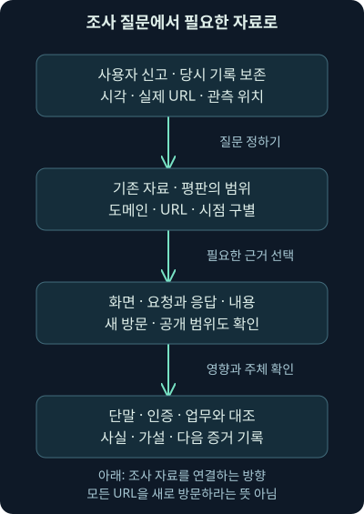
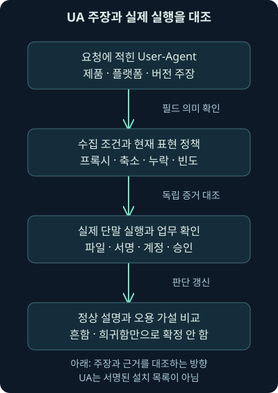
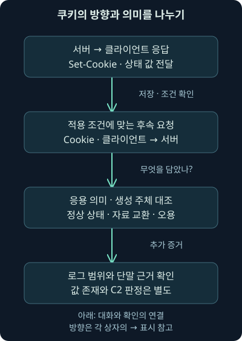

## 1. 익숙한 웹 주소가 경보에 나타났습니다

직원이 “메일의 문서 링크를 열었는데 로그인 화면이 조금 이상했다”고 신고했습니다. 프록시에는 유명한 파일 공유 서비스와 이름을 처음 보는 사이트가 함께 남아 있습니다. 어느 쪽이 나쁠까요? 주소의 유명세만 보고 하나를 지우면 중요한 연결을 놓칠 수 있습니다.

앞선 6강에서는 HTTP 요청과 응답의 구조를 배웠습니다. 이번 둘째 날 7강은 그 구조를 조사에 적용합니다. URL 평판을 읽고, 외부 조회와 새 방문을 구별하고, 화면·샌드박스·헤더·쿠키에서 무엇을 알 수 있는지 차근차근 이어가겠습니다. 인코딩·파일·반복 통신은 다음 8강에서 더 깊게 다룹니다. HTTPS 관측은 뒤의 별도 강의로 연결합니다.

회사·계정·URL·요청 메시지는 직접 만든 가상 예제입니다. `.example` 이름과 문서용 주소를 사용하며 실제 의심 사이트에 접속하거나 외부 검사 서비스에 자료를 제출하지 않았습니다. 교재는 개념의 범위를 정하는 데 사용했고, 별도 워크북이나 원본 사건 패킷을 실행한 결과로 설명하지 않습니다.

## 2. 같은 배달 통로로 서로 다른 물건이 옵니다

택배 기사가 같은 건물로 매일 들어온다고 해서 모든 상자의 내용이 같지는 않죠. HTTP도 업무 문서·업데이트·영상·API 응답을 운반합니다. 공격자는 이 널리 허용되는 통로에 피싱 화면·파일·명령 교환·자료 전송을 섞을 수 있습니다.

**피싱**은 신뢰할 만한 사람이나 서비스를 가장해 정보를 입력하거나 행동하도록 유도하는 방식입니다. **명령 및 제어**, C2는 공격자가 침해된 프로그램과 지시·상태를 주고받는 통신을 가리킵니다. **자료 반출**은 보호할 자료가 정해진 경계 밖으로 나가는 문제입니다. 서로 관련될 수 있지만 한 HTTP 요청이 이 전부를 증명하지는 않습니다.

택배 비유에는 한계가 있습니다. 네트워크에서 보이는 주소·메서드·크기는 상자 겉면과도 비슷하지만, 실제로는 프록시·캐시·암호화·재조립·로그 설정에 따라 겉면조차 다르게 남습니다. 먼저 어떤 자료를 어디에서 얻었는지 확인해야 합니다.

## 3. 먼저 “무엇을 확인하려는가?”를 적습니다

신고자의 질문은 “가짜 로그인 화면이었나?”일 수 있습니다. 분석팀의 질문은 “계정 정보를 실제로 전송했나?”, “파일이 내려왔나?”, “어떤 단말에서 실행됐나?”로 이어집니다. 화면만 보면 되는 질문과 인증·단말 증거가 필요한 질문은 다릅니다.

**트리아지**, 즉 초기 분류는 현재 자료로 위험과 다음 조사 순서를 정하는 단계입니다. 빠른 평판 조회가 도움이 될 수 있지만 조회 결과로 최종 결론을 대신하지 않습니다. 수동 분석도 사람이 했다는 이유만으로 더 정확하다고 보장되지 않습니다. 질문에 맞는 증거와 재현 가능한 조건이 중요합니다.

조사 메모의 첫 줄을 이렇게 시작해 보세요. “사용자가 열었다고 신고한 URL의 시각·출처를 보존하고, 실제 목적지와 후속 요청을 확인한다.” 이 문장은 아직 피싱 성공이나 감염을 선언하지 않으면서도 다음 행동을 구체화합니다.



## 4. 도메인의 평판과 한 URL의 평판을 나눕니다

**URL**은 스킴·호스트·경로·질의 문자열 등을 합쳐 특정 자원과 요청을 가리키는 주소 표현입니다. **도메인 평판**은 이름 전체에 대한 평가이고, **URL 평판**은 더 구체적인 주소에 대한 평가일 수 있습니다. 평가 서비스가 무엇을 키로 삼는지도 확인해야 합니다.

가상 `https://files.example/public/manual.pdf`와 `https://files.example/shared/item-42`는 같은 호스트 이름을 사용합니다. 그래도 업로드한 사람·자료·접근 조건은 다를 수 있습니다. 정상 서비스의 사용자 업로드 공간, 탈취된 사이트의 특정 경로, 정상 페이지에 삽입된 외부 자원을 각각 생각해 보세요.

따라서 “도메인이 허용 목록에 있다”에서 “이 파일도 안전하다”로 바로 넘어가지 않습니다. 반대로 같은 공유 서비스의 한 URL이 악용됐다고 전체 서비스와 모든 사용자를 같은 사건으로 묶지도 않습니다. 대상과 차단 영향을 구체적으로 정해야 합니다.

## 5. 평판 결과에는 시각과 범위가 붙습니다

평판 도구가 “탐지 없음”을 보여 줬다고 합시다. 이는 조회한 대상·시점·제품의 자료에서 해당 판단이 나오지 않았다는 뜻입니다. 막 생성된 경로, 특정 사용자에게만 보이는 화면, 아직 수집되지 않은 자료라면 결과가 없을 수 있습니다.

반대로 악성이라는 평가가 있으면 중요한 단서지만 우리 직원이 실제로 열었거나 내용을 실행했다는 뜻은 아닙니다. 원본 보고서의 관측 시점과 판단 근거, 오탐 가능성, 도메인·URL·파일 중 어떤 대상을 평가했는지 보존합니다. 여러 도구가 같은 피드를 재사용했다면 숫자만큼 독립 증거가 늘어난 것도 아닙니다.

작은 예제에서 `portal.example` 전체 평판은 양호하고 `/shared/item-42` 자료는 미평가라고 합시다. 결론은 “파일 안전”이 아니라 “해당 URL·자료의 직접 근거 부족”입니다. 프록시의 실제 응답과 내려온 바이트, 단말 기록을 다음 자료로 정합니다.

## 6. 기존 보고서를 읽는 것과 새 검사를 요청하는 것은 다릅니다

이미 있는 분석 보고서를 찾는 일과 서비스에 URL을 제출해 새 방문을 유발하는 일은 구별해야 합니다. 기존 보고서 조회도 검색 서비스에 관심 대상이 전달될 수 있습니다. 새 스캔은 여기에 더해 검사 환경이 대상 사이트에 접속하고 자원을 내려받는 행동을 만들 수 있습니다.

가상 `https://share.example/open?token=TRAINING-ONLY`를 생각해 보세요. 질의 문자열의 값이 실제 환경에서는 문서 접근 권한이나 개인별 식별자일 수 있습니다. “보안 도구에 넣었으니 괜찮다”고 생각하기 전에 공유 권한·보존·실제 접속·결과 공개 범위를 확인합니다. 예제의 값은 실제 토큰이 아닙니다.

도메인만 조회하면 민감한 경로를 덜 보낼 수 있지만 원래 URL에 대한 답과 달라집니다. 주소를 일부 지운 결과를 원래 링크의 완전한 분석으로 기록하지 않습니다. 원본은 내부 기록에 보존하고 어떤 변형으로 조회했는지 연결합니다.

## 7. “검색에 안 나옴”과 “비공개”는 같은 말이 아닙니다

urlscan의 2026년 11월 6일 공식 안내는 Public·Unlisted·Private를 구별합니다. Public은 공개 검색과 화면에 나타나며, Unlisted는 일반 공개 검색에서 빠져도 검증된 연구자·보안 회사의 Pro 환경에서 볼 수 있습니다. Private도 ID를 공유한 상대가 결과를 열 수 있는 조건을 고려해야 합니다. [현재 공개 범위 설명](https://docs.urlscan.io/pages/visibility)

핵심은 모드 이름을 확인했다는 기록과 실제 제출 경로의 설정입니다. 웹 화면·연동 프로그램·팀 설정이 같은 값을 쓰는지 점검해야 합니다. 비공개 결과라도 제공자가 자료를 처리하고 대상 사이트 방문이 생기는 문제까지 없어지는 것은 아닙니다.

VirusTotal도 일반 업로드와 별도의 Private Scanning을 구별합니다. 2026년 11월 6일 안내에서는 전용 제출 경로·권한이 필요하고, 비공개 분석에는 일반 다중 백신·URL 검사 파트너의 판정이 포함되지 않는다고 설명합니다. 공개 범위와 제공 결과가 모두 같은 기능이라고 가정하지 않습니다. 실제 구독·업로드는 하지 않았습니다. [Private Scanning의 적용 범위](https://docs.virustotal.com/docs/private-scanning)

## 8. 화면은 모양을 보여 주지만 입력 결과는 따로 봅니다

**스크린샷**은 특정 환경과 시각에 표시된 화면의 이미지입니다. 가상 `signin-review.example`에서 회사 로고와 비밀번호 입력창이 보이면 사칭 가능성을 조사할 단서가 됩니다. 실제 도메인·양식 전송 대상·업무 소유·인증 연동을 대조해야 합니다.

화면이 정상과 비슷해도 정보가 어디로 전송되는지는 이미지 한 장으로 충분히 알 수 없습니다. 반대로 화면이 비어 있어도 C2·파일 제공·지역별 차등 응답·만료된 링크·로그인 필요 조건일 수 있습니다. “빈 화면이므로 안전”과 “닮았으므로 정보 탈취 성공”을 모두 피합니다.

직원이 실제 정보를 입력했는지는 브라우저·프록시·인증 기록과 신고 내용을 함께 확인합니다. 그 값이 상대에 수신·보관됐는지는 별도 근거가 필요합니다. 필요한 증거를 구하는 동안 정해진 권한과 절차로 계정 위험을 줄일 수 있으며, 최종 결론을 기다려야만 모든 대응이 가능한 것은 아닙니다.

## 9. 샌드박스가 답할 수 있는 질문도 나눠 봅시다

**샌드박스**는 분석 대상을 제한된 환경에서 관찰하기 위한 실행·검사 환경입니다. 어떤 도구는 HTML과 연결 자원을 중심으로 보고, 다른 도구는 가상 운영체제에서 브라우저·프로세스·파일·설정 변화를 함께 기록합니다. 화면이 있는 보고서라고 모두 같은 깊이의 실행이 이뤄진 것은 아닙니다.

“어느 주소로 이동했나?”에는 네트워크 요청 기록이, “브라우저 뒤에서 무엇이 실행됐나?”에는 프로세스와 파일 기록이 더 필요합니다. 운영체제·브라우저·위치·언어·쿠키·대기 시간·사용자 상호작용이 달라지면 관측도 달라질 수 있습니다.

실행 중 관측이 없었다면 그 조건에서 보지 못했다는 뜻입니다. 모든 환경에서 악성 행동이 없다고 증명한 것은 아닙니다. VM이라는 이유만으로 외부 통신과 정보 공개가 사라지는 것도 아니죠. 보고서의 실행 조건·누락·도구 오류를 함께 읽습니다.

## 10. 오래된 서비스 설명을 오늘의 보장으로 사용하지 않습니다

예전 자료의 Page2Images·URLQuery·PhishTank·Hybrid Analysis·ANY.RUN 같은 이름은 화면 생성, 네트워크 관찰, 공동 평가, 가상 환경 관찰이라는 역할을 이해하는 데 도움이 됩니다. 그러나 모든 서비스의 현재 기본 공개 범위·보존·기능·요금제가 당시와 같다고 확정하지 않습니다.

이번 강의에서 현재 정책을 직접 확인한 공개 범위의 구체적 예는 앞의 urlscan과 VirusTotal입니다. 나머지 서비스에 “아무것도 저장하지 않는다”, “모든 제출이 항상 공개된다” 같은 고정 보장을 붙이지 않습니다. 실제 선택 시 그때의 공식 안내와 조직의 승인 범위를 확인해야 합니다.

이 차이는 이름만 바꾼 업데이트가 아닙니다. 도구를 고르는 기준을 “유명한가?”에서 “이번 질문에 필요한 자료를 어떤 환경과 공개 조건으로 얻나?”로 옮기는 것입니다. 자동 검사 보고서가 충분하지 않을 때는 내부 헤더·본문·파일·단말 근거로 이어갑니다.

## 11. 헤더는 요청자가 붙인 설명과 관측을 함께 읽습니다

가상의 단말 `192.0.2.25`에서 `198.51.100.20` 방향으로 다음 평문 요청이 수집되었다고 합시다. 실제 PCAP 관측이 아닌 설명용 메시지입니다.

```http
GET /shared/item-42 HTTP/1.1
Host: files.example
User-Agent: TrainingSync/1.0
Accept: */*
Cookie: mode=sync; state=QUI%3D
```

`GET`은 자원을 요청하는 메서드이고, `/shared/item-42`는 요청 대상 경로입니다. `Host`는 요청할 호스트, `User-Agent`는 클라이언트가 자신을 설명하는 값입니다. `Accept: */*`는 어떤 미디어 형식도 받을 수 있다고 표현하지만 실제 처리 안전성은 보장하지 않습니다.

`Cookie`는 이름과 값을 실어 보내는 요청 헤더입니다. `mode`와 `state`라는 이름이 친숙해 보여도 서버의 실제 의미는 응용 프로그램이 정합니다. 헤더를 읽었다는 사실과 그 값을 생성한 프로그램·사람을 확인했다는 사실을 구별합니다.

## 12. User-Agent는 명찰처럼 읽되 신분증으로 쓰지 않습니다

**User-Agent**, 줄여 UA는 요청자가 보내는 제품·환경 설명입니다. `TrainingSync/1.0`이면 “이 요청이 그렇게 자신을 설명했다”까지 관측할 수 있습니다. 서명된 설치 목록이나 실제 프로세스 증거가 아닙니다. 값이 없거나 브라우저가 아닌 형식도 정상 도구에서 가능합니다.

`Mozilla/5.0`으로 시작하는 문자열에는 과거 호환성 때문에 여러 제품 이름이 섞입니다. Firefox 형식 예에서 `Windows NT ...`는 플랫폼 주장, `rv:`는 엔진 버전 표현, `Gecko/...`는 엔진 계열, `Firefox/...`는 제품 표현입니다. 숫자 하나만 떼어 “이 패치가 설치됐다”로 바꾸지 않습니다.

`AppleWebKit`, `Chrome`, `Safari`가 함께 있다고 브라우저 세 개가 동시에 실행됐다는 뜻도 아닙니다. 실제 UA는 호환성 관행과 브라우저별 정책을 고려해야 합니다. 이 강의는 특정 과거 버전 문자열을 현재 정상 브라우저의 고정 정답으로 제시하지 않습니다.

`Win64; x64`는 64비트 Windows 환경을 표현하는 관행의 예이고, 과거 UA의 `WOW64`는 64비트 Windows에서 32비트 프로그램이 동작하는 환경과 연결해 읽습니다. 운영체제와 프로그램의 비트 수가 다른 층이라는 뜻입니다. 실제 WOW64는 그런 프로그램 호환을 지원하는 구성 요소이며, 문자열만으로 현재 장치 구조를 검증할 수는 없습니다. 2026년 11월 6일 Microsoft의 역할 설명을 확인했습니다. [WOW64의 실제 역할](https://learn.microsoft.com/en-us/windows/win32/winprog64/wow64-implementation-details)

Firefox 데스크톱의 `Gecko/20100101`도 날짜처럼 보인다고 실제 빌드 날짜로 읽으면 안 됩니다. 2026년 11월 6일 Mozilla 문서는 이 값을 고정 문자열로 설명합니다. 운영체제·CPU 표현 역시 판본과 호환 정책에 따라 실제 장치와 다를 수 있습니다. 관측한 표현과 실제 환경을 대조한다는 원칙을 유지합니다. [Firefox UA의 구성과 고정 값](https://developer.mozilla.org/en-US/docs/Web/HTTP/Reference/Headers/User-Agent/Firefox)

## 13. 오래된 버전 숫자가 항상 오래된 프로그램은 아닙니다

과거에는 UA의 상세 버전과 운영체제 차이를 비교해 조사 후보를 찾는 설명이 흔했습니다. 여전히 승인 소프트웨어·업무 역할과 맞지 않는 주장은 검토할 가치가 있습니다. 다만 현재 브라우저는 개인 식별 가능성을 줄이려고 일부 값을 축소·고정합니다.

2026년 11월 6일 Chromium의 공식 변경 기록을 확인했습니다. Chrome 101 단계의 세부 버전 `0.0.0` 처리와 이후 플랫폼 정보 축소를 구분하며, 고정 플랫폼 문자열이 실제 운영체제 갱신을 따라 바뀌지 않을 수 있다고 명시합니다. `Windows NT 10.0`만으로 정확한 Windows 판본을 확정하거나 `0.0.0`을 미갱신 증거로 읽으면 안 됩니다. [Chromium의 UA 축소 기록](https://www.chromium.org/updates/ua-reduction/)

**User-Agent Client Hints**는 브라우저가 별도 헤더 등으로 환경 정보를 전달하는 방식입니다. Chrome은 버전 89부터 기본 지원을 안내하며, 요청·정책에 따라 정보가 비거나 달라질 수 있습니다. `Sec-CH-UA` 계열도 클라이언트가 전한 정보이고 모든 브라우저의 공통 필수값은 아닙니다. [Chrome의 적용 범위와 필드 설명](https://developer.chrome.com/docs/privacy-security/user-agent-client-hints)

## 14. 희귀한 UA를 찾았다면 분모를 확인합니다

가상 업무 단말 100대 중 한 대만 `TrainingSync/1.0`을 사용한다고 합시다. 희귀하다는 관측은 맞지만 악성이라는 정답은 아닙니다. 특수 업무 도구, 재고 수집기, 시험 장비, 잘못된 설정이라는 대안을 확인합니다.

또 요청 수로 빈도를 셌는지 단말 수로 셌는지 구별해야 합니다. 한 업데이트 프로그램이 만 번 요청하면 문자열의 요청 비율이 커져도 사용 단말은 한 대일 수 있습니다. 프록시가 값을 바꾸거나 수집기가 누락한 상황도 분모를 흔듭니다.

가설을 단말의 실행 파일·서명·설치 기록·프로세스 경로·실행 계정·승인 업무와 대조합니다. 정상 UA와 똑같아도 실제 악성 프로그램이 흉내 낼 수 있으므로, 흔하다는 이유만으로 조사 대상에서 자동 제외하지 않습니다.



## 15. 표시 필터는 이미 해석한 필드를 좁힙니다

다음은 Wireshark에서 평문 HTTP/1.x 요청의 후보를 좁히기 위한 **미실행 예시**입니다. 표시 필터는 저장된 패킷의 해석 결과를 고르며, 새 통신을 수집하는 캡처 필터와 다릅니다.

```text
http.request and http.host == "files.example"
http.request and http.user_agent contains "Training"
http.request and http.cookie
```

첫 줄의 `http.request`는 요청으로 해석된 항목을, `and`는 두 조건을 모두 만족하는 항목을 고릅니다. `==`는 같은 값인지 비교합니다. 두 번째 줄의 `contains`는 지정한 문자열이 UA에 포함되는지 확인하는 조건이며 정규식이나 프로세스 식별이 아닙니다. 세 번째 줄은 요청에 Cookie 필드가 존재하는지 찾습니다. 필드 존재와 악용은 다른 질문입니다.

2026년 11월 6일 공식 HTTP 필드 참조에서 `http.request`, `http.host`, `http.user_agent`, `http.cookie`를 확인했습니다. 참조에 표시된 적용 범위는 이 필드들에 대해 1.0.0~4.6.9이며, 4.6.9를 영구 최신 버전이라고 부르는 뜻은 아닙니다. 이번 환경에서는 Wireshark·필터를 직접 실행하지 않았습니다. [공식 HTTP 필드 참조](https://www.wireshark.org/docs/dfref/h/http.html)

## 16. 조건에 걸리지 않았을 때도 질문이 남습니다

앞의 필터는 HTTP/2·HTTP/3의 모든 해당 요청을 포괄하는 공통 조건이라고 가정하지 않습니다. 해석된 프로토콜에 맞는 필드와 스트림을 확인해야 합니다. TLS 안의 헤더가 해독되지 않았다면 `http.cookie`가 없다고 해서 실제 쿠키도 없었다고 말할 수 없습니다.

한 방향 수집, 앞부분만 저장한 패킷, TCP 조각 누락, 재조립·해석 설정, 로그의 헤더 선택·마스킹 때문에 결과가 없을 수도 있습니다. 응답 방향의 `Set-Cookie`와 요청 방향의 `Cookie`도 다른 필드입니다. 요청을 찾는 조건으로 응답의 모든 상태 전달을 찾으려 하면 질문이 어긋납니다.

프록시·웹 서버·단말 브라우저·인증 기록 중 무엇이 그 빈칸을 보완할 수 있는지 정합니다. 민감 헤더가 필요하다는 이유로 모든 사용자의 값을 무제한 저장하는 것은 좋은 수집 설계가 아닙니다. 분석 목적에 맞는 범위·접근·보존·마스킹을 함께 정해야 합니다.

## 17. 쿠키는 상태를 전달하므로 여러 의미를 담을 수 있습니다

HTTP는 요청마다 필요한 상태를 응용 프로그램이 연결해야 하는 상황이 많습니다. 서버가 응답의 `Set-Cookie`로 값을 전달하면 브라우저는 적용 조건에 맞는 후속 요청에 `Cookie`를 넣을 수 있습니다. 모든 사이트·경로에 무조건 전송되는 값은 아닙니다.

쿠키 값은 세션 식별자·환경 설정·응용 상태 등 다양합니다. 표준이 특정 악성 여부를 판정해 주지는 않습니다. **인코딩**은 자료의 표현 방식을 정해진 규칙으로 바꾸는 작업입니다. RFC 6265는 임의 자료를 쿠키에 넣을 때 Base64 같은 인코딩을 사용할 수 있음을 설명합니다. 그러므로 길거나 인코딩된 값이라는 이유만으로 C2를 확정할 수 없습니다. 2026년 11월 6일 기본 문법과 이 용도를 확인했습니다. [쿠키 값의 표준 설명](https://datatracker.ietf.org/doc/html/rfc6265#section-4.1.1)

`state=QUI%3D`에서 `state`는 이름이고 첫 `=` 뒤가 값입니다. 값 안에도 인코딩의 일부인 `=`가 있을 수 있으므로 등호를 전부 잘라 버리면 안 됩니다. `%3D`의 의미와 Base64의 실제 복원은 다음 강의에서 직접 계산하겠습니다.

## 18. 과거 사례도 층을 나누어 읽습니다

JPCERT/CC의 2017년 2월 15일 ChChes 분석은 HTTP 쿠키를 명령 교환에 사용한 사례를 설명합니다. 여기서 중요한 수정은 쿠키 내용이 단순히 Base64 텍스트라고만 설명되지 않는다는 점입니다. 원분석에는 암호화한 자료와 인코딩, 이후 추가 암호화 모듈의 구분이 있습니다. Base64만 풀면 항상 명령이 읽힌다고 가정하지 않습니다. 2026년 11월 6일 원분석을 대조했습니다. [JPCERT/CC의 직접 분석](https://blogs.jpcert.or.jp/en/2017/02/chches-malware--93d6.html)

ESET의 2017년 7월 4일 M.E.Doc 백도어 분석은 정상 업데이트 요청과 공식 서버를 이용하면서 쿠키에 수집 자료를 실은 사례를 다룹니다. NotPetya 유포와 연결된 공급망 맥락의 분석이지, 모든 쿠키 전송이나 모든 정상 업데이트가 악성이라는 뜻은 아닙니다. 보고서는 서버를 직접 포렌식하지 않은 부분도 구별합니다. [ESET의 당시 관측과 한계](https://www.welivesecurity.com/2017/07/04/analysis-of-telebots-cunning-backdoor/)

이 역사적 관측을 지금의 새 경보에 적용할 때는 URL·쿠키의 위치만 흉내 냈다는 이유로 같은 악성코드나 공격자라고 이름 붙이지 않습니다. 실제 프로그램·값의 생성 의미·주기·응답·단말 행위가 더 필요합니다. 과거 악성 주소나 실행 명령을 이번 예제에 재사용하지 않았습니다.



## 19. 작은 단서에 조건을 더해 판단을 갱신합니다

처음에는 “공유 서비스의 URL에서 TrainingSync라는 UA와 인코딩처럼 보이는 쿠키가 보였다”였습니다. 다음에 승인된 동기화 프로그램이 같은 주기로 해당 요청을 만든다는 실행 기록이 확인되면 정상 업무라는 설명을 지지합니다. 그래도 버전·계정·대상 자료가 승인 범위와 맞는지 확인합니다.

조건을 바꿔 프로그램의 설치 경로가 예상과 다르고 승인 기록이 없으며 직후 보호 자료 접근이 보였다고 합시다. 계정 오용·비인가 실행의 가설이 더 중요해질 수 있습니다. 여기서도 쿠키만으로 명령 내용이나 반출 성공을 만들어내지 않습니다. 실제 요청·응답 바이트와 파일·단말 증거로 다음 질문을 좁힙니다.

서로 같은 특징을 여러 번 센 것은 아닌지도 보세요. “희귀 UA”와 “처음 본 UA”가 같은 하나의 관측을 다른 말로 반복한 것이라면 독립적인 근거 두 개처럼 점수를 더하면 안 됩니다.

## 20. 조사 메모를 다음 사람에게 넘깁니다

가상 메모는 이렇게 정리할 수 있습니다. “신고 URL과 당시 프록시 기록을 보존했다. 공유 도메인 전체의 평판만으로 해당 자원 안전성을 확정할 수 없다. 화면의 로그인 유사성은 관측했지만 실제 입력·전송·인증 악용은 미확인이다.” 여기까지는 사실과 한계를 연결합니다.

이어서 “UA와 쿠키 값은 요청자의 주장·응용 자료이며 단말 실행 주체와 대조 중이다. 담당자는 승인 소프트웨어·브라우저·인증 기록, 후속 요청과 응답 내용을 확인한다”고 적습니다. 외부 제출을 했다면 대상·공개 범위·실행 조건도 기록해야 하지만 이번 강의에서는 수행하지 않았습니다.

이런 메모가 있으면 다음 분석가가 같은 링크를 무심코 다시 열지 않고 필요한 증거부터 이어갈 수 있습니다. 다음 8강에서는 인코딩을 실제 바이트로 풀고, 파일 복원과 반복 통신의 숫자가 왜 곧바로 침해 결론이 되지 않는지 확인하겠습니다.

## 21. 복습: 도구의 결과와 사건의 결론을 나누어 보세요

### 질문 1. 공유 도메인의 평판이 좋으면 내려온 파일도 안전한가요?

**해설:** 평가 대상이 다릅니다. 사용자 업로드·탈취된 경로·삽입 자원이 있을 수 있으므로 특정 URL과 실제 파일·응답을 확인합니다.

### 질문 2. 평판 탐지 0이면 조사도 끝인가요?

**해설:** 그 시점과 대상·자료에서 판정이 없었다는 뜻입니다. 새 자원·개별 접근·수집 한계를 확인해야 합니다.

### 질문 3. 기존 보고서 조회와 새 URL 제출은 왜 구별하나요?

**해설:** 새 제출은 대상 접속·자원 다운로드를 유발할 수 있습니다. 조회도 관심 지표가 서비스에 전달될 수 있어 공개·권한·보존 범위를 확인합니다.

### 질문 4. Unlisted는 아무도 못 보는 비공개인가요?

**해설:** urlscan의 현재 안내에서는 일반 공개 검색에서 빠져도 검증된 Pro 이용자에게 보일 수 있습니다. 이름 대신 실제 접근 범위를 읽습니다.

### 질문 5. 스크린샷이 로그인 화면이면 비밀번호 유출이 확정되나요?

**해설:** 화면 관측과 실제 입력·전송·수신은 다른 사실입니다. 양식 대상·프록시·브라우저·인증 기록을 대조합니다.

### 질문 6. 샌드박스에서 행동이 없으면 모든 환경에서 안전한가요?

**해설:** 실행 환경·시간·접속 조건·상호작용·오류를 확인합니다. 해당 조건의 음성 결과를 모든 환경으로 일반화하지 않습니다.

### 질문 7. UA가 Windows NT 10.0이고 세부 버전이 0.0.0이면 미갱신인가요?

**해설:** Chrome의 UA 축소·고정 정책일 수 있습니다. 정확한 판본은 설치·단말 기록 등으로 확인합니다.

### 질문 8. 단말 한 대만 쓰는 UA는 악성인가요?

**해설:** 희귀함은 조사 후보의 근거입니다. 특수 업무·도구·설정·프록시라는 대안과 실제 프로세스를 확인해야 합니다.

### 질문 9. http.cookie 결과가 0이면 쿠키도 없었나요?

**해설:** 암호화·프로토콜별 필드·방향·수집 누락·재조립·마스킹을 확인합니다. 필터는 보이지 않은 헤더를 만들어내지 않습니다.

### 질문 10. 인코딩처럼 보이는 쿠키는 C2인가요?

**해설:** 정상 응용 상태에도 인코딩이 사용됩니다. 사용 위치·생성 주체·내용·응답·단말 근거가 더 필요합니다.

### 질문 11. ChChes 자료에서 Base64를 풀면 항상 명령을 읽을 수 있나요?

**해설:** 원분석은 암호화와 인코딩의 층을 구별합니다. 인코딩 복원과 복호화는 다른 작업입니다.

### 질문 12. 정상 설명이 유력해지면 무엇을 기록하나요?

**해설:** 어떤 승인·실행 근거가 가설을 지지했는지, 아직 확인하지 못한 계정·자료·영향이 무엇인지 남깁니다. 단서가 사라졌다는 말만으로 종결하지 않습니다.
