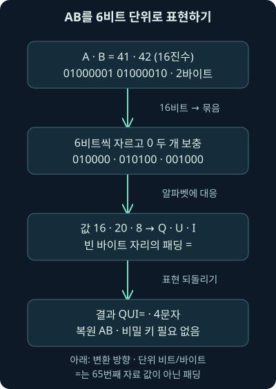
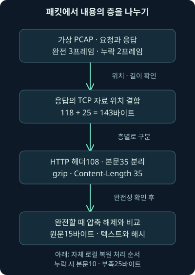
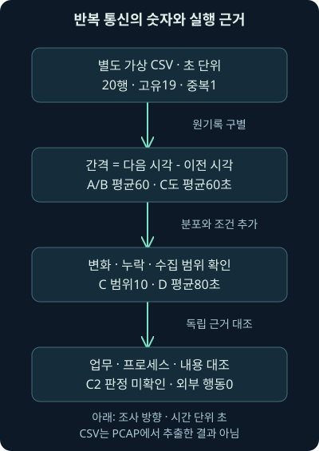

## 1. 헤더를 읽고도 내용이 남아 있습니다

앞 강의의 가상 조사에서 낯선 쿠키 값을 발견했습니다. `QUI%3D`라는 문자열입니다. “암호화된 명령인가요?”라는 질문이 자연스럽게 나오죠. 하지만 모양만 보고 답하기 전에, 어떤 형식의 어느 부분을 읽고 있는지부터 맞춰야 합니다.

이번 둘째 날 8강의 범위는 Base64 인코딩의 원리와 계산, HTTP 본문·파일 복원의 조건, 반복 요청의 시간 간격, 호스트 이름 대신 주소를 쓴 요청의 해석입니다. 설명만으로 끝내지 않고 자체 가상 자료를 로컬에서 실제 계산·해석한 결과를 함께 보겠습니다. 공격 흐름과 TLS의 관측 한계는 뒤의 별도 강의로 이어갑니다.

자료는 모두 직접 만들었습니다. 실제 사건·원본 실습 PCAP·악성 파일이 아닙니다. 문서용 주소와 `.example` 이름, 무해한 고정 텍스트만 사용했습니다. 외부 접속·인증 시도·샌드박스 제출·파일 실행은 하지 않았습니다.

## 2. 포장·압축·잠금을 구별하면 분석 순서가 보입니다

글자로만 쓸 수 있는 신청서에 작은 그림의 바이트를 넣어야 한다고 해봅시다. 그림을 정해진 글자 조합으로 옮겨 적으면, 같은 규칙을 아는 사람이 원래 바이트를 복원할 수 있습니다. **인코딩**은 이처럼 표현 방식을 바꾸는 작업입니다.

**압축**은 반복 구조 등을 이용해 표현할 크기를 줄이는 작업이고, **암호화**는 키 같은 비밀을 모르면 내용을 알아내기 어렵게 보호하는 작업입니다. 비유로는 표기법·압축 포장·잠금장치에 가깝습니다. 실제 데이터에는 이 작업들이 여러 층으로 적용될 수 있습니다.

Base64는 인코딩입니다. 복원에 비밀 키가 필요하지 않습니다. 암호문을 Base64로 옮겼다면 Base64를 풀어도 남는 것은 암호문입니다. 이 구별이 없으면 읽히지 않는 자료를 암호 해독에 실패한 것처럼 잘못 보고하거나, 읽힌 문자열을 실제 실행 결과로 착각하게 됩니다.

## 3. 왜 64개의 글자가 필요할까요?

**비트**는 0 또는 1 한 자리를 나타내며, 바이트는 8비트입니다. Base64는 원래 바이트의 비트들을 6개씩 묶어 문자로 바꿉니다. 6비트로 표현하는 경우의 수는 `2**6 = 64`입니다. 여기서 `**`는 거듭제곱 기호입니다.

표준 Base64는 값 0~25를 A~Z에, 26~51을 a~z에, 52~61을 0~9에 연결하고 마지막 두 값을 `+`, `/`에 연결합니다. 이 64개가 자료를 나타내는 글자입니다. 뒤에서 볼 `=`는 빈자리를 알리는 패딩 표시라서 65번째 자료 값이 아닙니다.

초기 문자 중심 전송 환경을 이해하는 데 도움이 되지만, 오늘날 HTTP 본문 전체가 반드시 ASCII만 허용되기 때문에 Base64를 써야 하는 것은 아닙니다. JSON의 문자열, 응용 프로그램의 자료 형식, URL이나 쿠키에 넣는 방식 같은 구체적인 이유를 확인해야 합니다. 현재 메일의 확장 기능까지 “모든 메일은 언제나 7비트만”이라고 일반화하지도 않습니다.

## 4. 두 바이트를 직접 나누어 보겠습니다

독립 예제로 ASCII 문자 `AB`를 사용하겠습니다. A는 16진수 `41`, B는 `42`입니다. **16진수**는 한 자리에 0~9와 A~F를 쓰는 수 표현이며, 이 예에서는 바이트의 값을 짧게 표시합니다. 두 바이트를 이진수로 이으면 `01000001 01000010`입니다.

6비트씩 나누면 앞의 두 묶음은 `010000`, `010100`입니다. 마지막에는 `0010` 네 비트가 남습니다. 이 네 비트 뒤에 0 두 개를 붙여 `001000`으로 만들면 각 값은 16·20·8입니다. 알파벳에서 Q·U·I에 대응합니다.

원본이 두 바이트라 마지막 바이트 자리가 비었다는 표시로 `=` 한 개를 붙여 **`QUI=`**가 됩니다. 0을 보탠 비트와 `=`가 표시하는 패딩을 같은 것으로 생각하지 마세요. 실제로 0바이트 하나를 원문 뒤에 붙여 복원하는 방식이 아닙니다.



## 5. 원문 길이를 바꾸면 패딩도 달라집니다

세 바이트는 24비트이고, 6비트 네 묶음으로 딱 나뉩니다. 이때 Base64 문자 네 개로 표시하고 패딩은 없습니다. 한 바이트만 남으면 `==` 두 개, 두 바이트가 남으면 `=` 한 개가 생깁니다. 긴 입력도 세 바이트씩 처리하고 마지막 조각에 같은 원리가 적용됩니다.

다음 표는 Python 3.12.14에서 직접 계산한 자체 예제입니다. 큰따옴표 속의 글자 수가 아니라 인코딩에 넣은 바이트 수를 기준으로 읽어 주세요.

| 원본 바이트 | 바이트 수 | 표준 Base64 | 결과 문자 수 |
| --- | --- | --- | --- |
| A | 1 | QQ== | 4 |
| AB | 2 | QUI= | 4 |
| ABC | 3 | QUJD | 4 |
| ABCD | 4 | QUJDRA== | 8 |

`QUJD`처럼 등호가 없는 정상 Base64도 있습니다. 반대로 어떤 설정 값 끝에 `=`가 있다는 이유만으로 Base64라고 확정할 수 없습니다. 글자 집합·길이·패딩·주변 형식과 실제 복원 조건을 함께 확인합니다.

## 6. 길이 계산은 가정부터 씁니다

줄바꿈 없는 표준 패딩 Base64라면 원본 n바이트의 결과 길이 L은 `L = 4 × ceil(n / 3)`입니다. `ceil`은 소수점이 있으면 다음 정수로 올리는 연산입니다. 세 바이트짜리 묶음이 몇 개 필요한지 올림하고, 각 묶음에 네 문자를 배정하는 계산입니다.

원문 4바이트라면 `4 / 3`을 올려 2묶음, 결과는 8문자입니다. 원문 15바이트는 5묶음이므로 20문자입니다. 작은 자료에서는 패딩의 비중이 커지고, 큰 자료에서는 대략 4/3 길이가 됩니다. 압축처럼 크기가 자동으로 줄어드는 방식이 아닙니다.

반대로 정규 형태의 패딩 Base64에서 패딩 개수를 p라고 하면 원문 길이는 `3 × (L / 4) - p`입니다. `QUI=`는 4문자·패딩 1개라서 2바이트입니다. 줄바꿈·URL 이스케이프·다른 알파벳·생략된 패딩이 있는 상태에 이 식을 그대로 적용하면 안 됩니다. 2026년 11월 6일 RFC 4648의 표준 알파벳·패딩·변형을 확인했습니다. [Base64 표준](https://datatracker.ietf.org/doc/html/rfc4648)

## 7. 퍼센트 인코딩은 별도의 층입니다

앞 강의의 `QUI%3D`에서 `%3D`는 바이트 값 16진수 3D, 즉 `=`를 나타내는 퍼센트 표현입니다. 그 층을 한 번 풀면 `QUI=`가 되고, 그다음 Base64를 풀면 `AB` 두 바이트가 됩니다. 순서와 적용 범위를 기록해야 합니다.

이때 헤더 전체를 무조건 URL 디코딩하지 않습니다. 쿠키는 모든 값에 퍼센트 디코딩을 강제하는 형식이 아닙니다. 이번 가상 `state` 값에 그 표현을 썼다는 사실을 기준으로 값 부분을 따로 해석하는 것입니다. 원문과 각 단계 결과를 나란히 보존합니다.

`%253D`를 한 번 풀면 `%3D`, 두 번 풀면 `=`가 됩니다. 여러 번 디코딩해서 그럴듯한 문자열이 나올 때까지 반복하면 원래 의미를 바꿀 수 있습니다. 어떤 계층이 몇 번 해석했는지에 대한 가설과 근거가 필요합니다.

## 8. 더하기 기호가 공백으로 변하는 함정도 있습니다

표준 Base64의 `+`는 실제 자료 값입니다. 그런데 폼 자료를 해석하는 방식에서는 `+`를 공백으로 바꾸기도 합니다. 일반 퍼센트 해제와 폼 해제를 구별해야 합니다. Python의 `unquote`와 `unquote_plus`는 이 점에서 다릅니다.

실제 로컬 계산에서 `unquote('+w==')`는 `+w==`를 유지했고, `unquote_plus('+w==')`는 앞부분을 공백으로 바꿨습니다. 의미를 모른 채 폼 해제를 적용하면 올바른 Base64를 손상시킬 수 있습니다. [Python의 URL 해제 함수](https://docs.python.org/3.12/library/urllib.parse.html)

**Base64url**은 URL과 파일 이름에서 쓰기 쉽게 `+`, `/` 대신 `-`, `_`를 쓰는 변형입니다. 실제 두 바이트 `fb ff`는 표준에서 `+/8=`, URL 안전형에서 `-_8=`가 됐습니다. 패딩 생략 허용 여부는 사용하는 형식이 정합니다. 알파벳만 바꾸거나 임의로 등호를 덧붙여 성공했다고 원래 형식까지 검증했다고 말하지 않습니다.

## 9. 직접 실행한 인코딩 예제를 읽습니다

[인코딩 계산 프로그램](../../assets/network-security/day02-lab08/explore_encoding.py)은 고정된 무해한 바이트만 계산합니다. 다운로드한 뒤 다음과 같이 실행할 수 있습니다. 이번 작성 검증에서는 실제 실행했습니다.

```text
python explore_encoding.py
```

`python`은 실행기, 뒤의 이름은 프로그램 파일입니다. 출력의 `raw_hex`는 원본 바이트의 16진수 표현, `standard`는 표준 Base64, `url_safe`는 URL 안전형, `length`는 인코딩 결과의 길이입니다. 원본과 다른 층의 길이를 비교하지 않도록 필드를 나눴습니다.

원리만 확인하려면 다음처럼 작은 코드로도 같은 `AB`를 복원할 수 있습니다. 이 코드도 실제 실행해 결과를 대조했습니다.

```python
import base64
result = base64.b64decode("QUI=", validate=True)
print(result.hex())
```

`b64decode`는 인코딩 표현을 바이트로 바꾸고, `validate=True`는 허용하지 않은 글자를 조용히 버리지 않게 합니다. `hex()`는 복원 바이트를 실행하지 않고 `4142`처럼 표시합니다. 이 옵션이 내용의 안전성·정규 표현·프로토콜 의미까지 모두 검증한다는 뜻은 아닙니다.

## 10. 실패한 복원도 분석 결과입니다

이 예제의 엄격한 검사에서 `QUI`, `QUI=!`, 끝에 줄바꿈이 붙은 `QUI=`는 거부됐습니다. 패딩 누락과 추가 문자를 어떻게 다룰지는 형식에 따라 다릅니다. Python 3.12의 기본 `validate=False`는 알파벳 밖 문자를 패딩 검사 전에 버릴 수 있어, 옵션을 기록하지 않으면 두 분석가가 다른 결과를 얻을 수 있습니다. 2026년 11월 6일 공식 설명을 대조했습니다. [Python Base64의 검사 옵션](https://docs.python.org/3.12/library/base64.html)

복원 오류가 나면 원본이 잘렸는지, URL 안전형인지, 퍼센트 표현이 남았는지, 선택한 필드가 맞는지부터 확인합니다. 편의를 위해 문자를 지우고 패딩을 붙였다면 변형 사실을 기록하고 원본을 남깁니다. 오류를 “악성 아님”으로 바꾸지 않습니다.

복원이 돼도 곧바로 텍스트라고 가정하지 않습니다. 바이트에는 압축 자료·암호문·이미지·실행 파일이 들어갈 수 있습니다. 텍스트로 해석할 때의 문자 인코딩도 별도 조건입니다. 이번에는 이미 직접 만든 작은 바이트만 다뤘습니다.

## 11. Base64의 존재보다 어디에서 왜 쓰였는지 묻습니다

가상 쿠키의 응용 상태와 API의 JSON 자료에 Base64가 들어갈 수 있습니다. 정상 도구도 사용하고 공격자도 사용합니다. MITRE ATT&CK의 T1132.001은 표준 인코딩을 명령 교환에 이용하는 절차를 정리하지만, 인코딩 문자열 하나가 그 기법의 실제 발생·공격자 귀속을 증명하는 것은 아닙니다. 2026년 11월 6일 현재 기법 설명을 확인했습니다. [표준 인코딩과 C2의 관계](https://attack.mitre.org/techniques/T1132/001/)

예를 들어 낯선 목적지·승인되지 않은 실행 주체·업무와 맞지 않는 자료·응답의 내용이 함께 관측된다면 조사 우선순위를 높일 수 있습니다. 서로 독립적인 근거인지, 같은 문자열을 여러 말로 반복한 것인지 구별해야 합니다.

암호문을 먼저 만든 뒤 Base64를 씌운 경우에는 키와 형식이 더 필요합니다. 읽히지 않는 바이트에 상상한 명령을 붙이지 않습니다. 복원 성공은 표현의 변환이 가능했다는 결과이고, 자료의 의미·악성 여부·전송 성공은 각각 남은 질문입니다.

## 12. 유명한 호스트에서도 파일 자체는 따로 봅니다

요청의 UA와 Host가 정상처럼 보여도 사용자 업로드 공간에서 문제 있는 파일이 전달될 수 있습니다. 반대로 낯선 호스트에서 받았다고 실제 실행과 침해 성공까지 확정할 수 없습니다. 요청·응답·받은 바이트·저장·실행·후속 행위를 단계별로 연결합니다.

**파일 복원**은 관측한 통신에서 응용 자료를 다시 구성하는 작업입니다. 파일 이름·확장자·Content-Type은 단서지만 실제 내용과 같다는 보증은 아닙니다. `report.pdf`라는 이름의 응답이 오류 HTML이거나, 선언한 형식과 다른 바이트일 수도 있습니다.

수집한 바이트가 완전한지도 먼저 봅니다. TLS가 해독되지 않았거나 필요한 TCP 조각이 빠졌다면 파일 전체를 얻지 못할 수 있습니다. “PCAP이 있으니 항상 파일을 쉽게 꺼낼 수 있다”는 설명에는 이 조건들이 빠져 있습니다.

## 13. 패킷·전송 경계·내용 압축을 차례로 벗깁니다

TCP는 바이트의 흐름을 여러 세그먼트로 나눠 운반합니다. **시퀀스 번호**는 흐름에서 바이트 위치를 맞추는 데 쓰입니다. HTTP 메시지 경계와 패킷 경계는 같지 않으므로 하나의 패킷 끝에서 파일도 끝났다고 가정하면 안 됩니다.

HTTP/1.1에서 청크 전송이 적용됐다면 청크의 길이와 경계를 처리하고, `Content-Encoding: gzip`이면 내용 압축을 해제하는 단계도 구별합니다. `Content-Length`는 그 메시지의 해당 본문 표현 길이이지 압축 해제한 파일 길이와 항상 같지 않습니다. 앞선 6강의 길이 개념을 실제 복원에 적용하는 것입니다.

이번 자체 자료는 청크 없이 Content-Length로 길이를 정하고 gzip만 사용합니다. 제한을 줄여 어느 단계의 바이트를 셌는지 분명히 하겠습니다. HTTP/2·HTTP/3는 스트림과 프레임 구조가 달라 이 예제의 단순한 결합 코드를 그대로 쓰지 않습니다.



## 14. 무해한 파일이 든 자체 PCAP을 준비했습니다

자료는 [완전한 세 프레임 PCAP](../../assets/network-security/day02-lab08/complete.pcap), [끝 조각을 제외한 두 프레임 PCAP](../../assets/network-security/day02-lab08/missing-tail.pcap), [비교용 원문](../../assets/network-security/day02-lab08/expected-note.txt), [PCAP 해석 프로그램](../../assets/network-security/day02-lab08/inspect_http.py)입니다. [실행 안내](../../assets/network-security/day02-lab08/README.txt)도 함께 확인해 주세요.

두 PCAP은 실제 망에서 캡처한 것이 아니라 바이트를 직접 조립한 독립 가상 자료입니다. `192.0.2.25:50000`이 `198.51.100.20:80`에 `files.example`의 `/note.txt`를 요청합니다. 연결 성립·종료 패킷을 생략하고 요청 한 프레임과 응답 두 조각만 넣었습니다. TLS도 사용하지 않았습니다.

내용은 `Training only.`와 줄바꿈 한 개, 총 **15바이트**입니다. 이 텍스트를 gzip으로 만든 본문은 작성 환경에서 **35바이트**였습니다. 작은 자료는 압축 형식의 부가 정보 때문에 오히려 커질 수 있습니다. 이 수치를 모든 압축 환경의 고정 결과로 확대하지 않습니다.

## 15. 실제 해석 결과에서 길이의 대상을 읽습니다

다음은 이 자료를 읽기 위해 실제 실행한 명령의 일반 형태입니다. Python 3.12.14와 기존에 준비된 dpkt 1.9.8을 사용했습니다. **dpkt**는 패킷 형식을 해석하는 파이썬 라이브러리이며 이 PCAP 해석 프로그램에 필요합니다. 기본 실행기에서 해당 모듈을 찾지 못한 뒤 기존 준비 경로를 명시해 실행했습니다. 패키지를 새로 설치한 것은 아닙니다.

```text
python inspect_http.py complete.pcap
python inspect_http.py missing-tail.pcap
```

프로그램은 입력 PCAP을 읽고 IPv4·TCP 체크섬을 확인한 뒤, 이 단일 대화의 응답 조각을 시퀀스 번호로 이어 붙입니다. HTTP 헤더와 본문을 나누고 선언 길이와 관측 길이를 비교합니다. 원문·입력 파일을 수정하거나 추출 바이트를 실행하지 않고 결과만 출력합니다.

실제 완전 자료의 결과는 `frames=3`, `declared_body_bytes=35`, `observed_body_bytes=35`, `complete=true`였습니다. gzip 해제 뒤 `decoded_bytes=15`이며 내용과 SHA-256이 비교용 원문과 일치했습니다. **SHA-256**은 바이트에서 일정 길이의 비교값을 계산하는 해시 함수입니다. 일치는 바이트 비교의 근거이지 내용의 안전성 인증이 아닙니다.

## 16. 한 조각을 빼면 무엇까지 말할 수 있을까요?

응답 헤더는 108바이트입니다. 첫 응답 세그먼트에는 헤더와 본문 앞 10바이트를 합쳐 118바이트가 들어 있습니다. 두 번째 세그먼트에는 남은 본문 25바이트가 들어 있습니다. 전체 응답은 `108 + 35 = 143바이트`이고, 세그먼트 분할은 `118 + 25 = 143바이트`입니다.

첫 응답의 시퀀스 번호는 9001이고 다음 조각은 `9001 + 118 = 9119`에서 이어집니다. 같은 바이트 위치를 두 번 더하지 않고, 빠진 위치가 있는지도 확인해야 합니다. 이 프로그램은 일반적인 모든 TCP 재조립을 구현한 것이 아니라 이 단순 자료의 연속 조각을 다룹니다.

끝 조각을 제외한 자료의 실제 결과는 `frames=2`, 관측 본문 10바이트, 부족 본문 25바이트, `complete=false`였습니다. gzip 해제 결과를 만들어내지 않았습니다. 이 부재는 수집본을 일부러 줄인 조건이지 실제 서버가 나머지를 보내지 않았거나 단말이 받지 못했다는 증거가 아닙니다.

| 자료 | 관측 본문 | 선언 본문 | 해석할 수 있는 범위 |
| --- | --- | --- | --- |
| 자체 complete.pcap | 35바이트 | 35바이트 | 조건 안에서 해제·원문 비교 가능 |
| 자체 missing-tail.pcap | 10바이트 | 35바이트 | 25바이트 부족, 전체 내용 판단 보류 |

## 17. Wireshark의 내보내기는 다른 검증 단계입니다

Wireshark에서는 `File → Export Objects → HTTP`로 재조립된 객체를 저장하는 흐름을 사용할 수 있습니다. 요청 경로·호스트·내용 형식·객체 길이를 확인하고 원하는 객체를 선택합니다. 메뉴의 객체 저장과 패킷 자체 저장은 다른 작업입니다. 이번 작성에서는 이 GUI 절차를 실행하지 않았습니다. [공식 객체 내보내기 설명](https://www.wireshark.org/docs/wsug_html_chunked/ChIOExportSection.html)

옛 자료의 “HTTP/2는 이 방법으로 내보낼 수 없다”를 현재 전체 버전의 한계로 외우면 안 됩니다. 2026년 11월 6일 확인한 Wireshark **4.6.9** 구현에는 HTTP/2 본문을 HTTP 객체 내보내기 경로로 전달하는 코드가 있습니다. 관련 빌드 지원과 해석·복호화·본문 재조립 조건이 충족되어야 하며, 모든 HTTP/2 파일을 이번 환경에서 내보냈다는 뜻은 아닙니다. [확인한 4.6.9 구현](https://github.com/wireshark/wireshark/blob/v4.6.9/epan/dissectors/packet-http2.c)

TShark의 지원 객체 종류는 `tshark --export-objects help`로 설치 버전에서 확인할 수 있습니다. `--export-objects`는 객체 내보내기 옵션, `help`는 지원 종류를 표시하도록 하는 값입니다. 이 명령은 **미실행 예시**이며 실제 설치·실행 결과를 제시한 것이 아닙니다. [현재 TShark 옵션 설명](https://www.wireshark.org/docs/man-pages/tshark.html)

## 18. 복원한 파일과 실행·침해를 구별합니다

운영 조사에서는 바이트·해시·출처·응답·원래 파일 이름·복원 조건을 연결하고, 필요하면 파일 형식·서명·정적 분석·승인된 동적 분석으로 이어갑니다. 파일 조회용 해시 제출과 파일 전체 업로드도 같은 행동이 아닙니다. 앞 강의의 외부 공유 범위를 다시 적용해야 합니다.

다른 운영체제에서 열었다고 모든 위험이 사라지는 것은 아닙니다. 스크립트 실행기·호환 계층·문서 프로그램·미리보기 도구에 따라 동작할 수 있습니다. 제한된 분석 환경과 실행·외부 연결 정책을 확인하는 이유입니다. 이번 자료에는 그런 실행 대상이 없고 복원 텍스트도 실행하지 않았습니다.

파일 바이트를 네트워크에서 봤다는 사실은 서버 응답 관측입니다. 단말의 저장·실행·행위 성공은 단말·브라우저·서버 증거가 더 필요합니다. “200 응답”, “압축 해제 성공”, “해시 일치”, “침해 성공”을 하나의 상태로 합치지 않습니다.

## 19. 반복 요청은 시계처럼 보일 수 있습니다

프로그램이 일정 간격으로 서버에 상태를 보고하면 요청이 규칙적으로 보입니다. 악성 프로그램의 주기적 확인을 **비커닝**, beaconing이라고 부르기도 합니다. 하지만 정상 업데이트·모니터링·동기화도 비슷한 모양을 만들 수 있습니다.

먼저 무엇의 시각인지 정합니다. TCP 연결 시작인지 HTTP 요청인지, 같은 연결 안의 여러 요청인지 구별해야 합니다. 한 연결에 요청이 여러 개 있으면 연결 개수만으로 요청 간격을 계산할 수 없습니다. 출처·단말·목적지·시간 기준을 일정하게 정합니다.

지금부터 사용할 [가상 요청 시각 CSV](../../assets/network-security/day02-lab08/intervals.csv)는 PCAP과 **별도로 만든 자료**입니다. PCAP에서 실제로 추출한 요청 20건이라고 표현하지 않습니다. 그 차이를 명시한 뒤 숫자 해석 자체를 연습하겠습니다.

## 20. 같은 평균이어도 같은 모양은 아닙니다

[시간 간격 계산 프로그램](../../assets/network-security/day02-lab08/inspect_intervals.py)을 실제 실행했습니다. CSV는 쉼표로 필드를 나눈 표 형식이며 `seconds`는 가상 기준 시점부터 지난 초입니다. `source`와 `id`로 같은 전달을 묶고, 그룹별 시각을 정렬해 이웃한 시각을 뺍니다.

```text
python inspect_intervals.py intervals.csv
```

총 20행 중 재전달 한 행을 묶으면 고유 기록은 19개입니다. A와 B의 시각은 각각 0·60·120·180·240초이고 간격은 네 개입니다. 사건 다섯 개 사이의 간격 수는 네 개라는 점을 먼저 확인해 주세요. 평균은 `240 / 4 = 60초`입니다.

C는 0·55·120·181·240초라 간격이 55·65·61·59초입니다. 평균은 역시 60초이지만 최대와 최소의 차이는 10초입니다. 여기서 **범위**는 가장 큰 간격에서 가장 작은 간격을 뺀 값입니다. 평균 하나만 보면 사라지는 변화입니다.

## 21. 누락과 지터를 공격 증거로 바꾸지 않습니다

**지터**는 시간 간격이 일정한 값 주변에서 변하는 현상을 가리킵니다. 실제 관측에는 네트워크 지연·스케줄링·재시도·수집 누락도 영향을 줍니다. C처럼 간격이 달라졌다는 사실만으로 공격자가 일부러 지연을 섞었다고 확정할 수 없습니다.

D는 이 가상 자료에서 120초 시점 기록을 의도적으로 뺐습니다. 남은 시각 0·60·180·240초의 간격은 60·120·60초, 평균 80초가 됩니다. 분석가는 관측 파일만 보고는 원래 요청의 누락인지 프로그램의 실제 지연인지 구별할 수 없습니다. 이 실습은 작성자가 바꾼 조건을 알고 비교하는 것입니다.

A와 B는 시간 숫자가 완전히 같습니다. B의 설명에는 예약 작업이라는 주장을 적었지만 그 문장 자체가 승인 증거는 아닙니다. 둘 다 업무 승인·실제 프로세스·목적지·전송 내용과 대조해야 합니다. 프로그램은 모든 그룹의 사건 판정을 `unresolved`, 미확인으로 유지합니다.



## 22. 짧은 구간과 인기 목록에도 한계가 있습니다

다섯 번의 요청은 세밀한 시간 비교를 보여 주기 위한 작은 자료입니다. 하루 한 번 확인하는 통신은 짧은 구간에서 반복조차 보이지 않을 수 있고, 목적지가 바뀌면 묶는 방식에 따라 주기성이 나뉩니다. 한 호스트·한 시간·한 임계값을 모든 통신에 적용하지 않습니다.

과거의 특정 인기 사이트 목록이나 “한 시간에 POST 100건” 같은 예시는 환경별 가설의 출발점입니다. 알려진 대형 서비스에서도 악용은 가능하고, 덜 알려진 업무 서비스도 정상입니다. 목록 시점·허용 예외·관리 대상·검토량과 놓치는 조건을 함께 평가합니다.

RITA는 Zeek 로그 등을 바탕으로 비커닝과 긴 연결 같은 후보를 조사하는 도구의 예입니다. 2026년 11월 6일 제작사 저장소와 간격 변화 분석을 확인했습니다. 이번 자체 평균·범위 계산은 RITA 점수의 구현이나 실행이 아닙니다. 제품의 버전·입력·집계 방식 없이 점수와 수치를 직접 비교하지 않습니다. [제작사 RITA 설명](https://github.com/activecm/rita), [간격 변화의 해석 예](https://www.activecountermeasures.com/malware-of-the-day-understanding-c2-beacons-part-2-of-2/)

## 23. 호스트 이름 대신 IP 주소가 보이면 무엇을 확인하나요?

가상 요청 `POST / HTTP/1.1`에 `Host: 198.51.100.20`이 있다고 합시다. **IP 리터럴**은 도메인 이름 대신 주소 자체를 표현한 값입니다. 악성 프로그램이 이런 요청을 사용할 수도 있지만 장비 관리·진단·고정 서비스·응용 API에서도 나올 수 있습니다.

특히 `/`는 웹 서버의 물리 폴더만 뜻하지 않습니다. 응용 라우터가 루트 경로의 POST를 정상 API로 처리할 수 있으므로 “PHP 파일 이름이 없으니 악성”이라는 추론은 맞지 않습니다. 6강의 URL 경로와 서버 처리 구분을 떠올려 보세요.

실제 연결 목적지·Host 또는 해당 HTTP 버전의 authority·포트·프록시·업무 설정·DNS 가용 자료를 함께 봅니다. Host가 주소여도 그 전에 어떤 이름 조회도 없었다고 확정할 수 없습니다. 캐시·다른 수집 위치·암호화 DNS·응용 설정이 남습니다. 낯선 주소·루트 POST·긴 인코딩이 모여도 사건 성공의 자동 판정은 아닙니다.

## 24. 숫자와 바이트를 조사 문장으로 바꿉니다

가상 기록에는 이렇게 적을 수 있습니다. “자체 자료에서 HTTP 응답의 gzip 본문 35바이트를 복원해 원문 15바이트와 일치를 확인했다. 끝 조각을 제외한 수집본에서는 25바이트가 부족해 전체 복원 결과를 제시하지 않았다.” 이 문장은 실행·침해를 주장하지 않습니다.

시간 자료에는 “A·B는 동일한 60초 간격이고 C도 평균은 60초이나 범위가 다르다. 업무 주장·실제 프로세스·수집 누락을 대조해야 하며 C2와 실제 자료 반출은 미확인”이라고 적습니다. 서버·단말·프록시·방화벽·리졸버의 어떤 기록이 다음 질문에 필요한지도 지정합니다.

이번에 실제 수행한 것은 무해한 바이트의 인코딩·해제, 자체 PCAP의 dpkt 해석·제한된 복원·체크섬·해시 비교, 별도 CSV의 시간 계산입니다. Wireshark GUI·표시 필터·객체 내보내기·TLS 복호화·원본 워크북·실제 악성코드 실행은 수행하지 않았습니다. 다음에는 요청의 이동과 공격 시도·전달·실행을 나누어 읽겠습니다.

## 25. 복습: 같은 모양에서 다른 결론을 찾아보세요

### 질문 1. Base64를 풀 때 키를 입력하지 않았는데 암호를 깬 것인가요?

**해설:** 인코딩 표현을 되돌린 것입니다. 안에 암호문이 있었다면 복호화는 별도 문제입니다.

### 질문 2. Base64는 글자가 65개인가요?

**해설:** 자료 값은 64개이고 등호는 패딩 표시입니다. 두 역할을 구별해야 합니다.

### 질문 3. AB가 QUI=라면 ABC에는 왜 등호가 없나요?

**해설:** 세 바이트 24비트가 6비트 네 묶음으로 나뉘어 빈자리가 없습니다. 결과는 QUJD입니다.

### 질문 4. 4바이트 원문은 인코딩 뒤 몇 문자인가요?

**해설:** 세 바이트 묶음 두 개가 필요해 8문자입니다. 표준 패딩·줄바꿈 없는 조건을 붙여 계산합니다.

### 질문 5. 퍼센트 표현을 계속 풀어 읽히는 문장이 나오면 충분한가요?

**해설:** 계층과 해제 횟수가 바뀌면 의미도 달라집니다. 원문·적용 범위·단계와 가설을 남겨야 합니다.

### 질문 6. +가 공백으로 바뀌면 어떤 해석을 의심하나요?

**해설:** 폼 해제 방식이 적용됐는지 확인합니다. 표준 Base64의 +는 자료 값이라 조용히 바꾸면 원본을 손상시킵니다.

### 질문 7. 엄격한 복원 오류는 악성이 아니라는 뜻인가요?

**해설:** 잘림·다른 알파벳·패딩·계층 오류일 수 있습니다. 형식 실패를 악성 부재로 바꾸지 않습니다.

### 질문 8. 완전 자료에서 35와 15는 각각 무엇인가요?

**해설:** gzip 본문 표현은 35바이트, 해제한 원문은 15바이트입니다. 헤더108바이트와도 구별합니다.

### 질문 9. 첫 응답118바이트가 있으니 파일도118바이트인가요?

**해설:** 헤더108과 본문 앞10을 합한 세그먼트 자료 길이입니다. 남은 본문25가 더 필요합니다.

### 질문 10. 끝 조각이 없으면 실제 서버도 안 보냈나요?

**해설:** 수집본의 부재일 뿐입니다. 원래 송신·수신 여부는 다른 증거가 필요하며 이번에는 작성자가 일부러 줄였습니다.

### 질문 11. 해시가 비교 파일과 같으면 침해가 없다는 뜻인가요?

**해설:** 비교한 바이트가 같다는 확인입니다. 실제 저장·실행·업무 영향의 판단과는 다른 질문입니다.

### 질문 12. A와 C의 평균이60초면 같은 통신 패턴인가요?

**해설:** C에는55·65·61·59초 변화가 있습니다. 평균 외의 분포와 누락·지연 조건을 봐야 합니다.

### 질문 13. B의 설명에 예약 작업이라고 적혀 있으면 정상인가요?

**해설:** 설명은 승인 증거가 아닙니다. 실제 프로세스·담당자·업무·목적지·자료를 확인합니다.

### 질문 14. IP 주소에 루트 POST를 보내면 C2가 확정되나요?

**해설:** 정상 관리·API도 가능합니다. 방향·업무·주체·내용·응답을 대조하고 공격 시도·행위 성공도 구별합니다.
