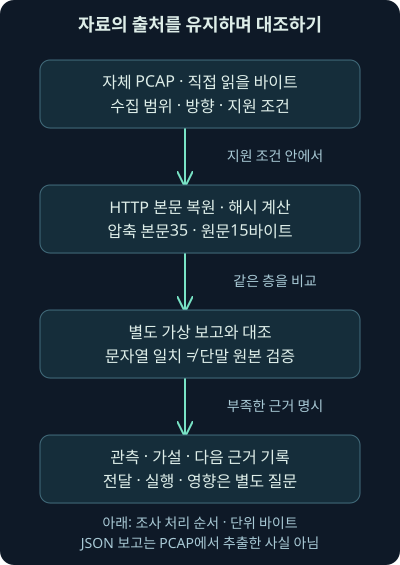
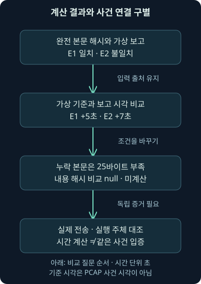
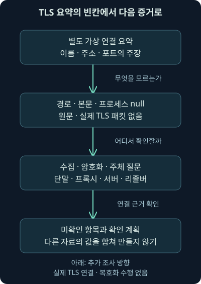

## 1. 자료가 세 종류면 결론도 세 배로 확실해질까요?

“웹에서 파일을 받은 뒤 낯선 암호화 통신이 생겼습니다.”라는 신고를 받았다고 해봅시다. 책상에는 패킷 파일, 단말에서 만들었다는 보고, TLS 연결 요약이 있습니다. 세 자료에 같은 주소가 보인다는 이유로 곧바로 하나의 감염 이야기로 묶고 싶어집니다. 이번에는 그 연결을 한 번씩 멈춰 확인해 보겠습니다.

앞선 8강에서는 HTTP 본문을 복원했고, 9강에서는 이동·전달·실행을 나눴으며, 10강에서는 암호화 관측의 경계를 배웠습니다. 둘째 날 11강은 그 원리를 실제로 내려받을 수 있는 무해한 자료와 독립적인 가상 보고에 적용하는 실습입니다. 새로운 용어를 많이 외우는 대신 근거의 출처를 유지하며 조사 메모를 완성하는 것이 목표입니다.

본 교재의 이 위치는 별도 워크북·가상 위키의 HTTP·HTTPS 실습을 안내합니다. 접근 가능한 교재 폴더와 관련 기록에서는 그 별도 실습의 실제 파일·절차를 확보하지 못했습니다. 따라서 여기서 제공하는 것은 직접 만든 독립 실습이며 원래 워크북 수행 결과나 실제 침해 사건의 재현이 아닙니다.

## 2. 영수증·물건·사용 기록은 서로 다른 자료입니다

택배 배송 기록에 “문 앞 전달”이 있고 집 안에 같은 제품 상자가 있다고 해봅시다. 둘은 연결될 수 있지만, 배송된 상자와 집 안의 상자가 같은 것인지부터 확인해야 합니다. 상자가 도착한 일과 사람이 물건을 사용한 일도 다릅니다.

패킷에서 받은 바이트, 디스크 파일의 바이트, 그 파일의 실행 기록도 이와 비슷합니다. 다만 컴퓨터에서는 같은 바이트를 여러 번 복사할 수 있고 캐시·압축·변환·보안 제품이 사이에 들어갑니다. 같은 해시가 있다는 사실만으로 어느 요청이 어느 파일을 만들었는지까지 자동 연결되지 않습니다.

이번 실습에서는 PCAP에서 직접 계산한 항목과 JSON에 작성자가 넣은 보고를 나란히 둡니다. **PCAP**은 패킷을 저장하는 파일 형식이고 **JSON**은 이름과 값을 구조로 담는 텍스트 표현입니다. 어느 파일 형식인지보다 그 안의 각 값이 어떻게 만들어졌는지가 중요합니다.



## 3. 실습 파일의 역할부터 분리해 놓겠습니다

[완전한 자체 PCAP](../../assets/network-security/day02-lab08/complete.pcap), [마지막 조각을 뺀 자체 PCAP](../../assets/network-security/day02-lab08/missing-tail.pcap), [기존 HTTP 검사 프로그램](../../assets/network-security/day02-lab08/inspect_http.py)은 8강에서 제공한 자료입니다. 이번에도 같은 바이트를 다시 읽습니다. 원본 사건 파일을 새로 확보한 것은 아닙니다.

여기에 [별도 가상 사례](../../assets/network-security/day02-lab11/case.json), [대조 프로그램](../../assets/network-security/day02-lab11/correlate_case.py), [실행 안내](../../assets/network-security/day02-lab11/README.txt)를 추가했습니다. 프로그램은 PCAP의 HTTP 복원 결과와 사례 파일에 적힌 해시·시각을 비교합니다. 실제 단말·TLS 서버·사용자 계정을 조회하지 않습니다.

여섯 파일을 같은 실습 폴더에 두면 설명의 파일 이름을 그대로 사용할 수 있습니다. 기존 검사 프로그램은 `dpkt`라는 패킷 해석용 Python 라이브러리를 사용합니다. 실제 검증 환경은 Python 3.12.14와 dpkt 1.9.8이며, 이미 접근 가능한 의존성을 사용했고 이번에 새 설치를 수행하지 않았습니다. 라이브러리와 이 작은 검사 프로그램의 지원 범위는 같지 않습니다. [dpkt 제작 프로젝트](https://github.com/kbandla/dpkt)

## 4. 먼저 수집 범위에 관한 질문을 적습니다

이 PCAP은 문서용 주소 `192.0.2.25`와 `198.51.100.20` 사이의 고정된 IPv4·TCP·HTTP/1.1 대화입니다. 클라이언트 포트는 50000, 서버 포트는 80입니다. 요청은 `files.example`의 `/note.txt`를 대상으로 하며 내용은 교육용 짧은 문장뿐입니다. 주소와 도메인은 자체 가상 예제입니다.

연결 성립·종료 프레임은 생략했습니다. 따라서 이 자료를 읽고 TCP 연결이 시작부터 끝까지 정상 종료됐다고 보고하면 범위를 넘습니다. 다른 통신이 파일에 없다는 사실도 해당 단말의 전체 활동이 없었다는 뜻은 아닙니다.

실제 조사라면 인터페이스·관측 위치·수집 시작과 종료·필터·드롭·보존·암호화 조건을 함께 받습니다. 이번처럼 파일이 작아도 “어디까지 담긴 자료인가?”를 먼저 묻는 습관은 그대로 필요합니다.

## 5. 첫 실행에서는 완전한 HTTP 자료를 고릅니다

다음 명령은 이 환경에서 실제 실행했습니다. 프로그램은 입력을 읽고 계산 결과를 출력하며, 안에 적힌 도메인에 접속하지 않습니다.

```text
python correlate_case.py case.json complete.pcap
```

`python`은 실행기이고 `correlate_case.py`는 이번 대조 프로그램입니다. 첫 번째 입력 `case.json`에는 별도 가상 보고가, 두 번째 입력 `complete.pcap`에는 실제로 읽을 교육용 패킷이 있습니다. 두 입력을 구별하려고 파일을 따로 받도록 했습니다.

프로그램 내부의 `inspect_http`는 앞 강의의 고정 자료 검사 함수입니다. 이를 가져와 사용한다는 것은 임의 PCAP까지 지원한다는 뜻이 아닙니다. Ethernet·IPv4·한 TCP 대화·고정 길이 gzip 응답이라는 지원 조건을 벗어나면 이 결과를 일반화하지 않습니다.

## 6. 직접 계산한 HTTP 결과를 읽어 보세요

실제 결과는 3프레임, 선언 본문 35바이트, 관측 본문 35바이트, 부족한 본문 0바이트였습니다. 검사 프로그램은 해당 고정 자료의 IP·TCP 길이와 체크섬을 확인하고 응답의 TCP 자료 위치를 이어 읽었습니다. **체크섬**은 전송 중 비트 오류 등을 검사하는 값이며 발신자 인증이나 내용의 무해함을 보증하는 서명이 아닙니다.

gzip은 내용을 압축해 전달하는 표현입니다. 이번에는 압축된 본문 35바이트를 해제해 15바이트의 `Training only.`와 마지막 줄바꿈을 얻었습니다. 화면에 보이는 글자 수, 압축된 바이트 수, 패킷 전체 크기는 서로 다른 단위입니다.

복원한 15바이트의 SHA-256은 `571143bbfd4e9e23772d8174a1f60be72d69923ed8b4a8c4744081059cd4203f`였습니다. **SHA-256**은 바이트 자료를 256비트 요약값으로 계산하는 방식입니다. 여기서는 복원 결과를 비교하는 데 사용하며 파일 실행·악성 여부 판정은 하지 않습니다.

## 7. 저장 파일과 비교하려면 바이트의 층이 맞아야 합니다

조사자가 디스크 파일의 해시를 가져왔을 때 먼저 “어느 층의 바이트인가요?”라고 물어보세요. 패킷 전체, TCP 자료, HTTP 헤더를 포함한 응답, 압축된 본문, 압축을 푼 내용은 해시 입력이 모두 다릅니다.

이번 프로그램이 가상 단말 보고와 대조하는 것은 압축을 푼 15바이트의 해시입니다. 압축된 35바이트나 PCAP 전체 해시와 비교하는 것이 아닙니다. JSON의 필드 이름도 `reported_file_sha256`으로 하여 보고된 값이라는 사실을 남겼습니다.

프로그램은 PCAP 전체의 해시도 별도로 출력합니다. 이는 어떤 캡처 파일을 읽었는지 구별하는 값입니다. PCAP 식별값과 복원 내용 식별값을 섞으면 “같은 파일인가?”라는 질문의 대상부터 어긋납니다.

## 8. 같은 해시가 나왔는데 왜 실행은 미확인일까요?

가상 보고 E1에는 복원 내용과 같은 해시가 적혀 있습니다. 실제 비교 결과 `reported_hash_matches_observed_body=true`가 나왔습니다. 반면 E2에는 0으로 채운 다른 값을 넣어 결과가 `false`였습니다. 여기서 `true`는 이 비교 조건이 참, `false`는 거짓이라는 뜻입니다.

E1의 값은 작성자가 예제 파일에 넣은 주장입니다. 프로그램이 실제 단말의 파일을 열거나 그 수집 경로·파일 시각·프로세스를 확인한 것이 아닙니다. 그러므로 `endpoint_report_verified`, `same_transfer_verified`, `execution_verified`는 모두 거짓으로 남습니다.

실제 디스크 파일과 네트워크 내용을 각각 확보해 같은 해시를 얻었다면 같은 바이트라는 강한 연결 단서가 됩니다. 그래도 어느 전송에서 생성됐는지, 누가 실행했는지, 승인된 업무인지에는 경로·시각·프로세스·사용자·다른 전송의 근거가 더 필요합니다.

## 9. 시간대를 맞추는 계산과 사건을 연결하는 판단도 다릅니다

E1의 가상 보고 시각은 `2026-11-06T20:00:05+11:00`입니다. 끝의 `+11:00`은 UTC보다 11시간 앞선 시간대 차이를 뜻합니다. **UTC**는 자료 사이의 시각을 비교할 때 사용할 수 있는 공통 시간 기준입니다.

이 값을 UTC로 바꾸면 같은 날짜 `09:00:05+00:00`입니다. 사례 파일에 분석가가 입력한 가상 기준 `09:00:00+00:00`과의 차이는 5초입니다. E2의 `09:00:07+00:00`은 기준보다 7초 뒤였습니다. 이번 프로그램을 실제 실행해 확인한 계산입니다.

그런데 이 기준은 PCAP에서 뽑은 사건 시각이 아닙니다. 프로그램도 `packet_timestamp_correlation_performed=false`라고 표시합니다. 시간대를 맞춘 계산이 성공했다는 사실과 두 출처가 같은 사건을 기록했다는 결론을 구별하기 위한 예제입니다.

## 10. 가까운 시간은 연결 후보를 좁힙니다

두 로그가 몇 초 차이라고 같은 행위를 기록한 것일까요? 한 단말에서 여러 다운로드가 일어나거나 서버가 기록을 늦게 쓰면 가까운 시각만으로는 구별되지 않습니다. 단말 시계의 오차와 수신 시각·발생 시각의 차이도 남아 있습니다.

실제 조사에서는 시간대를 맞춘 뒤 기록 생성 방식·동기화 상태·가능한 오차를 적고, 요청 식별자·파일 바이트·프로세스 식별·네트워크 연결 같은 다른 근거를 더합니다. 시각 비교는 그 연결의 한 조건입니다.

시간대가 없는 문자열을 이 프로그램은 오류로 처리합니다. 알아서 현지 시간으로 추측하면 환경마다 다른 계산이 나올 수 있기 때문입니다. 오류를 없애려고 임의의 시간대를 붙이는 대신 자료를 만든 쪽에 기준을 확인해야 합니다.



## 11. 이번에는 마지막 TCP 조각이 빠진 자료로 바꿉니다

같은 사례 JSON을 유지하고 PCAP 입력만 바꿔 다음을 실제 실행했습니다.

```text
python correlate_case.py case.json missing-tail.pcap
```

입력 패킷은 2프레임이었고 선언 본문 35바이트 중 10바이트만 남았습니다. 따라서 부족한 양은 `35 - 10 = 25`바이트입니다. 완전한 본문이 아니므로 압축을 푼 내용과 그 해시를 만들어내지 않습니다.

결과의 해시 비교는 E1·E2 모두 `null`이었습니다. JSON의 `null`은 여기서 자료 부족으로 비교값을 계산하지 않았다는 표시입니다. `false`처럼 실제 비교를 수행해 불일치가 나온 값과 구별해야 합니다.

## 12. 불일치와 미계산을 같은 실패로 묶지 않습니다

다음 표에서는 같은 프로그램이 다른 조건에서 무엇을 아는지 읽어 보세요. 세 값은 프로그램 동작의 범위를 설명하며 실제 사건의 무죄·유죄 판정이 아닙니다.

| 입력 조건 | 해시 비교 결과 | 조사에서 남길 말 |
| --- | --- | --- |
| 완전 본문과 E1의 같은 가상 해시 | true | 보고 문자열과 복원 내용의 해시 일치, 단말 원본 미검증 |
| 완전 본문과 E2의 다른 가상 해시 | false | 같은 층으로 계산한 비교가 불일치 |
| 본문 25바이트 부족 | null | 내용 해시를 얻지 못해 비교 미수행 |

`null`을 불일치로 바꾸면 빠진 증거를 반대 증거처럼 사용하게 됩니다. 반대로 일치하지 않는 E2를 “수집이 덜 됐을 것”이라고 마음대로 고쳐도 안 됩니다. 직접 계산한 결과와 가능한 설명을 따로 적습니다.

누락은 전송 중 손실일 수도 있지만 수집기의 드롭·필터·잘린 파일·관측 위치 때문에 생겼을 수도 있습니다. 이번 자료는 일부 조각을 의도적으로 뺀 자체 파일입니다. 실제 네트워크에서 손실이 발생했다고 측정한 결과는 아닙니다.

## 13. 실행을 보고했다는 문자열은 검증 결과가 아닙니다

E2에는 실행 관련 상태가 `reported`라고 적혀 있습니다. 뜻은 가상 작성자가 실행을 보고했다는 것이며, 프로그램이 실행 증거를 확인했다는 뜻이 아닙니다. E1의 상태 `unknown`은 보고에서 모른다고 적은 값입니다.

조건을 바꿔 E1도 `reported`로 수정해 실행했습니다. 비교 해시가 같고 보고 상태가 바뀌어도 `execution_verified`는 여전히 거짓이었습니다. 프로그램에 실제 프로세스·코드 실행·단말 수집을 확인하는 기능이 없기 때문입니다.

실제 조사에서는 파일 생성, 프로세스 시작, 스크립트 해석, 메모리 활동, 후속 접근처럼 사건에 맞는 증거를 찾습니다. 그 자료도 수집 출처·보존·식별 범위를 확인해야 합니다. 특정 필드가 있다는 사실이 곧 충분한 증거는 아닙니다.

## 14. TLS 요약에는 일부러 빈칸을 남겼습니다

사례 JSON에는 `192.0.2.25`에서 `203.0.113.80`의 포트 443으로 통신했다는 별도 가상 요약도 있습니다. TLS 1.3이라는 주장과 `updates.example`이라는 SNI 값이 적혀 있지만 실제 TLS 패킷은 제공하지 않았습니다. 이 요약을 PCAP에서 추출했다고 설명하지 않습니다.

HTTP 경로·본문·프로세스 식별은 `null`, ECH 상태는 `unknown`으로 두었습니다. 프로그램은 그 값을 그대로 보여 주고 `tls_summary_verified=false`, `tls_packets_analyzed=false`라고 출력합니다. 새로운 이름·파일·명령을 복원하지 않습니다.

같은 클라이언트 주소라고 HTTP 다운로드와 TLS 통신이 같은 프로세스에서 발생했다고 결론 내릴 수 없습니다. 주소 공유·프록시·여러 응용·다른 시점의 자료일 수 있습니다. 단말의 연결 주체와 세션 식별을 조사해야 합니다.

## 15. SNI의 이름과 URL 경로를 이어 붙이지 않습니다

SNI는 TLS의 서버 이름 단서이고 `/note.txt` 같은 경로는 HTTP의 자원 식별 부분입니다. 서로 다른 예제 자료에 이름과 경로가 각각 있다고 `https://updates.example/note.txt`라는 실제 요청을 만들어내면 안 됩니다.

암호화 자료에서 HTTP 내용이 보이지 않을 때는 판본·재개·ECH·프록시·키 자료·수집 조건을 확인하고 필요한 단말·서버 기록으로 옮깁니다. 10강에서 배운 관측 한계를 이번 가상 요약에도 그대로 적용하는 것입니다.

2026년 11월 6일 Wireshark의 TLS 안내를 다시 확인했습니다. 적절한 세션 비밀값이나 제한된 RSA 조건 없이 임의 캡처가 모두 해독되는 것은 아닙니다. 이번 실습에서는 비밀값·인증서 개인키·실제 TLS 연결을 수집하거나 복호화하지 않았습니다. [TLS 분석 도구의 조건](https://wiki.wireshark.org/TLS)



## 16. 패킷 도구에서 확인한다면 필터의 질문을 먼저 정합니다

다음은 Wireshark에서 사용할 수 있는 **미실행 표시 필터 예시**입니다. 이번 환경에서 Wireshark를 열어 이 필터를 적용한 결과는 아닙니다.

```text
http.request.method == "GET" and http.host == "files.example"
```

`http.request.method`는 해석된 HTTP 요청의 메서드, `http.host`는 해석된 Host 값입니다. `==`는 같은 값인지 비교하고 `and`는 두 조건을 모두 만족하게 합니다. 모든 HTTP가 아니라 특정 호스트를 요청하는 GET을 좁히려는 조건입니다.

이것은 수집 전에 패킷을 버리는 캡처 필터가 아닙니다. 결과가 없으면 암호화·지원 프로토콜·해석·재조립·수집 누락도 확인해야 합니다. 2026년 11월 6일 공식 HTTP 필드 참조로 문법을 대조했으며 이 자체 PCAP은 HTTP/1.1이라는 조건을 유지합니다. [Wireshark HTTP 필드](https://www.wireshark.org/docs/dfref/h/http.html)

## 17. 해시만 모으는 대신 대조할 출처를 정합니다

사용자가 파일을 받았다는 주장에는 브라우저 다운로드 기록·단말 파일·프록시 응답·서버 접근 기록을 대조할 수 있습니다. 실제 어떤 자료가 남았는지와 그 자료가 같은 요청을 식별하는지는 따로 확인합니다.

TLS 연결 주체가 궁금하면 단말의 프로세스와 연결 기록, 프록시 사용 여부, 서버의 응용 로그가 필요할 수 있습니다. 이름을 연결하려면 당시 리졸버·캐시·브라우저 자료를 봅니다. 지금 DNS를 다시 조회한 값만으로 과거의 목적지를 확정하지 않습니다.

여러 출처가 있다고 모두 독립 근거인 것도 아닙니다. 같은 원본 이벤트를 다른 제품이 복사한 결과라면 근거를 두 번 세지 않아야 합니다. 원기록과 보강된 해석의 관계를 함께 남깁니다.

## 18. 조사 메모를 네 문장으로 시작해 보세요

가상 보고를 이렇게 정리할 수 있습니다. “자체 완전 PCAP에서 HTTP 본문 35바이트를 복원해 교육용 원문 15바이트를 얻었다. E1의 별도 가상 해시 문자열은 이 원문의 해시와 같지만 실제 단말 파일과 동일 전송·실행은 검증하지 않았다.” 여기까지는 직접 계산과 입력 주장의 경계를 담았습니다.

이어서 “누락 자료에서는 본문 25바이트가 부족해 내용 해시 비교를 수행하지 않았다. 별도 TLS 요약에는 경로·본문·프로세스 증거가 없으므로 단말·프록시·서버·리졸버 자료의 수집 범위를 확인한다.”라고 씁니다. 빈칸을 남기는 이유와 다음 작업이 함께 보입니다.

보고서에서 실제 사건이라고 바꾸면 안 됩니다. 이번 메모의 대상은 자체 파일과 가상 보고입니다. 자료의 범위를 선명하게 쓰는 것 자체가 이번 실습의 결과입니다.

## 19. 가설은 확인 방법과 함께 적습니다

“다운로드한 내용과 관련된 후속 통신일 수 있다”는 가설을 세울 수는 있습니다. 그러나 그 가설을 지지할 자료와 다른 정상 설명을 구별해야 합니다. 사용자 업무·업데이트·공유 단말·다른 프로세스라는 대안을 함께 검토합니다.

다음 표에서는 질문과 추가 근거가 어떻게 연결되는지 보겠습니다. 요청한 자료를 실제 확보했다는 목록이 아니라 다음 조사의 방향입니다.

| 남은 질문 | 필요한 대조의 예 | 단독으로 충분하지 않은 값 |
| --- | --- | --- |
| 같은 요청이 파일을 만들었나 | 요청 식별·다운로드·파일 생성의 연결 | 해시 문자열 하나 |
| 파일이 실행됐나 | 프로세스·스크립트·단말 행위 자료 | HTTP 200이나 저장 경로 |
| TLS 연결도 같은 실행인가 | 프로세스 연결·프록시·세션 자료 | 같은 IP·가까운 시각 |
| 실제 영향이 있었나 | 접근·인증·서버·자료 활동 | 낯선 이름·포트·지문 |

증거가 부족하면 가설을 미확인으로 유지합니다. 그 상태에서 필요한 자료와 우선순위를 정하는 것은 조사 진행입니다. 확정할 수 없다는 말을 아무 작업도 하지 않았다는 뜻으로 받아들이지 마세요.

## 20. 조건을 바꿔도 지켜야 할 불변 조건이 있습니다

가상 E1의 시각을 `09:00:05+00:00`으로 바꾸면 같은 순간이므로 차이는 계속 5초였습니다. 가상 보고의 순서를 뒤집으면 출력 행의 순서는 바뀌지만 해시 일치의 의미는 바뀌지 않았습니다. 실행 보고 상태를 바꿔도 실제 실행 검증은 생기지 않았습니다.

시간대가 없는 시각, 잘못된 해시 형식, 지원하지 않는 실행 확정값, 잘못된 포트·자료 구조는 오류로 거부했습니다. 정상 종료는 침해 성공이 아니라 계산을 마쳤다는 뜻이며 불완전·불일치도 정상적인 계산 결과가 될 수 있습니다.

이번 회차의 두 실습 프로그램을 합쳐 25개의 기본·조건 변경·오류 입력 실행을 검증했습니다. 다음 12강의 이메일 예제 검증도 포함한 수이며, 이번 PCAP의 프레임 수나 실제 사건 수가 아닙니다. 입력 파일의 해시가 실행 전후 같았고 외부 행동은 없었습니다.

## 21. 파일을 보존하는 일과 진위를 확인하는 일은 다릅니다

검사 전후 해시가 같으면 이 실행에서 입력 바이트가 바뀌지 않았는지 확인하는 데 도움이 됩니다. 그러나 처음 받은 파일의 진실성·수집 주체·수집 경로까지 해시가 보증하지는 않습니다. 보존과 출처 검증을 구별해야 합니다.

실제 사건에서는 원본과 작업 사본, 수집 시각·담당자·도구·저장 위치·허용 범위를 연결합니다. 이번 프로그램은 파일을 수정하지 않고 결과를 출력하지만, 그것만으로 실제 증거 관리 절차 전체를 구현한 것은 아닙니다.

이번 강의를 마칠 때는 어떤 결과를 직접 계산했는지, 어떤 값은 가상 입력인지, 무엇은 끝까지 미확인인지 스스로 설명할 수 있으면 됩니다. 다음 강의에서는 같은 태도를 이메일의 전달 경로와 헤더에 적용하겠습니다.

## 22. 복습: 비교 결과를 조사 문장으로 바꿔 보세요

### 질문 1. 세 자료에 같은 IP가 있으면 하나의 프로세스인가요?

**해설:** 주소 공유·프록시·여러 응용·시점 차이가 남습니다. 단말 연결 주체와 세션을 대조해야 합니다.

### 질문 2. 이번 독립 실습을 원래 워크북 완료라고 써도 되나요?

**해설:** 별도 워크북·실제 파일·절차를 확보해 수행한 것이 아닙니다. 본 교재의 실습 주제와 연결한 자체 실습입니다.

### 질문 3. 35바이트와 15바이트가 다른 것은 복원 오류인가요?

**해설:** 압축된 본문과 압축을 푼 원문의 층이 다릅니다. 같은 층의 바이트를 비교해야 합니다.

### 질문 4. E1의 해시가 같으니 단말 파일을 검증했나요?

**해설:** JSON에 적힌 가상 문자열과 복원 해시를 비교했습니다. 실제 단말 파일·수집 출처는 확인하지 않았습니다.

### 질문 5. E2의 false와 누락 자료의 null은 같은 뜻인가요?

**해설:** false는 비교 불일치이고 null은 자료 부족으로 미계산입니다. 증거 부재와 반대 근거를 섞지 않습니다.

### 질문 6. 선언 35바이트, 관측 10바이트라면 얼마나 부족한가요?

**해설:** 같은 본문 층에서 35에서 10을 빼 25바이트입니다. 누락 원인이 실제 네트워크 손실인지도 별도 확인합니다.

### 질문 7. 20:00:05+11:00은 UTC로 언제인가요?

**해설:** 11시간을 빼 같은 날 09:00:05+00:00입니다. 이번 5초 차이는 가상 기준과의 계산이며 PCAP 시각 연결이 아닙니다.

### 질문 8. 5초 차이니까 같은 사건이라고 확정해도 되나요?

**해설:** 시간 생성 방식·시계 오차·동시 활동이 남습니다. 요청·파일·프로세스 등 다른 연결 근거가 필요합니다.

### 질문 9. E1을 reported로 바꾸면 실행 검증도 참이 되나요?

**해설:** 보고 문자열이 바뀐 것입니다. 이 프로그램에는 실제 실행을 검증하는 기능이 없으므로 거짓으로 남습니다.

### 질문 10. TLS 요약의 이름에 HTTP 경로를 붙이면 실제 URL인가요?

**해설:** 다른 출처·다른 계층의 값을 합쳐 관측하지 않은 요청을 만든 것입니다. 실제 응용 기록을 확인해야 합니다.

### 질문 11. 표시 필터에 결과가 없으면 통신도 없었나요?

**해설:** 수집·암호화·재조립·프로토콜 해석 조건을 봅니다. 필터의 질문과 자료 범위를 먼저 확인합니다.

### 질문 12. 정상 종료0은 감염을 찾았다는 뜻인가요?

**해설:** 계산 완료를 뜻합니다. 불일치·불완전·미확인도 정상 출력에 포함됩니다.

### 질문 13. 입력 해시가 유지됐으면 자료의 진위도 보증되나요?

**해설:** 실행 전후 바이트 보존을 확인한 것입니다. 수집 출처와 실제 사건의 진실성은 다른 검증입니다.

### 질문 14. 같은 원기록을 두 제품에서 찾으면 독립 증거 두 개인가요?

**해설:** 복제·전달 관계를 확인해야 합니다. 같은 기록을 두 번 세지 않고 실제 독립 자료를 연결합니다.
