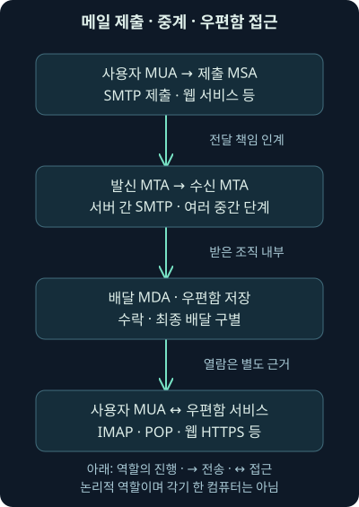
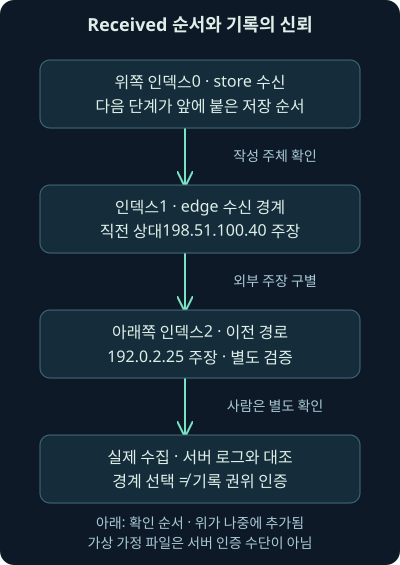
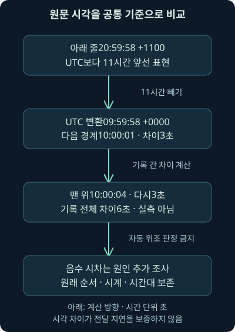

## 1. 보낸 사람 이름을 읽는 일과 전달 경로를 찾는 일

회계팀 이름으로 온 메일을 사용자가 신고했습니다. 화면의 보낸 사람은 익숙하지만 정말 그 조직에서 보낸 것인지, 어떤 서버를 거쳐 왔는지, 사용자가 첨부를 열었는지는 아직 모릅니다. 화면의 이름 하나에 이 질문의 답을 모두 맡길 수는 없습니다.

앞 강의에서는 패킷의 관측과 별도 보고를 구별했습니다. 둘째 날 12강은 같은 태도로 이메일을 읽습니다. 사용자에게서 메일 서버로 제출되는 과정, 서버끼리 전달하는 과정, 수신자가 열람하는 과정을 나눈 뒤 SMTP 대화와 메시지 헤더를 연결하겠습니다.

이번 범위는 전달 구조·기본 대화·메시지 원본·Received 추적과 신뢰 경계입니다. SPF·DKIM·DMARC라는 발신 인증 방식의 세부 계산은 다음 회차에서 이어갑니다. 실제 메일 발송·서버 접속·계정 검사 대신 직접 만든 가상 대화와 이메일 파일을 읽었으며, 실제 실행한 계산과 설명용 대화를 구별합니다.

## 2. 편지에는 봉투와 편지지가 있습니다

우체국은 봉투의 배달 주소로 편지를 옮깁니다. 편지지 첫 줄에 적힌 수신자 이름과 봉투 주소가 항상 같은 것은 아닙니다. 반송 주소도 편지 속 서명과 역할이 다릅니다. 이메일도 운반에 쓰는 정보와 사람이 읽는 메시지를 나누면 이해하기 쉽습니다.

**SMTP**, Simple Mail Transfer Protocol은 메일을 서버에 제출하거나 서버 사이에서 전달할 때 쓰는 프로토콜입니다. **봉투**, envelope는 그 전달 단계의 발신 경로와 수신 경로 같은 운반 정보를 뜻합니다. **메시지**는 헤더와 본문으로 구성되는 편지 내용입니다.

실제 이메일에서는 전달 과정에서 주소를 확장·변환하거나 여러 수신자에게 복제할 수 있습니다. 또한 전자적인 봉투 정보가 그대로 편지 안에 들어 있는 것은 아닙니다. 마지막에 보존된 메시지 파일만으로 모든 SMTP 대화의 봉투를 복원할 수 있다고 가정하면 안 됩니다.

## 3. 제출·중계·열람을 세 역할로 나눕니다

**MUA**, Message User Agent는 사용자가 메시지를 작성하고 읽는 클라이언트 역할입니다. 데스크톱 메일 프로그램뿐 아니라 웹메일 화면도 사용자에게 이 역할을 제공합니다. 사용자가 보낸 메일을 처음 받는 제출 서비스는 **MSA**, Message Submission Agent라고 부릅니다.

**MTA**, Message Transfer Agent는 메일을 다른 서버로 전달하는 역할입니다. 발신 조직 내부의 여러 서버를 거쳐 외부 경계 서버에서 수신 조직의 경계 서버로 넘어갈 수 있습니다. **MDA**, Message Delivery Agent는 최종 우편함으로 배달·저장하는 역할입니다.

이 이름은 반드시 각각 별도 컴퓨터 한 대를 뜻하지 않습니다. 한 서비스가 여러 역할을 수행하거나 클라우드 제공자가 조직을 대신해 운영할 수 있습니다. 분석에서는 제품 이름보다 그 순간 어느 역할로 어떤 연결을 했는지 확인해야 합니다.



## 4. 웹메일을 쓰면 내 컴퓨터에서 SMTP가 보이지 않을 수 있습니다

브라우저에서 전송 버튼을 눌렀다면 브라우저와 웹메일 서비스 사이에는 HTTPS가 사용될 수 있습니다. 이후 서비스 내부와 서버 사이에서 SMTP 전달이 이어져도 사용자 단말 캡처에는 그 구간이 없습니다. 단말에 SMTP가 없다는 사실과 메일을 보내지 않았다는 결론은 다릅니다.

수신자가 우편함을 읽는 데는 IMAP·POP 또는 서비스의 웹·동기화 방식 등이 쓰일 수 있습니다. **IMAP**은 서버의 우편함과 메시지를 접근·관리하는 프로토콜이고, **POP**은 우편함의 메시지를 가져오는 데 사용하는 프로토콜입니다. 이 구간과 서버 간 중계를 같은 패킷 흐름으로 합치지 않습니다.

따라서 메일 조사에서는 단말·제출 서버·외부 경계·수신 우편함 중 어디의 기록인지 먼저 적습니다. 메일 서버의 메시지 추적 기록과 사용자 단말의 네트워크 캡처는 같은 범위를 보여 주지 않습니다.

## 5. 포트 번호는 역할을 찾는 단서입니다

2026년 11월 6일 RFC 6409와 RFC 8314를 대조했습니다. 일반적인 서버 간 SMTP 중계는 TCP 25, 제출은 TCP 587, 처음부터 TLS로 시작하는 제출 서비스는 TCP 465라는 구분이 있습니다. 포트만으로 실제 프로토콜·인증·암호화 성공을 확정하지 않습니다. [제출과 중계의 구분](https://www.rfc-editor.org/rfc/rfc6409.html), [TLS 제출·접근의 구분](https://www.rfc-editor.org/rfc/rfc8314.html)

아래 표는 관측할 역할을 나란히 비교한 것입니다. 제품의 실제 설정과 연결 결과를 확인하는 출발점으로 읽어 주세요.

| 구간 | 대표적인 통신 예 | 조사에서 확인할 조건 |
| --- | --- | --- |
| 사용자 프로그램 → 제출 서비스 | SMTP 제출 587·TLS 제출 465 | 실제 인증·TLS·사용 계정·제출 결과 |
| 발신 경계 → 수신 경계 | SMTP 중계 25 | 실제 연결 상대·수락·대기열·다음 전달 |
| 사용자 ↔ 우편함 서비스 | IMAP TLS 993·POP TLS 995·웹 HTTPS | 접근 주체·동기화·열람 기록의 범위 |

TCP 연결이 된 사실, TLS가 성립한 사실, 메일이 수락된 사실, 사용자가 읽은 사실은 각각 다른 단계입니다. 한 단계의 성공 표시로 뒤의 단계를 채우지 않습니다.

## 6. 받는 조직의 서버는 어떻게 찾을까요?

가상 주소 `analyst@receiver.example`로 전달하려면 수신 도메인의 메일 처리 목적지를 알아야 합니다. **MX**, Mail Exchange 레코드는 DNS에서 그 도메인의 메일을 받을 서버 이름과 우선순위 값을 제공합니다. 그 이름의 A·AAAA 주소를 확인해 연결 대상을 정할 수 있습니다.

MX가 여러 개라면 숫자가 작은 우선순위 값이 먼저 고려됩니다. 예를 들어 10인 `mx-a.receiver.example`과 20인 `mx-b.receiver.example`이 있다면 앞의 값이 선호됩니다. 이는 모든 메일이 항상 첫 서버에 성공적으로 전달됐다는 기록은 아닙니다.

MX에 해당 조직과 다른 제공자 이름이 있어도 곧 위조는 아닙니다. 외부 보안 게이트웨이·클라우드 메일을 사용하는 정상 구성일 수 있습니다. 실제 사건 당시의 DNS·연결·제공자 설정을 함께 확인합니다. [SMTP의 대상 서버 선택](https://www.rfc-editor.org/rfc/rfc5321.html#section-5.1)

## 7. MX가 없다는 결과도 조건을 나누어 읽습니다

MX가 없을 때에는 해당 이름의 주소를 암묵적인 메일 목적지로 다루는 규칙이 있습니다. 그러나 이름 자체가 없는 오류, 일시적인 DNS 실패, MX가 있는데 대상이 모두 사용할 수 없는 상황은 서로 다릅니다. “MX 없음” 하나로 모든 전달 결과를 설명하지 않습니다.

또한 **Null MX**는 메일을 받지 않는다고 명시하는 별도 표현입니다. 우선순위 0과 루트 이름인 점 `.`을 사용하는 규칙이며, 빈 응답과 같은 뜻이 아닙니다. 2026년 11월 6일 RFC 7505로 차이를 확인했습니다. [메일 미수신의 명시적 표현](https://www.rfc-editor.org/rfc/rfc7505.html)

이번 강의는 예시 도메인을 실제 조회하지 않았습니다. DNS 설명의 목적은 관측 기록을 해석하는 것입니다. 현재 재조회한 답을 사건 당시의 실제 연결 서버라고 대입하지 않습니다.

## 8. SMTP 대화는 그때그때의 상대 사이에서 반복됩니다

SMTP의 한 구간에서 클라이언트는 전달을 요청하고 서버는 세 자리 응답 코드를 돌려줍니다. 중간 MTA가 다음 서버로 메일을 넘길 때는 그 MTA가 새 구간의 클라이언트가 됩니다. 사용자가 처음 누른 전송 버튼과 최종 수신까지 하나의 연결이 계속 유지되는 구조가 아닙니다.

**ESMTP**는 확장 SMTP를 뜻합니다. `EHLO`로 자신을 소개하고 서버가 지원하는 확장을 확인할 수 있습니다. 소개 문자열은 접속자가 제시한 이름이며 이름을 말했다는 사실만으로 그 도메인의 소유권이나 사람의 신원이 인증되지는 않습니다.

오래된 설명에서 텍스트 대화를 읽는 원리는 여전히 유용합니다. 다만 현재의 모든 메일이 평문 ASCII만으로 오간다고 일반화하면 안 됩니다. TLS와 확장·국제화의 조건도 함께 보아야 합니다.

## 9. 실제 접속이 아닌 가상 대화를 읽겠습니다

[별도 가상 SMTP 대화](../../assets/network-security/day02-lab12/smtp-session.txt)는 직접 작성한 텍스트입니다. 서버에 보낸 명령이나 캡처 결과가 아니며, 뒤에서 읽는 `.eml` 파일도 이 대화에서 수집한 것이 아닙니다. `C:`는 클라이언트가 보내는 줄, `S:`는 서버의 응답이라는 설명용 표기입니다.

```text
S: 220 submit.sender.example ESMTP
C: EHLO client.sender.example
S: 250-submit.sender.example
S: 250 SIZE 100000
C: MAIL FROM:<bounce@mailer.example>
S: 250 2.1.0 Sender accepted
C: RCPT TO:<analyst@receiver.example>
S: 250 2.1.5 Recipient accepted
```

220은 서비스 준비, EHLO는 소개·확장 확인입니다. `250-`의 하이픈은 여러 줄 응답이 이어짐을, 마지막 `250 `의 공백은 그 응답의 끝을 나타냅니다. 예제의 SIZE는 서버가 알리는 메시지 크기 관련 확장입니다. 실제 서버 설정을 측정한 수치가 아닙니다.

## 10. MAIL FROM과 화면의 From은 같은 필드가 아닙니다

`MAIL FROM:<bounce@mailer.example>`는 이번 전달의 반송 경로를 설정합니다. `RCPT TO:<analyst@receiver.example>`는 이번 전달에서 받을 경로 하나를 지정합니다. 꺾쇠는 SMTP 경로 표현의 구분자이고 `@` 앞뒤는 사서함 부분과 도메인 부분입니다.

반면 DATA 안의 `From: Accounts Team <invoice@sender.example>`는 메시지의 보낸 사람 필드입니다. 사용자가 보는 표시 이름 Accounts Team과 주소, SMTP 봉투의 반송 경로는 따로 읽어야 합니다. 서로 다르다는 사실만으로 공격이라고 확정하지도 않습니다. 정상 발송 서비스·반송 처리·전달 변환에서도 달라질 수 있습니다.

최종 배달 시의 `Return-Path`는 봉투의 반송 경로를 메시지에 기록하는 역할을 합니다. 실제 수집 출처와 배달 과정에서 추가된 필드인지 확인해야 하며, 임의 텍스트 파일에 그 줄이 있다는 사실만으로 모든 전달 구간의 발신을 검증하지 않습니다.

## 11. 수신자 수락과 메일 전체 수락도 다릅니다

같은 가상 대화의 다음 줄은 두 번째 수신자 `absent@receiver.example`에 대해 550을 반환합니다. 첫 수신자의 250과 두 번째 수신자의 550은 서로 다른 RCPT 요청의 결과입니다. 메시지의 `To:`에 적힌 주소 목록만 보고 모든 봉투 수신자가 수락됐다고 판단하면 안 됩니다.

DATA에 대한 354는 이제 메시지 자료를 보내라는 중간 응답입니다. 아직 최종 수락이 아닙니다. 본문 종료 뒤의 250이 그 구간에서 전달 책임을 받아들였다는 중요한 결과입니다. 최종 우편함 배달이나 사람의 열람까지 입증하는 것은 아닙니다.

응답의 첫 숫자가 4인 일시 실패와 5인 영구 실패도 구별합니다. 어느 명령에 대한 응답인지, 누가 재시도 책임을 갖는지, 다음 기록이 있는지를 확인합니다. 2026년 11월 6일 RFC 5321의 책임 인계·응답 의미를 대조했습니다. [SMTP 응답과 책임 인계](https://www.rfc-editor.org/rfc/rfc5321.html#section-4.2.5)

## 12. DATA의 끝은 마침표 하나가 있는 줄입니다

가상 대화에서 DATA 뒤에는 메시지 헤더, 빈 줄, 본문이 이어집니다. 단독 마침표 줄은 DATA 종료를 알립니다. **CRLF**는 캐리지 리턴과 줄바꿈 두 제어 문자를 조합한 줄 끝 표현이며 SMTP의 구분에도 사용됩니다.

본문 자체가 마침표로 시작할 때는 전송에서 마침표를 하나 더 붙이는 **dot-stuffing** 규칙이 있습니다. 예제의 `..A body line beginning with a dot.`는 원래 본문 줄 앞의 마침표와 종료 표식을 구별하려는 표현입니다. 저장된 메시지와 SMTP 전송 중 바이트를 같은 것으로 비교하면 이 차이를 놓칠 수 있습니다.

단독 마침표는 메일 자료의 끝이지 항상 TCP 연결의 끝은 아닙니다. 같은 연결에서 다음 전달이 이어질 수 있고, QUIT과 221은 세션을 끝내는 별도 대화입니다. 이번 텍스트에서는 이 순서를 설명했으며 실제 연결을 실행하지 않았습니다.

## 13. 대소문자와 국제화도 모든 값에 같은 규칙은 아닙니다

SMTP 명령 키워드의 대소문자와 주소·메시지 값의 의미를 섞지 마세요. `MAIL`과 `mail` 같은 명령 표기는 대소문자를 구별하지 않지만 사서함의 `@` 앞부분은 표준상 보존·구별해야 합니다. 도메인 부분은 DNS의 대소문자 규칙을 따릅니다. 실제 서비스의 사서함 정책도 따로 확인합니다.

헤더 필드 이름의 대소문자를 구별하지 않는다는 말도 모든 필드 값을 소문자로 바꿔도 된다는 뜻은 아닙니다. 메시지 식별값·서명 자료·본문은 각각의 규칙을 확인해야 합니다. “헤더는 전부 대소문자를 무시한다”라는 식으로 입력을 변형하지 않습니다.

기본 설명의 ASCII 외에도 SMTPUTF8 확장이 있습니다. **UTF-8**은 유니코드 문자를 바이트로 표현하는 방식이고, SMTPUTF8은 협상된 국제화 메일의 주소·헤더 처리 범위를 확장합니다. 2026년 11월 6일 RFC 6531로 조건을 확인했습니다. [국제화 SMTP의 적용 조건](https://www.rfc-editor.org/rfc/rfc6531.html)

## 14. TLS가 시작되면 패킷의 텍스트가 안 보일 수 있습니다

**STARTTLS**는 SMTP 대화 중 TLS를 시작하는 확장입니다. 지원 안내, STARTTLS 요청·응답, TLS 협상과 그 뒤의 SMTP 대화를 나누어 봅니다. TLS 협상 뒤에는 앞의 확장 상태를 그대로 유지한다고 가정하지 않고 다시 EHLO로 조건을 확인하는 흐름이 있습니다. [STARTTLS의 상태 전환](https://www.rfc-editor.org/rfc/rfc3207.html)

처음부터 TLS로 시작하는 제출 구간에서는 평문 SMTP 소개가 먼저 보이지 않을 수 있습니다. 10강에서 배운 것처럼 암호문을 보관한 것과 내용을 해독한 것은 다릅니다. 포트 465·587·25 하나로 평문 여부를 확정하지 않습니다.

또한 한 구간이 TLS라는 사실이 발신 사용자부터 최종 수신자까지 모든 구간의 보호·내용 안전성을 보장하지는 않습니다. 실제 서버 간 전송·정책·인증·키 조건을 확인해야 합니다. 이번 실습에는 실제 SMTP TLS 패킷이나 복호화 결과가 없습니다.

## 15. 메시지 원본은 헤더와 본문을 함께 보존합니다

화면에 보이는 보낸 사람·제목만 복사하면 전달 흔적이 빠질 수 있습니다. **헤더**는 `필드 이름: 값` 형식의 메시지 정보이고, 일반적인 원본에서는 빈 줄이 본문과의 경계를 표시합니다. 본문은 비어 있을 수도 있으며 보이는 화면만으로 원본 전체의 존재·부재를 판단하지 않습니다.

`Received`와 `Return-Path` 같은 전달 흔적, `From`·`To`·`Subject`·`Date` 같은 메시지 필드는 역할과 작성 주체가 다릅니다. SMTP의 MAIL FROM·RCPT TO 명령 자체가 보존된 메시지의 헤더 줄이라는 뜻은 아닙니다. 봉투 정보를 알려면 서버 대화·전달 로그 등 별도 출처가 필요할 수 있습니다.

원본은 그대로 보존하고 작업 사본에서 해석합니다. 헤더만 복사한 자료, 전달된 새 메일, 화면 캡처, 원래 메시지 파일은 같은 증거가 아닙니다. 무엇을 어떤 클라이언트에서 어떤 방식으로 얻었는지 기록해야 합니다.

## 16. 현재 클라이언트의 메뉴는 판본에 따라 다릅니다

2026년 11월 6일 Microsoft 공식 안내를 확인했습니다. 새 Outlook과 웹 Outlook은 메시지의 더 보기에서 View → View message details 흐름을, 클래식 Windows Outlook은 메시지를 별도 창으로 연 뒤 File → Properties의 Internet headers를 안내합니다. 한국어 메뉴 이름과 배포 상태는 환경에 따라 달라질 수 있습니다. [Outlook 판본별 헤더 보기](https://support.microsoft.com/en-us/outlook/view-internet-message-headers-in-outlook)

Gmail의 공식 안내는 메시지의 답장 옆 더 보기에서 Show original을 선택하는 흐름입니다. 이 메뉴의 내용과 내려받은 파일이 헤더만인지 전체 메시지인지 실제 결과를 확인합니다. [Gmail 원본 헤더 보기](https://support.google.com/mail/answer/29436?hl=en)

옛 리본의 위치나 HTML 본문의 소스 보기와 전체 메시지 원본을 같은 기능으로 일반화하지 않습니다. 이번 환경에서 해당 앱을 열어 메뉴 조작·내보내기를 실행한 것은 아닙니다. 민감한 헤더를 외부 분석 사이트에 붙여 넣는 작업도 수행하지 않았습니다.

## 17. 접힌 헤더 한 개를 여러 필드로 세지 않습니다

긴 헤더는 다음 줄의 공백·탭으로 이어지는 **접기**, folding 표현을 사용할 수 있습니다. 화면에서 세 줄이라도 하나의 Received 필드일 수 있습니다. 논리적인 값으로 연결하는 작업은 **펼치기**, unfolding이라고 부릅니다.

이번 가상 파일에서도 Received 한 개가 `from`, `by`, 날짜가 있는 여러 물리 줄로 나뉩니다. 단순히 모든 줄바꿈으로 자른 뒤 각각 새 헤더라고 세면 경로가 잘못 늘어납니다. 반대로 모든 줄을 무작정 붙이면 필드 사이의 경계까지 사라집니다.

RFC 5322의 접기·메시지 형식을 2026년 11월 6일 대조했습니다. 프로그램은 Python의 이메일 파서를 사용해 반복 필드를 가져오되 이 예제의 일부 값만 추가로 해석합니다. [메시지 필드와 접기](https://www.rfc-editor.org/rfc/rfc5322.html#section-2.2.3)

## 18. 같은 메시지에도 여러 본문 표현이 있을 수 있습니다

**MIME**, Multipurpose Internet Mail Extensions는 메시지의 자료 형식·전달 인코딩·여러 부분을 표현하는 체계입니다. `Content-Type`은 형식을, `Content-Transfer-Encoding`은 전달 표현을 알려 줍니다. Base64가 쓰여도 8강에서 배운 것처럼 암호화라는 뜻은 아닙니다.

이번 자체 파일의 `multipart/alternative`는 같은 메시지의 일반 텍스트와 HTML 표현을 담습니다. **boundary**는 부분 사이를 구분하는 경계 문자열입니다. 두 부분이 있다는 사실이 두 개의 독립 메일이나 실행 파일 두 개를 뜻하지는 않습니다. [MIME 표현](https://www.rfc-editor.org/rfc/rfc2045.html), [대체 본문의 의미](https://www.rfc-editor.org/rfc/rfc2046.html#section-5.1.4)

첨부는 Base64뿐 아니라 다른 허용된 전달 표현을 사용할 수도 있습니다. 분석에서는 부분별 헤더·바이트·실제 형식을 확인하고 파일 이름·확장자만 믿지 않습니다. 이번 프로그램은 본문을 렌더링하거나 첨부를 실행하지 않고 부분의 형식 이름만 출력합니다.

## 19. Received는 받은 쪽이 앞에 덧붙이는 기록입니다

SMTP 서버가 메시지를 받아 전달·처리하면 자신의 수신 정보를 메시지 앞쪽에 추가합니다. 따라서 Received의 저장 순서는 보통 위가 나중, 아래가 이전입니다. 이는 서버가 덧붙인 순서이며 모든 시계가 정확히 동기화돼 시간이 항상 정렬된다는 보장은 아닙니다.

한 줄에서 `from` 뒤에는 직전 상대가 제시한 이름과 수신 서버가 기록한 연결 주소 등이 있을 수 있습니다. `by`는 그 줄을 작성한 수신 서버의 이름, `with`는 보고된 전송 유형, `id`는 해당 서버의 식별값, `for`는 그 단계의 수신 경로, 세미콜론 뒤는 날짜·시각입니다. for는 생략될 수 있고 전체 수신자 목록을 보장하지 않습니다. 숨은 참조인 Bcc 수신자나 다른 RCPT 경로를 이 값 하나로 모두 찾았다고 해석하지 않습니다. 생략·주석·제품별 표현 차이도 있습니다. [SMTP 전달 흔적의 구조](https://www.rfc-editor.org/rfc/rfc5321.html#section-4.4)

서버의 대기열 ID는 그 서버의 로그를 찾는 데 유용하지만 모든 서버를 관통하는 하나의 전역 식별자가 아닙니다. 옆 서버에서도 같은 메시지를 찾으려면 시각·상대·주소·메시지 식별·다른 기록을 연결해야 합니다.

## 20. 아래에서 위로 읽기 전에 신뢰할 경계를 정합니다

경로를 이해할 때는 아래에서 위로 전달 흐름을 읽을 수 있습니다. 그러나 보안 조사는 먼저 수신 조직에서 확보한 원본과 신뢰 가능한 서버 기록으로 어느 줄이 실제 그 서버에서 추가됐는지 확인해야 합니다. 파일에 `by 우리서버`라고 적혀 있다는 이유만으로 그 줄이 인증되는 것은 아닙니다.

**신뢰 경계**는 어떤 주체의 기록을 어떤 관리·수집·전달 조건 아래 근거로 받아들일지 나누는 기준입니다. 외부 제공자를 조직이 신뢰하는 경우도 있고 같은 이름의 문자열을 공격자가 적은 경우도 있습니다. 도메인 접미사가 같다는 단순 조건으로 대신하지 않습니다.

수신 경계의 서버가 실제 기록한 직전 연결 상대는 그 구간을 찾는 중요한 근거입니다. 그보다 아래에 이미 붙어 들어온 모든 Received와 최초 사용자 주장은 별도 검증 대상입니다. 알려진 메일 제공자 이름을 거쳤다는 사실만으로 아래쪽 전체를 진실로 확장하지 않습니다.



## 21. TCP의 연결 상대와 최초 사람을 구별합니다

TCP는 양방향 대화를 성립시켜 자료를 전송합니다. 신뢰할 수 있는 수신 서버의 연결 기록에서 얻은 상대 IP는 단순히 상대가 EHLO에 적은 이름보다 직접적인 그 구간의 근거입니다. 그러나 “TCP이므로 모든 IP·모든 헤더는 절대 위조될 수 없다”라고 말하면 범위를 벗어납니다.

프록시·NAT·릴레이·침해된 서버·공유 발송 서비스가 있을 수 있고, 전달된 헤더 텍스트는 별도로 조작될 수 있습니다. 연결 상대의 주소가 확인돼도 최초 사용자의 물리 위치·사람·업무 승인을 자동 확인한 것은 아닙니다. 운영자가 신뢰하는 수집 출처와 실제 접속 로그를 대조해야 합니다.

EHLO 이름과 PTR 역방향 DNS 이름도 다른 출처입니다. PTR은 주소를 이름에 연결하는 DNS 정보이며 그 이름이나 일치만으로 발신자 신원이 인증되지는 않습니다. 이번에는 실제 PTR·주소 평판 조회를 하지 않았습니다.

## 22. 직접 만든 이메일을 실제로 읽어 보겠습니다

[가상 메시지 파일](../../assets/network-security/day02-lab12/message.eml), [명시적인 가정 파일](../../assets/network-security/day02-lab12/trace-policy.json), [검사 프로그램](../../assets/network-security/day02-lab12/inspect_mail.py), [실행 안내](../../assets/network-security/day02-lab12/README.txt)를 제공합니다. `.eml`은 메시지 원본을 담는 데 흔히 사용하는 파일 확장자입니다. 확장자가 진위나 출처를 인증하는 것은 아닙니다.

Python 3.12.14에서 다음을 실제 실행했습니다. 표준 라이브러리만 사용하고 메일 서버에 접속하지 않습니다.

```text
python inspect_mail.py message.eml trace-policy.json
```

첫 입력은 읽을 메시지 바이트이고 둘째 입력은 어느 Received 행을 가상 경계로 선택할지 적은 분석가의 가정입니다. Python의 `BytesParser`는 바이트를 메시지 구조로 해석하는 기능이지 메일 진위·인증·악성 여부 판정기가 아닙니다. 현재 3.12 문서와 실제 실행 판본 3.12.14를 구별했습니다. [Python 메시지 파서](https://docs.python.org/3.12/library/email.parser.html)

## 23. 세 Received 행의 실제 계산 결과를 읽습니다

프로그램은 위에서부터 0·1·2라는 인덱스를 붙입니다. **인덱스**는 여기서 배열의 위치를 뜻하며 첫 항목이 0부터 시작합니다. 표의 주소는 실제 서버 관측이 아니라 가상 파일에 넣은 값입니다.

| 위에서 센 위치 | by에 적힌 수신 서버 | 대괄호의 상대 주소 | 계산한 UTC 시각 |
| --- | --- | --- | --- |
| 0 | store.receiver.example | 203.0.113.10 | 10:00:04+00:00 |
| 1 | edge.receiver.example | 198.51.100.40 | 10:00:01+00:00 |
| 2 | outbound.sender.example | 192.0.2.25 | 09:59:58+00:00 |

맨 아래 줄의 원래 표기는 `20:59:58 +1100`입니다. UTC보다 11시간 앞서므로 같은 날짜의 `09:59:58 +0000`으로 바뀝니다. 2→1, 1→0의 인접 차이는 각각 3초였습니다. 6초의 전체 차이도 적힌 시각의 계산이지 실제 전달 지연을 별도 측정한 성능 결과는 아닙니다.

## 24. 가정 파일이 경계를 인증해 주지는 않습니다

가정 파일의 `boundary_received_index=1`은 위에서 두 번째 Received를 선택합니다. `expected_by`에는 `edge.receiver.example`, 예상 상대 주소에는 `198.51.100.40`을 넣었습니다. 실제 비교는 선택 행의 이름과 주소 문자열을 가정과 대조하는 것입니다.

기본 결과에서 예상 주소와 일치는 참이었지만 `boundary_authority_verified=false`였습니다. 이 가정 파일은 실제 조직의 수집 체계·서버 로그·서명·접근 권한을 검증한 증거가 아니기 때문입니다. 아래쪽 경로 권위와 최초 사람의 확인도 거짓으로 남았습니다.

실제 조사에서라면 신뢰할 수 있는 메시지 추출·테넌트 기록·수신 게이트웨이 로그와 그 경계를 연결해야 합니다. 설정 파일에 호스트 이름을 적는 일과 그 서버가 실제 그 줄을 만들었다는 확인은 다른 작업입니다.

## 25. 아래쪽 주소를 바꿔도 경계의 관측은 그대로일 수 있습니다

조건 변경 검증에서는 맨 아래의 `192.0.2.25`를 `192.0.2.99`로 바꾼 별도 작업 입력을 읽었습니다. 아래쪽 값은 바뀌었지만 선택한 수신 경계의 상대 `198.51.100.40`에 관한 비교는 그대로였습니다. 파일 원본을 수정한 것이 아니라 변형 사본을 사용했습니다.

이는 아래쪽 주소가 실제 어느 사람의 주소인지 확인했다는 결과가 아닙니다. 선택한 경계의 질문과 외부에서 주장된 이전 경로의 질문이 다르다는 것을 확인한 것입니다. 아래에 내부 장비 이름이 있어도 신뢰를 자동 확장하지 않습니다.

가정의 선택 행을 2로 바꾸고 예상 이름·주소도 맞추면 프로그램은 그 행을 비교합니다. 그래도 권위를 검증한 값은 계속 거짓입니다. 분석가가 경계를 바꿀 수 있다는 사실이 과거 증거의 진실성을 새로 만드는 것은 아닙니다.

## 26. 시각이 뒤집히면 먼저 기록 조건을 확인합니다

가상 맨 위 시각을 10:00:04 대신 09:59:59로 바꿔 실행하면, 바로 아래 10:00:01과의 차이가 -2초가 됩니다. 음수는 적힌 시각이 그 순서와 맞지 않음을 뜻합니다. 이것만으로 공격자가 헤더를 위조했다고 자동 판정하지 않습니다.

시계 오차·시간대 누락·기록 방식·변환·복사·조작이라는 가능성을 구별합니다. 원래 Received 순서를 시각으로 다시 정렬해 이상을 지워 버리지 않습니다. 저장 순서와 계산한 시각을 함께 보존해야 원인을 조사할 수 있습니다.

프로그램은 다른 시간대의 같은 순간 표현에서는 같은 3초·3초를 계산했습니다. 지원하지 않는 단순 Received 형식, 범위 밖 인덱스, 중복 From 같은 예제 계약 위반은 오류로 거부했습니다. 이 작은 도구가 모든 실제 메일 형식을 처리한다는 뜻은 아닙니다.



## 27. with·id·Date·Message-ID도 각자의 질문이 있습니다

`with ESMTPSA`는 확장 SMTP에서 STARTTLS와 SMTP AUTH가 사용됐다는 전송 유형의 표현입니다. **SMTP AUTH**는 해당 구간의 클라이언트 인증 확장입니다. 이 표시는 기록 주체의 보고이며 최초 사람·계정 사용 승인·모든 경로의 보호를 인증하는 서명이 아닙니다. 2026년 11월 6일 RFC 3848의 정의와 보안 한계를 확인했습니다. [전송 유형의 뜻과 한계](https://www.rfc-editor.org/rfc/rfc3848.html)

`Date`는 메시지 작성 쪽이 제시하는 날짜이고, Received 날짜는 각 수신 단계의 기록입니다. `Message-ID`는 메시지를 구별하는 필드이지만 그 안의 도메인이 반드시 실제 접속 서버나 인증된 발신 조직이라는 뜻은 아닙니다. 원본 보존·서버 로그 연결과 함께 읽습니다.

`X-Mailer` 같은 선택 필드가 있다면 작성 도구의 주장으로 다룹니다. 없다고 반드시 은폐이고 있다고 실제 설치 제품이 확인되는 것은 아닙니다. 이번 프로그램은 이 값들로 사람·제품·공격자를 식별하지 않습니다.

## 28. 헤더에서 못 본 사실을 조사 메모에 채우지 않습니다

웹메일을 썼다면 최초 단말의 주소가 헤더에 남지 않을 수 있습니다. 중간 서버의 표현이 생략되거나 호스트 이름 연결이 단순하지 않을 수도 있습니다. 수집·프록시·제공자 정책·보존 범위를 확인하고 빈 필드 하나로 위조·미발생을 확정하지 않습니다.

“가상 메시지에는 세 Received가 있고 선택한 경계 행의 상대 주소는 예상과 같다. 다만 실제 수집 권위·이전 경로·최초 사용자는 미검증이며 본문 열람·첨부 실행·발신 인증은 수행하지 않았다.”처럼 관측과 한계를 같이 씁니다.

실제 메일 조사에서는 수신 게이트웨이·제출·대기열·메시지 추적·인증·우편함 감사·단말 기록을 질문에 맞게 연결합니다. 서버 수락, 배달, 열람, 링크 클릭, 파일 실행은 서로 다른 근거를 요구합니다. 다음 강의의 발신 인증 결과도 이 구분 위에 놓겠습니다.

## 29. 복습: 전달 단계와 기록의 권위를 설명해 보세요

### 질문 1. 단말에서 SMTP가 안 보이면 메일을 보내지 않았나요?

**해설:** 웹메일 HTTPS나 다른 제출 경로일 수 있습니다. 어느 구간을 수집했는지와 서버 기록을 확인합니다.

### 질문 2. MUA·MTA·MDA는 반드시 세 컴퓨터인가요?

**해설:** 논리적인 역할입니다. 한 서비스가 여러 역할을 하거나 제공자가 대신 운영할 수 있습니다.

### 질문 3. MX 우선순위 10과 20 중 무엇이 먼저 고려되나요?

**해설:** 작은 값 10입니다. 실제 연결·장애·다른 주소 조건 때문에 최종 전달 결과는 별도 기록으로 확인합니다.

### 질문 4. Null MX와 빈 MX 응답은 같은가요?

**해설:** Null MX는 메일을 받지 않는다는 명시적 표현입니다. 빈 응답·오류·암묵적 목적지 규칙과 구별합니다.

### 질문 5. EHLO 이름을 말하면 그 조직의 발신자로 인증됐나요?

**해설:** 상대가 제시한 소개 문자열입니다. 실제 접속·인증·도메인 권한은 다른 근거입니다.

### 질문 6. MAIL FROM과 메시지 From이 다르면 무조건 공격인가요?

**해설:** 봉투의 반송 경로와 메시지 작성자 필드의 역할이 다릅니다. 정상 발송·전달 구성과 실제 인증을 대조해야 합니다.

### 질문 7. 첫 수신자 250, 두 번째 수신자 550이면 모두 수락됐나요?

**해설:** 각 RCPT의 결과입니다. 수락된 수신자와 거부된 수신자를 구별하고 DATA 이후 결과도 확인합니다.

### 질문 8. DATA의 354가 최종 배달 성공인가요?

**해설:** 자료를 보내라는 중간 응답입니다. 종료 뒤 수락, 이후 전달·우편함 배달·열람은 다른 단계입니다.

### 질문 9. 본문에 점이 있으면 바로 메시지가 끝나나요?

**해설:** 기본 DATA에서는 단독 마침표 줄이 종료 표식입니다. 점으로 시작하는 본문 줄은 dot-stuffing을 구별합니다.

### 질문 10. 헤더가 세 줄로 접혀 있으면 필드도 세 개인가요?

**해설:** 공백·탭으로 이어지는 물리 줄은 한 필드의 접기 표현일 수 있습니다. 구조를 해석한 반복 필드 수를 봅니다.

### 질문 11. Received가 아래에 있으니 최초 발신 주소를 믿어도 되나요?

**해설:** 먼저 수신 조직의 신뢰 경계를 확인합니다. 외부에서 붙어 들어온 아래쪽 기록은 추가 검증이 필요합니다.

### 질문 12. TCP 상대 IP가 확인되면 최초 사람도 확인됐나요?

**해설:** 해당 연결 구간의 상대에 관한 근거입니다. 프록시·릴레이·공유 서비스·계정 오용과 사람의 식별은 별도입니다.

### 질문 13. 20:59:58 +1100은 UTC로 언제인가요?

**해설:** 11시간을 빼 09:59:58 +0000입니다. 예제의 인접 차이는 3초씩이며 실제 성능 측정은 아닙니다.

### 질문 14. 시차 -2초가 나오면 헤더 위조 확정인가요?

**해설:** 기록 순서와 시각이 맞지 않는 단서입니다. 시계·시간대·변환·조작을 추가 조사하고 원래 순서를 보존합니다.

### 질문 15. 경계 가정을 입력했으니 서버 권위도 검증됐나요?

**해설:** 선택 행과 기대값을 비교한 것입니다. 실제 수집 출처·서버 로그·신뢰 정책을 인증하지 않았습니다.

### 질문 16. Message-ID와 ESMTPSA가 있으면 메일이 안전한가요?

**해설:** 식별 필드와 보고된 전송 유형입니다. 발신 승인·내용 안전·사용자 행위·실제 침해 성공은 별도 근거가 필요합니다.
