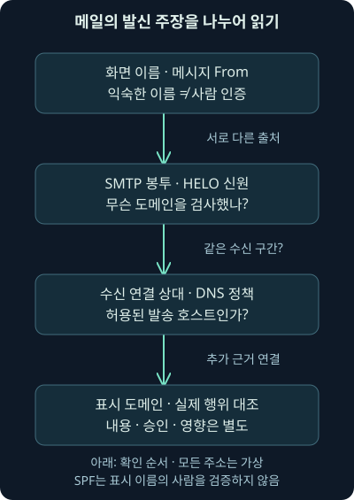
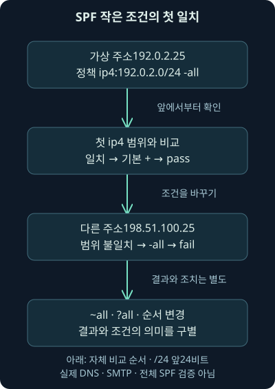
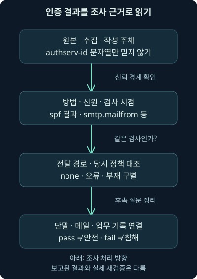

## 1. 회계팀 이름으로 왔는데 무엇을 확인해야 할까요?

회계팀 이름의 메일에 송금 계좌 변경 요청이 들어왔습니다. 화면에는 익숙한 이름이 있고, 헤더에는 `spf=pass`도 보입니다. 이 두 가지를 확인했으니 실제 회계팀의 정상 요청이라고 결론 내려도 될까요? 먼저 그 pass가 어떤 질문의 답인지부터 살펴보겠습니다.

앞선 12강에서는 메일의 제출·중계·열람, 봉투와 메시지, Received의 신뢰 경계를 배웠습니다. 둘째 날 13강은 그 위에 발신 주장의 종류와 SPF의 검사 범위를 연결합니다. 허용된 전송 경로라는 사실과 표시된 사람·내용의 신뢰를 나누는 것이 이번 범위입니다.

주소·도메인·정책·사례는 독립적으로 만든 가상 예제입니다. 실제 메일을 발송하거나 원격 SMTP·DNS에 접속하지 않았습니다. 본 교재에서 주제와 범위를 확인했으며, 별도 원본 워크북·VM을 실행한 결과로 설명하지 않습니다. 뒤의 작은 정책 조건 계산만 실제 실행했습니다.

## 2. 출입 명단과 방문자의 말은 다른 근거입니다

건물 안내 데스크에서 “어느 회사의 배송 차량인가요?”를 확인한다고 합시다. 회사가 미리 알려 준 차량 명단과 실제 도착한 차량을 비교하면 그 배송 경로에 관한 근거를 얻습니다. 하지만 운전자가 건넨 문서의 모든 내용이나 서명한 사람의 승인을 확인한 것은 아닙니다.

**SPF**, Sender Policy Framework는 특정 메일 신원에 사용된 도메인이 어떤 발송 호스트를 허용하는지 DNS 정책과 연결하는 방식입니다. **DNS TXT** 레코드는 DNS에 텍스트 자료를 게시하는 형식입니다. SPF 정책은 이 형식을 사용합니다.

차량 비유와 달리 실제 메일은 전달·발송 대행·공유 서버를 거칠 수 있고, 한 서버가 여러 조직을 위해 보낼 수 있습니다. 따라서 “이 IP가 허용됐다”라는 문장을 반드시 검사한 도메인·신원·수신 구간과 함께 써야 합니다.

## 3. 메일에는 서로 다른 발신 주장이 있습니다

메일 화면의 표시 이름, 메시지 `From`의 주소, SMTP `MAIL FROM`의 반송 경로, EHLO에 제시한 이름, 실제 연결 상대 주소는 서로 다른 항목입니다. 이름이 비슷하게 보인다고 출처와 검증 방법까지 같아지는 것은 아닙니다.

가상 메시지의 표시 이름이 Accounts Team이고 From 주소가 `invoice@sender.example`이라고 해봅시다. SMTP 반송 경로가 `bounce@vendor.example`이면 SPF는 그 봉투 신원의 도메인에 관한 질문을 할 수 있습니다. 화면의 Accounts Team이라는 사람 이름을 검증하는 검사는 아닙니다.

익숙한 표시 이름에 다른 도메인의 주소가 붙거나 비슷한 철자의 도메인이 사용될 수도 있습니다. 인증이 통과한 도메인과 사용자가 믿고 있는 조직이 같은지는 별도로 확인해야 합니다. 표시 이름의 모양만으로 실제 사람을 식별하지 않습니다.



## 4. 제출 계정 인증과 외부 도메인 검증은 다릅니다

사용자가 제출 서비스에 로그인했다는 기록은 그 구간의 계정 사용에 관한 근거입니다. 모든 서버 간 전달에서 수신 조직이 발신 조직의 사용자 비밀번호를 직접 검사하는 구조는 아닙니다. 외부 MTA가 받은 메일의 발신 주장을 평가할 별도의 방법이 필요합니다.

SMTP AUTH는 클라이언트 인증을 위한 확장입니다. 특정 로그인 방식 하나가 모든 제출 서비스의 필수 구현이거나 계정 인증 뒤의 모든 메시지 From이 자동으로 정당해진다고 가정하면 안 됩니다. 서버 정책·허용 발신자·위임·계정 오용 가능성도 남습니다.

오래된 자료의 SMTP 역사 설명은 배경으로 읽되, 현재도 1982년 명세 하나만 그대로 사용된다고 이해하지 않습니다. 전송의 기본 규칙과 추가 인증·TLS·국제화·서비스 정책을 구별합니다. 12강에서 다룬 단계별 성공 조건도 그대로 유지합니다.

## 5. SPF가 사용하는 입력을 먼저 적습니다

SPF를 해석할 때는 실제 수신 구간의 클라이언트 IP, 검사한 도메인, MAIL FROM 또는 HELO라는 신원의 종류를 함께 봅니다. **HELO 신원**은 HELO·EHLO에서 제시한 도메인이고 **MAIL FROM 신원**은 SMTP 반송 경로에 관한 신원입니다.

수신 서버가 본 연결 주소는 메시지 안에 적힌 발신 주소보다 그 구간의 통신 상대를 설명하는 데 유용합니다. 그렇다고 “TCP 주소는 어떤 조건에서도 위장·중계될 수 없으니 최초 작성자다”라고 절대화하지 않습니다. 중계·프록시·주소 변환이 있으면 기록된 상대와 원래 단말은 달라질 수 있고, 허용된 호스트나 계정도 악용될 수 있습니다.

통상적인 봉투 발신 검사와 별도의 HELO 검사를 섞으면 같은 pass라는 단어를 잘못 연결할 수 있습니다. 특히 반송 경로가 빈 `<>`인 메일은 루프를 피하기 위한 통지 등에도 사용되므로 곧 공격이라고 단정하지 않습니다. SPF의 MAIL FROM 신원 결정에는 이때 HELO 도메인으로 구성한 `postmaster` 사서함을 쓰는 규칙이 있습니다.

2026년 11월 7일 RFC 7208의 신원·입력·결과를 확인했습니다. SPF가 표시 이름이나 메시지 From을 직접 인증한다는 식으로 범위를 넓히지 않습니다. [SPF의 검사 대상과 입력](https://www.rfc-editor.org/rfc/rfc7208.html#section-2)

## 6. 가장 작은 정책을 한 항목씩 읽어 보겠습니다

가상 도메인 `sender.example`의 정책 자료를 다음과 같이 가정합니다. 실제 DNS에 게시하거나 조회한 레코드가 아닙니다.

```text
v=spf1 ip4:192.0.2.0/24 -all
```

`v=spf1`은 SPF 판본 표식입니다. `ip4:`는 뒤의 IPv4 범위와 연결 상대를 비교하는 조건입니다. `192.0.2.0/24`의 `/24`는 앞 24비트를 네트워크 부분으로 사용한다는 뜻이며 이 예제에서는 `192.0.2.`로 시작하는 주소 범위를 나타냅니다.

마지막 `all`은 어떤 주소든 일치하는 조건이고 앞의 `-`는 그 조건에 도달해 일치하면 fail을 반환하는 한정자입니다. “앞의 허용 범위에 맞지 않아 마지막 조건까지 왔다”라는 흐름을 함께 읽어야 합니다. 실제 운영 도메인의 권장 정책을 그대로 제공한 것은 아닙니다.

## 7. 앞에서부터 처음 일치한 조건이 중요합니다

클라이언트 `192.0.2.25`는 예제의 ip4 범위에 들어갑니다. 기본 한정자 `+`가 생략된 허용 조건에 일치하므로 pass가 됩니다. 클라이언트가 `198.51.100.25`이면 첫 조건에 맞지 않아 `-all`에 도달하고 fail이 됩니다.

**한정자**는 조건이 일치했을 때 어떤 결과를 줄지 정하는 기호입니다. `+`는 pass, `-`는 fail, `~`는 softfail, `?`는 neutral입니다. 기호의 의미와 조건의 일치 여부를 나누면 같은 주소에서도 정책에 따라 다른 결과가 나오는 이유가 보입니다.

조건을 단순한 집합으로만 보아서는 안 됩니다. 가상 정책을 `v=spf1 -ip4:192.0.2.0/24 +all`로 바꾸면 해당 범위가 먼저 fail에 일치합니다. 뒤의 +all이 앞의 결과를 덮어쓰지 않습니다. +all처럼 넓게 허용하는 표현은 정상 발신 경로를 식별하는 보호 효과도 잃게 합니다.



## 8. pass·none·neutral·softfail·fail을 구별합니다

pass는 검사한 신원에 대해 그 클라이언트의 사용이 허용된다는 결과입니다. none은 검사에 사용할 SPF 정보를 얻지 못하는 등의 경우이고, neutral은 정책이 있어도 허용·불허를 분명히 주장하지 않는 결과입니다. 이 둘을 악성 또는 허용으로 마음대로 바꾸지 않습니다.

softfail은 허용되지 않는 쪽의 약한 정책 진술입니다. “허용된 클라이언트이지만 수상하다”라는 뜻으로 고치지 않습니다. RFC는 이 결과 하나만을 근거로 거절하는 대신 추가 검사 등을 고려하는 범위를 설명합니다. fail도 곧 침해 성공이나 악성 본문이라는 뜻은 아닙니다.

다음 표는 결과의 질문을 비교합니다. 실제 처리 여부는 수신 정책·다른 인증·업무 맥락과 연결해야 합니다.

| 결과 | 주된 해석 | 단독으로 확정하지 못하는 것 |
| --- | --- | --- |
| pass | 검사한 신원에 대한 발송 호스트 허용 | 표시 사람·본문 안전·계정 승인 |
| none | SPF에 의한 허용 정보를 얻지 못함 | 악성·정상 또는 실제 메일 부재 |
| neutral | 정책이 허용·불허를 확정하지 않음 | 허용 명단 등재 |
| softfail | 강한 거절 진술은 아닌 불허 쪽의 결과 | 실제 공격·수신 거절 완료 |
| fail | 검사한 신원 사용의 명시적 불허 결과 | 본문 악성·침해 성공 |

## 9. 오류 결과도 두 종류가 더 있습니다

**temperror**는 DNS 조회의 일시적인 실패처럼 평가를 마치지 못한 오류이고, **permerror**는 잘못된 정책 구성 등 해석을 정상 완료할 수 없는 문제입니다. 수신자가 본 일시·영구 오류 결과를 모두 fail로 바꾸면 운영 장애와 권한 불일치를 섞게 됩니다.

예를 들어 적용할 SPF 레코드가 둘 이상이면 어느 것을 마음대로 합쳐 사용하는 방식이 아닙니다. 정책 선택 오류를 조사해야 합니다. 반대로 한 TXT 레코드 안에 나뉜 문자열 조각이 여러 개라는 사실과 SPF 레코드가 여러 개라는 사실도 다릅니다.

결과가 없으면 실행되지 않았거나 표시되지 않은 검사, 수집·보존 누락, 다른 관측 위치를 확인합니다. none·오류·헤더 부재는 각각 다른 상태입니다. 실제로 어느 도메인의 어느 시점 자료로 평가했는지 남겨야 합니다.

## 10. include는 남의 문자열을 그대로 붙이는 기능이 아닙니다

실제 SPF에는 `include`, `a`, `mx`, `exists`, `redirect` 같은 조건·수정자가 있습니다. include는 참조한 정책의 평가 결과를 이용하는 방식입니다. 상대 정책의 텍스트를 내 정책 안에 단순 복사한 것처럼 읽으면 결과와 오류의 전파를 잘못 이해할 수 있습니다.

a·mx 등의 평가는 주소·메일 서버 관계를 확인하는 DNS 작업을 요구할 수 있습니다. 그러나 메일을 배달할 때 MX가 없으면 적용하던 암묵적 MX 규칙을 SPF의 mx 조건에도 그대로 적용하지 않습니다. 같은 DNS 자료라도 프로토콜의 질문이 다릅니다.

확장을 많이 넣으면 무제한 조회가 허용되는 것도 아닙니다. RFC 7208은 DNS 조회를 유발하는 특정 조건·수정자의 평가 수를 전체 10으로 제한하며 재귀 평가도 포함합니다. 실제 DNS 패킷 수나 TXT 줄 수를 단순히 10개까지 세는 규칙과는 다르고, 추가 주소·빈 조회 제한도 있습니다. [조건과 조회 한도](https://www.rfc-editor.org/rfc/rfc7208.html#section-4.6.4)

## 11. 작은 조건 계산을 실제로 실행했습니다

[가상 사례 파일](../../assets/network-security/day02-lab13/cases.json), [조건 계산 프로그램](../../assets/network-security/day02-lab13/check_spf_subset.py), [실행 안내](../../assets/network-security/day02-lab13/README.txt)를 제공합니다. Python 3.12.14에서 다음을 실제 실행했습니다. 표준 라이브러리만 사용하고 DNS에 접속하지 않습니다.

```text
python check_spf_subset.py cases.json
```

입력 파일에는 가정한 클라이언트 주소·정책·검사 신원이 있습니다. 프로그램은 ip4·ip6·all과 네 한정자만 지원합니다. 실제 SMTP 신원을 패킷에서 뽑거나 도메인의 현재 정책을 확인하는 프로그램이 아닙니다.

구문을 먼저 살핀 다음 앞에서부터 조건을 비교합니다. 미지원 include 등은 교육 도구의 오류로 중단하며 이것을 실제 SPF의 permerror 판정이라고 표현하지 않습니다. 실제로는 유효한 정책을 이 작은 도구가 지원하지 않을 수 있기 때문입니다.

## 12. 여덟 가상 사례의 결과를 읽습니다

기본 실행의 S1은 `192.0.2.25`가 허용 범위에 일치해 pass, S2는 다른 범위의 주소가 -all에 일치해 fail이었습니다. S3는 같은 외부 주소에 ~all을 사용해 softfail, S4는 ?all에 일치해 neutral이었습니다.

S5의 `record:null`은 가상 작성자가 정책 자료 없음으로 정한 입력입니다. 실제 DNS에서 레코드가 없었다고 관측한 것이 아닙니다. S6은 명시적 마지막 all 없이 조건에 일치하지 않아 neutral이 됐습니다. “허용에 안 보이면 항상 fail”이라는 규칙이 아님을 보여 줍니다.

S7은 먼저 일치한 `-ip4` 때문에 fail, S8은 문서용 IPv6 `2001:db8::25`가 `2001:db8::/32`에 들어가 pass였습니다. 결과의 `real_spf_verified`와 `displayed_author_verified`는 모두 거짓입니다. 계산이 성공해도 실제 메일의 인증을 확인한 것은 아닙니다.

## 13. 표시 From을 바꿔도 SPF 계산이 같을 수 있습니다

가상 입력의 `display_from_domain`을 다른 예시 도메인으로 바꾸어도 프로그램은 이 값을 SPF 조건 평가에 사용하지 않습니다. 같은 연결 주소와 정책이면 결과는 같습니다. 실제 SPF의 범위를 이해하기 위한 조건 변경입니다.

이것이 “SPF만 통과하면 화면의 어떤 From도 정당하다”라는 뜻은 아닙니다. 그 빈틈을 읽으려면 다음 강의에서 배울 도메인 정렬과 수신 정책을 연결해야 합니다. SPF의 질문이 좁다는 사실과 전체 메일 처리의 질문은 다릅니다.

또한 허용된 발송 서비스나 계정이 악용될 수도 있습니다. 허용 경로를 사용한 메일이라는 결과만으로 실제 사람의 승인·송금 요청의 타당성·첨부의 무해함을 확인하지 않습니다.

## 14. 전달되면 수신 구간의 클라이언트가 바뀔 수 있습니다

원래 발신 서버가 보낸 메일을 중간 전달 서버가 다시 보냈다고 해봅시다. 최종 수신자가 보는 접속 상대는 중간 전달 서버입니다. 봉투 신원이 그대로라면 원래 도메인의 허용 정책과 새로운 상대 주소가 맞지 않을 수 있습니다.

따라서 SPF fail을 읽을 때는 발송 대행·전달·게이트웨이 경로와 당시 정책을 확인합니다. 허용 목록을 바꾸거나 필터를 해제하기 전에 실제 연결 주체와 메시지 경로부터 대조해야 합니다. 이번 실습에서는 전달 서버를 구성하거나 정책을 수정하지 않았습니다.

실제 조사는 수신 게이트웨이·메일 추적·봉투·커넥터·전달 설정·DNS 기록을 연결합니다. 현재 조회한 정책이 사건 당시와 같다는 보장은 없으므로 검사 시점·캐시·정책 변경 기록도 남깁니다.

## 15. Authentication-Results에는 누가 무엇을 검사했는지 적힙니다

다음은 직접 만든 **미수신 가상 헤더**입니다. 실제 서버의 인증 결과를 수집한 것이 아닙니다.

```text
Authentication-Results: mx.receiver.example;
 spf=pass smtp.mailfrom=sender.example
```

앞의 `mx.receiver.example`은 검사 서비스를 나타내는 `authserv-id`입니다. `spf=pass`는 보고한 방법과 결과이고 `smtp.mailfrom`은 어떤 신원 속성에 관한 값인지 보여 줍니다. 세미콜론은 결과 항목의 구조를 구분하며, 줄 앞 공백으로 이어진 부분은 한 필드의 접기 표현입니다.

2026년 11월 7일 현재 이 필드의 기준으로 RFC 8601을 확인했습니다. 예전 RFC 7001만을 현재 기준으로 쓰지 않습니다. 중간 갱신인 RFC 7601과의 대체 관계도 구별합니다. [인증 결과 필드의 현재 구조와 신뢰](https://www.rfc-editor.org/rfc/rfc8601.html)

## 16. pass라는 문자열보다 기록 주체의 신뢰가 먼저입니다

공격자가 메시지에 Authentication-Results처럼 보이는 텍스트를 넣을 수도 있습니다. authserv-id가 우리 서버 이름이라는 사실만으로 그 필드가 실제 우리 수신 시스템에서 생성됐다고 확정하지 않습니다. 메시지의 수집 경로와 서버의 처리·정리 정책을 확인해야 합니다.

12강의 Received 신뢰 경계를 다시 적용해 보세요. 신뢰하는 수신 체계가 실제로 만든 결과를 찾고, 외부에서 들어온 주장과 분리합니다. 헤더의 위치·이름은 단서지만 실제 서버 로그와 관리 관계를 대신하는 인증서가 아닙니다.

인증 결과 필드는 검사 결과를 전달하는 표현입니다. 그 필드를 읽는 작업과 실제 당시의 DNS·메시지·신원을 이용해 검사를 다시 수행하는 작업도 다릅니다. 재검증에 필요한 원본과 시점 자료를 확보했는지 명시해야 합니다.



## 17. Received-SPF와 제품별 추가 결과도 함께 읽습니다

`Received-SPF`에는 SPF 결과와 함께 client-ip·envelope-from·helo·receiver 등 평가의 단서를 담을 수 있습니다. 모든 구현이 실제 DNS 응답과 전체 재귀 평가 과정을 완전하게 기록한다는 뜻은 아닙니다. 재현에 필요한 정보가 충분한지 따로 확인합니다.

두 필드의 결과가 달라 보이면 같은 수신 단계·신원·시점의 검사인지 먼저 대조합니다. 전달 단계마다 결과가 달라질 수 있고, 외부 주장이나 제품별 표기가 섞일 수 있습니다. 최신 결과 하나만 남기려고 원본 필드를 삭제해서도 안 됩니다.

Microsoft 365의 `compauth`는 제품의 복합 인증 결과이며, `bestguesspass` 같은 표기도 제품 문서의 의미로 읽습니다. 이를 표준 SPF pass 또는 실제 DMARC 정책 검사 완료와 같은 말로 바꾸지 않습니다. 2026년 11월 7일 제작사의 헤더 설명을 대조했습니다. [Microsoft의 추가 필드 설명](https://learn.microsoft.com/en-us/defender-office-365/message-headers-eop-mdo)

## 18. 조사 메모는 허용된 범위를 문장에 남깁니다

가상 메모를 이렇게 쓸 수 있습니다. “수신 경계에서 보고한 SPF pass는 sender.example의 MAIL FROM 신원과 해당 연결 상대에 관한 결과다. 표시 이름의 사람·메시지 From 도메인 정렬·본문 안전·사용자 행위는 별도 확인이 필요하다.” 어떤 질문에 답했는지가 문장에 보입니다.

fail이라면 “당시의 전달 경로·발송 서비스·정책과 수집한 결과의 신뢰를 대조한다”라고 다음 작업을 연결합니다. 문자열 하나로 위조·침해 성공을 확정하지 않습니다. DNS·메일 서버·인증·우편함·단말 자료를 실제 확보한 범위와 함께 기록합니다.

발신 도메인의 정책을 게시하는 일과 수신 조직이 들어오는 메일을 평가하는 일도 구별합니다. 자기 도메인에 SPF를 설정했다고 외부의 모든 악성 메일이 자동으로 차단되는 것은 아닙니다. 다음 강의에서는 서명과 표시 From의 도메인 정렬을 더하겠습니다.

## 19. 복습: SPF가 답한 질문을 설명해 보세요

### 질문 1. spf=pass면 화면의 회계팀 이름도 인증됐나요?

**해설:** 검사한 MAIL FROM·HELO 신원과 발송 호스트의 허용에 관한 결과입니다. 표시 이름과 실제 사람의 승인은 별도입니다.

### 질문 2. 제출 계정 인증이 서버 간 모든 전달의 From을 보증하나요?

**해설:** 인증 구간·계정·허용 발신 정책이 다릅니다. 계정 오용·외부 전달·수신 검증을 나눠야 합니다.

### 질문 3. 192.0.2.25는 예제의 192.0.2.0/24에 들어가나요?

**해설:** 앞 24비트가 같은 해당 IPv4 범위이므로 일치합니다. 이 주소는 문서용 가상 값입니다.

### 질문 4. 정책에서 허용 주소에 안 보이면 항상 fail인가요?

**해설:** 뒤의 조건·한정자·기본 결과를 봅니다. ~all·?all·마지막 조건 부재는 -all과 결과가 다릅니다.

### 질문 5. -ip4에 먼저 일치한 뒤 +all이 있으면 pass로 바뀌나요?

**해설:** 앞에서 처음 일치한 조건의 결과가 중요합니다. 가상 S7은 fail에서 끝납니다.

### 질문 6. softfail은 허용된 발신자를 뜻하나요?

**해설:** 불허 쪽의 약한 정책 진술입니다. 단독 거절·악성 판정과도 구별해 추가 맥락을 확인합니다.

### 질문 7. none·neutral·temperror·permerror를 하나로 합쳐도 되나요?

**해설:** 정보 부재·중립 진술·일시 오류·해석 문제의 차이가 사라집니다. 원인과 수신 처리도 달라질 수 있습니다.

### 질문 8. 조회 한도 10은 모든 DNS 패킷을 열 개까지 세나요?

**해설:** 조회를 유발하는 지정 조건·수정자의 전체 평가 한도입니다. 재귀·추가 제한과 실제 질의 수를 구별합니다.

### 질문 9. 이 프로그램이 include를 거부하면 실제 SPF도 permerror인가요?

**해설:** 교육 도구의 지원 범위 오류입니다. 실제로 유효한 include를 이 도구가 구현하지 않았을 수 있습니다.

### 질문 10. 전달 뒤 SPF fail이면 원래 발신 메일이 악성이었나요?

**해설:** 접속 상대와 봉투·정책이 바뀌는 경로를 먼저 확인합니다. fail 하나로 내용·침해를 확정하지 않습니다.

### 질문 11. authserv-id가 우리 서버 이름이면 헤더를 믿어도 되나요?

**해설:** 문자열만으로 작성 주체를 인증하지 않습니다. 수집 경로·수신 처리·실제 서버 기록을 확인합니다.

### 질문 12. Received-SPF만 있으면 과거 검사를 완전히 재현할 수 있나요?

**해설:** 모든 DNS 응답·정책 버전·재귀 과정이 남는 보장은 없습니다. 당시 입력과 관측 범위를 따로 확보해야 합니다.
