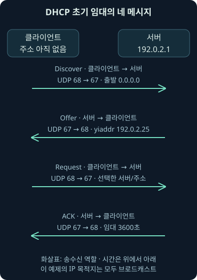
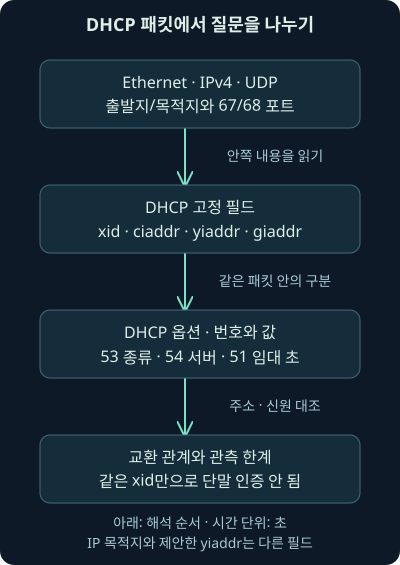
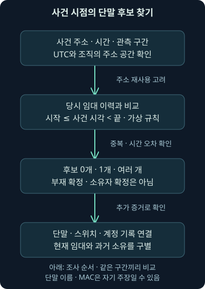

## 1. 경보에는 IP만 있는데 누구의 컴퓨터일까요?

오전 9시 30분, `192.0.2.25`에서 의심스러운 접속이 있었다는 경보를 받았습니다. 지금 자산 목록에서 그 주소를 검색하면 workstation-b가 나옵니다. 그러면 workstation-b의 사용자를 사건 당사자로 적어도 될까요? 주소를 다른 단말이 시간에 따라 나눠 썼다면 이야기가 달라집니다.

앞선 두 강의에서는 메일의 표시 이름·봉투·서명을 구별했습니다. 이번에는 주소와 단말 이름이 같은 종류의 신원이 아니라는 점을 네트워크에 적용하겠습니다. 둘째 날 15강은 DHCP의 초기 주소 임대, 패킷 필드, 사건 시점의 임대 이력, 이름·MAC 주소를 이용한 조사와 그 한계까지 다룹니다. **MAC 주소**는 같은 링크에서 장치의 네트워크 인터페이스를 구별하는 데 쓰는 주소이며, 뒤에서 IP·이름·실제 소유자와의 차이를 연결하겠습니다.

주소·단말·시간·MAC은 자체 가상 예제입니다. 제공하는 PCAP도 실제망에서 수집한 것이 아니라 오프라인에서 직접 만든 패킷 파일입니다. 실제로 수행한 것은 이 파일의 해석과 가상 시간 구간 계산이며, 원래 워크북·VM·DHCP 서버를 실행한 결과가 아닙니다.

## 2. 호텔 객실 번호와 투숙객 이름을 나누어 생각해 보세요

객실 305호에서 문제가 생겼다는 말을 들으면 예약 장부의 날짜부터 확인합니다. 오늘 그 방을 쓰는 사람이 어제도 같은 사람이었다고 가정하지 않기 때문입니다. 방 번호는 위치를 찾는 데 유용하지만 시간과 장부가 없으면 사람을 식별하는 데 부족합니다.

**DHCP**, Dynamic Host Configuration Protocol은 단말에 IP 주소와 관련 설정을 전달하고 일정 기간 사용할 주소를 관리하는 프로토콜입니다. 그 사용 기간을 **임대**, lease라고 부릅니다. 호텔 비유의 객실 번호가 IP, 장부가 임대 이력에 해당합니다.

실제 기술에서는 한 단말이 여러 인터페이스·주소를 가질 수 있고, 장부의 단말 이름도 단말이 제시한 주장일 수 있습니다. 호텔의 신분증 확인과 똑같은 인증 절차가 DHCP에 자동 포함되는 것은 아닙니다. “주소와 연결되는 후보를 찾았다”와 “실제 소유자를 확인했다”를 나눠 적어야 합니다.

2026년 11월 7일 Microsoft의 DHCP Server 설명에서 주소·관련 설정의 자동 할당과 관리를 확인했습니다. Windows Server의 해당 기능 설명과 아래 IPv4 프로토콜 원리를 구별해 읽습니다. [DHCP Server의 역할](https://learn.microsoft.com/en-us/windows-server/networking/technologies/dhcp/dhcp-top)

## 3. 처음 연결한 단말은 주소도 서버 위치도 모릅니다

고정 주소를 수동으로 설정하지 않은 단말이 처음 연결됐다고 합시다. 아직 사용할 IPv4 주소가 없고 어느 서버에 물어볼지도 모릅니다. 그래서 초기 요청에는 `0.0.0.0`이라는 아직 설정되지 않은 출발지와 `255.255.255.255`라는 제한 브로드캐스트 목적지가 등장할 수 있습니다.

**브로드캐스트**는 같은 링크의 여러 장치가 받을 수 있도록 보내는 방식입니다. 인터넷의 모든 서버에 뿌리는 통신이라는 뜻은 아닙니다. 네트워크 경계를 넘어 DHCP 서버에 전달해야 한다면 뒤에서 설명할 중계 기능이 관련됩니다.

DHCPv4는 UDP를 사용하며 기본적으로 클라이언트 쪽 포트 68, 서버 쪽 포트 67을 사용합니다. 앞선 TCP의 연결 수립을 DHCP의 필수 첫 단계로 끼워 넣지 않습니다. 포트는 통신 역할의 단서이고, 실제 내용은 메시지 필드와 함께 읽습니다.

## 4. Discover·Offer·Request·ACK는 서로 다른 약속입니다

초기 임대 과정을 네 이름의 앞글자로 **DORA**라고 부르기도 합니다. Discover는 서버를 찾는 메시지, Offer는 서버의 제안, Request는 클라이언트의 선택 요청, ACK는 서버의 승인 응답입니다. ACK는 acknowledgement의 줄임말입니다.

가상 서버가 `192.0.2.25`를 제안했다고 해서 그 단말이 이미 그 주소로 모든 통신을 시작했다고 쓰지 않습니다. 제안과 요청, 서버의 승인, 실제 단말의 설정·후속 사용은 차례대로 확인할 질문입니다.

다음 그림은 릴레이가 없는 한 링크의 가상 초기 교환입니다. 화살표는 클라이언트·서버의 송수신 역할이고, 이 예제에서 실제 IP 목적지는 네 메시지 모두 브로드캐스트입니다. 서버가 제안한 주소는 IP 목적지와 별도 필드에 들어갑니다.



## 5. 여러 Offer를 받으면 어떻게 하나를 고를까요?

한 클라이언트가 여러 서버의 제안을 받을 수 있습니다. 클라이언트는 그중 하나를 선택해 서버 식별자와 원하는 주소를 요청에 담습니다. 정상적으로 여러 서버를 운영할 수도 있으므로 Offer가 둘이라는 이유만으로 비인가 서버라고 결론 내리지 않습니다.

선택 기준도 “가장 먼저 온 제안이 무조건 선택된다”로 고정하지 않습니다. 기존에 사용한 서버 등 구현과 상태에 따른 선택이 가능합니다. 초기 선택 단계의 Request를 다른 서버도 읽을 수 있게 보내는 이유는 자신이 선택되지 않았다는 사실을 알 수 있게 하기 위해서입니다.

2026년 11월 7일 RFC 2131의 초기 선택·응답 주소·재임대 절차를 확인했습니다. 오래된 기본 흐름은 유효하지만 자료의 그림에 나온 주소를 모든 상태의 고정 규칙으로 외우지는 않습니다. [DHCPv4의 동작과 상태](https://www.rfc-editor.org/rfc/rfc2131.html)

## 6. 바깥 목적지와 안쪽 제안 주소는 다른 필드입니다

우편 봉투의 배송 주소와 안에 적힌 새 사무실 주소가 다를 수 있듯, 패킷을 어디로 보내는지와 어떤 주소를 쓰라고 제안하는지는 다른 질문입니다. DHCP의 고정 필드와 옵션을 함께 열어보면 이 구분이 보입니다.

**필드**는 메시지 구조 안의 정해진 항목이고, **옵션**은 번호·길이·값으로 설정 정보를 전달하는 항목입니다. 다음 표는 이번 예제에서 읽을 질문을 비교합니다. 표의 이름을 외우기보다 어느 주소가 어느 역할인지 설명해 보세요.

| 항목 | 역할 | 조사에서 남길 질문 |
| --- | --- | --- |
| IP 출발지·목적지 | 해당 패킷의 전달 방향 | 어디에서 관측한 어느 구간인가 |
| xid | 교환을 대응시키는 transaction ID, 거래 식별값 | 같은 요청의 응답 후보인가 |
| ciaddr | 이미 설정한 클라이언트 주소에 관한 필드 | 초기 상태인가, 재임대 상태인가 |
| yiaddr | 서버가 클라이언트에 제공하는 주소 필드 | 제안·승인한 주소는 무엇인가 |
| giaddr | 중계 에이전트 주소에 관한 필드 | 릴레이가 있는 경로인가 |
| chaddr | 클라이언트 하드웨어 주소 필드 | 어떤 링크 주소를 주장했나 |
| 옵션 53·54 | 메시지 종류·서버 식별자 | 어떤 단계이며 누구의 제안인가 |
| 옵션 51·61·12 | 임대 시간·클라이언트 식별자·호스트 이름 | 시간과 단말 후보를 어떻게 연결하나 |

**transaction ID**는 같은 교환을 연결하는 값이지 사람이나 장치의 영구 인증번호가 아닙니다. 충돌·재전송·여러 단말을 고려해야 하므로 xid 하나만으로 묶지 않습니다. 시간·클라이언트 식별자·하드웨어 주소·서버·관측 위치를 함께 확인합니다.



## 7. 옵션은 주소 외의 설정과 식별 단서도 전달합니다

주소만 얻어서는 네트워크를 제대로 사용하지 못할 수 있습니다. 서브넷 마스크, 기본 라우터, DNS 서버 같은 설정이 필요하기 때문입니다. 각각 무엇을 같은 네트워크로 볼지, 다른 네트워크로 어디를 거칠지, 이름을 어디에 물어볼지와 연결됩니다.

예제의 옵션 50은 요청 주소, 51은 임대 시간, 53은 메시지 종류, 54는 서버 식별자입니다. 옵션 12의 호스트 이름과 61의 클라이언트 식별자도 기록에 나타날 수 있습니다. 61이 항상 MAC 주소 그 자체인 것은 아니며 구현·형식을 확인해야 합니다.

RFC 2132의 옵션 정의와 RFC 6842의 서버 응답에 담는 클라이언트 식별자 갱신을 2026년 11월 7일 대조했습니다. 이번 파일의 서버 응답에는 동일한 61 값도 넣었습니다. 옵션 이름만 보고 실제 사람의 인증으로 확대하지 않습니다. [옵션의 번호와 값](https://www.rfc-editor.org/rfc/rfc2132.html), [서버 응답의 클라이언트 식별자](https://www.rfc-editor.org/rfc/rfc6842.html)

## 8. ACK가 항상 제안 주소로 유니캐스트되는 것은 아닙니다

**유니캐스트**는 특정 목적지로 보내는 방식입니다. 초기 클라이언트가 아직 주소를 사용할 준비가 안 됐다면 서버의 Offer·ACK를 브로드캐스트로 받아야 할 수 있습니다. 이미 주소가 설정된 상태나 릴레이를 거친 상태에서는 경로와 목적지가 달라집니다.

따라서 “Offer는 반드시 0.0.0.0으로 보낸다” 또는 “ACK는 언제나 제안 주소로 보낸다”라는 단일 규칙으로 분석하지 않습니다. 브로드캐스트 플래그, ciaddr·giaddr, 클라이언트 상태를 함께 봅니다. 예제는 브로드캐스트 플래그를 켠 초기 상황 하나만 보여줍니다.

그림의 클라이언트 주소와 서버의 서브넷 표기가 서로 달라 보이면 그대로 정상 구성이라고 복사하지 말고 실제 필드·마스크·경로를 확인하세요. 이번 자체 사례에서는 제안·요청·승인 주소를 `192.0.2.25`로 일관되게 맞췄습니다.

## 9. 다시 임대할 때마다 네 메시지가 모두 필요한가요?

이미 주소를 사용하는 클라이언트가 임대를 늘리는 **갱신**, renewal 단계라면 초기 Discover부터 다시 시작하는 모양만 나타나는 것은 아닙니다. 원래 서버에 갱신을 요청하다가 응답을 받지 못해 다른 서버의 응답도 구하는 상태로 넘어갈 수 있습니다.

T1·T2는 그 전환 시점을 나타내는 타이머입니다. 서버가 값을 지정할 수 있고 기본 관계로 임대 기간의 0.5와 0.875가 사용됩니다. 임대가 3600초라면 `3600 × 0.5 = 1800초`, `3600 × 0.875 = 3150초`입니다. 곱하는 비율은 전체 임대 기간 중 어느 시점을 기준으로 삼는지 나타냅니다.

이 계산은 사건 당시 단말이 정확히 그 초에 요청했다는 관측이 아닙니다. 실제 옵션·클라이언트 구현·재전송·관측 시간을 확인해야 합니다. 제한된 캡처에 Discover가 없다는 사실을 DHCP를 사용하지 않았다는 결론으로 바꾸지 않습니다.

## 10. 주소 임대가 끝나도 과거의 사용자는 바뀌지 않습니다

가상 장부에서 workstation-a가 09:00:03부터 10:00:03까지 주소를 쓰고, 그 뒤 workstation-b가 같은 주소를 쓴다고 합시다. 09:30의 경보는 a의 임대 구간과 연결됩니다. 현재 장부에 b만 보인다면 현재 상태로 과거를 덮어쓴 셈이 됩니다.

이번 시간 비교는 **반열린 구간**이라는 규칙을 사용합니다. `시작 ≤ 사건 시각 < 끝`으로 시작은 포함하고 끝은 제외합니다. 인접 구간의 경계에서 앞·뒤 단말을 동시에 고르지 않기 위한 자체 데이터 규칙입니다. 실제 서버의 만료·해제·정리 시각 의미까지 이 규칙과 같다고 가정하지 않습니다.

시계 오차가 있으면 경계의 후보가 바뀔 수 있습니다. 사건 10:00:03과 두 서버의 기록 10:00:02·10:00:04를 초 단위로만 기계적으로 연결하지 말고 시간대·동기화·수집 지연을 확인하세요. 필요하면 불확실성 구간 안의 여러 후보를 남깁니다.

## 11. 같은 주소라도 같은 조직의 같은 구간인가요?

서로 분리된 지점·가상 네트워크가 같은 주소 범위를 재사용할 수 있습니다. 그래서 장부에는 주소 외에 **scope**, 이 예제에서 주소 공간을 구분하는 범위 이름을 넣었습니다. office-a와 office-b의 `192.0.2.25`는 같은 후보 목록으로 합치지 않습니다.

외부 경보가 주소 변환 장치의 공개 주소만 담고 있다면 DHCP 장부와 바로 연결되지 않을 수 있습니다. 주소 변환 로그의 시간·포트·내부 주소를 거쳐야 합니다. VPN·무선 접속·여러 네트워크 카드가 있다면 각 접속 구간도 확인합니다.

IPv4 DHCP 기록이 없다고 IPv6·고정 주소·다른 주소 설정 방식까지 없었던 것은 아닙니다. 이번 DORA 예제와 계산기는 IPv4의 한 구간에 한정합니다. 조사 범위를 명시하면 “검색 결과 없음”을 실제 단말 부재로 잘못 읽는 일을 줄일 수 있습니다.



## 12. 호스트 이름이 회사 규칙을 따르면 정상 단말일까요?

DHCP 기록의 이름을 조직의 명명 규칙과 비교하면 새 장비·오입력·비인가 연결 후보를 찾는 데 도움이 됩니다. 허용 자산 목록에 없는 이름이나 가정용 장비처럼 보이는 이름은 조사 순서를 정하는 단서가 될 수 있습니다.

그러나 이름은 단말이 제시한 값일 수 있습니다. 정상 장비와 비슷하게 바꿀 수도 있고, 관리자가 승인한 새 장비의 등록이 늦을 수도 있습니다. 이름이 규칙에 맞는다는 사실은 보안 상태나 사용자의 승인을 증명하지 않습니다.

승인 여부는 자산 관리, 단말 관리 에이전트, 인증된 네트워크 접속, 스위치 포트·무선 연결 이력과 대조합니다. **NAC**, Network Access Control은 네트워크 접속을 정책에 따라 통제하는 체계를 말합니다. DHCP로 주소를 받는 일과 NAC의 접속 승인은 같은 절차가 아닙니다.

## 13. MAC 앞 세 바이트만으로 제조사를 단정하지 않습니다

일반적인 Ethernet MAC 주소는 48비트, 여섯 옥텟으로 표시합니다. **옥텟**은 8비트이고 `02:00:00:00:00:25`의 콜론으로 나뉜 각 두 자리 부분이 하나입니다. 여덟 옥텟 예시를 일반적인 48비트 Ethernet 주소로 읽지 않습니다.

**OUI**, Organizationally Unique Identifier는 IEEE가 관리하는 24비트 조직 식별자입니다. 전통적인 전역 주소의 접두 부분과 등록 주체를 연결하는 단서지만, 등록 주체가 곧 완제품 제조사·현재 소유자라는 보장은 없습니다. 할당 블록 형식도 확인해야 합니다.

지역 관리 주소나 무작위 주소에는 단순 제조사 조회를 적용하지 않습니다. 이번 `02`로 시작하는 MAC은 자체로 만든 지역 관리 주소입니다. 이를 조회해 실제 제조사가 확인됐다고 설명하지 않습니다. 이름·MAC은 변경·복제될 수 있고 무작위화는 정상적인 개인정보 보호 기능일 수도 있습니다.

2026년 11월 7일 IEEE의 식별자 지침과 2025년 3월 RFC 9724의 주소 무작위화 설명을 확인했습니다. “알려진 제조사만 허용하면 모든 비인가 단말을 찾는다”는 보장으로 사용하지 않습니다. [IEEE 식별자 지침](https://standards-support.ieee.org/hc/en-us/articles/4888705676564-Guidelines-for-Use-of-Extended-Unique-Identifier-EUI-Organizationally-Unique-Identifier-OUI-and-Company-ID-CID), [MAC 무작위화의 현재 맥락](https://www.rfc-editor.org/rfc/rfc9724.html)

## 14. 릴레이가 있으면 관측한 상대도 달라집니다

**DHCP 릴레이**, relay는 클라이언트의 요청을 다른 구간의 서버에 중계하는 기능입니다. 이때 서버 쪽에서 보이는 전달 경로가 단말과 같은 링크의 직접 교환과 다를 수 있습니다. giaddr와 중계 정보를 확인하는 이유입니다.

옵션 82처럼 접속 회선·중계 정보를 더하는 방식도 있습니다. 다만 그 값이 어떤 신뢰 구간에서 누가 넣고 관리하는지 확인해야 합니다. 문자열에 포트 이름이 있다고 물리적 위치가 독립적으로 인증된 것은 아닙니다. [중계 에이전트 정보의 구조](https://www.rfc-editor.org/rfc/rfc3046.html)

이번 PCAP에는 릴레이·옵션 82·실제 스위치 연결 자료가 없습니다. 이 파일의 직접 교환만으로 여러 VLAN 환경의 모든 목적지·포트 규칙을 재현했다고 일반화하지 않습니다.

## 15. 자체 패킷을 실제로 읽어 보았습니다

[네 메시지 PCAP](../../assets/network-security/day02-lab15/dora.pcap), [ACK가 빠진 PCAP](../../assets/network-security/day02-lab15/missing-ack.pcap), [해석 프로그램](../../assets/network-security/day02-lab15/inspect_dhcp.py), [안내](../../assets/network-security/day02-lab15/README.txt)를 제공합니다. Python 3.12.14 표준 라이브러리로 다음을 실제 실행했습니다.

```text
python inspect_dhcp.py dora.pcap
python inspect_dhcp.py missing-ack.pcap
```

같은 폴더에서 `python`은 실행기를, `inspect_dhcp.py`는 실행할 프로그램을 지정합니다. 마지막 값은 읽을 파일의 경로입니다. 패킷 파일을 읽어 출력할 뿐 네트워크 인터페이스로 전송하지 않습니다.

이 프로그램은 고정 PCAP 형식·Ethernet·분할되지 않은 IPv4·UDP·작은 DHCP 옵션 부분집합만 지원합니다. pcapng·VLAN·IPv6·옵션 오버로드·중복 옵션·복잡한 재전송의 일반 분석기가 아닙니다. 지원 밖 입력의 오류를 실제망의 공격 판정으로 바꾸지 않습니다.

## 16. 네 프레임에서 직접 확인한 것은 무엇일까요?

실행 결과 1~4번 프레임은 Discover·Offer·Request·ACK 순서였습니다. 시각은 09:00:00부터 09:00:03까지 UTC로 한 초씩 증가했습니다. 이것은 생성 시 지정한 가상 시각이며 실제망 지연을 측정한 결과가 아닙니다.

모든 xid는 `0x45000001`, chaddr는 `02:00:00:00:00:25`였습니다. 제안·요청·승인 주소 `192.0.2.25`와 서버 식별자 `192.0.2.1`이 대응했고 ACK의 임대 시간은 3600초였습니다. IPv4·UDP 길이와 체크섬도 프로그램으로 확인했습니다. **체크섬**은 전송 자료의 오류를 검출하는 값이지 발신 단말을 인증하는 전자서명이 아닙니다.

작은 비교의 `four_message_consistency`는 참이지만 실제 단말의 설정·소유자는 미검증입니다. ACK가 빠진 파일은 세 프레임, `ack_observed`는 거짓, 네 메시지 일치도 거짓이었습니다. 서버가 실제로 응답하지 않았다는 결론이 아니라 그 파일에서 ACK를 관측하지 못했다는 결과입니다.

## 17. 가상 임대 장부에서 사건 시점을 계산했습니다

[임대·조회 예제](../../assets/network-security/day02-lab15/leases.json)와 [시간 비교 프로그램](../../assets/network-security/day02-lab15/correlate_lease.py)은 패킷과 별도로 작성한 가상 장부입니다. PCAP 네 프레임에서 회사의 전체 임대 이력을 자동 복원한 자료가 아닙니다.

```text
python correlate_lease.py leases.json
```

실행기 뒤의 프로그램 이름을 시간 비교 프로그램으로 바꾸고, 마지막에 입력할 JSON 자료 경로를 적습니다. JSON은 항목 이름과 값을 구조적으로 저장한 텍스트 형식입니다. 이 프로그램은 같은 scope·IP·반열린 시간 구간만 비교합니다.

실제 계산한 결과 Q1은 office-a의 09:30에 workstation-a, Q2는 10:00:03 경계에서 workstation-b, Q3은 office-b의 같은 주소에서 workstation-c였습니다. Q4는 마지막 임대의 끝인 11:00:03이므로 후보가 없었습니다. 이는 제공 장부 안의 결과이고 실제 단말·소유자 확인은 모두 거짓으로 남겼습니다.

기록의 구간을 겹치게 바꾸면 후보가 여러 개일 수도 있습니다. 그때 최신 행 하나를 마음대로 선택하면 안 됩니다. 실제 중복 주소, 수집 중복, 시계 오차, 임대 해제·만료 처리의 차이를 대조해야 합니다.

## 18. Wireshark 필터는 어떤 질문에 쓸까요?

다음은 공식 필드 문서와 대조한 **표시 필터 예시**이며 이번에 Wireshark에서 실행한 결과는 아닙니다. 먼저 `dhcp`로 해석된 패킷을 보고, 같은 교환 후보를 좁힌 뒤 단계를 확인하는 순서입니다.

```text
dhcp
dhcp.id == 0x45000001 && dhcp.hw.mac_addr == 02:00:00:00:00:25
dhcp.option.dhcp == 5
```

두 번째 줄의 `==`는 같은 값을 고르고 `&&`는 두 조건을 모두 요구합니다. xid만 같은 다른 교환을 섞지 않으려 MAC 조건도 넣었지만, 이 조합이 단말 인증은 아닙니다. 세 번째 줄의 5는 옵션 53의 ACK 종류 값입니다. Request·Offer를 숨긴 상태에서 전체 교환이 없었다고 판단하지 않습니다.

구형 설명의 `bootp`와 현재 `dhcp`를 같은 버전의 문법이라고 가정하지 않습니다. 2026년 11월 7일 공식 참조에서 bootp 계열은 1.0.0~2.6.20, 위 dhcp 필드는 3.0.0~4.6.9 범위로 표기됨을 확인했습니다. 이 범위는 확인한 문서의 지원 표기이며 실제 설치 버전은 따로 확인합니다. [현재 DHCP 필드](https://www.wireshark.org/docs/dfref/d/dhcp.html), [과거 BOOTP 필드](https://www.wireshark.org/docs/dfref/b/bootp.html)

## 19. 결과가 없거나 이름이 이상하면 다음에 무엇을 볼까요?

주소가 안 보이면 먼저 시간·주소 공간·수집 위치·로그 보존 범위를 봅니다. 브로드캐스트가 수집 지점에 도달하지 않았거나 캡처를 늦게 시작했을 수 있고, 갱신·고정 주소·IPv6·릴레이 등 다른 경로일 수도 있습니다. 파서가 지원하지 않는 형식인지도 구별합니다.

이상한 이름·MAC·임대 서버가 보이면 비인가 장비 가설을 세울 수 있습니다. 그러나 승인된 새 장비, 무작위 MAC, 가상화, 관리 실수도 후보입니다. 자산·NAC·스위치·무선·DHCP 서버·단말의 기록을 같은 시점과 범위로 대조합니다.

조사 메모는 “가상 장부의 해당 구간에서 a가 후보였다. 실제 로그 출처·시계·단말 및 사용자 관계는 추가 확인이 필요하다”처럼 씁니다. 다음 강의에서는 이렇게 찾은 단말 후보가 다른 서버의 파일 공유에 접근했을 때 무엇까지 알 수 있는지 연결하겠습니다.

## 20. 복습: 주소·시각·후보를 나누어 적용해 보세요

### 질문 1. 지금 192.0.2.25를 쓰는 단말이 오전 사건의 단말인가요?

**해설:** 주소가 재사용될 수 있습니다. 사건 시점의 임대 이력과 주소 공간을 먼저 비교해야 합니다.

### 질문 2. Discover의 0.0.0.0은 공격자가 출발지를 숨겼다는 확정 증거인가요?

**해설:** 초기 클라이언트가 아직 주소를 설정하지 않은 정상 상황일 수 있습니다. 메시지 단계와 필드를 함께 봅니다.

### 질문 3. Offer에서 yiaddr가 보이면 단말의 설정 완료도 확인됐나요?

**해설:** 주소 제안의 관측입니다. 요청·승인·실제 단말 적용·후속 사용은 별도 확인이 필요합니다.

### 질문 4. ACK는 언제나 제안 주소로 유니캐스트하나요?

**해설:** 상태·브로드캐스트 플래그·릴레이에 따라 다릅니다. 자체 파일의 ACK는 브로드캐스트입니다.

### 질문 5. Offer 두 개면 비인가 DHCP 서버가 확정되나요?

**해설:** 정상적인 다중 서버도 가능합니다. 승인된 구성·선택 결과·실제 서버와 경로를 확인합니다.

### 질문 6. 임대 3600초의 기본 T1·T2는 각각 얼마인가요?

**해설:** 0.5와 0.875를 곱해 1800초·3150초입니다. 서버의 옵션과 실제 동작 시점은 별도로 확인합니다.

### 질문 7. xid가 같으면 같은 실제 단말인가요?

**해설:** 교환 대응값이며 영구 인증번호가 아닙니다. 다른 신원 필드·시각·관측 구간을 연결해야 합니다.

### 질문 8. 10:00:03 경계에서 예제는 왜 b를 골랐나요?

**해설:** 시작 포함·끝 제외라는 자체 구간 규칙 때문입니다. a의 끝은 제외되고 b의 시작은 포함됩니다.

### 질문 9. 같은 IP인데 office-a와 office-b 후보를 합쳐도 되나요?

**해설:** 분리된 주소 공간일 수 있습니다. 먼저 경보의 실제 구간을 확인해야 합니다.

### 질문 10. 02:00:00:00:00:25를 앞 세 바이트로 제조사 판정해도 되나요?

**해설:** 예제의 지역 관리 주소입니다. 전역 OUI의 제조사 단서처럼 일반화하지 않으며 실제 소유자도 인증하지 않습니다.

### 질문 11. MAC이 바뀌었으면 반드시 공격자의 위장인가요?

**해설:** 정상 무작위화·가상화·설정 변경도 가능합니다. 다른 자산·접속 기록과 대조해야 합니다.

### 질문 12. ACK 없는 파일은 서버가 승인하지 않았음을 증명하나요?

**해설:** 그 수집 파일에서 관측하지 못했다는 뜻입니다. 수집 시간·방향·누락·경로를 확인해야 합니다.

### 질문 13. 후보가 없거나 여러 개면 최신 행 하나를 골라도 되나요?

**해설:** 제공 자료의 범위와 모호함을 남겨야 합니다. 시간 오차·중복·주소 공간·다른 설정 방식을 추가 확인합니다.

### 질문 14. DHCP 장부에서 회사 이름을 가진 단말을 찾으면 사용자 승인까지 확인됐나요?

**해설:** 단말 이름은 자기 주장일 수 있습니다. 실제 접속·자산·계정·업무 승인 근거를 별도로 확보해야 합니다.
