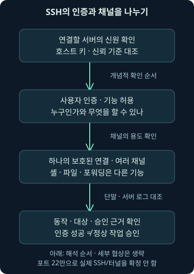
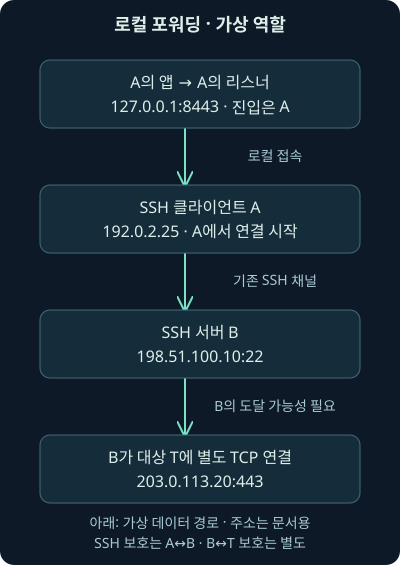
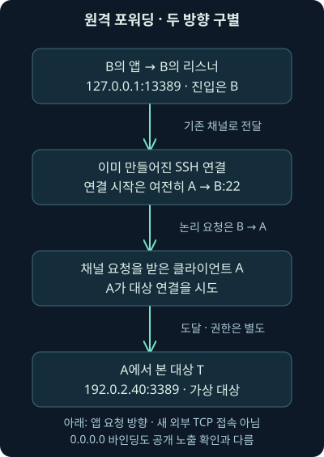

## 1. 밖으로 나간 연결인데 안쪽 작업이 생길 수 있을까요?

방화벽 기록에 내부 단말 A가 외부 서버 B의 22번 포트로 접속한 흔적이 있습니다. 외부에서 내부로 새로 들어온 TCP 연결은 보이지 않습니다. 그러면 B 쪽에서 시작한 작업이 A나 내부의 다른 서비스에 전달될 가능성도 없다고 말할 수 있을까요?

16강에서는 SMB 연결·인증·공유·실행을 나눴습니다. 이번에는 연결을 시작한 방향과 그 연결 안에서 요청을 시작한 방향을 구별하겠습니다. 둘째 날 17강은 SSH의 인증·채널·파일 전송, 로컬·원격 포워딩, X11, 관측 한계와 조사 근거까지 다룹니다.

주소·역할·경로·정책 값은 독립적인 가상 예제입니다. 실제 SSH 서버·리스너·터널을 만들거나 원격 접속하지 않았습니다. 실제 수행한 것은 가상 메타데이터의 경로 역할 계산입니다. 원래 워크북·VM·실제 패킷 분석 결과로 설명하지 않습니다.

## 2. 먼저 건 전화로 상대도 질문할 수 있습니다

A가 B에게 전화를 걸었다고 합시다. 통화를 시작한 사람은 A지만, 통화가 이어지는 동안 B도 A에게 질문할 수 있습니다. 통화 개시 방향과 대화 속 요청의 방향은 같은 개념이 아닙니다.

이 비유는 기존 연결 안의 양방향 요청을 이해하는 데 유용합니다. 다만 SSH에서는 사용자가 할 수 있는 기능·채널·대상·권한을 별도로 협상하고 제한합니다. 전화가 연결됐다는 사실 하나가 모든 내부 장치에 접속할 권한을 주지는 않습니다.

따라서 “외부에서 새 TCP 연결이 없었다”와 “기존 채널을 통해 외부의 작업 요청이 전달되지 않았다”를 같은 문장으로 쓰지 않습니다. 이 차이가 이번 강의의 중심입니다.

## 3. SSH는 서버 신원과 사용자 인증을 나눠 다룹니다

**SSH**, Secure Shell은 신뢰할 수 없는 네트워크에서 원격 로그인과 다른 네트워크 기능을 보호하는 프로토콜 체계입니다. **호스트 키**는 접속한 서버의 신원을 확인하는 데 사용하는 키이며, 사용자가 서버에 로그인할 때 쓰는 인증 자료와 역할이 다릅니다.

접속한 서버가 예상한 서버인지 확인하는 질문과, 서버가 사용자를 받아들였는지 확인하는 질문을 나눠보세요. 서버 신원 확인을 생략하면 보호된 통신이 예상하지 않은 상대와 맺어질 수 있습니다. 반대로 올바른 서버에 인증했다고 모든 작업이 업무상 승인됐다는 뜻은 아닙니다.

사용자 인증은 공개키만 가능한 것으로 설명하지 않습니다. 비밀번호 등 다른 방식과 구현·정책이 관련될 수 있습니다. 2026년 11월 7일 RFC 4251의 구조와 RFC 4252의 사용자 인증 범위를 확인했습니다. 현재 허용 알고리즘·구현 정책을 오래된 기본 명세 하나로 고정하지 않습니다. [SSH 구조](https://www.rfc-editor.org/rfc/rfc4251.html), [사용자 인증](https://www.rfc-editor.org/rfc/rfc4252.html)

## 4. 하나의 연결 안에 서로 다른 채널이 있습니다

**채널**은 SSH 연결 안에서 특정 기능의 데이터를 주고받는 논리적인 통로입니다. 한 통화에서 업무를 구분해 이야기하듯, 하나의 보호된 연결에 셸·프로그램·파일·전달 기능이 함께 연결될 수 있습니다. 이처럼 여러 통로를 나눠 사용하는 구조를 다중화라고 부릅니다.

**셸**은 사용자의 명령을 해석해 실행하는 환경입니다. 셸을 열지 않고 특정 프로그램이나 기능만 사용할 수도 있습니다. 따라서 대화형 명령창 기록이 없다는 사실만으로 SSH가 사용되지 않았다고 결론 내리지 않습니다.

RFC 4254는 채널·TCP 전달·X11 같은 연결 기능을 설명합니다. 채널이 존재한다는 원리와 해당 계정에 실제로 허용한 기능은 구별해야 합니다. [SSH 연결 기능과 채널](https://www.rfc-editor.org/rfc/rfc4254.html)



## 5. 암호화된 파일 전송도 정상·오용 두 경우가 있습니다

**SFTP**는 SSH 위에서 파일을 다루는 기능입니다. 이름이 비슷한 FTP에 단순히 암호화 표시를 붙인 것과 같은 프로토콜은 아닙니다. 정상적인 서버 관리·자료 교환에도 사용되지만 허용 계정이나 단말이 악용되면 자료 반출 경로가 될 수도 있습니다.

암호화된 구간에서는 일반적인 네트워크 캡처만으로 파일명·내용·명령을 그대로 읽지 못할 수 있습니다. 그렇다고 목적지·시각·전송량·연결 시간·단말의 실행 과정 같은 근거까지 모두 사라지는 것은 아닙니다.

큰 전송량 하나를 바로 유출이라고 판정하지도 않습니다. 승인된 백업·배포·자료 교환인지, 어느 계정과 파일이 관련됐는지 확인해야 합니다. 실제 파일 서버·단말·접근 로그와 대조할 질문을 남깁니다.

## 6. 포워딩의 로컬·원격은 누구를 기준으로 할까요?

**포트 포워딩**은 특정 포트로 들어온 TCP 통신을 SSH 채널을 거쳐 다른 대상 연결에 전달하는 기능입니다. **리스너**는 연결 요청을 기다리는 소켓이고, **바인딩 주소**는 그 리스너가 어느 인터페이스에서 연결을 받을지 지정하는 주소입니다.

이 강의에서는 항상 A를 SSH 클라이언트, B를 SSH 서버로 고정합니다. A가 B로 SSH 연결을 시작합니다. 로컬·원격이라는 말은 이 클라이언트 관점의 구분이지, 조직 내부·인터넷이라는 보안 구역 이름이 아닙니다.

다음 표에서 진입 리스너와 최종 대상에 연결하는 쪽을 먼저 보세요. 두 역할을 나누면 같은 127.0.0.1이 어느 컴퓨터를 뜻하는지도 이해할 수 있습니다.

| 가상 전달 모형 | 리스너의 위치 | 최종 대상 연결을 시도하는 쪽 | SSH 연결 개시 |
| --- | --- | --- | --- |
| 로컬 포워딩 | 클라이언트 A | 서버 B | A → B |
| 원격 포워딩 | 서버 B | 클라이언트 A | A → B |

## 7. 로컬 포워딩에서는 B가 대상에 연결합니다

가상 A의 앱이 A의 `127.0.0.1:8443`에 접속한다고 합시다. 이 통신을 SSH 채널로 B에 전달하고, B가 대상 T의 `203.0.113.20:443`에 별도 TCP 연결을 시도하는 모형입니다. A의 리스너 포트 8443과 대상 포트 443은 같은 값일 필요가 없습니다.

`127.0.0.1`은 해당 호스트 자신에게 돌아오는 루프백 주소입니다. 첫 접속은 A의 로컬 앱이 A의 리스너로 하는 접속입니다. 최종 대상과 통신할 수 있어야 하는 쪽은 B입니다. T가 SSH 서버이거나 B가 T에 다시 SSH 로그인할 수 있어야만 하는 것은 아닙니다.

또한 SSH의 보호 구간은 A와 B 사이입니다. B에서 T로 나가는 별도 연결의 보호는 대상 프로토콜·정책에 달려 있습니다. “한 번 SSH를 거쳤으니 끝까지 모든 구간이 같은 SSH 암호화다”라고 쓰지 않습니다.



## 8. 원격 포워딩에서도 SSH 연결은 A가 시작할 수 있습니다

이번에는 B의 `127.0.0.1:13389`를 진입 리스너로 가정합니다. B 쪽 앱의 요청이 기존 SSH 채널을 통해 A로 전달되고, A가 내부 대상 T의 `192.0.2.40:3389`에 연결을 시도하는 모형입니다.

방화벽에서 처음 본 SSH 연결은 여전히 A에서 B로 시작한 연결입니다. 그런데 애플리케이션 요청의 시작은 B 쪽일 수 있습니다. 이것이 바깥 연결의 개시 방향과 안쪽 요청의 방향을 나눠야 하는 이유입니다.

이 모형이 B에서 A로 새 TCP 연결을 직접 생성한다는 뜻은 아닙니다. 기존 SSH 연결의 채널을 이용하는 부분과 A에서 T로 만드는 별도 연결을 나눠 봅니다. 실제 사용에는 허용 기능·리스너·대상 도달·인증 조건도 필요합니다.



## 9. 대상 127.0.0.1은 어느 컴퓨터인가요?

원격 포워딩의 최종 대상을 `127.0.0.1:3389`로 바꾼다고 합시다. 최종 대상 연결을 시도하는 A의 루프백입니다. B의 루프백에 리스너가 있다는 사실과 A의 루프백을 대상으로 삼는 사실은 별도입니다.

로컬 포워딩에서 최종 대상이 127.0.0.1이면 반대로 B 자신의 루프백을 가리킵니다. 숫자를 복사하는 대신 “누가 이 주소에 연결하는가?”를 문장으로 먼저 적어보세요.

이런 구조에서는 최종 서비스가 기록한 연결 상대가 루프백이나 중간 호스트일 수 있습니다. 그 주소만으로 최초 조작자의 위치·사람을 확정하지 않습니다. 터널 양끝·프로세스·계정·시각을 연결해야 합니다.

## 10. 루프백 바인딩과 모든 인터페이스 바인딩은 다릅니다

B 리스너가 127.0.0.1에만 바인딩돼 있다면 B의 로컬 접근과 관계됩니다. 이것을 인터넷의 누구나 곧바로 그 포트에 연결할 수 있다는 설명으로 바꾸지 않습니다. B의 계정·다른 로컬 프로세스의 접근 가능성도 별도 문제입니다.

가상 리스너를 `0.0.0.0`으로 바꾸면 모든 IPv4 인터페이스에 바인딩한다는 뜻입니다. 그러나 실제 공개 노출은 주소 구성·방화벽·라우팅·서버 정책에 달려 있습니다. 이 값 하나만으로 인터넷에서 접속 성공을 확인한 것은 아닙니다.

2026년 11월 7일 OpenSSH의 상위 OpenBSD-current 문서에서 LocalForward·RemoteForward와 바인딩 동작을 대조했습니다. 해당 ssh_config 문서는 2026년 10월 30일 표기로 확인했습니다. 실제 설치한 OpenSSH·Windows 배포판·PuTTY의 지원 옵션과 기본값을 같은 것으로 가정하지 않습니다. [클라이언트의 전달 기능](https://man.openbsd.org/ssh_config)

## 11. 중계 서버가 닿을 수 있는 범위는 왜 중요할까요?

서로 다른 보안 구역에 연결된 중계 단말이 있다면 그 단말에서 도달 가능한 서비스가 조사 대상이 됩니다. **이중 연결**, dual-homed는 한 장치가 두 네트워크 쪽 연결을 가진 상황을 설명할 때 쓰는 말입니다. 연결이 두 개 있다는 사실 자체가 자동 침해는 아닙니다.

다만 승인된 관리 구역의 SSH 접근이 다른 구역의 대상 접근으로 확장될 수 있는지 확인해야 합니다. 어느 호스트가 최종 연결을 만드는지, 경로·방화벽·대상 권한이 무엇인지가 중요합니다. SSH가 모든 방화벽·필터를 무조건 무력화하거나 모든 프로토콜을 마음대로 전달한다는 보장은 아닙니다.

고정 TCP 포워딩은 전체 네트워크에 꽂힌 것과 동일한 VPN이 아닙니다. **VPN**은 네트워크 연결을 보호·연결하는 다른 체계입니다. 기능·범위·경로가 다른데 “내부 전체에 접속 가능”이라고 확대하면 영향 범위를 잘못 판단하게 됩니다.

## 12. 동적 전달과 X11도 별도의 기능입니다

**동적 포워딩**은 프록시 요청에 따라 대상이 정해지는 전달 방식입니다. 프록시는 요청을 대신 전달하는 역할입니다. 고정 대상 하나를 적어 둔 예제와 다르므로 바깥 SSH 연결만 보고 내부의 모든 최종 대상을 복원할 수는 없습니다.

**X11 포워딩**은 원격의 그래픽 애플리케이션이 SSH 채널을 통해 화면 표시 환경을 이용하도록 연결하는 기능입니다. 반드시 원격 컴퓨터의 전체 데스크톱을 통째로 공유하는 방식은 아닙니다. 프로그램이 실행되는 위치와 표시되는 위치를 구별합니다.

X11의 신뢰·권한 설정에 따라 로컬 표시 환경의 보안도 영향을 받을 수 있습니다. OpenSSH는 ForwardX11·ForwardX11Trusted 등의 차이를 설명합니다. 파일·TCP 전달과 같은 단어로 뭉쳐 관리하지 않습니다. 이번 계산기는 동적 전달·X11을 구현하지 않았습니다.

## 13. 2019년 사례를 현재의 보편 법칙으로 바꾸지 않습니다

2019년 1월 24일 FireEye가 공개하고 현재 Mandiant의 공식 페이지에서 제공하는 조사 글은 SSH 터널로 RDP 접근을 연결한 사례를 설명합니다. 2026년 11월 7일 원래 글의 시점과 설명을 확인했습니다. 과거 사례가 보여 준 핵심은 기존 허용 연결 안의 다른 원격 작업입니다. [역사적 RDP 터널링 조사](https://cloud.google.com/blog/topics/threat-intelligence/bypassing-network-restrictions-through-rdp-tunneling/)

PuTTY의 명령행 도구인 Plink 같은 도구 이름이 보일 수도 있습니다. 그러나 실행 파일 이름 하나나 22번 포트 하나로 그 사례와 동일한 공격·성공을 특정하지 않습니다. 실제 실행 인자·리스너·계정·채널·대상·후속 세션을 대조해야 합니다.

일반적인 네트워크 센서가 암호화된 채널 안의 RDP 내용을 직접 못 읽는 상황과 “어떤 방법으로도 탐지할 수 없다”는 주장은 다릅니다. 양끝의 단말·서버 기록과 연결 메타데이터는 여전히 중요한 근거입니다.

## 14. 현재 설정 이름은 기능의 어느 부분을 제한하나요?

OpenSSH 서버의 AllowTcpForwarding은 TCP 전달 허용 범위를 다룹니다. PermitOpen은 대상 연결, PermitListen은 원격 리스너 요청, GatewayPorts는 원격 리스너의 바인딩 범위와 관련됩니다. DisableForwarding은 여러 전달 기능을 함께 제한하는 옵션입니다.

같은 이름이라도 클라이언트 문서와 서버 문서의 문맥이 다를 수 있습니다. 예를 들어 GatewayPorts를 어느 쪽 설정에서 읽는지 구별해야 합니다. 2026년 11월 7일 상위 sshd_config의 역할을 확인했으며 실제 설정을 변경하거나 이 옵션들의 지원을 실행 검증하지 않았습니다. [서버 측 기능 제한](https://man.openbsd.org/sshd_config)

전달 옵션을 제한했다고 계정에 허용한 셸·프로그램·네트워크 경로까지 모두 차단된 것은 아닙니다. 상위 문서도 셸 권한과 다른 전달 수단을 함께 고려하도록 설명합니다. 출발지·대상·계정·기능·승인·모니터링을 연결해 판단해야 합니다.

## 15. 가상 경로 역할을 실제로 계산했습니다

[여섯 가상 입력](../../assets/network-security/day02-lab17/cases.json), [경로 비교 프로그램](../../assets/network-security/day02-lab17/map_routes.py), [안내](../../assets/network-security/day02-lab17/README.txt)를 제공합니다. Python 3.12.14 표준 라이브러리로 다음을 실제 실행했습니다.

```text
python map_routes.py cases.json
```

같은 폴더에서 `python`은 실행기, `map_routes.py`는 실행할 프로그램, `cases.json`은 읽을 자료의 경로입니다. JSON은 항목과 값을 저장한 텍스트 형식입니다. 이 프로그램은 파일을 읽고 역할을 출력할 뿐 SSH 명령·소켓·리스너를 실행하지 않습니다.

입력은 IPv4와 고정 TCP 로컬·원격 전달, 종류를 모른다는 unknown 모형만 지원합니다. 실제 SSH 설정·패킷·명령행을 파싱하거나 DNS·IPv6·동적 프록시·X11을 처리하는 도구가 아닙니다. 실제 주소에 도달하는지도 검사하지 않습니다.

## 16. 여섯 결과에서 같은 것과 다른 것을 봅니다

다음 표는 실제 로컬 계산 결과입니다. 모든 사례의 바깥 연결 주장은 `192.0.2.25 → 198.51.100.10:22`로 같았습니다. 다른 것은 작성자가 가정한 전달 모형과 역할입니다.

| 사례 | 가상 조건 | 계산해 확인한 역할·한계 |
| --- | --- | --- |
| S1 | 로컬 전달·루프백 리스너 | 진입은 A, 최종 연결은 B |
| S2 | 원격 전달·루프백 리스너 | 진입은 B, 최종 연결은 A |
| S3 | S2의 바인딩만 0.0.0.0 | 모든 IPv4 인터페이스 가정, 공개 노출은 미검증 |
| S4 | 전달 종류 unknown | 진입·대상 연결 역할·가용성은 null로 남김 |
| S5 | 원격 전달의 대상이 127.0.0.1 | 대상 루프백은 A |
| S6 | 로컬 전달이지만 전달 허용을 거짓으로 가정 | 모형상 경로 가용성은 거짓 |

**null**은 값이 없거나 이 계산에서 결정하지 않았다는 표시입니다. S4에 임의의 터널 종류를 넣지 않은 이유입니다. 실제 SSH 사용·전달·인터넷 노출·사건 판단은 어느 사례에서도 확인된 값으로 바꾸지 않았습니다.

## 17. 모형의 참은 실제 연결 성공이 아닙니다

`modeled_path_available`는 “전달을 허용한다고 가정함”과 “대상에 닿는다고 가정함”이라는 두 입력의 AND, 둘 다 참인지 계산한 값입니다. 실제 인증·리스너 생성·방화벽·대상 포트·응답을 측정한 값이 아닙니다.

S6은 전달 허용 가정이 거짓이므로 모형상 가용성도 거짓입니다. 이를 실제 서버에서 차단을 확인한 결과로 보고하지 않습니다. S1~S3의 참도 실제 연결 성공이 아닙니다. 승인 값 역시 작성자의 예제 가정으로 남습니다.

모형이 불가능하다는 결과와 실제 통신 부재, 모형이 가능하다는 결과와 실제 악용 성공을 나눠 적어야 합니다. 필요한 추가 자료를 정확히 말할 수 있어야 계산이 조사에 도움이 됩니다.

## 18. 패킷에서 무엇을 보고 무엇은 더 찾아야 할까요?

다음은 공식 문서와 대조한 **미실행 Wireshark 표시 필터 예시**입니다. 이번에는 실제 SSH PCAP이나 Wireshark 결과가 없습니다.

```text
tcp.port == 22
ssh
```

첫 줄은 출발지나 목적지 TCP 포트가 22인 패킷을 고릅니다. `==`는 해당 값과 같다는 뜻입니다. SSH가 다른 포트를 사용할 수도 있고 다른 서비스가 22를 쓸 수도 있습니다. 두 번째 줄은 도구가 SSH로 해석한 내용을 고르는 조건입니다.

2026년 11월 7일 공식 참조에서 ssh의 표기 범위 1.0.0~4.6.9를 확인했습니다. 문서에 채널 관련 필드가 있다는 사실이 암호화된 모든 실제 세션을 키 없이 볼 수 있다는 뜻은 아닙니다. 해독 조건·수집 시작·버전·재조립·설정을 함께 확인합니다. [Wireshark SSH 필드](https://www.wireshark.org/docs/dfref/s/ssh.html)

## 19. 조사 메모에는 연결·채널·대상·승인을 나눠 적습니다

가상 메모는 “A에서 B로 향하는 연결이 보고됐다. 제공된 원격 포워딩 가정에서는 진입 리스너가 B, 최종 대상 연결이 A에 위치한다. 실제 프로세스·채널·리스너·대상 세션·승인 자료는 미검증이다”처럼 쓸 수 있습니다.

실제 조사라면 SSH 양끝의 프로세스·유효 설정·인증·허용 기능·소켓·방화벽과 최종 대상 서비스의 세션 기록을 연결합니다. 기본 로그가 모든 포워딩 목적지를 완전하게 남긴다고 가정하지 않습니다. 로깅 수준·단말 센서·보존 범위를 확인합니다.

결과가 없을 때도 암호화·수집 위치·다른 포트·기존 연결·로그 누락을 고려합니다. 다음 강의에서는 터널의 대상이 될 수도 있는 원격 화면 접속을 연결·인증·세션·실제 사용자 행위로 더 나눠보겠습니다.

## 20. 복습: 두 방향과 두 호스트를 구별해 보세요

### 질문 1. A가 먼저 TCP 연결을 만들었으면 B는 작업을 요청할 수 없나요?

**해설:** 연결 개시와 안쪽 요청 방향은 다릅니다. 허용된 채널을 통해 반대쪽에서 시작한 요청이 전달될 수 있습니다.

### 질문 2. 호스트 키를 확인하면 사용자 업무 승인도 확인됐나요?

**해설:** 서버 신원·사용자 인증·기능 권한·업무 승인은 다른 질문입니다.

### 질문 3. SSH는 공개키 사용자 인증만 가능한가요?

**해설:** 비밀번호 등 다른 방식과 구현·정책이 관련됩니다. 실제 사용한 방식을 확인해야 합니다.

### 질문 4. 셸 창이 없으면 SSH 연결도 없나요?

**해설:** 파일·포워딩 등 다른 기능만 사용할 수도 있습니다. 대화형 셸 부재로 모든 채널을 부정하지 않습니다.

### 질문 5. 로컬 포워딩의 최종 대상은 누가 연결하나요?

**해설:** 이 강의의 클라이언트 A·서버 B 구분에서는 B입니다. 대상이 다시 SSH 서비스일 필요는 없습니다.

### 질문 6. 원격 포워딩이면 SSH TCP 연결도 B가 A로 시작하나요?

**해설:** 예제의 바깥 연결은 A→B입니다. 앱 요청의 B→A 방향과 구별합니다.

### 질문 7. 원격 전달 대상 127.0.0.1은 누구의 루프백인가요?

**해설:** 최종 대상에 연결하는 A의 루프백입니다. B 리스너의 루프백과 다른 역할입니다.

### 질문 8. B의 루프백 리스너가 곧 인터넷 전체 공개인가요?

**해설:** 루프백 바인딩과 외부 인터페이스 노출은 다릅니다. 실제 접근 주체·정책을 확인합니다.

### 질문 9. 0.0.0.0으로 바꾸면 외부 접속 성공도 확인됐나요?

**해설:** 모든 IPv4 인터페이스라는 가정만 바뀝니다. 방화벽·라우팅·실제 리스너와 접속은 미검증입니다.

### 질문 10. SSH를 거쳤으면 B와 T 사이도 같은 SSH 암호화인가요?

**해설:** 별도 대상 연결입니다. 해당 구간의 프로토콜·보호를 따로 봐야 합니다.

### 질문 11. 고정 포트 전달은 내부 전체에 연결한 VPN과 같나요?

**해설:** 기능·대상·경로 범위가 다릅니다. 전체 내부 접근으로 확대하지 않습니다.

### 질문 12. 전달 옵션을 제한하면 계정의 다른 통신도 모두 차단되나요?

**해설:** 셸·프로그램·다른 경로가 남을 수 있습니다. 권한·경로·기능의 전체 범위를 확인합니다.

### 질문 13. unknown 입력에 22번 포트가 있으면 remote로 정해도 되나요?

**해설:** 전달 종류의 근거가 없으므로 null로 남깁니다. 포트 하나로 채널을 만들어내지 않습니다.

### 질문 14. 모형상 가용성이 참이면 실제 터널 성공·유출이 확인됐나요?

**해설:** 두 입력 가정의 조건 계산입니다. 실제 인증·연결·내용·승인·후속 영향은 확인하지 않았습니다.
