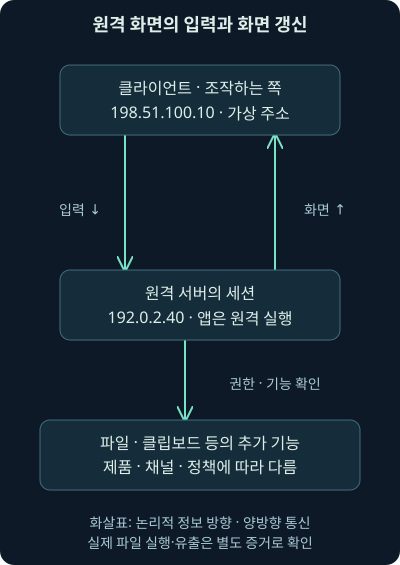
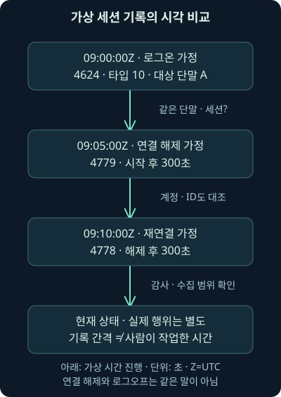
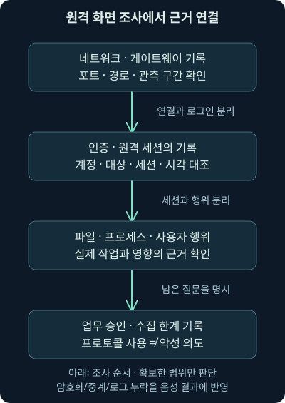

## 1. 원격 접속 기록이 있으면 누가 무엇을 했는지도 알까요?

업무 시간이 지난 뒤 한 계정으로 원격 접속이 보고됐습니다. 목적지는 3389번 포트이고, 나중에는 연결 해제와 재연결 기록도 보입니다. 이 자료만으로 계정 소유자가 그 시간 내내 화면을 조작했고 파일까지 가져갔다고 결론 내릴 수 있을까요?

17강에서는 SSH 연결 방향과 채널 안의 요청 방향을 구별했습니다. 이번에는 원격 화면 도구의 연결·인증·세션·실제 작업을 나누겠습니다. 둘째 날 18강은 RDP·VNC의 역할, 직접·중계 경로, 현재 보호 조건, Windows 세션 기록과 그 해석 범위까지 다룹니다.

주소·단말·계정·이벤트는 독립적인 가상 예제입니다. 실제 RDP·VNC 접속이나 Windows 로그 수집을 수행하지 않았습니다. 실제 실행한 것은 가상 JSON의 연결 조건·시각 비교이며, 원래 워크북·VM·실제 사건의 분석 결과가 아닙니다.

## 2. 안내원이 문을 열어 준 것과 사람이 서류를 읽은 것은 다릅니다

회의실 예약이 승인되고 출입문이 열렸다고 합시다. 그 사실은 입장 가능성과 관련되지만, 그 사람이 실제로 어떤 문서를 읽고 무엇을 적었는지까지 알려주지는 않습니다. 접속과 인증, 세션과 작업을 나누는 이유도 같습니다.

**RDP**, Remote Desktop Protocol은 원격의 그래픽 환경을 사용하기 위한 프로토콜입니다. **GUI**는 창·버튼 같은 그래픽 사용자 인터페이스입니다. 보통 클라이언트가 입력을 보내고 원격 시스템이 화면 갱신 정보를 돌려주는 구조를 생각하면 됩니다.

원격 애플리케이션은 대상 시스템에서 실행됩니다. 네트워크의 각 패킷이 완성된 화면 사진 하나와 일대일로 대응한다는 뜻은 아닙니다. 화면을 표현·갱신하는 방식과 별도 기능 채널이 있으므로 화면 크기나 통신량만으로 실제 작업을 복원하지 않습니다.



## 3. Windows 이름만 보고 RDP가 켜졌다고 가정하지 않습니다

RDP의 클라이언트 역할과 원격 접속을 받는 호스트 역할은 다릅니다. 지원 에디션·서비스·관리 정책·사용자 권한에 따라 접속 가능성이 달라집니다. 모든 Windows 단말이 기본적으로 외부의 RDP를 받아준다는 뜻은 아닙니다.

관리자 외에도 허용된 사용자에게 원격 접속 권한을 줄 수 있습니다. 계정이 존재하거나 비밀번호가 맞는다는 사실과 원격 로그온 권한은 별개입니다. 네트워크 경로·서비스·권한·인증·세션 정책 중 어느 단계에서 거부됐는지 나눠봐야 합니다.

2026년 11월 7일 Microsoft의 Remote Desktop 설명에서 기능 활성화·허용 사용자·NLA의 역할을 확인했습니다. 특정 화면을 실제 열거나 장치 설정을 바꾼 것은 아닙니다. [호스트 기능과 접근 범위](https://learn.microsoft.com/en-us/windows-server/remote/remote-desktop-services/remotepc/remote-desktop-allow-access)

## 4. 3389 하나만 찾으면 모든 원격 화면을 볼까요?

직접 연결의 기본 단서로 TCP·UDP 3389를 볼 수 있습니다. 하지만 포트는 변경할 수 있고, RD Gateway 같은 중계 역할을 거치면 외부 구간의 관측이 달라집니다. **게이트웨이**는 여기서 클라이언트와 내부 원격 자원 사이의 접근을 중계하는 역할입니다.

Microsoft는 RD Gateway의 외부 구간에 기본 TCP 443과 UDP 3391, 내부 원격 자원 쪽에 TCP·UDP 3389를 설명합니다. 각각 어떤 역할·방향에서 사용하는 포트인지 봐야 합니다. 이 목록은 모든 포트를 무조건 열라는 권고가 아닙니다.

2026년 11월 7일 지원되는 Windows Server의 RDS 포트 문서를 대조했습니다. **RDS**, Remote Desktop Services는 원격 데스크톱 서비스를 구성하는 역할들의 체계입니다. 실제 배포·제품·대체 포트와 수집 위치를 함께 확인하세요. [RDS의 역할별 포트](https://learn.microsoft.com/en-us/troubleshoot/windows-server/remote/ports-used-by-rds)

## 5. 터널과 클라우드 경로에서는 관측 주소도 달라집니다

17강의 원격 포워딩처럼 다른 연결 안으로 RDP가 전달되면 네트워크 경계에서 직접 3389가 안 보일 수 있습니다. 대상 서비스에는 중간 호스트나 루프백이 접속 상대로 남을 수도 있습니다. 그 주소를 최초 조작자의 실제 위치로 바로 바꾸지 않습니다.

또한 조직의 일반 RDS와 특정 클라우드 서비스의 연결 모델은 다를 수 있습니다. 예를 들어 Microsoft는 Windows 365에 양쪽에서 서비스 쪽으로 연결하는 별도 흐름을 설명합니다. 이를 모든 온프레미스 RDP의 동작으로 일반화하지 않습니다. [Windows 365의 경로 차이](https://learn.microsoft.com/en-us/windows-365/enterprise/understanding-remote-desktop-protocol-traffic)

따라서 외부 흐름·게이트웨이·대상 단말 기록을 같은 시간대로 연결해야 합니다. 주소 변환·프록시·터널·서비스별 연결 방식이 있다면 어느 기록에서 어느 주소가 보이는지 먼저 설명할 수 있어야 합니다.

## 6. NLA는 원격 세션 앞쪽에서 인증하는 보호입니다

**NLA**, Network Level Authentication은 원격 세션이 만들어지기 전에 사용자를 인증하도록 하는 보호입니다. 무인증 상태에서 원격 환경을 만드는 부담을 줄이는 원리로 이해하면 됩니다. 정상 접속을 허용할 사용자·권한·인증 정책은 계속 필요합니다.

NLA가 있다는 사실과 실제 계정 소유자가 정상 업무를 했다는 결론은 다릅니다. 계정·인증 자료가 오용됐거나 이미 열린 세션이 악용되는 경우도 조사해야 합니다. 공격에는 훔친 비밀번호 또는 취약점만 가능하다고 경우의 수를 두 개로 닫지 않습니다.

또한 NLA를 **다중 요소 인증**, MFA와 같은 말로 쓰지 않습니다. MFA는 서로 독립적인 여러 인증 요소를 요구하는 방식입니다. 앞에서 인증한다는 위치의 문제와 무엇을 조합해 인증하는지의 문제는 다릅니다. 실제 게이트웨이·계정·제품의 인증 정책을 확인합니다.

## 7. 암호화와 권한, 화면과 파일은 다른 질문입니다

통신을 보호하는 TLS 등의 설정과 원격 로그온 권한을 함께 확인해야 합니다. 보호된 세션을 사용했다고 악성 의도·계정 오용·허용된 기능의 남용이 사라지는 것은 아닙니다. 반대로 암호화로 내용이 안 보인다고 세션 존재까지 부정하지 않습니다.

파일·클립보드·드라이브·프린터 같은 추가 기능은 제품·채널·정책에 따라 달라집니다. 화면 접속 하나로 모든 파일이 전송됐다고 보고하지 않습니다. 파일 경로·실제 저장·전송 기록·단말의 프로세스와 사용자 행위 자료가 필요합니다.

하나의 계정으로 세션을 열었다는 기록만으로 실제 키보드를 조작한 사람이 누구인지 완전히 확인한 것도 아닙니다. 세션의 재사용·위임·공유·계정 오용 가능성을 업무 맥락과 대조해야 합니다.

## 8. VNC는 RDP의 다른 포트 이름이 아닙니다

**VNC**, Virtual Network Computing은 원격 화면 제어에 쓰이는 기술·제품 계열입니다. 기본 원리에는 **RFB**, Remote Framebuffer Protocol이 연결됩니다. framebuffer는 화면을 나타내는 영상 자료의 공간을 뜻하며, RFB는 클라이언트가 원격 GUI를 보고 제어하는 방식을 설명합니다.

RDP와 목적이 비슷해도 같은 프로토콜이나 같은 계정·세션 체계는 아닙니다. 기존 화면을 공유하는지 별도 가상 화면을 만드는지, 동시 접속과 권한을 어떻게 처리하는지는 구현·설정에 따라 확인합니다. 두 기술 모두 “항상 새 사용자 데스크톱을 하나 만든다”로 묶지 않습니다.

RFC 6143은 2011년의 RFB 설명 문서이며 Informational, 정보 제공 성격입니다. 현재 모든 VNC 제품의 보안 확장·암호화·중계 기능 전체를 이 문서 하나로 대신하지 않습니다. 2026년 11월 7일 기본 역할을 확인했습니다. [RFB의 범위](https://www.rfc-editor.org/rfc/rfc6143.html)

## 9. 오래된 VNC의 위험을 모든 현재 제품의 속성으로 옮기지 않습니다

기본 RFB와 오래된 인증·비암호화 구성은 위험을 평가할 필요가 있습니다. 그러나 “VNC라는 이름이면 모두 암호화가 없고 모든 버전이 취약하다”라고 단정하면 현재 제품의 보호 조건을 잘못 설명하게 됩니다.

예를 들어 RealVNC의 2026년 8월 26일 갱신 문서는 AlwaysOn 기본값과 강제 암호화, 직접 연결에서 암호화를 보장하지 않는 다른 선택값을 구별합니다. 클라이언트와 서버의 요구가 실제 세션에 어떤 결과를 주는지도 확인해야 합니다. 2026년 11월 7일 이 내용을 대조했습니다. [현재 제품의 암호화 조건](https://help.realvnc.com/hc/en-us/articles/37653068502045-Connection-Encryption-Methods)

같은 문서는 v8과 Server v7의 설정 위치도 나눠 설명합니다. 이는 확인한 제품 문서의 적용 범위이며 다른 VNC 구현의 기본값까지 보증하지 않습니다. 이번에는 제품을 설치하거나 해당 화면·세션을 실행 검증하지 않았습니다.

## 10. 두 기술을 비교할 때도 포트보다 구현과 승인이 중요합니다

다음 표는 비교할 질문을 정리합니다. 목적이 비슷하다는 점과 세부 동작·보호·로그가 다르다는 점을 함께 보세요. 표의 포트만으로 프로토콜·성공·승인을 판정하지 않습니다.

| 질문 | RDP 조사에서의 예 | VNC 조사에서의 예 |
| --- | --- | --- |
| 무엇을 제공하나 | 원격 그래픽 환경·세션과 부가 기능 | RFB 기반 화면 보기·제어와 제품 확장 |
| 어디서 찾나 | 직접 3389, 게이트웨이 등 실제 경로 | 통상 5900 계열과 제품의 대체·중계 경로 |
| 무엇이 허용됐나 | 로그온 권한·세션 정책·추가 채널 | 뷰어·서버 인증·제어 권한·제품 정책 |
| 보호는 무엇인가 | 인증·TLS·경로·서비스 정책 | 제품·판본·협상한 보안 방식·암호화 요구 |
| 실제 행위는 어디서 보나 | 대상 이벤트·세션·단말·파일 기록 | 서버·뷰어·관리 서비스·단말 기록 |

정상 원격 지원이 있다는 사실과 관측된 그 접속이 승인됐다는 사실도 다릅니다. 등록된 도구의 계정·기기·시간·업무 범위가 맞는지 확인하세요. 반대로 정책 위반이 있다고 실제 침해·자료 유출까지 자동 확정하지 않습니다.

## 11. Windows 이벤트는 생성한 단말과 의미를 함께 읽습니다

16강에서 본 4624는 로그온 세션 생성의 성공 기록입니다. **타입 10**, RemoteInteractive는 원격 대화형 로그온에 관한 값입니다. 타입 3인 Network와 구별합니다. 타입 3 기록 하나가 원격 화면 세션의 모든 단계를 증명하지는 않습니다.

기록은 접근받은 대상 단말에서 생성된 것인지, 실제 감사 로그의 출처·버전·보존이 무엇인지 확인해야 합니다. **Logon ID**는 해당 단말의 로그온 세션을 연결하는 식별값이며 다른 단말의 같은 숫자와 바로 합치지 않습니다. [4624의 타입과 필드](https://learn.microsoft.com/en-us/previous-versions/windows/it-pro/windows-10/security/threat-protection/auditing/event-4624)

**세션 이름**은 원격 접속의 특정 세션을 설명하는 다른 단서입니다. 사용자·대상·세션·시각을 함께 봐야 하고, 이름 하나를 전사적으로 유일한 식별자처럼 쓰지 않습니다. 실제 수집 도구가 필드를 어떻게 정규화했는지도 남깁니다.

## 12. 연결 해제는 로그오프와 같은 말이 아닙니다

4779는 Window Station에서의 세션 연결 해제, 4778은 재연결과 관련된 Security 이벤트입니다. **Window Station**은 Windows가 데스크톱과 입출력 환경을 관리하는 객체 문맥입니다. 연결 창이 닫혔다고 실행 중인 세션·프로그램이 모두 종료됐다고 가정하지 않습니다.

또한 이 두 이벤트는 Terminal Services 외에 빠른 사용자 전환이나 Hyper-V 확장 세션 등에서도 나타날 수 있습니다. 번호만 보고 모든 4778·4779를 인터넷의 RDP 로그인이라고 바꾸지 않습니다. 실제 메시지·세션 종류·필드·대상을 확인해야 합니다.

2026년 11월 7일 Microsoft의 두 이벤트 문서에서 의미·감사 범위를 대조했습니다. 원격 세션의 연결 상태와 사용자 작업 내용은 다른 근거입니다. [재연결 4778](https://learn.microsoft.com/en-us/previous-versions/windows/it-pro/windows-10/security/threat-protection/auditing/event-4778), [연결 해제 4779](https://learn.microsoft.com/en-us/previous-versions/windows/it-pro/windows-10/security/threat-protection/auditing/event-4779)

## 13. 시간표의 간격을 사람이 일한 시간으로 바꾸지 않습니다

가상 기록이 09:00:00Z에 로그온, 09:05:00Z에 연결 해제, 09:10:00Z에 재연결을 보여준다고 합시다. **Z**는 UTC, 세계 협정시 기준이라는 표기입니다. 로그온에서 해제까지의 기록 간격은 5분, 즉 `5 × 60 = 300초`입니다.

해제에서 재연결까지도 300초입니다. 하지만 앞의 300초가 모두 실제 키 입력·파일 작업 시간이었다는 뜻은 아닙니다. 뒤의 300초 동안 세션의 모든 프로세스가 종료됐다는 뜻도 아닙니다. 세션·연결·유휴·실제 작업을 구별합니다.

마지막 기록이 재연결이어도 지금 현재 연결 중이라고 보장하지 않습니다. 이후 자료가 없을 수 있기 때문입니다. 시계 오차·시간대·수집 지연·누락과 실제 단말 상태를 별도로 확인해야 합니다.



## 14. 가상 세션의 연결 조건을 실제 계산했습니다

[여섯 가상 사례](../../assets/network-security/day02-lab18/cases.json), [비교 프로그램](../../assets/network-security/day02-lab18/compare_sessions.py), [안내](../../assets/network-security/day02-lab18/README.txt)를 제공합니다. Python 3.12.14 표준 라이브러리로 다음을 실제 실행했습니다.

```text
python compare_sessions.py cases.json
```

같은 폴더에서 `python`은 실행기, `compare_sessions.py`는 실행할 프로그램, `cases.json`은 입력 자료의 경로입니다. 17강과 파일 이름이 같아도 내용이 다르므로 18강 폴더를 사용합니다. Windows 이벤트를 저장한 EVTX 원본을 파싱하는 프로그램은 아닙니다.

입력의 target·logon_id·user·session_name은 작성자가 넣은 대상·세션·사용자·세션 이름 가정입니다. session_kind도 작성자가 원격 종류를 rdp로 정한 값입니다. 이 스위치를 넣는 일이 실제 이벤트를 RDP로 식별·인증하는 검증은 아닙니다.

## 15. 같은 이름만 아니라 같은 대상·ID·시간을 비교합니다

프로그램은 제공한 4624·타입 10·rdp 종류 가정이 맞는지 먼저 봅니다. 그다음 대상 단말·Logon ID·사용자·세션 이름이 같은 4778·4779만 연결하고, 로그온 뒤의 시간순인지 확인합니다. 다른 단말의 같은 문자열은 합치지 않습니다.

매칭된 입력이 역순이면 자동 정렬해서 숨기지 않고 도구 오류로 중단합니다. 같은 전환이 연속 반복되는 경우도 이 단순 도구의 지원 밖으로 처리합니다. 실제 로그가 거짓이거나 실제 공격이라는 판정이 아니라, 중복·복잡한 상태·시계 문제를 사람이 더 살펴야 한다는 한계입니다.

문자열의 같은 표기만 비교할 뿐 실제 계정의 별칭·대소문자·도메인 관계를 포괄적으로 정규화하지 않습니다. flow의 IP와 단말 이름도 실제 자산 장부에서 대응시키지 않습니다. 실제 로그 수집·신원·인과관계는 계산 범위 밖입니다.

## 16. 여섯 결과는 증거가 어디까지인지 보여 줍니다

다음 표는 실제 로컬 계산 결과입니다. 실제 RDP·Windows 이벤트가 확인됐다는 결과와 섞지 않고, 입력 조건 중 무엇이 맞았는지 읽습니다.

| 사례 | 가상 자료 | 계산에서 남긴 결과 |
| --- | --- | --- |
| P1 | 목적지 3389의 흐름 주장만 | 원격 대화형 로그온 조건은 확인되지 않음 |
| P2 | 4624이지만 타입 3 | 타입 10 조건과 다르므로 원격 대화형 가정 불충족 |
| P3 | 타입 10과 같은 세션의 해제·재연결 | 전환 두 개, 시작 후 300·600초, 해제→재연결 300초 |
| P4 | 전환 기록의 대상만 다른 단말 | 두 전환을 연결하지 않음 |
| P5 | P3의 출발지 주장을 127.0.0.1로 변경 | 루프백 가정은 참, 최초 조작자·터널은 미검증 |
| P6 | P3와 같은 자료에 승인 참을 가정 | 연결 조건은 같고 승인 가정만 다름 |

모든 사례에서 실제 RDP·원본 Windows 이벤트 검증은 거짓, 실제 조작자·작업·현재 상태는 미검증, 사건 결론은 unresolved로 남았습니다. P3의 마지막 전환을 현재 상태나 실제 작업 완료로 바꾸지 않습니다.

P2도 실제로 RDP가 없었다는 증명이 아닙니다. 제공된 타입 3 자료만으로 이번 타입 10 조건을 충족하지 못했다는 뜻입니다. P6의 승인 값 역시 실제 승인서·사용자 확인을 대신하지 않습니다.

## 17. 실제 패킷에서는 넓은 조건과 해석된 내용을 구별합니다

다음은 공식 문서와 대조한 **미실행 Wireshark 표시 필터 예시**입니다. 이번에 실제 RDP·VNC PCAP에서 실행한 결과는 없습니다.

```text
tcp.port == 3389 || udp.port == 3389
rdp
vnc
```

첫 줄의 `||`는 둘 중 하나라도 맞는 조건을 고릅니다. TCP 또는 UDP의 출발지·목적지 포트 3389를 보는 넓은 조건이며 실제 프로토콜·로그온 성공을 보증하지 않습니다. 다른 포트·게이트웨이·터널 경로는 놓칠 수 있습니다.

다음 두 줄은 도구가 해석한 프로토콜을 고릅니다. 2026년 11월 7일 공식 참조의 rdp 1.8.0~4.6.9, vnc 1.0.0~4.6.9 범위를 확인했습니다. 암호화된 내용이나 다른 전송 방식의 세부를 자동으로 모두 복원한다는 뜻은 아닙니다. [RDP 필드](https://www.wireshark.org/docs/dfref/r/rdp.html), [VNC 필드](https://www.wireshark.org/docs/dfref/v/vnc.html)

## 18. 없다면 수집·감사·경로의 빈칸도 확인합니다

원격 로그온 기록이 없으면 실제 접속 부재 외에 감사 설정·수집 채널·대상 단말·보존 기간·시간대·필터를 확인합니다. 네트워크에 3389가 없으면 다른 포트·중계·터널·다른 제품 경로인지 대조합니다. 검색 결과 없음은 관측 범위 안의 결과입니다.

반대로 이벤트가 있으면 출발지·계정·시간이 알려진 관리 패턴인지 확인합니다. 공유 계정·세션 재사용·원격 지원 도구·서비스 구성 변경도 후보입니다. 이상한 시각 하나만으로 악성 의도를 확정하지 않습니다.

실제 행위는 파일·프로세스·대상 서비스·업무 시스템·단말의 자료와 연결합니다. 암호화된 네트워크만 수집했다면 화면 내용·실행한 파일·실제 사람의 의도를 상상해 채우지 않습니다.



## 19. 허용할 원격 관리와 조사 메모를 함께 정합니다

원격 관리가 필요한 대상·계정·출발 구간·시간·기능을 정하고, 네트워크·호스트 방화벽과 실제 사용자 권한을 맞춰 확인합니다. 필요 없는 단말의 기능을 줄이는 원칙과 승인된 원격 업무를 보존하는 목적을 함께 봅니다. 이번에 실제 서비스를 끄거나 계정을 변경한 것은 아닙니다.

사용하는 제품의 지원 상태·업데이트·암호화 요구·인증·관리 로그도 확인합니다. 프로토콜 이름이나 등록된 도구 하나만으로 안전을 보증하지 않고, 보호 설정 하나로 모든 계정 오용을 막았다고 보고하지 않습니다.

가상 메모는 “같은 대상·ID·세션 이름의 전환 주장이 시간순으로 연결됐다. 실제 로그 출처·원격 접속·사용자 행위·업무 승인·현재 상태는 미검증이다”라고 쓸 수 있습니다. 다음 회차에서는 화면 접속과 다른 방식의 원격 명령 관리도 같은 원칙으로 나누어 읽겠습니다.

## 20. 복습: 세션 기록과 실제 행위를 나눠 설명해 보세요

### 질문 1. 3389 통신만으로 원격 화면 로그온 성공이 확인됐나요?

**해설:** 포트·연결은 단서입니다. 실제 프로토콜·인증·권한·세션 근거가 더 필요합니다.

### 질문 2. 모든 Windows 단말은 기본적으로 RDP를 받나요?

**해설:** 호스트 지원·에디션·서비스·정책·사용자 권한이 다릅니다. 클라이언트 기능과도 구별합니다.

### 질문 3. 직접 3389가 없으면 RDP도 없나요?

**해설:** 다른 포트·게이트웨이·터널·특정 서비스 경로가 있을 수 있습니다. 관측 위치를 먼저 봅니다.

### 질문 4. NLA는 실제 사용자의 업무 승인을 증명하나요?

**해설:** 세션 앞쪽의 인증 보호입니다. 계정 오용·세션 재사용·작업 승인과는 다른 질문입니다.

### 질문 5. NLA를 켰으면 다중 요소 인증도 적용됐나요?

**해설:** 인증 위치와 요구 요소는 다른 개념입니다. 실제 인증 정책을 확인해야 합니다.

### 질문 6. 원격 화면을 봤다는 기록은 파일 유출 증거인가요?

**해설:** 추가 기능·실제 파일·전송·단말 행위의 근거가 필요합니다. 화면 세션에서 자동 추론하지 않습니다.

### 질문 7. VNC는 모두 암호화가 없다고 설명해도 되나요?

**해설:** 구현·판본·보안 방식·정책이 다릅니다. 현재 제품의 강제 암호화와 오래된 비보호 구성을 구별합니다.

### 질문 8. RealVNC의 기본값을 다른 VNC 구현에도 적용하나요?

**해설:** 특정 제품 문서의 범위입니다. 다른 구현·설정·협상 결과는 별도로 확인합니다.

### 질문 9. 타입 3인 P2는 실제 RDP 부재를 증명하나요?

**해설:** 제공 자료가 타입 10 조건을 충족하지 못했다는 뜻입니다. 전체 세션·수집 범위는 별도입니다.

### 질문 10. 4778·4779는 언제나 인터넷 RDP만의 이벤트인가요?

**해설:** 빠른 사용자 전환·확장 세션 등 다른 상황도 있습니다. 실제 종류·메시지·대상·필드를 확인합니다.

### 질문 11. P3의 300초는 실제 키보드 작업 시간인가요?

**해설:** 가상 기록 사이의 간격입니다. 유휴·작업·프로세스 상태를 측정한 것이 아닙니다.

### 질문 12. 연결 해제면 로그오프와 모든 프로세스 종료도 확인됐나요?

**해설:** 다른 상태입니다. 세션·프로세스·로그오프 근거를 따로 확인해야 합니다.

### 질문 13. 대상이 다른 P4의 같은 Logon ID를 합쳐도 되나요?

**해설:** 단말 범위의 식별값입니다. 대상·계정·세션·시간을 함께 맞춰야 합니다.

### 질문 14. 루프백 출발지인 P5는 터널 공격이 확정됐나요?

**해설:** 중계·로컬 경로 등을 조사할 단서입니다. 실제 프로세스·양끝 연결·최초 출발지는 미검증입니다.

### 질문 15. 마지막 기록이 재연결이면 지금도 연결 중인가요?

**해설:** 이후 기록이 누락됐을 수 있습니다. 현재 상태·보존·수집을 따로 확인합니다.

### 질문 16. 승인 스위치가 참인 P6은 정상 사용자 확인이 끝났나요?

**해설:** 가상 작성자의 가정입니다. 실제 승인·사용자·로그 출처·행위는 계산으로 대신하지 않았습니다.
