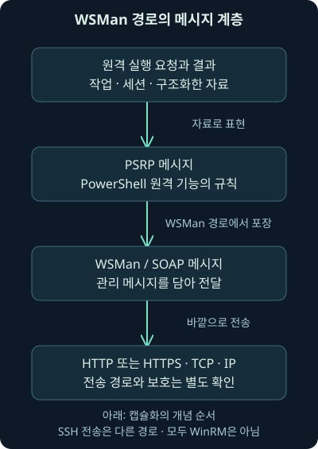
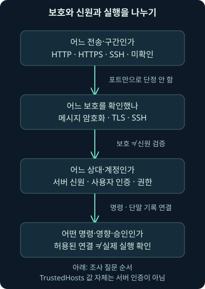
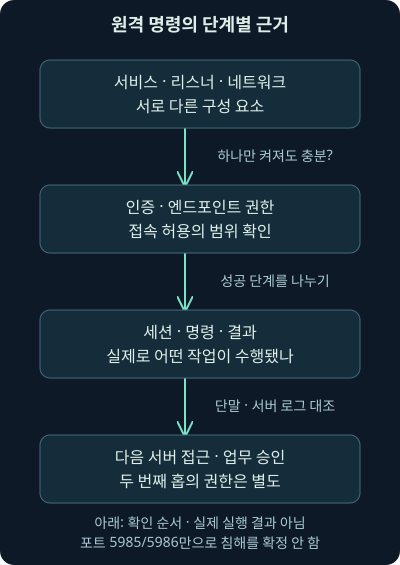

## 1. 5985번 포트가 보이면 웹 접속일까요, 원격 명령일까요?

한 직원 단말이 서버의 TCP 5985번 포트와 통신했습니다. HTTP라는 말도 보입니다. 웹사이트를 열어 본 정상 접속일까요, 원격 관리일까요? 포트와 HTTP라는 단서만으로 실제 명령 실행까지 확인한 것은 아닙니다.

17·18강에서는 SSH 채널과 원격 화면 세션을 나눠 읽었습니다. 이번에는 화면을 직접 조작하는 대신 원격에서 명령을 실행하고 결과를 받는 구조를 보겠습니다. **PowerShell**은 명령 실행과 자동화에 사용하는 환경이며, 원격 관리 기능도 제공합니다.

둘째 날 19강의 범위는 PSRP·WinRM·WSMan 계층, HTTP·HTTPS·SSH 전송, 인증·메시지 보호·서버 신원·권한·실행 증거입니다. 예제는 독립적인 가상 자료입니다. 실제 원격 접속·인증·서비스·설정을 실행하지 않았고, 실제로 수행한 것은 뒤의 JSON 조건 비교뿐입니다. 원래 워크북·VM의 수행 결과가 아닙니다.

## 2. 작업 주문서와 배송 수단은 다른 역할입니다

다른 사무실에 “이 자료를 조회해서 결과를 보내 주세요”라는 주문서를 보낸다고 합시다. 주문서의 항목과 뜻, 그것을 담는 봉투, 실제 배송 경로는 각각 다른 역할입니다. 봉투가 도착했다고 상대가 작업을 승인·실행·완료했다는 뜻도 아닙니다.

원격 명령도 비슷합니다. 어떤 작업과 결과를 어떻게 표현하는지, 그 메시지를 무엇에 담아 보내는지, 상대를 어떻게 인증하고 기능을 허용하는지 나눠야 합니다. “SSH와 비슷하게 명령을 실행한다”는 사용 경험과 실제 전송 구조가 같다는 설명은 다릅니다.

비유와 실제 동작의 차이도 있습니다. 원격 세션은 여러 메시지·출력·오류·실행 문맥을 관리합니다. 명령 문자열 한 줄을 웹서버에 던지는 것만으로 전체 원리를 설명할 수는 없습니다.

## 3. PSRP·WSMan·WinRM·SOAP를 차례로 연결합니다

**PSRP**, PowerShell Remoting Protocol은 PowerShell 원격 기능의 메시지·명령·결과 교환 규칙을 설명합니다. **WS-Management**, 줄여 WSMan은 관리 작업을 위한 메시지 체계이고, **WinRM**, Windows Remote Management는 Windows의 관련 구현입니다. 같은 말처럼 보이더라도 역할을 구별합니다.

WSMan 경로에서는 **SOAP**라는 구조화된 메시지 포장 방식이 관련됩니다. SOAP는 역사적으로 Simple Object Access Protocol이라는 이름으로 설명됐습니다. 메시지에는 **XML**, 태그로 자료 구조를 표현하는 형식이 사용됩니다. XML이라는 사실이 내용 전체가 평문 명령으로 보인다는 뜻은 아닙니다.

2026년 11월 7일 Microsoft의 PSRP 구조 설명을 확인했습니다. 명세에 WSMV와 Windows Vista라는 역사적 이름이 보이더라도 현재 기능이 Vista에서만 작동한다는 뜻으로 읽지 않습니다. 실제 지원 운영체제·구현은 별도로 확인합니다. [PSRP와 다른 프로토콜의 관계](https://learn.microsoft.com/en-us/openspecs/windows_protocols/ms-psrp/a2bea4b6-1768-4e4c-9993-9421e44c7986)

## 4. WSMan 경로에서는 관리 메시지가 HTTP 계층을 거칩니다

이 경로를 아래 그림처럼 읽어보세요. 위쪽은 원격 작업의 의미, 아래쪽은 바깥 네트워크 전송에 가까워집니다. PSRP 메시지를 WSMan·SOAP의 관리 메시지에 담고 HTTP 또는 HTTPS와 TCP·IP를 통해 전달하는 구조입니다.

**캡슐화**는 안쪽 자료를 다른 프로토콜의 메시지에 담아 보내는 것을 말합니다. 안쪽 메시지가 인코딩·분할·보호돼 있을 수 있으므로 HTTP 본문에 XML이 있다고 모든 실제 명령을 바로 읽을 수 있는 것은 아닙니다.

서버가 일반적인 웹사이트 화면을 제공해야만 관리 기능이 되는 것도 아닙니다. 관리용 요청·리스너·권한·세션은 일반 웹 탐색과 다른 문맥입니다. 바깥 프로토콜의 이름과 애플리케이션의 목적을 분리해서 읽습니다.



## 5. 모든 PowerShell 원격 관리를 WinRM이라고 부르지는 않습니다

PowerShell 6 이후에는 SSH를 사용하는 원격 관리 경로도 있습니다. 이때 원격 기능을 쓴다는 목적은 비슷해도 WSMan·SOAP·HTTP라는 경로를 그대로 지나가는 것으로 설명하지 않습니다. 17강에서 본 SSH 인증·채널·호스트 신원도 다시 관련됩니다.

Windows PowerShell 5.1과 PowerShell 7 계열의 전송·엔드포인트·지원 플랫폼을 구별해야 합니다. **엔드포인트**는 여기서 원격 사용자가 연결해 사용할 실행 환경·세션 구성의 대상입니다. 실행 중인 PowerShell 판본과 연결할 구성을 확인해야 합니다.

2026년 11월 7일 PowerShell 7.6 문서의 SSH 원격 관리 설명을 대조했습니다. 이는 확인한 문서의 판본이며 이 기기에 그 판본이 설치됐거나 실제 SSH 원격 기능을 시험했다는 뜻은 아닙니다. [SSH 전송의 범위](https://learn.microsoft.com/en-us/powershell/scripting/security/remoting/ssh-remoting-in-powershell?view=powershell-7.6)

## 6. HTTP라는 이유만으로 모든 명령이 평문이라고 단정하지 않습니다

WinRM의 기본 포트 단서로 HTTP 5985, HTTPS 5986을 볼 수 있습니다. HTTPS에서는 TLS의 전송 보호를 생각할 수 있습니다. 그런데 HTTP를 쓴다는 사실만 보고 인증 뒤의 모든 원격 메시지가 암호화되지 않았다고 결론 내리면 안 됩니다.

인증 방식에 따라 **메시지 수준 암호화**, 메시지 자체를 보호하는 방식이 관련될 수 있기 때문입니다. Kerberos·NTLM 등을 사용하는 원격 통신의 보호와 TLS의 바깥 전송 보호는 같은 계층이 아닙니다. 실제 인증·설정·협상·수집 구간을 봐야 합니다.

Microsoft의 WinRM 원격 관리 보안 문서는 초기 인증과 이후 통신을 나눠 설명합니다. 2026년 11월 7일 이 범위를 확인했습니다. 기본 동작 설명을 출처가 불명확한 실제 패킷의 암호화 확인 결과로 대신하지 않습니다. [인증 이후 통신의 보호](https://learn.microsoft.com/en-us/powershell/scripting/security/remoting/winrm-security?view=powershell-7.6)

## 7. 암호화와 서버 신원도 서로 다른 질문입니다

**Kerberos**와 **NTLM**은 Windows 환경에서 만날 수 있는 인증 방식입니다. 이름으로 접속하는 도메인 환경과 IP 주소·작업 그룹 환경의 선택·요구가 다를 수 있습니다. 두 이름을 “모든 환경에서 같은 신원 보장”으로 묶지 않습니다.

특히 사용자를 인증하는 근거와 접속한 서버가 의도한 상대인지 확인하는 근거를 구별하세요. HTTPS라면 인증서의 이름·신뢰·유효성·실제 검증 결과가 중요합니다. 암호문이 오갔다는 사실 하나가 올바른 서버의 신원이나 업무 승인을 증명하지는 않습니다.

**작업 그룹**, workgroup은 도메인과 다른 Windows의 구성 문맥입니다. 특정 Windows 인증 경로의 요구와 모든 PowerShell 원격 관리의 요구는 다릅니다. SSH를 통한 다른 플랫폼의 원격 관리까지 반드시 Windows 도메인 가입이 필요하다고 확대하지 않습니다.

## 8. Basic 자체에는 메시지 암호화가 없습니다

**Basic 인증**의 자료 표현을 암호화와 같은 말로 쓰면 안 됩니다. Basic 자체는 메시지의 비밀성을 제공하지 않습니다. HTTPS 같은 보호와 실제 설정을 따로 확인해야 합니다. 이름에 인증이 붙었다고 명령과 자격증명의 모든 구간이 자동 보호되는 것은 아닙니다.

Microsoft의 WinRM 구성 문서는 클라이언트·서비스의 설정을 나눕니다. 확인한 서비스 항목에서는 Basic과 AllowUnencrypted의 기본값을 거짓으로 설명합니다. “보호 없는 HTTP·Basic 예제를 만들 수 있다”와 “현재 기본 서버가 그대로 허용한다”는 다른 주장입니다.

2026년 11월 7일 해당 구성 문서를 대조했습니다. 뒤의 W2는 개념 비교를 위한 의도적인 반례 가정이며 실제 서버가 받아 준 결과가 아닙니다. 이번 강의에서는 보호 설정을 해제하거나 인증 정보를 전송하지 않았습니다. [WinRM 구성 항목과 기본값](https://learn.microsoft.com/en-us/windows/win32/winrm/installation-and-configuration-for-windows-remote-management)

## 9. TrustedHosts 목록은 서버 신뢰 인증서가 아닙니다

**TrustedHosts**는 일부 WinRM 접속 문맥에서 서버 신원을 검증하지 못하는 오류를 처리할 때 관련되는 목록입니다. 이름이 신뢰 목록처럼 보이더라도 그 호스트가 안전하거나 실제 의도한 서버라는 인증을 자동 제공하지 않습니다.

목록에 이름이 있다는 사실, 사용자 인증이 성공했다는 사실, 보호된 메시지를 사용했다는 사실을 각각 적어보세요. 어느 하나를 나머지 질문의 답으로 복사하면 계정 오용이나 다른 상대 접속을 놓칠 수 있습니다.

Microsoft의 보안 문서는 TrustedHosts를 호스트 자체의 신뢰성에 관한 보장으로 보지 않도록 설명합니다. 실제 값을 조회·변경한 것이 아니며 가상 W5에서도 이 값 때문에 서버 신원을 검증됐다고 바꾸지 않습니다.



## 10. 서비스·리스너·방화벽·실행 환경은 다른 구성입니다

**리스너**는 접속 요청을 기다리는 지점입니다. WinRM 서비스가 존재하거나 실행 중이라는 사실만으로 적절한 리스너·방화벽·인증·PowerShell 실행 환경이 모두 준비됐다고 가정하지 않습니다. 반대로 클라이언트 역할과 명령을 받는 서버 역할도 구별해야 합니다.

Windows Server 2012 이후의 기본 원격 관리 설명은 해당 Windows 환경과 역할의 범위로 읽습니다. 모든 과거 서버·모든 데스크톱·모든 PowerShell 판본에 같은 상태가 항상 보장되는 것은 아닙니다. 이미지·도메인 정책·관리자가 바꾼 설정도 관련됩니다.

2026년 11월 7일 Windows PowerShell 5.1과 PowerShell 7.6의 요구 문서를 확인했습니다. 실제 운영체제·판본·정책을 확인하는 일은 별도의 조사입니다. [Windows PowerShell의 요구 범위](https://learn.microsoft.com/en-us/powershell/module/microsoft.powershell.core/about/about_remote_requirements?view=powershell-5.1)

## 11. 원격 기능을 켜는 위치와 판본도 중요합니다

Enable-PSRemoting은 원격 명령을 받도록 구성을 준비하는 명령 이름입니다. 명령의 목적을 설명한 것이며 이번에 실행하지 않았습니다. 단순히 방화벽 포트 하나만 여는 작업과 같지는 않습니다.

PowerShell 7 계열에서 구성하는 엔드포인트와 Windows PowerShell의 구성은 구별해야 합니다. Microsoft는 실행한 판본에 맞는 원격 구성과 이름을 설명합니다. 한쪽 구성을 확인했다고 다른 판본의 모든 원격 환경이 준비됐다고 보고하지 않습니다.

확인한 7.6 문서는 WS-Management 기반 구성의 Windows 적용 범위를 명시합니다. SSH 기반 원격 기능의 준비까지 이 명령 하나가 모두 대신하는 것으로 설명하지 않습니다. [구성 명령의 판본·적용 범위](https://learn.microsoft.com/en-us/powershell/module/microsoft.powershell.core/enable-psremoting?view=powershell-7.6)

## 12. 명령 이름과 실제 성공 단계를 연결해 보세요

Enter-PSSession은 원격 세션에 들어가 대화형으로 작업하는 명령 이름입니다. Invoke-Command는 명령 실행을 요청하는 데 쓰는 명령입니다. 두 이름을 배웠다고 실제 연결·인증·명령 결과를 확보한 것은 아닙니다.

조사에서는 요청이 있었는지, 인증됐는지, 해당 실행 환경의 권한이 있었는지, 명령이 시작됐는지, 결과·오류가 무엇인지 나눠봅니다. 서비스 활성화 이벤트나 특정 프로세스 이름 하나가 모든 명령의 성공 증거는 아닙니다.

관리 업무도 같은 기능을 쓰기 때문에 출발 단말·계정·대상·시간·명령·승인을 함께 비교해야 합니다. “원격 관리 기능이 사용됐다”와 “침해에 사용됐다” 사이에 필요한 근거를 남겨야 합니다.

## 13. B에 접속했다고 B에서 C의 자료도 바로 읽을까요?

A에서 B로 원격 작업을 요청하고, B의 작업이 다시 C의 파일 서버에 접근한다고 합시다. 이를 **두 번째 홉**, second hop이라고 부릅니다. 첫 접속에 성공했다고 원래 사용자의 인증 자료·권한이 C에 자동 전달되는 것은 아닙니다.

대상 서버가 다른 서버에 접근하는 인증·위임·서비스 계정·정책은 별도입니다. 첫 세션의 성공이나 실패만 보고 후속 자료 접근의 원인을 모두 확정하지 않습니다. 자격증명 위임을 무조건 켜는 것이 이번 강의의 해법도 아닙니다.

실제 조사는 A→B와 B→C 기록을 각각 확인하고 계정·권한·행위를 연결합니다. 이번 가상 계산기는 두 번째 홉을 구성하거나 검증하지 않았습니다.



## 14. 가상 전송·보호 주장을 실제로 비교했습니다

[여섯 입력 사례](../../assets/network-security/day02-lab19/cases.json), [비교 프로그램](../../assets/network-security/day02-lab19/compare_remoting.py), [안내](../../assets/network-security/day02-lab19/README.txt)를 제공합니다. Python 3.12.14 표준 라이브러리로 다음을 실제 실행했습니다.

```text
python compare_remoting.py cases.json
```

같은 폴더에서 `python`은 실행기, `compare_remoting.py`는 실행할 프로그램, `cases.json`은 입력 자료의 경로입니다. 프로그램은 JSON 텍스트를 읽고 입력 주장의 계층·보호 근거를 분리해 출력합니다. WinRM·SSH에 접속하거나 설정·명령을 실행하지 않습니다.

입력의 transport는 작성자가 가정한 전송이며 포트에서 추론한 결과가 아닙니다. 메시지 보호·상대 확인·TrustedHosts·승인 값도 미리 넣은 가정입니다. 이 파일을 실제 서버의 인증·협상 로그로 취급하지 않습니다.

## 15. 같은 포트라도 서로 다른 질문이 남습니다

다음 표는 실제 로컬 출력의 의미입니다. 보호 근거라는 말에도 “제공한 가정”이라는 범위를 붙여 읽어야 합니다.

| 사례 | 입력의 전송·인증·보호 가정 | 계산으로 분리한 주장 |
| --- | --- | --- |
| W1 | WSMan·HTTP·Kerberos·메시지 보호 | 메시지 암호화 가정 |
| W2 | WSMan·HTTP·Basic·보호 없음 | 보호 근거 목록 없음, 실제 기본 허용 결과 아님 |
| W3 | WSMan·HTTPS·Basic | TLS 전송 보호 가정, Basic 자체 암호화 아님 |
| W4 | PowerShell의 SSH 전송·공개키 | SSH 전송 보호 가정, WSMan 계층으로 바꾸지 않음 |
| W5 | HTTP·NTLM·메시지 보호·TrustedHosts 참 | 메시지 보호와 목록 가정, 서버 신원은 별도 |
| W6 | 포트 5985지만 전송·보호는 unknown | 계층 null, 모르는 값은 그대로 남김 |

W1과 W5의 서버 신원 가정은 다르게 넣었습니다. 하지만 어느 사례에서도 실제 신원 검증은 참이 아닙니다. 실제 전송·암호화·원격 실행·두 번째 홉 검증도 모두 거짓으로 남겼습니다. 승인 가정 역시 실제 승인서를 검증하지 않습니다.

## 16. 문서의 기본값과 실제 사건의 관측을 섞지 않습니다

W2를 보고 현재 Windows의 기본 HTTP 통신이 모두 보호 없이 처리된다고 말하면 안 됩니다. 기본 설정·허용 인증·암호화 요구와 어긋날 수 있는 반례 가정입니다. 실제 동작을 확인하려면 당시 설정과 협상·로그가 필요합니다.

반대로 문서에 기본 보호가 있다고 쓰여 있어도 수집한 모든 실제 통신이 그 설정을 사용했다고 자동 보고하지 않습니다. 판본·배포·정책·변경·다른 전송을 확인해야 합니다. 포트가 5985라는 이유만으로 W6에 전송 종류를 만들어 넣지 않았습니다.

이 프로그램은 프로토콜·인증 방식 전체를 구현한 검증기가 아닙니다. 예를 들어 Basic 자체를 메시지 암호화로 입력하면 교육 도구의 오류로 거부합니다. 도구의 입력 오류와 실제 서버 인증 실패·공격 결과는 다른 값입니다.

## 17. 패킷에서는 먼저 수집 범위를 확인합니다

다음은 기본 포트 단서를 찾기 위한 **미실행 표시 필터 예시**입니다. 실제 WinRM PCAP이나 Wireshark 실행 결과는 없습니다.

```text
tcp.port == 5985 || tcp.port == 5986
```

`tcp.port`는 TCP의 출발지 또는 목적지 포트, `==`는 같은 값, `||`는 둘 중 하나라도 맞는 조건입니다. 기본 HTTP·HTTPS 관리 포트를 함께 보는 이유이지 실제 WinRM·명령 실행을 식별한 필터는 아닙니다.

2026년 11월 7일 [Wireshark TCP 필드 참조](https://www.wireshark.org/docs/dfref/t/tcp.html)에서 `tcp.port`의 출발지·목적지 의미와 제공 범위 1.0.0–4.6.9를 대조했습니다. 문서의 버전 범위를 이 기기의 설치 버전으로 말하지 않습니다.

다른 포트·SSH·프록시·암호화·늦은 수집 시작이면 관측이 달라집니다. 읽을 수 있는 HTTP·SOAP가 있어도 그것이 실제 PowerShell 작업인지, 메시지가 완전한지, 결과가 무엇인지 더 확인해야 합니다. 보이지 않는 명령을 상상해 채우지 않습니다.

## 18. 단말·서버·정책 자료를 같은 사건으로 연결합니다

원격 관리가 의심되면 출발 단말의 실행 과정·접속, 대상의 WinRM·PowerShell·인증·프로세스·실행 환경 기록과 방화벽 자료를 연결합니다. 감사 정책·로그 수준·수집 채널·보존에 따라 남는 정보가 다를 수 있습니다.

명령 기록이나 전사 기록이 모든 작업·출력·사용자 의도를 완전하게 남긴다고 보장하지 않습니다. 실행한 환경과 권한·우회 경로·비대화형 기능·수집 누락을 확인해야 합니다. 로그가 없다는 사실도 곧 실제 미실행은 아닙니다.

정상 원격 작업의 출발 구간·대상·계정·시간을 정해 두면 벗어난 사용을 조사할 기준이 됩니다. 다만 허용 목록에 있다는 사실만으로 현재 계정·기능의 오용을 놓치지 않도록 실제 행위와 승인을 대조합니다.

## 19. 조사 메모는 어떤 보호와 어떤 실행을 확인했는지 적습니다

가상 메모는 “제공한 HTTP·Kerberos 사례에서 메시지 보호 주장을 분리했다. 실제 설정·협상·상대 신원·엔드포인트 권한·명령 결과·승인은 미검증이다”처럼 쓸 수 있습니다. HTTP라는 단어를 바로 평문이나 정상 웹 접속으로 바꾸지 않았다는 점이 보입니다.

실제 조사에서는 직접 관측한 기록과 문서의 기본값, 그 사실이 지지하는 가설, 추가 확인할 실행·영향을 나눠 씁니다. 원격 기능이 있다는 사실만으로 백도어 설치·내부 이동·침해 성공을 확정하지 않습니다.

다음 강의에서는 원격 명령과 다른 목적의 파일 전송을 다룹니다. 파일을 보내라고 한 제어 메시지와 실제 파일 내용이 서로 다른 연결에 있다는 점을 패킷으로 확인해 보겠습니다.

## 20. 복습: 포트·보호·신원·실행을 나눠보세요

### 질문 1. HTTP 5985면 일반 웹 탐색이나 평문 명령이 확정되나요?

**해설:** 애플리케이션 목적과 메시지 보호를 별도로 봐야 합니다. HTTP만으로 원격 관리의 내용·실행을 확정하지 않습니다.

### 질문 2. PSRP와 WinRM을 모두 같은 이름으로 불러도 되나요?

**해설:** 원격 메시지 규칙과 관리 구현·전송 계층은 다른 역할입니다. SSH 전송 경로도 구별합니다.

### 질문 3. PowerShell 원격 관리는 언제나 WSMan·HTTP를 쓰나요?

**해설:** PowerShell 6 이후 SSH 경로도 있습니다. Windows PowerShell 5.1과 해당 판본·구성을 구별해야 합니다.

### 질문 4. HTTP에서도 메시지 보호가 가능하면 서버 신원도 자동 확인됐나요?

**해설:** 보호와 신원 검증은 다른 질문입니다. 실제 인증·상대 확인 근거를 대조합니다.

### 질문 5. Basic은 자체로 메시지를 암호화하나요?

**해설:** 아닙니다. HTTPS 같은 보호와 실제 정책을 별도로 확인해야 합니다. W2는 실제 기본 허용 동작이 아닌 반례 가정입니다.

### 질문 6. TrustedHosts에 있으면 안전한 서버라는 인증이 끝났나요?

**해설:** 목록 자체가 서버 신원을 인증하거나 안전을 보장하지 않습니다. W5도 실제 신원 검증은 거짓으로 남습니다.

### 질문 7. WinRM 서비스가 실행 중이면 원격 명령도 성공하나요?

**해설:** 리스너·방화벽·인증·실행 환경·권한·명령 결과가 다른 단계입니다.

### 질문 8. Windows Server의 기본 설명을 모든 데스크톱·PowerShell 판본에 적용하나요?

**해설:** 운영체제·역할·판본·이미지·정책을 확인해야 합니다. 기본값은 실제 상태의 관측이 아닙니다.

### 질문 9. Enable-PSRemoting 하나로 모든 SSH 원격 관리도 준비되나요?

**해설:** 확인한 명령은 WS-Management 기반 구성 문맥입니다. SSH·설치판·실행 환경은 별도입니다.

### 질문 10. A→B가 성공하면 B→C의 사용자 자료 접근도 성공하나요?

**해설:** 두 번째 홉의 인증·위임·권한·경로는 별도입니다. 첫 세션 결과로 후속 접근을 대신하지 않습니다.

### 질문 11. W6의 포트가 5985면 전송을 WSMan으로 바꿔도 되나요?

**해설:** 종류의 근거가 없으므로 null·unknown으로 남깁니다. 포트 하나로 프로토콜을 만들어내지 않습니다.

### 질문 12. TLS 보호 가정이 있으면 실제 명령 결과도 검증됐나요?

**해설:** 전송 보호·상대·권한·실행은 다른 근거입니다. 가상 프로그램은 실제 협상이나 실행을 하지 않았습니다.

### 질문 13. 승인 입력을 참으로 넣으면 실제 승인도 확인됐나요?

**해설:** 작성자의 가정입니다. 실제 기록·승인서·사용자 확인은 별도로 필요합니다.

### 질문 14. 로그가 안 보이면 원격 관리가 없었다고 결론 내리나요?

**해설:** 감사·수집·보존·전송·암호화·관측 범위를 먼저 확인해야 합니다. 실제 미실행과 관측 부재는 다릅니다.
