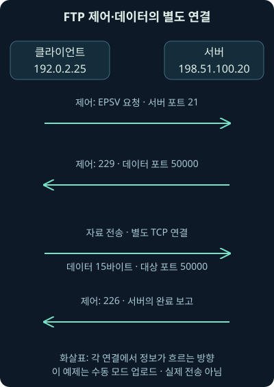
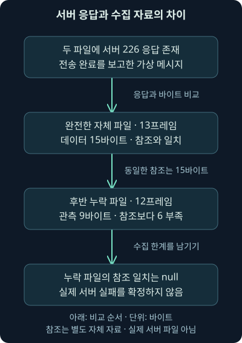
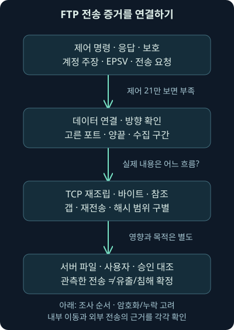

## 1. “전송 완료”라고 했는데 파일은 어디 있나요?

앞 강의에서는 원격 관리 요청이 보였다는 사실과 실제 명령이 실행됐다는 결론을 나눴습니다. 이번에는 파일을 옮기는 상황으로 가보죠. 서버 쪽에서 `226`이라는 완료 응답을 보냈는데, 우리가 모은 패킷에는 파일 내용이 일부만 있습니다. 서버가 거짓말을 한 걸까요? 아니면 수집기가 중간을 놓쳤을까요? 판단하기 전에 **서버의 보고, 관측한 바이트, 비교할 기준 자료**를 따로 놓아야 합니다.

이번 범위는 FTP의 구조와 보안 의미입니다. FTP는 File Transfer Protocol, 즉 파일을 주고받는 통신 규칙입니다. 본 자료의 해당 학습 항목을 따라 개념을 설명하고, 원문과 별개로 직접 만든 가상 패킷으로 확인합니다. 원본 워크북·실제 사건 패킷·운영 서버 로그를 분석한 결과는 아닙니다. 다음의 모든 IP 주소는 문서용이며 계정·파일·통신도 가상입니다. 실제 FTP 서버에 접속하지 않았습니다.

## 2. 접수 창구와 화물 통로가 따로 있습니다

택배 영업소를 떠올려보세요. 접수 창구에서 이름을 말하고 목적지를 정한 다음, 실제 상자는 별도 통로로 옮깁니다. 창구에서 “접수했습니다”라는 말을 들었다고 화물이 모두 배송된 것은 아니죠. FTP도 작업을 지시하는 **제어 연결**과 파일 내용을 나르는 **데이터 연결**을 나눕니다.

비유와 다른 점도 있습니다. 실제 FTP의 두 연결은 사람이 오가는 문이 아니라 TCP 연결입니다. TCP는 앞 강의에서 배운, 순서 있는 바이트 흐름을 전달하는 전송 규칙입니다. 제어 연결이 계속 열려 있는 동안 여러 파일의 데이터 연결이 만들어질 수 있고, 디렉터리 목록도 데이터 연결로 전달될 수 있습니다. 따라서 제어 연결 하나가 파일 하나와 항상 일대일로 대응한다고 생각하면 안 됩니다.

## 3. 포트 21만 수집하면 무엇이 빠질까요?

포트는 같은 호스트 안에서 통신 끝점을 구별하는 번호입니다. 전통적인 FTP 제어 서비스는 TCP 21을 사용합니다. 그러나 이 번호는 제어 연결을 찾는 출발점이지 전체 파일 내용의 위치가 아닙니다. 별도 데이터 연결을 빠뜨리면 파일 이름과 응답만 보고 실제 내용을 확인했다고 착각하기 쉽습니다.

가상 클라이언트 `192.0.2.25`가 서버 `198.51.100.20`의 21번으로 접속한다고 해보죠. 이 제어 연결의 클라이언트 쪽 포트는 `50001`입니다. 뒤에서 협상하는 데이터 연결은 같은 두 IP를 쓰더라도 `50002 → 50000`이라는 다른 포트 쌍을 사용합니다. 두 흐름을 연결해 읽어야 합니다. IP가 같다는 이유만으로 같은 TCP 연결로 합쳐서도 안 됩니다.

## 4. 명령과 응답은 어떤 대화인가요?

가상 제어 대화에는 `USER user-a`, `PASS training-only`가 등장합니다. `USER`는 사용할 계정 이름을, `PASS`는 암호 값을 전달하는 명령입니다. 여기의 값은 교육용으로 새로 만든 문자열이며 실제 자격 증명이 아닙니다. 공개 파일에 암호가 있으니 안전하다는 일반 규칙을 만든 것도 아닙니다. 실제 조사 자료의 자격 증명은 별도로 보호해야 합니다.

응답의 세 자리 숫자는 서버가 보고하는 처리 상태입니다. 이번 대화의 `331`은 암호가 더 필요하다는 뜻이고 `230`은 로그인 상태로 진행하라는 보고입니다. 모든 FTP 로그인이 반드시 같은 두 명령을 거쳐야 하는 것은 아닙니다. 이 파일의 순서를 다른 인증 방식이나 모든 서버에 적용하지 마세요. 기본 명령·응답 의미는 2026-11-07 확인한 [RFC 959](https://www.rfc-editor.org/rfc/rfc959.html)의 정의에 맞춰 설명합니다.

그런데 패킷 안에 `230`이 있으면 우리가 실제 서버에 로그인한 셈일까요? 아닙니다. 이 수업의 패킷은 프로그램이 만든 데이터입니다. 관측한 것은 “가상 응답 바이트가 파일에 존재한다”는 사실입니다. 실제 인증 성공은 서버 측 인증 기록과 해당 연결을 대조해서 판단합니다.

## 5. 누가 데이터 연결을 시작하는지부터 보세요

FTP에서는 제어 연결을 시작한 쪽과 데이터 연결을 시작하는 쪽이 다를 수 있습니다. **능동 모드**에서는 서버가 클라이언트가 알려준 데이터 끝점으로 연결을 시작하고, **수동 모드**에서는 클라이언트가 서버가 알려준 데이터 끝점으로 연결을 시작합니다. 여기서 능동·수동은 데이터 TCP 연결의 시작 방향을 가리킵니다. 파일 업로드·다운로드 방향과 같은 말이 아닙니다.

| 조건 | 제어 TCP 연결 시작 | 데이터 TCP 연결 시작 | 먼저 확인할 지점 |
| --- | --- | --- | --- |
| 능동 모드 | 클라이언트 → 서버 | 서버 → 클라이언트 | 클라이언트 측 수신 경로·주소 변환 |
| 수동 모드 | 클라이언트 → 서버 | 클라이언트 → 서버 | 서버가 알려준 데이터 포트·방화벽 경로 |

예를 들어 회사의 주소 변환 장비 뒤에 있는 클라이언트로 서버가 새 연결을 시도하면, 제어 대화는 정상이어도 데이터 연결이 막힐 수 있습니다. 주소 변환은 내부 주소와 외부에서 보이는 주소를 바꾸는 동작입니다. 수동 모드도 서버의 데이터 포트가 차단되어 있으면 실패합니다. 그래서 “21번에 접속됐으니 전송 경로도 정상”이라는 판단은 성립하지 않습니다. 전통적인 능동 데이터 연결에서 익숙한 20번을 모든 모드의 필수 데이터 포트로 외우지 마세요.

## 6. EPSV 응답에서 포트를 찾아봅시다

이번 자체 예제는 확장 수동 모드인 EPSV를 씁니다. 클라이언트가 `EPSV`를 요청하고 서버가 `229 Entering Extended Passive Mode (|||50000|)` 형태로 답합니다. 괄호의 구분자 `|` 사이에서 포트 값 `50000`을 읽습니다. 이 응답은 새 서버 주소를 지정하는 것이 아닙니다. 기본적으로 제어 연결의 서버 주소를 사용하고 데이터 포트를 바꿉니다.

따라서 이 예제의 데이터 목적지는 `198.51.100.20:50000`입니다. 콜론 뒤 숫자는 포트라는 표기입니다. 주소와 포트를 아무 패킷에서나 추측해서 조합한 것이 아니라, 제어 연결과 응답을 근거로 연결한 것이죠. EPSV의 응답 형식·주소 관계는 2026-11-07 [RFC 2428 §3](https://www.rfc-editor.org/rfc/rfc2428.html#section-3)에서 확인했습니다. 기존 PASV와 EPSV는 응답 형식이 다르므로 같은 문자열 해석기를 무조건 적용하면 안 됩니다.



그림에서는 같은 두 호스트 사이에 역할이 다른 흐름이 있다는 점을 읽어주세요. `226` 화살표는 제어 응답이며, 그 화살표가 파일 내용 15바이트를 싣는 것은 아닙니다. 실제 수업 파일에는 TCP 연결 수립·종료 전체가 들어 있지 않으므로 그림의 대화를 실제 접속 기록으로 확대 해석하지 않습니다.

## 7. 전송 방향과 자료 표현도 구별합니다

가상 대화의 `TYPE I`에서 `TYPE`은 자료 표현을 선택하는 명령이고 `I`는 이미지, 즉 이 예제에서는 바이트를 그대로 다루는 이진 표현을 선택합니다. 반대로 텍스트 표현에서는 줄바꿈 등의 변환을 고려해야 합니다. “원본 파일과 수신 파일의 해시가 다르다”는 결과를 보안 사건으로 판단하기 전에 표현 변환 여부도 확인해야 하는 이유입니다.

`STOR note.txt`는 서버 쪽에 `note.txt`라는 이름으로 자료를 저장하도록 요청합니다. 클라이언트에서 서버로 보내는 업로드입니다. `RETR`는 서버에서 가져오라는 요청이므로 자료의 방향이 반대입니다. 명령의 단어와 파일 이름만으로 완료를 확정하지 마세요. 요청, 서버 응답, 실제 데이터, 저장 결과는 각각 다른 증거입니다. 이번 검사기는 고정된 `TYPE I`·`STOR` 대화만 지원하며 텍스트 변환이나 모든 명령을 구현하지 않습니다. TYPE I와 기본 기능의 범위는 2026-11-07 [RFC 1123 §4.1](https://www.rfc-editor.org/rfc/rfc1123.html#section-4.1)에서도 대조했습니다.

## 8. 150과 226을 서로 다른 문장으로 적어보세요

`150`은 데이터 처리를 시작하려는 예비 응답이고 `226`은 데이터 연결을 닫으며 요청한 파일 동작이 성공했다는 완료 보고입니다. 이번 대화에서는 `STOR` 뒤의 `150`, 데이터 바이트, `226`을 순서와 연결 관계에 맞춰 읽습니다. `150`만 있고 뒤가 없다면 성공 여부가 아직 확인되지 않습니다. 다른 작업 맥락에서도 쓰일 수 있는 응답 코드를 고립시켜 해석하지 않는 습관이 필요합니다.

그렇다면 `226`을 봤을 때 쓸 문장은 “서버 방향 제어 흐름에서 완료를 보고하는 응답을 관측했다”입니다. “모든 바이트가 이 수집기에 있다”, “서버 디스크의 파일이 원본과 일치한다”, “승인된 사용자가 보냈다”는 문장은 별도 근거가 필요합니다. 이 구별은 서버가 틀렸다는 비난이 아니라, 각 증거가 답할 수 있는 질문의 경계를 정하는 일입니다.

## 9. 평문 FTP는 무엇을 노출하나요?

평문은 암호로 보호하지 않아 내용을 읽을 수 있는 표현입니다. 일반적인 평문 FTP 경로를 관측할 수 있으면 계정·암호 명령과 파일 내용이 노출될 수 있습니다. 암호화에 의한 기밀성·무결성 보호가 없으면 도청뿐 아니라 통신 내용 변경 위험도 살펴야 합니다. 무결성이란 내용이 의도하지 않게 바뀌지 않았는지 보장하는 성질입니다.

TCP 체크섬이 있다고 이 문제가 해결되지는 않습니다. 체크섬은 오류 검출용 계산 값입니다. 통신을 조작하는 쪽이 다시 계산할 수 있으므로 암호학적인 상대 인증이나 변조 방지 증거로 쓰면 안 됩니다. 이번 파일에서도 체크섬 검사는 바이트 구조 검증일 뿐, 실제 서버의 신원을 인증하지 않습니다.

## 10. FTPS와 SFTP는 이름만 비슷합니다

FTPS는 FTP에 TLS 보호를 적용하는 방식입니다. TLS는 통신 암호화와 상대 확인을 위한 보안 프로토콜입니다. 명시적 TLS 협상에서 `AUTH TLS`로 제어 연결을 보호하는 것과 데이터 연결의 보호 수준을 정하는 것은 구별됩니다. `PBSZ 0` 다음 `PROT P`를 협상하면 데이터에 TLS를 적용하고, `PROT C`는 데이터에 TLS를 적용하지 않는 수준입니다. 이 이름들은 분석할 협상 항목을 이해하기 위한 설명이며 여기서 서버 설정이나 명령을 실행하지 않았습니다.

따라서 “제어 채널에 TLS가 있다”만 보고 파일 데이터까지 암호화됐다고 단정하지 않습니다. 실제 협상 성공·데이터 연결·인증서 검증·적용 정책을 함께 확인해야 합니다. 이 구분은 2026-11-07 확인한 [RFC 4217 §8–9](https://www.rfc-editor.org/rfc/rfc4217.html#section-9)를 근거로 합니다. 문서가 옛 TLS 규격을 참조한다는 이유로 옛 TLS 버전을 현재 권고로 재사용하지 않습니다. 현재 배치된 제품의 지원 버전과 조직 정책은 따로 확인해야 합니다.

SFTP는 SSH 위의 별도 파일 전송 프로토콜입니다. 앞서 배운 SSH의 보호 경로와 연결되며, FTP 명령 대화에 TLS를 더한 FTPS와 같은 프로토콜이 아닙니다. SFTP에서 FTP의 21번 제어 대화와 EPSV 응답을 찾으려 하면 출발점부터 어긋납니다. 포트 번호 하나보다는 실제 클라이언트·서버 설정과 프로토콜 식별 근거를 먼저 모으세요. 2026-11-07 [OpenSSH의 sftp 설명](https://man.openbsd.org/sftp)에서도 SSH 전송 사용을 확인했습니다.

## 11. 오래됐다는 말은 어떤 조사 질문으로 바뀌어야 하나요?

오래된 FTP 서버가 남아 있다면 제품 이름·정확한 버전·수정 상태·노출 범위·인증·보호 설정을 확인합니다. “오래된 기술이니 이 서버에는 특정 취약점이 있다”라고 결론 내리지는 않습니다. 알려진 취약점을 연결하려면 해당 제품과 버전의 제작사 권고를 찾아야 합니다. 수정 버전도 영구적인 최신 버전이 아닙니다.

또 과거 자료의 브라우저 지원 중단 예정이나 당시 사용률 수치를 현재 사실로 옮기지 않습니다. 2026-11-07 확인한 [Chrome 88 변경 기록](https://developer.chrome.com/blog/chrome-88-deps-rems/)은 FTP 지원 비활성화를, [Firefox 90 변경 기록](https://developer.mozilla.org/en-US/docs/Mozilla/Firefox/Releases/90)은 FTP 제거를 설명합니다. 이는 해당 브라우저의 과거 변경입니다. 모든 운영체제의 파일 전송 기능이 사라졌다는 뜻은 아니며, 이 버전 번호를 현재 최신 브라우저라고 부르지도 않습니다.

## 12. 역사적 유출 사례에서 가져올 질문

2013년 Target 침해에 관해 2014년 미국 상원 위원회 직원 보고서는 탈취 자료가 FTP로 외부 서버에 전달됐다고 기술합니다. 보고서 자체는 당시 공개 보도·전문가 분석을 바탕으로 한 설명임을 밝힙니다. 이 수업이 그 사건의 원본 패킷이나 실제 서버를 다시 조사해 확인한 결과는 아닙니다. 근거는 2026-11-07 확인한 [당시 위원회 보고서의 요약 및 인쇄 11쪽](https://www.commerce.senate.gov/wp-content/uploads/media/doc/2014%200325%20Target%20Kill%20Chain%20Analysis.pdf)입니다.

이 사례에서 가져올 질문은 “FTP는 무조건 공격인가?”가 아닙니다. 어떤 내부 호스트가 어떤 자료를 모았고, 어느 외부 끝점으로 얼마나 보냈으며, 그 목적지가 승인된 전송 대상인가를 묻는 것이죠. 조직 내부의 중간 저장과 외부 전송은 다른 구간일 수 있습니다. 내부 트래픽이라고 관찰 대상에서 빼면 준비 단계를 놓칠 수 있고, 외부 FTP라고 모두 유출로 단정하면 업무 전송을 오판할 수 있습니다.

## 13. 직접 만든 파일을 먼저 구별합시다

수업 자료는 [설명 파일](../../assets/network-security/day02-lab20/README.txt), [검사기](../../assets/network-security/day02-lab20/inspect_ftp.py), [13개 프레임의 가상 패킷](../../assets/network-security/day02-lab20/ftp-complete.pcap), [데이터 일부를 뺀 12개 프레임의 가상 패킷](../../assets/network-security/day02-lab20/ftp-missing-data.pcap), [독립 비교 자료](../../assets/network-security/day02-lab20/expected-note.txt)입니다. PCAP는 패킷과 수집 시각 등을 담는 파일 형식이고, 프레임 수는 이 파일에 기록된 통신 단위의 개수입니다.

첫 번째 파일에는 제어 대화와 두 조각의 데이터가 있습니다. 두 번째는 그중 뒤쪽 데이터 조각 6바이트를 의도적으로 제거했고 완료 응답은 남겼습니다. 두 파일 모두 가상 생성물이므로 실제 서버 장애를 재현했다거나 특정 수집기에서 패킷 손실이 발생한 기록이라고 말할 수 없습니다. 연결 수립·종료 패킷을 생략한 작은 바이트 해석 예제입니다.

## 14. 무엇을 실제 실행했는지 확인해보죠

다음 두 검사는 작성 환경의 Python 3.12.14에서 실제 실행했습니다. Python은 프로그램을 실행하는 언어 환경입니다. 검사기는 표준 라이브러리만 사용하여 로컬 파일을 읽고 결과를 출력합니다. 서버 연결·파일 업로드·암호 시도는 하지 않습니다. 세 파일을 같은 폴더에 두었다는 조건의 예입니다.

```text
python inspect_ftp.py ftp-complete.pcap expected-note.txt
python inspect_ftp.py ftp-missing-data.pcap expected-note.txt
```

`python`은 실행기를, `inspect_ftp.py`는 읽을 프로그램을 가리킵니다. 그다음 첫 인수는 검사할 PCAP 경로, 두 번째 인수는 비교할 참조 파일 경로입니다. 인수는 프로그램에 건네는 입력 값이라는 뜻입니다. 이름이 비슷한 다른 파일이나 실제 사건 자료로 바꿔도 범용 FTP 분석기가 되는 것은 아닙니다. 고정된 주소·연결·명령·IPv4 및 TCP 헤더 형식만 처리하며, IP 조각화·VLAN·TLS·일반적인 FTP 상태 기계는 구현하지 않습니다.

## 15. 두 결과를 나란히 읽어봅시다

참조 파일은 `Training only.` 뒤에 줄바꿈 LF 한 바이트가 붙은 **15바이트**입니다. 바이트는 여기서 8비트짜리 자료 단위입니다. 줄바꿈을 두 바이트로 바꾸면 다른 파일이 됩니다. 우리가 만든 참조 파일의 길이를 안다는 것이 이번 비교의 중요한 조건입니다. 모든 실제 FTP 패킷에서 이 길이를 자동으로 얻을 수 있다는 뜻이 아닙니다.

| 실제 로컬 검사 항목 | 전체 예제 | 뒤쪽 조각 제거 예제 |
| --- | --- | --- |
| 기록된 프레임 | 13개 | 12개 |
| `226` 완료 보고 존재 | 참 | 참 |
| 재조립해 관측한 데이터 | 15바이트 | 9바이트 |
| 독립 참조 파일 길이 | 15바이트 | 15바이트 |
| 참조 길이에 비해 부족한 양 | 0바이트 | 6바이트 |
| 내부 순서 번호 공백 감지 | 거짓 | 거짓 |
| 참조와 전체 일치 판단 | `true` | `null` |
| 실제 서버 파일 저장 검증 | 하지 않음 | 하지 않음 |

부족량은 `max(0, 참조 길이 − 관측 길이)`로 계산합니다. `max`는 큰 쪽을 택한다는 뜻이므로 관측 쪽이 더 길더라도 음수로 표시하지 않습니다. 이번에는 `15 − 9 = 6`입니다. 길이가 같아야만 비교를 허용하는 이 검사기에서 `null`은 **전체 비교를 판단할 조건이 부족함**을 뜻합니다. 불일치가 확인된 `false`와 다릅니다. 같은 길이의 다른 바이트라면 `false`를 낼 수 있지만, 지금 결과는 그 경우가 아닙니다.



## 16. 중간 공백이 없는데 왜 부족하죠?

TCP 순서 번호는 흐름 안에서 바이트의 위치를 가리킵니다. 이번 데이터는 앞 조각 9바이트와 바로 이어지는 뒤 조각 6바이트로 나눴습니다. 뒤 조각을 빼면 앞 조각 안에는 빠진 위치가 없습니다. 뒤에 더 올 자료의 길이를 패킷만으로 알 수 없을 때, 내부 공백 검사가 거짓이라고 해서 전체 파일이 있다고 증명할 수는 없습니다. 이번에는 따로 가진 15바이트 참조가 부족함을 드러냅니다.

반대로 중간 조각이 빠지고 그 뒤 순서 번호가 관측되면 내부 공백을 감지할 수 있습니다. 수집 순서가 바뀐 경우는 번호에 따라 정렬하고, 같은 번호의 같은 바이트가 재전송된 경우는 한 번만 셉니다. 재조립은 이렇게 조각을 원래 흐름으로 맞추는 일입니다. 검사기는 충돌하는 겹침을 추측해 통과시키지 않고 오류로 중단합니다. 실제 도구의 재조립 정책과 세션 시작 이전 누락은 별도로 확인해야 합니다.

검사기는 가장 먼저 관측한 데이터 순서 번호를 시작점으로 삼습니다. 따라서 앞부분이 이미 빠진 늦은 수집을 일반적으로 알아내는 기능은 없습니다. 양방향 ACK, 연결 수립·종료, 서버 파일 크기 등 더 넓은 증거가 필요합니다. 이번 실험의 고정 조건을 설명하는 것이지 모든 PCAP의 완전성 검증을 제공하는 것은 아닙니다.

## 17. 해시에는 비교한 범위를 붙여주세요

해시는 바이트 내용에서 계산하는 고정 길이의 요약 값입니다. 전체 예제에서 참조와 관측 바이트를 비교하면 같고, 15바이트의 SHA-256은 `571143bbfd4e9e23772d8174a1f60be72d69923ed8b4a8c4744081059cd4203f`입니다. 이 값은 자체 자료의 실제 계산 결과입니다. 서버 디스크의 실제 파일 해시를 얻은 결과는 아닙니다.

검사기 출력 이름도 `captured_prefix_sha256`, 즉 수집해 이어 붙인 앞부분의 해시라고 붙였습니다. 뒤쪽 제거 예제의 9바이트 해시는 15바이트 전체와 비교할 값이 아닙니다. “해시가 다르니 누군가 파일을 변조했다”는 결론보다 먼저 입력 길이·자료 범위·표현 변환·완전성을 확인하세요. 해시가 같더라도 사용자의 승인이나 자료 반출 권한까지 증명하지는 않습니다.

## 18. Wireshark에서는 어디부터 찾을까요?

다음은 Wireshark 표시 필터를 읽는 예이며, 이번 환경에서 Wireshark를 실행해 적용한 결과는 아닙니다. 표시 필터는 이미 읽은 패킷 가운데 화면에 보일 대상을 고르는 조건입니다. 수집 필터처럼 처음부터 저장할 패킷을 제한하는 문법과 구별하세요.

```text
ftp
ftp.request.command == "STOR"
tcp.port == 21 || tcp.port == 50000
```

첫 줄은 FTP로 해석된 대화를 찾는 출발점입니다. 두 번째의 `ftp.request.command`는 요청 명령 필드이며 `==`는 같은 값인지 비교합니다. 큰따옴표 안 `STOR`를 지정한 이유는 업로드 **요청**을 좁히기 위해서입니다. 이 필터가 완료 응답이나 파일 데이터 전체를 자동으로 증명하지는 않습니다. 비표준 포트의 프로토콜 해석·재조립 설정도 영향을 줄 수 있습니다.

세 번째의 `tcp.port`는 출발지나 목적지 TCP 포트 중 하나가 맞으면 찾습니다. `||`는 또는이므로 제어 21과 이 예제에서 협상된 데이터 50000을 함께 살펴보려는 조건입니다. 실제 환경의 모든 FTP 데이터 포트가 50000이라는 뜻은 아닙니다. 먼저 제어 대화와 연결 식별자를 확인한 뒤 범위를 조정하세요. 2026-11-07 [Wireshark 공식 FTP 필드 참조](https://www.wireshark.org/docs/dfref/f/ftp.html)에서 `ftp.request.command`의 제공 범위 1.0.0–4.6.9를 확인했습니다. 이는 문서의 필드 버전 범위이며 여기서 특정 Wireshark 버전을 시험했다는 뜻이 아닙니다.

## 19. “아무것도 안 나옵니다”의 의미를 좁혀봅시다

포트 21의 제어 대화만 수집했다면 데이터가 안 나오는 것은 수집 범위 때문일 수 있습니다. 한쪽 방향만 미러링했다면 응답이나 반대 방향 데이터가 빠질 수 있죠. TLS가 적용된 구간이면 평문 명령 검색이 비어 있어도 통신이 없었다고 말할 수 없습니다. 다른 포트·다른 구간·해석 설정·재조립·수집 시작 시점도 확인합니다.

반대로 데이터가 많이 보인다는 이유만으로 유출이라고 확정하지 않습니다. 업무 전송일 수 있고, 파일 이름과 실제 내용이 다를 수도 있습니다. “수집한 이 방향과 시간 범위에서 이 조건으로 찾지 못했다”라고 쓰면 다음 조사자가 어떤 한계를 보완할지 알 수 있습니다. “없었다”라는 한 단어는 그 정보를 지워버립니다.

## 20. 조사에서는 네 단계로 증거를 이어갑니다

먼저 제어 연결의 주소·포트·시간·명령·응답을 기록합니다. 그다음 협상된 데이터 끝점을 연결하고 어느 방향의 바이트인지 확인합니다. 이어 재조립 범위와 참조 파일 비교 조건을 적습니다. 마지막으로 서버 파일·클라이언트 실행 주체·업무 승인을 대조합니다. 이 순서라면 네트워크 관측을 단말과 서버의 실제 동작으로 연결할 수 있습니다.



클라이언트의 프로세스·실행 계정·파일 읽기 기록, 서버의 인증·FTP 전송·파일 생성·저장 크기 기록, 방화벽의 허용·차단 및 변환 기록을 같은 시간 기준으로 맞춰보세요. 목적지가 이름으로 지정됐다면 리졸버의 이름 조회 기록도 후보 주소를 연결하는 데 도움을 줍니다. 장비 시각 차이와 로그 보존 범위를 먼저 확인해야 다른 연결을 같은 사건으로 붙이지 않습니다.

이번 전체 예제의 결론은 “가상 제어 대화의 완료 보고와 자체 데이터 15바이트를 관측했고, 별도 참조 15바이트와 일치했다”입니다. 뒤쪽 제거 예제는 “완료 보고는 남아 있지만 수집된 앞부분은 9바이트여서 참조 전체 비교는 미확인”입니다. 두 경우 모두 실제 서버 저장·실제 인증·반출 승인·침해 성공은 확인하지 않았습니다. 다음 강의에서는 파일 전송과 다른 목적의 ICMP를 보면서, 진단 메시지와 자료 운반 가능성을 같은 증거 원칙으로 구별하겠습니다.

## 21. 복습: 응답·바이트·결론을 나누어 설명해보세요

### 질문 1. TCP 21 패킷만 있으면 파일도 전부 있나요?

**해설:** 제어와 데이터 연결이 따로이므로 아닙니다. 협상 내용과 데이터 끝점을 연결하고 수집 범위부터 확인합니다.

### 질문 2. 수동 모드에서 업로드하면 서버가 데이터 연결을 시작하나요?

**해설:** 수동 모드의 데이터 TCP 연결은 클라이언트가 시작합니다. 업로드라는 자료 방향과 연결 시작 방향의 개념을 구별해야 합니다.

### 질문 3. 모든 데이터 전송에서 TCP 20을 찾으면 되나요?

**해설:** 수동 모드에서는 협상한 서버 포트를 씁니다. 전통적인 능동 모드에서 익숙한 번호를 모든 데이터 연결에 적용하면 놓칩니다.

### 질문 4. EPSV의 229 응답에 50000이 있으면 어느 IP로 가나요?

**해설:** 이번 조건에서는 제어 연결의 서버 IP와 포트 50000을 연결합니다. 응답에서 임의의 새 IP를 제공받았다고 해석하지 않습니다.

### 질문 5. 230 뒤에 150이 왔으면 파일 전송은 끝났나요?

**해설:** 230은 로그인 상태 보고이고 150은 예비 응답입니다. 파일 동작의 완료 보고·실제 데이터·저장 확인은 더 살펴야 합니다.

### 질문 6. 가상 패킷의 226은 실제 서버 저장을 증명하나요?

**해설:** 이 자료에서는 생성한 응답 바이트입니다. 실제 서버를 실행하지 않았으므로 실제 저장 결과를 검증했다고 말할 수 없습니다.

### 질문 7. 참조 15바이트, 관측 9바이트면 부족량은 얼마인가요?

**해설:** `max(0, 15 − 9) = 6`바이트입니다. 15는 별도로 가진 자체 참조 길이이며 모든 FTP 패킷에서 자동으로 주어지는 값이 아닙니다.

### 질문 8. 그때 reference_match가 false가 아닌 null인 이유는요?

**해설:** 전체 비교 조건이 부족하기 때문입니다. 같은 길이의 다른 내용을 확인한 불일치와, 자료 일부만 가진 미확인을 나눕니다.

### 질문 9. 내부 순서 번호 공백이 없으면 완전한 파일인가요?

**해설:** 끝부분이 빠진 경우에는 내부 공백이 없을 수 있습니다. 늦게 수집했다면 앞부분 누락도 숨을 수 있으므로 시작·종료·길이·참조 근거가 더 필요합니다.

### 질문 10. 9바이트 해시와 15바이트 해시가 다르면 변조인가요?

**해설:** 비교 범위부터 다릅니다. 먼저 같은 길이와 같은 표현의 전체 자료를 확보해야 변조 여부에 관한 비교를 할 수 있습니다.

### 질문 11. 제어 연결의 AUTH TLS만 보면 데이터도 암호화됐나요?

**해설:** 데이터 보호 협상과 실제 데이터 연결을 더 확인해야 합니다. 제어 보호와 데이터 보호는 별도 질문입니다.

### 질문 12. SFTP와 FTPS에 같은 EPSV 필터를 적용하나요?

**해설:** SFTP는 SSH 위의 별도 프로토콜입니다. FTP에 TLS를 적용한 FTPS의 제어 대화를 그대로 찾는 접근은 맞지 않습니다.

### 질문 13. FTP 서버가 오래됐으면 특정 취약점도 확정되나요?

**해설:** 제품·버전·수정 상태·설정과 해당 제작사 권고를 대조해야 합니다. 나이만으로 특정 취약점을 확인한 것은 아닙니다.

### 질문 14. 브라우저에서 FTP가 제거됐으니 회사에 FTP가 없나요?

**해설:** 브라우저 기능 변경과 다른 전송 프로그램의 존재는 다릅니다. 실제 자산·프로세스·네트워크 기록을 확인해야 합니다.

### 질문 15. 내부 FTP라면 외부 유출 조사와 무관한가요?

**해설:** 업무일 수도 있고 외부 전송 전 중간 저장일 수도 있습니다. 자료의 흐름과 승인·파일·실행 기록을 연결하기 전에는 어느 쪽도 확정하지 않습니다.

### 질문 16. STOR 필터 결과가 비었으면 업로드가 없었다고 쓰나요?

**해설:** 암호화·포트 해석·수집 방향·시간·재조립 설정에 따라 보이지 않을 수 있습니다. 검색한 범위와 한계를 기록한 뒤 다른 증거를 대조합니다.
