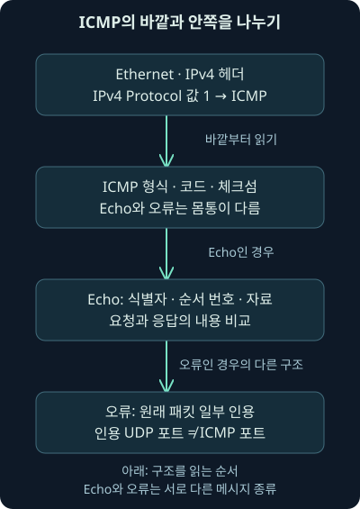
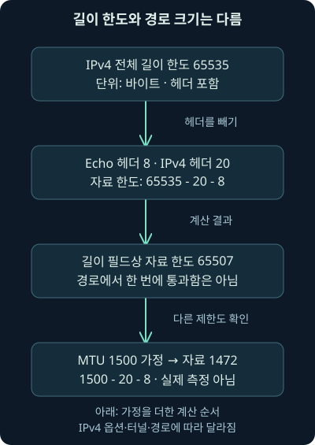
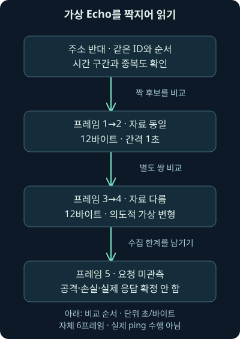

## 1. “ping만 했습니다”는 어디까지 설명할까요?

앞 강의에서는 FTP의 완료 응답과 실제로 수집한 파일 바이트를 구별했습니다. 이번에는 파일 전송 프로그램도 아닌 진단 통신을 보겠습니다. 단말에서 외부 주소로 ping을 보냈고, 패킷 안에 읽을 수 있는 문장이 있습니다. 연결 점검일까요, 자료 전송일까요? 문장 하나만으로 목적을 확정하기 전에 메시지의 구조와 정상적인 사용 범위를 알아야 합니다.

ping은 보통 상대에게 요청을 보내고 응답을 확인하는 진단 도구입니다. **ICMP**, Internet Control Message Protocol은 IP 통신의 오류·제어·진단 메시지를 전달하는 규칙입니다. ping에서 쓰는 Echo는 그중 한 종류입니다. ICMP 전체를 ping과 같은 말로 부르면 오류 통지를 놓칩니다.

둘째 날 21강은 ICMP의 역할, Echo의 자료 영역, 요청·응답 대응, 길이 계산과 MTU, 오류 안의 원래 패킷, 보안 조사 해석을 다룹니다. 뒤의 여섯 프레임은 자체 제작한 가상 PCAP입니다. 실제 ping·원격 접속·정보 유출·원본 워크북을 실행한 결과가 아닙니다. 주소도 문서용입니다.

## 2. 안내문과 회신용 엽서를 떠올려보세요

우편물이 목적지에 가지 못하면 반송 사유가 붙어 돌아옵니다. 이것은 새 물건을 주문하는 편지와 다릅니다. ICMP 오류도 원래 통신을 처리하지 못한 이유를 보내는 역할을 합니다. 반면 Echo 요청·응답은 “이 내용을 받았으면 돌려주세요”라는 회신용 엽서에 가깝습니다.

엽서의 내용 칸에 평범한 점검 자료 대신 다른 문장을 쓸 수 있겠죠. ICMP Echo도 자료 영역의 바이트가 고정된 인사말이어야 하는 것은 아닙니다. 그렇다고 글자가 있다는 사실만으로 비밀 자료가 빠져나갔다고 할 수는 없습니다. 진단 도구도 크기·패턴·시각 같은 정보를 넣을 수 있기 때문입니다.

비유에서 주의할 점도 있습니다. ICMP는 우편처럼 배송·회신을 보장하지 않습니다. 응답 제한, 방화벽, 호스트 정책, 경로와 수집 위치에 따라 안 보일 수 있습니다. 응답이 없다는 한 가지 사실만으로 상대가 꺼졌다고 단정하지 않습니다.

## 3. ICMP에는 TCP 포트를 붙이지 않습니다

IPv4 패킷의 Protocol 필드는 안쪽 자료가 어떤 규칙인지 가리킵니다. 값 1이면 ICMP입니다. 이것은 TCP의 출발지·목적지 포트와 다른 필드입니다. ICMP Echo의 식별자도 TCP 포트 그 자체는 아닙니다. 따라서 “ICMP 포트 8을 열었다”라고 쓰기보다 “ICMP Echo Request 유형을 허용했다”라고 정확히 구별해야 합니다.

ICMP의 **유형**, Type은 큰 메시지 종류이고 **코드**, Code는 그 안의 세부 이유입니다. 예를 들어 IPv4 Echo 요청은 유형8/코드0, 응답은 유형0/코드0입니다. 유형3/코드3은 목적지에 도달할 수 없다는 오류 중 포트에 관한 사유를 나타냅니다. 같은 숫자라도 어느 필드인지 먼저 읽으세요. 기본 역할과 필드 의미는 2026-11-07 [RFC 792](https://www.rfc-editor.org/rfc/rfc792.html)에서 확인했습니다.



그림의 마지막 두 칸은 하나의 Echo 안에 차례로 둘 다 들어 있다는 뜻이 아닙니다. 유형에 따라 달라지는 몸통을 비교한 것입니다. 오류 안에서 UDP 포트가 보이더라도 그것을 바깥 ICMP의 포트로 옮기면 안 됩니다.

## 4. 그런데 응답은 어떻게 찾을까요?

Echo에는 **식별자**, Identifier와 **순서 번호**, Sequence Number가 있습니다. 가상 요청이 `192.0.2.25 → 198.51.100.20`, 식별자700/순서1이라고 합시다. 주소가 반대인 응답에서 같은 두 값을 찾으면 짝 후보를 좁힐 수 있습니다. 여기에 시간 구간과 자료 내용도 대조합니다.

순서 번호는 이 Echo 교환을 구별하는 값입니다. TCP의 바이트 위치 번호와 같은 동작을 한다고 생각하지 마세요. 서로 다른 호스트가 같은 식별자·순서 번호를 쓸 수 있고, 주소 변환이나 반복 사용도 있을 수 있습니다. 숫자 두 개만 같다는 이유로 멀리 떨어진 시간의 패킷을 무조건 붙이지 않습니다.

Echo 응답은 요청 자료를 돌려주는 구조입니다. 실제 분석에서는 자료 길이뿐 아니라 바이트도 비교해보세요. 같은 길이의 서로 다른 문장이 있을 수 있습니다. 이번 검사기는 작은 고정 사례의 대응을 보여줄 뿐, 모든 동시 요청·중복·재전송·주소 변환을 처리하는 일반 분석기는 아닙니다. 2026-11-07 [RFC1122 §3.2.2.6](https://www.rfc-editor.org/rfc/rfc1122.html#section-3.2.2.6)도 대조했습니다. 이 문서는 응답 전송에 필요한 의도적 조각화를 구현하지 않은 경우 전송 크기로 잘라 보내는 조건도 설명하므로, 큰 응답이 짧다는 사실을 곧바로 변조로 판단하지 않습니다.

## 5. 자료 칸을 읽었다는 사실과 반출 결론은 다릅니다

페이로드는 헤더를 제외하고 실린 자료를 뜻합니다. Echo의 자료 영역에 임의의 바이트를 넣을 수 있다는 구조는 정상 진단과 오용 양쪽에 쓰일 수 있습니다. 원문에서 강조하는 보안 요점도 이 운반 가능성입니다. 특정 도구로 사용자 정의 패킷을 만들 수 있다는 말과 그 기능이 실제 사건에 사용됐다는 증거는 다릅니다.

분석가가 `training-one`이라는 문장을 봤다면 직접 관측한 사실은 “이 자료 영역에 그 바이트가 있다”입니다. 정보 유출 가설을 검토하려면 내용이 어떤 파일·계정 자료와 관련되는지, 어느 프로세스가 만들었는지, 목적지·빈도·양·업무 승인·반대 방향이 무엇인지 더 필요합니다. 이번 문장은 새로 만든 교육용 값이며 실제 비밀 자료가 아닙니다.

크거나 자주 반복되는 Echo도 조사할 이유는 될 수 있습니다. 하지만 크기 하나를 모든 환경에 맞는 공격 기준으로 고정하지 마세요. 모니터링 시스템의 정상 점검 주기와 크기, 시험 작업, 수집 중복도 함께 봐야 합니다. 규칙적인 간격도 자동화된 정상 점검과 악성 통신 양쪽에서 나타날 수 있습니다.

## 6. 65507바이트라는 숫자에는 가정이 숨어 있습니다

IPv4의 Total Length는 헤더까지 포함한 전체 길이입니다. 16비트 필드이므로 최대 값은 `2**16 − 1 = 65535`바이트입니다. `**`는 거듭제곱을 나타내는 표기입니다. Echo 자료만 계산하려면 바깥 IPv4 헤더와 Echo 헤더를 빼야 합니다.

IPv4 옵션이 없어서 헤더가20바이트이고 Echo 헤더가8바이트라면 `65535 − 20 − 8 = 65507`바이트입니다. 이것은 길이 필드에 맞는 이론적 자료 크기이지, 모든 장비에서 이 크기를 받아 한 프레임으로 보낼 수 있다는 보장이 아닙니다. IPv4 길이의 의미는 2026-11-07 [RFC 791의 Total Length 정의](https://www.rfc-editor.org/rfc/rfc791.html)에서 대조했습니다.

| 계산 조건 | 빼는 IPv4 헤더 | 빼는 Echo 헤더 | 자료 크기 상한 |
| --- | --- | --- | --- |
| IPv4 길이 필드 한도65535, 옵션 없음 | 20바이트 | 8바이트 | 65507바이트 |
| 같은 길이 필드, 헤더24 가정 | 24바이트 | 8바이트 | 65503바이트 |
| 아래에서 설명할 MTU1500 가정, 옵션 없음 | 20바이트 | 8바이트 | 1472바이트 |

옵션 때문에 IPv4 헤더가 늘면 자료에 쓸 공간이 줄어듭니다. 그리고 이 식은 **IPv4 Echo**의 가정입니다. 모든 ICMP 오류 몸통이나 IPv6에 65507을 그대로 붙이지 않습니다. 원문의 숫자는 유지하되 적용 조건을 이렇게 보충해야 실제 조사에서 틀린 크기 판단을 피할 수 있습니다.

## 7. 길이가 허용돼도 길목을 통과하지 못할 수 있습니다

**MTU**, Maximum Transmission Unit은 해당 링크에서 한 번에 실을 수 있는 IP 패킷 크기의 제한을 설명할 때 쓰는 값입니다. 경로의 가장 좁은 구간이 있으면 그 영향도 받습니다. 이를 경로 MTU라고 부릅니다. 가상으로1500바이트라고 가정하면 헤더20과8을 빼 Echo 자료는1472바이트가 됩니다.

1500이 모든 네트워크의 실제 값은 아닙니다. 터널 같은 바깥 포장이 추가되거나 링크가 다르면 사용 가능한 크기도 달라집니다. Ethernet 헤더까지 포함한 캡처 프레임 길이와 IP 길이도 같은 수치가 아닙니다. 어디부터 어디까지 센 바이트인지 적어야 숫자를 비교할 수 있습니다.



## 8. 조각화와 오류 메시지는 왜 관련되나요?

**조각화**, fragmentation은 큰 IP 데이터그램을 더 작은 조각으로 나누는 동작입니다. IPv4에서 DF, Don't Fragment라는 비트가 설정되어 조각화가 금지됐는데 다음 구간이 너무 작으면 전달할 수 없습니다. 이때 관련 ICMP 오류와 다음 구간 MTU 정보가 경로 크기를 조정하는 데 쓰일 수 있습니다. 2026-11-07 [RFC 1191](https://www.rfc-editor.org/rfc/rfc1191.html)의 역할을 확인했습니다. 실제 경로 탐색을 수행한 것은 아닙니다.

조각은 일부만 수집될 수도 있고 중간 장비에서 처리 방식이 다를 수 있습니다. 따라서 조각화된 큰 Echo의 어느 한 조각에서 글자를 못 찾았다고 전체 자료가 없다고 결론 내리면 안 됩니다. IP 재조립을 했는지, 필요한 모든 조각이 있는지, 수집 길이가 잘렸는지 확인합니다. 2026-11-07 대조한 [RFC 8900](https://www.rfc-editor.org/rfc/rfc8900.html)은 조각화가 통신을 취약하게 만드는 조건과 운영상의 문제를 다룹니다. 큰 패킷이면 항상 안전하게 조각화되어 도착한다는 설명은 피합니다.

이번 검사기는 조각화 패킷을 지원하지 않고 오류로 중단합니다. 지원하지 않는 입력을 조용히 무시해 “이상이 없다”라고 만들지 않습니다. 그 오류는 공격 판정이나 실제 호스트 장애가 아니라 도구의 적용 범위입니다.

## 9. IPv6의 ICMP는 따로 확인합니다

ICMPv6는 IPv6에서 쓰는 제어 메시지 체계입니다. Echo 요청·응답 유형은128·129로 IPv4와 다르고, Packet Too Big 같은 오류도 별도 정의가 있습니다. 2026-11-07 [RFC 4443](https://www.rfc-editor.org/rfc/rfc4443.html)을 확인했습니다. IPv4 검사 프로그램이 IPv6도 검사한다고 표현하지 않습니다.

보안 때문에 ICMP를 전부 차단하자는 결론도 조심해야 합니다. 특히 IPv6의 필요한 제어·오류 기능까지 막으면 통신과 경로 크기 처리가 깨질 수 있습니다. 유형·방향·관련 통신·구간별 요구를 검토해야 합니다. [RFC 4890](https://www.rfc-editor.org/rfc/rfc4890.html)은 ICMPv6 필터링을 다루는 Informational 문서로, 여기서는 필요한 메시지를 구별해야 한다는 근거로 사용합니다. 모든 조직에 그대로 적용할 방화벽 명령을 실행한 것은 아닙니다.

## 10. 오류 메시지 안에 UDP 포트가 있습니다

가상 여섯 번째 프레임은 유형3/코드3 오류입니다. 그 안에는 원래 IPv4 헤더와 UDP 헤더를 인용해 넣었습니다. UDP는 TCP와 다른 전송 프로토콜이고 출발지·목적지 포트를 가집니다. 오류가 어느 원래 통신에 관한 것인지 찾는 단서입니다. 인용의 범위와 원래 프로토콜을 구별하는 근거는 2026-11-07 [RFC1122 §3.2.2](https://www.rfc-editor.org/rfc/rfc1122.html#section-3.2.2)에서도 확인했습니다.

우리 예제의 인용 자료에는 원래 `192.0.2.25 → 198.51.100.20`, UDP 목적지33434가 있습니다. 이 숫자는 **인용된 원래 UDP의 포트**입니다. ICMP 포트33434가 아닙니다. 또한 원래 애플리케이션의 전체 본문이 모두 인용됐다는 뜻도 아닙니다. 바깥 IP, ICMP 오류, 안쪽 원래 IP·UDP의 경계를 차례로 읽어보세요.

이 자료의 오류 바이트도 프로그램이 만든 것입니다. 실제 포트가 닫힌 서버를 조사했다는 증거가 아닙니다. 원래 요청의 실제 전달과 서버 반응을 확인하려면 해당 원래 흐름과 서버·방화벽 기록을 대조해야 합니다.

## 11. 자체 파일에서 실제로 무엇을 확인했나요?

[가상 여섯 프레임 PCAP](../../assets/network-security/day02-lab21/icmp-training.pcap), [로컬 검사기](../../assets/network-security/day02-lab21/inspect_icmp.py), [설명 파일](../../assets/network-security/day02-lab21/README.txt)을 제공합니다. 작성 환경의 Python3.12.14 표준 라이브러리에서 다음을 실제 실행했습니다. 같은 폴더에 파일을 둔 예입니다.

```text
python inspect_icmp.py icmp-training.pcap --mtu 1500 --ip-header 20
```

`python`은 실행기, 다음은 검사 프로그램과 PCAP 입력 경로입니다. `--mtu 1500`은 크기 계산용 MTU 가정, `--ip-header 20`은 크기 계산용 IPv4 헤더 길이입니다. 이 두 인수는 실제 경로 측정이나 패킷의 헤더 옵션 지원을 켜는 설정이 아닙니다. 입력 해석은 옵션 없는 IPv4로 제한되며 숫자 계산의 조건만 바꿉니다.

검사기는 로컬 파일만 읽습니다. PCAP 형식·길이·IPv4/ICMP 체크섬을 확인하고 고정된 Echo와 오류 부분집합을 해석합니다. IPv6·VLAN·IP 재조립·일반적인 다중 세션·모든 오류 확장은 지원하지 않습니다. 실제 ping 명령, 서버, 소켓 통신은 실행하지 않았습니다.

## 12. 두 쌍과 요청 없는 응답을 나눠 읽어봅시다

| 실제 로컬 결과 | 관측한 자체 자료 | 해석 범위 |
| --- | --- | --- |
| 프레임1→2 | 식별자700/순서1, 자료12바이트 동일 | 가상 요청·응답의 자료 일치 |
| 프레임3→4 | 식별자700/순서2, 길이12지만 바이트 다름 | 의도적으로 바꾼 가상 사례의 불일치 |
| 프레임5 | 식별자900/순서3 응답, 대응 요청 미관측 | 수집 파일에서 짝을 못 찾음 |
| 프레임6 | 오류 안의 원래 UDP 목적지33434 | 원래 패킷 일부의 인용 |
| 길이 계산 | 65507/1472바이트 | 헤더20·MTU1500 가정의 계산 |

앞 두 쌍의 기록 시각 간격은 각각1000000마이크로초, 즉1초입니다. 마이크로초는 백만분의1초 단위입니다. 이것은 생성한 패킷 시각의 차이이며 실제 네트워크 지연을 측정한 결과가 아닙니다. 내용 불일치도 교육용으로 넣은 반례입니다. 실제 악성 Echo를 발견했다고 쓰지 않습니다.



## 13. 조건을 바꾸면 계산도 달라집니다

MTU 가정을1492로 바꾸면 자료 크기 계산은 `1492 − 20 − 8 = 1464`바이트입니다. 반대로 IP 헤더 가정을24로 바꾸고 MTU1500을 유지하면1468바이트입니다. 둘 다 같은 PCAP을 읽으면서 숫자 계산 조건을 바꾸는 사례입니다. 실제 패킷이 옵션 헤더로 바뀐 것이 아닙니다.

짝이 없는 응답도 조건에 따라 생길 수 있습니다. 수집 시작 전에 요청이 지나갔거나 한쪽 방향만 수집했을 수 있고, 다른 관측 지점에서 주소가 변했을 수도 있습니다. 실제 위조·비정상 메시지 가능성도 검토하지만, 먼저 수집 범위와 변환 기록을 확인합니다. 체크섬이 맞아도 발신자 신원이나 안전함은 인증되지 않습니다.

## 14. Wireshark 필터는 질문에 맞춰 좁힙니다

다음은 **미실행 표시 필터 예시**입니다. Wireshark에서 이미 읽은 패킷의 화면 표시를 고르는 조건이며, 이번에는 Wireshark를 실행해 결과를 얻지 않았습니다.

```text
icmp
icmp.type == 8 && icmp.code == 0
icmp.ident == 700
```

첫 줄은 ICMP로 해석된 패킷, 두 번째는 유형8이면서 코드0인 Echo 요청을 좁힙니다. `==`는 같은 값, `&&`는 두 조건을 모두 만족한다는 뜻입니다. 세 번째는 식별자700이라는 한 단서입니다. 두 번째만 보면 응답을 제외하므로 요청·응답 비교에 필요한 패킷을 스스로 가리지 않도록 주의하세요. 식별자 조건도 주소·시간을 대신하지 않습니다.

2026-11-07 [공식 ICMP 필드 참조](https://www.wireshark.org/docs/dfref/i/icmp.html)에서 `icmp.type`, `icmp.code`, `icmp.ident`의 제공 범위1.0.0–4.6.9와 [필터 문법](https://www.wireshark.org/docs/man-pages/wireshark-filter.html)을 확인했습니다. `icmp.data`는 해당 참조에서4.6.0부터이므로 오래된 판본의 모든 자료 검색을 같은 필드로 설명하지 않습니다. 문서 버전 범위는 이 기기에 설치·시험한 버전이 아닙니다.

## 15. 조사 결론에 수집의 한계를 함께 남기세요

직접 사실은 메시지 유형·코드·주소·식별자·순서·자료·시각·체크섬 상태입니다. 가설은 진단, 시험, 비정상 자료 운반 등입니다. 실제 민감 정보 반출이나 명령 제어 성공은 프로세스·파일 접근·목적지 소유·방화벽·단말 기록과 대조할 결론입니다. 원격 관리처럼 보이는 문장 하나로 이 단계를 건너뛰지 않습니다.

결과가 비어 있다면 필터, 시간, 방향, 캡처 길이, IP 조각과 재조립, 터널·암호화로 감춰진 구간을 확인합니다. Echo가 응답했다고 웹서비스·인증·파일 기능까지 정상인 것도 아닙니다. ICMP 진단과 애플리케이션 성공은 다른 질문입니다. 다음 강의에서는 HTTPS로도 가능한 원격 관리와 조직의 승인된 통신 기준을 연결하겠습니다.

## 16. 복습: 숫자가 어느 필드와 가정에 속하는지 설명해보세요

### 질문 1. ICMP 전체가 ping인가요?

**해설:** Echo는 일부입니다. 오류·제어 메시지도 있으므로 유형·코드와 몸통을 읽어야 합니다.

### 질문 2. 유형8은 ICMP의 TCP 포트8인가요?

**해설:** 아닙니다. IPv4 Protocol과 ICMP 유형, TCP 포트는 다른 필드입니다.

### 질문 3. 식별자와 순서 번호만 같으면 같은 요청·응답인가요?

**해설:** 주소 방향·시간·중복·변환도 확인해야 합니다. 여러 호스트와 시점에서 같은 값을 사용할 수 있습니다.

### 질문 4. 문장이 보이면 자료 유출이 확정되나요?

**해설:** 정상 진단도 자료를 넣을 수 있습니다. 내용의 출처·프로세스·양·목적지·승인을 더 확인해야 합니다.

### 질문 5. 65507은 어떤 조건의 값인가요?

**해설:** IPv4 전체 길이65535에서 옵션 없는 헤더20과 Echo 헤더8을 뺀 자료 한도입니다. 모든 경로에서 한 번에 전송된다는 보장이 아닙니다.

### 질문 6. MTU1492·헤더20이면 Echo 자료 공간은요?

**해설:** `1492 − 20 − 8 = 1464`바이트입니다. 실제 경로 MTU가1492인지 확인한 결과와 계산 가정을 구별합니다.

### 질문 7. IP 헤더 가정을24로 바꾸면 검사기가 옵션 패킷도 지원하나요?

**해설:** 아닙니다. 이 도구에서 그 인수는 크기 계산용입니다. 패킷 해석의 지원 범위와 수학적 조건은 다릅니다.

### 질문 8. 같은12바이트면 내용도 같나요?

**해설:** 가상 프레임3→4처럼 길이는 같고 바이트는 다를 수 있습니다. 실제 내용 비교가 필요합니다.

### 질문 9. 프레임5의 요청이 없으니 위조 응답인가요?

**해설:** 수집 파일에서 요청을 못 찾았다는 사실만 확인됐습니다. 늦은 수집·방향·주소 변환 등 다른 원인도 대조해야 합니다.

### 질문 10. 오류 안의33434는 ICMP 서비스 포트인가요?

**해설:** 자체 예제에서는 인용된 원래 UDP 목적지 포트입니다. 바깥 오류와 안쪽 원래 통신을 구별합니다.

### 질문 11. ICMP를 전부 막으면 보안과 진단 문제가 해결되나요?

**해설:** 필요한 오류·제어 기능까지 차단하면 통신이 깨질 수 있습니다. 특히 ICMPv6의 역할을 구별하고 구간·유형·방향별 정책을 검토합니다.

### 질문 12. 이 수업의1초 간격은 실제 서버의 응답 지연인가요?

**해설:** 자체 생성 시각의 차이입니다. 실제 ping이나 경로 측정은 하지 않았습니다.
