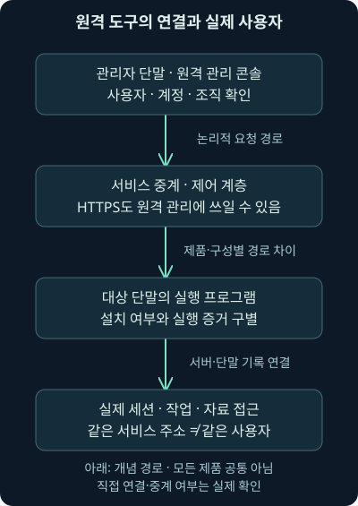
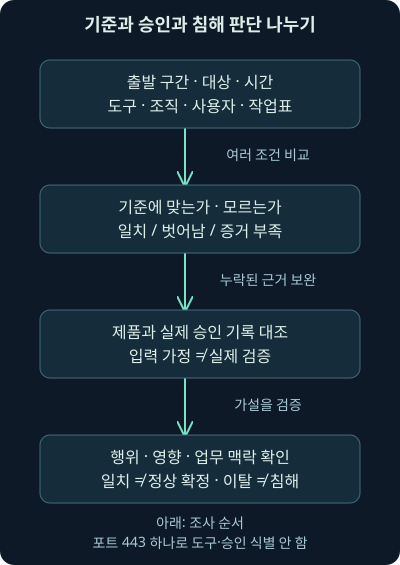
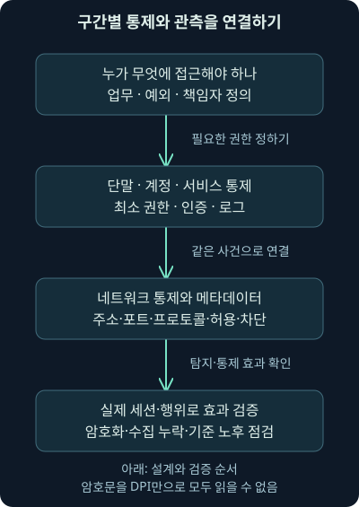

## 1. 원격 지원이 끝났는데 연결이 남아 있습니다

직원이 “지원 담당자가 문제를 봐줬다”라고 말합니다. 단말에는 원격 관리 프로그램이 실행됐고 외부 서버와 HTTPS 통신도 있습니다. 승인된 지원일까요, 지원을 가장한 접근일까요? HTTPS라는 이유만으로 정상이라고 결론 내릴 수 없고, 원격 도구라는 이유만으로 침해라고 확정할 수도 없습니다.

앞 강의에서 ICMP의 자료 영역과 실제 유출 결론을 나눴죠. 이번에는 **도구의 기능, 연결의 보호, 실제 사용자, 승인된 작업, 수행 결과**를 나눠보겠습니다. 둘째 날22강의 범위는 원격 관리 도구의 정상 사용과 오용, 기대 통신 기준, 여러 계층의 통제·관측, 근거가 부족한 결과의 기록입니다.

본 자료의 해당 개념을 바탕으로 독립적인 설명과 가상 JSON 사례를 만들었습니다. 실제 제품 설치·원격 연결·인증·조직 콘솔·승인서·Windows 로그를 분석한 결과는 아닙니다. 도구 이름이 문서에 있다고 그 제품의 현재 모든 버전이 같은 방식으로 작동한다고 가정하지 않습니다.

## 2. 정식 열쇠도 다른 사람이 사용할 수 있습니다

시설 관리자가 가진 정식 열쇠는 필요한 점검을 돕습니다. 하지만 열쇠가 진짜라는 사실만으로 지금 문을 연 사람이 담당자이고, 이번 작업이 승인됐다는 뜻은 아니죠. 원격 관리 도구도 정상 소프트웨어의 기능을 다른 목적으로 사용할 수 있습니다.

비유와 실제의 차이는 범위입니다. 원격 프로그램은 화면 공유만 하는 것이 아니라 제품·권한·설정에 따라 파일, 명령, 자동화, 장치 관리 같은 기능을 가질 수 있습니다. 반대로 어떤 제품에 가능한 기능이 있다고 이번 세션이 모두 사용했다는 뜻도 아닙니다. **기능의 존재와 실제 행위**를 분리해 읽어야 합니다.

원격 관리의 오용을 찾으려면 악성 파일 탐지 결과뿐 아니라 누가 어떤 경로로 이 기능을 사용했는지 살펴야 합니다. 프로그램 이름·전자 서명·일반적인 설치 경로는 식별 단서입니다. 사용자의 권한과 이번 작업의 정당성을 대신하지 않습니다.

## 3. 원격 화면·원격 명령·RMM을 연결해보세요

앞에서 RDP·VNC의 화면, SSH·PowerShell의 명령을 배웠습니다. **RMM**, Remote Monitoring and Management는 여러 단말을 원격으로 관찰·관리하는 기능을 설명할 때 쓰는 말입니다. 한 종류의 포트나 하나의 전송 프로토콜 이름은 아닙니다. 제품마다 화면·명령·파일·배포 기능과 구조가 다릅니다.

서비스 제공자가 운영하는 관리 기능을 사용하는 경우도 있습니다. **SaaS**, Software as a Service는 소프트웨어 기능을 서비스로 제공받는 형태이고, **테넌트**는 여기서 그 서비스 안에서 구분되는 조직·고객의 관리 영역을 뜻합니다. 같은 서비스 주소에 연결됐더라도 어느 테넌트·계정의 통제인지 더 알아야 합니다.

예를 들어 조직이 승인한 서비스에 연결한 단말이 있다고 합시다. 승인된 조직 영역의 관리자인지, 다른 고객 영역에 등록된 단말인지에 따라 의미가 달라질 수 있습니다. 하지만 네트워크 목적지 주소만으로 그 조직 정보를 확인할 수 있다고 가정하면 안 됩니다. 콘솔·등록·인증 기록이 필요합니다.

## 4. 연결을 시작한 방향과 조작하는 방향도 다릅니다

어떤 원격 도구는 대상 단말이 서비스와 바깥 연결을 만들고, 관리자는 콘솔이나 중계를 통해 작업을 요청합니다. 다른 구성은 직접 연결을 쓸 수 있습니다. 따라서 바깥으로 나가는 연결만 보인다고 “외부에서 이 단말을 관리할 수 없었다”라고 단정하지 않습니다. 앞의 SSH 전달에서 배운 물리적 연결 방향과 논리적 작업 방향의 차이와 닮았습니다.



그림의 중계 서비스에 TLS로 연결됐다는 사실이 실제 사람의 승인을 보증하지는 않습니다. TLS는 통신 경로의 보호와 관련되고, 업무 승인은 누가 어떤 권한으로 어느 작업을 하도록 허락받았는지에 관한 질문입니다. 2026-11-07 확인한 [RFC 8446](https://www.rfc-editor.org/rfc/rfc8446.html)의 TLS1.3 보호 범위를 업무의 정당성으로 확대하지 않습니다. 실제 제품이 TLS1.3을 사용했다고 시험한 결과도 아닙니다.

## 5. 제품 이름은 사례이지 공격 판정 목록이 아닙니다

AnyDesk, Atera, TeamViewer처럼 합법적인 원격 기능을 제공하는 도구가 보안 조사에 등장할 수 있습니다. 그 이름이 보였다는 사실만으로 악성 프로그램이라고 부르면 정상 지원과 관리 활동을 오판하기 쉽습니다. 반대로 알려진 회사 제품이라고 모든 사용을 정상 처리하면 계정 오용이나 승인되지 않은 등록을 놓칠 수 있습니다.

2026-11-07 확인한 [2023년 공동 원격 접근 소프트웨어 안내](https://www.ic3.gov/CSA/2023/230606.pdf)는 합법적인 도구의 오용과 기준 행동·다른 의심 행위의 대조를 설명합니다. 이는 게시 당시의 안내이며 특정 제품의 현재 메뉴·기본 포트·수정 버전을 보증하는 문서는 아닙니다. 이번 수업에서도 제품을 설치하거나 가입하지 않았습니다.

도구가 없다는 설치 목록만으로 실행이 없었다고 결론 내리지 마세요. 일부 형태는 설치 없이 사용자 문맥에서 실행될 수 있습니다. 이것도 “모든 원격 도구는 관리자 없이 모든 기능을 수행한다”는 일반화와 다릅니다. 실제 프로그램·권한·실행 자료를 확인해야 합니다.

## 6. 과거 공격 자료를 어떻게 학습에 사용할까요?

본 자료에는 과거 Conti 관련 운영 지침에서 원격 도구를 사용하는 내용이 예시로 등장합니다. 여기서는 그 명령·다운로드·설치 순서를 재현하지 않습니다. 학습할 요점은 정식 원격 관리 기능도 접근을 유지하거나 작업을 수행하는 데 오용될 수 있다는 점입니다. 특정 이름을 찾는 규칙만으로 모든 공격을 설명하지 않습니다.

2026-11-07 [호주 보안 기관의 Conti 프로필](https://www.cyber.gov.au/advisory/2021-010-asds-acsc-ransomware-profile-conti)에서도 AnyDesk를 이용한 접근 유지 관측을 확인했습니다. 이는 과거 관측에 관한 설명입니다. 이 수업에서 현재 Conti 활동이나 실제 조직 침해를 확인했다는 뜻은 아니며, 다른 제품을 사용했다는 각각의 주장까지 이 출처 하나로 확정하지 않습니다.

과거 도구명이 지금 단말에 있다는 사실은 조사 질문을 만들 수 있습니다. 누가 언제 실행·등록했고 어떤 계정으로 세션이 열렸으며 무엇을 수행했는지 물어야 합니다. 같은 이름이 과거 사건에도 있었다는 이유만으로 공격자 집단을 귀속하지 않습니다.

## 7. “우리 조직에서는 무엇이 정상인가요?”부터 정합니다

**베이스라인**, baseline은 비교할 기준 행동입니다. 예를 들어 “지원 단말 구간에서, 지정 대상에, 정해진 시간 동안, 승인된 도구·조직·사용자로, 작업표에 연결된 원격 지원을 한다”라는 조건을 적을 수 있습니다. 과거에 많이 보였다는 빈도만으로 승인됐다고 정하는 것과 다릅니다.

좋은 기준에는 대상 업무와 책임자가 있습니다. 운영팀의 정기 점검과 외주 지원, 긴급 장애 작업은 조건이 다를 수 있죠. 기준의 변경일·예외 기간·승인 주체를 남기면 실제 관측이 벗어났을 때 무엇을 확인할지 알 수 있습니다. 예외가 끝났는데 계속 허용되어 있는지도 조사할 수 있습니다.

하지만 기준 자체가 틀리거나 오래됐으면 비교 결과도 오해를 부릅니다. 기준에 맞는다는 말은 지금 넣은 조건과 맞는다는 뜻이지 모든 정상성을 증명하는 말이 아닙니다. 다음 가상 계산은 이 차이를 보여줍니다.

## 8. 가상 지원 작업의 조건을 읽어봅시다

자체 기준은 출발 구간 `192.0.2.0/24`, 대상 `198.51.100.20`, 시간 `2026-11-07 09:00 이상 10:00 미만 UTC`입니다. `/24`는 앞24비트가 같은 주소 구간을 뜻하며 이 예제에서는 `192.0.2.`로 시작하는 주소를 비교합니다. 문서용 구간을 실제 사내 주소라고 말하지 않습니다.

도구 주장은 `training-support`, 테넌트는 `org-a`, 사용자는 `operator-a`, 작업표 연결 주장은 참으로 놓았습니다. 모두 가상 이름입니다. UTC는 시간대 기준이며 서로 다른 장비 시각을 비교할 때 같은 기준으로 바꿔야 합니다. 시간 범위의 끝을 포함하지 않아10:00 정각은 기준 밖으로 계산합니다.

포트443도 입력에는 있지만 도구 식별이나 승인 판단 조건으로 사용하지 않습니다. 이 숫자만으로 HTTPS와 특정 제품·테넌트·사용자를 모두 확인할 수 없기 때문입니다. 포트를 바꾸어도 나머지 기준 비교가 자동으로 실제 제품 식별 결과로 바뀌지 않습니다.

## 9. 자체 비교 프로그램을 실제 실행했습니다

[여섯 가상 사례](../../assets/network-security/day02-lab22/cases.json), [비교 프로그램](../../assets/network-security/day02-lab22/compare_baseline.py), [설명](../../assets/network-security/day02-lab22/README.txt)을 제공합니다. 같은 폴더에서 다음을 Python3.12.14 표준 라이브러리로 실제 실행했습니다.

```text
python compare_baseline.py cases.json
```

`python`은 실행기, `compare_baseline.py`는 실행할 프로그램, `cases.json`은 입력 경로입니다. JSON은 이름과 값을 구조적으로 적는 텍스트 자료 형식입니다. 이 프로그램은 파일 속 주장을 기준과 비교할 뿐, 원격 제품이나 서버에 접속하지 않습니다. 방화벽을 바꾸거나 실제 사용자의 승인을 조회하지도 않습니다.

입력에서 도구·테넌트·사용자·작업표 연결이 `null`이면 미확인으로 남깁니다. 값을 알 수 없는데 허용된 이름으로 채워 넣는 것이 분석은 아닙니다. 반대로 명백히 기준과 다른 값이 있으면 그 이유를 기록합니다. 도구 오류는 잘못된 입력·시간·지원 범위에 관한 결과이며 실제 인증 실패와 다릅니다.

## 10. 기준 일치·이탈·증거 부족을 나눠보죠

| 사례 | 바꾼 조건 | 실제 로컬 비교 결과 |
| --- | --- | --- |
| B1 | 모든 입력 주장이 기준과 같음 | 제공한 기준과 일치 |
| B2 | 출발 주소가203.0.113.25 | 출발 구간 이탈 |
| B3 | 테넌트가org-b | 조직 영역 주장 이탈 |
| B4 | 시각이10:00 정각 | 시간 범위 이탈 |
| B5 | 도구·테넌트·사용자·작업표가null | 증거 부족 |
| B6 | 작업표 연결 주장이거짓 | 작업표 미연결로 이탈 |

출력에서 `matches_supplied_rule`은 제공한 기준과 같다는 뜻, `deviation`은 확인한 차이가 있다는 뜻, `insufficient_evidence`는 비교할 정보가 모자라다는 뜻입니다. 차이와 미확인이 동시에 있으면 이 도구는 이탈을 먼저 표시하면서 미확인 목록도 따로 남깁니다. 보안 사건의 심각도를 계산하는 점수는 아닙니다.



B1도 실제 제품·테넌트·사용자·승인·원격 실행 검증은 모두 거짓으로 남습니다. B2·B3·B4·B6도 침해 확정으로 바꾸지 않았습니다. 실제 환경이라면 긴급 작업·기준 오류·승인 누락일 수도 있고 비인가 사용일 수도 있습니다. 입력 주장과 독립적인 기록이 필요합니다.

## 11. 주소 허용 목록만으로는 부족한 이유

**허용 목록**, allowlist는 허용할 대상을 명시하는 방식입니다. 허용 서비스의 목적지에만 연결하도록 제한하면 불필요한 경로를 줄일 수 있습니다. 그러나 여러 조직이 같은 서비스 주소·중계·배달 인프라를 공유할 수 있으므로 주소 허용이 곧 우리 테넌트·우리 관리자 검증은 아닙니다.

일부 주소만 고정하면 제품 경로가 바뀌어 정상 지원을 막을 수도 있습니다. 적용 제품의 공식 요구와 실제 배포 구성·업무를 확인하고 예외를 관리해야 합니다. 이번 강의는 제품별 허용 도메인 목록을 만들어 배포하거나 실제 차단을 시행한 결과가 아닙니다.

2026-11-07 확인한 [NIST SP800-207](https://csrc.nist.gov/pubs/sp/800/207/final)의 원칙처럼 내부 위치나 자산 소유만으로 계정·자산에 자동 신뢰를 주지 않습니다. 사용자의 인증, 대상 자원의 권한, 실제 세션과 작업을 별도로 확인합니다. 허용된 경로에서도 계정과 행위는 조사 대상입니다.

## 12. 네트워크 계층을 겹쳐 보는 이유

3계층은 여기서 IP 주소·경로, 4계층은 TCP·UDP와 포트 같은 전송 단서를 생각하면 됩니다. 어떤 구간에서 어떤 대상·프로토콜·포트로 갈 수 있는지 정하면 예상 밖 흐름을 좁히기 쉽습니다. 하지만443이라는4계층 단서 하나로 안쪽의 모든 업무를 설명할 수는 없습니다.

**DPI**, Deep Packet Inspection은 패킷의 안쪽 프로토콜·내용까지 살펴 식별·분석하는 기능을 가리킵니다. 프로토콜에 맞는 동작인지 확인하거나 거래 메타데이터를 기록하는 데 도움을 줄 수 있습니다. 메타데이터는 여기서 주소·시각·방향·크기·연결 관계처럼 내용을 설명하는 주변 정보입니다. 제품의 가시성과 설정에 따라 얻는 필드는 달라집니다.

암호화된 애플리케이션 내용이 DPI라는 이름만으로 모두 보이는 것은 아닙니다. 허용된 복호화 경로나 단말·서비스 로그가 없으면 실제 명령·파일·사용자 정보를 확인하기 어려울 수 있습니다. “프로토콜 형식에 맞는 HTTPS”라는 사실도 그 안의 업무 승인을 증명하지 않습니다. 통제 기능의 이름과 관측 가능한 증거를 나눠 적으세요. 암호화·터널에 따른 검사 한계는 2026-11-07 [NIST 방화벽 지침 §2.3](https://nvlpubs.nist.gov/nistpubs/Legacy/SP/nistspecialpublication800-41r1.pdf)에서도 대조했습니다.

## 13. 기본 차단은 필요한 통신을 정의하는 일과 함께 갑니다

**외부 발신 기본 차단**, outbound default deny는 명시적으로 허용하지 않은 외부 연결을 기본적으로 제한하는 정책 방향입니다. 출발 구간과 업무별 필요한 경로를 정하고 책임자를 연결해야 운영 가능한 정책이 됩니다. 장비 하나에서 숫자443을 모두 허용하는 것과 같은 설명으로 축소하면 안 됩니다.

정책을 적용한다면 정기 작업·업데이트·인증·지원의 실제 의존성을 확인하고 시험·단계 적용·차단 기록 검토·예외 만료를 함께 설계합니다. 이것은 이번 환경에서 즉시 차단했다는 뜻이 아닙니다. [NIST SP800-41 Rev.1](https://csrc.nist.gov/pubs/sp/800/41/r1/final)은 방화벽의 역할과 정책 수립·시험·운영을 다루며2026-11-07 확인했습니다. 오래된 문서의 개별 제품·암호 설정을 현재 권고로 그대로 옮기지 않고 정책 원리의 근거로 사용합니다.

허용·차단을 강화해도 내부의 승인된 경로나 단말에서 오용이 일어날 수 있습니다. 규칙이 존재하는지뿐 아니라 적용 지점·정책 순서·예외·실제 세션·수집 범위를 확인해야 통제 효과를 평가할 수 있습니다.

## 14. 단말·계정·서비스·네트워크 기록을 연결합니다

단말에서는 실행 파일의 위치·해시·서명·실행 사용자·부모 프로세스·지속 실행 구성을 확인합니다. 파일이 존재한다는 사실은 실행했다는 증거와 다릅니다. EDR, Endpoint Detection and Response는 단말의 활동을 수집·탐지·조사하는 기능을 말합니다. 이 기록도 수집·보존·탐지 설정의 한계가 있습니다.

관리 서비스에서는 단말 등록 조직, 로그인 계정·인증, 세션 시작·종료, 수행 작업·파일 활동, 관리자 변경을 확인할 수 있는지 살펴봅니다. 실제 제공 필드는 제품·요금제·버전·설정별로 다르므로 없는 로그를 있다고 상상하지 않습니다. 작업표·지원 요청·사용자 확인은 그 세션과 시각·대상·작업 범위로 맞춥니다.

방화벽·프록시·이름 조회 기록은 출발·목적지·시간·허용·차단·주소 변환을 연결하는 데 씁니다. 같은 외부 IP라는 이유만으로 같은 사용자 세션으로 붙이지 않습니다. 리졸버 기록은 도메인과 후보 주소 관계를 도와도 실제 명령 수행과 승인을 증명하지 않습니다. 여러 장비의 시각 차이를 먼저 정리하세요.

## 15. 기록이 없을 때는 무엇을 아직 모르는지 적습니다

설치 목록에 없고 원격 콘솔 로그도 없다고 합시다. 정말 실행되지 않은 것일 수도 있지만, 휴대형 실행·다른 조직 등록·다른 계정·로그 비활성·보존 만료·수집 누락일 수도 있습니다. 가상 B5처럼 미확인을 기준 일치로 바꾸지 않으면 다음에 필요한 증거가 분명해집니다.

네트워크에서 제품 이름이 검색되지 않는 경우도 비슷합니다. 암호화·비표준 포트·중계·서비스 공용 인프라·해석 설정·수집 시간·방향을 확인해야 합니다. 반대로 제품 이름이 탐지됐더라도 실제 세션·작업은 더 확인해야 합니다. 음성과 양성 결과 모두 관측 범위를 붙여 쓰는 습관이 필요합니다.

## 16. 조사 순서와 대응을 업무 맥락에 맞춥니다

직접 사실을 적고 기준과의 차이를 찾은 다음, 영향을 확인할 자료와 적절한 조치를 연결합니다. 예를 들어 “승인된 도구 이름은 있으나 조직 등록·사용자·작업표가 아직 미확인”이면 계정·서비스 담당자 기록 대조가 다음 단계입니다. “확인되지 않았으므로 정상”도, “확인되지 않았으므로 침해”도 아닙니다.



실제 비인가 세션·위험 행위 근거가 쌓이면 조직의 대응 절차와 권한에 따라 접근 제한·계정 조치·단말 격리 등을 검토합니다. 필요한 증거 보존과 업무 영향도 같이 봅니다. 이번에는 그런 실제 사건이나 조치를 수행하지 않았습니다. 가상 계산의 모든 사건 결론은 `unresolved`, 즉 아직 판단하지 않음으로 남겼습니다.

## 17. 어떤 프로토콜도 이름만으로 결론이 되지 않습니다

DNS·HTTP·SMTP·SMB·SSH·ICMP·FTP는 서로 다른 목적과 구조로 자료를 옮깁니다. 정상 업무에도 필요하고 기능의 오용도 가능합니다. 알려진 프로토콜이라는 이유로 안전하다고 놓아두거나 낯선 포트라는 이유로 공격이라고 단정하는 방식은 둘 다 근거가 부족합니다.

대신 네트워크의 구간과 흐름을 알고, 어디에서 무엇을 수집하는지 정하고, 단말·계정·실제 작업을 연결해보세요. 이번 기준 비교는 그 질문을 작은 조건으로 나눈 연습입니다. 다음 강의에서는 둘째 날 전체를 한 사건의 관측 범위와 조사 흐름으로 복습하겠습니다.

## 18. 복습: 기준 비교를 실제 검증으로 바꾸지 마세요

### 질문 1. HTTPS라면 원격 관리 통신일 수 없나요?

**해설:** HTTPS도 원격 기능의 전송에 쓰일 수 있습니다. 바깥 보호 방식과 애플리케이션 목적을 구별합니다.

### 질문 2. 정식 서명이 있는 제품이면 이번 사용도 승인됐나요?

**해설:** 제품 식별·무결성 단서와 실제 사용자·업무 승인은 다릅니다. 세션과 작업표를 더 대조해야 합니다.

### 질문 3. 외부 발신 연결만 있으면 외부 사용자의 관리가 불가능했나요?

**해설:** 중계·서비스 경로가 있을 수 있습니다. 실제 제품 구성을 확인하고 물리적 개시 방향과 논리적 작업 방향을 구별합니다.

### 질문 4. 같은 서비스 주소면 같은 테넌트인가요?

**해설:** 공용 인프라일 수 있습니다. 조직 등록·계정·콘솔 기록이 추가로 필요합니다.

### 질문 5. B1이 기준과 일치하면 실제 승인 검증도 참인가요?

**해설:** 입력 주장이 기준과 같은 것뿐입니다. 실제 승인서는 확인하지 않아 검증 값은 거짓으로 남습니다.

### 질문 6. B2가 출발 구간을 벗어나면 침해가 확정되나요?

**해설:** 긴급 지원·기준 오류·비인가 사용 등의 가설이 남습니다. 실제 사용자·행위·승인을 확인해야 합니다.

### 질문 7. 09:00 이상10:00 미만에서10:00 정각은요?

**해설:** 끝을 포함하지 않아 기준 밖입니다. 시간대와 경계 조건을 명시해야 다른 결과를 피할 수 있습니다.

### 질문 8. 도구·사용자·작업표가null인데 주소만 맞으면 정상인가요?

**해설:** B5처럼 비교 정보가 부족합니다. 모르는 값을 허용 값으로 채우지 않습니다.

### 질문 9. port를443에서8443으로 바꾸면 도구 식별 결과가 달라지나요?

**해설:** 이 자체 프로그램은 포트로 제품을 식별하지 않습니다. 실제 환경에서도 포트만으로 제품·승인을 확정하지 않습니다.

### 질문 10. DPI를 쓰면 모든 암호화 명령이 보이나요?

**해설:** 관측 위치·복호화·제품 설정에 따라 내용 가시성이 제한됩니다. 단말과 서비스 로그가 더 필요할 수 있습니다.

### 질문 11. 설치 목록에 없으면 실행도 없었나요?

**해설:** 일부는 설치 없이 실행될 수 있습니다. 실제 실행 기록·프로세스·등록·수집 범위를 대조합니다.

### 질문 12. 내부 구간이고 허용 목록에 있으면 더 볼 필요가 없나요?

**해설:** 허용 경로에서도 계정·도구 기능이 오용될 수 있습니다. 실제 사용자와 작업·영향은 별도 근거입니다.

### 질문 13. 과거 공격 자료의 도구 이름이 같으면 같은 공격자 집단인가요?

**해설:** 공통 도구 이름은 귀속 증거로 부족합니다. 독립적인 행위·인프라·시간·기술 근거가 필요합니다.

### 질문 14. 이 강의에서 실제 원격 프로그램과 방화벽을 설정했나요?

**해설:** 가상 JSON 조건만 로컬로 비교했습니다. 실제 설치·접속·인증·정책 변경·조직 승인 검증은 하지 않았습니다.
