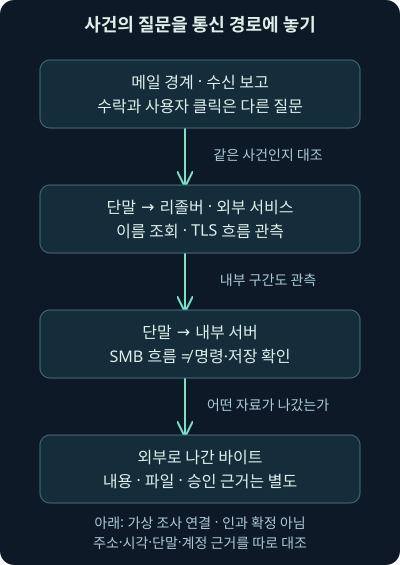
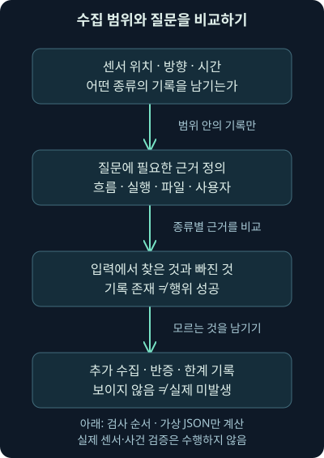
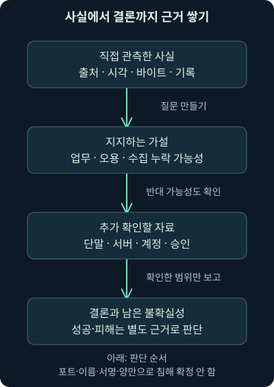

## 1. 패킷은 많은데 사건을 설명하기 어렵습니다

경보가 울려 기록을 모았다고 해보죠. 이메일이 들어왔고, 단말이 어떤 이름을 조회했고, 외부와 TLS 통신을 했습니다. 잠시 뒤 내부 서버와 SMB 흐름이 있고 외부로 나간 바이트도 있습니다. 이것을 그대로 “피싱으로 감염된 뒤 내부 이동과 유출에 성공했다”라고 이어 적어도 될까요?

각 기록은 연결할 후보입니다. 하지만 수신과 클릭, 통신과 실행, 전송량과 민감 자료 반출은 서로 다른 질문입니다. 이번에는 둘째 날의 네트워크 구조·수집·프로토콜을 하나의 조사 흐름으로 묶어보겠습니다. 앞 강의의 상세 원리를 다시 압축해 대신하는 강의가 아니라, 그 원리를 어디에 적용할지 연습하는 종합 복습입니다.

23강의 범위는 통신 경로와 관측 지점, 수집 자료의 차이, DNS·HTTP(S)·SMTP의 연결, 다른 관리·전송 프로토콜, 조사 가설과 추가 증거입니다. 마지막에 자체 가상 기록을 실제로 비교한 결과를 읽습니다. 실제 사건·센서·사용자·공격 성공을 확인한 결과는 아닙니다.

## 2. CCTV의 수보다 촬영한 문이 중요합니다

건물의 출입문 앞 카메라는 사람이 드나든 모습을 보여줍니다. 하지만 방 안에서 어떤 서류를 읽었는지는 보여주지 못하죠. 카메라가 열 대 있어도 모두 같은 문을 비추면 다른 구역의 공백은 그대로입니다. 네트워크 센서도 어느 경로·방향·시간의 통신을 수집했는지가 중요합니다.

실제 네트워크는 비유보다 복잡합니다. 스위치의 미러링, TAP의 복사, 가상·클라우드 구간, 프록시와 주소 변환, 샘플링·누락이 각각 관측을 바꿉니다. 센서가 설치됐다는 사실과 필요한 기록이 실제 보존됐다는 사실도 다릅니다. 조사 전에 “어디를 볼 수 있었나?”부터 그려야 합니다.

## 3. 먼저 가상 사건의 경로를 놓아봅시다

이 강의의 단말은 문서용 주소 `192.0.2.25`, 내부 서버는 `192.0.2.60`이라고 가정합니다. 이름 조회와 이메일은 각각 리졸버와 메일 경계를 거치고, 외부 서비스는 `198.51.100.20`이라고 놓겠습니다. 실제 조직 자산을 발견한 값이 아니라 설명을 위한 배치입니다.

메일 경계, 단말에서 리졸버로 가는 경로, 단말에서 외부로 나가는 경로, 단말과 내부 서버 사이를 따로 봅니다. 경계 센서 하나가 이 네 경로를 모두 본다고 가정하지 않습니다. 같은 스위치 안의 통신이나 가상 네트워크 경로가 경계를 통과하지 않을 수도 있기 때문입니다.



그림에서는 먼저 어떤 문을 통과한 기록인지 읽어주세요. 메일 수신 기록을 단말 실행 증거로, SMB 흐름을 서버 파일 저장 증거로 곧바로 바꾸지 않는 것이 핵심입니다. 실제 사건에서는 당시 자산·임대·주소 변환·계정 자료로 이 주소가 누구였는지도 확인해야 합니다.

## 4. 같은 통신도 자료 종류에 따라 답이 달라집니다

**흐름 기록**은 양 끝점·시간·방향·양 같은 요약을 제공합니다. **프로토콜 기록**은 해석한 요청·응답·필드 정보를 더 담을 수 있습니다. **PCAP**는 수집한 패킷 바이트를 보관하는 형식입니다. PCAP가 있어도 잘린 길이·누락·암호화·관측 구간 때문에 필요한 전체 내용을 항상 얻는 것은 아닙니다.

예를 들어 흐름에 전송량이 있으면 “얼마나 보였는가?”를 물을 수 있습니다. HTTP 요청 헤더가 있으면 “무슨 경로를 요청했다고 해석됐는가?”를 물을 수 있죠. 파일 전체를 재조립해 비교했다면 “관측 바이트가 이 참조와 같은가?”까지 갈 수 있습니다. 그 파일이 실제 실행됐는지는 여전히 단말 기록이 필요한 질문입니다.

| 조사 질문 | 도움이 되는 자료 | 그 자료만으로 남는 한계 |
| --- | --- | --- |
| 어떤 연결이 있었나 | 흐름·방화벽 | 실제 사용자·명령·파일 내용 |
| 어떤 요청·응답인가 | 프로토콜 기록·해석 가능한 PCAP | 암호화·재조립·수집 누락 |
| 어떤 바이트를 받았나 | 충분한 패킷·객체·참조 | 저장·실행·업무 승인 |
| 무엇이 실행·저장됐나 | 단말·서버 실행·파일 기록 | 기록의 수집·시각·보존 범위 |

이 표는 자료의 서열이 아닙니다. 좁은 질문에는 요약 기록이 효율적이고, 바이트 질문에는 그에 맞는 자료가 필요합니다. 처음부터 모든 기록이 같은 결론을 줄 것이라고 기대하지 않는 편이 정확합니다.

## 5. DNS 기록은 “방문했다”보다 좁은 사실입니다

가상09:02에 단말의 이름 조회 기록이 있습니다. DNS는 이름과 여러 종류의 자료를 질의·응답하는 체계이지, 사용자의 웹 방문 확인 서비스는 아닙니다. 브라우저의 미리 조회, 다른 프로그램, 캐시, 공용 리졸버도 생각해야 합니다. 리졸버 주소가 통신의 출발지라고 해서 그 장비 사용자가 원래 요청자라는 뜻도 아닙니다.

도메인이 위협 정보에 있다는 결과는 조사할 맥락입니다. 조회 시점·정확한 이름·응답 주소·공유 인프라·출처와 판단 시점을 대조해야 합니다. 나쁜 평판이 실제 악성 응답이나 실행 성공까지 증명하지 않고, 평판 결과가 없다는 사실도 안전을 보증하지 않습니다.

DoH는 DNS 질의를 HTTPS로 전달하는 방식입니다. 일반 DNS 포트에서 질의가 없다는 이유로 이름 조회가 없었다고 말하지 않습니다. 2026-11-07 [RFC8484](https://www.rfc-editor.org/rfc/rfc8484.html)의 전송 구분을 확인했습니다. 이 강의에서 실제 DoH·리졸버를 실행하거나 복호화한 것은 아닙니다.

## 6. HTTP 요청과 실제 결과를 차례로 연결합니다

HTTP 요청이 있다면 메서드·대상·호스트·헤더·응답·바이트를 순서대로 봅니다. 경로가 이상하거나 User-Agent가 드물다는 이유만으로 악성이라고 결론 내리지 않습니다. 자동화된 관리 도구·API·사용자 정의 장치도 그런 모양을 만들 수 있습니다. 드묾을 계산할 때는 비교한 집단과 기간도 필요합니다.

리다이렉트는 다음 위치를 지시하는 응답입니다. 그 위치를 실제 요청했는지, 파일을 받았는지, 같은 연결인지 다른 호스트인지 더 확인해야 합니다. Base64처럼 인코딩된 문자열을 해석했다는 사실도 암호를 풀었다거나 악성 기능을 실행했다는 뜻과 다릅니다. 읽힌 바이트의 의미와 출처를 별도로 검토합니다.

파일 내용이 보일 때도 전체 수집·전송 인코딩·압축·재조립·참조 범위를 점검합니다. 앞의 FTP 실습에서 완료 응답이 있어도9바이트만 관측됐던 것처럼, HTTP 성공 상태가 관측한 객체의 완전성이나 실행을 자동 보증하지 않습니다. 서버 응답과 수집 바이트를 나누는 습관을 유지하세요.

## 7. HTTPS는 내용을 가려도 모든 질문을 지우지는 않습니다

TLS는 통신을 보호하지만 업무의 정당성을 인증하는 체계는 아닙니다. 암호화된 흐름에서는 주소·시간·양·연결 관계 등을 볼 수 있어도 실제 URL·명령·파일 내용은 확인하지 못할 수 있습니다. 인증서나 지문도 관측 조건과 구현·공유·설정에 따라 해석해야 합니다. 같은 지문을 같은 사용자·악성 프로그램의 신원으로 바꾸지 않습니다.

2026-11-07 TLS1.3의 현행 대조 기준으로 [RFC9846](https://www.rfc-editor.org/info/rfc9846/)을 확인했습니다. 2026년7월 문서로RFC8446을 대체하지만 프로토콜 명칭은 여전히TLS1.3입니다. 앞의 역사적 RFC8446에서 설명한 보호 목적이 사라진 것은 아니며, 최신 전체 규격과 옛 근거 문서의 역할을 구별합니다. 여기서는 실제 TLS 협상·복호화를 수행하지 않았습니다.

프록시가 있다면 단말→프록시와 프록시→외부가 다른 세션일 수 있습니다. 이름 조회도 각 구간에서 다르게 보일 수 있죠. 단말·프록시·서버·방화벽의 시각과 식별자를 맞춰야 같은 사건으로 연결할 수 있습니다. 암호문에서 보이지 않는 내용을 상상해 채우지 않습니다.

## 8. 이메일은 수신과 사용자의 행동을 분리합니다

가상09:01의 메일 수락 기록은 서버가 전달 책임을 받아들였다는 종류의 보고입니다. 사용자의 받은편지함 표시·읽기·링크 접속·첨부 실행은 다른 단계입니다. 격리·필터·후속 전달·실패 기록도 확인해야 하죠. “피싱 메일이 전달됐다”라는 문장에서 전달의 어느 단계를 확인했는지 적어주세요.

From의 표시 사람, SMTP 봉투의 발신 주소, 연결 상대, 서명 도메인은 서로 다른 신원 주장입니다. SPF·DKIM·DMARC도 같은 사람을 같은 방법으로 인증하는 세 검사가 아닙니다. 헤더의 검사 결과를 믿을 수 있는 수집 경로인지까지 확인해야 합니다. 다음24강은 이 부분을 실제 자체 파일로 연결하는 독립 실습입니다.

## 9. 내부 통신도 기능·권한·성공을 구별합니다

DHCP의 임대는 당시 주소 사용을 연결하는 단서이지만 장치의 진짜 소유자까지 자동 인증하지는 않습니다. SMB의 연결·로그온·공유 접근과 실제 명령·파일 저장도 구별해야 합니다. 네트워크 주소와 프로세스·사용자를 연결하려면 단말과 서버의 기록이 필요합니다.

SSH·RDP·VNC·PowerShell과 원격 관리 도구도 정상 업무에 사용됩니다. 연결 보호·서버 신원·사용자 권한·세션·실제 작업·승인은 각각 다른 근거입니다. 터널이나 중계가 있으면 물리적 연결을 시작한 방향과 관리 작업 방향도 다를 수 있습니다. 정상 포트·정식 서명·허용 서비스 이름 하나로 모든 질문을 해결하지 않습니다.

ICMP 자료와 FTP 제어·데이터처럼 프로토콜별 구조도 끝까지 중요합니다. 다른 프로토콜로 파일이나 명령이 운반될 수 있다는 가능성과 실제 그런 행위가 있었다는 증거는 다릅니다. 출발·대상·시간·양·프로세스·파일·승인이라는 질문에 그 프로토콜이 남길 수 있는 근거를 붙여봅니다.

## 10. 작은 가상 기록 지도를 실제로 비교해보죠

[질문·센서·기록 JSON](../../assets/network-security/day02-lab23/cases.json), [비교 프로그램](../../assets/network-security/day02-lab23/map_evidence.py), [설명](../../assets/network-security/day02-lab23/README.txt)을 제공합니다. 센서는 기록 수집 지점을 뜻합니다. 이 파일에서는 경로 이름과 기록 종류·수집 시간만 가정했으며 실제 센서 제품의 출력 형식이 아닙니다.

```text
python map_evidence.py cases.json
```

같은 폴더에서 `python`은 실행기, 다음은 프로그램과 입력 경로입니다. 작성 환경의 Python3.12.14 표준 라이브러리로 실제 실행했습니다. 로컬 JSON을 읽고 각 질문이 요구한 기록 종류를 찾습니다. 네트워크·서버에 접속하거나 센서를 설정하지 않습니다.

수집 범위는09:00 이상09:30 미만 UTC, 경로와 종류가 같은 기록이라는 조건입니다. UTC는 시각을 비교할 시간 기준입니다. 이 조건 밖이면 입력 기록을 제외합니다. 실제 장비 시각의 오차·중복·샘플링·기록의 진실성은 검사하지 않습니다. 프로그램에 시간이 있다고 실제 시각이 정확하다고 검증한 것은 아닙니다.

## 11. 흐름이 있어도 필요한 근거는 비어 있습니다

| 질문 묶음 | 입력에서 찾은 종류 | 남아 있는 질문 |
| --- | --- | --- |
| S1 수신 보고 | smtp_accept | 실제 받은편지함·열람·실행 |
| S2 이름 조회 | dns_query | 어느 사용자·프로세스의 어떤 행위인가 |
| S3 보호된 외부 흐름 | tls_flow | 실제 요청·내용·의도 |
| S4 원격 명령 | 필요한 endpoint_process 없음 | 명령 시작·결과·사용자 |
| S5 서버 파일 저장 | 필요한 server_file_write 없음 | 어떤 자료가 실제 저장됐나 |
| S6 외부 자료 전송 | outbound_bytes 있음, file_identity 없음 | 어느 파일·민감 자료·승인인가 |

이것은 실제 로컬 출력의 의미입니다. S4·S5에 SMB 흐름 기록이 후보로 연결되지만, 필요한 프로세스·파일 기록 종류가 없어서 근거 충족으로 계산되지 않습니다. S6도 바이트 종류만 있고 파일 식별 근거가 빠져 있습니다. 바깥으로 나간 양을 자료 유출 성공으로 바꾸지 않았습니다.

S1·S2·S3은 좁게 정해 둔 “그 종류의 보고가 입력에 있는가?”에는 답합니다. 그러나 모든 실제 단계 검증 값은 거짓입니다. 입력 종류가 있다는 계산과 실제 사건이 확인됐다는 판단을 다르게 남기는 연습입니다. 이 프로그램이 제공하는 것은 조사 질문의 공백이지 자동 침해 판정이 아닙니다.



## 12. 조건을 추가하면 무엇이 달라질까요?

센서가09:04부터 수집했다고 가정하면09:03의 TLS 흐름은 범위 밖입니다. 기록 파일에 행이 남아 있어도 설정한 관측 시간과 맞지 않으므로 비교 대상에서 제외됩니다. 이를 “통신이 없었다”로 보고하지 않습니다. 무엇을 제외했는지와 이유를 함께 남겨야 합니다.

내부 서버의 파일 기록을 추가하면 S5가 요구한 종류가 입력에 생길 수 있습니다. 그래도 그 파일이 민감한지, 사용자가 승인됐는지, 외부 전송과 같은 파일인지 더 확인해야 합니다. 근거 하나를 추가하면 답할 질문이 늘어나지만 모든 결론이 한꺼번에 완성되지는 않습니다.

수집 방향이 바뀌거나 다른 경로에서 기록된 경우도 마찬가지입니다. 센서와 기록의 경로 이름이 맞지 않으면 계산기는 제외합니다. 실제 네트워크라면 미러링 방향·주소 변환·비대칭 경로·클라우드 구간을 조사해야 합니다. 이 문자열 비교가 물리적 수집 경로를 검증하는 기능은 아닙니다.

## 13. 필터에는 질문과 제외 범위를 같이 적습니다

다음은 **미실행 Wireshark 표시 필터 예시**입니다. 특정 단말이 출발지나 목적지인 패킷을 화면에서 살펴보려는 출발점입니다. 실제 Wireshark를 실행해 얻은 결과는 아닙니다.

```text
ip.addr == 192.0.2.25
```

`ip.addr`는 IPv4의 출발지 또는 목적지 주소, `==`는 같은 값이라는 비교입니다. 이 조건은 앞에서 정한 단말 후보를 찾으려는 것이며 실제 소유자·프로세스를 식별하지 않습니다. 주소 변환 이후, IPv6, 프록시의 다른 세션, 수집되지 않은 구간은 별도입니다. 필터를 좁히면서 필요한 반대 방향이나 다른 주소를 지우지 않았는지도 확인하세요.

명령·필터는 추측을 숨기는 문장이 아닙니다. 2026-11-07 [공식 IPv4 필드 참조](https://www.wireshark.org/docs/dfref/i/ip.html)에서 `ip.addr`의 제공 범위1.0.0–4.6.9와 [표시 필터 문법](https://www.wireshark.org/docs/man-pages/wireshark-filter.html)을 확인했습니다. 실제 설치·시험 버전을 뜻하지 않습니다. 검색 대상·시간·방향·해석 설정을 함께 기록하면 다음 조사자가 음성 결과를 재평가할 수 있습니다. “없음”보다 “이 수집 범위의 이 조건에서 찾지 못함”이 더 유용한 조사 문장입니다.

## 14. 직접 사실·가설·추가 확인을 나누어 씁니다

가상 메모를 써보죠. “제공한 기록에서 메일 수신 보고·이름 조회·TLS 및 SMB 흐름·외부 바이트 종류를 찾았다. 원격 프로세스·서버 저장·파일 식별은 미확인이다. 피싱 후 이동과 반출은 검증할 가설이며 실제 단말·서버·사용자·승인 자료가 더 필요하다.” 이 정도면 무엇을 했고 어디서 멈췄는지 분명합니다.

반증도 찾습니다. 승인된 배포 작업이었는지, DNS가 미리 조회였는지, 파일이 전달됐지만 실행되지 않았는지, 시각 차이 때문에 다른 세션을 붙였는지 살펴보세요. 공격 이야기를 가장 잘 이어 붙이는 것보다 증거가 버틸 수 있는 결론을 만드는 것이 중요합니다.



## 15. 조사 결과는 다음 운영 개선으로 연결합니다

관측 공백을 찾았다면 필요한 구간·기록·보존 기간·담당자를 정하고 실제 수집·조회가 되는지 검증합니다. 내부 서버의 실행·파일 질문이 반복해서 비어 있다면 네트워크 흐름만 더 모으는 것으로 해결되지 않을 수 있습니다. 수집의 목적을 조사 질문에 연결해야 합니다.

2026-11-07 확인한 [NIST SP800-61 Rev.3](https://csrc.nist.gov/pubs/sp/800/61/r3/final)은 사고 대응을 사이버 위험 관리와 연결합니다. 여기서는 조사에서 배운 공백을 준비·탐지·대응 개선으로 되돌리는 방향의 근거로 사용합니다. 자체 검사 결과를 조직의 통제 효과 인증이나 실제 대응 완료로 표현하지 않습니다.

## 16. 둘째 날의 학습 범위를 어떻게 마무리하나요?

우리는 네트워크 구조와 경로, 수집 자료와 위치, DNS·HTTP(S)·SMTP, 주소 임대·파일 공유·원격 관리·자료 전송을 배웠습니다. 본 교재의 범위와 각 강의 절·예제의 대응은 별도 검토 기록으로 점검했습니다. 이미 게시한 설명·그림·예제는 그대로 이어서 읽을 수 있습니다.

독립 강의를 읽고 자체 자료를 검사한 것과 원래 별도 워크북·VM의 실습을 수행한 것은 다릅니다. 다음24강도 접근 가능한 원문 안내와 실습 목적을 연결한 **자체 이메일 자료**로 진행합니다. 그 뒤 셋째 날에는 같은 질문을 단말의 프로세스·로그·파일로 더 가까이 들어가 보겠습니다.

## 17. 복습: 같은 기록을 다른 결론으로 부풀리지 마세요

### 질문 1. 경계 PCAP가 있으면 내부 서버 통신도 모두 있나요?

**해설:** 실제 경로가 경계를 통과했는지부터 봐야 합니다. 내부·가상 구간과 수집 방향이 다르면 빠질 수 있습니다.

### 질문 2. DNS 조회가 있으면 사용자가 링크를 클릭했나요?

**해설:** 미리 조회·다른 프로그램·캐시·중계도 가능합니다. 실제 사용자·브라우저·웹 요청 근거를 더 확인합니다.

### 질문 3. 일반 DNS 기록이 비었으면 조회도 없었나요?

**해설:** DoH·캐시·다른 리졸버·수집 위치를 확인해야 합니다. 조회 부재와 관측 부재는 다릅니다.

### 질문 4. HTTP 성공 응답이면 파일 실행도 성공했나요?

**해설:** 응답·바이트 수신·저장·실행은 다른 단계입니다. 단말의 실행 근거가 필요합니다.

### 질문 5. TLS 암호문이라면 조사할 정보가 전혀 없나요?

**해설:** 주소·시간·양·연결 관계 등은 조건에 따라 남습니다. 다만 그 정보로 내용과 명령을 만들어내지 않습니다.

### 질문 6. TLS1.3 새 규격이 나왔으니 TLS1.4인가요?

**해설:** 확인한 RFC9846도TLS1.3입니다. 문서 번호·발행일과 프로토콜 버전은 구별합니다.

### 질문 7. 가상 S4에 SMB 흐름이 있는데 왜 근거가 부족하죠?

**해설:** 질문이 요구한 것은 원격 프로세스 기록입니다. 다른 종류의 연결 기록이 실제 명령 실행을 대신하지 않습니다.

### 질문 8. S6에서 외부 바이트가 보이면 어떤 파일이 나갔나요?

**해설:** 파일 식별 근거가 빠져 있어 답할 수 없습니다. 파일·내용·프로세스와 전송을 대조해야 합니다.

### 질문 9. S1의 필요한 종류가 충족되면 실제 수신도 검증됐나요?

**해설:** 가상 입력에 해당 보고 종류가 있다는 계산입니다. 실제 서버·기록 자체를 검증하지 않았습니다.

### 질문 10. 센서 시작을09:04로 바꾸면09:03의 기록은요?

**해설:** 수집 범위 밖으로 제외합니다. 그 제외를 실제 통신 미발생으로 바꾸지 않습니다.

### 질문 11. 파일 저장 기록을 추가하면 유출도 자동 확인되나요?

**해설:** 저장 근거와 외부 전송의 파일 동일성·민감도·승인이 추가로 필요합니다.

### 질문 12. 포트와 도구 이름이 정상 목록에 있으면 더 조사하지 않나요?

**해설:** 계정·기능의 오용이 가능하므로 실제 사용자·작업·시간·승인을 대조합니다.

### 질문 13. 결과가 없을 때 보고서에는 무엇을 써야 하나요?

**해설:** 검색 조건·시간·방향·수집 길이·재조립·암호화·보존 범위를 남겨야 음성 결과의 의미를 평가할 수 있습니다.

### 질문 14. 독립 실습 게시가 원래 워크북 수행 완료인가요?

**해설:** 아닙니다. 접근한 자료와 실제 실행한 자체 검사를 구별하고 원본 실습의 미확인을 남깁니다.
