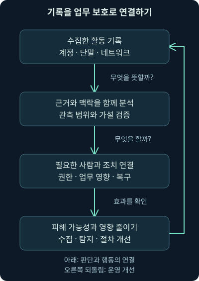
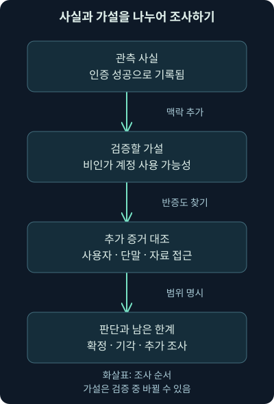
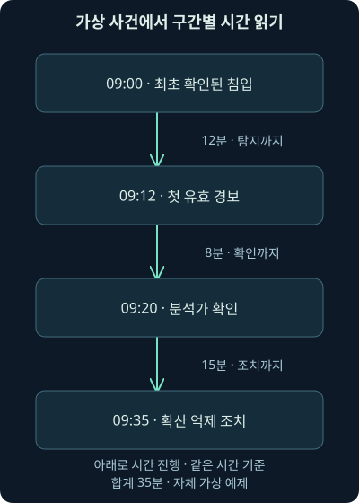

## 1. 이번 강의에서 함께 풀 문제

월요일 아침, 직원이 “공유 폴더가 열리지 않아요”라고 연락합니다. 거의 같은 시간에 보안 장비에서는 수백 개의 경보가 올라옵니다. 로그인 실패, 낯선 프로그램 실행, 외부 서버와의 통신도 섞여 있네요. 어디부터 봐야 할까요? 전부 차단하면 업무가 멈출 수 있고, 정상이라고 넘기면 실제 피해가 커질 수 있습니다.

이때 필요한 것이 블루팀의 기본 사고방식입니다. **블루팀**은 조직의 정보와 시스템을 보호하고, 이상을 발견해 조사하며, 피해를 줄이고 회복을 돕는 방어 측 사람들을 가리킵니다. 특정 장비를 다루는 사람만 뜻하지 않습니다. 작은 회사의 담당자 한 명일 수도 있고, 여러 전문팀이 함께 이 역할을 맡을 수도 있습니다.

첫째 날 1강에서는 블루팀의 목적, 사람·절차·기술의 관계, 위협과 업무에 따른 우선순위, 증거를 다루는 태도를 배웁니다. 도구별 설치와 SOC의 세부 조직 구조는 뒤 강의에서 다룹니다. 여기 나오는 회사·시각·로그는 이해를 위해 만든 **가상 사례**이며 실제 침해 조사 결과가 아닙니다.

## 2. 무엇을 지키는지부터 정해 봅시다

작은 온라인 상점을 떠올려 보세요. 주문 화면이 멀쩡해도 배송 주소가 다른 사람에게 노출되면 문제가 됩니다. 주소는 보호했지만 주문 금액이 바뀌어도 곤란하죠. 둘 다 정상이지만 결제를 하루 동안 받지 못해도 사업은 손해를 봅니다. “해킹을 막자”라는 말만으로는 이 세 상황의 차이를 설명하기 어렵습니다.

정보 보안에서는 이를 **기밀성**, **무결성**, **가용성**으로 나누어 생각합니다. 기밀성은 허용된 사람만 정보를 보게 하는 성질입니다. 무결성은 정보나 처리 결과가 허가 없이 바뀌지 않도록 유지하는 성질입니다. 가용성은 필요한 사람이 필요한 시점에 서비스를 사용할 수 있는 성질입니다. 영어 첫 글자를 묶어 CIA라고 부르기도 하지만, 약자보다 상점에서 실제로 무엇이 잘못되는지 먼저 기억하면 됩니다.

세 가지를 따로 생각해야 조치의 부작용도 보입니다. 고객 자료가 유출되는 중이라면 연결 차단이 필요할 수 있습니다. 그러나 확인 없이 결제 서버 전체를 끄면 가용성에 큰 영향을 줍니다. **어떤 피해를 막기 위해 어떤 업무 영향을 감수할지**를 설명할 수 있어야 합니다. 보안팀의 판단은 업무 담당자, 시스템 운영자, 정해진 대응 권한과 연결됩니다.

| 상점에서 생긴 문제 | 먼저 살필 성질 | 함께 확인할 증거와 조건 |
|---|---|---|
| 주문자 명단이 외부에 공개됨 | 기밀성 | 접근·다운로드 기록, 공개 범위, 자료 내용 |
| 정산 계좌가 허가 없이 변경됨 | 무결성 | 변경 이력, 승인 기록, 계정 활동 |
| 주문 시스템이 응답하지 않음 | 가용성 | 장애 시각, 서버 상태, 네트워크와 변경 작업 |

표의 오른쪽을 함께 읽어 주세요. 증상이 곧 원인을 말해 주지는 않습니다. 응답이 없다는 사실만으로 공격이라고 확정할 수 없고, 변경 기록이 있다고 해서 그 변경이 반드시 비인가인 것도 아닙니다. 허용된 행위와 실제 행위를 비교할 맥락이 필요합니다.

## 3. 경비실 비유로 보는 방어의 전체 흐름

건물 경비실을 생각하면 출입문 잠금장치, 출입 기록, 비상 연락망, 대피 계획이 각각 다른 역할을 한다는 것을 알 수 있습니다. 문을 튼튼하게 만드는 일은 침입 가능성을 낮추고, 출입 기록을 보는 일은 이상을 발견하며, 연락망은 발견한 문제에 대응하게 해 줍니다. 피해를 입은 공간을 다시 사용할 수 있게 만드는 일도 남아 있습니다.

컴퓨터 환경에서도 접근 권한과 보안 설정, 로그 수집, 이상 탐지, 대응과 복구가 연결됩니다. **로그**는 프로그램이나 장비가 남긴 활동 기록이고, **탐지**는 그 기록이나 상태에서 주의가 필요한 징후를 찾아내는 일입니다. **대응**은 확인된 위험에 맞춰 확산 억제·계정 보호·조사 같은 행동을 하는 일이며, **복구**는 필요한 검증을 거쳐 업무를 정상 상태로 회복시키는 일입니다.

다만 건물 비유에는 한계가 있습니다. 디지털 세계에서는 같은 계정이 여러 곳에서 사용되고, 정상 기능이 악용되며, 구름처럼 보이는 클라우드 서비스에도 자료가 있습니다. 출입문 한 곳의 CCTV만으로 모든 활동을 알 수 없듯, 방화벽 하나의 기록으로 계정·파일·업무 전체를 알 수 없습니다. 서로 다른 관측 지점의 증거를 연결해야 합니다.



그림에서 아래로 내려갈 때마다 질문이 달라집니다. “무슨 기록이 있나?”에서 “무엇을 의미하나?”, 다시 “무슨 행동이 필요한가?”로 옮겨 갑니다. 마지막의 개선 화살표는 사건을 처리한 뒤 수집 위치·탐지 조건·연락 절차를 고친다는 뜻입니다. 경보를 닫았다는 것만으로 이 연결이 완성되지는 않습니다.

## 4. 좋은 도구가 있는데 왜 일이 안 풀릴까요?

보안 장비가 낯선 실행을 정확히 발견했다고 해 봅시다. 담당자는 그 경보를 보았지만 서버의 소유자를 모릅니다. 야간에 누구에게 연락할지도 정해져 있지 않고, 계정을 잠글 권한도 없습니다. 탐지 기능은 동작했지만 피해를 줄이는 행동까지 이어지지 않은 상태입니다.

여기서 **사람**은 판단과 협업을 맡고, **절차**는 누가 어떤 조건에서 무엇을 할지 연결하며, **기술**은 기록과 분석·조치 수단을 제공합니다. 셋을 독립적인 구매 목록처럼 보면 빈틈이 생깁니다. 같은 장비라도 담당자의 이해와 인계 방식에 따라 결과가 달라집니다.

반대로 절차가 너무 딱딱해도 문제가 됩니다. 모든 경보에 똑같은 항목을 복사해 넣느라 실제 조사를 못 한다면 절차가 목표를 가리고 있는 것이죠. 반복 입력을 줄이고, 판단에 필요한 질문과 근거를 남기도록 설계해야 합니다. 자동화는 이런 반복을 줄이는 데 도움이 되지만, 불완전한 절차를 그대로 빠르게 반복할 수도 있습니다.

## 5. 같은 문제를 세 높이에서 보기

“고객 주문이 멈추면 안 된다”는 목표를 실제 조사까지 연결해 봅시다. 경영진 수준에서는 어떤 업무 손실을 우선 줄일지 결정합니다. 팀 운영 수준에서는 그 업무를 지탱하는 시스템의 담당자, 수집할 기록, 대응 연락망을 정합니다. 개별 분석 수준에서는 특정 시각의 로그인과 프로그램 실행, 통신을 확인합니다.

이처럼 **전략**은 방향과 우선순위, **운영**은 그 방향을 지속적으로 수행할 체계, **전술**은 구체적인 상황에서의 실행으로 이해할 수 있습니다. 조직마다 용어를 쓰는 범위는 조금씩 다릅니다. 중요한 것은 화면에서 발견한 한 줄이 어떤 업무 목표와 연결되는지 설명하는 능력입니다.

예를 들어 “외부 통신 한 건을 차단했다”는 전술적 결과만 남기면 다음 사람이 업무 영향을 알기 어렵습니다. “고객 정보에 접근 가능한 단말에서 확인된 비인가 통신을 제한했고, 주문 처리 업무는 별도 경로로 유지했다”라고 쓰면 결과가 조직의 목표와 연결됩니다. 실제로 그렇게 확인한 경우에만 이 수준으로 보고해야 합니다.

## 6. 블루팀과 SOC는 항상 같은 조직일까요?

**SOC**는 Security Operations Center, 즉 보안 운영을 모아 수행하는 조직이나 기능을 말합니다. 큰 상황판이 있는 물리적 방을 떠올리기 쉽지만, 원격으로 협업하거나 외부 서비스의 도움을 받는 형태도 가능합니다. 중요한 것은 기록을 모으고, 판단하고, 필요한 사람과 조치를 연결하는 기능입니다.

블루팀은 방어 측을 넓게 가리키므로 SOC와 범위가 정확히 같지는 않습니다. 보안 설정을 설계하는 엔지니어, 단말을 운영하는 담당자, 사고 대응 담당자와 함께 움직일 수 있습니다. **사고 대응**은 보안 사건을 분석하고 영향과 확산을 관리해 회복시키는 활동입니다. 조직 이름이 달라도 누가 이 역할을 맡는지 확인하면 됩니다.

혼자 일한다면 여러 역할을 한 사람이 맡을 수 있습니다. 그렇다고 모든 권한까지 혼자 가져야 하는 것은 아닙니다. 자료 접근 권한, 업무 중단 승인, 법무·개인정보 판단은 별도로 정해질 수 있습니다. “누가 최종 결정을 할 수 있는가?”를 미리 아는 것이 기술을 배우는 것만큼 중요합니다.

## 7. 예방·탐지·대응·복구는 서로 기대고 있습니다

예방은 일이 벌어질 가능성이나 범위를 줄입니다. 예를 들어 불필요한 접근 권한을 줄이면 계정 하나가 악용되었을 때 닿을 수 있는 자료도 줄어듭니다. 탐지는 그럼에도 발생한 이상을 알아차릴 기회를 만듭니다. 대응은 그 발견을 행동으로 바꾸며 복구는 회복된 상태가 믿을 만한지 확인합니다.

이 연결을 단순히 한 번만 도는 일직선으로 생각하지는 마세요. 복구 중에 새로운 흔적을 발견하면 조사 범위를 다시 넓혀야 합니다. 조사에서 로그가 부족한 것을 알았다면 평소 수집 정책을 고쳐야 합니다. 정상적인 운영 중에도 설정 점검과 수집 상태 확인은 계속됩니다.

**현재 기준 확인 — 2026년 11월 3일:** NIST CSF 2.0은 조직의 사이버 위험을 다루는 결과를 Govern·Identify·Protect·Detect·Respond·Recover의 여섯 기능으로 묶습니다. 여기서 Govern은 방향·역할·정책을 정하는 거버넌스, Identify는 자산과 위험의 파악입니다. 기능은 함께 지속되는 활동이며 특정 제품 설치 순서가 아닙니다. [NIST의 CSF 설명](https://www.nist.gov/cyberframework/faqs)을 근거로, 탐지 도구 앞뒤의 책임과 복구까지 보겠습니다.

## 8. “침해가 가능하다”와 “이미 침해됐다”는 다릅니다

방어자는 예방 수단을 통과한 문제가 있을 수 있다고 가정하며 준비합니다. 이 태도는 “완벽히 막았을 테니 내부는 안전하다”는 생각을 경계하게 해 줍니다. 그러나 모든 단말을 실제로 침해되었다고 판정하라는 뜻은 아닙니다. 준비할 때의 가정과 사건을 확정할 때의 증거는 구별해야 합니다.

예를 들어 정상 계정이 악용될 수 있다는 가정 아래 로그인 기록과 계정 변경 기록을 모을 수 있습니다. 하지만 해외 주소가 보였다는 이유만으로 계정 탈취를 확정하면 원격 근무나 회사의 중계 서비스를 놓칠 수 있습니다. 그 계정의 사용 조건, 인증 방식, 실제 사용자 활동을 확인해야 합니다.

“문제가 있을 수 있으니 관측하고 검증하자”는 태도는 예방을 포기하는 태도도 아닙니다. 접근 제한·업데이트·보안 설정은 여전히 중요합니다. 우리는 예방이 실패했을 때도 발견하고 행동할 수 있는 다음 기회를 마련하는 것입니다.

## 9. 들어온 뒤의 행동도 봐야 하는 이유

방문자가 건물 입구를 통과했다고 해 봅시다. 그 뒤에 평소 들어가지 않던 자료실을 열거나 여러 층을 돌면 다른 단서가 생깁니다. 컴퓨터에서도 처음 진입한 순간을 놓쳤더라도 이후의 계정 사용, 프로그램 실행, 자료 접근, 외부 통신에 흔적이 남을 수 있습니다.

이런 진입 이후의 활동을 흔히 **침투 후 활동**이라고 부릅니다. 프로그램이 실행된 단말의 기록, 계정을 검증하는 서버의 기록, 자료를 보관하는 서버의 기록이 각각 다른 부분을 보여 줍니다. 하나의 계정으로 여러 시스템에 접근하는 행위가 정상 업무인지도 비교해야 합니다.

그렇다고 낯선 프로그램 이름 하나를 공격으로 외우면 안 됩니다. 관리자가 쓰는 도구가 악용될 수 있고 공격자도 정상 기능을 사용할 수 있습니다. “무슨 도구인가?”와 함께 “누가, 어디서, 어떤 권한으로, 어떤 순서와 목적으로 사용했는가?”를 질문해야 합니다.

## 10. 경보가 있어야만 조사를 시작할 수 있을까요?

**경보**는 미리 정한 조건 등에 따라 주의가 필요하다고 알려 주는 신호입니다. 예를 들어 짧은 시간에 로그인 실패가 반복되면 규칙이 경보를 만들 수 있습니다. 경보를 확인하는 일은 정해진 신호를 출발점으로 삼습니다.

반면 **위협 헌팅**은 공격이 숨어 있을 가능성을 구체적인 질문으로 만들고 자료에서 검증하는 활동입니다. “관리용 계정이 평소 사용하지 않던 단말에서 중요한 서버 여러 대에 접근했을까?”처럼 조사 가능한 가설을 세울 수 있습니다. 경보가 없다는 이유만으로 질문을 접지 않는 것이죠.

헌팅에도 범위와 종료 조건이 필요합니다. 확인할 계정, 기간, 기록 종류를 정하지 않으면 끝없이 검색할 수 있습니다. 결과가 없을 때는 “이 기간에 수집된 인증 기록에서는 해당 조건을 찾지 못했다”고 남깁니다. 로그 수집이 끊겼거나 더 오래된 활동이 있었다면 놓쳤을 수 있습니다. “공격이 없었다”는 말은 이보다 훨씬 넓은 주장입니다.

## 11. 왜 공격받는지를 알아야 우선순위가 생깁니다

상점의 결제 정보, 연구소의 설계 자료, 공공기관의 서비스는 공격자가 얻으려는 가치가 다를 수 있습니다. 돈을 요구하려는 행위, 장기적으로 정보를 얻으려는 행위, 운영을 방해하려는 행위는 준비할 관측과 대응에도 차이를 만듭니다. 다만 돈을 벌려는 공격자도 정보를 훔칠 수 있으므로 동기별 상자를 완전히 나누지는 마세요.

**위협 정보**는 이런 행위자·행동·대상·환경에 관한 자료를 판단에 쓸 수 있도록 정리한 정보입니다. 낯선 주소 목록만이 전부가 아닙니다. 우리 업종의 업무, 인터넷에 공개된 서비스, 관리자 계정의 사용 방식과 연결될 때 방어의 우선순위를 정하는 데 도움이 됩니다.

전체 산업의 보고서에 많이 나온 공격이라고 해서 우리 회사에서도 가장 중요한 것은 아닙니다. 보고서에 포함된 사건의 종류, 지역, 조사 기간과 자료 수집 경로를 살펴야 합니다. 우리 자산과 실제 관측, 담당자의 업무 지식을 더해 가설을 세우고 바꿔 나가야 합니다.

## 12. 제한된 시간으로 무엇을 먼저 볼까요?

가상 상점에서 경보 두 개가 왔다고 합시다. 하나는 공개 홈페이지의 반복된 로그인 실패이고, 다른 하나는 고객 자료에 접근하는 관리자 계정의 낯선 인증 성공입니다. 단순 건수는 첫 번째가 많아도 두 번째의 영향이 더 클 수 있습니다. **자산**은 보호해야 할 데이터·시스템·계정 같은 대상이며, 자산마다 업무 가치와 접근 범위가 다릅니다.

여기서 **위험**은 바람직하지 않은 일이 일어날 가능성과 그 영향 등을 함께 고려하는 생각입니다. 초보 단계에서는 근거 없는 정밀한 숫자를 만들기보다, 중요한 자산인지, 실제 성공 징후인지, 지금도 활동이 이어지는지, 확인되지 않은 내용이 무엇인지 차례로 적어 보세요.

| 질문 | 홈페이지 로그인 실패 | 중요 계정의 낯선 인증 성공 |
|---|---|---|
| 직접 관측한 것 | 실패가 반복됨 | 성공으로 기록된 인증이 있음 |
| 우선 확인할 맥락 | 공개 경로, 계정 잠금·서비스 영향 | 사용자 확인, 인증 수단, 접속 단말 |
| 영향이 커지는 조건 | 서비스 중단, 실제 성공이 뒤따름 | 중요 자료 접근, 추가 계정 변경 |
| 지금 확정할 수 없는 것 | 비밀번호를 알아냈는지 | 인증 성공이 비인가 사용인지 |

어느 쪽이 항상 먼저라는 고정 답은 없습니다. 실제로 홈페이지가 멈췄다면 첫 경보의 우선순위가 올라갑니다. 중요한 계정의 접속이 승인된 작업으로 확인되면 두 번째의 의심은 낮아집니다. 우선순위는 새 증거에 따라 바뀌는 판단입니다.

## 13. 사실·가설·결론을 섞지 않는 연습

가상 로그에 “계정 helpdesk의 인증 성공”이 남았다고 합시다. 이것은 해당 시스템이 그 시각에 성공으로 기록했다는 **관측 사실**입니다. “누군가 계정을 악용했을 수 있다”는 그 사실과 다른 맥락을 바탕으로 세운 **가설**입니다. “고객 명단이 유출되었다”는 **결론**은 자료 접근과 전송 등의 추가 증거를 필요로 합니다.

사실도 그 기록이 보장하는 범위 안에서 표현해야 합니다. 장비가 단말의 이름을 추정해 붙였거나 시계가 틀렸을 수 있습니다. 인증 성공은 사용자가 의도한 작업 완료까지 보장하지 않습니다. 로그의 의미와 생성 조건을 알수록 보고서의 문장이 정확해집니다.



그림 가운데의 가설을 곧바로 맨 아래의 결론으로 옮기지 마세요. 다른 기록과 사용자 확인을 거치며 가설이 약해질 수도 있습니다. 조사 기록에는 현재 판단뿐 아니라 그 판단을 바꿀 수 있는 증거도 적어 두면 좋습니다.

## 14. 조건을 더한 작은 조사 사례

가상 회사의 단말 WS-17이 문서용 주소 `198.51.100.25`와 통신했고, 같은 단말에서 평소와 다른 프로그램 실행이 기록되었습니다. **단말**은 직원 PC나 서버처럼 통신과 프로그램 실행이 이루어지는 컴퓨터를 말합니다. 문서용 주소는 설명을 위한 것이므로 실제 조사 대상 서버로 접속하지 않습니다.

처음에는 “낯선 통신”과 “낯선 실행”이라는 두 사실이 있습니다. 두 기록의 단말 식별과 시간이 맞는지 확인해야 연결할 수 있습니다. 같은 공인 주소를 여러 PC가 공유할 수 있고, 프로그램 실행 로그의 시각과 네트워크 장비의 시계가 다를 수도 있습니다.

그런데 통신 내용이 암호화되어 있다면 어떨까요? **암호화**는 내용을 정해진 비밀 정보 없이는 쉽게 읽기 어렵게 변환하는 기술입니다. 수집한 패킷에 통신 상대와 데이터량은 보여도 전송한 문서 내용은 안 보일 수 있습니다. **패킷**은 네트워크가 정보를 나누어 운반하는 단위입니다. 상세 구조는 둘째 날에 배웁니다. 여기서는 “패킷이 있으니 내용도 모두 보인다”는 오해만 피하면 됩니다.

추가로 단말의 실행 파일·부모 프로그램·사용자, 자료 서버의 파일 접근 기록, 외부 연결을 중계하는 장비의 기록을 대조합니다. 실행과 통신이 시간상 가깝다는 이유만으로 해당 프로그램이 그 통신을 만들었다고 단정하지 않습니다. 프로그램과 연결을 직접 이어 주는 기록이 있으면 가설을 더 강하게 평가할 수 있습니다.

## 15. 응답이 없다는 것도 해석이 필요합니다

외부 통신 기록이 안 보였으니 자료가 나가지 않았다고 결론을 내려도 될까요? 수집 지점 밖의 경로를 사용했거나, 조사 기간 이전에 전송했거나, 장비가 일부 기록만 저장했을 수 있습니다. 암호화 때문에 전송 여부는 보여도 내용을 알 수 없는 상황도 구분해야 합니다.

따라서 먼저 자료가 보여 주는 범위를 씁니다. “조사한 방화벽 기록의 해당 시간 범위에서는 WS-17의 외부 연결을 찾지 못했다. 다른 출구와 단말 측 기록은 아직 확인하지 않았다”라는 문장은 다음 조사자가 이어서 확인할 부분을 알려 줍니다.

이런 한계 표시는 판단을 미루기 위한 형식이 아닙니다. 부족한 기록을 보완하고 과도한 확신을 줄이는 기술입니다. 위험이 크면 결론이 확정되기 전에도 정해진 권한과 기준에 따라 임시 보호 조치를 취할 수 있지만, 그 조치와 침해 확정은 별개로 기록합니다.

## 16. 발견이 빠르다는 말은 어디부터 잰 것일까요?

가상 사건에서 최초로 확인된 침입 시각은 09:00, 첫 유효 경보는 09:12, 분석가의 확인은 09:20, 확산 억제 조치는 09:35라고 합시다. 각각의 간격을 계산하면 경보까지 12분, 경보 후 확인까지 8분, 확인 후 조치까지 15분입니다. 최초 확인 시점부터 조치까지는 `12 + 8 + 15 = 35분`입니다.

**체류 시간**이라는 표현은 침해가 시작된 때부터 발견될 때까지의 기간을 가리킬 때 사용됩니다. 다만 실제 시작 시각을 모르고 가장 이른 흔적만 아는 경우도 있습니다. “가장 이른 관측부터 발견까지”인지, 보고서가 정의한 다른 기준인지 확인해야 합니다. 발견·조사 시작·차단·복구를 모두 같은 종료 시각으로 묶으면 문제가 가려집니다.



그림에서 세 간격을 따로 보세요. 첫 경보가 빨라졌어도 담당자가 연락을 받지 못하면 조치까지의 시간은 줄지 않을 수 있습니다. 반대로 어떤 사건이 피해를 드러내며 발견되었다면 발견 시간이 짧아도 피해를 막았다는 뜻은 아닙니다.

여러 사건을 비교할 때는 **중앙값**과 **평균**도 구분합니다. 자체 예제 `2, 4, 6, 8, 100일`은 순서 가운데인 6일이 중앙값이고, 모두 더한 120일을 5로 나눈 24일이 평균입니다. 어느 값도 “모든 사건은 그 기간 안에 발견된다”는 보장이 아닙니다. 사건 종류와 측정 조건을 함께 봐야 합니다.

## 17. 오래된 통계에서 원리만 남겨 읽기

과거 자료의 인력 부족·연봉·공격 동기·발견 기간은 그 시기와 조사 대상의 결과입니다. 이를 현재의 채용 규모나 우리 조직의 발견 능력으로 옮기지 않겠습니다. 인력이 필요하다는 설명도 개인의 취업이나 급여를 보장하지 않습니다. 중요한 학습 목적은 필요한 역량과 운영의 빈틈을 파악하는 것입니다.

**현재 기준 확인 — 2026년 11월 3일:** ISC2의 2025년 연구는 기존의 전 세계 인력 격차 추정치를 그해에는 포함하지 않았다고 설명합니다. 따라서 과거의 부족 인원 수를 최신 수치처럼 반복하거나 단순한 연도별 추세로 연결하면 안 됩니다. [ISC2의 연구 설명](https://www.isc2.org/Insights/2025/12/2025-ISC2-Cybersecurity-Workforce-Study)을 확인했습니다.

Mandiant의 2026년 보고서 소개는 2025년 조사 사건을 바탕으로 전체 체류 시간 중앙값을 14일로 제시합니다. 이는 해당 조사 표본의 지표이며, 우리 조직이 14일 이내에 발견한다는 기준이나 목표가 아닙니다. 오래된 자료의 값과 비교할 때에도 사건 구성과 정의를 확인해야 합니다. [Mandiant의 공식 소개](https://cloud.google.com/blog/topics/threat-intelligence/m-trends-2026/)를 같은 날짜에 확인했습니다.

## 18. 경보를 많이 닫으면 더 잘 지킨 걸까요?

하루에 경보 100개를 닫던 팀이 200개를 닫기 시작했다고 해 봅시다. 이 수치만으로 방어가 좋아졌다고 말하기 어렵습니다. 중복 경보가 늘었거나 중요한 사건까지 성급하게 종료했을 수도 있습니다. 반대로 조사에 필요한 맥락이 자동으로 정리되어 같은 품질을 더 빨리 유지한 것일 수도 있습니다.

**오탐**은 주의 대상으로 분류했지만 정해진 판단 기준상 실제 문제가 아니었던 경우를 말합니다. 단순히 담당자가 경보를 닫았다고 오탐이 확정되는 것은 아닙니다. 판단을 바꿀 만한 자료가 없었던 것인지, 정상 작업으로 확인한 것인지 구별해야 합니다. 놓친 사건은 경보 목록에 아예 없을 수 있으므로 닫힌 경보만 세면 전체 탐지 능력을 알 수 없습니다.

| 단독으로 보기 쉬운 수치 | 빠지기 쉬운 내용 | 함께 살필 질문 |
|---|---|---|
| 닫은 경보 수 | 조사 품질과 누락 | 표본 재검토에서 근거가 충분했는가? |
| 평균 처리 시간 | 긴 사건과 업무 영향 | 중요 사건별 지연 구간은 어디인가? |
| 수집한 로그 양 | 필요한 흔적과 수집 공백 | 핵심 시스템의 필요한 기록이 실제로 있는가? |
| 차단 건수 | 잘못 차단한 업무 | 보호 효과와 정상 업무 영향은 무엇인가? |

표의 목적은 측정을 포기하는 것이 아닙니다. 숫자가 가리키는 대상과 빠진 대상을 함께 쓰자는 것입니다. 좋은 지표는 사람을 빨리 클릭하게 만드는 압박보다, 다음에 무엇을 개선할지 알려 줍니다.

## 19. 오래 일할 수 있는 팀을 만드는 것도 방어입니다

반복 입력, 잦은 인계 누락, 확인할 수 없는 경보는 사람을 지치게 합니다. 피로를 개인의 의지로만 해결하려 하면 같은 문제가 계속됩니다. 자주 묻는 질문을 문서화하고, 자료 조회를 묶고, 판단 이유가 다음 사람에게 전달되게 만드는 일이 필요합니다.

자동화할 작업은 “반복되는가?”뿐 아니라 “입력이 틀렸을 때 어떤 일이 생기는가?”도 보세요. 기록에 자산 소유자를 붙이는 작업과 중요 서버를 자동 격리하는 작업은 오류의 영향이 다릅니다. 처음에는 조회·정리처럼 되돌리기 쉬운 부분부터 정확도를 확인하고, 조치에는 조건·권한·중단·복구 경로를 설계할 수 있습니다.

새로운 공격을 전부 외우는 것보다 질문하는 습관을 기르는 편이 오래 갑니다. 모르는 용어를 기록하고, 작게 재현하며, 무엇을 확인했고 무엇을 모르는지 설명해 보세요. 기술과 환경이 달라져도 이 습관은 계속 쓸 수 있습니다.

## 20. 다음 사람에게 넘길 수 있는 조사 문장

처음 사례로 돌아가 짧은 인계문을 써 보겠습니다. 아래 문장은 **가상 예시**입니다. 시간대는 UTC, 즉 협정 세계시로 표시했습니다. 실제 조사에서는 원래 기록의 시간대와 변환 기준도 남깁니다.

```text
대상: WS-17 / 조사 기간: 2026-11-03 00:00~00:40 UTC
관측: 00:12 경보, 00:15 낯선 프로그램 실행 기록,
      00:16 문서용 주소 198.51.100.25와 외부 연결 기록.
가설: 해당 프로그램의 비인가 활동 가능성. 연결의 주체는 추가 확인 필요.
미확인: 실행 승인 여부, 자료 접근 범위, 전송 내용.
다음 확인: 단말 실행·연결 기록, 사용자 작업, 자료 서버 접근 기록.
조치 판단: 중요 업무 영향과 현재 활동 여부를 확인해 정해진 담당자에게 인계.
```

좋은 기록은 문장이 멋진 기록이 아니라 다음 사람이 같은 근거를 찾을 수 있는 기록입니다. 실제 업무에서는 자료 위치, 조회 조건, 시간 오차, 담당자와 조치 내역을 더 남깁니다. 비밀번호나 인증 토큰처럼 불필요한 비밀 정보는 인계문에 그대로 복사하지 않습니다.

## 21. 복습 — 직접 판단해 봅시다

### 질문 1. 경보를 모두 없애는 것이 블루팀의 최종 목표일까요?

**해설:** 경보를 끄면 숫자는 줄지만 위험은 남습니다. 조직의 중요한 정보와 서비스가 피해를 입을 가능성과 영향을 줄이는 것이 목표입니다. 경보는 그 목표를 돕는 신호이므로 실제 조사와 조치·복구까지 이어지는지 봐야 합니다.

### 질문 2. 고객 정보는 보호했지만 결제 서비스를 이틀 동안 중단시켰습니다. 무엇을 함께 평가해야 할까요?

**해설:** 기밀성 보호 효과와 가용성 손실을 함께 봐야 합니다. 어떤 위험 때문에 중단했고 대안은 무엇이었는지, 승인 권한과 업무 영향도 확인해야 합니다. 한 가지 보안 성질을 지켰다는 것만으로 전체 조치가 적절했다고 결론 내릴 수 없습니다.

### 질문 3. 비싼 탐지 도구가 정확한 경보를 냈는데 피해가 커졌습니다. 어디를 조사할까요?

**해설:** 경보 전달, 분석가의 확인, 담당자 연락, 조치 권한과 실제 실행 시각을 살핍니다. 사람·절차·기술 중 연결이 끊긴 부분이 있을 수 있습니다. 탐지 정확도만 다시 높이는 것으로 해결되지 않을 수 있습니다.

### 질문 4. 작은 회사에 전용 SOC가 없으면 보안 운영도 없는 것일까요?

**해설:** 조직의 명칭과 기능을 구분해야 합니다. 직원이나 외부 서비스가 모니터링·조사·대응을 나누어 맡을 수 있습니다. 실제 담당자와 책임·권한·연락 경로가 명확한지 확인해야 합니다.

### 질문 5. 침해를 염두에 두고 준비한다는 이유로 모든 낯선 접속을 침해로 기록해도 될까요?

**해설:** 준비의 가정은 관측과 검증을 늘리기 위한 것입니다. 침해 판정은 별도의 증거가 필요합니다. 낯선 접속의 업무 맥락과 사용자·인증·단말 기록을 확인하며 가설을 평가해야 합니다.

### 질문 6. 중요 계정의 인증 성공은 고객 자료 유출을 입증할까요?

**해설:** 인증 성공과 자료 접근·외부 전송은 서로 다른 단계입니다. 승인된 접속인지, 어떤 권한으로 무슨 자료를 읽었는지, 전송이 있었는지를 추가 확인해야 합니다. 로그가 성공으로 기록한 범위를 넘어 결론을 넓히지 않습니다.

### 질문 7. 가상 사건의 09:12 경보를 09:14에 확인했지만 조치는 10:00에 했습니다. 확인 속도 개선만 보고해도 될까요?

**해설:** 확인 간격은 2분이지만 경보부터 조치까지는 48분입니다. 확인 뒤 46분이 걸린 이유를 따로 봐야 합니다. 담당자 연락이나 승인·기술적 준비에서 지연이 있었을 수 있습니다.

### 질문 8. 발견 기간이 2·4·6·8·100일이면 평균과 중앙값은 무엇을 보여 주나요?

**해설:** 합계 120일을 5로 나눈 평균은 24일이며 가운데 값인 중앙값은 6일입니다. 긴 사건 하나의 영향과 일반적인 가운데 위치가 다르게 보입니다. 둘 다 상한선이나 개별 조직의 성능 보장은 아닙니다.

### 질문 9. 공개 홈페이지의 실패 경보가 관리자 성공 경보보다 항상 덜 중요할까요?

**해설:** 홈페이지가 실제로 멈췄거나 실패 뒤에 성공이 이어지면 우선순위가 높아질 수 있습니다. 관리자의 성공이 승인된 작업이면 의심은 낮아집니다. 자산·업무 영향·현재 활동·증거를 함께 보고 순서를 조정합니다.

### 질문 10. 수집한 방화벽 로그에 외부 전송이 없으면 무엇이라고 보고할까요?

**해설:** 확인한 장비·기간·조건에서 해당 기록을 찾지 못했다고 씁니다. 다른 출구, 수집 공백, 기간 이전의 활동, 암호화된 내용은 별도 확인 대상입니다. 관측 범위 밖의 부재까지 증명한 것은 아닙니다.

### 질문 11. 헌팅 질문 “수상한 것이 있을까?”를 어떻게 바꾸면 좋을까요?

**해설:** 특정 기간에 특정 중요 계정이 평소 사용하지 않는 단말에서 여러 서버에 인증했는지처럼 확인 가능한 조건으로 좁힙니다. 대상·기간·자료·반증 조건이 있어야 조사와 결과 해석이 가능합니다.

### 질문 12. 과거 인력 부족 통계를 현재의 채용 공고 수로 설명해도 될까요?

**해설:** 안 됩니다. 조사에서 추정한 필요 인력과 실제 공고는 다르고 연도와 방법도 달라집니다. 2025년 ISC2 연구는 같은 격차 추정치를 포함하지 않았습니다. 수치의 정의와 조사 조건을 먼저 확인해야 합니다.

### 질문 13. 업무 담당자가 “자동 차단은 안 됩니다”라고 하면 보안에 관심이 없는 걸까요?

**해설:** 서비스 중단의 영향이나 다른 통제가 있을 수 있습니다. 위험과 업무 조건을 확인해 관측 강화·범위 제한·승인된 임시 조치 같은 대안을 논의해야 합니다. 기술적 탐지와 조치 권한을 연결하는 것이 운영입니다.

### 질문 14. 이번 강의 뒤에 무엇을 준비하면 좋을까요?

**해설:** 안전하게 실습하고 원본·작업본·기록을 구별하는 환경입니다. 다음 강의에서 VM과 네트워크 연결, 되돌리기와 증거 보존을 살핍니다. 도구를 설치했다는 사실과 조사할 수 있는 환경을 검증했다는 사실도 나누어 보겠습니다.

## 22. 확인한 근거와 다음 학습

이번 회차는 방어의 목적과 준비, 운영의 세 요소, 위험과 증거 중심의 사고방식을 다뤘습니다. 자체 계산·가상 사례는 실제 공격 재현이나 패킷 분석 결과가 아닙니다. 과거의 통계를 현재 수치로 사용하지 않았으며, 현재 보충의 확인일은 **2026년 11월 3일**입니다.

[NIST SP 800-61 Rev. 3](https://csrc.nist.gov/pubs/sp/800/61/r3/final)은 2025년 4월 발행되어 Rev. 2를 대체했으며 사고 대응을 위험 관리 활동과 연결합니다. 여기서는 제품 설치 지침 대신 준비·발견·대응·복구를 함께 보는 근거로 사용했습니다. 자세한 사고 처리 방법은 뒤 회차에서 단계적으로 배웁니다.

다음 2강에서는 안전한 실습 환경을 준비합니다. 가상머신을 쓰는 이유부터 연결 범위, 기록의 시간, 파일의 동일성까지 살펴보며 “내가 실제로 확인한 것”을 남기는 연습을 시작하겠습니다.
