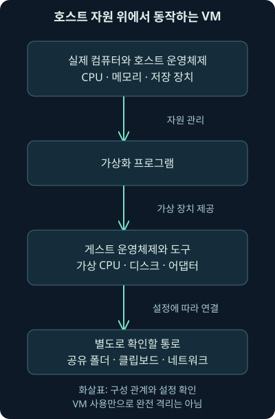
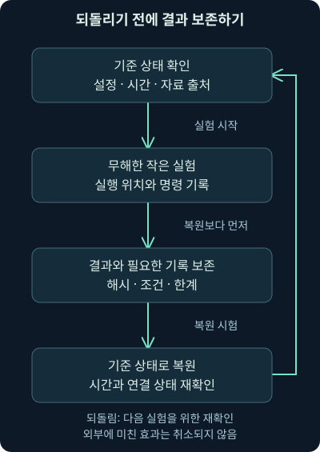
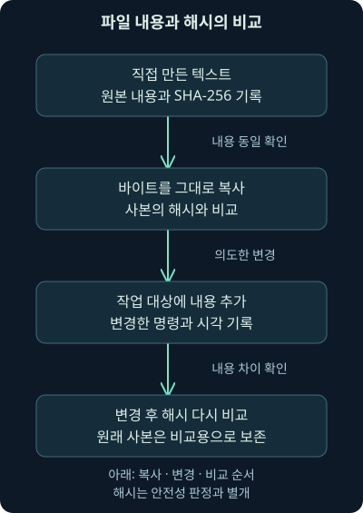

## 1. 실습을 시작하기 전에 만들 한 가지 습관

처음 분석 도구를 배우면 설치부터 끝내고 싶어집니다. 그런데 명령을 어느 컴퓨터에서 실행했는지, 원본 파일을 바꿨는지, 실습용 컴퓨터가 회사 네트워크와 연결되었는지 모르겠다면 결과를 믿기 어렵습니다. 분석을 잘하기 위한 첫 준비는 **실험한 범위와 되돌릴 방법을 아는 것**입니다.

앞 강의에서는 조직의 피해를 줄이려면 사실과 가설, 조치의 영향을 구별해야 한다고 배웠습니다. 이번에는 그 태도를 자신의 실습 환경에 적용합니다. 가상머신, 네트워크 연결, 공유 기능, 스냅숏, 시간과 파일 해시를 배웁니다. 처음에는 무해한 텍스트 자료만 사용합니다.

이 강의의 실습 환경 구성은 독립적인 설명용 절차입니다. 가상머신 설치·부팅·격리 검증을 실제로 수행한 결과가 아닙니다. 직접 확인한 것은 뒤에 표시하는 **로컬 텍스트 파일의 복사·변경·SHA-256 비교**입니다. 설명용 시각·이름·주소는 가상 예제입니다.

## 2. 어떤 자료를 확인했고 무엇이 더 필요할까요?

확인한 본 교재의 준비 부분은 실습용 가상머신을 마련하고, 워크북과 VM 안의 디지털 안내를 함께 활용하도록 연결합니다. 여기서 본문은 실습의 목적과 위치를 알려 주지만 실제 이미지 가져오기와 계정·환경별 설정의 상세 내용은 별도의 실습 안내에 의존합니다.

현재 확인한 업로드 폴더와 관련 작업 폴더에서는 본 교재 5권, 중복 PDF, 첫 권의 DOCX를 확인했습니다. 해당 과정의 독립 워크북, VM 이미지, VM 내부 안내에는 접근하지 못했습니다. 따라서 원래 실습의 계정·주소·필수 사양·설정값을 추정해서 적지 않습니다. 다른 과정의 워크북이 있다는 이유로 같은 실습 안내라고 취급하지도 않습니다.

아래에서는 별도로 만든 안전한 준비 방법을 배웁니다. 나중에 본래 VM과 안내를 사용할 수 있다면 제공자의 요구 사양·지원 가상화 제품·실습 네트워크를 먼저 대조하세요. 지금 소개하는 숫자와 메뉴는 그 이미지의 공식 요구 조건이 아닙니다. 자료를 보지 못했다는 것과 개념을 배울 수 없다는 것은 다른 문제입니다.

## 3. 컴퓨터 안에 컴퓨터를 두는 이유

요리 연습을 할 때 도마와 재료를 구역별로 나누면 실험과 정리가 쉬워집니다. **가상머신**, 줄여서 VM은 한 물리 컴퓨터 안에서 별도의 운영체제가 돌아가는 컴퓨터 환경입니다. 실제 컴퓨터와 운영체제 쪽을 **호스트**, VM 안의 운영체제를 **게스트**라고 부릅니다. 둘의 자원을 연결하고 관리하는 소프트웨어가 **가상화 프로그램**, 또는 하이퍼바이저입니다.

게스트에는 가상 CPU·메모리·디스크·네트워크 어댑터를 제공합니다. **운영체제**는 프로그램과 하드웨어 자원을 관리하는 기본 소프트웨어이고, **네트워크 어댑터**는 통신 경로에 붙는 연결 장치입니다. 가상 디스크도 보통 호스트 쪽 파일로 저장되므로 실제 저장 공간을 사용합니다.

**CPU**는 명령을 처리하는 중앙 처리 장치입니다. **메모리**는 실행 중인 프로그램이 작업에 사용하는 공간이고, **디스크**는 파일을 지속적으로 저장하는 공간입니다. 게스트에 메모리를 많이 준다고 디스크 용량까지 늘어나지는 않습니다. 세 자원의 역할을 나누어 보면 느린 원인도 구분하기 쉬워집니다.

도마 비유와 달리 VM은 완전히 독립한 물리 장비가 아닙니다. 호스트의 자원을 공유하고, 설정에 따라 폴더·클립보드·네트워크가 이어질 수 있습니다. 소프트웨어 결함의 가능성도 있습니다. “VM 안이니 어떤 파일을 실행해도 된다”는 보장은 없습니다. 이번 준비는 무해한 자료로 원리와 기록 습관을 익히는 범위입니다.



그림을 위에서 아래로 보세요. 물리 자원과 호스트가 있어야 가상화 프로그램과 게스트가 동작합니다. VM의 파일을 별도로 보관하더라도 호스트의 디스크 부족이나 장애는 VM에도 영향을 줍니다. 공유 기능을 켜면 별도의 통로도 생깁니다.

## 4. 파일 형식과 출처부터 확인합시다

운영체제 설치 미디어를 담은 **ISO 이미지**와 완성된 VM을 묶어 배포하는 **OVA**, 구성 설명인 **OVF**는 역할이 다릅니다. ISO를 연결했다고 이미 운영체제가 설치된 것은 아니고, VM 묶음을 가져왔다고 바로 실행해도 되는 것도 아닙니다. 배포자가 누구인지, 어떤 제품과 CPU 구조를 지원하는지 확인해야 합니다.

프로그램과 이미지는 공식 배포 경로와 신뢰할 수 있는 안내에서 확보합니다. 파일의 **해시**는 파일 내용을 계산해 일정한 길이의 값으로 표현한 것입니다. 배포자가 제공한 신뢰할 수 있는 값과 비교하면 받은 내용의 동일성을 확인하는 데 도움이 됩니다. 파일 이름이 같다는 사실보다 강한 확인 수단입니다.

그러나 파일과 비교값을 모두 같은 비인가 경로에서 받았다면 둘 다 바뀌었을 수 있습니다. 해시가 같다는 것만으로 제작자의 신원이나 파일의 무해함까지 증명하지 않습니다. 배포 경로·서명·공식 안내를 함께 보는 이유입니다. 원래 제공되지 않은 VM을 임의의 사이트에서 대신 구해 사용하지 않습니다.

## 5. 메모리 숫자를 정하기 전에 남는 자원을 계산하기

VM에는 호스트가 가진 자원 일부를 나누어 줍니다. 크기의 기본 단위인 **비트**는 0 또는 1의 값이고, **바이트**는 8비트입니다. **GiB**는 `2의 30제곱 바이트` 단위이며, `10의 9제곱 바이트`인 십진 단위 GB와 엄밀하게 다릅니다. 단위를 맞춰 계산해야 합니다.

예를 들어 호스트 메모리가 16 GiB이고, 호스트 운영체제와 현재 작업을 위해 8 GiB를 남기며, 게스트에 4 GiB를 주는 자체 설계를 해 봅시다. 계산은 `16 − 8 − 4 = 4 GiB`의 여유입니다. 메모리를 나누는 계산에서 VM 본체의 디스크 파일 크기를 빼는 것은 서로 다른 자원을 섞는 것입니다.

이 숫자는 이해용 배분 예제입니다. 사용하는 운영체제와 분석 도구의 공식 최소·권장 사양, 실제 메모리 사용량에 따라 바꿔야 합니다. 메모리가 부족하면 디스크로 데이터를 옮기는 일이 늘어 응답이 느려질 수 있고, 실습이 멈춘 것처럼 보일 수도 있습니다. CPU 코어도 모두 게스트에 주기보다 호스트의 작업을 고려해 배분합니다.

디스크에는 VM 본체뿐 아니라 스냅숏과 복사본, 수집한 로그가 늘어납니다. **동적 할당 디스크**는 설정한 최대 크기를 처음부터 모두 차지하지 않을 수 있지만, 사용에 따라 호스트 공간을 더 씁니다. 현재 용량이 작다는 이유로 이후에도 같은 크기라고 생각하면 안 됩니다. 구체적인 요구 용량은 사용할 이미지의 안내에서 확인합니다.

## 6. 네트워크 모드 이름보다 통신 상대를 먼저 보기

VM의 네트워크 설정은 “누구와 연결되는가?”라는 질문으로 읽으면 쉽습니다. **NAT**는 주소를 변환하며 게스트의 바깥 연결을 중계하는 방식입니다. 기본 상태에서 바깥에서 게스트로 새 연결을 시작하기 어려울 수 있지만, 게스트가 인터넷이나 호스트 쪽 자원에 접근하는 길이 생길 수 있습니다. 격리와 같은 뜻은 아닙니다.

**브리지**는 게스트를 호스트의 실제 네트워크에 연결하는 방식입니다. **호스트 전용**은 호스트와 게스트들이 통신하는 가상망이고, **내부 네트워크**는 같은 내부망 이름에 붙은 게스트들끼리 통신하는 방식입니다. 어댑터 비활성화 또는 케이블 분리는 해당 네트워크 연결 자체를 사용하지 않게 하는 선택입니다.

| VirtualBox의 연결 모드 | 기본적인 통신 범위 | 준비 단계에서 확인할 점 |
|---|---|---|
| NAT | 게스트가 호스트를 거쳐 외부로 나갈 수 있음 | 외부 접근 가능, 전달 규칙과 추가 어댑터 확인 |
| 브리지 | 실제 네트워크에 게스트를 연결 | 업무망과의 연결·외부 노출을 고려 |
| 호스트 전용 | 호스트와 해당 가상망의 게스트 | 호스트에도 접근 가능, 별도 라우팅·공유 확인 |
| 내부 네트워크 | 같은 이름의 내부망 게스트 | 다른 게스트가 중계하면 외부 경로가 생길 수 있음 |
| 연결 안 함 | 해당 어댑터의 통신 경로 없음 | 다른 어댑터와 공유 기능은 별개 |

이 표는 **VirtualBox 7.2 문서의 기본 모델**을 비교한 것입니다. 호스트의 인터넷 연결 공유, 게스트의 추가 어댑터, 중계 VM 같은 구성이 있으면 실제 범위가 달라집니다. 하나의 드롭다운 이름으로 환경 전체의 격리를 판정하지 않습니다. [제작사의 네트워크 문서](https://docs.oracle.com/en/virtualization/virtualbox/7.2/user/networkingdetails.html)를 2026년 11월 3일에 확인했습니다.

## 7. 처음에는 통신이 필요 없는 작은 실험부터

이번의 파일 복사와 해시 비교는 네트워크가 없어도 됩니다. VM을 새로 준비한다면 우선 신뢰할 수 있는 빈 환경을 마련하고, 전원이 꺼진 상태에서 설정의 Network 항목을 엽니다. 활성화된 어댑터를 모두 확인하고 이번 작업에 필요 없는 어댑터는 비활성화합니다. 제품과 언어에 따라 버튼 이름은 다를 수 있습니다.

파일 하나를 만들고 값을 계산하는데 브리지 연결이 필요한 것은 아닙니다. 설치 과정에서 업데이트가 필요하다면 그 준비 단계와 오프라인 실험 단계를 나누어 기록합니다. 필요한 공식 배포처에 접근하는 동안의 네트워크 설정과, 실험 전 다시 연결을 끊은 상태를 따로 확인하세요. 이 강의는 실제 호스트의 보안 설정을 끄거나 회사 장비의 정책을 바꾸도록 요구하지 않습니다.

두 VM 사이의 통신을 배울 때는 양쪽을 끈 뒤 Settings → Network에서 Internal Network를 선택하고, 같은 내부망 이름을 지정하는 식으로 구성할 수 있습니다. 이름은 예를 들어 `blue-lab`처럼 스스로 정합니다. 이 이름은 인터넷 도메인이 아니라 가상망을 구분하는 이름입니다. 내부망이 자동으로 주소까지 배정한다는 뜻은 아니므로 주소 설정 방식도 확인해야 합니다.

## 8. 주소를 적을 때도 “설명용”과 “실제 설정”을 구분하기

앞으로 그림에서 분석 PC를 `192.0.2.10`, 실습 서버를 `192.0.2.20`처럼 표시할 수 있습니다. 이들은 **문서용 주소**로, 실제 인터넷의 조사 대상 주소가 아닙니다. 그림의 역할과 통신 방향을 이해하기 위한 예제이며 독자의 실제 장치 주소라고 가정하지 않습니다.

실제 VM을 연결할 때는 사용 중인 가상망의 주소 범위, 중복 여부, 게스트의 설정을 확인해야 합니다. 제품과 운영체제에 따라 허용 범위나 주소 배정 방식이 다릅니다. 설명에 나온 주소를 호스트의 기존 업무 어댑터에 그대로 입력하지 마세요. 이번 회차의 로컬 파일 실습에는 주소를 바꿀 필요가 없습니다.

**기본 게이트웨이**는 직접 닿지 않는 목적지로 보낼 때 다음 경로를 맡는 장치입니다. 주소만 있고 기본 게이트웨이가 없으면 바깥으로 가는 보편적인 경로가 없을 수 있습니다. 하지만 특정 목적지용 경로나 다른 어댑터가 존재할 수 있으므로 이것만으로 모든 외부 통신이 불가능하다고 확정하지는 않습니다.

## 9. 인터넷을 끊었는데 파일이 오갈 수 있다고요?

네트워크 연결을 껐어도 **공유 폴더**가 켜져 있으면 게스트에서 호스트 파일을 볼 수 있습니다. **클립보드**는 복사한 내용을 잠시 보관해 붙여넣을 때 쓰는 공간이고, **공유 클립보드**는 그 자료가 호스트·게스트 사이로 이동하는 통로입니다. 드래그 앤드 드롭, USB 장치 연결도 별도로 확인해야 합니다. 네트워크 격리와 호스트·게스트 사이의 모든 통로 차단은 같은 말이 아닙니다.

처음에는 이런 공유를 꺼 두고 필요한 기능만 목적과 방향을 정해 사용합니다. 자료를 넣기 위해 공유가 꼭 필요하다면 개인 문서 전체가 아닌 별도 교환 폴더, 가능한 읽기 전용, 사용 뒤 연결 해제를 고려할 수 있습니다. 읽기 전용은 쓰기를 막을 뿐 내용 읽기를 막아 주지는 않습니다. 비밀 정보를 둔 폴더라면 여전히 노출될 수 있습니다.

**현재 기준 확인 — 2026년 11월 3일:** VirtualBox 7.2의 보안 안내는 양방향 클립보드와 공유 폴더가 호스트 자원 접근 경로가 될 수 있음을 설명합니다. Guest Additions는 게스트 안에 설치하는 통합 기능이며 설치했다고 공유가 안전해지는 것은 아닙니다. [제작사의 보안 안내](https://docs.oracle.com/en/virtualization/virtualbox/7.2/user/Security.html)와 [통합 기능 문서](https://docs.oracle.com/en/virtualization/virtualbox/7.2/user/guestadditions.html)를 확인했습니다.

## 10. 스냅숏은 되돌릴 지점이지 독립 백업이 아닙니다

게임의 저장 지점처럼 **스냅숏**은 VM의 특정 상태로 돌아가기 위한 기능입니다. 실험 전에 깨끗한 상태를 남기면 잘못된 설정이나 파일 변경 뒤에 다시 비교하기 쉽습니다. 실행 중인 VM의 메모리 상태를 포함하는지 등 세부 동작은 제품과 촬영 조건에 따라 다릅니다.

하지만 호스트의 VM 저장 디스크가 망가지면 같은 곳에 있는 스냅숏도 함께 잃을 수 있습니다. **백업**은 장애나 손실을 고려해 별도로 보관하고 복원 가능성을 확인하는 사본입니다. 스냅숏을 만들었다는 사실만으로 독립적인 백업이 확보되지는 않습니다.

실습 결과를 VM 안에만 두었다가 이전 스냅숏으로 돌아가면 기록이 사라질 수 있습니다. 설정을 되돌리기 전에 결과와 필요한 로그를 별도 보관하고, 어떤 상태를 기준으로 재시작했는지 남기세요. 스냅숏 삭제는 돌아가기와 다른 작업이며 제품이 디스크 변경분을 병합할 수도 있으므로 용량과 안내를 확인해야 합니다.



그림에서 기록 보존이 되돌리기보다 먼저인 점을 보세요. 이전 상태로 돌아가는 작업은 외부 서버에 이미 보낸 데이터나 호스트에서 바뀐 공유 파일까지 취소하지 않습니다. VM의 시간도 바뀔 수 있으므로 다음 절의 시간 확인을 다시 해야 합니다.

## 11. 기준 상태를 만드는 구체적인 순서

VM 프로그램과 신뢰할 수 있는 설치 미디어를 확보했다면 새 VM 또는 제공된 가져오기 절차를 사용합니다. VM 이름·호스트의 제품 버전·게스트 종류·할당 자원·이미지 출처를 기록합니다. 가져온 VM은 처음 부팅하기 전에 네트워크와 공유 기능부터 확인합니다. 제공 이미지가 없다면 계정과 설정이 이미 준비되어 있을 것이라고 가정하지 않습니다.

운영체제를 정상 설치하고 필요한 공식 업데이트를 적용한 다음, 이번 실험에 쓸 연결 범위와 계정으로 전환합니다. 일상 학습 계정과 관리자 작업이 필요한 단계를 구분하세요. 부팅과 로그인, 시간 표시, 저장 공간을 확인한 뒤 정상 종료합니다. 이 상태에 `baseline-clean`처럼 의미를 알 수 있는 스냅숏 이름과 설명을 남길 수 있습니다.

이 절의 순서는 준비 계획이며 여기서 실제로 수행한 설치 기록은 아닙니다. 사용하는 제품과 이미지의 공식 절차를 우선하고, 설치 오류를 해결하려고 호스트의 보안 기능을 임의로 끄지 않습니다. 지원 CPU 구조나 가상화 기능, 설치된 다른 가상화 제품과의 조건은 해당 버전 문서에서 확인해야 합니다. 버전 번호 하나를 영구적인 최신 버전이라고 외우지 마세요.

## 12. 시간이 맞지 않으면 사건의 순서도 달라집니다

가상 예제로 게스트 로그가 `2026-11-03T09:15:00+11:00`, 다른 로그가 `2026-11-02T22:15:00Z`를 표시한다고 합시다. 첫 값의 `+11:00`은 UTC보다 11시간 앞선 시간대 차이이며, `Z`는 UTC 기준을 뜻합니다. 첫 시각에서 11시간을 빼면 둘째 값과 같은 순간입니다. 날짜가 다르다고 다른 사건으로 보면 안 됩니다.

그렇다고 시간대를 UTC로 바꾸면 시계 오차까지 고쳐지는 것은 아닙니다. 게스트 시계가 실제보다 3분 늦으면 같은 시간대여도 오차가 남습니다. 스냅숏 복원·일시 정지 뒤에는 시각을 다시 확인합니다. 호스트와의 시간 동기화가 있다면 그 동작과 시간 변경도 기록합니다.

PowerShell에서는 아래처럼 현재 표시를 확인할 수 있습니다. **PowerShell**은 명령을 입력해 운영체제와 파일 등의 정보를 다루는 환경입니다. 명령을 입력하는 창이 호스트인지 게스트인지 먼저 확인합니다. 아래 명령은 이번 강의의 VM에서 실행한 결과가 아니라 독자가 사용할 조회 예제입니다.

```powershell
Get-Date -Format o
```

`Get-Date`는 현재 시각을 가져옵니다. `-Format`은 표현 형식을 정하는 옵션이고, 소문자 `o`는 날짜·시각·시간대 정보를 보존하는 표준 형식입니다. 시각을 바꾸는 명령이 아닙니다. 시간이 정확한지 확인하려면 신뢰할 수 있는 시간 기준과 비교해야 합니다. [Microsoft의 Get-Date 문서](https://learn.microsoft.com/en-us/powershell/module/microsoft.powershell.utility/get-date?view=powershell-7.6)를 2026년 11월 3일에 확인했습니다.

## 13. 원본·작업본·결과를 나누어 두기

사진을 보정할 때 원본 위에 덮어쓰면 처음 상태로 돌아가기 어렵습니다. 분석 자료도 같습니다. **원본**은 처음 확보한 자료, **작업본**은 조회나 변환에 사용하는 사본, **결과**는 필터링·추출·계산으로 만든 산출물로 구분합니다. 원본의 해시와 확보 시각·출처를 남기면 나중에 비교하기 쉽습니다.

원본이라고 이름 붙인 폴더가 자동으로 변경을 막아 주는 것은 아닙니다. 읽기 권한, 보관 방법, 접근 기록도 필요합니다. 실습에서는 최소한 원본을 보존하고 복사본으로 작업해 보세요. 실제 사건에서는 조직의 증거 보존 절차와 책임 범위를 따릅니다.

예를 들어 캡처 파일에서 필터에 맞는 패킷만 저장했다면 그 새 파일은 원본 전체가 아닙니다. 주소를 가리거나 시간 형식을 바꾼 **CSV**, 즉 값을 구분자로 나누어 표처럼 저장하는 텍스트 파일도 가공 결과입니다. 어떤 조건으로 만들었는지 쓰지 않으면 다음 분석가는 “없어 보이는 패킷”이 실제로 없었는지 변환에서 빠졌는지 구분할 수 없습니다.



그림의 해시 비교는 내용이 같은지 확인하는 데 쓰입니다. 작업본을 바꾼 뒤 값이 달라지는 것은 예상 가능한 결과이지 그 자체로 악성 행위를 뜻하지 않습니다. 변경 이유와 절차가 기록되어 있어야 합니다.

## 14. 직접 확인한 작은 파일 실습

이 실습은 인터넷과 VM 없이도 할 수 있습니다. 자신이 만든 빈 실습 폴더에서 새 파일 이름을 사용하세요. `Set-Content`는 같은 이름의 파일 내용을 바꾸므로 보관 중인 자료가 있는 폴더에 그대로 실행하면 안 됩니다. 다음은 **실제로 실행해 확인한 명령의 핵심과 같은 절차**입니다. 작성 환경은 Windows의 PowerShell 7.6.5였고 악성 파일이나 네트워크 통신은 사용하지 않았습니다.

```powershell
Set-Content -LiteralPath .\lab-note.txt -Value 'blue-team-lab' -Encoding ascii
Copy-Item -LiteralPath .\lab-note.txt -Destination .\lab-note-copy.txt
Get-FileHash -LiteralPath .\lab-note.txt -Algorithm SHA256
Get-FileHash -LiteralPath .\lab-note-copy.txt -Algorithm SHA256
```

첫 줄은 텍스트 파일을 만듭니다. `-LiteralPath`는 경로를 와일드카드 패턴으로 해석하지 않고 지정한 그대로 다룹니다. `.`은 현재 폴더, 뒤의 파일 이름은 그 폴더 안의 대상을 가리킵니다. `-Value` 뒤의 따옴표 안 문장이 파일에 들어갈 내용이며, `-Encoding ascii`는 이 영문 예제의 문자 저장 방식을 지정합니다. 기본 줄바꿈도 들어갑니다.

둘째 줄의 `Copy-Item`은 원본 내용을 새 경로로 복사합니다. `-Destination`이 사본 이름입니다. 셋째·넷째 줄은 두 파일의 **SHA-256** 해시를 계산합니다. SHA-256은 내용을 256비트 값으로 계산하는 해시 알고리즘이며, 화면에서는 보통 16진수 64자리로 표시합니다. **16진수**는 한 자리에 `0~9`와 `A~F`의 16가지 값을 사용하는 표현입니다. 한 자리가 4비트를 나타내므로 `64 × 4 = 256비트`입니다.

실제 계산에서 원본과 사본은 모두 아래 값이었습니다. 경로와 계산 시각 같은 메타데이터가 아니라 파일 내용의 해시를 비교한 것입니다.

```text
원본 = 사본
2B94AA9862D21CC4CE671C7B2D9097126AF96B3E0319B662A9039F4C7B1D6FBB
```

이제 한 줄을 더 붙입니다. `Add-Content`는 기존 내용을 대체하는 대신 뒤에 추가합니다. 추가 전에 원래 값을 기록해 두어야 비교할 수 있습니다.

```powershell
Add-Content -LiteralPath .\lab-note.txt -Value 'second-line' -Encoding ascii
Get-FileHash -LiteralPath .\lab-note.txt -Algorithm SHA256
```

변경한 파일은 다음 값으로 달라졌습니다. 사본은 원래 내용으로 남아 있습니다. 이는 파일 내용을 바꾸면 비교값이 달라짐을 직접 확인한 결과이며, VM의 안전성이나 어떤 프로그램의 무해함을 검증한 결과는 아닙니다.

```text
변경 후 원본
D0B8970F70C27EAACFE46FE2E2BE344EF8E8CD6190F5181E0D592DA15B6074CF
```

다른 환경에서 값이 다르면 먼저 실제 바이트를 비교합니다. 줄바꿈이 Windows의 CRLF인지 다른 환경의 LF인지, 마지막 줄바꿈이 있는지, 문자 인코딩이나 보이지 않는 표시가 들어갔는지에 따라 해시는 달라집니다. **바이트**는 파일 내용을 이루는 8비트 단위입니다. 같은 글자로 보인다는 것과 같은 바이트라는 것은 다릅니다.

## 15. 해시로 알 수 있는 것과 없는 것

해시가 일치하면 실무적으로 파일 내용의 동일성을 강하게 확인하는 데 도움이 됩니다. 해시 알고리즘에는 수학적으로 충돌 가능성이 있지만 SHA-256을 내용 검증에 쓰는 목적은 이름이나 크기만 비교할 때보다 신뢰도를 높이는 데 있습니다. 파일의 출처와 취급 기록까지 해시 하나로 대신하지는 않습니다.

| 확인 결과 | 지지하는 해석 | 그 결과만으로 확정할 수 없는 것 |
|---|---|---|
| 복사 전후 SHA-256 일치 | 비교한 파일 내용이 같다는 강한 확인 | 파일이 안전함, 출처가 진짜임 |
| 내용 추가 뒤 값 변경 | 변경 전후 내용이 다름 | 누가 어떤 의도로 바꿨는지 |
| 이름만 바꾸고 값 일치 | 이름과 내용 해시는 별개 | 모든 메타데이터가 같음 |
| 알려진 값과 불일치 | 기대한 내용과 다르거나 비교 조건이 다름 | 악성 파일로 교체되었다는 확정 |

명령 의미는 [Get-FileHash 공식 문서](https://learn.microsoft.com/en-us/powershell/module/microsoft.powershell.utility/get-filehash?view=powershell-7.6)와 [Set-Content 문서](https://learn.microsoft.com/en-us/powershell/module/microsoft.powershell.management/set-content?view=powershell-7.6)를 2026년 11월 3일에 대조했습니다. 앞 절의 숫자 결과는 문서의 예제 출력을 복사한 것이 아니라 자체 파일에서 계산한 값입니다.

## 16. VM 안에서 네트워크 상태를 확인하는 방법

VM을 만들었다면 설정 화면의 모드와 게스트 안의 실제 주소·경로를 함께 봅니다. Windows 게스트에서는 다음 조회 예제를 사용할 수 있습니다. **NetTCPIP**는 Windows의 네트워크 정보를 다루는 PowerShell 모듈이며 다른 운영체제나 설치 구성에서는 같은 명령이 없을 수 있습니다. 이 명령들은 이번 VM에서 실행한 결과가 아닙니다.

```powershell
Get-NetIPConfiguration -All
Get-NetRoute -DestinationPrefix '0.0.0.0/0'
Get-NetRoute -DestinationPrefix '::/0'
```

첫 줄은 주소·DNS 서버·인터페이스 정보를 봅니다. **DNS**는 이름을 주소 등의 정보와 연결하는 체계이며 상세 동작은 둘째 날에 배웁니다. `-All`을 붙인 이유는 가상·연결 끊김 인터페이스도 포함해 추가 연결을 놓치지 않기 위해서입니다. 기본 조회에 안 보이는 어댑터가 있을 수 있습니다.

둘째 줄은 IPv4의 기본 경로, 셋째 줄은 IPv6의 기본 경로를 찾습니다. IPv4와 IPv6는 인터넷 주소를 표현하고 전달하는 프로토콜의 두 버전입니다. `0.0.0.0/0`과 `::/0`은 각각의 기본 목적지 범위 표기입니다. `/0`은 특정 주소 비트를 고정하지 않은 범위를 뜻하며, 일치하는 더 구체적인 경로가 없을 때 기본 경로가 쓰일 수 있습니다.

결과가 비어 있어도 완전한 격리를 증명하지는 않습니다. 특정 경로, 다른 어댑터, 호스트 공유, 중계 기능을 더 확인해야 합니다. 반대로 경로가 보인다는 것만으로 실제 접속 성공을 확정하지 않습니다. 방화벽이나 다음 장치에서 막힐 수 있습니다. [주소 설정 조회](https://learn.microsoft.com/en-us/powershell/module/nettcpip/get-netipconfiguration?view=windowsserver2025-ps)와 [경로 조회](https://learn.microsoft.com/en-us/powershell/module/nettcpip/get-netroute?view=windowsserver2025-ps) 문서를 같은 날짜에 확인했습니다.

## 17. 실습 기록을 이렇게 남겨 보세요

환경을 기억에 맡기지 말고 실험 노트를 남깁니다. 아래는 **가상의 작성 예**이며 VM을 실제 구성했다고 보고하는 기록이 아닙니다. 수행하지 않은 칸은 ‘미실행’으로 두는 것이 정확합니다.

```text
실습 목적: 무해한 텍스트의 복사·내용 변경과 해시 비교
실행 위치: 호스트 또는 게스트 중 실제 위치 기입
제품·운영체제·버전: 실제 확인값 기입
자료 출처: 직접 작성한 텍스트
네트워크: VM 미사용 / 또는 실제 어댑터별 상태 기입
공유 기능: 미사용 / 또는 실제 설정 기입
시간 기준: 원래 시간대, 기준 시각과 오차 확인 여부
원본·작업본: 각 경로와 SHA-256
실행: 실제 입력한 명령과 순서
결과: 일치 여부와 변경 후 값
한계: VM 부팅·격리·복원 검증은 미실행
```

이렇게 쓰면 “파일 해시를 계산했다”와 “가상망을 검증했다”를 섞지 않게 됩니다. 다음에 PCAP, 즉 패킷을 저장한 캡처 파일을 분석할 때도 같은 틀을 사용할 수 있습니다. 자료 형식이 달라져도 출처·수집 범위·가공 조건·결과·한계는 계속 중요합니다.

## 18. 막혔을 때는 무엇을 분리해서 볼까요?

VM이 부팅하지 않는다면 이미지 형식·지원 CPU 구조·할당 자원·저장 공간·제품 오류를 구분합니다. 네트워크가 안 된다면 게스트의 주소, 연결한 모드, 같은 내부망 이름, 필요한 주소 배정, 게스트 방화벽을 확인합니다. 사이트 하나가 열리지 않았다는 결과로 모든 통신이 차단되었다고 말하지 않습니다.

명령을 찾을 수 없다는 오류는 운영체제나 모듈, 실행한 셸이 다르기 때문일 수 있습니다. 파일이 없다는 오류는 현재 폴더와 이름을 먼저 확인합니다. 파일이 정상인데 해시가 다르다면 내용·줄바꿈·인코딩을 따로 살펴야 합니다. 각 오류는 서로 다른 문제이므로 보안 기능을 한꺼번에 끄는 식으로 해결하지 않습니다.

화면에서 복사한 명령에는 줄바꿈이나 따옴표가 달라질 수 있습니다. 디지털 안내가 복사에 편리하더라도 붙여넣기 전에 무엇을 읽고 바꾸는 명령인지 확인하세요. 관리자 권한이 필요한지, 어느 경로를 쓰는지, 외부 주소에 연결하는지 알 수 있어야 합니다. 명령의 의미를 설명하는 것이 복사 성공보다 중요합니다.

## 19. 준비 완료를 단계별로 판단하기

| 단계 | 완료라고 쓰려면 필요한 확인 | 남겨야 할 한계 |
|---|---|---|
| 자료 읽기 | 출처·역할·적용 버전 확인 | 미확보 워크북·이미지 |
| 환경 준비 | 실제 설치·부팅·로그인과 설정 확인 | 아직 시험하지 않은 기능 |
| 연결 검토 | 어댑터·경로·공유 범위의 실제 확인 | 시험하지 않은 경로와 조건 |
| 파일 실험 | 명령·입력·해시 결과 기록 | 실제 네트워크·VM 결과와 별개 |
| 되돌리기 준비 | 기준 상태 보관과 복원 시험 | 외부 효과와 별도 백업 범위 |

이번 작성에서 직접 실행해 완료한 것은 표의 파일 실험입니다. VM 환경 준비·연결 검토·복원 시험은 독자의 실제 환경에서 추가로 수행할 항목입니다. 준비가 덜 되었어도 운영 원리는 먼저 배울 수 있지만, 수행하지 않은 항목을 체크 완료로 바꾸지는 않습니다.

실습 안내가 갱신되면 적용 버전과 확인 날짜를 함께 기록하세요. 로컬 안내와 최신 공식 문서가 다르면 무조건 새 명령을 섞기보다 해당 이미지에 맞는 버전 조건과 변경 이유를 확인합니다. 기존 상태를 보존하고 작은 변경부터 확인하면 오류의 원인을 찾기 쉬워집니다.

## 20. 복습 — 조건이 바뀌면 어떻게 될까요?

### 질문 1. VM을 사용하면 호스트와 완전히 분리된 것일까요?

**해설:** 자원과 가상화 소프트웨어를 공유하며 설정에 따라 네트워크·폴더·클립보드가 연결됩니다. 분리 수준은 실제 구성과 소프트웨어 상태에 달려 있습니다. VM이라는 이름만으로 모든 파일을 안전하게 실행할 수 있다고 판단하지 않습니다.

### 질문 2. NAT이면 인터넷에 못 나갈까요?

**해설:** 일반적인 NAT는 게스트의 바깥 연결을 중계합니다. 외부에서 새 연결을 받는 조건과 게스트가 바깥으로 나가는 조건은 다릅니다. 외부 연결이 필요한 준비 단계와 오프라인 실험 단계를 나누어 확인해야 합니다.

### 질문 3. 호스트 전용 가상망이면 호스트도 보호될까요?

**해설:** 호스트 전용은 호스트와 게스트가 연결되는 방식입니다. 호스트에 접근할 수 있으므로 완전한 차단으로 볼 수 없습니다. 호스트의 공유·중계 설정과 추가 어댑터도 확인합니다.

### 질문 4. 두 VM에 같은 내부망 이름만 주면 주소까지 생길까요?

**해설:** 내부망 연결과 주소 배정은 다릅니다. 정적 주소나 별도 주소 배정 기능이 필요할 수 있습니다. 연결 이름이 같다는 사실은 통신 준비의 일부이지 실제 통신 성공의 증거가 아닙니다.

### 질문 5. 인터넷 연결을 끊고 공유 폴더를 켰습니다. 파일 이동도 막혔을까요?

**해설:** 공유 폴더는 네트워크와 별개 통로가 될 수 있습니다. 읽기 전용도 읽기는 허용하므로 비밀 정보가 노출될 수 있습니다. 공유 대상·방향·권한을 별도로 확인해야 합니다.

### 질문 6. 스냅숏 복원으로 이미 외부에 전송한 자료도 회수될까요?

**해설:** VM의 상태를 되돌려도 외부 서버나 호스트 공유 폴더에서 발생한 효과까지 취소되지 않습니다. 실험 전에 통신과 공유 범위를 통제하고 결과를 보존해야 합니다.

### 질문 7. 호스트 메모리 16 GiB에서 호스트 몫 8 GiB, 게스트 6 GiB라면 여유는 얼마일까요?

**해설:** 단순 배분 계산은 `16 − 8 − 6 = 2 GiB`입니다. 실제 메모리 사용과 부가 비용은 변하므로 이 숫자가 원활한 실행을 보장하지 않습니다. 제품과 게스트의 요구 조건도 함께 확인합니다.

### 질문 8. 파일 이름을 바꾸면 SHA-256도 반드시 달라질까요?

**해설:** 내용 해시는 이름이 아닌 바이트를 계산합니다. 내용이 같다면 이름 변경만으로 내용 해시가 바뀌지는 않습니다. 그렇다고 파일의 모든 속성과 취급 이력이 같다는 뜻은 아닙니다.

### 질문 9. 다운로드한 파일이 같은 사이트의 해시값과 일치하면 안전한가요?

**해설:** 받은 내용이 그 비교값과 맞는다는 확인입니다. 사이트와 값의 신뢰성, 서명, 파일의 성격은 별도 문제입니다. 같은 비인가 경로에서 파일과 값을 함께 바꿀 수 있으므로 출처 검증을 대체하지 못합니다.

### 질문 10. `blue-team-lab`이라고 보이는데 내 해시만 다릅니다. 무엇부터 볼까요?

**해설:** 줄바꿈 CRLF·LF, 마지막 줄바꿈, 인코딩과 실제 파일 내용을 확인합니다. 글자 표시가 같아도 바이트는 다를 수 있습니다. 같은 이름의 다른 경로 파일을 계산하지 않았는지도 확인해야 합니다.

### 질문 11. `09:15+11:00`과 전날 `22:15Z`는 같은 순간일 수 있나요?

**해설:** 해당 예제에서는 11시간을 빼면 같아집니다. 다만 시계 오차는 시간대 변환으로 없어지지 않습니다. 원래 표기와 변환 기준, 동기화 확인 여부를 기록해야 합니다.

### 질문 12. IPv4 기본 경로가 없으면 완전한 격리를 확정할까요?

**해설:** IPv6나 더 구체적인 경로, 다른 어댑터, 호스트 공유 통로를 놓칠 수 있습니다. 조회가 비었다는 사실은 그 조건에 대한 결과입니다. 환경 전체의 연결 범위를 따로 검토해야 합니다.

### 질문 13. 해시 실험을 직접 실행했으니 VM 준비도 완료라고 기록할까요?

**해설:** 파일 실험과 VM 설치·부팅·격리·복원은 서로 다른 검증입니다. 이번 강의에서는 파일 실험만 직접 확인했습니다. 각 항목의 수행 여부를 따로 남기는 것이 정확합니다.

### 질문 14. 원본 워크북을 못 찾았으니 설치 계정을 추정해 안내해도 될까요?

**해설:** 안 됩니다. 접근한 자료와 부족한 항목을 밝히고 독립적인 준비 절차임을 구분해야 합니다. 제공자와 버전이 다른 안내를 같은 환경의 정답으로 대체하면 재현성과 안전성을 잃습니다.

## 21. 확인일과 다음 학습

공식 문서와 기술 보충의 확인일은 **2026년 11월 3일**입니다. VM 연결·공유·스냅숏은 VirtualBox 7.2 문서 범위를 기준으로 설명했으며 그 제품을 설치·실행한 결과는 아닙니다. 스냅숏의 복원·삭제와 디스크 변화는 [제작사의 VM 작업 문서](https://docs.oracle.com/en/virtualization/virtualbox/7.2/user/working-with-vms.html)에서 대조했습니다. 다른 제품·버전의 메뉴와 세부 동작은 해당 안내를 확인해야 합니다.

우리는 이번에 실험의 경계와 원본 보존, 시간과 해시를 배웠습니다. 다음 3강에서는 이런 자료를 다루는 사람들이 어떻게 역할을 나누는지, SOC의 사람·업무·기술이 어떻게 연결되는지 살펴봅니다. 도구를 많이 설치하기 전에 어떤 질문과 판단을 맡는 조직인지부터 이해해 보겠습니다.
