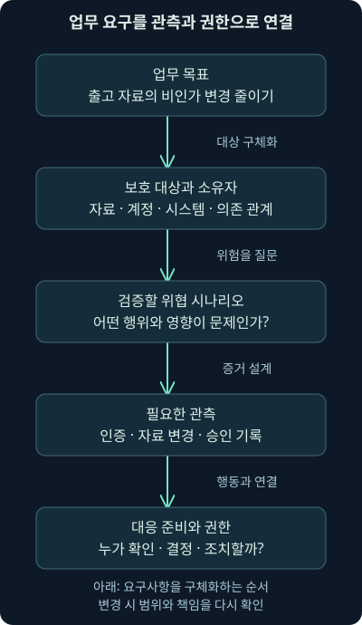
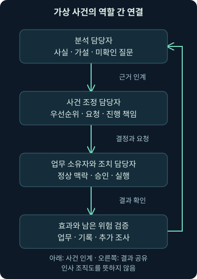

## 1. 경보를 받았는데 누가 결정할 수 있을까요?

물류 회사의 야간 담당자가 낯선 계정 활동을 발견했습니다. 그런데 그 계정은 창고 출고 작업에도 사용됩니다. 분석가는 연결을 끊고 싶지만, 창고 운영자는 배송이 멈출까 걱정합니다. 두 사람이 서로의 말을 이해하지 못하면 경보가 정확했어도 대응이 늦어질 수 있습니다.

첫 강의에서는 블루팀의 목적을, 두 번째 강의에서는 실험의 경계와 기록을 배웠습니다. 이제 그 일을 맡는 조직을 들여다보겠습니다. **SOC**는 보안 운영 기능을 모아 수행하는 조직이나 협업 체계입니다. 이번 3강은 보호 대상과 임무, 권한과 위험 판단, 사람의 역할과 조직 구조를 다룹니다. 다음 4강에서는 실제 기록이 수집·탐지·조사·조치로 흘러가는 과정을 연결합니다.

이 강의의 회사·계정·장비·시간·허용 기준은 모두 **설명용 가상 사례**입니다. 실제 회사의 정책이나 조사 결과가 아닙니다. 어떤 조직에도 그대로 적용할 수 있는 고정 조직도나 차단 기준을 제시하려는 것이 아니라, 자신의 환경에서 빠진 연결을 찾는 방법을 익힙니다.

## 2. 장비 목록보다 업무의 흐름을 먼저 그려 보기

물류 회사를 지킨다고 하면 서버와 PC 목록부터 받기 쉽습니다. 하지만 출고가 무엇에 의존하는지 모르면 같은 서버 두 대의 중요도도 구분하기 어렵습니다. 주문 접수, 재고 확인, 라벨 발행, 출고 확인이 이어진다고 생각해 보세요. 그중 한 단계가 멈추면 다른 단계도 영향을 받을 수 있습니다.

**자산**은 보호해야 할 정보·시스템·계정·서비스 등의 대상입니다. 자산 목록에 담당자, 다루는 자료, 연결된 업무와 의존 관계를 더하면 조사할 때 쓸 수 있는 지도가 됩니다. “서버 A가 중요하다”에 그치지 않고 “서버 A가 멈추면 어떤 업무가 언제부터 어려워지는가?”를 묻는 것이죠.

이때 업무 담당자의 설명과 실제 구성이 맞는지 확인해야 합니다. 문서에는 예비 서버가 있다고 해도 실제로 전환 시험을 하지 않았다면 중단 영향을 작게 평가할 수 있습니다. 자료가 완전하지 않다면 미확인으로 표시하고, 담당자와 검증할 항목을 남겨 둡니다.

## 3. 보호 대상에서 필요한 관측과 행동으로 이어가기

창고의 출고 자료를 지키고 싶다면 그 자료가 어디 있고 누가 바꿀 수 있는지부터 알아야 합니다. 그다음에는 자료를 잘못 바꾸거나 빼내려는 행위가 어떤 모습으로 나타날지 생각합니다. 이어서 그 행위를 볼 기록이 어디에 있는지, 발견하면 누구에게 어떤 행동을 요청할지를 정합니다.

**위협**은 자산에 바람직하지 않은 영향을 줄 수 있는 원인이나 행위의 가능성을 말합니다. “공격이 걱정된다”라는 문장보다 “출고 계정이 악용되어 배송 목적지가 변경될 수 있다”처럼 자산과 행동을 묶으면 관측과 대응을 설계하기 쉽습니다. 그렇다고 이런 시나리오가 이미 발생했다는 뜻은 아닙니다.

| 가상 업무 질문 | 구체화한 내용 | 운영에서 필요한 연결 |
|---|---|---|
| 무엇을 지킬까? | 출고 자료와 승인된 목적지 변경 | 자료 소유자·변경 권한 목록 |
| 어떤 일이 문제일까? | 비인가 계정 사용과 목적지 변경 | 인증·변경·승인 기록 |
| 어떻게 알아차릴까? | 평소와 다른 접근 뒤 중요 항목 변경 | 기록 수집과 시간·계정 연결 |
| 발견하면 어떻게 할까? | 변경 보류·담당자 확인·추가 접근 제한 | 승인 권한·연락망·복원 절차 |

표는 질문을 끝내는 체크리스트가 아닙니다. “변경 기록을 본다”고 답했다면 그 기록이 실제로 켜져 있는지, 변경 전후 값과 수행 계정이 남는지까지 확인합니다. 새로운 창고나 외부 서비스가 생기면 같은 질문에 대한 답도 달라집니다.



그림을 아래로 읽으며 한 단계씩 구체화해 보세요. 중간의 기록이 없다면 마지막의 조치 판단도 어려워집니다. 반대로 기록은 충분해도 담당자와 권한이 없으면 행동으로 연결되지 않습니다.

## 4. 사람·절차·기술은 어디에서 만나나요?

1강에서 배운 세 요소를 실제 역할에 놓아 보겠습니다. 사람이 “이 계정은 출고 시스템의 공용 계정이라 단말 이름도 봐야 한다”고 설명합니다. 절차는 어떤 기록으로 확인하고 어느 경우에 업무 담당자에게 연락할지 정합니다. 기술은 그 기록을 수집하고 찾고 비교할 수 있게 해 줍니다.

기술만 바꾸어도 문제가 해결되지 않는 이유가 여기 있습니다. 계정 목록이 낡았다면 새로운 탐지 도구도 잘못된 중요도를 붙일 수 있습니다. 담당자가 바뀌었는데 연락 절차가 그대로라면 자동 알림을 보내도 응답이 없을 수 있습니다. 세 요소 사이의 전달 정보를 함께 점검해야 합니다.

사람이 실수했다는 설명만으로 끝내지도 마세요. 화면에 업무 소유자가 표시되지 않았는지, 정상 작업을 확인할 경로가 없었는지, 교대 때 진행 상황이 빠졌는지를 살펴보면 개선할 수 있는 구조가 보입니다. 사람을 탓하는 기록과 재발을 줄이는 기록은 다릅니다.

## 5. SOC의 업무 범위를 문서로 정하는 이유

아파트 관리실에 모든 문제를 맡길 수는 없습니다. 엘리베이터 고장 신고를 받고 전문 업체를 부를 수는 있지만, 관리실 직원이 허가 없이 모든 시설을 개조하지는 않습니다. SOC에도 무엇을 맡고 어디까지 행동할지 정하는 문서가 필요합니다.

이를 **운영 헌장**, 또는 charter라고 부를 수 있습니다. 조직에서 쓰는 이름이 다르더라도 보호 대상, 제공 서비스, 업무 범위, 책임과 권한, 연락·보고 경로가 분명하면 같은 목적을 수행합니다. 문서가 있다는 사실보다 관련 사람들이 같은 기대를 갖는지가 중요합니다.

예를 들어 “본사와 두 창고의 보안 경보를 확인한다”는 범위에는 새로 인수한 지점이 포함되지 않을 수 있습니다. 외부 업체가 운영하는 시스템은 자료 접근과 조치 권한이 따로 정해져 있을 수 있습니다. 보호 대상으로 알고 있었는데 실제 계약과 수집 범위에는 없었던 상황을 미리 찾아야 합니다.

## 6. 조사할 권한과 서비스를 멈출 권한은 구분합니다

가상 SOC가 계정의 인증 기록을 조회할 수 있다고 합시다. 그렇다고 그 계정을 즉시 잠그거나 중요 서버의 전원을 끌 권한까지 자동으로 생기지는 않습니다. 조회, 자료 반출, 설정 변경, 계정 제한, 업무 중단은 영향과 책임이 다릅니다.

평소 승인과 긴급 상황의 위임 조건을 구체화해야 합니다. 누가 어떤 근거를 확인하면 어느 범위의 임시 조치를 할 수 있는지, 담당자가 응답하지 않으면 누구에게 연결할지, 조치 후 누가 검증하고 해제할지를 정합니다. 특정 조치가 모든 조직에서 무조건 허용되거나 금지된다고 외우지는 마세요.

이를 **에스컬레이션**이라고 부르기도 합니다. 자신의 처리 범위를 넘거나 중요도가 높아졌을 때 정해진 담당자와 결정 권한으로 문제를 올리는 일입니다. 단순히 티켓을 다른 사람에게 넘기는 것과 달리, 왜 지금 도움이 필요한지와 어떤 결정을 기다리는지가 함께 전달되어야 합니다.

## 7. 제공 서비스와 제공하지 않는 서비스를 함께 설명하기

“보안 관제”라는 말만으로는 상대가 무엇을 받을지 알기 어렵습니다. 경보를 전달하는지, 내용을 조사하는지, 야간에도 연락하는지, 직접 조치하는지에 따라 필요한 역량과 기대가 달라집니다. **서비스 목록**은 이런 제공 범위를 설명하는 문서입니다.

가상 회사가 평일 주간 분석만 운영한다면 야간에도 같은 속도로 조사한다고 말해서는 안 됩니다. 외부 업체가 경보를 전달해 주더라도 사내 담당자의 계정 제한과 복구 책임은 남을 수 있습니다. 업무 시간 밖의 연락 경로와 예외 조건을 분명하게 적어야 합니다.

**공식 근거 확인 — 2026년 11월 4일:** FIRST의 CSIRT Services Framework 2.1은 팀의 임무와 보호 대상에 맞는 서비스를 선택하는 관점을 제시하며 모든 팀이 모든 서비스를 제공해야 한다고 요구하지 않습니다. **CSIRT**는 컴퓨터 보안 사고 대응 팀을 뜻합니다. SOC와 기능이 겹칠 수 있지만 같은 조직 이름은 아닙니다. [FIRST의 서비스 체계](https://www.first.org/standards/frameworks/csirts/csirt_services_framework_v2.1)를 서비스 범위를 명확하게 하는 참고로 사용했습니다.

## 8. 운영 방향을 계속 맞추는 대화가 필요합니다

운영 헌장을 한 번 승인했다고 상황이 멈추지는 않습니다. 창고가 늘고 업무가 외부 서비스로 옮겨 가며, 계정과 담당자가 바뀝니다. 중요한 자산이 생겼는데 기존 수집과 대응 체계가 따라오지 못할 수 있습니다.

SOC와 업무·시스템 담당자가 정기적으로 범위와 위험을 검토하는 자리를 **운영 협의체**나 steering committee라고 부를 수 있습니다. 어떤 이름이든 새 업무의 보호 요구, 수집 공백, 조치 영향, 투자 우선순위를 결정하고 담당자와 기한을 남기는 기능이 필요합니다.

협의체가 사건마다 모든 결정을 대신하라는 뜻은 아닙니다. 미리 정할 수 있는 권한과 기준을 평소에 합의하면 사건 중의 기다림을 줄일 수 있습니다. “중요 계정이 위험하다”는 보고를 “어떤 업무의 어떤 경로가 관측되지 않으며 무엇을 결정해 달라”는 요청으로 바꾸어 보세요.

## 9. 위험 선호와 허용 범위를 구체화하기

“서비스는 빨라야 하지만 안전해야 합니다”라는 말은 방향을 알려 주지만 실제 선택에는 부족합니다. 조직이 목표를 달성하며 감수하려는 위험의 큰 방향을 **위험 선호**, risk appetite라고 합니다. 그 방향을 특정 업무의 조건과 허용 범위로 더 구체화한 것을 **위험 허용도**, risk tolerance라고 구분해 설명할 수 있습니다.

가상 회사가 “출고 주소의 비인가 변경은 특히 엄격하게 관리한다”고 정했다고 합시다. 이를 바탕으로 중요 변경의 승인 방식, 미확인 변경을 보류할 조건, 담당자 확인 기한을 구체화할 수 있습니다. “확인 요청 후 15분 안에 담당자가 응답한다” 같은 수치는 설명용 약속이며 보편적인 권장 기준이 아닙니다.

위험 선호가 높다는 이유로 기초 보호나 적용되는 의무가 없어지는 것은 아닙니다. 또한 “정부는 항상 엄격하고 새 회사는 항상 느슨하다”처럼 업종이나 규모만으로 판단하지 않습니다. 같은 회사에서도 고객 자료와 공개 홍보 자료의 조건은 다를 수 있습니다. 확인해야 할 것은 실제 업무·의존 관계·정해진 기준입니다.

**현재 문서 대조:** NIST IR 8286A Rev. 1은 2025년 12월 발행되어 2021년 문서를 대체했으며, 위험 선호·허용도와 위험 시나리오의 식별·기록을 다룹니다. [공식 문서 안내](https://csrc.nist.gov/pubs/ir/8286/a/r1/final)를 2026년 11월 4일에 확인했습니다. 이 강의의 물류 사례와 수치는 해당 문서의 실제 사례를 옮긴 것이 아닙니다.

## 10. 불편을 줄이는 통제에도 확인할 조건이 있습니다

**통제**는 위험을 줄이거나 관리하기 위해 사용하는 설정·절차·기술적 조치입니다. 사용자에게 매번 확인 창을 띄우는 통제도 있고, 불필요한 시스템 간 연결을 제한하거나 기록을 모으는 통제도 있습니다. 사용자가 덜 느끼는 방식으로 같은 보호 효과를 낼 수 있다면 운영에 도움이 됩니다.

그러나 눈에 띄지 않는다고 비용이나 부작용이 없는 것은 아닙니다. 로그 수집은 저장 공간과 접근 권한 관리가 필요하고, 연결 제한은 프로그램의 숨은 의존성을 끊을 수 있습니다. 먼저 목표와 필요한 통신을 확인하고 작은 범위에서 시험하며, 문제가 생겼을 때 되돌릴 방법을 마련합니다.

같은 탐지·대응 도구도 환경에 따라 역할이 다릅니다. 단말에서 실행·파일·연결을 관측하고 대응하는 기능을 **EDR**이라고 부르지만, 설치했다고 모든 행위가 빠짐없이 보이는 것은 아닙니다. 지원 운영체제·설정·센서 상태·자료 보존 기간이 맞아야 실제 조사에 쓸 수 있습니다. 제품 이름 대신 확인 가능한 능력으로 요구를 적어 보세요.

## 11. 쉽게 바꿀 수 없는 장비가 있다면

가상 물류센터에 오래된 라벨 발행 장비가 있다고 합시다. 공급사가 검증한 프로그램 때문에 운영체제나 추가 프로그램 설치를 바로 바꾸기 어렵고, 정해진 서버에서 작업을 받아야 합니다. 이 예제는 실제 장비 구성이 아니며 변경을 직접 실행하는 안내도 아닙니다.

“당장 폐기하자”와 “아무것도 못 한다” 사이에는 검토할 선택지가 있습니다. 우선 지원 상태와 실제 업무 의존, 필요한 연결, 장비를 멈출 수 있는 시간, 대체 수단을 확인합니다. 장비 내부를 바꾸는 일이 어렵다면 그 주변의 접근·통신·관리 경로와 관측 지점에서 위험을 줄일 수 있는지 살펴봅니다.

**보완 통제**는 원래 기대한 보호를 그대로 적용하기 어려울 때 그 위험을 관리하도록 추가하는 다른 수단입니다. 다만 보완했다고 결함이 사라지는 것은 아닙니다. 장비의 수명주기와 교체 계획, 여전히 남는 위험을 함께 기록해야 합니다.

## 12. 주변에서 줄이는 위험과 남는 위험

예를 들어 작업을 보내는 서버를 제한하고, 관리 접속 경로를 별도로 두고, 장비가 임의의 외부 주소와 통신하지 못하도록 설계할 수 있습니다. 이때 **네트워크 구역 분리**는 시스템을 구분한 뒤 구역 사이에 필요한 연결만 통과시키는 접근입니다. 주소·방향·서비스와 실제 업무 동작을 대조해야 합니다.

장비 앞의 중계 시스템에서 요청을 점검하고 기록하도록 설계할 수도 있습니다. 하지만 허용된 서버 자체가 침해되면 정상처럼 보이는 요청이 들어올 수 있고, 암호화되거나 파서가 이해하지 못하는 내용은 점검이 제한될 수 있습니다. **파서**는 입력 자료를 정해진 구조로 읽는 구성 요소입니다. 포트 하나를 허용하거나 차단한 사실만으로 프로그램의 안전성까지 보장하지 않습니다.

| 가상 보완 방법 | 줄이려는 노출 | 별도로 남는 확인 |
|---|---|---|
| 필요한 서버만 연결 허용 | 임의 시스템의 접근 | 허용 서버의 상태·권한 |
| 관리 경로 분리 | 일상 PC에서의 직접 관리 | 관리자 인증과 활동 기록 |
| 주변 장비에서 기록 수집 | 단말 내부 관측 부족 | 내용 가시성·누락·시간 오차 |
| 교체와 복원 계획 | 장기 의존과 중단 영향 | 실제 전환 시험·책임·일정 |

**공식 근거 확인 — 2026년 11월 4일:** 운영 기술, 즉 물리적 작업이나 설비와 연결된 **OT** 환경의 보안 안내는 노후 제품의 위험과 구역 분리·연결 통제의 역할을 함께 설명합니다. [ASD가 공개한 OT 연결 원칙](https://www.cyber.gov.au/publication/secure-connectivity-principles-for-operational-technology)을 대조했습니다. 보완 통제는 지원 종료 제품을 영구적으로 안전하게 만드는 수단이라고 설명하지 않습니다.

## 13. 위험을 받아들인다는 문장에 필요한 내용

통제를 적용한 뒤에도 남는 위험을 **잔여 위험**이라고 합니다. 담당자는 개선 권고를 받았지만 업무 조건 때문에 당장 모든 변경을 하지 않기로 결정할 수 있습니다. 이때 “위험 수용”이라는 두 단어만 적으면 무엇을 알고 결정했는지 알 수 없습니다.

보호 대상, 우려하는 사건과 영향, 현재 통제, 아직 모르는 것, 검토한 대안, 결정 권한자, 적용 기간과 재검토 조건을 남깁니다. 공급사 지원이 끝나거나 연결 범위가 바뀌면 다시 판단해야 할 수 있습니다. 승인 범위와 기한이 있는 결정이지 조사자가 영구 안전을 보증하는 문서가 아닙니다.

의견이 다르면 근거와 대안을 명확하게 설명하고 정해진 경로로 재검토를 요청합니다. 담당자의 위험 판단을 대신해 몰래 업무를 중단하거나, 반대로 승인되었다는 이유로 탐지와 기록을 포기하지 않습니다. 나중에 상황이 달라졌는지 알아볼 관측과 책임도 남겨야 합니다.

## 14. 진입을 놓쳐도 남은 기회를 준비합니다

완벽하게 막는다는 가정으로 조직을 설계하면 첫 예방 실패 뒤에 할 일이 없어집니다. 반대로 모든 조직이 반드시 같은 수준의 침해를 겪는다고 단정할 필요도 없습니다. 가능성을 염두에 두고 발견·확산 억제·복구 능력을 준비하는 것이 핵심입니다.

가상 공격자가 직원 계정을 얻었다고 해도 중요 자료 접근이나 설정 변경을 제한하고 관측하면 피해 경로를 줄일 수 있습니다. 계정 사용과 자료 변경을 함께 보는 이유가 여기에 있습니다. 동시에 한 번의 잘못된 조작이 즉각 큰 영향을 줄 수도 있으므로 “공격은 늘 여러 단계를 거쳐 천천히 진행된다”는 보장으로 받아들이면 안 됩니다.

이런 준비는 기술 담당자 혼자 끝낼 수 없습니다. 어떤 자료가 중요한지 알려 줄 업무 소유자, 권한을 제한할 운영자, 증거를 해석할 분석가, 복원 상태를 검증할 사람이 필요합니다. 이제 이 역할들을 나누어 보겠습니다.

## 15. 역할 이름과 사람 수는 별개입니다

**역할**은 맡은 판단과 업무의 묶음입니다. 한 사람이 여러 역할을 맡을 수도 있고, 하나의 역할을 여러 사람이 교대할 수도 있습니다. 작은 팀에 전담 탐지 엔지니어가 없다고 탐지 규칙의 유지 책임까지 없어지는 것은 아닙니다.

분석가는 경보의 근거를 확인하고 사건 범위를 조사합니다. **탐지 엔지니어링**은 어떤 행위를 어떤 자료와 조건으로 찾을지 설계하고 시험·수정하는 작업입니다. **보안 데이터·시스템 운영**은 수집과 저장·검색의 안정적인 동작을 맡습니다. 같은 사람이 일부를 겸해도 역할의 산출물을 나누면 누락이 보입니다.

**사건 책임자**는 사건의 우선순위·조정·결정과 진행 상황을 연결하고, 시스템 운영자는 실제 설정과 서비스 복구를 수행할 수 있습니다. 조직에 따라 이름과 권한이 달라집니다. 인사상의 보고 선과 사건 중 협업 경로가 반드시 같은 것은 아닙니다.

**SOC 운영 책임자**는 개별 사건을 넘어 서비스의 범위·인력·품질·개선 우선순위를 조정합니다. 플랫폼을 유지하는 시스템 관리자, 탐지 담당자, 분석가가 서로 필요한 것을 전달할 수 있게 연결하는 역할도 중요합니다. 사건 지휘와 평상시 조직 관리를 한 사람이 겸할 수 있지만 맡는 판단은 구분해 두어야 합니다.

| 필요한 역할 | 주요 질문 | 다음 사람에게 주는 것 |
|---|---|---|
| 분석 | 무엇이 관측되었고 어디까지 확인했나? | 근거·가설·영향 범위·추가 요청 |
| 탐지 설계 | 이 조건이 필요한 행위를 찾는가? | 시험된 논리·입력 요건·한계 |
| 수집·플랫폼 운영 | 자료가 제대로 들어오고 보존되는가? | 수집 상태·지연·필드·접근 조건 |
| 사건 조정·대응 | 지금 무엇을 누가 결정하고 실행하나? | 우선순위·승인·조치와 결과 |
| 업무·시스템 소유 | 어떤 업무가 영향을 받고 무엇이 정상인가? | 중요도·정상 맥락·복구 확인 |

## 16. 조직도에는 보이지 않는 협업도 있습니다

한 관리자의 아래에 모두 모이면 연락이 쉬워질 수 있지만 전문성이나 업무 분리가 달라질 수 있습니다. 서로 다른 팀에 있더라도 인계 조건과 응답 책임이 분명하면 잘 움직일 수 있습니다. 어느 조직도가 항상 정답이라고 말하기 어려운 이유입니다.

예를 들어 단말 자료의 보존 기간을 바꾸려면 분석가뿐 아니라 저장 운영자와 정보 관리 담당자가 필요할 수 있습니다. 외부 서비스 사업자에게 자료를 요청해야 한다면 계약된 요청 경로도 필요합니다. SOC 내부의 직함만 외우면 이 의존 관계를 놓칩니다.



그림은 인사 조직도가 아니라 협업 예제입니다. 분석 결과가 조치 담당자에게 전달되고, 조치 효과가 다시 분석으로 돌아옵니다. 연락이 안 되거나 담당 범위가 겹치면 한 사람이 진행 책임을 명확히 잡고 필요한 전문성을 요청합니다.

## 17. 단계별 분석 조직의 장점과 주의점

일부 SOC는 분석 업무를 Tier 1·2·3처럼 단계로 나눕니다. **Tier**는 역할의 단계나 층을 뜻하며 조직마다 기준이 다릅니다. 처음에는 정해진 기록으로 초기 분류를 하고, 복잡한 범위 확인이나 전문 분석은 더 숙련된 역할에 연결하는 식입니다.

이 방식은 처음 배우는 사람이 확인 순서를 익히고 도움을 요청할 기준을 알기 쉽습니다. 하지만 도구 접근을 지나치게 제한하거나, 같은 질문을 단계마다 처음부터 다시 하면 인계 비용이 커집니다. “상위 단계로 넘겼다”는 사실만 남고 사건이 실제로 진행되지 않을 수도 있습니다.

단계가 있다고 하위 단계의 판단이 덜 중요해지는 것은 아닙니다. 정확한 시간·계정·수집 범위와 현재 가설을 남겨야 다음 사람이 이어갈 수 있습니다. 새로운 기법을 배우고 역할을 확장할 수 있는 지도와 검토 경로도 마련해야 합니다.

## 18. 단계 구분이 약한 조직은 어떻게 움직일까요?

**Tierless** 방식은 고정된 단계별 인계보다 공동 조사와 능력에 따른 기여를 강조합니다. 초보자도 선배와 함께 맥락을 보고 질문하면서 배울 수 있습니다. 그렇다고 아무나 모든 자료를 반출하거나 위험한 조치를 실행한다는 뜻은 아닙니다. 필요한 접근 권한과 검토는 여전히 있습니다.

역할 단계가 적어도 현재 사건의 담당자, 검토자, 조치 승인자, 종료 조건은 정해야 합니다. 도움을 요청해도 되는 분위기와 숙련자의 지원 시간이 있어야 자율성이 학습으로 이어집니다. 모두가 관여한다는 말 때문에 아무도 책임지지 않는 상태가 되면 안 됩니다.

| 비교할 조건 | 단계별 역할 중심 | 공동 조사 중심 |
|---|---|---|
| 사건의 진행 방식 | 정해진 조건으로 단계 간 인계 | 담당자가 필요한 전문성을 요청 |
| 학습 지원 | 초기 범위와 절차를 선명하게 설정 | 함께 조사하며 범위를 확장 |
| 흔한 실패 | 반복 인계·정보 손실·성장 정체 | 책임 불명확·지원자 과부하 |
| 공통으로 필요한 것 | 권한·기록·검토·학습·진행 책임 | 권한·기록·검토·학습·진행 책임 |

이 비교는 효율이나 만족도를 보장하는 통계가 아닙니다. 과거 수업의 경험담을 전체 산업의 채택 비율로 옮기지 않습니다. 실제 팀의 업무량·전문성·근무 시간·민감한 자료와 조치 권한을 보고 선택해야 합니다.

## 19. 혼합 구조와 소규모 팀에도 기준은 필요합니다

초기 경보는 정해진 절차로 확인하면서 중요 사건은 공동 조사로 전환하는 혼합 구조도 가능합니다. 기준은 직함이 아니라 필요한 판단과 위험입니다. “언제 누구에게 요청할지”와 “어떤 결과를 남길지”가 분명해야 합니다.

한 사람이 여러 역할을 맡는 경우에도 권한과 검토를 구분할 수 있습니다. 업무 영향이 큰 변경은 별도 승인자와 협의하고, 조사와 설정 변경 이력을 남깁니다. 모든 전문 분석을 내부에서 수행하기 어렵다면 외부 지원의 범위와 요청 조건을 미리 준비합니다.

**공식 참고 — 2026년 11월 4일 확인:** MITRE의 2022년 2판 SOC 운영 자료는 임무에 맞는 구조와 기능, 협업과 인력 성장을 다룹니다. 오래된 발행물이라는 이유로 모든 원리가 무효가 되는 것은 아니지만 현재 제품 동작이나 채택 비율의 근거로 쓰지는 않습니다. [MITRE의 공개 안내](https://www.mitre.org/news-insights/publication/11-strategies-world-class-cybersecurity-operations-center)를 구조 선택의 참고로 확인했습니다.

## 20. 교대 인계는 티켓 번호보다 정보가 중요합니다

가상 분석가가 “출고 계정 활동 의심, 확인 부탁”이라고만 남기고 퇴근했다고 합시다. 다음 사람은 어느 기록을 어디까지 봤는지부터 다시 찾아야 합니다. 반면 대상·기간·관측 사실·미확인 가설·조치·다음 판단을 남기면 바로 이어갈 수 있습니다.

```text
대상: 출고 계정 ship-demo / 관련 단말 WH-07
범위: 2026-11-04 00:00~00:30 UTC, 수집된 인증·변경 기록
관측: 평소와 다른 단말에서 인증 성공, 목적지 변경 기록 1건
미확인: 승인 작업 여부, 단말의 실제 사용자, 다른 변경 범위
현재 조치: 조사 자료 보존 요청. 계정 제한은 아직 실행하지 않음
필요 결정: 업무 소유자의 변경 확인 및 임시 제한 승인 여부
진행 책임: 다음 교대의 지정 담당자 / 재확인 시각 기록
```

이 문장은 가상 예제입니다. 인증 성공과 목적지 변경이 같은 행위자의 악의적 활동인지 아직 확정하지 않았습니다. 단말·서버의 시간과 계정 식별, 변경 승인 기록을 추가 대조해야 합니다. 인계문에 필요한 자료의 위치와 조회 조건을 더하면 재현성도 좋아집니다.

## 21. 인원 계산으로 숨은 운영 조건 찾기

“누군가 항상 경보를 보게 하자”는 요구를 계산해 봅시다. 24시간을 주 7일 유지하는 한 자리에는 `24 × 7 = 168시간/주`가 필요합니다. 한 사람이 주 40시간을 그 자리에 전부 쓸 수 있다고 단순화해도 `168 ÷ 40 = 4.2명`의 근무 시간에 해당합니다.

실제로는 휴가·교육·교대 인계·회의·휴식·예상치 못한 결원이 있고, 사건이 겹치면 여러 사람이 필요합니다. 따라서 4.2를 올림한 5명이면 충분하다고 결론 내리면 안 됩니다. 이 계산은 숨은 조건을 드러내는 시작점이지 권장 인력 산식이 아닙니다.

소규모 팀은 제공 시간과 야간 호출·외부 지원을 현실적으로 정해야 합니다. 보안 담당자가 모든 시간에 모든 전문 역할을 수행할 것이라는 기대는 위험합니다. 서비스 범위를 명확히 하고 그 범위 밖에서 누가 판단하는지 정하는 것이 업무를 지속하는 방법입니다.

## 22. 복습 — 역할과 권한을 바꿔 생각하기

### 질문 1. 서버 목록을 받았으면 보호 대상 파악이 끝났을까요?

**해설:** 업무·자료·소유자·의존 관계가 빠져 있습니다. 같은 서버라도 출고를 멈추는지 공개 안내만 제공하는지에 따라 영향과 우선순위가 달라집니다. 문서의 대체 수단이 실제로 동작하는지도 확인해야 합니다.

### 질문 2. 로그 조회 권한이 있으면 중요 계정을 잠글 권한도 있을까요?

**해설:** 조회와 조치는 영향이 달라 별도로 정해야 합니다. 평상시 승인, 긴급 위임, 사후 기록과 해제 조건을 확인합니다. 권한을 추정해서 업무에 큰 영향을 주는 행동을 하면 안 됩니다.

### 질문 3. 운영 헌장에 새 지점이 빠져 있는데 SOC가 당연히 보호한다고 말해도 될까요?

**해설:** 실제 서비스·자료 접근·연락·조치 범위를 확인해야 합니다. 범위가 빠졌다면 업무 소유자와 요구를 정하고 변경해야 합니다. 기대와 제공 능력의 차이를 숨기지 않습니다.

### 질문 4. 위험 선호와 위험 허용도는 어떻게 연결되나요?

**해설:** 큰 방향을 특정 업무의 조건과 허용 범위로 구체화하는 관계로 이해할 수 있습니다. “자료 무결성을 중시한다”에서 변경 승인·확인 기한·예외 조건으로 이어갑니다. 이 강의의 15분은 설명용 수치이지 표준 요구가 아닙니다.

### 질문 5. 신생 회사니까 로그 수집은 중요하지 않다고 판단해도 될까요?

**해설:** 규모나 설립 시점만으로 정할 수 없습니다. 실제 자료·업무 영향·위협·요구 조건을 보고 결정합니다. 제한된 예산에서도 중요한 자산을 보호하고 필요한 관측을 마련할 책임은 남습니다.

### 질문 6. 장비에 보안 프로그램을 못 깔면 아무 보호도 못 할까요?

**해설:** 주변의 접근·통신·관리 경로 제한, 관측과 복구·교체 계획을 검토할 수 있습니다. 다만 장비 내부의 결함과 허용된 경로의 위험은 남을 수 있습니다. 실제 업무와 안전 조건을 확인하며 검증해야 합니다.

### 질문 7. 필요한 서버만 연결하도록 했으면 장비 취약점도 제거되었을까요?

**해설:** 노출 범위를 줄였을 뿐 결함 자체가 사라진 것은 아닙니다. 허용 서버가 악용되거나 검사하지 못하는 내용이 전달될 수 있습니다. 남는 위험과 관측 한계, 수명주기 대책을 함께 기록합니다.

### 질문 8. 위험 수용 문서에 승인자 이름만 있으면 충분할까요?

**해설:** 대상·시나리오·영향·통제·대안·미확인 사항·기간·재검토 조건이 필요합니다. 어떤 조건의 위험을 알고 받아들였는지 설명할 수 있어야 상황 변화도 알아차릴 수 있습니다.

### 질문 9. 탐지 엔지니어가 없는 작은 팀에는 탐지 유지 역할도 없을까요?

**해설:** 전담 직함과 필요한 역할은 다릅니다. 누군가 규칙의 입력·논리·시험·변경을 맡아야 합니다. 겸임하거나 지원을 받더라도 책임과 결과물을 명확히 해야 합니다.

### 질문 10. Tierless 조직이면 초보자도 모든 조치를 자유롭게 해도 될까요?

**해설:** 공동 조사와 무제한 권한은 다릅니다. 자료 접근·민감한 분석·업무 영향이 큰 조치는 적절한 권한과 검토가 필요합니다. 담당자와 도움 요청 기준도 유지해야 합니다.

### 질문 11. 단계별 SOC는 항상 느리고 공동 조사는 항상 빠를까요?

**해설:** 구조 이름만으로 성능을 보장할 수 없습니다. 인계 정보·지원 가능 시간·숙련도·업무량이 결과에 영향을 줍니다. 실제 지연과 품질을 보고 바꿀 부분을 찾아야 합니다.

### 질문 12. “계정 의심, 확인 부탁”이라는 인계문에는 무엇이 빠졌나요?

**해설:** 대상·기간·자료·확인한 사실·남은 가설·조치 여부·필요 결정과 진행 책임이 빠졌습니다. 다음 사람이 이어갈 수 있도록 조회 조건과 결과의 한계를 남겨야 합니다.

### 질문 13. 168시간을 주 40시간으로 나눈 4.2는 충분한 인원수일까요?

**해설:** 휴가·교육·인계·동시 사건 등을 제외한 단순 근무 시간 비율입니다. 실제 운영 인력과 전문성 요구는 별도로 계산해야 합니다. 숫자 하나를 조직 설계의 정답으로 쓰지 않습니다.

### 질문 14. 분석가가 위험을 보고했는데 당장 모든 개선이 승인되지 않았습니다. 다음에는 무엇을 남길까요?

**해설:** 판단에 사용한 근거와 대안, 결정 권한과 적용 기간, 남은 위험과 관측·재검토 조건을 기록합니다. 의견 차이를 이유로 무단 변경하거나 기록을 포기하지 않습니다. 조건이 바뀌면 정해진 경로로 다시 판단을 요청합니다.

## 23. 이번 범위와 다음 연결

이번 강의는 SOC의 임무·범위·위험 판단과 역할 구조를 구체화했습니다. 원래의 실습 VM이나 실제 회사의 운영 자료를 실행·분석한 결과는 아닙니다. 문서 대조일은 **2026년 11월 4일**이며, 조직 구조와 권한은 실제 환경의 기준을 확인해야 합니다.

다음 4강에서는 이 역할들이 어떤 자료를 받아 무엇을 만들어 전달하는지 살펴봅니다. 특히 “경보가 없었다”와 “해당 행위를 볼 수 있었다”의 차이, 조사 인계와 지표 계산의 조건을 실제로 읽어 보겠습니다.
