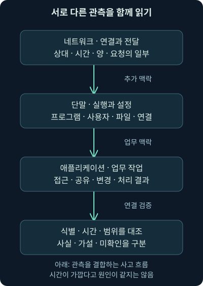
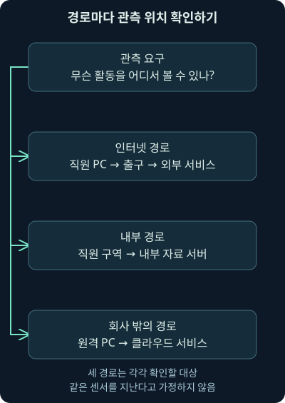
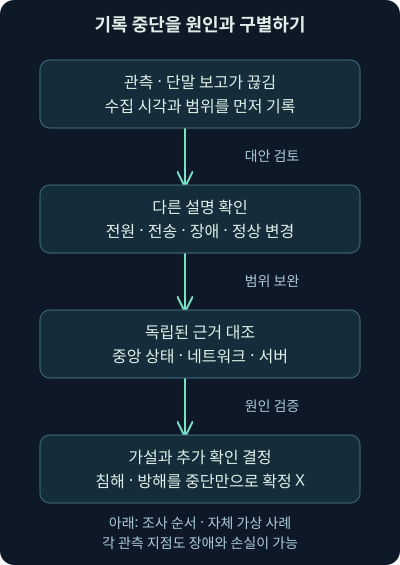

## 1. “그 기록은 어디서 찾나요?”에 답할 수 있는 환경

직원 PC에서 낯선 외부 연결이 발견됐습니다. 방화벽에서는 주소와 연결량이 보이지만 어떤 프로그램이 만들었는지 모릅니다. 단말 담당자는 프로그램 목록을 볼 수 있지만 당시 실행 기록은 수집하지 않았습니다. 두 사람 모두 도구가 있는데도 질문에 답할 증거가 부족한 상황입니다.

4강에서는 수집부터 조사·대응까지의 흐름을 배웠습니다. 이번 5강은 그 흐름의 입력을 마련하는 **네트워크·단말·애플리케이션 관측**을 다룹니다. 방어하기 쉬운 환경의 조건, 관측 위치, 기록의 수준, 실행과 통신의 연결을 차근차근 살펴봅니다.

이 범위는 배경과 예외가 많아 두 회차로 나눴습니다. 6강에서 클라우드 관측과 기록의 중앙 검색·변환을 이어가고, 이벤트·경보·사건의 구분은 7강부터 다룹니다. 이번 회사·주소·프로그램·기록은 **자체 가상 예제**입니다. 실제 패킷이나 단말에서 확인한 침해 결과가 아닙니다.

## 2. 방어하기 쉬운 네트워크란 무엇일까요?

창고에 출입 기록은 있지만 물건의 위치와 담당자가 없다고 해 보세요. 이상을 발견해도 누구에게 확인하고 어느 구역을 제한할지 어렵습니다. 물건 목록과 담당자는 있지만 출입 기록이 없다면 과거에 누가 들어왔는지 알기 어렵겠죠. 서로 다른 준비가 연결되어야 조사와 행동이 가능해집니다.

**네트워크**는 컴퓨터와 장치들이 정보를 주고받도록 연결한 체계입니다. 방어하기 쉬운 환경은 여기에 장비를 많이 설치한 상태만 뜻하지 않습니다. 무엇이 있고, 누가 맡고, 어떤 연결이 필요하며, 어떤 흔적을 볼 수 있는지 알고 실제로 위험을 줄일 수 있는 상태를 말합니다.

예를 들어 이름 없는 서버를 발견했다면 주소만 차단하기보다 그 서버가 어떤 업무를 하고 누가 변경할 수 있는지 확인해야 합니다. 관측·목록·통제·소유자·설정·시험·유지·측정이 각각 다음 질문을 풀 수 있게 해 줍니다.

## 3. 여덟 관점을 실제 질문으로 바꾸기

과거의 방어 가능한 아키텍처 논의에는 관측, 자산 파악, 연결 통제, 소유자 확인, 불필요한 노출 축소, 평가와 갱신이라는 관점이 등장합니다. 여기에 진행 상태를 측정하는 관점을 더해 자신의 환경을 점검할 수 있습니다. 다음 표는 그 생각을 독립적인 조사 질문으로 풀어 쓴 것입니다.

| 관점 | 가상 물류 회사에서 확인할 질문 |
|---|---|
| 관측 | 출고 계정과 서버의 활동을 어느 기록으로 볼까? |
| 자산 파악 | 사용 중인 단말·서비스와 바뀐 자산은 무엇일까? |
| 연결 통제 | 어떤 주체가 어느 서비스에 접근해야 할까? |
| 소유자·책임 | 이상이 생기면 누가 확인·승인·복원할까? |
| 노출 축소 | 불필요한 계정·기능·연결이 남아 있을까? |
| 평가 | 설정과 탐지·대응이 실제로 동작하는가? |
| 유지·갱신 | 알려진 약점과 지원 상태를 어떻게 관리할까? |
| 측정 | 이전보다 나아졌는지 같은 기준으로 확인하는가? |

**역사적 근거 확인 — 2026년 11월 4일:** [Richard Bejtlich의 2008년 원문](https://taosecurity.blogspot.com/2008/01/defensible-network-architecture-20.html)은 당시의 아키텍처 관점을 설명합니다. 이를 현재의 필수 제품 목록이나 보편적인 구현 순서로 취급하지 않겠습니다. 특히 업데이트를 다른 모든 작업이 끝난 뒤까지 미루라는 뜻으로 사용하지 않습니다.

## 4. 자산 목록은 관측으로 보완하고 책임으로 완성하기

**자산 목록**에는 이름과 주소뿐 아니라 역할·소유자·사용 기간·위치·중요도·관리 방식이 필요합니다. 같은 주소를 다른 시점에 다른 PC가 사용할 수 있고, 클라우드의 임시 서버는 짧게 생성됐다가 사라질 수 있습니다. 목록에도 시간과 변경 이력이 있어야 합니다.

이미 지나가는 통신을 관찰해 장비와 서비스 후보를 찾는 방식을 **수동적 관측**이라고 합니다. 여기서 수동적이라는 말은 사람이 직접 본다는 뜻이 아니라 대상에게 별도 탐색 요청을 보내지 않고 기존 활동을 본다는 뜻입니다. 조용한 장치나 센서 밖의 경로는 보이지 않을 수 있습니다.

반대로 장치에 직접 요청을 보내 확인하는 **능동적 점검**은 별도의 범위·권한·업무 영향을 고려해야 합니다. 중요한 설비를 허가 없이 스캔하는 절차를 여기서 실행하지 않습니다. 목록, 관측, 담당자의 설명을 대조해 불확실한 항목을 확인하는 것이 먼저입니다.

## 5. 연결 통제와 노출 축소는 다른 질문입니다

**연결 통제**는 누가 어디에 어떤 목적으로 접근할 수 있는지 제한합니다. **공격 표면**은 악용될 수 있는 기능·접점·노출의 범위를 말하며, 노출 축소는 불필요한 서비스·계정·기능을 줄이는 작업입니다. 특정 접속을 막는 것과 쓰지 않는 서버 기능을 제거하는 것은 서로 보완적입니다.

가상 자료 서버가 직원의 문서 조회만 제공하면 된다고 합시다. 관리 기능은 지정된 관리 경로로 제한하고, 불필요한 공개 기능은 끌 수 있습니다. 그러나 프로그램이 의존하는 기능을 확인하지 않고 끄면 업무가 멈출 수 있으므로 소유자·시험·되돌리기 절차를 연결합니다.

평가에서는 “설정이 저장됐다”뿐 아니라 필요한 연결은 동작하고 금지한 연결은 제한되는지, 관련 기록이 남고 조사자가 찾을 수 있는지 봅니다. 취약점을 찾았다는 사실과 공격이 성공했다는 사실, 차단 규칙이 있다는 사실과 실제 차단 효과도 구분합니다.

## 6. 유지와 측정은 뒤로 미루는 일이 아닙니다

업데이트·구성 관리·복원 시험은 위험에 맞춰 함께 진행합니다. 알려진 약점이 외부에 노출됐다면 관측 체계의 완성을 기다리는 동안 피해가 생길 수 있습니다. 반대로 업무 영향이 큰 변경은 검증과 임시 보호·변경 계획을 함께 검토해야 합니다.

진행 상태를 잴 때는 장비 수만 보지 않습니다. “핵심 서버의 필요한 인증·변경 기록을 실제로 확인할 수 있는가?”처럼 목표와 자료를 묶습니다. 수집 에이전트가 설치된 서버의 비율과 필요한 필드를 정상 수신하는 서버의 비율은 다를 수 있습니다.

이런 활동은 3강의 소유자·권한과 4강의 지표로 돌아갑니다. [NIST CSF 2.0의 설명](https://www.nist.gov/cyberframework/faqs)을 **2026년 11월 4일**에 대조했습니다. 기능은 서로 연결되어 지속되는 활동이므로 한 목록의 끝에 있는 일을 무조건 나중에만 하는 것으로 읽지 않습니다.

## 7. 관측 자료를 네트워크와 단말로 나누는 이유

네트워크 관측은 주로 시스템 사이의 상호작용을 보여 줍니다. 단말 관측은 그 컴퓨터에서 실행한 프로그램·계정·파일·설정의 맥락을 보여 줍니다. **애플리케이션 기록**은 주문 변경이나 문서 공유처럼 업무 기능 안에서 일어난 일을 설명할 수 있습니다.

이 구분은 자료를 빠뜨리지 않기 위한 관점이지 엄격한 경계가 아닙니다. PC에서 수집한 연결 기록도 네트워크 활동을 설명합니다. DNS 서버가 남긴 기록은 네트워크의 이름 조회이면서 서버 애플리케이션의 기록이기도 합니다.

네트워크 자료를 ‘움직이는 데이터’, 단말 자료를 ‘저장된 데이터’라고만 나누면 오해가 생깁니다. 프로세스 생성과 로그인도 시간에 따라 발생하는 활동입니다. **프로세스**는 실행 중인 프로그램의 한 인스턴스입니다. 파일이 디스크에 있다는 사실과 그 파일이 실제로 실행됐다는 사실은 서로 다른 관측입니다.

그림에서 각 자료가 답하는 질문을 비교해 보세요. 단말·네트워크·애플리케이션의 관측이 맞물리면 설명이 구체화됩니다. 같은 시각에 보였다는 이유만으로 모두 하나의 원인이라고 단정하지는 않습니다.

## 8. 연결 요약에서 요청 내용까지 깊이가 다릅니다

네트워크 자료에도 수준이 있습니다. **플로**는 주소·포트·프로토콜·시간·양 같은 조건으로 통신을 묶어 요약한 기록입니다. **포트**는 한 시스템 안에서 통신의 서비스를 구분하는 번호이고, **프로토콜**은 통신의 형식과 동작 규칙입니다. 플로는 어느 쪽과 얼마나 통신했는지 파악하는 데 도움이 됩니다.

**트랜잭션 기록**은 웹 요청이나 이름 조회처럼 프로토콜이 수행한 작업을 해석해 남긴 기록입니다. **PCAP**은 관측 지점에서 패킷을 저장한 캡처 파일입니다. 패킷은 통신 정보를 나누어 운반하는 단위입니다. 더 자세한 자료도 저장 범위·손실·암호화에 따라 볼 수 있는 내용이 달라집니다.

| 자료 수준 | 작은 예제의 관측 | 그 자료만으로 부족한 질문 |
|---|---|---|
| 플로 | PC가 문서용 서버와 2분 동안 통신 | 어느 파일·계정·프로그램인가? |
| 요청·응답 해석 기록 | 문서 조회 요청과 응답 상태 | 응답 자료 전체와 실제 실행 여부 |
| 패킷 캡처 | 해당 지점이 수신한 패킷의 바이트 | 센서 밖 활동, 암호화 평문, 단말 내부 동작 |
| 단말·업무 기록 | 실행 주체나 문서 변경 맥락 | 다른 장치·경로에서 일어난 전체 활동 |

따라서 항상 가장 큰 파일만 모으는 대신 조사 질문과 필요한 깊이를 정합니다. 요약에서 찾은 시간·대상을 더 자세한 자료로 이어갈 수 있는 식별자와 보존 기간도 필요합니다. 요약을 만들었다고 패킷 원본이 자동 보관되는 것은 아닙니다.

## 9. 포트 번호와 실제 프로그램은 일대일이 아닙니다

문서용 단말 `192.0.2.45`가 `198.51.100.80:8443`으로 연결했다고 합시다. 콜론 뒤의 8443이 목적지 포트입니다. 이 기록은 해당 주소·포트와의 통신을 지지하지만, 특정 웹 서비스나 악성 도구의 사용을 확정하지 않습니다.

서비스는 다른 포트에서 실행될 수 있고, 허용된 서비스 안에 다른 내용이 실릴 수도 있습니다. 암호화되거나 일부만 수집됐다면 프로토콜 식별이 틀리거나 불가능할 수 있습니다. 실제 요청·응답과 단말의 프로그램·설정·업무 맥락을 추가 확인해야 합니다.

예를 들어 DNS는 이름 조회, HTTP와 HTTPS는 웹 작업, SMB는 파일·공유 자원 접근, RDP는 원격 화면 접속에 자주 쓰입니다. SSH는 보통 암호화된 원격 관리에 쓰이고 FTP는 파일 전송 규칙입니다. 여기서는 기능을 구분하는 수준으로 배우며 상세 동작과 분석은 둘째 날에 이어갑니다. 이름이나 포트만 보고 실제 사용 목적을 고정하지 않습니다.

## 10. 센서가 있는 곳과 통신이 지나는 곳을 맞추기

**센서**는 통신이나 상태를 관측하는 구성 요소입니다. **TAP**은 링크의 트래픽을 분석용으로 복사하는 장치이고, **미러링**은 스위치 등에서 지정한 트래픽을 다른 포트로 복사하는 기능입니다. 복사한 범위와 방향이 실제 조사 질문을 포함하는지 확인해야 합니다.

인터넷 출구를 보면 외부 연결을 관측할 수 있지만 내부 서버끼리의 경로는 지나지 않을 수 있습니다. 직원 구역·서버 구역·외부 공개 서비스 구역이 서로 어떤 경로로 연결되는지도 살펴야 합니다. **보안 구역**은 비슷한 보호 요구의 자산을 묶어 접근을 관리하는 구분입니다.

그림은 모든 회사의 실제 배선을 뜻하지 않습니다. 출구 관측, 내부 구역 관측, 회사 밖의 단말·서비스 관측은 각각 다른 경로를 확인합니다. “방화벽을 보고 있다”는 말 대신 어느 경로와 기록을 보고 있는지 적어야 합니다.

## 11. 회사 밖의 단말과 클라우드도 범위에 넣기

직원이 집에서 클라우드 문서 서비스에 직접 접속하면 회사 출구의 센서를 지나지 않을 수 있습니다. 가상 사설망이나 회사의 중계 경로를 쓰는지에 따라서도 달라집니다. **중계 서비스**는 통신을 대신 전달하거나 정책을 적용하는 경로이며, 그 기록이 무엇을 포함하는지 확인해야 합니다.

단말의 연결 기록·인증 서비스·클라우드 애플리케이션 감사 기록을 활용할 수 있지만 모두 자동 수집된다고 가정하면 안 됩니다. 외부 단말의 에이전트가 마지막으로 정상 보고한 시각, 사용자와 장치의 식별, 서비스의 제공 기록을 함께 확인합니다.

가상망에서 제공하는 플로 기록이나 트래픽 복사도 상품·인터페이스·설정·권한과 지원 범위에 따라 다릅니다. 물리 스위치와 같은 방식으로 모든 클라우드 트래픽을 복사할 수 있다고 생각하지 마세요. 구체적인 클라우드 자료는 다음 6강에서 확인합니다.

## 12. 암호화된 통신에서도 보이는 것과 안 보이는 것

**TLS**는 통신 상대의 인증과 전송 내용 보호 등에 쓰이는 프로토콜입니다. HTTPS는 HTTP를 TLS 등으로 보호해 사용하는 웹 통신 방식입니다. 관측 지점과 버전에 따라 주소·시간·통신량 같은 정보는 보이지만 웹 요청의 경로나 내용은 보이지 않을 수 있습니다.

암호화가 있다고 모든 조사가 불가능한 것은 아닙니다. 단말의 프로그램·연결, 서비스의 접근 기록, 인증 기록을 대조할 수 있습니다. 반대로 패킷이 있다는 이유로 요청·파일 내용을 읽을 수 있다고 주장해서도 안 됩니다. 이 강의에서 암호 해독이나 통신 가로채기를 실행하지 않았습니다.

실제로 내용을 분석할 수 있는 조건이 있더라도 수집 권한·민감 정보·처리 범위를 확인합니다. 암호화된 연결에서 평문을 보지 못한 결과와, 통신 자체가 없었던 결과를 구분해 기록해야 합니다.

## 13. 단말에서 필요한 질문을 먼저 세우기

네트워크에서 파일 전송 후보를 찾았다면 단말에서는 그 파일이 저장됐는지, 실행됐는지, 어떤 사용자와 부모 프로세스가 관여했는지 묻게 됩니다. **부모 프로세스**는 새 프로세스를 만든 실행 주체를 뜻합니다. 단순한 파일 이름보다 경로·해시·실행 맥락을 함께 보면 판단이 구체화됩니다.

또한 어떤 프로그램과 스크립트가 실행됐는지, 명령행의 인수가 무엇인지, 서비스나 시작 항목이 바뀌었는지 살펴봅니다. **명령행 인수**는 프로그램에 전달한 옵션과 값입니다. **서비스**는 운영체제의 백그라운드 기능으로 동작하는 프로그램이고, **시작 항목**은 부팅·로그인 등의 계기에 자동 실행되도록 정한 설정입니다.

**레지스트리**는 Windows의 여러 설정을 보관하는 체계입니다. 파일·레지스트리·서비스의 변경은 정상 설치와 관리 작업에서도 생깁니다. 바뀌었다는 사실, 승인 여부, 관련 실행과 영향은 구별해야 합니다. 취약한 버전이 설치되었다는 사실도 실제 악용 성공과는 다릅니다.

## 14. 단말 관측의 여러 도구와 기록

운영체제와 애플리케이션의 인증·오류·접근·감사 기록이 기본 자료가 됩니다. **감사 기록**은 누가 어떤 작업을 수행했는지 추적하는 데 쓰는 기록입니다. 접근 기록이 접속을 보여 줘도 자료 내용 변경까지 모두 포함하는 것은 아닐 수 있습니다.

보안 제품도 서로 다른 질문에 답합니다. 안티바이러스는 파일이나 행위의 악성 여부를 평가할 수 있고, **FIM**은 파일 무결성 모니터링으로 기준 대비 변경을 관측합니다. **HIDS/HIPS**는 호스트의 침입 탐지·방지 기능을, **애플리케이션 제어**는 정해진 실행 허용·제한을 가리킵니다. 탐지 기록과 방지 조치의 성공은 따로 확인합니다.

**EDR**은 단말 탐지·대응, **XDR**은 여러 출처를 연결한 탐지·대응 기능을 가리키는 용어입니다. 지원 범위는 제품·설정에 따라 다릅니다. **DLP**는 Data Loss Prevention으로, 민감한 자료의 유출·부적절한 이동을 관리하는 기능입니다. DLP 경보만으로 외부 수신자가 자료를 확보했다는 결론까지 내릴 수는 없습니다.

## 15. 계속 관측한다는 것이 모든 일을 즉시 기록한다는 뜻은 아닙니다

단말과 설정을 지속적으로 살피는 접근을 연속적인 보안 모니터링이라고 부를 수 있습니다. 그러나 모든 항목이 같은 주기로 수집되지는 않습니다. 실행 이벤트는 발생 기반일 수 있고, 설치 목록·설정·취약점 평가는 정기적으로 확인할 수 있습니다. 전송·저장·처리 지연도 존재합니다.

따라서 “에이전트가 있으니 모든 행위를 실시간으로 안다”라고 쓰지 않습니다. 항목별 생성 조건과 제외 규칙, 보존 기간, 중단 시 버퍼와 재전송을 확인합니다. **버퍼**는 전송 전 자료를 잠시 보관하는 공간이며, 꽉 차면 손실이나 지연이 생길 수 있습니다.

**2026년 11월 4일 확인한 [NIST SP 800-137](https://csrc.nist.gov/pubs/sp/800/137/final)**은 자산·위협·취약점과 통제 효과의 가시성을 위한 지속적인 관측 전략을 다룹니다. 2011년의 전략 문서이며, 이 이름을 단말 제품 하나나 ‘모든 이벤트를 빠짐없이 즉시 수집’하는 기능의 보장으로 좁히지 않습니다.

## 16. Windows 실행 기록에서 빈 필드를 해석하기

가상 Windows 기록에 프로세스 생성은 남았지만 명령행이 비었다고 해 봅시다. 프로그램이 인수 없이 실행됐을 수도 있지만, 해당 필드의 수집 설정이 꺼져 있을 수도 있습니다. 빈칸만으로 실행 방식을 확정하면 안 됩니다.

**현재 문서 대조 — 2026년 11월 4일:** Microsoft의 [Windows 10 이벤트 4688 문서](https://learn.microsoft.com/en-us/previous-versions/windows/it-pro/windows-10/security/threat-protection/auditing/event-4688)는 프로세스 명령행을 포함하는 정책과 기본 빈 필드를 설명합니다. 이벤트 버전·운영체제·감사 설정을 확인해야 하며 여기서 실제 정책을 변경하거나 단말 이벤트를 수집하지 않았습니다.

명령행에는 비밀번호나 토큰 같은 민감한 값이 실릴 수도 있습니다. 필요한 기록을 수집하면서 접근 권한·보관·표시 제한을 함께 설계합니다. 기록이 많아지는 것과 안전하게 활용할 수 있는 것은 다른 조건입니다.

## 17. Sysmon도 설치·설정·수집 상태를 확인합니다

**Sysmon**은 운영체제 활동을 기록하는 Microsoft의 도구입니다. Sysinternals Windows 문서의 프로세스 생성 이벤트는 실행과 부모의 맥락을 담고, 연결 이벤트는 프로세스와 통신을 연결하는 데 도움을 줍니다. Sysmon 자체가 악성 여부를 분석하거나 모든 활동을 막는 제품이라고 이해하지는 마세요.

**2026년 11월 4일 확인한 [Sysinternals 문서](https://learn.microsoft.com/en-us/sysinternals/downloads/sysmon)의 v15.22 설명**에서 이벤트 1은 프로세스 생성, 이벤트 3은 네트워크 연결입니다. 연결 이벤트는 기본 비활성화로 설명되므로 설치만으로 존재한다고 가정하지 않습니다. 현재 OS의 기본 제공 여부·설치·활성화 방식은 [Windows의 별도 활성화 안내](https://learn.microsoft.com/en-us/windows/security/operating-system-security/sysmon/how-to-enable-sysmon)와 적용 버전도 확인해야 합니다.

Windows와 Linux의 지원 기능·배포 조건이 같다고 가정하지 않습니다. Linux용 구현은 [Microsoft의 별도 저장소](https://github.com/microsoft/Sysmon-Linux)에서 조건을 확인할 수 있습니다. 이 강의는 설치나 설정 명령을 실행한 실습 결과가 아니라 어떤 필드와 수집 조건이 필요한지 설명하는 범위입니다.

## 18. 프로세스 번호만 맞추면 다른 실행을 묶을 수 있습니다

**PID**는 프로세스 식별 번호입니다. 프로세스가 끝난 뒤 운영체제가 그 번호를 다시 사용할 수 있습니다. 다른 컴퓨터에도 같은 번호가 있을 수 있으므로 PID 4240이라는 숫자만으로 과거의 실행과 현재 연결을 묶으면 안 됩니다.

단말·시각·부팅 또는 세션 맥락과 더 안정적인 실행 식별자를 함께 사용합니다. Sysmon의 **ProcessGUID**는 실행을 연결하는 데 쓰는 식별 필드입니다. **GUID**는 고유 식별자를 표현하는 방식이며, 해당 필드의 생성 조건과 실제 자료의 품질도 확인해야 합니다.

다음 강의에서 PID가 재사용된 자체 기록을 직접 연결해 보겠습니다. 관측 지점이 다르면 주소 변환·공유·시간 오차도 추가로 고려합니다. 필드가 같다는 것만으로 기록의 진실성이나 악성 여부까지 보장되지는 않습니다.

## 19. 단말이 보고를 멈추면 무엇을 뜻할까요?

단말 기록이 끊겼다고 곧바로 공격자가 보안 기능을 껐다고 확정하지 않습니다. 전원 종료·네트워크 장애·전송 오류·업데이트·저장 문제도 가능합니다. 반대로 설치 목록에 에이전트가 있다고 현재 관측이 계속된다고 믿어서도 안 됩니다.

중앙 관리의 마지막 정상 보고 시각, 서비스 상태, 다른 수집 경로, 네트워크 활동을 대조합니다. 단말이 침해되었다면 그 단말의 관측과 보고도 방해받을 수 있습니다. 별도 지점의 네트워크 관측은 보완 근거가 될 수 있지만 그 센서 역시 손실·설정·장애·암호화의 한계가 있습니다.

그림의 시작은 ‘에이전트 기록 없음’이라는 관측입니다. 중간에서 정상 중단과 장애·방해의 가능성을 검토합니다. 마지막 판단에는 확인한 범위와 아직 못 본 자료가 남을 수 있습니다.

## 20. 파일 전송을 발견한 뒤에 더할 조건

가상 PC가 `files.example`에서 `parcel-helper.exe`라는 파일을 받았다고 합시다. 주소와 도메인은 문서용 예시입니다. 전송을 해석한 기록은 파일 전달을 지지할 수 있지만 실행 여부는 별도입니다. 이름이 정상 프로그램처럼 보여도 안전을 보장하지 않습니다.

단말에서 같은 파일의 경로·해시·프로세스 생성과 연결이 확인되면 조사 질문이 좁혀집니다. 부모 프로세스, 사용자, 권한, 뒤따른 설정 변경을 대조합니다. 시간과 파일 식별이 맞는지도 봅니다. 전송된 파일과 나중에 실행한 같은 이름의 다른 파일을 섞지 않아야 합니다.

프로세스가 서비스를 만들고 방화벽 설정을 바꿨다는 기록까지 있다고 해도 악성 여부와 허가된 설치 여부를 확인해야 합니다. 또한 보이는 변경 몇 개를 되돌렸다고 완전 복구를 확정하지 않습니다. 다른 계정·지속 실행 설정·자료 접근·다른 단말의 범위와 검증된 복구 상태를 더 살펴야 합니다.

| 지금 확보한 자료 | 지지하는 사실 | 추가 증거가 필요한 질문 |
|---|---|---|
| 파일 전달 기록 | 해당 관측 범위에서 자료 전달 | 실제 저장·전체 내용·실행 여부 |
| 프로세스 생성 | 해당 단말에서 실행이 기록됨 | 승인 여부·원인·후속 영향 |
| 프로세스 연결 기록 | 실행과 연결의 관측상 관계 | 내용·원격 작업 성공·자료 유출 |
| 변경·업무 감사 기록 | 특정 설정·자료 작업 | 전체 영향과 복구 완료 |

## 21. 조사 전에 관측 요구를 작게 적어 보기

가상 요구를 “출고 PC의 낯선 파일 실행과 외부 연결을 조사할 수 있게 한다”로 정해 봅시다. 단말의 실행·연결 식별자, 네트워크의 대상·시간·양, 파일 식별과 사용자 작업, 수집 상태와 보존 범위가 필요합니다. 어느 제품을 사야 한다는 문장보다 검증 가능한 조건입니다.

그다음에는 정상적인 무해한 시험 활동에서 필요한 기록을 실제로 찾을 수 있는지 확인합니다. 시험의 범위·시각·예상 필드와 결과를 남기면 됩니다. 이 강의에서 그런 단말·패킷 시험을 직접 수행한 것은 아닙니다. 현재 작성한 내용은 자체 사례와 공식 문서 대조입니다.

자료의 분류보다 중요한 것은 조사 질문에 답할 수 있는가입니다. 다음 회차에서 클라우드 서비스의 책임 경계와 다양한 자료를 같은 검색 맥락으로 연결하는 조건을 이어가겠습니다.

## 22. 복습 — 관측 위치와 결론의 범위를 바꾸기

### 질문 1. 관측 체계가 완성될 때까지 중요한 보안 업데이트를 미뤄도 될까요?

**해설:** 목록의 순서를 고정된 대기 규칙으로 읽으면 안 됩니다. 노출·악용 가능성·업무 영향에 맞춰 임시 보호와 검증된 갱신을 병행해야 합니다. 관측과 예방·복구는 서로 연결된 활동입니다.

### 질문 2. 한 달 동안 통신하지 않은 장치는 수동 관측 목록에 반드시 잡힐까요?

**해설:** 그렇지 않습니다. 조용하거나 센서 밖의 장치는 빠질 수 있습니다. 자산 목록·소유자·플랫폼 자료와 대조해야 합니다. 수동 관측의 장점과 수집 범위의 한계를 함께 봅니다.

### 질문 3. 네트워크 연결을 단말이 기록하면 그것은 어느 자료일까요?

**해설:** 생성 위치는 단말이고 설명하는 활동은 네트워크 연결입니다. 두 범주가 겹칠 수 있습니다. 분류를 고정하기보다 필요한 정보와 생성 조건·가시성을 확인합니다.

### 질문 4. 목적지 포트 8443을 보았으면 HTTPS 또는 공격 도구라고 확정할까요?

**해설:** 주소·포트는 관측된 연결의 일부입니다. 실제 프로토콜·프로그램·업무 목적은 추가 확인해야 합니다. 비표준 포트나 암호화·식별 실패도 고려합니다.

### 질문 5. 회사 출구의 캡처에 서버 간 접근이 없으면 내부 이동도 없을까요?

**해설:** 내부 경로가 출구를 지나는지부터 확인합니다. 구역 간 센서·서버·인증 기록을 대조해야 합니다. 그 지점에서 못 본 사실을 모든 내부 경로의 부재로 넓히지 않습니다.

### 질문 6. 재택 PC가 클라우드에 직접 접속하면 어디를 더 볼까요?

**해설:** 회사 출구를 지나지 않을 수 있으므로 단말·인증·클라우드 서비스 기록과 실제 중계 경로를 확인합니다. 같은 회사 계정이라는 이유로 수집 위치가 같다고 가정하지 않습니다.

### 질문 7. 패킷 원본이 있으면 암호화된 파일 내용도 읽을 수 있나요?

**해설:** 수집 조건과 암호화에 따라 다릅니다. 연결 메타데이터와 평문 내용의 가시성은 구분해야 합니다. 단말과 서비스의 자료가 보완할 수 있지만 실제 내용 확인 여부를 따로 적습니다.

### 질문 8. 파일이 디스크에 있다는 기록은 실행 성공을 뜻할까요?

**해설:** 저장과 실행은 별개의 활동입니다. 해당 파일의 실행 식별·시각·주체와 후속 활동이 필요합니다. 이름이 같아도 다른 파일일 수 있어 경로와 해시도 대조합니다.

### 질문 9. Windows 프로세스 생성 기록의 명령행이 비면 인수가 없었다고 할까요?

**해설:** 감사 정책이나 이벤트 버전·수집 조건 때문에 비어 있을 수 있습니다. 해당 환경의 설정을 확인해야 합니다. 빈 필드는 인수가 없었다는 확정 증거가 아닙니다.

### 질문 10. Sysmon을 설치했으면 연결 이벤트도 모두 있나요?

**해설:** 기록 종류와 설정을 확인해야 합니다. 대조한 Sysinternals 문서는 네트워크 연결 이벤트의 기본 비활성화를 설명합니다. 설치·활성화·필터·전송·보존이 모두 질문에 맞아야 합니다.

### 질문 11. PID가 같은 두 실행을 같은 프로세스로 연결해도 될까요?

**해설:** 번호가 재사용되거나 다른 단말에서 겹칠 수 있습니다. 단말·시간·실행 수명과 ProcessGUID 같은 식별 맥락을 대조합니다. 다음 강의에서 자체 기록으로 잘못 연결되는 경우를 확인합니다.

### 질문 12. 단말 기록이 끊기면 보안 도구가 무력화됐다고 확정할까요?

**해설:** 전원·네트워크·수집 장애 같은 다른 원인도 있습니다. 중앙 상태와 다른 관측을 대조합니다. 방해 가능성을 조사하되 중단만으로 원인과 침해 성공을 단정하지 않습니다.

### 질문 13. 네트워크 TAP이 있으니 단말 관측은 없어도 될까요?

**해설:** TAP도 해당 경로의 복사·처리 조건 안에서만 관측합니다. 암호화 내용·프로그램·사용자·로컬 파일 변경은 부족할 수 있습니다. 서로 독립된 관측의 보완 효과와 비용·위험을 함께 평가해야 합니다.

### 질문 14. 보이는 서비스와 방화벽 변경을 되돌렸으면 복구 완료일까요?

**해설:** 관측된 변경만 처리한 상태일 수 있습니다. 다른 영향·계정·지속 실행·자료 접근·관련 단말을 확인하고 업무와 신뢰 상태를 검증해야 합니다. 보이는 프로세스 목록이 전체 피해 범위를 대신하지 않습니다.

## 23. 이번 범위와 다음 학습

방어하기 쉬운 환경의 조건과 네트워크·단말·애플리케이션 관측, 기록의 가시성과 식별 문제를 다뤘습니다. 문서 확인일은 **2026년 11월 4일**이며 실제 패킷·단말·보안 제품 실습을 실행한 결과는 아닙니다. 오래된 ‘모든 단말 자료는 저장된 데이터’, ‘업데이트는 맨 마지막’, ‘포트로 도구 확정’ 같은 단순화는 조건을 분명히 하여 바로잡았습니다.

다음 6강은 클라우드 관측과 로그 중앙화입니다. 운영체제가 보이지 않는 서비스에서는 어떤 기록이 필요한지, 같은 검색창에 자료를 모아도 잘못 연결될 수 있는 이유를 배우겠습니다.
