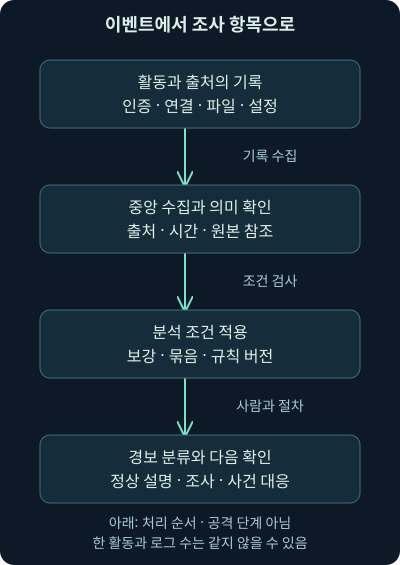
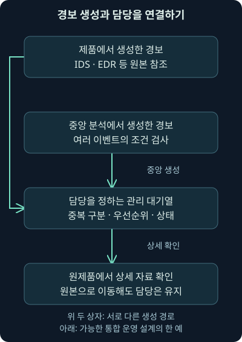
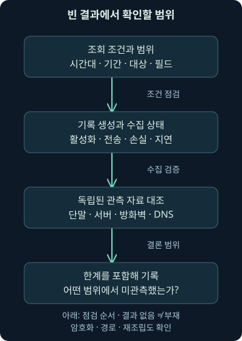

## 1. 빨간 표시가 떴다고 곧바로 침해일까요?

야간 근무를 시작했는데 화면에 “의심스러운 외부 접속”이라는 경보가 나타났습니다. 같은 시간에는 직원의 로그인 성공, 예약 작업 실행, 웹 요청도 기록되어 있습니다. 어디부터 봐야 할까요? 모든 기록을 사건으로 취급하면 업무가 멈추고, 경보 이름만 믿으면 실제로 일어나지 않은 일을 보고하게 됩니다.

6강에서는 여러 위치의 기록을 모으고 연결하는 방법을 배웠습니다. 이번 7강의 범위는 **이벤트와 로그의 차이, 경보가 생기는 두 경로, 수집 범위, 분류 대기열과 우선순위**입니다. 다음 8강에서는 알려진 공격의 특징과 평소와 다른 행동을 구별하며 경보의 정확성을 판단합니다. 사건 기록과 관리 도구는 그 뒤 회차에서 이어갑니다.

주소·회사·계정·경보·시각은 모두 **자체 가상 예제**입니다. 뒤의 Python 코드는 직접 만든 구조화된 기록으로 실행해 결과를 확인했습니다. 실제 장비 로그·패킷·보안 제품·원본 실습 VM을 실행하거나 조사한 결과는 아닙니다.

## 2. 일어난 일과 그 일을 적은 메모를 나누어 보세요

건물 출입구를 떠올려 보겠습니다. 누군가 문을 통과한 일이 있고, 출입 장치가 남긴 기록이 있습니다. 문을 통과한 일 자체와 장치의 메모는 다릅니다. 장치가 꺼져 있었다면 사람이 지나가도 메모는 없을 수 있습니다. 장치의 시계가 틀리면 기록 시각도 실제 시각과 달라집니다.

컴퓨팅 환경에서 관측할 수 있는 발생을 **이벤트**, event라고 부릅니다. 로그인, 연결, 파일 열기, 설정 변경 등이 그 예입니다. **로그**, log는 이런 활동이나 장치의 판단을 남긴 기록입니다. 이벤트 하나가 여러 로그에 나타날 수도 있고, 한 요약 로그에 여러 활동의 수치가 담길 수도 있습니다.

비유의 한계도 있습니다. 컴퓨터 기록은 사람이 목격한 전체 사실을 그대로 옮긴 진술이 아닙니다. 어떤 프로그램이 어떤 조건에서 필드를 만들었는지에 따라 의미가 정해집니다. “연결 시도”, “연결 성립”, “자료 전달”을 같은 활동으로 읽지 않도록 출처의 기록 조건을 확인해야 합니다.

## 3. 경보는 주의를 요청하고, 사건은 대응 기준과 연결됩니다

**경보**, alert는 도구나 분석 절차가 관심을 가지고 확인하도록 표시한 항목입니다. 이 강의에서는 그 운영상 의미로 사용합니다. 보안 도구가 아닌 서버의 장애 알림도 일상에서는 경보라고 부르므로 제품의 같은 단어가 항상 같은 뜻은 아닙니다.

**보안 사건**, incident는 조직이 정한 기준에 따라 보안 대응을 관리할 상황입니다. 기밀성은 허용된 사람만 정보를 보는 성질, 무결성은 정보와 시스템이 허용되지 않게 바뀌지 않는 성질, 가용성은 필요할 때 이용할 수 있는 성질입니다. 이 성질들의 실제·임박한 위협과 관련 규정 위반 여부를 함께 살펴봅니다.

2026년 11월 4일 확인한 [NIST SP 800-61 Rev. 3](https://csrc.nist.gov/pubs/sp/800/61/r3/final)은 2025년 4월 발행되어 Rev. 2를 대체했습니다. [본문의 정의와 DE.AE-08](https://nvlpubs.nist.gov/nistpubs/specialpublications/nist.sp.800-61r3.pdf)은 정보·시스템의 기밀성·무결성·가용성과 법·정책·절차·허용 이용 기준의 실제 또는 임박한 위협을 다루며, 정해진 사건 기준에 따른 선언을 설명합니다. 과거의 “악성으로 확인된 경보만 사건”이라는 단순한 설명으로 대응을 늦추면 안 됩니다.

공격자의 신원이나 모든 피해를 확정해야만 사건을 열 수 있는 것은 아닙니다. 긴급한 위험에 대응하면서 조사 중인 사실과 불확실성을 기록할 수 있습니다. 반대로 조사용 표를 만들었다는 행정적 사실만으로 침해 성공이 증명되는 것도 아닙니다.

| 구별할 대상 | 작은 예제 | 아직 알 수 없는 것 |
|---|---|---|
| 이벤트 | 계정 인증을 시도함 | 누가 어떤 의도로 시도했는가 |
| 로그 | 인증 결과가 실패로 기록됨 | 다른 경로나 시간에도 실패했는가 |
| 경보 | 일정 조건의 인증 실패를 탐지가 표시함 | 비인가 시도인지, 정상 오류인지 |
| 보안 사건 | 정해진 기준에 따라 비인가 계정 사용 위험을 대응함 | 전체 범위·원인·복구 완료 여부 |

표는 하나의 고정된 승급 규칙이 아닙니다. 사용자의 제보로 사건이 시작될 수도 있고, 여러 경보를 한 사건으로 묶을 수도 있습니다. 데이터 유형과 조사·대응 상태를 서로 다른 축으로 읽는 것이 목적입니다.

## 4. 이벤트가 로그에 담겨 경보로 이어지는 경로

직원 `analyst-a`의 실패 인증이 연속으로 기록된 가상 상황을 보겠습니다. 인증 서버는 각각의 요청 결과를 남깁니다. 중앙 분석 도구는 “같은 계정에 일정 시간 동안 실패가 많이 발생했다”는 조건을 검사하고 경보를 만듭니다. **SIEM**, Security Information and Event Management는 여러 출처의 보안 관련 기록을 모아 검색·분석하도록 돕는 시스템을 뜻합니다.

이때 경보는 실패 기록 한 줄의 이름을 바꾼 것만은 아닙니다. 여러 기록과 시간 구간, 묶는 기준, 탐지 버전이 결합한 새 분석 결과입니다. 어느 원본들이 사용되었는지 돌아갈 수 있어야 경보가 맞게 생성되었는지 확인할 수 있습니다.



그림은 위에서 아래로 읽습니다. 원본을 모으는 단계, 조건을 적용하는 단계, 사람이 확인할 항목을 만드는 단계를 나눠 보세요. 화살표를 지났다고 실제 행위의 위험성이 자동으로 높아지는 것은 아닙니다. 그림 아래의 조사 결과는 정상 설명, 추가 조사, 사건 대응으로 달라질 수 있습니다.

## 5. 이미 경보인 로그도 들어옵니다

다른 경로도 있습니다. 네트워크에서 침입 징후를 찾는 **IDS**, Intrusion Detection System이 자체 규칙에 맞는 요청을 발견하면 그 장비가 이미 경보를 만듭니다. 중앙으로 전달되는 로그는 단순 연결 기록이 아니라 “탐지가 이런 판단을 했다”는 기록입니다.

단말에서 활동을 관측하고 조사·대응을 돕는 **EDR**, Endpoint Detection and Response도 자체 경보를 만들 수 있습니다. 같은 SIEM에 들어왔다는 이유로 인증 이벤트와 EDR 경보를 같은 의미로 취급해서는 안 됩니다. 무엇이 원자료이고 무엇이 도구의 분석 결과인지 남겨야 합니다.

같은 경보를 장비 화면, 중앙 검색 화면, 사건 관리 화면에서 봤다면 독립된 증거가 세 개 생긴 것일까요? 원본 경보 하나의 복사본일 수 있습니다. 원본 출처·센서·경보 식별자와 전달 경로를 비교해야 합니다. 전달 중복을 원본에서 서로 다른 규칙이 각각 발생한 상황과도 구별합니다.

## 6. 실제처럼 생긴 JSON을 작게 읽어봅시다

**JSON**은 이름과 값을 구조적으로 적는 데이터 표현 형식입니다. 중괄호는 하나의 객체를, 큰따옴표는 문자열을 나타냅니다. 다음은 Suricata의 EVE 구조 일부를 참고해 직접 만든 **학습용 기록**입니다. Suricata를 실행해 생성한 출력이 아니며 일부 필드는 설명을 위해 생략했습니다.

```json
{"timestamp":"2026-11-04T09:10:00+00:00","sensor":"sensor-a","event_type":"alert","flow_id":7001,"src_ip":"192.0.2.10","dest_ip":"198.51.100.20","alert":{"signature_id":1000001,"rev":1,"signature":"EXAMPLE learning marker","action":"allowed"},"verdict":{"action":"drop"}}
```

`timestamp`는 기록이 제시하는 시각입니다. 여기의 `+00:00`은 UTC와의 시차가 0임을 나타냅니다. `sensor`는 실습에서 출처를 구분하려고 덧붙인 자체 필드이며 모든 EVE 출력에 있는 기본 필드라고 가정하지 않습니다. `event_type`의 `alert`는 이 객체가 경보 유형임을 뜻합니다.

`flow_id`는 관련 통신 흐름을 찾는 연결 단서이고 `src_ip`와 `dest_ip`는 그 기록의 출발·도착 주소입니다. 주소 방향은 기록의 방향이며 그것만으로 공격자·피해자를 정하지 않습니다. 외부 서버가 보내는 응답 패킷에서 탐지가 발생했다면 외부가 출발 주소일 수 있습니다.

`alert` 안에는 어떤 규칙이 맞았는지 나타내는 번호·개정 번호·이름·동작이 들어 있습니다. 규칙 번호만 메모하면 나중에 규칙 내용이 바뀌었을 때 설명을 재현하기 어렵습니다. 센서, 도구 버전, 규칙 묶음과 개정도 함께 남기는 이유입니다.

## 7. allowed인데 drop이면 모순일까요?

`allowed`는 허용, `drop`은 패킷 폐기를 나타내는 값입니다. `alert.action`의 `allowed`만 보고 “최종적으로 허용되었다”고 쓰면 방금 예제를 잘못 읽게 됩니다. 2026년 11월 4일 확인한 [Suricata 8.0.2 EVE 문서의 Action과 Verdict](https://docs.suricata.io/en/suricata-8.0.2/output/eve/eve-json-format.html)는 개별 경보의 동작과 패킷에 적용할 최종 판단을 구별합니다. 다른 규칙이나 흐름 상태 때문에 경보의 동작이 `allowed`여도 `verdict.action`은 `drop`일 수 있습니다.

**IPS**, Intrusion Prevention System은 통신 경로에서 차단 같은 예방 동작을 수행하는 방식입니다. 수동으로 복사본을 보는 IDS와 동작 조건이 다릅니다. 여기서는 8.0.2 문서의 의미를 확인했으며 이 버전을 현재의 권장 최신 버전이라고 뜻하지 않습니다. 설치 버전과 모드에 맞는 문서를 다시 대조해야 합니다.

그렇다면 `drop`이면 피해가 전혀 없었다고 결론 내려도 될까요? 그 판단이 다루는 패킷·시점·경로를 먼저 봐야 합니다. 앞선 패킷이나 다른 연결, 다른 장비를 지난 요청까지 소급해 모두 막았다는 의미는 아닙니다. 서버 처리 기록과 단말의 후속 실행, 관련된 다른 통신을 대조합니다.

## 8. 자체 기록으로 중복과 동작을 직접 분리하기

아래 코드는 실제 보안 제품 대신 직접 만든 목록을 읽습니다. **튜플**, tuple은 여러 값을 순서대로 묶은 것으로, 여기서는 출처와 경보 번호를 함께 비교하는 열쇠로 씁니다. `set`은 같은 열쇠를 중복해서 보관하지 않는 집합입니다.

```python
rows = [
    {"sensor": "sensor-a", "alert_id": "A-01", "flow_id": 7001,
     "action": "allowed", "verdict": "drop"},
    {"sensor": "sensor-a", "alert_id": "A-01", "flow_id": 7001,
     "action": "allowed", "verdict": "drop"},
    {"sensor": "sensor-b", "alert_id": "A-01", "flow_id": 7001,
     "action": "allowed", "verdict": None},
]
seen = set()
for row in rows:
    key = (row["sensor"], row["alert_id"])
    if key in seen:
        continue
    seen.add(key)
    final = row["verdict"] or "unknown"
    print(row["sensor"], row["alert_id"], row["action"], final)
print("received:", len(rows), "unique:", len(seen))
```

`rows`는 입력 세 줄입니다. `key`가 이미 `seen`에 있으면 `continue`가 그 반복의 나머지 처리를 건너뜁니다. 없는 열쇠는 집합에 넣고 출력합니다. `None`은 값이 없음을 표시합니다. `or "unknown"`은 이 자체 예제에서 최종 판단이 비어 있으면 미확인으로 출력하려는 선택입니다. 누락을 허용으로 바꾸지 않습니다.

직접 실행한 결과는 다음과 같습니다. 두 센서의 경보 번호와 흐름 번호가 우연히 같더라도 출처가 다르므로 별도 항목으로 남습니다. 센서 A의 동일 경보 재전송만 하나로 셉니다.

```text
sensor-a A-01 allowed drop
sensor-b A-01 allowed unknown
received: 3 unique: 2
```

이 열쇠는 **이 예제의 식별 규칙**입니다. 실제 제품에서 센서의 재설치·재시작·계정 범위에 따라 번호를 재사용한다면 시간 범위나 원본 고유 ID를 더해야 합니다. 같은 ID의 내용이 바뀌거나 서로 충돌하면 단순히 버리면 안 됩니다. 원본 세 줄은 보존하고, 화면의 묶음 수와 원본 수를 별도로 관리합니다.

## 9. 사건이 한 개라도 기록은 여러 개일 수 있습니다

가상 단말에서 웹 요청 하나가 일어났다고 합시다. DNS 조회 기록, 방화벽 연결 기록, IDS 경보, 단말 연결 기록이 각각 남을 수 있습니다. 이들은 다른 관측 지점에서 생성되므로 추가 맥락을 제공할 가능성이 있습니다. 그러나 서로 같은 활동을 설명하는지 확인해야 그 가치를 평가할 수 있습니다.

**상관분석**, correlation은 관련된 자료를 연결해 의미를 검토하는 작업입니다. 시간이 가까운 모든 항목을 자동으로 같은 원인으로 확정하는 뜻은 아닙니다. 네트워크 주소 변환인 **NAT**, Network Address Translation이나 통신을 중계하는 공유 프록시를 거치면 한 공인 주소에 여러 사용자가 보일 수 있습니다. 주소·포트·시간과 변환 기록, 단말·세션 식별자를 함께 확인합니다.

`flow_id` 하나를 모든 센서와 모든 날짜에 걸친 전역 식별자로 가정하지 마세요. 해당 도구의 생성 범위와 버전, 센서·실행 맥락을 확인하고 거래별 구분이 필요하면 `tx_id` 같은 거래 식별자도 대조합니다. 관련성은 조사 질문에 맞게 정해야 합니다.

## 10. 많이 모으면 언제나 더 잘 찾을까요?

출입구 카메라를 늘렸는데 정작 중요한 문은 보이지 않고 같은 복도의 영상만 수십 개라면 조사 효율은 떨어집니다. 로그도 양과 관측 범위를 구분해야 합니다. 저장·전송·검색·검토 비용은 증가하는데 필요한 권한 변경은 빠져 있을 수 있습니다.

“보안 관련 기록을 수집하자”는 말도 이미 경보가 난 로그만 남기자는 뜻은 아닙니다. 성공한 인증, 정상으로 보이는 연결, 자산 변경 기록은 나중에 경보를 검증하고 범위를 확인하는 데 필요합니다. 지금 조용하다는 이유로 없애면 미래의 질문에 답하지 못할 수 있습니다.

먼저 조사 질문을 적고 그 질문에 필요한 출처·필드·기간을 정합니다. 보관 의무와 민감 정보, 검색 가능한 기간, 별도 원본 보관 비용도 고려합니다. 여기서 보관 의무는 조직이 확인해야 하는 조건을 뜻하며 이 강의가 특정 법률의 보존 기간을 지정하는 것은 아닙니다.

| 조사 질문 | 필요한 자료의 예 | 함부로 줄였을 때 생기는 빈칸 |
|---|---|---|
| 실패 뒤 정상 로그인이 있었나 | 성공·실패 인증, 계정·세션 | 실패만 남기면 이후 접근을 놓침 |
| 어느 단말이 연결했나 | 주소 할당·변환, 단말 식별 | 공용 주소를 한 사용자로 오인 |
| 권한이 언제 바뀌었나 | 관리 감사, 변경 승인 | 접속 경보만으로 변경을 설명 못함 |
| 로그가 안 온 이유는 무엇인가 | 수집 상태·지연·손실 지표 | 활동 없음과 관측 실패를 혼동 |

각 행을 수집 설정의 질문으로 바꿔보세요. 예를 들어 “성공 인증을 검색할 수 있는 기간이 관련 실패 기록과 겹치는가?”라고 물으면 필요한 구성이 더 구체적이 됩니다. 수집을 줄일 때는 대표 탐지·조사 사례로 영향을 시험하고 되돌릴 조건을 남깁니다.

## 11. 어디서 경보를 확인할지는 별도의 결정입니다

장비에서 경보를 만들었다는 것과 분석가가 어느 화면에서 일을 맡는지는 다릅니다. 각 제품의 화면에서 분류할 수도 있고 SIEM에 모을 수도 있으며 별도 대응 도구로 전달할 수도 있습니다. **분류**, triage는 한정된 시간과 인력으로 무엇을 먼저 확인하고 어디로 보낼지 정하는 작업입니다.

개별 화면은 해당 자료에 맞는 세부 분석이 편할 수 있습니다. 네트워크 화면에서 패킷을 바로 열거나 EDR에서 실행 트리를 보는 식입니다. 하지만 네 개의 대기열을 따로 보면 전체에서 가장 급한 항목을 놓치고 중복 담당을 만들기 쉽습니다.

통합 대기열은 여러 자료와 자산 맥락으로 우선순위를 비교하기 좋습니다. 대신 원제품의 세부 기능이나 필드가 전부 옮겨지지는 않을 수 있습니다. **SOAR**, Security Orchestration, Automation and Response는 여러 도구의 작업을 연결하고 일부 반복 처리를 자동화하는 체계입니다. 경보를 SOAR로 보냈다는 사실이 조치의 적절성을 보증하지는 않습니다.



그림의 두 생성 경로가 한 관리 대기열로 모입니다. 아래의 원제품 이동은 상세 자료를 확인하러 가는 동작이고, 담당 책임까지 없애는 이동이 아닙니다. 이 그림은 가능한 운영 설계의 한 예이며 모든 제품을 한 화면으로 바꿔야 한다는 뜻은 아닙니다.

## 12. 원제품으로 이동해도 담당은 이어져야 합니다

통합 화면에 경보만 표시되고 원본 링크가 없다면 다시 검색하는 동안 시간을 잃습니다. 센서·원본 경보 ID·시각·검색 구간과 접근 권한이 맞는 링크를 유지하면 자료를 확인하기 쉬워집니다. 링크가 있어도 계정 권한이나 보존 기간 때문에 자료를 못 볼 수 있으므로 실패 상황도 시험해야 합니다.

2026년 11월 4일 확인한 [Security Onion의 3/main Alerts 문서](https://docs.securityonion.net/en/3/main/alerts/)는 Alerts에서 상세 분석과 Hunt·PCAP으로 이동하고 Cases로 승격하는 흐름을 설명합니다. 이는 확인한 문서 분기의 예입니다. 예전 화면의 버튼 위치·아이콘·필터가 설치 버전과 같다고 가정하지 않으며 이 강의에서 해당 제품을 직접 조작하지 않았습니다.

분류 화면의 확인 표시와 사건 승격, 실제 단말 조치는 서로 다른 상태입니다. “확인함”을 눌렀다는 이유로 악성이 기각되거나 차단이 끝난 것이 아닙니다. 어느 화면에서 처리하든 담당자·상태·다음 행동·원본 참조가 연결되어야 합니다.

## 13. 빨간색보다 먼저 확인할 업무 맥락

**심각도**, severity는 탐지나 활동이 가질 수 있는 기술적 영향을 나타내는 등급입니다. **우선순위**, priority는 지금 어느 일을 먼저 할지 정하는 운영상의 순서입니다. 제품의 높은 심각도 경보가 항상 우리 환경의 첫 번째 작업인 것은 아닙니다.

가상 대기열에 두 항목이 있습니다. A는 외부 공개 실습 서버를 향한 탐지로, 해당 경로의 차단 기록이 있습니다. B는 급여 시스템 관리자 계정에서 새 단말 인증 뒤 권한 변경이 보이는 항목입니다. A의 제품 등급이 높아도 B의 업무 영향과 진행 중인 위험 때문에 먼저 확인할 수 있습니다.

그렇다고 “관리자 계정이면 언제나 최우선” 같은 새 고정 규칙으로 바꾸지는 마세요. 활동이 실제인지, 자산의 중요도와 현재 영향이 무엇인지, 이미 통제되었는지, 확산 가능성과 확인 시급성이 어떤지를 함께 판단합니다. 근거가 약해도 잠재 영향이 크면 빠른 추가 확인을 우선할 이유가 있습니다.

## 14. 속도는 확인을 생략하는 기술이 아닙니다

응급실의 분류가 모든 진단을 끝낸 뒤 순서를 매기는 작업은 아니듯, 보안 분류도 완전한 조사가 끝날 때까지 기다리지 않습니다. 지금 확인한 정보로 임시 우선순위와 다음 질문을 정하고, 새 증거가 들어오면 바꿉니다. 비유와 달리 여기서는 경보 자체의 오류와 센서의 관측 실패도 함께 의심해야 합니다.

가상 B 항목에는 우선 “계정의 역할과 권한 변경의 실제 결과를 확인하고 승인된 변경인지 대조한다”는 짧은 작업을 정할 수 있습니다. 위험이 시급하면 정해진 절차와 권한 안에서 대응 담당자에게 올립니다. 긴급 대응과 침해 성공 단정을 같은 것으로 취급하지 않습니다.

대기열의 항목 수만 줄이는 것도 목표가 아닙니다. 중복을 묶은 이유, 정상으로 설명한 근거, 보강이 필요한 항목과 재검토 시간을 남겨야 다시 평가할 수 있습니다. 오래 대기한 낮은 등급 항목도 새로운 자료와 누적 패턴 때문에 순서가 달라질 수 있습니다.

## 15. 검색 결과가 없으면 무엇을 확인할까요?

경보가 가리킨 단말의 실행 기록을 검색했는데 아무것도 나오지 않았습니다. “실행이 없었다”고 바로 쓰고 싶어질 수 있습니다. 하지만 기록이 생성되는 정책이 켜졌는지, 그 단말이 수집 대상인지, 필요한 기간이 남아 있는지 먼저 확인해야 합니다.

검색 시각의 시간대와 장비 시계, 수집 지연, 필드 변환, 단말 이름 변경, 누락·삭제 여부를 차례로 봅니다. 네트워크라면 센서가 해당 방향과 경로를 봤는지, 암호화로 내용을 보지 못했는지, 여러 패킷을 합치는 재조립이 정상인지도 중요합니다. **재조립**은 나뉜 통신 조각을 도구가 분석할 수 있도록 이어 보는 처리입니다.

그림은 빈 결과를 받았을 때의 조사 흐름입니다. 아래로 내려가며 조회 조건, 수집 건강 상태, 독립된 기록을 확인합니다. 마지막 판단은 “수집을 검증한 범위에서 관측하지 못함”처럼 한계를 포함해야 합니다.



단말 기록을 못 얻으면 서버의 처리 결과, 방화벽의 다른 경로 기록, DNS 이름 조회를 대신 수행한 리졸버의 기록, 계정 제공자의 인증 기록을 대조할 수 있습니다. 독립 자료도 각자의 범위를 갖습니다. 빈 결과를 다른 빈 결과와 합쳤다고 자동으로 확실한 부재 증거가 되지는 않습니다.

## 16. 다음 분석가가 이어받을 수 있는 짧은 기록

가상 항목을 이렇게 메모해 봅시다. “센서 A의 경보 A-01에서 09:10 UTC, 문서용 주소 192.0.2.10에서 198.51.100.20으로 향한 기록이 관측됨. 개별 경보 동작은 allowed이고 패킷 최종 판단 필드는 drop. 침해 성공 여부는 미확인.” 여기까지는 제공된 자체 기록의 범위입니다.

그다음에 “다른 규칙에 의한 차단과 관련될 수 있음”이라는 가설을 따로 적습니다. 추가 작업은 “같은 센서의 관련 규칙·흐름·거래 기록과 서버 처리 결과, 단말 후속 실행 확인”으로 구체화합니다. 담당자와 확인 기한을 정하면 단순한 수상함 표시가 다음 작업으로 이어집니다.

8강에서는 같은 자료를 보고도 탐지의 목적에 따라 검증 질문이 달라지는 이유를 배웁니다. 알려진 공격 특징과 평소와 다른 행동을 구분하고, 규칙이 맞았다는 말과 공격이 있었다는 말을 나누어 읽게 됩니다.

## 17. 복습과 바로 읽는 해설

### 질문 1. 로그에 없는 활동은 발생하지 않은 것일까요?

**해설:** 아닙니다. 이벤트와 기록은 다릅니다. 생성 설정·수집 대상·관측 경로·보존 기간·검색 조건이 빠지면 활동이 있어도 기록을 찾지 못합니다. 먼저 어떤 범위를 실제로 볼 수 있었는지 확인해야 합니다.

### 질문 2. 중앙으로 들어오는 모든 JSON은 단순 이벤트인가요?

**해설:** JSON은 표현 형식입니다. 그 안에는 인증 결과 같은 이벤트 기록도 있고 IDS가 만든 경보도 있습니다. 출처와 유형, 생성 조건을 읽어야 원활동과 도구 판단을 구별할 수 있습니다.

### 질문 3. 한 경보를 세 화면에서 봤으니 증거가 세 개일까요?

**해설:** 전달된 복사본일 수 있습니다. 원본 센서·경보 ID·전달 경로를 비교하세요. 독립 출처의 관측이 더해진 경우에도 같은 활동과 연결되는지 검증한 다음 증거의 의미를 평가합니다.

### 질문 4. 예제에서 flow_id가 모두 같으면 하나로 합쳐도 될까요?

**해설:** 센서 A와 B의 번호 생성 범위를 확인하지 않았으므로 그렇게 할 수 없습니다. 예제는 출처와 경보 ID를 함께 묶어 재전송만 구별합니다. 실제 환경에는 재시작·번호 재사용·거래 구분까지 추가할 수 있습니다.

### 질문 5. allowed와 drop이 함께 있으면 어느 하나를 오류로 버릴까요?

**해설:** 버리지 않습니다. 개별 규칙 경보의 동작과 최종 패킷 판단은 다른 필드입니다. 문서에 정의된 범위·모드·버전을 대조하고 관련 규칙과 원본을 확인해야 합니다.

### 질문 6. drop이 있으니 해당 단말의 모든 피해는 없다고 써도 될까요?

**해설:** 그 패킷과 경로에서 보고된 동작을 넘는 결론입니다. 앞선 통신·다른 연결과 단말 실행, 서버 처리 결과가 남아 있을 수 있습니다. 차단 보고와 전체 침해 여부는 별도 질문입니다.

### 질문 7. 탐지된 경보만 남기면 수집 비용을 안전하게 줄일 수 있을까요?

**해설:** 성공 인증과 평범한 연결도 경보 검증·범위 조사에 필요합니다. 조사 질문을 기준으로 필요한 출처와 필드·기간을 정하고, 제거 영향과 보존 조건을 확인해야 합니다.

### 질문 8. 개별 제품 화면과 통합 화면 중 항상 옳은 선택은 무엇인가요?

**해설:** 정해진 하나는 없습니다. 개별 화면의 깊은 분석과 통합 대기열의 전체 우선순위 비교를 연결할 수 있습니다. 담당 상태·중복·원본 참조·누락 감시를 어떻게 유지하는지가 핵심입니다.

### 질문 9. 심각도가 높은 실습 서버 경보보다 관리자 계정 항목을 먼저 볼 수 있나요?

**해설:** 가능합니다. 기술 등급뿐 아니라 자산 중요도·권한·현재 영향·통제 여부·추가 확인의 시급성을 고려합니다. 가상 B의 권한 변경이 승인된 것인지 확인하면 우선순위가 다시 낮아질 수도 있습니다.

### 질문 10. 아직 공격자를 모르는데 사건 대응을 시작해도 될까요?

**해설:** 조직의 사건 기준과 권한에 따라 가능합니다. 실제 또는 임박한 위험에 대한 대응을 공격자 식별이나 모든 피해 확정까지 미룰 이유는 없습니다. 확정한 사실과 조사 중인 범위를 나눠 기록합니다.

### 질문 11. 화면에서 경보를 확인 처리했으면 차단도 완료된 것인가요?

**해설:** 확인 표시는 대기열의 업무 상태일 수 있습니다. 사건 승격과 실제 기술 조치, 조치 결과 검증은 별도입니다. 제품과 운영 절차가 각 상태에 부여한 의미를 확인해야 합니다.

### 질문 12. 다음 분석가에게 “수상한 접속, 확인 요망”만 남기면 무엇이 부족할까요?

**해설:** 출처·시각·식별자·관측 사실·가설·미확인 결론이 빠져 있습니다. 원본 위치와 구체적인 다음 확인, 담당·기한도 필요합니다. 조사자가 같은 질문을 처음부터 되풀이하지 않게 만드는 기록이 좋은 인계입니다.
