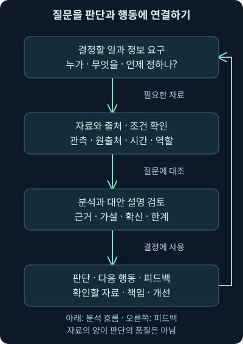
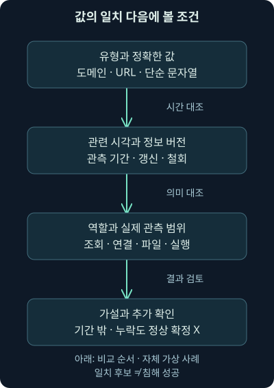
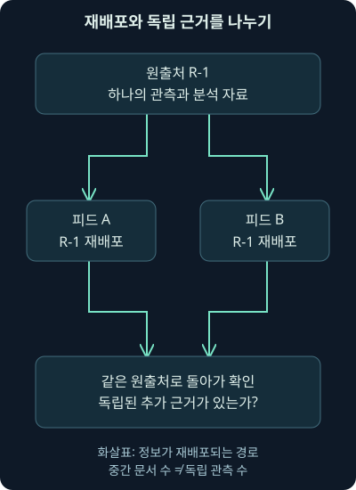

## 1. “나쁜 주소”라는 말 다음에 필요한 것

가상 경보가 외부 목록의 주소와 일치했습니다. 그런데 목록에는 주소만 있고 언제, 어디서, 어떤 활동과 연관되었는지 설명이 없습니다. 이 주소로 연결한 단말을 당장 격리해야 할까요? 예전의 악성 호스팅 주소가 지금은 다른 서비스에 할당되어 있을 수도 있고, 실제로는 분석 보고서에 들어 있던 참고 주소를 비교했을 수도 있습니다.

10강에서는 관측값의 발견 여부와 의심·악성 연관 판단을 나눴습니다. 이번 11강은 **정보 요구, 위협의 분석 관점, 관측값의 맥락, 판단과 행동의 연결**을 다룹니다. 다음 12강은 이런 내용을 플랫폼과 피드로 관리하고 안전하게 공유하는 방법입니다. MISP의 구체적인 자료 구조는 별도 13강에서 이어갑니다.

주소·도메인·파일·기관·보고서·시각은 모두 **자체 가상 사례**입니다. 뒤의 Python 비교는 직접 만든 기록으로 실행했습니다. 실제 위협 목록·리졸버·패킷·단말을 조회한 결과가 아니며 외부 주소에 접속하거나 공격·차단한 실습도 아닙니다.

## 2. 정보를 모으기 전에 결정할 일을 정합니다

창고에 큰 물건이 도착한다는 안내를 받았다고 합시다. 경비 담당자는 출입 시간과 차량을 알고 싶고, 작업자는 필요한 운반 장비를 알고 싶습니다. 같은 안내를 받아도 결정할 일이 다르면 필요한 정보가 다릅니다. 사진을 많이 모았다고 어느 문으로 옮겨야 할지 저절로 정해지지는 않습니다.

보안에서도 **정보 요구**, intelligence requirement를 먼저 정합니다. “우리 관리자 계정의 비인가 사용을 어떤 기록으로 빠르게 발견할 것인가?”처럼 판단할 대상과 행동을 구체화합니다. 누가 사용할지, 언제까지 필요할지, 어떤 근거가 있어야 결정을 내릴 수 있는지도 붙입니다.

“최신 위협을 모두 알려 달라”는 요구는 끝이 없습니다. “외부 문서 공유 서비스에 대한 계정 오용을 조사할 때 확인할 인증·공유·권한 변경 조건을 정한다”로 좁히면 필요한 자료와 결과 형태가 보입니다. 정보 수집은 그 질문에 답하기 위한 수단입니다.

## 3. 자료·정보·분석 결과를 구분해 봅시다

원시 주소 하나나 연결 시각은 **자료**, data입니다. 그 값이 어느 출처에서 언제 수집되었고 무엇을 나타내는지 연결하면 이해할 수 있는 **정보**, information가 됩니다. 여기에 질문과 대안 설명을 대조해 “현재 무엇을 우선 확인해야 하는가”라는 판단을 만들면 의사결정에 쓸 분석 결과가 됩니다.

이것을 모든 문서에 적용하는 엄격한 세 단계 규격으로 생각할 필요는 없습니다. 같은 문서 안에 원자료·추정·분석 결론이 섞일 수 있습니다. 독자는 각 문장이 관측인지, 출처의 주장인지, 작성자의 해석인지 구별할 수 있어야 합니다.

**인텔리전스**, intelligence는 여기서 정보 요구에 답하도록 자료를 분석한 판단과 그 결과물을 뜻합니다. 단순 번역어인 “정보”만으로는 주소 목록과 검토된 판단의 차이가 잘 드러나지 않아 용어를 함께 씁니다. 새로운 기술이나 비밀 자료만 있어야 만들어지는 것은 아닙니다.



그림의 출발점은 자료의 양이 아니라 질문입니다. 마지막에 사용 결과를 되돌리는 이유도 봐주세요. 분석 결과가 실제로 쓸모 있었는지, 필요한 기록을 놓쳤는지 알아야 다음 요구와 수집을 고칠 수 있습니다.

## 4. 위협을 의도·능력·기회로 살펴보기

행위자를 중심으로 위협을 분석할 때 **의도**, intent는 무엇을 얻거나 해치려는지, **능력**, capability는 이를 위해 무엇을 할 수 있는지, **기회**, opportunity는 어떤 조건을 이용할 수 있는지를 묻는 관점입니다. 예를 들어 계정을 훔쳐 자료를 보려는 목적, 유인 메시지를 만들고 인증 정보를 재사용하는 수단, 노출된 로그인 경로와 약한 통제가 각각 연결될 수 있습니다.

이 셋을 기계적으로 점수 곱셈에 넣는 공식은 아닙니다. “직접 겨냥한 흔적을 찾지 못했다”는 말과 “상대에게 의도가 없다”는 말도 다릅니다. 불특정 다수를 노리는 활동에서는 특정 조직을 사전에 알고 있지 않아도 기회가 열리면 피해가 생길 수 있습니다.

행위자 관점만으로 모든 위험을 설명하지도 않습니다. 사람의 실수·설정 오류·환경 장애까지 모두 악의적 의도로 환원하면 원인을 놓칩니다. 지금 가진 근거로 각 항목을 얼마나 알고 있는지, 모르는 것을 없음으로 채웠는지 확인하는 분석 틀로 사용합니다.

## 5. 사이버 위협 정보가 답해야 하는 질문

**CTI**, Cyber Threat Intelligence는 사이버 환경의 위협과 관련된 자료를 분석해 방어의 의사결정에 연결하는 것을 말합니다. 누가 무엇을 하려는지뿐 아니라 어떤 행동을 어떤 순서와 수단으로 수행하는지, 우리 자산과 통제에는 어떤 의미인지가 중요합니다.

**TTP**, Tactics, Techniques and Procedures는 목적과 행동을 설명할 때 쓰는 세 관점입니다. 전술은 어떤 목표를 이루려는지, 기법은 그 목표를 위해 어떤 방법을 쓰는지, 절차는 특정 환경에서 그 방법을 어떻게 실행했는지에 해당합니다. 한 도구 이름이나 포트 번호가 이 세 가지 전체를 설명하지는 못합니다.

공격자의 행동을 배워 방어에 반영한다는 것은 공격을 그대로 따라 실행하자는 뜻이 아닙니다. 가상 유인 메일 뒤 인증 정보 사용과 자료 공유가 이어질 수 있다면, 메시지 전달·인증·권한 변경·문서 공유 기록 중 어떤 연결을 봐야 할지 정할 수 있습니다. 직접 관측하지 못한 단계는 가설로 남깁니다.

## 6. 같은 분석도 받는 사람에 맞게 전달합니다

경영진이 자원 배분을 정할 때는 어떤 업무와 자산이 위협받고 어떤 투자가 필요한지 설명해야 합니다. 탐지 담당자는 어떤 출처와 필드·행동 조합을 확인할지 필요합니다. 사건 분석가는 현재 경보가 그 활동과 얼마나 연결되는지와 다음 확인을 알아야 합니다.

이를 전략적 판단과 현장의 전술·운영 판단처럼 나눠 볼 수 있지만 하나의 보고서가 모두를 같은 깊이로 만족시킬 필요는 없습니다. 같은 근거를 참조하면서 의사결정에 맞는 결과물을 만드는 것이 목표입니다. 상세 주소 목록을 그대로 경영 보고서에 붙이거나, 위험 요약 한 줄만 탐지 담당자에게 주면 연결이 끊깁니다.

| 사용할 사람과 결정 | 필요한 결과의 예 | 놓치면 안 되는 조건 |
|---|---|---|
| 자원 배분 담당 | 업무 영향·방어 공백·개선 선택 | 적용 범위와 불확실성 |
| 탐지·수집 담당 | 필요한 로그·행동 조건·시험 항목 | 원본 필드·버전·관측 위치 |
| 사건 분석가 | 단서의 역할·시각·관련 행동·다음 질문 | 관측·출처 주장·가설 구분 |

표는 조직의 고정 직급 구분이 아닙니다. 작은 팀에서는 한 사람이 모두 맡을 수 있습니다. 그 경우에도 지금 어떤 결정을 위해 어떤 깊이로 쓰는지 나누면 필요 이상의 자료 수집과 설명 누락을 줄일 수 있습니다.

## 7. 관측값을 판단 단서로 바꾸는 맥락

`files.example`이라는 이름만 적힌 기록을 받았다고 합시다. 이 이름이 내려받기 서버인지, 제어 통신 상대인지, 피해 조직의 정상 서비스인지, 단지 보고서 링크인지 알 수 없습니다. **맥락**, context는 값을 해석할 때 필요한 역할·관계·시각·출처·수집 조건 같은 정보입니다.

**IOC**, Indicator of Compromise는 침해와 관련될 가능성을 나타내는 단서입니다. 관측값에 설명을 한 줄 붙였다고 자동으로 신뢰할 IOC가 되는 것은 아닙니다. 그 연관성을 어떤 관측이 지지하고 언제 어디에 적용하는지 평가해야 합니다. 외부 출처의 분류와 우리 환경의 관측도 나눕니다.

2026년 11월 4일 확인한 [NIST SP 800-150](https://csrc.nist.gov/pubs/sp/800/150/final)은 위협 정보 공유의 목표·출처·범위·배포 규칙과 활용을 다루는 2016년 지침입니다. [공식 본문](https://nvlpubs.nist.gov/nistpubs/specialpublications/nist.sp.800-150.pdf)에서도 지표뿐 아니라 행동과 분석·대응 관련 정보의 맥락을 다룹니다. 발행 연도가 오래된 지침의 개념을 참고하는 것이며 제품별 최신 기능이나 현행 공유 표준을 대신하지 않습니다.

## 8. 주소에 시간과 역할을 더한 작은 예제

가상 훈련 보고서 R-1이 11월 1~2일 사이 `files.example`이 시험용 유인 자료 전달에 사용되었다고 기술했다고 합시다. 보고서의 근거는 가상 메일 내용과 실험실 서버 기록이며 우리 회사의 실제 관측이 아닙니다. “해당 기간·활동과 연관된 외부 참고 정보”라는 범위가 생겼습니다.

이제 11월 2일의 회사 DNS 조회에서 같은 이름이 발견되었다는 가상 기록을 추가해 보겠습니다. 직접 지지하는 사실은 그 관측 위치에서 이름 조회가 기록되었다는 것입니다. 자료 전달 시도와 관련될 수 있다는 가설은 가능하지만 파일 다운로드·실행·감염을 확정하지 않습니다. 메일 전달·응답 주소·단말 실행·서버 기록을 더 봐야 합니다.

11월 4일에 이름을 봤다면 판단은 또 달라집니다. 같은 값이라도 보고서가 제시한 기간 밖입니다. 주소 소유·호스팅·역할이 바뀌었는지, 정보가 갱신되었는지 재검토할 필요가 있습니다. 기간 밖이라는 이유만으로 정상이라고 처리하는 것도 근거를 넘어섭니다.



그림에서 값의 일치 다음에 시간·역할·관측 범위를 따로 대조합니다. 세 항목이 맞더라도 최종 위험 판단에는 추가 근거가 필요합니다. 반대로 하나가 불명확하면 그 사실을 숨기지 않고 재검토 대상으로 남깁니다.

## 9. 보고서의 시간을 여러 종류로 나눕니다

행동이 관측된 시각, 분석가가 알게 된 시각, 보고서가 작성·발행된 시각, 우리 도구가 가져온 시각은 다를 수 있습니다. 오늘 받은 문서라고 해서 오늘 발생한 위협이나 오늘도 유효한 주소를 뜻하지 않습니다. 어떤 시간인지 모르는 날짜 하나를 모든 판단에 쓰지 마세요.

처음 관측·마지막 관측도 그 출처가 가진 관측 범위 안의 시점입니다. 실제 공격의 시작·종료와 같다고 보장하지 않습니다. “최근에는 못 봤다”는 말은 관측 센서·대상·기간·손실 조건을 함께 봐야 의미가 생깁니다.

확인 후 더 이상 쓰지 않기로 한 단서는 과거 기록에서 지우기보다 이유와 적용 종료·철회 상태를 보존하는 편이 조사 재현에 도움이 됩니다. 과거의 일치 결과를 나중에 검토할 때 당시 사용한 정보와 개정 이력을 알아야 하기 때문입니다.

## 10. 상세한 보고서라고 모두 사실은 아닙니다

가상 보고서가 “첨부를 열면 예약 작업이 생기고 외부 통신이 이어진다”고 설명했다고 합시다. 이는 작성자가 확인한 조건과 범위의 주장입니다. 그 조건이 무엇이고 실제 실행 관측인지, 코드에서 추정한 기능인지, 다른 보고서의 인용인지 확인해야 합니다.

**매크로**는 문서 프로그램 등에서 반복 동작을 자동화하는 코드나 명령 묶음을 뜻합니다. 문서 안에 매크로와 주소가 있다는 사실, 특정 조건에서 실행할 수 있다는 설명, 우리 단말에서 실제 실행되었다는 관측은 서로 다른 수준의 근거입니다.

우리 단말에서 같은 첨부 이름을 찾았다고 그 모든 동작이 있었다고 쓰지는 않습니다. 같은 파일 내용인지, 열람·실행 조건이 충족되었는지, 예약 작업과 통신을 실제 관측했는지 따로 봅니다. 이름을 바꾼 같은 파일도 있고 같은 이름의 다른 파일도 있을 수 있습니다.

공격 기법 번호나 악성 프로그램 이름을 붙이는 것도 근거의 요약일 뿐입니다. 분류 이름만으로 사실을 더하지 않습니다. 출처가 무엇을 관측했고 어디서 추론했는지 나눠 적으면 다음 사람이 우리 환경에 적용할 수 있는 범위를 판단하기 쉽습니다.

## 11. 출처의 신뢰성과 내용의 확신은 다릅니다

평소 신뢰하는 기관의 문서라도 특정 항목이 추정이라면 확정 사실로 쓰지 않습니다. 반대로 낯선 출처의 주장도 독립된 원본 관측과 대조할 수 있습니다. 출처의 과거 정확성, 자료에 접근한 방식, 분석 근거와 반증 가능성을 함께 평가합니다.

**확신도**, confidence는 특정 판단이 근거에 의해 얼마나 잘 지지되는지를 나타내려는 표현입니다. 제품의 숫자나 높음·중간·낮음은 그 정의와 평가 기준을 확인해야 합니다. “높음”을 공격 확률 100%나 자동 차단 허가와 같은 뜻으로 읽지 않습니다.

두 피드가 같은 보고서를 복사했다면 출처가 두 개 보여도 독립 관측이 두 개가 아닐 수 있습니다. **출처 계보**는 정보가 어디에서 시작해 어떻게 전달되었는지의 연결입니다. 서로를 인용하는 문서를 순환해 읽고 근거가 늘었다고 착각하지 않도록 원출처와 재배포를 구분합니다.



그림의 중간 상자가 두 개라는 이유로 맨 위의 관측 근거가 두 개가 되지는 않습니다. 각 피드가 별도의 원본 관측이나 분석을 더했다면 그 부분을 따로 평가하면 됩니다. 재배포 경로를 지우지 않고 남겨야 이 차이를 확인할 수 있습니다.

## 12. 같은 파일을 썼다고 같은 공격자일까요?

두 가상 사건에 동일한 파일 해시가 있습니다. **해시**는 파일 내용에서 계산한 비교용 값이며 알고리즘 종류와 전체 값을 함께 봐야 합니다. 입력·추출 과정이 정확하다는 조건에서 같은 해시는 내용의 일치 가능성을 강하게 지지할 수 있지만 누가 그 파일을 보냈는지까지 설명하지는 않습니다.

공개된 도구나 유출된 자료, 정상 구성 요소를 여러 행위자가 재사용할 수 있습니다. 같은 호스팅·도메인·통신 라이브러리도 공유될 수 있습니다. 관계를 발견하면 유용한 조사 후보가 되지만 새 주소를 특정 집단에 자동 귀속하거나 침해 성공으로 확대하지 않습니다.

**귀속**, attribution은 활동을 특정 행위자나 집단과 연결하는 판단입니다. 여러 종류의 근거와 대안 설명·확신의 한계를 요구합니다. 초보 단계에서는 무엇을 실제로 연결할 수 있는지, 같은 도구·기반 시설·파일의 관계와 행위자 판단이 어떻게 다른지 먼저 구별하면 충분합니다.

## 13. 문자열 포함 검색의 함정

목록에 `files.example`이 있고 로그에 `files.example.attacker.example`이 있으면 같은 도메인일까요? 아닙니다. 뒤의 이름 안에 같은 문자열이 들어 있을 뿐 전체 이름은 다릅니다. 하위 도메인까지 포함하는 정책인지도 별도로 정해야 합니다. 문자열이 포함된다는 이유로 임의의 이름을 목록과 같다고 판정하면 오탐이 생깁니다.

도메인과 URL도 구분합니다. 도메인은 호스트 이름을 비교하는 관점이고 URL은 스킴·호스트·경로·쿼리 등이 있는 자원 위치입니다. **스킴**은 `https`처럼 접근 방식을 나타내는 앞부분이고 **쿼리**는 `?` 뒤에 붙는 요청 인자입니다. URL 전체를 무조건 소문자로 만들거나 인자를 지우면 의미가 달라질 수 있습니다.

**정규화**는 비교를 위해 표현을 정한 형태로 맞추는 처리입니다. 아래 예제에서는 도메인 이름만 소문자로 바꾸고 마지막의 루트 표시 점을 제거합니다. 이는 도메인만 다루는 단순한 학습 규칙이며 국제화 이름·손상된 입력·모든 이름 형식을 처리하는 완전한 검증기가 아닙니다.

## 14. 자체 기록으로 유형·값·시간을 나누어 비교하기

다음 코드의 `intel`은 비교할 가상 참고 정보, `rows`는 다섯 개의 자체 기록입니다. 유효 시간 구간은 시작을 포함하고 끝은 제외하는 `[start, end)`로 **이 예제에서 직접 정의**했습니다. 표준 위협 정보 객체나 특정 제품의 API 형식을 구현한 것이 아닙니다.

```python
from datetime import datetime

intel = {"kind": "domain", "value": "files.example",
         "start": "2026-11-01T00:00:00+00:00",
         "end": "2026-11-03T00:00:00+00:00"}
rows = [
    ("R1", "domain", "FILES.EXAMPLE.", "2026-11-02T12:00:00+00:00"),
    ("R2", "domain", "files.example.attacker.example", "2026-11-02T12:00:00+00:00"),
    ("R3", "url", "https://files.example/manual", "2026-11-02T12:00:00+00:00"),
    ("R4", "domain", "files.example", "2026-11-04T12:00:00+00:00"),
    ("R5", "domain", "files.example", None),
]
start = datetime.fromisoformat(intel["start"])
end = datetime.fromisoformat(intel["end"])
for record_id, kind, value, timestamp in rows:
    if kind != intel["kind"]:
        result = "different-type"
    elif value.lower().rstrip(".") != intel["value"]:
        result = "different-value"
    elif timestamp is None:
        result = "time-unknown"
    elif not start <= datetime.fromisoformat(timestamp) < end:
        result = "outside-window"
    else:
        result = "candidate-for-review"
    print(record_id, result)
```

`fromisoformat`은 날짜 문자열을 시간대 정보가 있는 시각으로 읽습니다. `+00:00`은 UTC 기준의 시차가 0이라는 뜻입니다. `kind`를 먼저 비교하는 이유는 도메인과 URL을 같은 규칙으로 다루지 않기 위해서입니다. `lower()`는 소문자화, `rstrip(".")`은 끝의 점 제거이며 입력은 제시한 정상 도메인 형태라는 조건입니다.

`None`은 시각이 없다는 값입니다. 이를 오늘 시각이나 0으로 바꾸지 않고 `time-unknown`으로 남깁니다. `start <= ... < end`는 정의한 반열린 시간 구간의 비교입니다. 시간 조건까지 맞아도 결과 이름은 공격 판정이 아닌 검토 후보입니다.

로컬 Python 3.12.14에서 본문 코드를 직접 실행한 출력은 다음과 같습니다. URL에서 호스트를 따로 추출하거나 하위 도메인을 포함하는 기능은 이 코드에 없습니다. 그런 질문이 필요하면 별도 파싱과 정책을 설계해야 합니다.

```text
R1 candidate-for-review
R2 different-value
R3 different-type
R4 outside-window
R5 time-unknown
```

## 15. 비교 결과를 조사 기록으로 바꾸기

R1은 유형·정규화한 값·제시된 시간 조건이 맞았다는 사실만 지지합니다. 그 값의 역할과 출처의 근거, 우리 기록이 조회·연결·파일 중 무엇을 나타내는지 더 확인해야 합니다. R2·R3은 현재 비교 정책에서 다른 항목이며 실제 위험이 없다는 뜻은 아닙니다.

R4는 기간 밖의 재검토 대상입니다. 과거 기록을 분석할 때는 당시의 정보 버전과 관측 시각을 맞춰야 하므로, 현재 목록에 없거나 현재는 만료되었다고 과거 일치를 무의미하게 만들지도 않습니다. R5는 시각 자료를 보완해야 하며 누락 자체를 정상으로 판정하지 않습니다.

조건을 바꿔보세요. R1을 정확히 종료 시각인 11월 3일 00:00 UTC로 바꾸면 이 예제의 끝 제외 조건 때문에 기간 밖입니다. 이 경계도 직접 검산했습니다. 운영 도구에서는 해당 제품·정보 형식의 시간 의미와 갱신·철회 정책을 확인해야 합니다.

## 16. 패킷과 로그에서 실제로 확인할 것은 무엇인가요?

DNS에서 이름이 보이면 질문·응답·캐시·리졸버와 수집 위치를 확인합니다. 이름을 조회한 사실과 응답 주소로 연결한 사실, 파일을 받은 사실은 다른 기록입니다. 공유 프록시나 NAT처럼 통신을 중계하거나 주소를 바꾸는 장치가 있으면 원래 단말과 사용자를 더 연결해야 합니다.

HTTPS처럼 암호화된 통신에서는 패킷이 있어도 요청의 전체 경로·내용을 보지 못할 수 있습니다. TLS 지문이나 인증서·상대 주소 같은 다른 특징도 관측 가능한 버전·위치·조건을 확인해야 합니다. 어떤 한 특징만으로 프로그램이나 공격자의 신원을 단정하지 않는 원칙이 여기에도 적용됩니다.

일치가 없을 때도 센서의 방향·기간·누락·재조립·도구 설정을 확인합니다. 단말의 실행·파일·인증 기록, 서버의 처리 결과, 방화벽의 연결과 리졸버 기록을 보완하면 질문을 좁힐 수 있습니다. 모든 자료가 없으면 확인하지 못한 범위를 분명하게 남깁니다.

## 17. 다음 행동까지 연결한 결과물을 만들기

가상 분석 결과를 “위험 도메인 발견”으로 끝내지 말고 적용 범위와 다음 확인을 붙입니다. “제시된 기간의 이름 조회가 가상 참고 정보와 일치한다. 메일 전달과 후속 실행은 미확인이다. 해당 단말·시간의 메일·프로세스·서버 자료를 대조한다”처럼 쓰면 다음 작업이 구체적입니다.

이미 확인한 위험이 시급하다면 조직이 정한 권한과 대응 절차에 따라 필요한 조치를 검토합니다. 분석의 확신 정도, 업무 영향, 조치 범위와 되돌림·검증 조건도 구분합니다. 정보의 일치 조건과 자동 조치 조건을 같은 것으로 만들지 않는 것이 중요합니다.

수집과 탐지 개선으로 연결할 수도 있습니다. 지금 자료로 실행 여부를 확인할 수 없었다면 어떤 기록과 보존 조건이 필요한지 남깁니다. 분석 결과를 받는 사람에게 필요한 형식과 기한을 확인하면 긴 보고서를 만들고도 사용되지 않는 일을 줄일 수 있습니다.

## 18. 소비자도 정보를 만드는 사람입니다

외부 보고서를 쓰는 분석가는 소비자이면서 우리 환경의 관측과 반증을 더하는 생산자이기도 합니다. 가상 경보를 정상 변경으로 설명했거나 특정 조건에서 일치를 잘못 만들었다면 그 근거는 다음 분석과 피드 조정에 도움이 됩니다. 다만 내부 기록을 외부로 보낼 수 있는지는 별도 공유 정책을 확인해야 합니다.

전담 위협 정보 팀이 있어도 사건 분석가가 질문·관측 범위·정상 설명을 잘 남겨야 결과가 개선됩니다. 반대로 전담 팀이 없더라도 요구와 출처·판단을 관리하면 작은 규모로 시작할 수 있습니다. 좋은 플랫폼이나 자동 요약 기능이 이 책임을 없애주지는 않습니다.

다음 12강에서는 값을 저장하는 기능과 분석 근거를 보존하는 기능을 나눠 보고, 피드의 품질·속도·공유 범위를 실제 업무와 연결합니다. 목록의 크기보다 질문에 답할 수 있는 자료 구조와 피드백이 왜 필요한지 확인하겠습니다.

## 19. 복습과 바로 읽는 해설

### 질문 1. 주소를 많이 모으면 인텔리전스도 자동으로 풍부해질까요?

**해설:** 양은 의사결정에 필요한 맥락과 분석을 보장하지 않습니다. 누가 어떤 결정을 내릴지 정하고 출처·시간·역할·근거·불확실성을 연결해야 합니다.

### 질문 2. 직접 겨냥한 흔적이 없으니 공격자의 의도도 없다고 해도 될까요?

**해설:** 관측 부재와 실제 부재는 다릅니다. 불특정 다수 활동이나 관측 공백이 있을 수 있습니다. 의도·능력·기회는 분석 관점이며 모르는 항목을 없음으로 채우지 않습니다.

### 질문 3. 신뢰하는 기관의 문서가 높음 확신도라면 자동 차단해도 될까요?

**해설:** 출처의 신뢰·특정 판단의 확신·조치 허용은 다른 질문입니다. 적용 대상과 시점·업무 영향·근거와 절차를 확인해야 합니다. 확신도 표현도 출처별 정의를 봐야 합니다.

### 질문 4. 오늘 받은 보고서의 주소는 오늘도 악성일까요?

**해설:** 수신·발행·관측·유효 시점은 다릅니다. 역할이나 할당이 바뀌었는지, 개정·철회 정보가 있는지 검토합니다. 기간 밖이라는 사실 역시 정상 판정이 아닙니다.

### 질문 5. 보고서에 매크로의 통신 기능이 있으니 우리 단말도 접속했다고 써도 될까요?

**해설:** 기능 설명과 우리 환경에서의 실행은 다릅니다. 파일 내용·열람·실행 조건과 네트워크·단말의 실제 관측을 대조해야 합니다. 첨부 안 URL의 존재만으로 접속을 확정할 수 없습니다.

### 질문 6. 같은 해시가 두 사건에 있으면 같은 공격자가 확정되나요?

**해설:** 알고리즘과 전체 값·입력 처리가 맞다는 조건에서 파일의 연관성을 검토할 수 있습니다. 도구와 파일은 여러 행위자가 재사용할 수 있으므로 행위자 귀속에는 다른 근거가 필요합니다.

### 질문 7. R2는 문자열에 files.example이 들어가는데 왜 다른 값인가요?

**해설:** 전체 도메인이 files.example.attacker.example으로 다릅니다. 포함 검색과 정확한 이름 비교를 혼동하면 무관한 이름을 맞출 수 있습니다. 하위 도메인 포함 정책도 별도로 정해야 합니다.

### 질문 8. R3의 URL에서 호스트를 자동으로 비교한 것인가요?

**해설:** 이 코드에는 URL 파싱이 없습니다. 도메인과 유형이 다르므로 다른 유형으로 표시합니다. URL 호스트를 비교하려면 그 질문에 맞는 파싱·정규화·정책을 별도로 설계해야 합니다.

### 질문 9. R1의 시각을 종료 시각으로 바꾸면 무엇이 달라지나요?

**해설:** 이 자체 예제는 시작 포함·끝 제외 구간입니다. 정확히 종료 시각이면 outside-window가 됩니다. 운영 표준이나 제품이 같은 경계를 쓰는지 확인 없이 일반화하지 않습니다.

### 질문 10. R5는 시각이 없으니 현재 시각을 넣으면 되나요?

**해설:** 원래 관측 시각을 만들어내는 오류입니다. 시각 미확인으로 남기고 출처와 수집·변환 과정에서 보완해야 합니다. 추정 시각을 쓰더라도 그 가정과 범위를 명시해야 합니다.

### 질문 11. 같은 보고서를 인용한 피드 두 개가 맞으면 근거도 두 배인가요?

**해설:** 같은 원출처의 재배포일 수 있습니다. 출처 계보와 실제 추가 관측을 확인해야 합니다. 독립성을 확인하지 않고 문서 수만으로 확신을 높이지 않습니다.

### 질문 12. 검토 후보를 찾은 뒤 어떤 문장을 남기면 조사가 이어질까요?

**해설:** 무엇이 어느 조건에서 일치했는지, 어떤 가설을 지지하는지, 어떤 결과는 미확인인지와 다음 대조 자료를 남깁니다. 담당·기한과 위험에 맞는 확인 순서도 붙이면 정보가 실제 행동으로 이어집니다.
