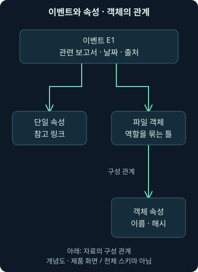
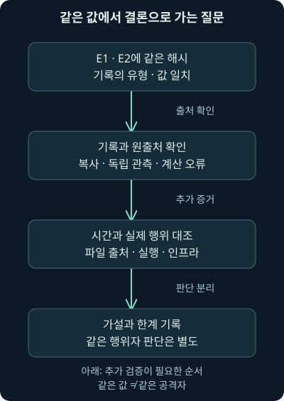
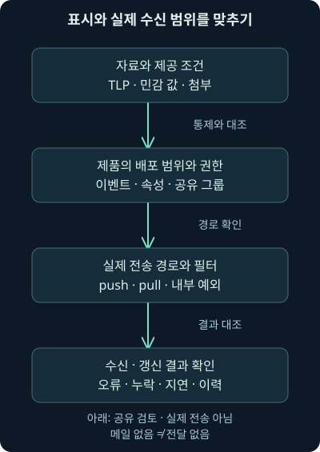

## 1. 주소를 저장했는데 설명이 사라졌다면

12강에서는 위협 정보 플랫폼과 피드를 고르는 기준을 배웠습니다. 이제 보고서에서 찾은 파일 해시와 도메인을 실제 자료 구조에 담는 방법을 살펴보겠습니다. 값만 복사하면 간단해 보이지만, 한 달 뒤 다른 분석가가 “이 도메인은 공격 서버였나요, 보고서의 참고 주소였나요?”라고 물으면 어떨까요? 출처와 역할이 빠진 목록은 다시 조사해야 하는 숙제를 남깁니다.

이번 13강은 **MISP의 이벤트·속성·객체, 분류와 관측 보고, 상관관계, 검토와 공유 흐름**을 다룹니다. 다음 14강에서는 직접 만든 가상 기록을 로컬에서 검사합니다. 두 강의 모두 MISP 서버 설치·로그인·피드 수신·실제 배포를 수행한 결과는 아닙니다.

이 강의의 보고서·조직·파일·주소·활동은 자체 가상 사례입니다. 문서용 주소 `192.0.2.20`과 예시 도메인 `files.example`을 사용합니다. 자료 모델을 이해하려는 예제이므로 외부 접속이나 악성 파일이 필요하지 않습니다.

## 2. MISP는 값과 맥락을 함께 다루는 작업 공간입니다

도서관에서 책 제목만 적은 목록과, 저자·판본·주제·다른 책과의 관계가 있는 목록을 비교해 보세요. 뒤의 목록은 같은 책을 찾는 것뿐 아니라 이전 연구를 이어가는 데 도움이 됩니다. MISP도 관측값과 관련 설명을 구조화하고, 검색·관계 확인·교환에 쓰는 플랫폼입니다.

비유에는 한계가 있습니다. 도서관의 분류표가 책 내용의 진실을 보증하지 않듯, 플랫폼에 저장된 값과 분류도 자동으로 사실이 되지 않습니다. 작성자의 주장, 분석 근거, 관측한 위치를 읽어야 합니다. **CTI**, 사이버 위협 정보의 판단을 저장하는 것과 판단을 검증하는 것은 함께 필요합니다.

MISP는 웹 화면과 **API**, 프로그램끼리 정해진 요청과 응답으로 자료를 주고받는 인터페이스를 제공합니다. 사람이 정리한 자료와 다른 보안 도구의 조회를 연결할 수 있지만, 실제 연동은 버전·권한·설정에 달려 있습니다. 과거의 “바로 연동된다”는 소개를 모든 현행 제품 조합의 보장으로 읽지 마세요. 확인일 2026-11-04의 [공식 기능 안내](https://www.misp-project.org/features/)를 참고하되, 이번에는 연동 실행이나 처리량 시험을 하지 않았습니다.

이런 구조화는 악성 파일만을 위한 방식은 아닙니다. 사기 관련 계정·거래의 분석처럼 기술적 값과 비기술적 설명을 함께 정리해야 하는 경우에도, 허용되는 자료형과 개인정보·공유 조건을 따져 활용할 수 있습니다. 큰 목록을 저장할 수 있다는 소개와 우리 환경의 처리 속도·저장 용량을 시험한 결과는 구별합니다.

## 3. 이벤트는 맥락이 연결된 자료를 담는 묶음입니다

**이벤트**, Event는 관련 자료를 담는 중심 묶음입니다. 보고서 한 편을 정리한 묶음일 수도 있고, 하나의 분석 대상이나 활동군에 대한 자료일 수도 있습니다. 앞에서 배운 일반적인 보안 이벤트, 즉 시스템의 개별 활동 기록과 이름이 같지만 뜻은 다릅니다. MISP 이벤트가 하나 생겼다고 내부 침해 사건이 하나 확정된 것은 아닙니다.

가상 보고서 A에는 파일과 도메인에 대한 설명이 들어 있습니다. 이를 E1이라는 이벤트로 묶으면 제목·관련 날짜·작성 조직·공유 범위 아래에 자료를 연결할 수 있습니다. 날짜는 무엇의 날짜인지 기록해야 합니다. 보고서 발행일, 분석자가 읽은 날, 실제 관측 시각을 하나로 섞으면 이후 시간 비교가 어긋납니다.

보고서 두 편이 같은 활동을 다룬다고 무조건 합치거나, 보고서 한 편의 여러 활동을 반드시 한 이벤트로 고정할 필요는 없습니다. 독자가 출처와 범위를 이해할 수 있게 팀의 묶음 기준을 정하세요. 너무 큰 묶음은 서로 다른 시간과 근거를 섞고, 지나치게 작은 묶음은 관계를 놓치게 합니다.

## 4. 속성은 값의 모양과 역할을 구분해 담습니다

**속성**, Attribute는 이벤트 안에 담는 개별 정보입니다. 파일 해시·주소·도메인처럼 비교할 수 있는 값뿐 아니라 참고 링크·설명·첨부도 들어갈 수 있습니다. 따라서 “속성에 있으니 모두 차단할 지표”라는 해석은 틀립니다.

**유형**, type은 값이 무엇인지 나타냅니다. 예를 들어 `sha256`은 SHA-256 해시, `domain`은 도메인, `link`는 참고 링크를 표현할 때 사용할 수 있습니다. **범주**, category는 그 자료를 어떤 분석 맥락에 놓는지 구분합니다. 형식이 URL이라는 사실만으로 공격자의 통신 주소인지, 분석 보고서를 읽는 링크인지 정해지지 않습니다.

| 가상 자료 | 유형을 보는 질문 | 역할·범주를 보는 질문 | 이번 예제의 판단 |
|---|---|---|---|
| 파일 내용의 SHA-256 | 어떤 바이트를 비교하나? | 전달 파일의 후보인가? | 추가 조사할 파일 후보 |
| files.example | 어떤 도메인인가? | 공격 통신이라는 근거가 있나? | 언급만 확인, 역할 미확정 |
| reports.example의 보고서 링크 | 어디의 설명을 참고했나? | 외부 분석 자료인가? | 참고 자료, 탐지 대상과 구분 |

표는 형식과 의미의 차이를 읽기 위한 것입니다. 실제로 허용되는 유형·범주 조합은 설치된 자료 정의를 확인해야 합니다. 문자열을 원하는 칸에 억지로 맞추기보다 원문 역할을 보존하고 지원 구조를 선택하세요. 2026-11-04 확인한 [공식 데이터 모델 안내](https://www.misp-project.org/datamodels/)를 기준으로 설명합니다.

## 5. ID와 UUID는 값의 진실성을 뜻하지 않습니다

화면에서 이벤트 번호 42를 찾았는데 다른 서버에서는 번호가 다를 수 있습니다. 로컬 데이터베이스의 **ID**, 식별 번호는 그 시스템에서 항목을 찾는 데 쓰입니다. 시스템 사이에서 항목의 정체성을 이어가기 위해서는 **UUID**, 여러 시스템에서 식별자를 충돌 없이 만들도록 설계한 식별 값을 함께 사용합니다.

같은 속성을 수정할 때마다 별개의 새 항목처럼 복제하면 갱신·철회 추적이 어려워집니다. 반대로 값이 같다는 이유만으로 서로 다른 출처의 기록을 하나로 덮으면 출처와 관측 시각이 사라집니다. 식별자의 연속성, 값의 일치, 출처의 독립성은 서로 다른 문제입니다.

UUID가 있다고 신뢰할 수 있는 작성자라는 뜻도 아닙니다. 서명이나 인증된 교환이 있더라도 그것이 보증하는 범위와 내용의 정확성을 구분해야 합니다. 14강의 E1·A1 같은 짧은 이름은 학습용 ID이며 실제 제품 UUID를 흉내 낸 것이 아닙니다.

## 6. 객체는 함께 해석해야 하는 속성의 관계를 보존합니다

파일 이름 두 개와 해시 두 개를 한 줄 목록에 섞으면 어떤 이름이 어떤 해시에 붙었는지 알기 어렵습니다. **객체**, Object는 파일·네트워크 연결처럼 함께 읽어야 하는 속성과 역할을 묶습니다. **템플릿**은 해당 객체에 어떤 항목과 필수 조건이 있는지 정하는 틀입니다.

가상 파일 A의 이름과 해시를 하나의 파일 객체에 넣고, 다른 파일 B는 별도 객체로 두면 대응 관계가 보입니다. 객체 사이의 참조는 “이 파일이 저 설정을 포함한다”와 같은 관계를 표현하는 데 도움을 줍니다. 다만 관계 이름을 붙였다고 실제 분석으로 그 관계를 입증한 것은 아닙니다.

그림에서는 이벤트 아래의 단일 속성과 객체 묶음을 구별해 보세요. 단순 목록으로 충분한 자료도 있지만, 파일 이름과 내용의 대응처럼 잃으면 안 되는 관계에는 객체가 유용합니다. 템플릿의 필수 조건과 버전은 설치 환경에서 확인합니다. 확인일 2026-11-04의 [공식 객체 안내](https://www.circl.lu/doc/misp/misp-objects/index.html)를 참고했습니다.

## 7. 태그·택소노미·갤럭시는 서로 다른 정리 도구입니다

**태그**, Tag는 자료에 붙이는 분류 표시입니다. 자유로운 팀 내부 표시도 있고 정해진 어휘를 사용하는 표시도 있습니다. **택소노미**, Taxonomy는 같은 기준으로 태그를 선택하도록 돕는 분류 체계입니다. 한 사람은 “공유 제한”, 다른 사람은 “외부 금지”라고 제각각 쓰면 자동 처리에서 같은 뜻인지 판단하기 어려워집니다.

분류의 이름을 맞춰도 판정 근거가 생기는 것은 아닙니다. 어떤 행위를 관측했는지, 누가 어느 근거로 태그를 붙였는지 설명을 남겨야 합니다. **로컬 태그**처럼 외부로 전달되지 않도록 사용하는 표시가 있다면, 내보내기에서 실제 포함되는 범위도 확인하세요. 태그가 수신자에게 전달된다고 가정해서는 안 됩니다. 확인일 2026-11-04의 [택소노미 안내](https://www.circl.lu/doc/misp/taxonomy/index.html)를 참고하세요.

**갤럭시**, Galaxy는 행위자·도구·악성 코드·행동 분류 등의 지식을 연결하는 구조입니다. 그 안의 **클러스터**, Cluster는 특정 대상을 설명하는 항목이라고 생각하면 됩니다. “이 자료가 어떤 지식과 관련 있는가”를 정리할 수 있지만, 연결된 행위자 이름을 자동으로 관측 사실로 옮기지 마세요. [공식 갤럭시 안내](https://www.circl.lu/doc/misp/galaxy/index.html), 확인일 2026-11-04를 기준으로 사용한 설명입니다.

## 8. 같은 해시가 연결되면 무엇을 알 수 있을까요?

**상관관계**, correlation는 관련될 수 있는 기록을 연결해 살펴보는 기능입니다. 가상 E1과 E2에 같은 SHA-256 값이 들어 있다면 다른 보고서의 맥락을 찾아볼 출발점이 됩니다. 14강에서는 직접 만든 무해한 파일의 같은 바이트를 두 기록에 넣어 이 과정을 확인합니다.

관측할 수 있는 사실은 “두 기록의 같은 유형에 같은 값이 있다”입니다. 원파일의 해시를 실제로 계산했고 기록이 정확하다면 같은 내용의 파일일 가능성을 강하게 지지합니다. 그러나 한 보고서가 다른 보고서를 복사했을 수도 있고, 공개 도구나 공통 파일을 여러 행위자가 사용할 수도 있습니다. 값의 일치가 독립 관측 두 번이나 동일 공격자를 보장하지 않습니다.

그림 아래의 추가 근거가 핵심입니다. 실제 행위의 순서·파일 출처·실행 조건·계정·시간·인프라의 사용 맥락을 대조해야 캠페인이나 행위자 관련 가설을 평가할 수 있습니다. 연결된 기존 보고서의 분류를 새 기록으로 무조건 상속하지 않습니다.

다른 이벤트로 이동해 맥락을 좁혀 가는 작업을 **피벗**, pivot이라고 부릅니다. 목록의 조직·태그·클러스터 표시를 출발점으로 삼되, 조직 표시가 보고서의 최초 관측자까지 자동 증명하지는 않습니다. 원출처 링크·작성 설명·재배포 경로·날짜를 다시 확인해야 합니다. 그래프의 선 개수보다 각 선이 어떤 근거를 연결하는지 읽는 일이 중요합니다.

## 9. 정확 일치·유사성·포함 관계는 다른 연결입니다

정확히 같은 SHA-256 값과, 비슷한 파일을 찾기 위한 **퍼지 해시**, 유사도 비교용 요약 값은 질문이 다릅니다. 파일이 비슷하다는 신호는 동일한 바이트라는 뜻이 아닙니다. IP 주소 하나가 어떤 네트워크 범위에 포함된다는 관계도 같은 단말·사용자·행위자라는 증거는 아닙니다.

도구가 어떤 알고리즘과 설정으로 연결했는지 확인하세요. 속성별 상관관계 비활성화, 제외 조건, 사용자의 접근 권한이나 수신한 자료 범위 때문에 연결이 보이지 않을 수도 있습니다. “그래프에 연결이 없다”는 결과를 전 세계에 관련 자료가 없다는 결론으로 바꾸지 않습니다.

반대로 공용 서비스 주소처럼 여러 정상·비정상 활동에 함께 등장하는 값은 너무 많은 관계를 만들 수 있습니다. **워닝리스트**, warning list는 알려진 공용·정상 가능 값 등의 맥락을 검토하도록 돕습니다. 일치가 무조건 안전을 증명하지 않으며 실제 활성 목록은 인스턴스 설정에 달려 있습니다. [공식 워닝리스트 안내](https://www.misp-project.org/warninglists/), 확인일 2026-11-04를 참고했습니다.

## 10. Sighting은 무엇을 보았다는 보고인가요?

**사이팅**, Sighting은 속성에 대한 관측·오탐·만료 등의 피드백을 남기는 구조입니다. 여기서 먼저 “보았다”의 단위를 정해야 합니다. 같은 도메인이 보고서에 있었다는 사실, 내부 DNS 요청에 있었다는 사실, 단말에서 파일이 실행됐다는 사실은 서로 다릅니다.

MISP 2.5 계열의 공식 구현에서는 유형 `0`이 관측, `1`이 false-positive인 오탐, `2`가 expiration인 만료입니다. 오래된 설명의 “false-negative sighting”을 이 유형 `1`의 뜻으로 사용하면 안 됩니다. **미탐**, false negative는 실제 위협을 놓친 경우이고, 오탐은 정상·무관한 것을 위협으로 판단한 경우입니다. 2026-11-04 확인한 [2.5 구현의 유형 정의](https://github.com/MISP/MISP/blob/2.5/app/Model/Sighting.php)를 근거로 구별합니다.

관측 횟수가 10이라고 피해 단말이 10대라는 뜻도 아닙니다. 같은 분석가·같은 센서가 반복 보고하거나, 같은 자료가 재배포되었을 수 있습니다. 보고 주체·시각·출처와 집계 단위를 확인하세요. 누가 무엇을 조사하는지 자체가 민감할 수 있으므로 관측 피드백의 공유 정책도 확인합니다. [공식 사이팅 안내](https://www.circl.lu/doc/misp/sightings/index.html), 확인일 2026-11-04를 참고했습니다.

## 11. 수동 등록은 생성보다 검토가 중요합니다

작업의 시작은 빈 이벤트를 만들고 제목·날짜·출처·공유 범위를 정하는 일입니다. 다음에는 필요한 값을 속성이나 객체로 넣고 역할과 근거를 확인합니다. 분류를 붙인 뒤에도 아직 다른 도구가 자동 소비하거나 다른 조직에 전달해도 되는지 별도 검토가 필요합니다.

**자유 텍스트 가져오기**, freetext import는 보고서의 여러 값을 인식해 입력을 돕습니다. 하지만 인식기가 URL의 형식을 알아보는 것과 그 URL이 참고 문헌인지 공격 통신인지 이해하는 것은 다릅니다. 가져오기 미리보기에서 값의 누락·줄바꿈·잘림·유형·범주·설명을 확인합니다.

문자열 끝에 기호를 임의로 붙여 형식 인식을 통과시키면 실제 비교 값이 달라질 수 있습니다. 원값을 보존하고 적절한 입력 방법을 선택해야 합니다. 과거 화면의 버튼 위치를 따라가기보다 입력→제안 확인→수정→저장이라는 목적을 이해하세요. [공식 보고서 기반 등록 안내](https://www.circl.lu/doc/misp/create-event-report/index.html), 확인일 2026-11-04는 실제 설치본 화면과 다를 수 있으며 이번에는 클릭 실습을 하지 않았습니다.

## 12. to_ids는 악성 인증서가 아닙니다

**IDS**, Intrusion Detection System은 침입 징후를 탐지하는 시스템입니다. 속성의 `to_ids`는 탐지용 서명 생성 등에 사용할 대상으로 보는 설정입니다. 이 값을 켰다는 사실만으로 침해가 확정되거나 센서에 규칙이 배포된 것은 아닙니다. 껐다고 그 값이 정상으로 확정된 것도 아닙니다.

가상 파일 해시는 내부 조사 후보로 사용할 수 있어도, 보고서 참고 링크는 공격 주소로 내보내면 안 됩니다. 역할을 모르는 도메인은 기록에는 남기되 탐지에 바로 사용하지 않는 선택도 가능합니다. 왜 켜거나 껐는지 설명을 남기면 다음 분석가가 의도를 이해할 수 있습니다.

실제 탐지는 내보내기 조건·지원 유형·적용된 규칙·센서 위치·활성화 시각까지 확인해야 합니다. MISP 2.5 계열의 [공식 속성 구현](https://github.com/MISP/MISP/blob/2.5/app/Model/MispAttribute.php), 확인일 2026-11-04를 참고한 설명이며, 이 강의에서 탐지 규칙을 생성하거나 배포하지 않았습니다.

## 13. 게시와 인터넷 공개는 같은 말이 아닙니다

MISP에서 **게시**, publish는 검토한 이벤트를 관련 내보내기·알림·동기화 흐름에 제공하는 동작과 연결됩니다. 그렇다고 무조건 인터넷 누구나 볼 수 있게 공개한다는 뜻은 아닙니다. 누가 볼 수 있는지는 배포 범위와 계정·조직·서버 설정을 함께 봐야 합니다.

확인일 2026-11-04의 [공식 이벤트 수명주기·게시 안내](https://www.circl.lu/doc/misp/using-the-system/)는 게시 후 편집에 따른 재게시 필요, 게시의 알림·내보내기·동기화 효과를 설명합니다. “메일 없이 게시”도 공유 효과가 없는 저장이라는 뜻으로 이해하지 마세요. 메일과 자료 전달은 다른 경로입니다.

초안 상태만으로 민감 정보가 완전히 숨겨진다고 가정하지도 않습니다. 같은 조직의 권한 있는 사용자나 별도 조회 경로의 동작을 설치본에서 확인해야 합니다. 저장·검토·게시·전송·탐지 적용 각각에 대한 실제 기록을 구별하는 습관이 필요합니다.

다른 조직이 작성한 자료에 오류를 발견했다면 원기록을 무단 덮어쓰는 대신 **제안**, proposal로 변경을 요청하는 협업 방법도 있습니다. 제안이 생성된 것과 원작성자가 검토·수락한 것은 다른 상태입니다. 의견·설명·관계도 누가 남긴 것인지 보존해야 원래 주장과 추가 분석을 구별할 수 있습니다.

## 14. 배포 범위와 TLP를 함께 읽어야 합니다

**배포 범위**, distribution는 자료를 볼 수 있는 범위를 정하는 제품 설정입니다. MISP 2.5 계열에서 기본 값은 `0` 조직 내부, `1` 해당 공동체, `2` 연결된 공동체, `3` 모든 공동체, `4` 지정 공유 그룹이며, 속성의 `5`는 이벤트 범위 상속을 뜻합니다. 숫자는 심각도나 신뢰도 점수가 아닙니다. [공식 속성 정의](https://github.com/MISP/MISP/blob/2.5/app/Model/MispAttribute.php), 확인일 2026-11-04를 기준으로 설명합니다.

**공유 그룹**, Sharing Group은 수신 조직과 인스턴스를 더 구체적으로 정하는 구조입니다. 그룹을 만들었다고 모든 자료에 적용되는 것은 아닙니다. 해당 이벤트·속성에 실제로 선택된 범위를 확인하고, 하위 항목에 더 제한된 자료가 있는지 확인하세요. 상위·하위 범위와 권한을 무시하고 하나의 숫자로 최종 수신자를 계산하면 안 됩니다.

12강의 **TLP**, Traffic Light Protocol은 제공자가 의도한 공유 범위를 전달하는 표시였습니다. TLP:AMBER+STRICT 자료에 넓은 배포 설정을 붙였다고 외부 공유가 허용되지 않습니다. 반대로 TLP:CLEAR 태그만 붙였다고 시스템 권한이 자동으로 열리는 것도 아닙니다. 표시와 실제 통제·내보내기·수신자를 맞춰야 합니다. 2026-11-04 확인한 [FIRST TLP 2.0](https://www.first.org/tlp/)에서는 과거 WHITE 대신 CLEAR를 사용합니다.

## 15. 양방향 공유는 양쪽 조건을 확인해야 합니다

조직 A와 B의 서버가 연결되었다고 모든 이벤트가 양쪽으로 흐르는 것은 아닙니다. **push**는 보내는 쪽에서 자료를 밀어 보내는 방식이고, **pull**은 받는 쪽이 가져오는 방식입니다. 인증 키의 소속·권한, 서버 설정, 필터, 배포 범위와 연결 대상이 실제 흐름을 결정합니다.

그림의 마지막을 봐주세요. 보냈다는 기록만으로 상대가 같은 자료를 저장하고 적용했는지까지 알 수는 없습니다. 오류·필터 제외·일부 필드 누락·갱신 지연을 확인해야 합니다. 동기화 후 공동체 범위가 변하는 규칙이나 내부 인스턴스 예외도 있으므로 “조직 내부면 어떤 동기화에서도 절대 이동하지 않는다”처럼 단정하지 않습니다.

이러한 조건과 예외는 [공식 동기화·공유 안내](https://www.circl.lu/doc/misp/sharing/index.html), 확인일 2026-11-04에서 확인했습니다. 위임 게시가 필요한 경우에도 신뢰된 조직을 통한 절차와 남는 메타데이터를 검토해야 하며 완전한 익명성을 보장한다고 말할 수 없습니다. 이번에는 서버 연결·위임·메일·외부 공유를 수행하지 않았습니다.

## 16. 자동화는 출처를 자동으로 사실로 바꾸지 않아야 합니다

SIEM은 여러 기록을 모아 검색·분석하는 보안 정보·이벤트 관리 시스템이며, SOAR는 보안 작업의 연결·자동화·대응 절차를 돕는 체계입니다. 이런 도구나 사건 관리 시스템이 API로 MISP를 조회하거나 기록을 추가할 수 있습니다. 다만 “조회 성공”, “속성 존재”, “우리 환경에서 관측”, “유효한 경보”는 별도의 결과입니다.

**PyMISP**는 Python에서 MISP와 상호작용하도록 돕는 라이브러리입니다. 프로그램을 쓴다고 읽기 전용이 되는 것은 아닙니다. 조회·추가·수정·게시 권한을 구분하고, 연동에서 출처·유형·시각·분류가 어떻게 보존되는지 확인해야 합니다. 외부 서비스의 보강 모듈은 제출 값이 해당 서비스로 전달되는 경로도 검토합니다.

실시간 트래픽이 값과 일치하면 경보를 만들도록 설계할 수는 있습니다. 그러나 실제로는 커넥터와 규칙·조회 조건·수집 범위·시간·센서 적용이 필요합니다. MISP에 값이 들어 있다는 이유만으로 실시간 경보 기능 전체가 켜진 것이 아닙니다. 제품 연결 실패를 공격 부재로 해석하지 마세요.

## 17. 가져오기와 내보내기에서는 보존되는 의미를 시험합니다

JSON·CSV·일반 텍스트·STIX·탐지 규칙 같은 형식은 쓰임이 다릅니다. **JSON**은 이름과 값, 목록과 중첩 구조를 표현하는 자료 형식이고, **CSV**는 주로 행과 열로 값을 표현하는 형식입니다. 평면 목록에는 원래 객체 관계·관측 설명·공유 조건이 빠질 수 있습니다.

과거 문서의 Bro는 현재 Zeek이라는 이름으로 접할 수 있습니다. 옛 출력 형식 이름이 메뉴나 API 호환 이름으로 남는 것과 현재 도구의 정식 명칭은 구별하세요. STIX의 XML 기반 예전 계열과 JSON 기반 2.x를 같은 형식으로 취급하지도 않습니다. 지원 변환·버전·모듈은 실제 설치본에서 검증해야 합니다.

이 명칭 변경은 2018년의 [Zeek 공식 발표](https://zeek.org/2018/10/renaming-the-bro-project/), 확인일 2026-11-04로 대조했습니다. **STIX**, Structured Threat Information Expression은 위협 정보를 구조화하는 표준 계열로, 단순히 파일 확장자가 같다고 객체·관측 보고·관계가 모두 변환되는 것은 아닙니다. 대량 입력·줄별 입력·샌드박스 분석 결과·외부 형식 가져오기도 지원 경로와 변환 모듈에 따라 의미 보존을 확인해야 합니다.

원문·사본·내보낸 결과를 대조할 때 값뿐 아니라 유형·역할·관계·출처·시간·배포 범위를 확인하세요. 첨부가 포함되는 요청은 파일 내용까지 전달할 수 있습니다. 서명·암호화된 알림도 수신자 범위와 원자료의 정확성을 대신 보증하지 않습니다.

공식 기능 안내에는 GnuPG·S/MIME를 통한 알림 서명·암호화도 설명되어 있습니다. 둘은 암호 기술을 이용해 메시지의 보호와 서명 확인을 돕는 도구·방식입니다. 실제 키·수신자 설정과 검증 결과를 확인해야 하며, 기능이 있다는 소개만으로 모든 알림이 보호되어 있다고 가정하지 않습니다.

## 18. 사건 관리와 위협 정보 관리는 서로 돕습니다

사건 관리 시스템에는 누가 언제 무엇을 조사하고 조치했는지 남깁니다. 위협 정보 플랫폼에는 여러 분석에서 재사용할 값·행동·출처·관계를 정리합니다. 둘이 연결되어도 외부 보고서 하나가 내부 사건 하나로 자동 확정되는 것은 아닙니다.

가상 E1에서 해시 후보를 찾았다면 단말의 파일 존재·실행·경로·계정 기록을 조사할 수 있습니다. DNS 요청만 있다면 리졸버 기록과 실제 응답·연결·방화벽·서버·프록시 기록을 대조합니다. 암호화된 통신이나 수집하지 않은 구간 때문에 내용이 보이지 않을 수 있으며, 패킷 재조립·보존 기간·필터도 결과를 바꿉니다.

최종 기록에는 “외부 두 기록에서 같은 값 확인”, “내부 관측 미확인”, “행위자 판단 보류”처럼 층위를 나눠 적습니다. 조사 후 새 관측이나 오탐·만료 근거가 생기면 원출처와 자료 버전을 남겨 갱신하세요. 이 되돌림이 목록을 쌓는 일과 지속적으로 쓸 수 있는 정보 관리의 차이입니다.

## 19. 현재 문서의 적용 범위와 다음 실습

이번 강의는 2026-11-04에 확인한 MISP 공식 기능·자료 모델과 CIRCL 사용자 안내, **2.5 계열 API·구현**을 기준으로 개념을 설명했습니다. 2.5는 이 강의가 대조한 계열이며 영구적인 최신 버전이라는 뜻이 아닙니다. 업데이트되는 사용자 안내의 화면과 실제 설치본은 다를 수 있습니다. API의 세부 필드는 [공식 2.5 API 문서](https://github.com/MISP/MISP/blob/2.5/docs/API_Doc.md)를 대조하세요.

이벤트·속성·출처·관계라는 원리는 여전히 유효합니다. 수정이 필요한 부분은 오래된 공유 색상 이름, 사이팅 오탐 유형의 잘못된 명칭, 같은 값에서 동일 행위자로 건너뛰는 판단, 가져온 모든 값이 자동 경보가 된다는 단순화입니다. 제품의 실제 버튼·성능·연동 결과를 검증했다고 말하지 않습니다.

14강에서는 원본 제품 실습을 실행한 척하지 않고 자체 가상 자료로 입력 검토→상관관계→탐지 후보 계획을 직접 확인합니다. 구조가 올바른 것과 내용이 진실인 것, 탐지 후보와 공유 허가를 끝까지 구별해 보겠습니다.

## 20. 복습 질문과 바로 읽는 해설

### 질문 1. MISP 이벤트가 생성되면 침해 사건이 하나 생긴 것인가요?

**해설:** 관련 자료를 담는 묶음이 생긴 것입니다. 외부 보고서 정리일 수도 있습니다. 내부 사건 여부는 실제 관측과 영향·비인가 활동을 조사해 판단해야 합니다.

### 질문 2. 보고서 URL은 형식이 URL이니 공격 통신 주소인가요?

**해설:** 값의 형식과 분석 역할은 다릅니다. 참고 자료라면 그 역할과 범주를 보존하고 탐지 대상으로 잘못 내보내지 않아야 합니다.

### 질문 3. 파일 이름과 해시가 여러 개면 객체가 왜 유용할까요?

**해설:** 어떤 이름과 해시가 같은 파일의 설명인지 대응을 보존할 수 있습니다. 목록에 값이 모두 존재한다는 것만으로는 관계를 복원하기 어렵습니다.

### 질문 4. 두 이벤트의 같은 해시에서 동일 공격자를 확정해도 될까요?

**해설:** 같은 값은 연결 조사 근거입니다. 기록의 정확성·복제 여부·파일 재사용·실제 행위·시간 등의 추가 근거 없이 캠페인이나 행위자 분류를 옮기면 안 됩니다.

### 질문 5. 퍼지 해시 유사성과 SHA-256 정확 일치는 같은 결과인가요?

**해설:** 유사성과 동일 값 비교는 질문이 다릅니다. 어떤 알고리즘과 조건이 연결을 만들었는지 확인해야 합니다. 어느 쪽도 그 자체로 침해 성공을 뜻하지 않습니다.

### 질문 6. 사이팅 유형 1은 미탐을 뜻하나요?

**해설:** 이번에 확인한 MISP 2.5 구현에서는 오탐입니다. 실제 위협을 놓치는 미탐과 정상·무관한 것을 위협으로 판단한 오탐은 반대 방향의 오류입니다.

### 질문 7. 사이팅 20회이면 감염 단말이 20대인가요?

**해설:** 반복 보고·동일 센서·재배포와 관측 단위를 확인해야 합니다. 무엇을 어디에서 보았다는 보고인지 모르면 단말 수나 감염 수로 변환할 수 없습니다.

### 질문 8. to_ids를 켜면 센서에 규칙이 적용되나요?

**해설:** 탐지용 사용 후보 설정과 실제 내보내기·규칙 생성·센서 적용은 별도 단계입니다. 켰다는 사실만으로 악성 판정이나 적용 완료를 주장할 수 없습니다.

### 질문 9. TLP:AMBER+STRICT에 배포 범위 3을 붙이면 공유가 허용되나요?

**해설:** 제품 설정이 제공자의 허용 범위를 바꾸지 않습니다. 표시·권한·동기화·실제 수신자 범위를 맞춰야 하며 충돌을 해결하기 전에는 범위를 넓히지 않습니다.

### 질문 10. 메일 없이 게시했으니 외부 자료 전달도 없다고 볼까요?

**해설:** 메일 알림과 동기화·내보내기는 다른 경로입니다. 실제 게시 동작과 서버 설정을 확인해야 하며 버튼 이름 하나로 전송 부재를 단정하지 않습니다.

### 질문 11. 관련 그래프가 비어 있으면 관련 자료가 전혀 없나요?

**해설:** 조회 권한·가져온 범위·형식·상관관계 설정·제외 조건을 먼저 확인합니다. 현재 화면에서 보이지 않는 것과 관련성이 없는 것은 다릅니다.

### 질문 12. API로 외부 자료를 받으면 내부 관측 표시를 켜도 될까요?

**해설:** 수신과 내부 관측을 분리해야 합니다. 내부에서 실제 확인한 기록의 위치·시간·행위를 근거로 남긴 뒤 해당 보고를 추가합니다. 자료를 받았다는 사실만으로 내부 침해를 만들지 않습니다.
