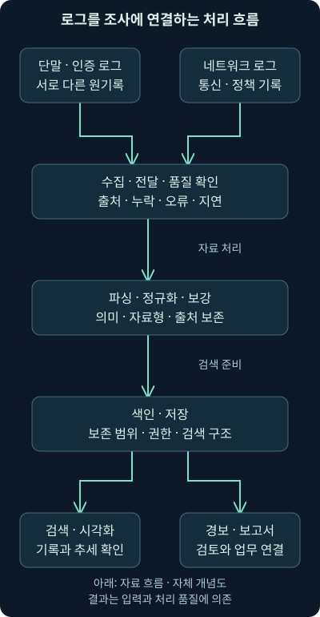
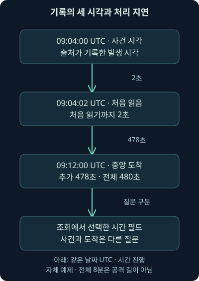
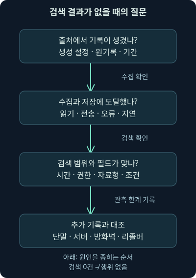

## 1. 기록 세 곳을 오가며 놓치는 연결

가상 조직에서 계정 로그인 실패가 늘었습니다. 인증 서버에는 실패 기록이 있고, 단말에는 프로세스 기록이 있으며, 방화벽에는 통신 기록이 있습니다. 따로 보면 모두 평범해 보일 수 있습니다. 그런데 같은 시간과 계정을 기준으로 나란히 놓으면 조사할 질문이 생깁니다. “실패 뒤에 성공이 있었나?”, “그 계정으로 어떤 단말과 자료에 접근했나?” 같은 질문입니다.

14강까지는 위협 정보를 정리하고 값의 관계를 검토했습니다. 이번 15강은 **로그를 모아 검색·분석할 수 있게 만드는 SIEM의 처리 흐름**입니다. 수집·파싱·정규화·보강·색인·시간·품질·저장량을 다룹니다. 다음 16강에서는 탐지 사용 사례와 KQL 검색, 자체 로그의 조건 검증을 이어갑니다. 자동화는 충분한 설명을 위해 그다음 17강으로 나눕니다.

이 강의의 조직·로그·주소·시간·처리량은 모두 자체 가상 예제입니다. 계산 코드는 직접 실행했지만 실제 SIEM·Elastic 서버·원본 VM·PCAP을 실행하거나 실제 계정 활동을 조회한 결과는 아닙니다.

## 2. SIEM을 관제실의 기록 작업대로 생각해 봅시다

여러 건물의 출입 장부를 한 작업대에서 비교한다고 생각해 보세요. 한 장부는 이름, 다른 장부는 사번을 쓰고 시계도 조금씩 다릅니다. 장부를 가져다 놓는 것만으로는 같은 사람의 동선을 바로 찾을 수 없습니다. 항목의 뜻과 시간을 맞춰야 합니다.

**SIEM**, Security Information and Event Management는 보안 정보·이벤트를 모아 검색·분석·시각화·경보·보고에 활용하는 체계입니다. 제품 하나의 화면을 뜻하기도 하지만, 실제 운영에서는 여러 수집기와 처리·저장·분석 구성 요소가 함께 일합니다. 한 상자에 모든 기능이 들어 있어야 하는 것은 아닙니다.

장부 비유와 달리 디지털 기록은 원격 전송·복제·자동 처리 과정에서 지연·중복·잘림이 생길 수 있습니다. 또한 암호화된 통신 내용을 로그가 대신 보여 주는 것도 아닙니다. SIEM은 들어온 자료를 활용하는 작업대이며, 기록하지 않은 행동을 자동 복원하는 장치는 아닙니다.

## 3. 입력에서 결과까지 한 번에 바라보기

로그를 수집한 다음에는 필요한 항목을 읽고, 같은 의미의 이름과 자료형으로 정리하고, 설명을 보태고, 검색하기 좋은 형태로 저장합니다. 그 위에서 검색·차트·경보·보고서가 만들어집니다. 어떤 단계가 빠졌는지 알아야 “화면에 없다”는 문제를 조사할 수 있습니다.



그림의 입력과 마지막 결과 사이를 봐주세요. 검색 문장을 바꾸는 일은 맨 뒤의 작업입니다. 앞에서 수집이 끊겼거나 실패를 성공으로 잘못 읽었다면 검색만 정교하게 해도 문제는 해결되지 않습니다. 각 단계의 정상·실패 수와 마지막 수신 시각을 확인할 수 있어야 합니다.

## 4. 수집 성공이라는 말을 네 단계로 나눠봅니다

기록을 **생성**하는 설정이 켜져 있는지 먼저 확인합니다. 다음은 단말이나 서버의 **에이전트**, 자료를 읽어 전송하는 프로그램이 실제 파일·채널을 읽었는지입니다. 세 번째는 전송이 목적지까지 도달했는지, 네 번째는 수신한 자료가 처리되어 검색 가능한 저장소에 들어갔는지입니다.

가상 인증 서버가 10시까지 기록을 남겼더라도 수집기의 마지막 읽기가 9시 50분이면 그 이후 자료를 검색할 수 없습니다. 수신기가 연결을 받아도 형식 오류로 저장에 실패할 수 있습니다. “에이전트가 실행 중”이라는 상태 하나만으로 네 단계가 모두 성공했다고 말할 수 없습니다.

업무에 필요한 출처를 정하고 실제 수집 범위를 문서화하세요. 모든 시스템의 모든 기록을 무조건 무기한 모으라는 뜻은 아닙니다. 탐지 목적·개인정보·권한·비용·보존 요건에 따라 범위를 정하되, 제외한 출처 때문에 어떤 질문에 답할 수 없는지 남겨야 합니다.

네트워크 입력도 전체 패킷만 있는 것은 아닙니다. **NetFlow** 같은 흐름 요약은 통신의 주소·시간·수량 등 일부 메타데이터를 담을 수 있습니다. 제품과 수집 설정이 그 형식을 지원하는지 확인해야 하며, 요약 기록만으로 패킷 내용이나 애플리케이션의 실제 동작 전체를 복원할 수는 없습니다.

## 5. 파싱은 문자열에서 항목을 읽어내는 일입니다

**파싱**, parsing은 원기록의 구조를 읽어 값을 항목으로 나누는 과정입니다. 예를 들어 다음 가상 한 줄에서 시각·사용자·주소·결과를 구분할 수 있습니다. 아래는 직접 만든 설명용 문자열이며 특정 제품의 실제 형식은 아닙니다.

```text
2026-11-05T09:00:00Z user=sam src=198.51.100.20 result=DENY
```

문자열을 잘랐다고 의미가 정해지는 것은 아닙니다. 이 예제에서는 인증 시도가 거절됐다는 설정이지만, 다른 출처의 `DENY`는 방화벽 정책 거절일 수 있습니다. 출처의 이벤트 코드·문서·실제 샘플을 대조하지 않고 같은 단어를 모두 로그인 실패로 변환하면 잘못된 경보가 생깁니다.

시각 끝의 `Z`는 **UTC**, 협정 세계시 기준임을 나타냅니다. 로컬 시각으로 표시할 때도 원래 시간대와 변환 규칙을 보존해야 다른 출처와 정확히 비교할 수 있습니다.

로그 형식에 필드가 추가되거나 구분자 안에 공백·따옴표가 들어가면 파서가 틀릴 수 있습니다. 예상 형식만 넣어 보고 끝내지 말고 빈 항목·다국어 메시지·줄바꿈·새 버전의 샘플을 확인하세요. 읽지 못한 줄을 조용히 버리면 정상적으로 처리된 것처럼 보이는 빈 구간이 생깁니다.

## 6. 정규화는 같은 질문을 같은 항목으로 묻게 합니다

**정규화**, normalization는 여러 출처의 의미를 공통 이름·자료형·값 규칙에 맞추는 작업입니다. 어떤 출처는 `user`, 다른 출처는 `account`를 써도 같은 계정 개념으로 검색하고 싶습니다. 다만 이름을 바꾸기 전에 두 항목이 실제로 같은 역할인지 확인해야 합니다.

| 원기록에서 확인할 것 | 공통 항목의 예 | 놓치기 쉬운 차이 |
|---|---|---|
| 인증을 시도한 계정 | user.name·user.domain | 표시 이름·로컬 계정·다른 디렉터리 |
| 네트워크 교환의 출발 주소 | source.ip | 수집기 주소·프록시 주소·NAT 전후 |
| 기록에 적힌 시각 | @timestamp | 원시 시간대·대체 시각·시계 오차 |
| 인증 동작의 결과 | event.outcome | 행위 결과와 보안 판단의 차이 |

표의 이름은 **ECS**, Elastic Common Schema라는 공통 필드 규칙을 참고한 예입니다. 실제 원기록의 모든 의미가 이 표만으로 정리되는 것은 아닙니다. 사용자 이름이 같아도 디렉터리나 서비스가 다르면 다른 계정일 수 있습니다. 출처와 원래 필드도 함께 보존하세요. 확인일 2026-11-05의 [공식 사용자 필드](https://www.elastic.co/docs/reference/ecs/ecs-user)와 [출발지 필드](https://www.elastic.co/docs/reference/ecs/ecs-source)를 참고했습니다.

**NAT**, 네트워크 주소 변환은 통신 경로에서 주소를 바꾸는 동작이고, **프록시**는 요청을 중간에서 대신 전달하는 구성입니다. 서버에 보인 주소가 원래 사용자 단말의 주소와 같지 않을 수 있는 이유입니다. 수집기의 관리 주소를 통신 출발지로 잘못 옮기지 않는지도 확인합니다.

## 7. 자료형은 검색 결과를 바꿉니다

`destination.port`를 숫자로 저장하면 1024보다 큰 포트를 범위로 비교할 수 있습니다. 문자열로 잘못 저장하면 같은 질문을 숫자 범위로 처리하지 못하거나 다른 의미의 비교가 될 수 있습니다. 겉보기 값이 같아도 저장된 **자료형**, 값이 숫자·문자열·날짜 등 무엇인지에 따라 검색 동작이 달라집니다.

**매핑**, mapping은 Elasticsearch 같은 저장소에서 필드의 자료형과 처리 방식을 정하는 정의입니다. 구조화된 계정 이름·식별자에는 `keyword` 같은 전체 값 중심 필드를, 긴 설명에는 단어를 분석하는 `text` 필드를 사용할 수 있습니다. 모든 문자열에 같은 비교 규칙을 기대하지 마세요.

확인일 2026-11-05의 [공식 keyword 안내](https://www.elastic.co/docs/reference/elasticsearch/mapping-reference/keyword)와 [text 안내](https://www.elastic.co/docs/reference/elasticsearch/mapping-reference/text)를 대조했습니다. 따옴표를 붙이면 어떤 필드든 바이트 단위 완전 일치가 된다고 가정할 수 없습니다. 정규화·분석기·매핑이 실제 설치본에서 어떻게 적용되는지 확인해야 합니다.

## 8. 사건 시각·처음 읽은 시각·중앙 도착 시각

기록의 시각은 하나가 아닙니다. 사건이 발생했다고 기록된 시각, 수집기가 처음 읽은 시각, 중앙 저장소에 도착한 시각이 다를 수 있습니다. ECS에서 `@timestamp`는 출처의 사건 시각을 표현하며, 원래 시각이 없을 때는 수신 시각 등으로 대체될 수 있습니다. 필드 이름만 보고 원시 사건 시간이 정확히 보존됐다고 가정하지 않습니다. [공식 기본 필드](https://www.elastic.co/docs/reference/ecs/ecs-base), 확인일 2026-11-05를 참고했습니다.

`event.created`는 에이전트·파이프라인 등이 사건을 처음 읽은 시각, `event.ingested`는 중앙 저장소에 도착한 시각을 표현합니다. 가상 사건이 09:04:00에 기록되고 09:04:02에 읽혀 09:12:00에 도착했다면 전체 차이는 8분입니다. 처음 읽기까지 2초, 그 뒤 도착까지 7분 58초로 나눌 수 있습니다. 계산은 직접 검산했습니다.



그림은 공격 단계의 순서가 아니라 기록이 처리되는 시각의 차이를 보여 줍니다. 실제 시스템의 시계 오차나 시간대 해석 오류 때문에 순서가 뒤집혀 보일 수도 있습니다. 음수 지연을 즉시 공격자가 시간을 조작했다는 증거로 단정하지 마세요. [ECS 이벤트 필드](https://www.elastic.co/docs/reference/ecs/ecs-event), 확인일 2026-11-05를 기준으로 설명합니다.

## 9. 필터링은 저장 전 삭제와 화면 좁히기를 구별합니다

**필터링**, filtering은 조건에 맞춰 자료를 고르거나 제외하는 일입니다. 수집 단계에서 행을 버리는 것과, 저장한 뒤 검색 화면에서 보이지 않게 하는 것은 되돌릴 수 있는 범위가 다릅니다. 검색 조건은 바꿀 수 있지만 수집 전에 버린 원기록은 남아 있지 않을 수 있습니다.

반복되는 정상 기록을 줄이고 싶다면 먼저 조사에 필요한 시간·행위 연결을 잃지 않는지 확인합니다. “실패만 필요하다”며 성공 기록을 버리면 반복 실패 뒤의 성공 여부를 조사하기 어려워집니다. 삭제 기준·버전·제외량·원본 보존 정책을 함께 남겨야 합니다.

규칙이 특정 항목을 제외했을 때도 그 이유가 남아야 합니다. 임시 시험 계정을 영구 제외하면 나중에 실제 비인가 사용이 가려질 수 있습니다. 화면에 경보가 줄었다는 지표만으로 탐지가 좋아졌다고 평가하지 않습니다.

## 10. 보강은 원관측에 설명을 붙이는 작업입니다

**보강**, enrichment은 자산의 소유 부서·중요도·주소 관련 정보·위협 정보 조회 결과 같은 추가 맥락을 붙이는 일입니다. 가상 서버가 급여 업무 서버라는 설명은 조사 우선순위에 영향을 줄 수 있습니다. 그러나 주소가 목록에 있었다는 보강 결과를 내부 악성 활동 관측으로 바꾸지는 않습니다.

보강 자료의 기준 시각도 필요합니다. 오늘의 자산 소유자가 사건 당시의 소유자와 다를 수 있고, IP의 위치 정보는 실제 사용자의 물리적 위치를 보장하지 않습니다. 보강 출처·조회 시각·버전·미확인 결과를 구분해 남기세요.

외부 서비스로 해시·도메인·로그 내용을 보내는 보강은 별도의 자료 전달 행위입니다. 조회 실패나 속도 제한을 “위협 정보 없음”으로 저장하면 안 됩니다. 실패·미조회·결과 없음·확인된 정상은 다른 상태입니다. 13·14강에서 다룬 공유 범위와 사실 구분을 그대로 적용합니다.

## 11. 전송과 재시도는 지연과 중복을 만듭니다

일시적으로 저장소가 느려지면 **큐**, 처리 대기열에 자료가 쌓일 수 있습니다. 메모리에만 있는 큐와 디스크에 보존되는 큐는 장애 시 성격이 다릅니다. 수집기가 재전송하면 같은 사건이 여러 번 들어올 수도 있습니다. 자료를 한 번 더 받는 것과 사건이 한 번 더 발생하는 것은 다릅니다.

확인일 2026-11-05의 [Logstash 큐·복원력 안내](https://www.elastic.co/docs/reference/logstash/queues-data-resiliency)는 메모리 큐와 별도 설정이 필요한 지속성 큐·실패 자료 보관 기능을 설명합니다. 프로그램이 설치됐다고 이런 기능이 모두 활성화된 것은 아닙니다. 실패 자료를 모두 자동 복구해 준다고 일반화하지도 않습니다.

중복 제거에는 출처 안에서 식별자가 유일하다는 근거가 필요합니다. 서로 다른 서버가 같은 이벤트 번호를 쓴다면 번호만 비교해 삭제하면 실제 사건을 잃습니다. 지연·재시도·중복률·오류 보관·수신 간격을 함께 확인하세요. 16강의 자체 실습에서는 가정한 식별 범위를 명시하고 중복과 지연을 따로 셉니다.

## 12. 색인과 저장은 검색을 위한 준비입니다

**색인**, indexing은 필요한 항목을 효율적으로 찾도록 검색 구조를 만드는 일입니다. 책 뒤의 찾아보기와 비슷하지만, 디지털 저장소에서는 자료형·분석 규칙·색인 상태가 검색 가능 여부를 결정합니다. 저장 요청 성공과 즉시 검색 가능 상태도 같은 시점이라고 가정하지 않습니다.

JSON **문서**, document 하나에 로그의 여러 필드를 담고 이를 인덱스나 데이터 스트림 같은 저장 구조로 관리할 수 있습니다. 전통적인 표의 행·열에 비유하면 이해에 도움은 되지만 모든 자료가 고정된 표처럼 동작하는 것은 아닙니다. 검색 대상과 실제 보존 구간을 확인해야 합니다.

원기록·파싱 결과·보강 결과를 구별해 보존하면 오류를 발견했을 때 다시 처리할 수 있습니다. 다만 저장소 안의 원문 필드가 원수집 매체와 완전히 동일한 증거 사본이라는 뜻은 아닙니다. 수집 방법·변환·접근 이력·무결성 확인의 범위를 기록하세요. 해시는 바이트 비교를 돕지만 내용의 진실성을 보증하지 않습니다.

## 13. 같은 자료에서도 결과물은 여러 가지입니다

**검색**은 특정 질문에 맞는 기록을 찾는 작업입니다. **대시보드**는 수량과 추세를 한 화면에 모아 보는 구성이고, **경보**는 정해진 조건을 만족했을 때 검토 대상으로 알려 주는 결과입니다. **보고서**는 정해진 목적과 독자에 맞게 결과·범위·해석을 정리합니다.

실패 횟수가 높다는 차트는 눈여겨볼 지점을 보여 줍니다. 하지만 독립 사건인지 중복인지, 전체 단말의 얼마나 많은 비율을 수집했는지 모르면 공격 증가라고 결론 내리기 어렵습니다. 대시보드의 막대 하나가 원기록 몇 개를 어떤 조건으로 집계했는지 내려가 확인할 수 있어야 합니다.

보고서도 “지난주 위협 100건”보다 단위와 정의가 필요합니다. 경보 100개인지, 검토한 사건 100개인지, 고유 계정 100개인지 구별하세요. 같은 자료를 재조회한 횟수를 별개의 공격으로 세면 우선순위와 개선 판단이 어긋납니다.

## 14. 결과가 비어 있으면 어디부터 볼까요?

검색에 결과가 없을 때 바로 “그 행위는 없었다”고 결론 내리지 않습니다. 로그 생성·수집·처리·저장·권한·검색 조건 중 어느 구간을 실제로 확인했는지 나눠 보세요. 가설이 틀렸을 수도 있지만 관측하지 못했을 수도 있습니다.



그림 위쪽에서 원기록의 생성과 수집을 확인하고, 다음에 검색의 시간·필드·권한을 확인합니다. 마지막 단계는 다른 출처와의 대조입니다. 같은 검색만 반복하는 대신 어느 단계에서 관측이 끊겼는지 찾아가는 흐름으로 읽어주세요.

| 보이는 현상 | 먼저 확인할 질문 | 곧바로 내릴 수 없는 결론 |
|---|---|---|
| 한 서버의 최근 자료가 없음 | 마지막 생성·읽기·도착 시각은? | 최근 활동 없음 |
| 문자열은 있는데 필드 검색은 없음 | 파싱·자료형·필드 이름이 맞나? | 해당 사용자 활동 없음 |
| 시간 범위를 바꾸면 나타남 | 사건·도착 시각·시간대가 다른가? | 공격 시각이 바뀜 |
| 차트 수량이 갑자기 줄어듦 | 수집률·제외 규칙·권한·집계는? | 위협 감소 |

패킷 관련 질문이면 센서 위치·통신 방향·암호화·재조립·저장 기간을 확인합니다. 계정 관련 질문이면 인증 제공자·단말·서버 감사 기록을 대조합니다. DNS만 보였다면 리졸버 응답·후속 연결·방화벽과 서버 기록을 확인하세요. 답이 없는 범위를 다음 수집·조사의 질문으로 바꾸는 것이 좋습니다.

## 15. 처리량과 저장량을 단위로 계산해 봅시다

가상 수집량이 초당 1,000건, 한 건의 평균 크기가 800바이트라고 합시다. **EPS**, Events Per Second는 초당 이벤트 수입니다. 평균값은 순간 폭주와 다르므로 장비 처리량을 이 숫자 하나로 결정하면 안 됩니다.

다음 코드는 이 가정의 원자료 크기만 계산합니다. 작성 시 Python 3.12.14로 직접 실행했습니다.

```python
eps = 1000
bytes_per_event = 800
seconds_per_day = 24 * 60 * 60
daily_bytes = eps * bytes_per_event * seconds_per_day
print(daily_bytes)
print(round(daily_bytes / 10**9, 2))
print(round(daily_bytes / 2**30, 2))
print(round(daily_bytes * 30 / 10**12, 4))
```

`eps × bytes_per_event`는 초당 바이트 수이고, 하루의 초 수 86,400을 곱하면 하루 바이트 수가 됩니다. `10**9`는 10의 9제곱이며 십진 GB로, `2**30`은 이진 GiB로 나누기 위한 값입니다. 두 단위를 섞으면 같은 바이트 수가 다른 숫자로 보입니다.

| 계산 범위 | 자체 계산 결과 | 포함하지 않은 요소 |
|---|---|---|
| 하루 원자료 | 69,120,000,000바이트 | 전송 부가 정보 |
| 하루 십진 단위 | 69.12 GB | 색인·복제·보강 |
| 하루 이진 단위 | 64.37 GiB | 압축 효과·부가 저장 |
| 30일 원자료 | 2.0736 TB | 백업·여유 공간·보존 계층 |

이 값은 구매 권고나 제품 용량 보장이 아닙니다. 실제 저장량에는 색인·복제·압축·보강·원본 보존·백업이 영향을 줍니다. 평균 로그 크기와 일별 변동을 실제로 측정하고, 수집 지연과 검색 성능까지 함께 시험해야 합니다.

## 16. 빠른 수집과 안전한 운영을 함께 설계합니다

로그에는 계정·내부 주소·파일 경로·메시지 내용 같은 민감 정보가 들어갈 수 있습니다. 필요한 업무 역할에 맞춰 읽기·내보내기·삭제·설정 변경 권한을 나누고, 누가 어떤 자료에 접근했는지 확인할 수 있어야 합니다. 편리한 중앙화는 자료를 한곳에 모으는 책임도 함께 만듭니다.

보존 기간은 검색 가능한 구간, 원본이 남는 구간, 복구 가능한 구간을 구별해 정하세요. 기록이 수집된 지 오래됐다는 이유로 무기한 남기는 것도, 저장비를 줄이기 위해 조사에 필요한 기록을 설명 없이 버리는 것도 운영 목적과 맞지 않을 수 있습니다.

수집기·파서·보강·규칙의 변경 이력도 로그만큼 중요합니다. 어느 날 결과가 달라졌다면 공격자뿐 아니라 설정 변경·업데이트·필드 이름 변경을 대안 설명으로 확인해야 합니다. 문서화와 반복 검증을 다음 강의의 사용 사례와 연결하겠습니다.

## 17. 제품의 기능 목록보다 실제 질문으로 시험합니다

SIEM을 평가할 때는 실제 필요한 출처의 수집 설정, 형식 변경 대응, 검색 속도, 복합 조건, 시각화, 경보 옵션, API, 문서·지원·업데이트와 확장 기능을 시험합니다. 기능 이름이 같아도 어떤 오류를 어떻게 보여 주는지, 운영자가 수정할 수 있는 범위가 다를 수 있습니다.

평균 처리량뿐 아니라 폭주·전송 중단·잘못된 자료형·재처리·보존 기간·권한 차이를 넣어 보세요. 검색 속도도 자료량·시간 범위·동시 사용자·캐시 상태가 다른데 숫자만 비교하면 의미가 없습니다. “어떤 로그가 들어와 어떤 결과가 나왔는가”를 같은 조건으로 기록해야 합니다.

과거 교재의 제품 목록을 현행 판매·소유·라이선스·추천 순위로 재게시하지 않습니다. 대형 제품·관리형 서비스·특정 규모에 맞춘 대안이라는 선택 관점은 유지하되, 현재 계약 조건·지원 범위와 실제 운영 적합성은 따로 확인해야 합니다. 이번에는 비교 시험·구매·클라우드 서비스 가입을 하지 않았습니다.

## 18. Elastic Stack 예제로 구성 요소의 역할을 연결합니다

**Elastic Stack**은 수집·처리·검색·분석에 쓰는 여러 구성 요소를 묶어 부르는 이름입니다. **Logstash**는 입력→필터→출력 단계로 자료를 처리하고, **Elasticsearch**는 문서를 색인·검색하며, **Kibana**는 검색·시각화 등의 화면을 제공합니다. [공식 Logstash 처리 안내](https://www.elastic.co/docs/reference/logstash/how-logstash-works), 확인일 2026-11-05를 참고했습니다.

오래된 구성도처럼 모든 로그가 반드시 Logstash를 거쳐야 하는 것은 아닙니다. 현재 Elasticsearch의 **인제스트 파이프라인**, 색인 전 처리 절차에서도 필드 추출·변환·보강을 할 수 있습니다. 실제 구성은 에이전트·통합 기능·중간 처리·저장 경로에 따라 다릅니다. [공식 인제스트 파이프라인 안내](https://www.elastic.co/docs/manage-data/ingest/transform-enrich/ingest-pipelines), 확인일 2026-11-05를 대조했습니다.

이번 강의는 그 원리를 설명하는 것이며 설치본의 버전·플러그인·라이선스·성능을 확인한 실행 보고서가 아닙니다. 기능이 공개 문서에 있다는 사실과 내 환경에서 설정되고 정상 작동한다는 사실을 구별하세요. 실제 화면 검색과 원래 VM 실습은 수행하지 않았습니다.

## 19. 한 건의 실패 기록에서 조사 질문까지

가상 자료의 `event.outcome: failure`가 올바르게 정규화됐다고 합시다. 직접 관측한 사실은 “해당 출처가 그 동작을 실패로 기록했다”입니다. 비밀번호 추측·사용자 오타·서비스의 오래된 자격 증명·승인된 시험 등 여러 설명이 가능합니다.

같은 계정의 반복 실패와 후속 성공이 나타나면 우선 조사할 가설을 세울 수 있습니다. 그러나 성공이 공격자의 인증 성공인지, 정상 사용자가 나중에 로그인한 것인지 추가 대조가 필요합니다. 계정 주체·출발지 역할·단말·실제 세션과 행동 기록을 확인합니다.

SIEM이 만드는 연결은 이 질문에 도달하는 속도를 높입니다. 증거가 충분하지 않은 결론을 자동으로 만들어 주는 역할은 아닙니다. 다음 16강에서는 조건과 검토 절차를 하나의 사용 사례로 문서화하고, 검색 조건과 집계의 차이를 직접 살펴보겠습니다.

## 20. 복습 질문과 바로 읽는 해설

### 질문 1. 수집기가 실행 중이면 최신 로그 검색이 보장되나요?

**해설:** 생성·읽기·전송·처리·저장 상태를 나눠 확인해야 합니다. 서비스가 떠 있어도 권한·읽기 위치·대기열·파싱 오류 때문에 검색 자료가 비어 있을 수 있습니다.

### 질문 2. 모든 DENY를 인증 실패로 바꾸면 어떤 문제가 생길까요?

**해설:** 방화벽 거절 등 다른 의미의 기록을 로그인 실패로 셀 수 있습니다. 원출처·이벤트 코드·실제 샘플로 의미를 확인한 뒤 정규화해야 합니다.

### 질문 3. 같은 user.name이면 같은 계정인가요?

**해설:** 디렉터리·서비스·호스트 같은 식별 범위를 봐야 합니다. 같은 짧은 이름이 다른 계정을 가리킬 수 있으므로 이름만으로 기록을 합치지 않습니다.

### 질문 4. 사건 09:04, 중앙 도착 09:12의 차이 8분은 공격 지속 시간인가요?

**해설:** 그 기록의 사건 시각과 도착 시각 차이입니다. 수집·처리·전송 지연과 시계 오차를 확인해야 하며 공격의 시작·종료 구간으로 바꿀 수 없습니다.

### 질문 5. 성공 기록을 버리고 실패만 저장해도 될까요?

**해설:** 실패 뒤 성공·세션·실제 행동을 조사할 근거를 잃을 수 있습니다. 목적과 보존 정책을 검토하고 제외 범위·수량·원본 가용성을 기록해야 합니다.

### 질문 6. 재전송된 같은 사건을 두 번 받으면 실패 횟수도 두 번인가요?

**해설:** 수신 건수와 고유 사건 수는 다릅니다. 식별자의 유일 범위를 검증해 중복을 구분해야 하며, 번호가 같다는 이유만으로 다른 서버의 사건을 지워서도 안 됩니다.

### 질문 7. 위협 정보 보강 조회가 실패하면 정상이라고 표시할까요?

**해설:** 미조회·조회 오류·결과 없음·정상 확인은 다릅니다. 통신 오류를 정상 판정으로 바꾸면 자료의 신뢰와 후속 판단이 왜곡됩니다.

### 질문 8. 실패 차트가 줄었으니 공격도 줄었다고 볼까요?

**해설:** 수집 범위·중복·제외 규칙·권한·집계 단위부터 확인합니다. 입력이나 조건이 바뀌면 실제 행위가 같아도 차트가 달라질 수 있습니다.

### 질문 9. 69.12 GB와 64.37 GiB는 서로 다른 하루 수집량인가요?

**해설:** 같은 69,120,000,000바이트를 다른 단위로 표현했습니다. GB는10의9제곱, GiB는2의30제곱 바이트 기준이므로 숫자가 다릅니다.

### 질문 10. 30일 계산 2.0736 TB만 준비하면 충분한가요?

**해설:** 원자료만 계산한 값입니다. 색인·복제·압축·보강·백업·여유 공간과 처리·검색 성능을 실제로 측정해야 합니다. 제품 용량 보장이 아닙니다.

### 질문 11. Elastic에서는 Logstash가 항상 필수인가요?

**해설:** 구성에 따라 다른 수집·처리 경로를 사용할 수 있습니다. 과거 예제의 경로를 모든 현재 환경의 필수 구조로 일반화하지 않습니다.

### 질문 12. 실패 뒤 성공을 봤다면 침해 성공인가요?

**해설:** 관련 가설을 조사할 이유가 생긴 것입니다. 정상 사용·서비스 오류 등의 대안과 계정·세션·단말·후속 행동을 대조해야 합니다. 시간상 인접하다는 이유만으로 인과관계를 확정하지 않습니다.
