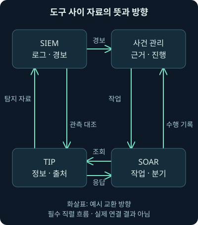
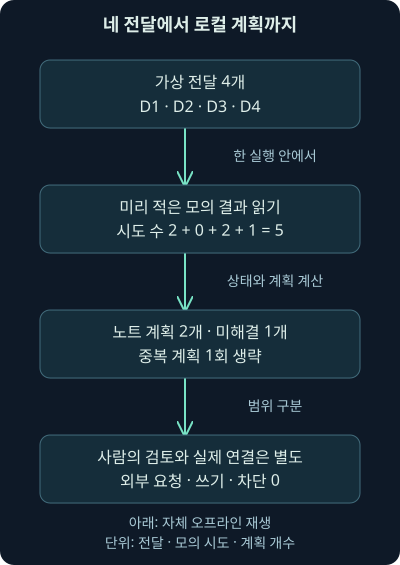
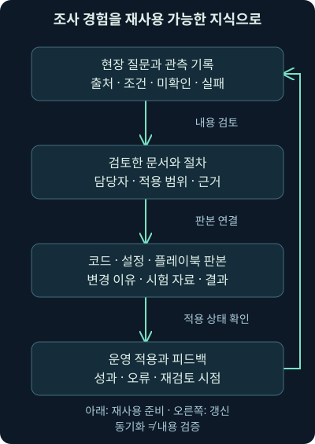

## 1. 도구 네 개를 연결했는데 같은 일을 다시 한다면

가상 SOC, 보안 운영센터가 SIEM·사건 관리·위협 정보·자동화 도구를 모두 갖췄습니다. 그런데 분석가는 여전히 주소를 복사하고 케이스 번호를 다시 입력합니다. 한 도구에서는 정상 완료인데 다른 도구에는 기록이 없기도 합니다. 선을 연결하는 것보다 “어떤 의미의 자료가 어느 책임 아래 이동하는가”를 정하는 일이 먼저였던 셈입니다.

17강에서는 개별 작업과 흐름의 실패·권한·검토를 배웠습니다. 이번18강은 **SOC 도구 사이의 자료·식별·상태 연결, 자체 오프라인 재생, 조사 지식과 코드의 재사용**입니다. 모의 결과를 읽는 프로그램은 직접 실행했지만 실제 API·서버·보강 서비스·케이스 쓰기·차단·외부 발송은 수행하지 않았습니다.

모든 조직·도메인·케이스·관측·응답은 자체 가상 설정입니다. 프로그램의 출력은 로컬 계획이며 실제 위협 정보나 제품 실행 결과가 아닙니다. 다음19강부터는 공격자의 목적과 행동을 이해하는 모듈로 이어갑니다.

## 2. 각 도구가 맡는 질문을 구분합니다

**SIEM**은 모은 기록을 검색·분석·시각화·경보·보고에 연결합니다. **사건 관리 시스템**은 조사 담당자·근거·진행·조치를 이어갑니다. **TIP**, 위협 정보 플랫폼은 재사용할 정보의 값·맥락·출처·관계를 관리합니다. **SOAR**는 정의한 작업과 조건을 연결해 수집·처리·대응의 반복을 돕습니다.

제품에 따라 이 기능들이 한곳에 함께 있을 수도 있습니다. 분류 이름보다 실제 자료와 책임을 확인하세요. 사건 관리 기능을 SIRP, 보안 사건 대응 플랫폼이라고 부르는 경우도 있지만 이름만으로 조사 범위나 자동화 권한이 결정되지는 않습니다.

SIEM 경보를 사건 관리 도구로 옮겼다는 사실은 내부 침해 확정과 다릅니다. TIP 이벤트도 보고서 묶음일 수 있습니다. 케이스 생성·조사 개시·판단 확정·조치 완료를 같은 상태로 만들지 않아야 도구 간 집계가 왜곡되지 않습니다.

## 3. 화살표에는 자료의 뜻을 적습니다

SIEM에서 사건 관리로는 경보와 원기록 참조·시간·조건·관측 범위를 전달할 수 있습니다. TIP에서 SIEM으로는 찾을 값·조건·맥락·갱신/철회 정보를 제공할 수 있습니다. 조사에서 TIP으로 되돌리는 것은 내부에서 실제 보았다는 근거와 새 분석이며, 외부 목록을 받았다는 사실과 다릅니다.



그림에서는 경보 전달과 보강 조회·응답, 작업 수행 기록을 구별해 읽어주세요. SOAR가 조회 결과를 케이스에 정리할 수 있지만, 어떤 값을 어디서 확인했는지와 오류·미확인 범위도 함께 전달해야 합니다. 도구 사이에 값만 오가면 같은 재조사가 반복됩니다.

## 4. 식별자와 출처를 함께 이동시킵니다

같은 이벤트 번호를 쓰는 다른 서버가 있거나, 다른 조직에 같은 케이스 번호가 있을 수 있습니다. 연동에서는 번호가 어느 시스템·조직의 범위에서 유일한지 확인해야 합니다. 출처의 원식별자와 수신 시스템에서 부여한 번호를 나눠 보존하면 연결을 추적하기 쉽습니다.

관측값에는 유형·값·역할·관련 시각·원출처·원기록 참조·공유 조건을 붙입니다. 도메인과 참고 URL, 계정 이름과 다른 영역의 같은 이름을 구별하지 않으면 잘못된 연결이 생깁니다. 시각의 시간대와 사건·도착·갱신 시각도 분리합니다.

**자료 계약**, data contract는 서로 어떤 필드·자료형·의미·필수 조건·오류를 주고받을지 정한 약속입니다. 이름만 맞추는 스키마 검사와 내용의 진실 검증은 다릅니다. 실제 제품의 요청·응답 형식은 해당 버전 문서와 설치본으로 시험해야 합니다.

## 5. 같은 사실을 어느 곳에서 수정할지 정합니다

계정의 현재 상태는 인증 시스템이, 케이스 담당자와 조사 판단은 사건 관리 시스템이, 외부 정보의 출처·판본은 TIP이 책임지는 식으로 기준을 정할 수 있습니다. 실제 조직에서는 이 책임과 충돌 해결 기준을 문서화해야 합니다. 여러 도구가 같은 필드를 서로 덮어쓰면 마지막 전송이 무조건 정답이 되는 문제가 생깁니다.

가상 자산 소유 부서가 바뀌었다면 사건 당시의 소유자와 현재 소유자를 구별합니다. 현재 값으로 과거 조사 기록을 설명 없이 덮으면 당시에 누가 무엇을 알았는지 잃습니다. 변경 이유·출처·시각·버전을 남기세요.

외부 자료가 정정·철회되면 현재 적용할 탐지 자료와 과거에 판단에 사용한 판본을 분리합니다. 과거 근거를 지워 버리는 것과 현재 사용을 중단하는 것은 다른 일입니다. 연동의 편리함 때문에 이런 차이를 감추면 안 됩니다.

## 6. 응답 성공과 의미 있는 결과를 구별합니다

요청이 수락됐거나 정상 응답을 받았어도 내용이 비었거나 일부 페이지밖에 없을 수 있습니다. **페이지네이션**, pagination은 많은 결과를 여러 묶음으로 나눠 받는 방식입니다. 첫 묶음만 처리하고 전체 검색이 끝났다고 기록하지 않아야 합니다.

연결 오류·권한 부족·속도 제한·시간 초과는 정상 결과 없음과 다릅니다. 반환된 상태를 상대 도구가 같은 의미로 저장하는지 확인하세요. 호출 성공률이 높아도 잘못된 계정·기간·출처를 조회했다면 조사 품질은 높아지지 않습니다.

쓰기 작업은 더 구체적인 확인이 필요합니다. 노트 생성 의도·요청 발송·서버 수락·실제 노트 존재·올바른 케이스 연결을 나눠 봅니다. 이번 자체 프로그램의 노트 계획을 실제 케이스 쓰기 성공이라고 표시하지 않는 이유입니다.

## 7. 피드백은 독립 근거를 만들어 내지 않습니다

외부 보고서의 도메인을 받았고 내부 도구가 같은 도메인을 다시 반환했다고 합시다. 둘 다 원래 같은 보고서에서 왔다면 새로운 독립 관측이 생긴 것은 아닙니다. 조회·재배포·요약을 거칠수록 출처와 주장 주체를 더 분명히 남겨야 합니다.

실제 패킷에서 DNS 요청을 관측했다면 그것은 이름 조회의 근거입니다. 도메인 차단 여부·접속·파일 수신·프로세스 실행까지 자동으로 확장하지 않습니다. 리졸버 응답·방화벽·프록시·서버·단말 기록과 연결할 질문을 남깁니다.

관측하지 못한 결과에도 수집 위치·방향·시간·암호화·재조립·보존·도구 설정의 한계가 있습니다. “연동된 모든 도구에서 못 찾았다”는 문장도 그 도구들이 같은 제한된 출처를 보고 있었다면 범위가 제한적입니다. 시스템 수보다 증거의 범위를 확인하세요.

## 8. 자체 실습의 입력과 프로그램을 확인합니다

[deliveries.json](../../assets/network-security/lab18/deliveries.json), [replay_workflow.py](../../assets/network-security/lab18/replay_workflow.py), [workflow-contract.json](../../assets/network-security/lab18/workflow-contract.json), [README.txt](../../assets/network-security/lab18/README.txt)를 같은 폴더에 저장합니다. 파일의 설명과 코드를 읽고 이 과제의 범위를 확인하세요.

입력 형식 `training-workflow-v1`은 직접 만든 연습 형식입니다. MISP·TheHive·SOAR의 API나 제품 스키마가 아닙니다. **재생**, replay는 미리 적힌 가상 조회 결과를 순서대로 읽어 분기와 계획을 계산하는 뜻으로 사용합니다. 실제 조회를 실행했다가 기록을 재생하는 도구가 아닙니다.

외부 전달 허용 값은 false이고 프로그램에는 네트워크·서비스 호출·케이스 수정 코드가 없습니다. `files.example`, `relay.example`, `docs.example`은 예시 도메인입니다. 이 주소에 접속하거나 값을 보강 서비스로 보내는 과제가 아닙니다.

## 9. 네 번의 전달에 세 가지 결과를 넣었습니다

**전달 ID**는 프로그램에 들어온 묶음의 이름이고, **이벤트 ID**는 그 전달이 가리키는 원관측의 이름입니다. 같은 원관측이 여러 번 전달될 수 있으므로 두 식별자를 구별합니다. 입력의 조직·케이스·워크플로 버전도 함께 읽습니다.

| 전달 | 가상 맥락 | 미리 적힌 모의 조회 결과 |
|---|---|---|
| D1 | CASE1·EV1·files.example | 시간 초과 뒤 정상 응답·의심 주장 |
| D2 | D1과 같은 케이스·이벤트의 재전달 | D1과 같은 설정, 이미 계획됐는지 확인 |
| D3 | CASE2·EV2·relay.example | 두 번 모두 시간 초과 |
| D4 | CASE3·EV3·docs.example | 정상 응답·일치 없음 |

표의 “의심”과 “일치 없음”도 가상 제공자의 주장일 뿐입니다. 모의 결과에 그런 글자가 있다는 사실을 실제 도메인의 상태로 옮기면 안 됩니다. 프로그램은 둘 다 사람이 확인할 로컬 노트 계획으로 남기도록 만들었습니다.

## 10. 기본 재생을 실행합니다

```powershell
python replay_workflow.py deliveries.json
```

`python`은 실행기, `replay_workflow.py`는 프로그램, `deliveries.json`은 읽을 입력 파일입니다. 기본값은 전달 한 번당 모의 결과를 최대2개 읽는 것입니다. 실제로 기다리거나 서비스에 두 번 요청하지 않습니다. 작성 시 Python3.12.14로 실행했습니다.

결과는 전달4개, 모의 조회 시도5회, 완료된 중복 계획 생략1회, 노트 계획2개, 미해결1개였습니다. 외부 요청·실제 케이스 쓰기·차단 수는 모두0입니다. 이 숫자는 실제 보안 작업 처리량이나 성공률이 아닙니다.



그림에서 전달 수4와 시도 수5가 다른 이유를 보세요. D1은 두 모의 결과를 읽고 D2는 이미 만들어진 계획이라 생략하며, D3는 두 번 실패하고 D4는 한 번에 응답합니다. 계산은2+0+2+1=5입니다.

## 11. 노트 두 개가 아니라 노트 계획 두 개입니다

출력의 `note_plans`에는 CASE1·EV1과 CASE3·EV3의 계획이 있습니다. `lookup_claim`은 가상 조회의 주장이고 `decision`은 두 경우 모두 `human_review_required`, 사람의 검토 필요입니다. `action`은 `local_note_plan_only`, 로컬 노트 계획뿐이라는 표시입니다.

실제 케이스가 생성·수정된 것은 아닙니다. 프로그램이 표시한 필드와 실행의 범위를 읽지 않고 “자동 조사·대응 완료”로 보고하면 다음 담당자가 필요한 실제 작업을 건너뛸 수 있습니다. 계획·요청·실제 결과는 따로 기록해야 합니다.

조직에서 이런 계획을 실제 기록으로 옮기려면 케이스 대상·쓰기 권한·자료 계약·공유 조건·중복 처리·확인 응답을 추가로 검증해야 합니다. 이번 예제는 그 연결을 구현하지 않았습니다.

## 12. 중복 제거 키의 범위를 읽습니다

계획을 구별하는 키는 조직·케이스·이벤트·워크플로 버전의 묶음입니다. D1의 계획이 생성된 뒤 D2가 같은 키로 들어오면 같은 실행 안에서 새 계획을 만들지 않습니다. 값이 같은 도메인이라고 전부 합치는 방식은 아닙니다.

작성 시 D2의 케이스를 별도 가상 케이스로 바꾼 사본도 실행했습니다. 다른 케이스이므로 별도 계획이 생겼습니다. 반대로 같은 키인데 관측값이 다른 사본은 충돌 오류로 멈췄습니다. 식별 범위와 내용이 어긋난 것을 조용히 덮어쓰지 않는지 확인한 것입니다.

이 중복 상태는 프로그램 실행 중 메모리에만 있습니다. 같은 명령을 다시 실행하면 상태가 새로 시작되어 같은 계획이 다시 표시됩니다. 실제 시스템의 영속 중복 제거·동시 실행 잠금·외부 작업의 한 번만 수행 보장을 구현한 것이 아닙니다.

## 13. 미해결을 완료로 채우지 않습니다

D3는 두 모의 시간 초과 뒤 `pending` 목록에 남습니다. 이 목록의 뜻은 조회 결과를 아직 확인하지 못해 후속 검토가 필요하다는 것입니다. 실행 프로그램의 종료 코드0이더라도 미해결 항목은 있을 수 있습니다.0은 재생 계산의 성공이지 모든 보안 조치의 완료가 아닙니다.

작성 시 CASE2·EV2에 대해 나중에 정상 모의 응답을 주는 추가 전달을 붙인 사본을 실행했습니다. 새 계획이 생기고 현재 미해결 목록에서는 빠졌지만 이전 실패 시도는 `audit`, 실행 이력에 남았습니다. 실패가 없었던 것처럼 지우지 않고 현재 상태와 과거 시도를 구분한 것입니다.

실제 시스템에서는 담당자·재확인 시각·다른 출처·연결 장애 처리와 종료 기준을 정해야 합니다. 실패 상태를 끝없이 방치하거나 자동으로 정상으로 닫지 않습니다. 이번 예제는 그런 운영 책임을 대신 수행하지 않습니다.

## 14. 시도 수를 줄이면 어떤 계획이 남을까요?

```powershell
python replay_workflow.py deliveries.json --max-attempts 1
```

`--max-attempts`는 전달 한 번에서 읽을 모의 결과 수의 상한입니다.1로 바꾸면 D1은 첫 시간 초과 뒤 끝나고, 아직 완료된 계획이 없는 D2도 첫 결과를 다시 읽습니다. D3도 한 번만 읽고 D4는 일치 없음 응답을 읽습니다.

실제 자체 결과는 모의 시도4회·노트 계획1개·미해결2개였습니다. 시도가 줄었다는 이유만으로 더 효율적인 흐름이라고 판단할 수 없습니다. 얻지 못한 맥락과 후속 재작업이 늘 수 있습니다. 이 상한은 전체 시스템의 전역 재시도 예산이 아니라 전달별 상한이라는 한계도 봐주세요.

권한 부족 모의 결과를 넣은 별도 사본에서는 뒤에 정상 결과가 있어도 그 전달의 재시도를 멈췄습니다. 권한 문제를 일시적 시간 초과처럼 반복 요청하지 않는 분기를 확인한 것입니다. 실제 권한을 변경하거나 서비스에 재접속하지 않았습니다.

## 15. 입력 오류와 결과 미확인을 나눕니다

외부 전달 허용 값이 true이거나 형식 이름·필수 값·모의 상태가 잘못되면 이 과제는 오류 코드2로 멈춥니다. 오류를 빈 정상 결과로 바꾸지 않습니다. 작성 시 잘못된 JSON·필수 키 누락·충돌·비허용 상태와 시도 수를 넣어 확인했습니다.

다만 프로그램은 전체 도메인 문법이나 실제 사건의 진실·권한·제품 호환성을 검증하지 않습니다. 예시 도메인과 제한된 상태만 받는 교육용 프로그램입니다. 코드의 가상 판단 필드를 바꿔 실행해도 그 도메인의 실제 보안 상태가 바뀌지는 않습니다.

한 번의 실행이 계획된 대로 끝났는지, 원자료·외부 주장·조치 권한이 검증됐는지는 다른 질문입니다. 출력의 성공 상태를 다른 의미로 확대하지 않는 습관을 익혀야 실제 도구 연동에서도 오류가 숨지 않습니다.

## 16. 조사 기록은 다음 사람이 검증할 수 있어야 합니다

원관측·원출처 참조·수집 범위·조회 조건·반환 주장·실패·미확인·분석 가설·실제 수행과 결과를 구분해 남깁니다. 작업 담당자와 케이스·실행·자료 버전을 연결하면 다른 도구에서 같은 항목을 다시 찾을 수 있습니다.

조치 판단은 근거와 대안 설명을 함께 적습니다. 같은 값이 보였다는 관측, 비인가 사용일 가능성, 감염·침해 성공이라는 결론은 같은 층위가 아닙니다. 필요하면 단말·서버·방화벽·리졸버 기록을 어떤 질문으로 대조할지 남기세요.

한 도구에서 끝난 작업이 다른 도구에 기록되지 않았을 때도 실제 효과를 먼저 확인해야 합니다. 기록 전송 오류를 이유로 같은 격리·차단·메시지를 무조건 반복하지 않습니다.17강의 실패·멱등성·권한 원칙이 여기서 연결됩니다.

## 17. 모든 지식이 케이스나 지표 목록은 아닙니다

팀의 새 구성원 안내·회의 기록·조사 방법·도구 설정 설명·교육 자료는 일반 지식 저장소가 필요합니다. **비정형 자료**는 고정된 필드로 정리되지 않은 글·그림 등이고, **반정형 자료**는 일부 제목·태그·항목 구조를 갖지만 일정한 표 하나로 고정되지 않은 자료입니다.

위키·공동 노트·문서 저장소 등을 선택할 때는 공동 편집·검색·버전·주석·동기화·변경 알림·그림과 서식·접근 권한·배우기 쉬운 정도를 함께 봅니다. 사용하기 번거로워 아무도 갱신하지 않으면 기능이 많아도 운영 지식이 쌓이지 않습니다.



그림에서 현장 메모와 검토된 운영 절차를 구분해 보세요. 빨리 공동 기록하는 공간과 실제 대응에 쓰는 승인·검증된 절차의 상태가 같지 않을 수 있습니다. 내용의 소유자·확인일·적용 버전·원근거·남은 한계를 검색 결과에서도 알 수 있게 합니다.

## 18. 코드와 절차도 판본을 함께 관리합니다

**버전 관리**는 변경한 내용과 이력을 추적해 어느 상태를 사용했는지 알 수 있게 하는 방법입니다. **Git**은 이런 변경을 관리하는 도구이고, **저장소**, repository는 파일과 그 이력을 관리하는 단위입니다. 변경 묶음을 기록하는 **커밋**, commit은 사용한 코드·설정·시험 자료의 판본을 연결하는 데 도움을 줍니다. [GitHub의 Git 안내](https://docs.github.com/en/get-started/using-git/about-git), 확인일2026-11-05를 참고했습니다.

파일 이름을 `최종_진짜최종`으로 늘리는 대신 어떤 논리·자료·검증이 바뀌었는지 남깁니다. 검토 의견과 시험 결과를 연결하고, 실행 로그에는 사용한 코드·플레이북·설정 버전을 기록합니다. 버전이 있다는 사실만으로 코드의 정확성·안전성·원자료 진실이 검증되지는 않습니다.

문서의 자동 동기화도 양쪽의 복구·충돌 해결을 대신 보장하지 않습니다. 잘못된 변경이 빠르게 퍼질 수도 있습니다. 중요한 운영 절차는 적용 상태와 초안을 구분하고 담당자·확인 주기·변경 이유를 남겨야 합니다. 이번 강의는 팀의 실제 코드 저장소나 승인 흐름을 새로 구성한 작업은 아닙니다.

## 19. 공유·비밀·원본 보존의 범위를 정합니다

케이스 첨부·로그·관측값·실행 이력에는 민감한 정보가 들어갈 수 있습니다. 문서·코드 저장소로 옮길 때도 원래의 공유 제한과 접근 범위를 유지해야 합니다. 태그·주석·샘플 설정·출력 로그에서 비밀이 새지 않는지 확인하고, 실제 인증 값 대신 예시·참조 구조를 사용합니다.

Git에서 현재 파일을 지웠다고 이전 이력의 값까지 사라지는 것은 아닙니다. 비밀이 노출됐다면 필요한 자격 증명 조치와 이력·사본·협업 영향을 포함해 별도 처리해야 합니다. [GitHub의 민감 자료 제거 안내](https://docs.github.com/en/authentication/keeping-your-account-and-data-secure/removing-sensitive-data-from-a-repository), 확인일2026-11-05를 참고했습니다. 이번에는 비밀 검색·자격 증명 변경·이력 재작성·삭제를 수행하지 않았습니다.

외부에서 온 설명·문자열을 명령문이나 실행 코드로 취급하지 않는 것도 중요합니다. 자료 값과 실행할 작업을 분리하고, 정해진 유형·대상·허용 작업으로 처리합니다. 이 예제는 입력을 명령으로 실행하지 않으며 제품 연결이나 외부 전달 코드를 포함하지 않습니다.

## 20. 실제 수행 범위와 다음 모듈

이번에는 Python3.12.14로 자체 가상 결과 재생과 조건 변경을 실행하고 입력 파일 보존을 확인했습니다. 실제 SOAR·TheHive·Cortex·MISP·SIEM 연동, API 호출·VM·PCAP·계정·악성 코드·차단·외부 메시지·티켓 발송은 실행하지 않았습니다.

개념의 현재 보충은2026-11-05의 [SIEM·SOAR 실무 지침](https://www.cyber.gov.au/publication/implementing-siem-and-soar-platforms-practitioner-guidance), [TheHive6 문서의 Flow 안내](https://docs.strangebee.com/flow/user-guides/about-flow/)와 GitHub 공식 문서로 확인했습니다. 설치본의 라이선스·API 세부 형식·성능·권한·실제 화면은 별도 검증이 필요합니다.

원본 본 교재는 도구 역할과 자료 흐름을 파악하는 기준이고, 별도 원본 워크북·가상 위키·VM은 확인한 접근 위치에서 확보·실행하지 못했습니다. 자체 파일은 그 원래 실습의 복제나 완료 증명이 아닙니다. 다음19강에서는 이 도구들이 무엇을 이해하고 관측하려는지, 공격자의 목적과 행동을 차근차근 살펴보겠습니다.

## 21. 복습 질문과 바로 읽는 해설

### 질문 1. SIEM 경보가 케이스로 옮겨졌으면 침해 사건이 확정됐나요?

**해설:** 조사 작업의 묶음이 만들어졌을 수 있습니다. 경보·케이스 생성·비인가 활동 판단·피해 확인·조치 완료를 나눠 기록해야 합니다.

### 질문 2. 이벤트 번호만 같으면 같은 원관측으로 합쳐도 될까요?

**해설:** 출처·조직·서버 등 식별 범위에서 유일한지 확인해야 합니다. 번호만 비교하면 다른 시스템의 실제 기록을 잘못 합치거나 버릴 수 있습니다.

### 질문 3. 정상 응답의 첫 페이지를 받으면 전체 조회가 끝난 것인가요?

**해설:** 페이지·제한·필터·권한·부분 결과를 확인해야 합니다. 요청 수락이나 일부 반환과 전체 범위 처리 완료는 다릅니다.

### 질문 4. 같은 외부 보고서가 세 도구에서 돌아오면 독립 근거도 세 개인가요?

**해설:** 재배포·요약 경로가 같은 원출처일 수 있습니다. 문서·도구 수와 독립 관측 수를 구별해야 판단의 확신이 잘못 커지지 않습니다.

### 질문 5. 기본 재생에서 전달4개인데 시도가5회인 이유는 무엇인가요?

**해설:** D1이2회, 이미 계획된 D2는0회, D3가2회, D4가1회여서 합계5회입니다. 실제 조회가 아니라 미리 적은 모의 결과를 읽은 횟수입니다.

### 질문 6. note_plans 두 개면 실제 케이스 노트도 두 개 생겼나요?

**해설:** 로컬 계획을 출력했을 뿐입니다. API·쓰기·대상 확인을 실행하지 않았으며 계획과 실제 수행 결과를 구별해야 합니다.

### 질문 7. 같은 명령을 두 번 실행해도 외부 작업 중복을 막나요?

**해설:** 이 프로그램의 상태는 실행 중 메모리에만 있고 다시 시작하면 초기화됩니다. 실제 외부 효과도 없으며 영속·분산 중복 제거를 검증한 예제가 아닙니다.

### 질문 8. 종료 코드0인데 pending이 남아도 되나요?

**해설:**0은 재생 계산 성공입니다. 조회 결과 미확인·후속 검토가 필요한 항목은 별도로 남을 수 있습니다. 프로그램 성공을 사건 종결로 바꾸면 안 됩니다.

### 질문 9. 시도 상한1이 더 빠르니 무조건 좋은가요?

**해설:** 모의 시도는4회로 줄지만 노트 계획1개·미해결2개가 됩니다. 얻지 못한 맥락·후속 작업·전체 재시도 범위를 함께 평가해야 합니다.

### 질문 10. 나중에 계획이 생기면 이전 실패 로그를 지워도 될까요?

**해설:** 현재 미해결 상태와 과거 실행 이력을 구분해 남겨야 합니다. 이전 실패는 장애 원인·지연·중복·후속 판단을 이해할 근거가 됩니다.

### 질문 11. 위키가 자동 동기화되면 운영 절차도 검증된 것인가요?

**해설:** 동기화는 변경 전달 기능입니다. 초안·검토 상태·소유자·적용 버전·시험 근거를 별도로 확인해야 하며 잘못된 내용도 빠르게 퍼질 수 있습니다.

### 질문 12. 현재 코드에서 비밀을 지우면 Git 이력도 깨끗해지나요?

**해설:** 이전 커밋·사본에 남을 수 있습니다. 필요한 자격 증명 조치와 이력·협업 범위를 포함한 별도 처리가 필요합니다. 버전 관리를 접근 통제나 비밀 관리의 대체물로 보지 않습니다.
