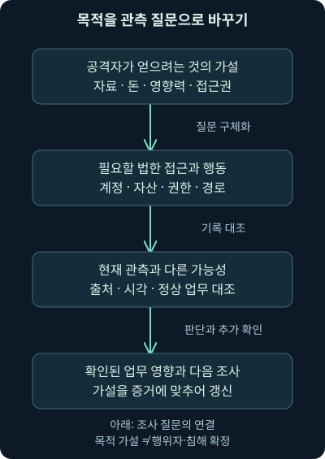
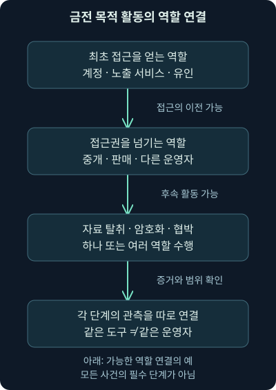
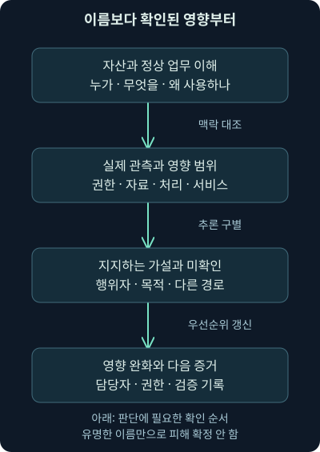

## 1. 도구를 연결한 다음에는 무엇을 이해해야 할까요?

가상 조직의 자료 공유 서버에서 대량 내려받기가 관측됐습니다. 담당자는 파일을 훔치려는 사람일 수도 있고 승인된 이관 작업을 하는 사람일 수도 있습니다. 외부 계정을 쓰는 공격자가 정상 사용자의 권한을 빌린 상황일 수도 있지요. 같은 기록에서 목적·주체·영향을 구분하지 않으면 대응 방향이 달라집니다.

18강까지는 조사 도구와 자료 흐름을 배웠습니다. 이번19강은 **공격자의 목적과 역할, 국가 연계·금전·이념·위탁·내부자라는 분석 관점**입니다. 다음20강은 기회형·표적형 공격과 위협 그룹 이름을 읽는 방법입니다. 실제 공격 사례의 흐름은21강부터 별도로 이어가며 요약으로 건너뛰지 않습니다.

조직·계정·행위·주소·보고서는 명시한 역사적 출처 외에는 모두 자체 가상 사례입니다. 이번 강의에서 실제 직원·계정·악성 파일·패킷을 조사하거나 공격·모니터링·차단을 실행하지 않았습니다. 관측한 사실과 해석·추가 확인을 구별하는 연습입니다.

## 2. 이름표보다 “무엇을 얻으려는가”를 먼저 묻습니다

건물의 문을 여는 사람을 생각해 보세요. 물건을 훔치려는 사람, 열쇠를 빌려주고 돈을 받는 사람, 정당한 업무로 들어가는 사람의 행동 일부는 비슷할 수 있습니다. 문이 열렸다는 사실만으로 목적과 역할이 모두 결정되지는 않습니다.

보안에서 **위협 행위자**, threat actor는 피해를 일으키거나 비인가 활동을 수행하는 주체를 분석할 때 쓰는 말입니다. 한 사람·협력자·조직·여러 역할의 연결일 수 있습니다. 도구·악성 코드의 이름과 행위자 이름을 같은 것으로 읽지 않아야 합니다. 일정한 목적이나 맥락으로 연결된 활동의 묶음을 **캠페인**이라고 하는데, 이 이름 역시 한 주체와 반드시 일대일로 대응하지 않습니다.

먼저 보호할 업무와 자료를 정하고, 상대가 무엇을 얻거나 방해하려는지 가설을 만듭니다. 자료 열람·돈·자원 사용·서비스 중단·신뢰 손상처럼 목적이 달라지면 확인할 기록과 방어 지점도 달라집니다. 목적은 유용한 질문이지만 로그 한 줄이 상대의 속마음을 직접 보여 주는 것은 아닙니다.

## 3. 분류는 서로 겹칠 수 있는 분석 관점입니다

국가와의 연계, 금전 목적, 이념적 주장, 위탁된 역할, 내부 접근은 같은 종류의 분류 축이 아닙니다. 국가 연계는 관계의 주장이고, 금전은 목적이며, 위탁은 역할·사업 구조에 가깝습니다. 한 활동에 여러 관점이 함께 적용될 수 있습니다.

| 분석 관점 | 먼저 묻는 질문 | 그것만으로 알 수 없는 것 |
|---|---|---|
| 국가 연계 | 어떤 공개 근거가 지원·관계 주장을 뒷받침하나? | 관측된 모든 주소·사용자의 국적 |
| 금전 목적 | 접근·사기·협박·자원 판매로 무엇을 얻으려 하나? | 도구 사용자의 정확한 신원 |
| 이념적 주장 | 주장한 목적과 실제 행위·영향이 일치하나? | 공개 주장 계정과 실행 주체의 동일성 |
| 위탁·분업 | 접근 확보·도구 제공·실행 중 누가 무엇을 맡나? | 거래·동맹의 전체 구조 |
| 내부 접근 | 어떤 신뢰·권한을 어떤 범위에서 사용했나? | 악의·실수·계정 탈취 중 무엇인지 |

표는 사람을 하나의 칸에 고정하는 분류표가 아닙니다. 조사 질문의 차이를 읽어주세요. 어떤 관점이 아직 미확인인지 남기면 새로운 증거가 나왔을 때 가설을 바꾸기 쉽습니다.

## 4. 국가 연계 활동을 볼 때의 질문

국가 연계로 평가되는 활동은 정보 수집·정책적 목적·특정 기술이나 시스템 접근·업무 방해 등 여러 목표를 가질 수 있습니다. 하지만 “국가 연계라면 모든 단계가 새로운 고급 기술”이라는 가정은 맞지 않습니다. 사용 가능한 계정·기존 도구·알려진 약점도 목적 달성에 이용될 수 있습니다.

상대가 어떤 자료나 신뢰 경로에 관심을 가질지 생각하면 수집 우선순위를 정하는 데 도움이 됩니다. 가상 연구 조직이라면 연구 자료·협력사 접근·개발자 계정·문서 공유 권한의 변화를 조사 질문으로 연결할 수 있습니다. 이것은 특정 국가가 실제로 그 조직을 공격했다고 판단한 사례가 아닙니다.

국가 연계라는 평가는 공개 보고서의 근거·관측 범위·발행일·확신 수준과 함께 읽습니다. 출발 IP의 지리 정보·사용 언어·접속 시각 하나만으로 국가나 조직을 확정하지 마세요. 중계 서버·탈취된 단말·시간대 변환 등 대안 설명을 검토해야 합니다.

## 5. 기술적 연결과 귀속 판단은 다릅니다

**귀속**, attribution는 활동을 특정 주체나 관련 조직에 연결하는 판단입니다. 같은 악성 파일·인프라·행동의 연결은 조사 출발점일 수 있지만, 누가 지시하고 실행했는지를 한 번에 증명하지는 않습니다. 공개 도구와 공용 기반 시설은 여러 주체가 이용할 수 있습니다.

보고서의 “연관 가능성”, “부분 중첩”, “해당 기관의 평가”를 우리 환경에서 직접 확인한 사실처럼 바꾸지 않습니다. 기술적 관측과 외부 기관의 주장을 따로 기록하고, 다른 출처가 같은 원보고서를 재인용한 것은 아닌지 확인합니다.

이름을 알아야만 방어할 수 있는 것도 아닙니다. 실제 비인가 세션·자료 접근·업무 중단의 근거가 있으면 필요한 조사와 영향 판단을 진행할 수 있습니다. 행위자 이름이 정해질 때까지 중요한 근거 수집을 미룰 이유는 없습니다.

## 6. 역사적 보고서의 날짜도 확인합니다

과거의 대표적인 공개 분석 사례로 APT1 보고서가 자주 언급됩니다. 원자료 일부의2012년이라는 소개와 달리, 제작사의 공개 안내 날짜는 **2013-02-19**입니다. [Mandiant의 원발표 안내](https://cloud.google.com/blog/topics/threat-intelligence/mandiant-exposes-apt1-chinas-cyber-espionage-units), 확인일2026-11-05로 대조했습니다.

여기서 배울 점은 특정 이름이나 과거 지표를 외우는 것보다, 보고서가 어떤 기간·대상·자료를 근거로 분석했는지 읽는 방식입니다. 오래된 보고서의 주소나 해시가 지금도 같은 역할이라는 뜻은 아닙니다. 오늘의 조사에 쓰려면 유효 시각·출처·현재 관측과의 관계를 다시 검토해야 합니다.

역사적 귀속 보고서가 있었다는 사실을 현재 모든 사건의 행위자 판정 규칙으로 만들지 않습니다. 다음20강에서는 명칭 변경과 출처별 활동군의 범위가 어떻게 달라질 수 있는지도 살펴보겠습니다.

## 7. 금전 목적에서는 역할의 분업을 봅니다

**조직적 사이버 범죄**라는 관점에서는 자료·계정·접근권·장비 자원을 돈으로 바꾸는 흐름을 묻습니다. 직접 사기를 실행하는 역할, 접근을 확보해 넘기는 역할, 악성 도구를 제공하는 역할이 나뉠 수 있습니다. 같은 브랜드를 쓴다는 이유만으로 모든 행동을 한 주체가 수행했다고 가정하지 않습니다.

가상 경보에서 외부 접속이 발견된 뒤 한동안 조용하다가 다른 도구와 행동이 나타날 수 있습니다. 실제 역할이 바뀌었을 가능성도 있지만, 같은 주체가 방법을 바꿨거나 수집 범위가 달라졌을 수도 있습니다. 시각·계정·세션·파일·원출처를 연결해 비교해야 합니다.

과거 자료에 나온 범죄 집단·도구 이름을 현재 활동·소유·동맹 관계의 고정 목록으로 재게시하지 않습니다. 활동은 바뀌고 이름은 재사용될 수 있습니다. 원보고서의 날짜와 어떤 행위를 관측했다는 주장인지부터 읽습니다.

## 8. 랜섬웨어와 자료 협박의 영향을 나눕니다

**랜섬웨어**, ransomware는 자료나 시스템의 사용을 막는 암호화 등과 금전 요구가 연결되는 악성 활동을 설명할 때 쓰입니다. **이중 협박**, double extortion은 암호화로 인한 접근 제한과 자료를 빼내 공개하겠다는 압박을 함께 활용하는 방식입니다. 자료 절취·협박이 암호화 없이 일어나는 경우도 구별해야 합니다.

그래서 백업으로 파일을 복구할 수 있다는 사실만으로 자료 노출 가능성이 사라지지는 않습니다. **기밀성**은 허용되지 않은 열람·노출을 막는 성질이고, **가용성**은 필요한 때 업무·자료를 사용할 수 있는 성질입니다. 복구와 노출의 조사 질문이 다릅니다.2026-11-05 확인한 [캐나다 사이버보안센터의 랜섬웨어 지침](https://www.cyber.gc.ca/en/guidance/ransomware-playbook-itsm00099)을 참고했습니다.

가상 파일 이름 변경과 암호화 의심 경보가 있더라도 실제 변경 내용·범위·프로세스·복구 상태를 확인해야 합니다. 협박 메시지의 주장만으로 모든 자료가 유출됐다고 확정하지 않습니다. 서버 읽기·내보내기·외부 전송·보존 범위를 대조해 관측과 주장을 분리합니다.

그림은 목적의 가설에서 필요한 행동을 예상하고 실제 기록과 대조하는 순서로 읽어 주세요. 마지막의 업무 영향에서는 중단과 자료 노출을 따로 확인합니다. 한쪽 근거가 있다는 이유로 다른 쪽까지 자동으로 확정하지 않습니다. 이 강의는 금전 지급·협상·법적 판단을 수행하거나 특정 조치를 대신 결정하는 안내가 아닙니다.

## 9. 이념적 주장은 행위와 함께 검증합니다

**핵티비즘**, hacktivism은 정치·이념·사회적 메시지와 해킹 행위가 연결된 활동을 설명하는 말입니다. **DDoS**, 분산 서비스 거부는 여러 출처의 요청이나 트래픽 등으로 서비스 제공을 방해하는 방식입니다. 웹 내용 변조·자료 절취와 공개·평판 손상도 조사할 수 있는 영향입니다.

**독싱**, doxing은 개인을 식별·추적할 수 있는 정보를 모아 노출해 위협·괴롭힘 등에 이용하는 행위를 가리킵니다. 보안 조사에서도 실제 개인 정보의 무분별한 재공유를 피하고 필요한 접근 범위와 근거를 유지해야 합니다. 사람의 정치적 의견 자체가 침해의 증거인 것은 아닙니다.

과거 Anonymous·LulzSec 같은 이름이 이런 활동의 예로 소개되지만, 같은 이름을 쓰는 공개 계정이 모두 한 조직이나 하나의 실행 주체라는 뜻은 아닙니다. 조직 수준·기술 수준·목표가 항상 낮거나 단순하다고 단정하지도 않습니다. [Google의 핵티비즘 분석](https://cloud.google.com/blog/topics/threat-intelligence/global-revival-of-hacktivism/), 확인일2026-11-05를 참고해 공개 주장과 실제 방법의 다양성을 구별합니다.

## 10. 공개 예고·성과 주장이 곧 관측은 아닙니다

가상 계정이 “조직의 서비스를 멈췄다”고 게시했다고 합시다. 직접 확인한 사실은 그런 주장이 있다는 것뿐일 수 있습니다. 실제 이용 가능성·부하·요청 분포·시작 시각·영향 범위를 대조해야 합니다. 오래된 자료나 다른 조직의 화면을 재사용했을 수도 있습니다.

사전 위협을 수집할 때도 출처·시각·정확한 대상·자료 신뢰도를 남기고 기존 위협 정보 절차에 연결합니다. 공개 자료를 보는 것과 비공개 공간에 접근·위장·침투하는 활동은 다른 범위입니다. 이 강의는 그런 접근이나 상대와의 접촉을 지시하거나 수행하지 않습니다.

목적을 이해하는 이유는 주장에 반응해 성급히 결론 내리려는 것이 아닙니다. 필요한 서비스 기록과 업무 연계를 빨리 확인하려는 것입니다. 실제 서비스 저하가 있다면 주체 판정과 별도로 영향·복구·조사 담당자를 연결합니다.

## 11. 위탁·접근 판매·서비스형 범죄

**해커 고용**, hackers-for-hire라는 관점은 보수를 받고 특정 역할을 맡는 주체를 살펴봅니다. **초기 접근 중개자**, initial access broker는 조직이나 계정에 대한 접근을 확보해 다른 주체에게 넘기는 역할을 설명할 때 쓰입니다. 접근의 확보자와 나중 행동의 실행자가 다를 수 있습니다.

**RaaS**, Ransomware-as-a-Service는 랜섬웨어 운영의 일부 도구·기반·역할을 서비스처럼 나눠 제공하는 구조입니다. 같은 프로그램이나 브랜드를 쓴다는 사실이 모든 참여자의 신원·행동을 같게 만들지 않습니다. 취약점 이용이나 봇 자원처럼 다른 역할도 위탁·거래될 수 있지만 구체적 구조는 출처의 근거로 확인해야 합니다.

그림은 모든 공격이 이 순서로 진행된다는 규칙이 아닙니다. 역할을 나눠 보면 계정·세션·도구·시간이 바뀌는 구간에서 무슨 질문을 해야 하는지 보입니다. 여러 역할이 협력하거나 한 주체가 여러 역할을 맡을 수 있습니다.

## 12. 내부 접근은 악의의 증거가 아닙니다

**내부자** 관점에서는 조직이 부여한 신뢰·물리적 접근·계정·업무 권한이 어떻게 사용됐는지 살펴봅니다. 악의적 내부자는 권한을 이용해 자료·돈·지식재산을 빼내거나 업무·평판을 해칠 수 있습니다. 그러나 정상 계정의 기록이 있다고 계정 소유자가 직접 그 행위를 했다는 결론이 나오지는 않습니다.

실수·잘못된 공유 설정·교육 부족에 의한 노출과, 의도적 오용·외부인의 계정 탈취를 구분합니다. 이 구분에 따라 필요한 개선도 달라집니다. 사람의 불만이나 퇴사 예정 같은 배경만으로 악의와 침해를 확정하지 않습니다.

가상 자료 관리자가 야간에 파일을 많이 내려받았다면 승인된 이관·대량 보고·백업·계정 탈취·무단 반출 등 대안 설명을 검토합니다. 실제 자료·동작·권한·승인·세션·단말 근거를 대조해야 합니다. 직원 개인에 대한 결론을 자동 점수나 이상 징후 하나에 맡기지 않습니다.

## 13. 정상 권한으로도 큰 영향을 줄 수 있습니다

문을 부수지 않고 열쇠를 사용하는 경우를 떠올려 보세요. 권한이 있다는 사실은 해당 목적·자료·기간의 모든 사용이 승인됐다는 뜻은 아닙니다. 가상 지급 업무에서도 자료 수정·승인·전송·확인을 한 계정에 모아 두면 어떤 단계에서 문제가 생겼는지 구별하기 어려울 수 있습니다.

여기서의 조사 질문은 비밀번호만이 아닙니다. 누가 어느 자료를 읽고 수정했는지, 승인 기록과 실제 전송이 일치하는지, 예외 처리와 서비스 계정 사용이 있었는지를 확인합니다. **무결성**은 자료·처리 결과가 허용되지 않게 바뀌지 않는 성질입니다. 금전 손실뿐 아니라 자료의 신뢰와 업무 지속에 대한 영향을 살펴봅니다.

이 예제는 직접 만든 가상 업무이며 실제 은행 사건·금액·직원을 조사한 것이 아닙니다. 내부 위험이 언제나 드물고 예측 불가능한 일이라는 단정도 하지 않습니다. 관측 가능한 행위·통제·업무 절차를 기준으로 위험을 다루는 것이 중요합니다.

## 14. DLP·UEBA는 검토할 단서를 줍니다

**DLP**, Data Loss Prevention은 자료의 이동·사용과 관련된 유출 방지·탐지·통제를 돕는 기술·절차를 뜻합니다. **UEBA**, User and Entity Behavior Analytics는 사용자와 단말·계정 같은 개체의 행동을 분석하는 방식입니다. 과거 자료의 UBA는 사용자 행동 분석을 가리키는 표현으로 접할 수 있습니다.

평소보다 큰 다운로드나 새로운 외부 목적지는 검토할 단서가 됩니다. 하지만 업무 변경·승인된 이관·새 프로젝트·자료 수집 오류로도 이상이 나타날 수 있습니다. 이상 탐지 결과는 악의의 정답표가 아닙니다. 관측 범위와 정상 업무 기준을 조정하고 정기적으로 오류를 확인해야 합니다.

모니터링은 필요한 목적·접근 권한·보존·개인 정보·조직 정책과 적용 규범을 함께 검토해야 합니다. 감정·성향을 추정해 사람을 공격자로 분류하는 대신 실제 행위와 근거를 분석합니다. [영국 NCSC의 악의적 내부자 자료 반출 대응 안내](https://www.ncsc.gov.uk/guidance/reducing-data-exfiltration-by-malicious-insiders), 확인일2026-11-05를 참고했습니다. 실제 직원 감시나 도구 설정은 수행하지 않았습니다.

## 15. 가상 관측에서 목적 가설로 발전시키기

가상 서버 기록에는 계정 하나가 제한 자료 묶음을 읽고 내보낸 것으로 나타납니다. 직접 관측한 사실은 출처가 그 계정·시각·대상·동작을 기록했다는 것입니다. 그 계정의 실제 사용자가 누구였는지, 자료를 외부에 전달했는지는 아직 다른 질문입니다.

승인 문서와 서버의 원기록·접속 세션·단말·인증 제공자 기록을 대조합니다. 업무 승인과 실제 범위가 맞으면 정상 설명을 지지할 수 있습니다. 승인 범위를 벗어나고 외부 전송 근거가 추가되면 무단 반출 가설을 더 검토할 수 있습니다. 어느 경우든 이 가상 설정을 실제 실행 결과라고 부르지 않습니다.

출발지가 익숙하다고 정상으로, 외국 주소라고 공격자로 바로 분류하지 않습니다. 중계·NAT·VPN·탈취된 단말·원격 관리 등 주소의 역할을 확인해야 합니다. 주소가 사람·국적·의도를 자동으로 나타내지 않습니다.

## 16. 영향과 긴급성은 이름표를 기다리지 않습니다

한 단말의 처음 관측된 문제라도 관리자 권한·중요 자료·생산·백업·인증 기반과 연결되면 큰 영향을 줄 수 있습니다. 반대로 널리 알려진 집단 이름이 경보에 붙었다는 이유만으로 그 이름의 모든 위협이 현실화된 것은 아닙니다.

그림의 질문은 무엇이 실제로 관측됐는지, 어떤 자산·권한이 연결되는지, 영향이 진행 중인지입니다. 조사·영향 완화·업무 담당자 연계를 행위자 판명과 병행할 수 있습니다. 구체적인 조치는 권한·증거·업무 영향을 검토한 조직의 절차로 결정합니다.

## 17. 보이지 않는 것을 목적 없음으로 채우지 않습니다

패킷에서 자료 내용이 보이지 않는다면 암호화·수집 위치·통신 방향·기간·재조립·필터를 확인합니다. 단말 기록이 없다면 수집 설정·보존·시각·권한을 확인합니다. 미관측은 그 목적이나 행위가 없었다는 증거와 다릅니다.

의심스러운 문자열·도구 이름·포트 하나로 감염·침해 성공을 확정하지 않습니다. 서버·방화벽·리졸버·인증·단말 기록을 어떤 질문으로 비교할지 남기세요. 반증과 정상 설명을 찾는 것도 중요한 조사입니다.

현재 확인은2026-11-05의 공식·제작사 자료에 한정합니다. CISA의 일부 원페이지·PDF는403으로 접근하지 못했으므로 그 전체 내용을 직접 검증했다고 하지 않습니다. 원자료의 관점을 독립적인 설명·가상 예제로 바꾸고, 역사적 날짜와 현재 판단을 구별했습니다.

## 18. 다음 강의로 연결하기

목적과 역할을 이해하면 어떤 자료가 중요한지 보이지만, 실제 공격의 범위와 주체는 계속 검증해야 합니다. 국가·범죄·이념·위탁·내부 접근은 서로 겹칠 수 있는 질문이며 자동 우선순위 표가 아닙니다.

다음20강에서는 대상을 넓게 찾는 활동과 특정 조직을 겨냥한 활동을 구별하되, 시작 방식과 최종 피해 규모를 섞지 않겠습니다. 그리고 오래된 위협 그룹 이름을 현재 이름·출처별 활동군과 연결할 때 무엇을 보존해야 하는지 직접 만든 자료로 확인하겠습니다.

## 19. 복습 질문과 바로 읽는 해설

### 질문 1. 국가 연계·금전·내부자를 서로 배타적인 칸으로 나눠도 될까요?

**해설:** 관계·목적·접근 위치 등 서로 다른 축입니다. 한 활동에 여러 역할·목적이 겹칠 수 있고, 아직 모르는 항목을 억지로 채우면 조사 가설을 고치기 어렵습니다.

### 질문 2. 외국 IP와 특정 언어의 파일이면 국가가 판명되나요?

**해설:** 중계·공용 인프라·탈취된 단말·다른 사용 목적이 있을 수 있습니다. 관측 범위와 추가 근거 없이 국가·조직·사람을 확정할 수 없습니다.

### 질문 3. APT1 공개 보고서의 날짜를2012년으로 옮겨도 되나요?

**해설:** 이번에 대조한 제작사 발표는2013-02-19입니다. 원자료의 오류를 그대로 반복하지 않고 근거와 확인일을 기록해야 합니다. 과거 발표가 현재 사건 귀속의 정답표는 아닙니다.

### 질문 4. 백업으로 복구하면 이중 협박의 문제도 해결되나요?

**해설:** 업무·자료 접근 복구와 이미 읽히거나 반출된 자료의 노출 가능성은 다릅니다. 기밀성과 가용성의 질문을 나눠 근거를 확인해야 합니다.

### 질문 5. 공격자가 공개한 성과 화면은 직접 관측한 사실인가요?

**해설:** 우선 외부의 주장입니다. 대상·시각·자료 진위·실제 서비스·자산 기록을 대조해야 합니다. 재사용·과장·다른 사건일 가능성도 검토합니다.

### 질문 6. 같은 랜섬웨어 브랜드면 같은 사람이 모든 단계를 했나요?

**해설:** 접근 중개·도구 제공·실행·협박 등의 역할이 나뉠 수 있습니다. 도구 이름과 주체를 구별하고 실제 계정·시간·행동 근거로 비교해야 합니다.

### 질문 7. 정상 직원 계정으로 기록됐으면 내부자의 악의인가요?

**해설:** 정상 업무·실수·계정 탈취·위탁 작업 등 대안을 확인해야 합니다. 계정과 실제 사람·목적을 같게 취급하지 않습니다.

### 질문 8. 퇴사 예정이고 야간 다운로드가 많으면 범인인가요?

**해설:** 그런 배경과 이상만으로 결론을 내릴 수 없습니다. 승인·실제 자료·세션·단말·업무 필요·외부 전송 등을 확인하고 개인에 대한 판단을 자동 추정에 맡기지 않습니다.

### 질문 9. UEBA 경보가 높으면 악성 정답일까요?

**해설:** 기준에서 벗어난 행동의 신호일 수 있습니다. 업무 변화·설정·수집 품질과 정상 가능성을 검토해야 하며, 이상 점수와 실제 악의는 다른 값입니다.

### 질문 10. 정상 권한이 있으면 그 범위의 모든 행위가 승인됐나요?

**해설:** 기술적으로 가능하다는 것과 업무 목적·대상·기간의 허용은 다릅니다. 실제 승인과 자료·동작·전송·변경 이력을 대조해야 합니다.

### 질문 11. 행위자를 모르면 영향 완화도 기다려야 하나요?

**해설:** 실제 영향과 필요한 조사를 평가하며 진행할 수 있습니다. 행위자 판명과 관측·업무 영향·권한에 따른 대응 판단을 구별해야 합니다.

### 질문 12. 패킷에서 자료 반출이 안 보이면 반출이 없었나요?

**해설:** 위치·방향·시간·암호화·재조립·보존·필터를 확인해야 합니다. 서버·단말·프록시·방화벽 등 다른 출처와 대조하고 관측하지 못한 범위를 기록합니다.
