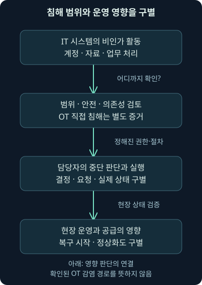
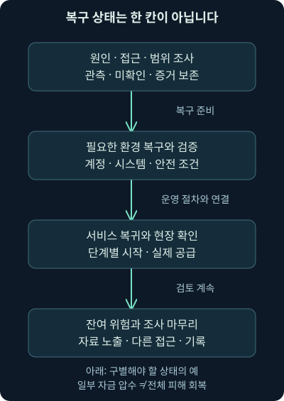
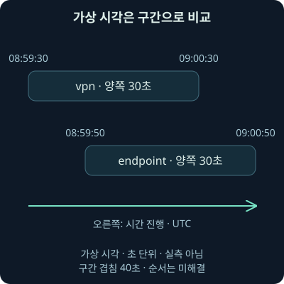

## 1. 사무실의 계정 문제가 현장의 공급 문제로 이어질 때

앞 강의에서는 여러 작은 장치가 공격 자원으로 묶이는 구조를 보았습니다. 이번에는 다른 질문을 해보겠습니다. “연료를 운송하는 회사의 업무용 네트워크에 문제가 생겼다면, 실제 운송도 멈출 수 있을까?” 컴퓨터 화면의 경보와 현장의 서비스 사이에는 우리가 먼저 이해해야 할 의존 관계가 있습니다.

이번 22강의 범위는 **2021년 Colonial Pipeline 사건을 공개 1차 자료로 읽고, 계정·인증·업무 중단·복구·증거의 시간 순서를 구별하는 방법**입니다. 침해 성공 과정을 재현하는 실습이 아닙니다. 실제 회사의 원본 로그·패킷·복구 시스템에는 접근하지 않았으며, 뒤의 시간 비교 파일은 사건과 무관한 자체 가상 자료입니다.

역사적 사건을 배울 때는 나중에 알게 된 전체 줄거리와 당시 담당자가 알 수 있었던 사실을 나누어야 합니다. 당시의 미확인 상태를 지워 버리면 왜 확인·격리·복구에 시간이 필요했는지 이해하기 어렵습니다. 이 구분을 지키면서 천천히 따라가 보겠습니다.

## 2. 먼저 사건의 연도부터 바로잡습니다

이 사건을 2020년 사례로 소개한 오래된 설명이 있지만, 이번에 확인한 공식 기록의 주요 날짜는 **2021년**입니다. 미국 에너지부는 2021년 5월 7일 랜섬웨어 공격에 대응해 회사가 배관 운영을 선제적으로 중단했다고 기록합니다. 2026년 11월 5일 직접 확인했습니다. [미국 에너지부의 사건 대응 정리](https://www.energy.gov/ceser/articles/ceser-2021-emergency-response-recap)

날짜 오류는 단순한 오타 이상입니다. 다른 취약점·조직·계정·조사 시기와 연결할 때 1년 차이가 생기면 잘못된 인과관계를 만들 수 있습니다. 검색 결과의 게시일과 사건 발생일, 사후 보고일도 따로 적어야 합니다.

이번 강의는 과거의 모든 숫자를 반복하지 않습니다. 현재 직접 대조한 사실과 자료에 남은 당시의 주장·조사 한계를 구별합니다. 주유소 부족 비율·유가 기록·세부 피해액처럼 다른 집계 범위가 필요한 수치를 근거 없이 덧붙이지 않고, 공급·운송·이용자에게 파급되는 원리를 설명합니다.

## 3. 계정과 VPN과 인증은 무엇이 다른가요?

**계정**은 시스템이 이용자를 구별하고 권한을 연결하는 기록입니다. **인증**은 접속자가 그 계정에 연결된 인증 수단을 통제하는지 확인하는 과정입니다. 비밀번호는 그런 수단 중 하나이지, 로그인 기록에 계정 이름이 있다는 사실만으로 실제 사람이 확인되는 것은 아닙니다.

**VPN**, Virtual Private Network는 외부에서 조직의 자원에 접근할 수 있는 보호된 통신 경로를 구성할 때 쓰는 기술입니다. 터널로 건물 안에 들어오는 출입 통로를 생각하면 쉽습니다. 통로의 암호화와 출입자의 자격 확인은 서로 다른 기능입니다. 통신이 암호화되어도 훔친 인증 수단으로 접속하면 비인가 접근이 가능할 수 있습니다.

**MFA**, 다중 요소 인증은 지식·소유·생체 특성처럼 서로 다른 종류의 요소를 조합하는 방식입니다. 비밀번호 두 개를 묻는다고 서로 다른 두 요소가 되는 것은 아닙니다. 그렇다고 MFA라는 이름 하나가 계정·기기·세션과 모든 후속 행위를 안전하게 보증하는 것도 아닙니다.

## 4. 공개 조사에서 확인한 최초 흔적은 무엇일까요?

2021년 6월 9일 하원 청문회에서 사건 대응을 수행한 Mandiant의 증언은 당시 식별한 가장 이른 침해 증거를 **4월 29일**로 설명합니다. 사용하지 않도록 의도된 옛 VPN 프로필을 통해 사용자 이름·비밀번호로 로그인했고, 그 프로필에는 일회용 코드가 요구되지 않았다고 기록합니다. 같은 청문회에서 회사는 자격 증명 획득 경위를 계속 조사 중이라고 설명했습니다. 확인일은 2026년 11월 5일입니다. [하원 청문회의 조사자·회사 증언](https://www.govinfo.gov/content/pkg/CHRG-117hhrg45085/html/CHRG-117hhrg45085.htm)

여기서 문장 속 “당시 식별한 가장 이른 증거”를 놓치지 마세요. 이것은 실제 최초 접속이 절대로 그보다 이를 수 없다는 보장이 아닙니다. 보존된 기록·조사 범위가 바뀌면 더 이른 흔적이 나올 가능성을 따로 다뤄야 합니다.

또 “암호가 어디서 어떻게 노출됐는지”는 다른 질문입니다. 비밀번호가 사용됐다는 증거만으로 재사용·피싱·직접 탈취·유출 자료 구매 중 하나를 확정하면 안 됩니다. 사건의 경로를 설명할 때 확인된 접속과 아직 밝혀지지 않은 취득 경위를 구분합니다.

## 5. 복잡한 비밀번호가 있어도 남는 문제

2021년 6월 8일 상원 청문회에서 회사 대표는 해당 옛 VPN 경로가 단일 요소 인증을 사용했다고 설명했습니다. 복잡한 비밀번호였다는 설명도 함께 나옵니다. 같은 기록은 조사 시점에 OT 환경에서 침해 증거가 확인되지 않았다는 조건을 담고 있습니다. 이 두 설명을 현재 우리의 직접 관측처럼 바꾸지 않습니다. [상원 청문회의 인증·조사 범위 설명](https://www.govinfo.gov/content/pkg/CHRG-117shrg46569/html/CHRG-117shrg46569.htm), 확인일 2026년 11월 5일.

복잡한 암호는 추측을 어렵게 할 수 있지만, 그 값 자체를 다른 사람이 확보했을 때는 다른 문제가 됩니다. 이번 사례의 교훈을 “비밀번호를 조금 더 복잡하게”로 끝내면 사용하지 않는 접근 경로, 인증 정책 적용의 빠진 부분, 계정과 세션 관리의 문제를 놓치게 됩니다.

가상 조직에서도 공식 VPN에는 MFA가 있지만 옛 원격 접속 경로에는 적용되지 않았다면 전체 보호 상태가 달라집니다. 관리자는 계정 수만 세는 것이 아니라 실제 사용 가능한 접속 경로와 예외, 마지막 사용 시각, 담당자, 폐기 여부를 확인해야 합니다. 이 가상 설명은 실제 회사의 구성을 새로 검증한 결과가 아닙니다.

## 6. IT에 문제가 생겼는데 왜 OT 운영이 영향을 받을까요?

**IT**, 정보 기술은 메일·계정·문서·업무 처리 같은 정보 시스템을 이야기할 때 쓰는 표현입니다. **OT**, 운영 기술은 설비·물리적 공정의 상태를 관측하거나 제어하는 기술입니다. 두 용어의 실제 경계는 회사 구성에 따라 확인해야 합니다. 같은 회사 안에서도 현장 장비, 관리 단말, 인증·통신·업무 지원의 의존 관계가 다를 수 있습니다.

식당의 주문 접수·재료 확인·조리 과정을 떠올려 보세요. 조리 기계가 직접 고장 나지 않아도 주문의 신뢰나 안전 확인이 불가능하면 운영을 멈출 수 있습니다. 실제 산업 설비에서는 이런 판단이 안전·공정·공급과 연결됩니다. 식당 비유로 구체적인 배관 안전 절차를 대신할 수는 없습니다.

따라서 “배관 운영 중단”을 “공격자가 제어 장비를 직접 암호화했다”로 바꾸면 안 됩니다. 에너지부의 설명처럼 IT 시스템의 랜섬웨어 위협에 대응한 운영 중단이라는 사실과, OT에 대한 실제 비인가 변경 여부는 서로 다른 증거가 필요합니다. 중단이라는 결과에서 모든 기술 원인을 거꾸로 확정하지 않습니다.



## 7. 결정과 실제 효과와 복구 상태를 나눠 씁니다

“중단을 결정했다”, “일부 통신을 끊었다”, “운영 중단을 현장에서 확인했다”는 서로 다른 상태입니다. 자동화 강의에서 작업 요청과 실제 완료를 구분했던 원칙과 같습니다. 대응 문서에도 결정 시각·실행 담당·검증 시각·실제 영향을 나눠 적습니다.

복구도 마찬가지입니다. 시스템을 켰다는 것, 안전 검사를 통과했다는 것, 서비스를 다시 시작했다는 것, 수요처까지 정상 공급되었다는 것은 한 번의 체크로 끝나지 않습니다. 원인이 제거되었는지와 잔여 접근, 계정·세션·자료의 상태도 별도 확인해야 합니다.



그림에서는 준비와 검증, 서비스 복귀, 잔여 위험 검토를 나누어 읽어 주세요. 단계들이 실제로는 병행될 수 있고 필요한 검토로 되돌아갈 수도 있습니다. 요청 접수나 한 시스템의 정상 화면만으로 마지막 칸까지 완료됐다고 표시하지 않습니다.

이때 일반 보안 분석가가 공정 정지·재가동을 임의로 결정하는 식으로 접근하면 안 됩니다. 운영·안전·사건 대응 담당자가 정한 권한과 절차, 현장의 검증 자료를 연결합니다. 이번 강의는 실제 설비 조작이나 재가동 지시를 수행하지 않았습니다.

## 8. 주요 날짜를 읽되 서로 다른 이정표를 합치지 않습니다

미국 에너지부의 사건 페이지는 5월 10일 FBI의 DarkSide 관련 발표와, 5월 13일 전체 배관 시스템 재시작 및 시장으로의 공급 개시 발표를 정리합니다. 앞서 확인한 하원 증언에는 5월 12일 저녁부터 서비스 복귀를 시작한 과정이 나옵니다. “재가동 시작”과 “다음 날의 상태 발표”를 하나의 날짜 오류로 취급하지 않고 어떤 상태를 뜻하는지 읽습니다. [에너지부의 사건별 공식 발표 연결](https://www.energy.gov/ceser/colonial-pipeline-cyber-incident), 확인일 2026년 11월 5일.

| 날짜 | 이번에 대조한 의미 | 그 날짜만으로 확정하지 않는 것 |
| --- | --- | --- |
| 2021-04-29 | 조사자가 당시 식별한 가장 이른 VPN 침해 증거 | 모든 경로의 실제 최초 시작 |
| 2021-05-07 | 랜섬웨어 사건 확인과 운영 중단 대응 | OT 장비의 직접 감염 |
| 2021-05-10 | FBI의 DarkSide 관련 공개 발표 | 모든 단계의 개인·운영자 신원 |
| 2021-05-12~13 | 재가동 과정과 공급 개시 상태 발표 | 모든 지역 공급·모든 조사 종결 |
| 2021-06-07 | 법무부의 일부 비트코인 압수 발표 | 전체 피해 회복·자료 노출 제거 |

이 표는 연표를 암기하기 위한 것이 아닙니다. 발견·대응·발표·복구·사후 조치가 다른 시계로 움직인다는 점을 읽어 주세요. 정확한 시각과 시간대가 없는 날짜에 임의로 초 단위 순서를 덧붙이지 않습니다.

거리도 무엇을 센 값인지 확인해야 합니다. 하원 증언에서 약 29,000마일은 재가동 과정에서 점검하며 차량으로 이동한 거리로 설명됩니다. 이것을 배관 자체의 길이라고 옮기면 안 됩니다. 서로 다른 대상·누적 방식의 숫자는 단위가 같아도 의미가 다릅니다. 공개 증언의 표현을 대조한 것이며 실제 점검 경로를 검증한 결과는 아닙니다.

## 9. 자료 절취와 암호화는 서로 다른 조사 질문입니다

오래된 사건 소개에는 약 100GB의 자료 절취가 언급됩니다. 상원 청문회 서두에도 그 규모에 관한 발언이 있지만, 이번 강의에서 원본 전송 기록을 검증한 수치는 아닙니다. “공개 기록에 그런 언급이 있다”는 수준과 “우리가 바이트를 계산해 확인했다”는 수준을 구별합니다. 모든 자료가 무엇이었는지까지 확대하지 않습니다.

가상의 회사에서 파일을 대량으로 읽은 기록과 외부 전송 기록이 있다면 자료 항목·계정·프로세스·시각·대상 경로를 맞춰 봅니다. 읽기와 전송의 시간 순서가 맞더라도 바이트의 내용이 같다는 증거는 별도로 필요합니다. 암호화되어 내용이 보이지 않는 전송에서는 출발·목적·양·인증·단말 기록을 함께 살펴야 합니다.

암호화 파일이 백업에서 복구되었다고 이미 반출된 자료의 기밀성이 자동으로 회복되지는 않습니다. 반대로 협박하는 쪽의 주장만으로 전부 유출되었다고 확정할 수도 없습니다. 앞서 배운 기밀성·무결성·가용성의 질문을 실제 기록으로 나누어 적용합니다.

## 10. 돈의 이동을 찾은 것과 암호를 깬 것은 다릅니다

미국 법무부는 2021년 6월 7일 약 75비트코인의 지급과 관련해 63.7비트코인을 압수했다고 발표했습니다. **비트코인**은 공개 거래 원장을 사용하는 디지털 자산이고, **개인 키**는 그 자산의 지출 권한과 연결되는 비밀 암호 값입니다. 발표는 공개 원장의 거래 추적과 해당 주소의 개인 키 보유를 설명합니다. 이것을 비트코인 암호 자체를 깨뜨린 사례라고 바꾸지 않습니다. [미국 법무부의 압수 발표](https://www.justice.gov/archives/opa/pr/department-justice-seizes-23-million-cryptocurrency-paid-ransomware-extortionists-darkside), 확인일 2026년 11월 5일.

학습용으로 같은 자산 단위의 비율을 계산하면 `63.7 ÷ 75 × 100`은 약 84.9%입니다. 실제 Python 계산으로 확인했습니다. 지급량이 약 75라는 근사값이므로 비율도 정밀한 실측 회수율처럼 쓰지 않습니다. 서로 다른 시점의 달러 가치를 같은 비율로 바꾸면 가격 변화 때문에 의미가 달라집니다.

또 일부 자금 압수가 서비스 장애·조사 비용·자료 노출·신뢰 손상 전체의 회복을 뜻하지 않습니다. 이 사건의 지급 사실을 다른 조직의 지급·협상 결정으로 일반화하지 않습니다. 이번 강의에서는 금전 거래·협상·법적 의무 판단·지갑 접근을 수행하지 않았습니다.

## 11. 우리 환경에서 비슷한 경보를 받았다면

가상의 `remote.example`에서 쓰지 않는 줄 알았던 계정의 세션이 발견되었다고 합시다. 먼저 확인할 사실은 계정 이름·인증 결과·정책·원격 주소·기기·세션 식별자·시각입니다. 세션 식별자는 여러 기록이 같은 접속을 가리키는지 연결하는 값입니다. 사람 이름과 주소만으로 같은 접속이라고 묶지 않습니다.

다음에는 해당 세션이 어떤 자산에 접근했는지, 실제 권한 사용과 파일·서비스 변경이 있었는지 확인합니다. 인증 제공자·VPN 장비·서버·단말·방화벽·리졸버·클라우드 감사 자료가 각 질문을 보완합니다. 리졸버 기록은 이름 조회를 보여 주지만 로그인 성공이나 파일 실행까지 대신 증명하지는 않습니다.

일부 기록이 없을 때는 시계를 맞추기 전에 수집 범위부터 확인합니다. 사건 시각의 원기록인지 수집 서버에 도착한 시각인지, 시간대가 있는지, 보존 기간과 누락은 어떤지 확인하세요. 확인되지 않은 칸은 “없음” 대신 “이 범위에서는 미확인”으로 남깁니다.

## 12. 타임라인을 줄 세웠는데도 순서가 불명확할 수 있습니다

두 벽시계가 각각 30초까지 틀릴 수 있다고 합시다. 첫 기록은 09:00:00, 둘째 기록은 09:00:20입니다. 숫자만 정렬하면 첫 기록이 먼저 보입니다. 하지만 각각의 오차를 생각하면 실제 순서는 반대일 수도 있습니다.

**타임라인**은 사건·관측·결정을 시간과 연결해 배치한 기록입니다. **시간 불확실성**은 그 시각이 실제 발생 시각을 얼마나 정확히 나타내는지에 관한 범위입니다. 시계 편차만이 아니라 센서의 기록 방식이나 지연도 확인해야 합니다. 이번 예제에서는 계산을 위해 각 시각의 양쪽에 같은 크기의 오차를 가정합니다. 실제 시스템의 동기화 품질을 측정한 값은 아닙니다.

시간 순서가 분명하더라도 인과관계는 다른 문제입니다. VPN 기록 뒤에 파일 경보가 있다고 해서 그 세션이 파일을 만들었다는 결론은 나오지 않습니다. 같은 단말·계정·세션·프로세스와 실제 동작을 연결할 증거가 더 필요합니다.

## 13. 가상 자료 네 건으로 범위를 계산합니다

이번 독립 자료는 2026년 11월 1일의 가상 이벤트 네 건입니다. Colonial Pipeline의 로그나 당시 시각을 재구성한 자료가 아닙니다. `.example` 출처는 설명용이며 외부에서 조회하지 않습니다. Python 표준 라이브러리로 자료를 읽고 시간 구간을 비교합니다.

| 가상 기록 | 명목 시각: UTC | 자체로 가정한 오차 | 뜻 |
| --- | --- | --- | --- |
| vpn | 09:00:00 | 양쪽 30초 | 접속 세션 기록 |
| endpoint | 09:00:20 | 양쪽 30초 | 파일 관련 경보 |
| decision | 09:05:00 | 양쪽 5초 | 중단 결정 기록 |
| paused | 09:07:00 | 양쪽 5초 | 중단 상태 관측 |

**UTC**는 시간대 비교의 기준으로 쓰는 협정 세계시입니다. 파일의 시각 끝 `Z`는 UTC를 나타냅니다. `+09:00`처럼 오프셋을 명시한 시각도 UTC로 바꾸어 비교할 수 있습니다. 오프셋은 기준 시간과의 차이입니다. 시간대가 없는 09:00을 임의로 UTC라고 가정하지 않습니다.

프로그램은 각 시각에서 오차를 빼서 가장 이른 시각, 더해서 가장 늦은 시각을 구합니다. A의 가장 늦은 가능 시각이 B의 가장 이른 가능 시각보다 **엄격하게 앞설 때**만 A가 먼저라고 표시합니다. 끝점이 닿거나 구간이 겹치면 순서를 미해결로 남깁니다. 이 규칙은 이 교육 예제가 선택한 보수적인 비교 조건입니다.

## 14. 실제로 실행한 기본 비교를 읽어봅시다

자료는 [가상 이벤트](../../assets/network-security/lab22/events.json), [시간 비교 프로그램](../../assets/network-security/lab22/review_time.py), [실행 설명](../../assets/network-security/lab22/README.txt), [필드와 해석](../../assets/network-security/lab22/field-notes.txt) 네 파일입니다. 같은 폴더에 두고 다음처럼 실행합니다. 이번 검증에는 Python 3.12.14를 사용했습니다. 실제 보안 제품의 명령이나 API 입력 형식이 아닙니다.

```text
python review_time.py events.json
```

`python`은 실행기, `review_time.py`는 프로그램 파일, `events.json`은 읽을 입력입니다. 기본 비교는 `vpn`과 `endpoint`입니다. 자료 형식을 확인하고 시각을 UTC로 정규화한 뒤 가정된 구간을 비교합니다. 실제 프로그램은 파일을 읽고 화면에 결과를 출력했으며 입력 파일을 바꾸지 않았습니다.

기본 실행에서 vpn의 구간은 08:59:30~09:00:30, endpoint의 구간은 08:59:50~09:00:50이었습니다. 명목 시각 차이는 20초이지만 구간이 겹쳐 `order_not_resolved`, 순서 미해결이 나왔습니다. 결과가 겹친다는 말은 정확히 동시에 발생했다고 증명했다는 뜻도 아닙니다.



그림은 왼쪽에서 오른쪽으로 읽습니다. 점 하나 대신 구간으로 그리면 겹치는 범위가 보입니다. 시간 구간은 입력에서 가정한 값이며 통계적 신뢰구간이나 실제 동기화 측정값이 아닙니다.

## 15. 결정과 효과를 고르면 어떤 결과가 나올까요?

이번에는 비교할 기록을 지정해 보겠습니다. `--left`와 `--right`는 왼쪽·오른쪽 비교 대상으로 사용할 기록 ID를 고르는 선택 사항입니다. decision은 결정이고 paused는 관측한 상태라는 의미를 유지합니다.

```text
python review_time.py events.json --left decision --right paused
```

실제 실행에서 두 명목 시각의 차이는 120초였습니다. 결정 구간의 마지막은 09:05:05, 중단 관측 구간의 처음은 09:06:55라서 `left_before_right`가 나왔습니다. 구간 사이의 여유는 110초입니다. 가정된 범위 안에서 시간 순서가 구별된다는 의미이지, 결정만으로 실제 중단을 발생시킨 전체 과정을 검증한 것은 아닙니다.

모든 정상 비교 결과의 `causation`은 `not_tested`, 인과관계 미검증입니다. `real_incident`도 `not_analyzed`로 현실 사건 미분석을 명시합니다. “프로그램이 성공했다”와 “사건의 원인이 증명되었다”를 결과 필드에서도 구별하는 이유입니다.

## 16. 불확실성을 늘리면 순서 판단도 바뀝니다

이번에는 양쪽 오차에 각각 60초를 추가해 보겠습니다. 다음 조건은 실제 시계를 늦추거나 장비 설정을 바꾸지 않습니다. 파일 안의 가정으로 계산하는 불확실성 범위만 더 넓힙니다.

```text
python review_time.py events.json --left decision --right paused --extra-uncertainty-seconds 60
```

`--extra-uncertainty-seconds`의 단위는 초입니다. 60은 기존 양쪽 5초를 각각 65초로 만듭니다. 실제 실행에서 decision은 09:03:55~09:06:05, paused는 09:05:55~09:08:05가 되어 겹쳤습니다. 결과는 순서 미해결로 바뀌었습니다. 두 기록의 원래 표시 시각을 수정한 것은 아닙니다.

이 예제는 불확실성 가정이 결론을 바꾼다는 점을 보여 줍니다. 실제 조사에서는 편리한 결론이 나오도록 오차를 줄이지 않습니다. 시계 동기화·수집 지연·기록 방식의 근거를 검토하고 그 근거가 허용하는 정밀도로 결론을 씁니다.

## 17. 입력 오류와 미해결 결과도 구별합니다

시간대가 없는 시각, 중복된 기록 ID, 빠진 출처, 음수 오차, 해석할 수 없는 날짜나 JSON은 다른 문제입니다. 프로그램은 이런 입력을 오류로 구분합니다. 종료 값 0은 비교 계산을 마쳤다는 뜻이고 2는 입력·실행 조건 오류를 뜻합니다. 순서 미해결도 계산 자체가 정상적으로 끝났다면 0입니다.

시험에서는 없는 ID와 잘못된 입력, 같은 이벤트 비교, 역방향 비교, 같은 시각을 다른 오프셋으로 표현한 경우도 확인했습니다. 양쪽 구간의 끝이 닿는 조건은 엄격한 선후 관계로 승격하지 않습니다. 자동으로 이름을 합치지 않았던 앞 강의와 마찬가지로, 모호함을 정상 결과에 남기는 것이 중요합니다.

하지만 이 검사로 출처가 진짜인지, 시각이 조작되지 않았는지, 사건들이 같은 세션에 속하는지는 알 수 없습니다. 원본 보존과 수집 과정·자료의 관련성·내용 검증은 별도의 조사 작업입니다. 이 작은 프로그램을 실제 사건 진실 판별기로 사용하지 않습니다.

## 18. 인증 보충은 현재 판본과 적용 범위를 확인합니다

과거 사건의 단일 요소 인증 문제를 이해하는 원리는 여전히 유효합니다. 현재 보충으로는 2025년 7월 확정된 **NIST SP 800-63B-4**와 그 인증·인증 수단 관리 설명을 확인했습니다. 2026년 11월 5일 기준이며 이 판본을 영구적인 최신판으로 부르지 않습니다. [NIST 판본·대체 관계](https://csrc.nist.gov/pubs/sp/800/63/B/4/final)

문서는 인증의 보증 수준에 따라 서로 다른 요소와 피싱 저항성 있는 수단의 조건을 나눕니다. 피싱 저항성은 이용자가 가짜 상대에게 속더라도 인증 비밀이나 인증 결과가 악용되지 않도록 설계하는 성질과 연결됩니다. 모든 MFA 방식의 특성이 같지 않으므로 “MFA 있음”이라는 칸 하나로 검토를 끝내지 않습니다. 정부 정보 시스템을 위한 지침의 적용 목적과 조직별 위험을 구별합니다. [NIST 공식 인증 본문](https://pages.nist.gov/800-63-4/sp800-63b.html)

계정·인증 수단을 바꾸더라도 이미 열린 세션과 다른 접근 경로, 권한·자료·백업 상태는 따로 확인해야 합니다. 구체적인 제품·판본·업무 절차 없이 한 조치가 전체 침해를 해결한다고 약속하지 않습니다. 이번에는 실제 계정·인증 정책·세션을 변경하지 않았습니다.

## 19. 사건을 설명하는 문장을 끝까지 정확하게 씁니다

좋은 사건 메모는 짧더라도 범위를 잃지 않습니다. “이 접속 경로에서 이 계정의 인증이 기록되었고, 해당 시점의 적용 정책은 이러했다. 다른 출처의 파일 경보와 시간 범위가 겹치지만 관련 세션·프로세스는 미확인이다”라고 쓰면 다음 분석가가 해야 할 일이 보입니다.

서비스 중단과 OT 침해, 복구 시작과 정상화, 일부 자금 압수와 전체 피해 회복도 같은 방식으로 나눕니다. 직접 관측·외부 증언·자체 계산·추가 확인을 표시하면 사건의 유명한 이름이 추론의 빈칸을 대신 채우지 못하게 됩니다.

이번 자체 실습은 로컬의 가상 시간 자료와 산술입니다. 실제 회사·VPN·OT·원본 PCAP·암호 자산·복구 도구를 실행하거나 검증하지 않았습니다. 원래 워크북·가상 장치의 수행 완료로도 기록하지 않습니다. 다음 강의는 Conti 사례에서 도구 이름보다 행동의 맥락과 증거를 읽는 연습으로 이어갑니다.

## 20. 복습: 결과와 근거의 범위를 맞춰 봅시다

### 질문 1. 이 사건을 2020년이라고 소개해도 괜찮을까요?

**해설:** 확인한 공식 기록의 주요 날짜는 2021년입니다. 발생·발견·발표·보고 시기를 나누고 근거를 대조해야 다른 사건과 잘못 연결하지 않습니다.

### 질문 2. 가장 이른 발견 증거가 4월 29일이면 실제 침해도 반드시 그날 시작했나요?

**해설:** 당시 조사에서 확인한 범위입니다. 더 이른 활동의 존재 여부는 보존·수집 범위와 추가 조사에 달려 있으므로 실제 최초와 같다고 보장하지 않습니다.

### 질문 3. 복잡한 암호를 썼다면 탈취된 값도 안전한가요?

**해설:** 추측 난이도와 값이 노출된 뒤의 악용은 다릅니다. 실제 인증 방식·예외 경로·계정·세션을 확인해야 합니다.

### 질문 4. VPN 암호화가 있으면 접속자도 승인된 사람인가요?

**해설:** 보호된 통신 경로와 인증 수단의 정당한 통제는 다릅니다. 인증 성공 기록에서 실제 사람·의도·후속 권한 사용까지 자동으로 확정하지 않습니다.

### 질문 5. 운영 중단은 OT에 랜섬웨어가 실행됐다는 뜻인가요?

**해설:** 위협 억제와 안전 판단으로 중단할 수도 있습니다. 기술적 침해 범위와 업무 영향에 필요한 증거를 분리해야 합니다.

### 질문 6. 5월 12일 재가동 시작과 13일 상태 발표는 모순인가요?

**해설:** 어떤 단계와 발표 시점을 뜻하는지 확인해야 합니다. 서비스 복귀 시작·공급 개시·전체 정상화를 같은 상태로 합치지 않습니다.

### 질문 7. 일부 비트코인 압수는 암호 체계가 깨졌다는 뜻인가요?

**해설:** 확인한 발표는 거래 추적과 개인 키 보유를 설명합니다. 발표하지 않은 기술적 수단이나 암호 해독 성공을 만들어내지 않습니다.

### 질문 8. 자산 단위 약 84.9%는 전체 피해 회복률인가요?

**해설:** 같은 단위의 근사 지급량과 압수량을 나눈 계산입니다. 다른 시점의 가격·운영 손실·자료 노출·전체 피해와 구분해야 합니다.

### 질문 9. 가상 기록 09:00:00과 09:00:20은 앞뒤가 확실한가요?

**해설:** 각각 양쪽 30초 오차를 가정하면 구간이 겹칩니다. 명목 순서가 보이더라도 실제 선후 관계는 미해결입니다.

### 질문 10. decision이 paused보다 먼저라는 결과면 원인도 증명됐나요?

**해설:** 시간 순서의 계산일 뿐입니다. 결정·실행·효과를 연결할 별도 근거가 필요하며 프로그램은 인과관계를 시험하지 않습니다.

### 질문 11. 추가 오차 60초 조건이 실제 장비 시계를 변경했나요?

**해설:** 자체 계산 범위만 넓혔습니다. 실제 장비·계정·원본 자료는 변경하지 않았고 가정에 따라 순서 판단이 미해결로 바뀐 것입니다.

### 질문 12. 순서 미해결이면 프로그램 오류인가요?

**해설:** 정상 입력에서도 나오는 유용한 결과입니다. 입력 오류와 구별하고, 모호함을 없애려고 근거 없이 정밀도를 높이지 않습니다.
