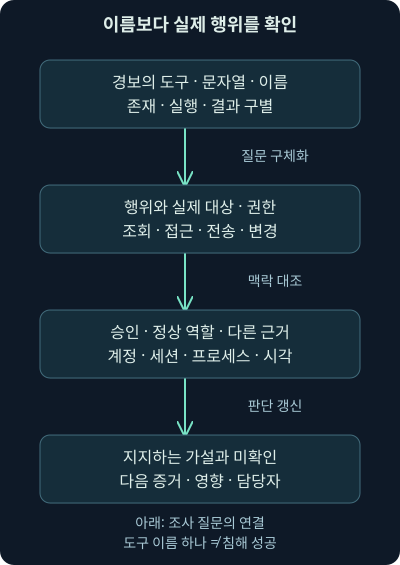
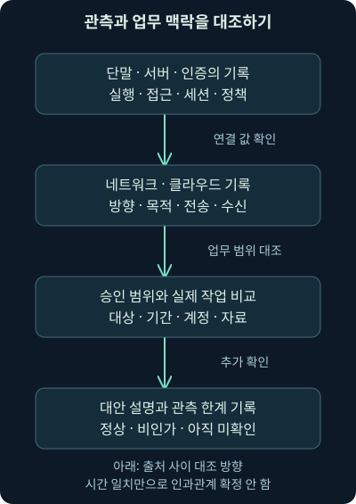
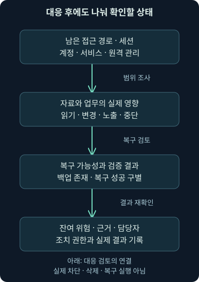

## 1. 원격 관리 도구가 보이면 침해라고 말할 수 있을까요?

가상의 회사 단말에서 평소 보지 못한 원격 접속 프로그램이 발견됐습니다. 같은 날 계정 목록을 조회한 기록과 큰 외부 전송도 보입니다. 바로 랜섬웨어 사건이라고 이름 붙이고 싶어질 수 있습니다. 하지만 새 관리 업체가 승인받은 점검을 했을 가능성도 있고, 실제로 접근을 악용한 경우일 수도 있습니다. 무엇이 이 둘을 구별해 줄까요?

앞 강의에서는 계정·인증·운영 중단 사이의 증거를 나누었습니다. 이번 23강은 **Conti 관련 과거 자료를 읽되, 도구 이름을 행위·권한·대상·업무 맥락의 조사 질문으로 바꾸는 방법**입니다. 공격자의 명령을 실행하거나 유출 매뉴얼을 따라 하는 실습이 아닙니다. 정상 도구와 내부 권한이 어떻게 다른 목적에 사용될 수 있는지 이해하겠습니다.

역사적 설명은 표시한 공개 분석을 근거로 합니다. 조직·계정·주소·기록을 연결하는 예제는 직접 만든 가상 사례입니다. 원본 사건의 단말·패킷·유출 파일 안의 실행 도구에는 접근하거나 실행하지 않았습니다. 자료에 적힌 계획과 실제 현장에서 관측한 결과도 구분합니다.

## 2. 매뉴얼의 존재와 실제 수행은 다른 사실입니다

조리법에 오븐을 쓰라고 적혀 있다고 그날 모든 주방에서 오븐을 썼다고 말할 수는 없겠지요. 공격자 자료도 비슷합니다. 문서에 적힌 방법은 의도·선호·교육 내용을 알아보는 단서지만, 우리 환경에서 그 단계가 실행되었다는 증거는 아닙니다.

**플레이북**은 목적을 달성하기 위해 순서·조건·작업을 정리한 절차 자료입니다. 방어팀의 플레이북과 공격자에게 귀속된 자료는 용도와 권한이 다르지만, 둘 다 “문서에 있음”과 “실행됨”을 구별해야 합니다. 번역 과정의 오해와 작성 시점, 실제 사용자의 변형도 고려합니다.

Cisco Talos의 2021년 9월 2일 분석은 이미 유출된 Conti 관련 자료를 번역하고 자사 대응에서 본 활동과 비교한 것입니다. Northwave의 자체 조사 설명은 유출을 8월 5일, Talos 번역 공개를 9월 2일로 나눕니다. 따라서 번역 발표일을 최초 유출일로 옮기지 않습니다. 확인일은 2026년 11월 6일입니다. [Talos의 원분석](https://blog.talosintelligence.com/conti-leak-translation/), [Northwave의 조사·날짜 설명](https://northwave-cybersecurity.com/threat-intel-research/inside-the-world-of-ransomware-3-3)

## 3. 흔한 도구라는 이유로 가벼운 위협은 아닙니다

과거 자료에서 배울 점은 공격자가 항상 새로운 취약점이나 비밀 도구를 만들어야만 성공하는 것은 아니라는 사실입니다. 기존 계정과 관리 기능, 공개 도구, 느슨한 권한 경계가 결합되어도 큰 영향을 줄 수 있습니다. 다만 이 자료 하나를 모든 운영자의 기술 수준에 대한 평가로 확대하지 않습니다.

Talos는 자료의 상세한 절차가 경험이 적은 운영자의 진입 장벽도 낮출 수 있다고 분석했습니다. 여기서 “덜 숙련됨”과 “피해가 작음”은 같은 말이 아닙니다. 조직 내부에서 어떤 권한을 확보했고 어떤 자료와 복구 기능에 접근할 수 있었는지가 중요합니다.

**TTP**는 tactics, techniques, procedures의 머리글자이며 목표를 향한 전술, 방법인 기법, 실제 절차라는 관점을 묶어 부릅니다. 이름표를 외우기보다 어떤 목표로 무엇을 했는지 읽는 도구라고 생각하세요. 아래 그림은 조사 질문의 연결이며, 매번 같은 순서로 일어나는 공격 절차를 뜻하지 않습니다.

## 4. 공개된 회사 정보도 대상 선택에 쓰일 수 있습니다

공격자는 회사의 사업·매출·직책·협력 관계 같은 공개 정보를 보고 가치 있는 대상을 고르거나 협박 맥락을 만들 수 있습니다. **OSINT**는 공개된 출처에서 정보를 모아 분석하는 활동을 뜻합니다. 그 방법 자체가 악성이라는 뜻은 아닙니다. 보안팀과 정상 업무에서도 공개 정보를 사용합니다.

가상의 공격 메일이 실제 담당자의 직책을 정확히 썼다고 합시다. 공개 소개 페이지에서 얻었을 수도 있고, 메일함을 침해해 얻었을 수도 있습니다. 메일 문구만으로 내부 침해를 확정할 수 없습니다. 어떤 정보가 공개되어 있었는지와 메일·인증·자료 접근의 근거를 비교해야 합니다.

회사 내부의 계정 설명이나 공유 폴더 이름도 업무 관계를 드러낼 수 있습니다. 지나치게 자세한 설명에 비밀 값을 저장하지 않는 관리 원칙과, 허용된 조회 기능이 어떤 정보를 반환하는지 이해하는 일이 연결됩니다. 이번 강의에서는 외부 인물 조사나 회사 정보 수집을 실행하지 않았습니다.

## 5. 계정·그룹·도메인 정보를 찾는 이유

큰 건물에 들어간 사람이 안내판과 직원 명부, 출입 구역을 살펴보는 상황을 떠올려 보세요. 내부 탐색에서도 계정·그룹·단말·서버의 관계를 알아보면 다음에 어디에 접근할 수 있을지 판단하는 데 도움이 됩니다. 관리자에게는 정상 업무이고, 비인가 주체에게는 다른 자산을 찾는 과정일 수 있습니다.

**Active Directory Domain Services**, 줄여 AD DS는 Windows 환경에서 사용자·컴퓨터·공유 자원 등의 디렉터리 정보를 관리하고 인증·접근 제어를 연결하는 서비스입니다. **도메인**은 이 관리·신뢰 체계의 논리적 경계이고, **그룹**은 여러 계정에 권한이나 관리를 연결하기 위해 묶는 단위입니다. 모든 조직이 AD DS를 쓰는 것은 아닙니다.

2026년 11월 6일 확인한 Microsoft 개요 문서는 Windows Server 2016·2019·2022·2025 적용 대상으로 디렉터리와 인증·조회 기능을 설명합니다. 이 적용 표시는 특정 고객의 실제 구성을 검증했다는 뜻이 아닙니다. [Microsoft AD DS 개요](https://learn.microsoft.com/en-us/windows-server/identity/ad-ds/get-started/virtual-dc/active-directory-domain-services-overview)

## 6. 탐색 도구 세 가지의 이름을 행위로 읽습니다

과거 자료에 나오는 **ADFind**는 디렉터리 정보를 조회하는 도구로 이해하면 됩니다. 경보에서 이 이름을 봤다면 실행 계정·실행 위치·조회 대상·시각·평소 사용 여부를 묻습니다. 파일 이름을 바꾸거나 다른 프로그램으로 같은 조회를 수행할 수도 있으므로 이름 하나만 찾는 방식에는 한계가 있습니다.

**SharpView**는 PowerView의 기능을 .NET 환경에서 구현한 탐색 도구로 소개됩니다. .NET은 프로그램을 실행하는 플랫폼의 하나입니다. **Seatbelt**는 운영체제·정책·사용자 폴더 등 단말의 구성 정보를 모으는 도구입니다. 수집한 정보의 종류가 다르므로 둘을 모두 “비밀번호를 훔친 증거”라고 쓰면 안 됩니다. 이 역할 설명은 앞서 링크한 Talos의 분석과 대조했습니다.

명령 해석기나 스크립트가 실행됐다는 사실도 실제 반환 결과와 구별합니다. **PowerShell**은 Windows 관리에 널리 쓰이는 명령·스크립트 환경입니다. 무엇을 조회하거나 변경하도록 실행했는지, 대상에 도달했는지, 결과가 남았는지 확인해야 합니다. 이번에는 도구 설치·디렉터리 조회·명령 실행을 수행하지 않았습니다.

## 7. 자격 증명과 세션의 위험은 파일 하나보다 넓습니다

**자격 증명 접근**은 비밀번호·키·인증에 쓰이는 자료를 얻으려는 행동을 살펴보는 관점입니다. 비밀번호뿐 아니라 이미 열린 로그인 세션을 이어 쓰는 값도 중요합니다. 브라우저의 **쿠키**는 웹 상태를 유지하도록 저장·전송하는 자료로, 종류와 서비스에 따라 로그인 세션과 연결될 수 있습니다. 모든 쿠키가 인증 비밀은 아닙니다.

과거 자료의 **Mimikatz**는 Windows 인증 관련 자료에 접근하는 기능으로 널리 알려진 도구이고, **SharpChrome**은 Chrome의 저장된 로그인·쿠키와 관련된 접근을 설명할 때 등장합니다. 파일의 존재, 실행 시도, 보호된 자료 접근, 실제 비밀 획득과 사용을 각각 나눠 확인합니다. 보호 장치가 막았을 가능성도 조사해야 합니다.

**Kerberoasting**은 Kerberos 서비스 인증에 관련된 자료를 얻어 오프라인에서 비밀을 추측하려는 공격 관점입니다. Kerberos는 계정이 매 서비스에 비밀번호를 직접 보내는 대신 티켓이라는 인증 자료를 이용하는 체계입니다. 정상 서비스 사용에도 티켓 요청은 발생하므로, 티켓 요청 하나가 비밀번호 해독 성공의 증거는 아닙니다. 여기서는 공격 명령이나 비밀 추출 절차를 실행하지 않습니다.

## 8. 공유 폴더와 도메인 신뢰를 왜 조사할까요?

**네트워크 공유**는 다른 장치가 파일이나 자원에 접근하도록 제공한 접점입니다. SMB는 Windows 파일 공유 등에 사용하는 프로토콜입니다. 공유 목록을 본 것과 그 안의 제한 자료를 읽고 바꿀 수 있다는 것은 다릅니다. 정상 관리 계정도 공유와 접근 권한을 점검합니다.

**도메인 신뢰**는 다른 도메인의 계정을 인증·접근 판단에 연결하는 관계입니다. 신뢰가 있다고 모든 자원에 관리자 권한이 생기는 것은 아닙니다. 과거 자료의 `nltest` 같은 Windows 도구는 도메인·신뢰 관련 정보를 확인할 때 접할 수 있습니다. 그 이름만으로 도메인 전체가 장악됐다고 결론내리지 않습니다.

**도메인 컨트롤러**, DC는 도메인의 디렉터리·인증 기능을 제공하는 서버입니다. NTDS라는 이름은 그 디렉터리 자료와 연결되어 등장합니다. 그 자료에 대한 비인가 접근과 복제·백업 기능의 악용은 중요한 조사 대상이지만, 정상 백업·운영 작업과 구별해야 합니다. 파일 접근의 주체·권한·방법·실제 결과와 후속 인증 사용을 대조합니다.

## 9. 원격 접속 프로그램은 승인과 지속 접근을 함께 봅니다

**AnyDesk**와 **Atera** 같은 이름은 정상 원격 지원·관리 맥락에서도 등장합니다. 설치 파일이나 서비스가 있다는 사실만으로 Conti 감염을 확정할 수는 없습니다. 누가 설치를 승인했는지, 어떤 외부 계정·관리 서버와 연결되는지, 언제 실제 세션이 열렸는지부터 확인합니다.

반대로 정상 제품이라는 이유로 검토를 생략하지도 않습니다. 공격자가 남겨 둔 접근 경로가 재부팅 뒤에도 살아 있다면 초기 악성 파일을 지운 뒤에도 위험이 남을 수 있습니다. **지속성**은 접근을 유지하거나 다시 얻으려는 성질·방법을 이야기할 때 쓰는 말입니다. 서비스·자동 시작·예약 실행·원격 관리 등록 등이 실제로 어떤 상태인지 점검합니다.

프로그램 설치, 서비스 시작, 외부 연결, 원격 명령, 자료 접근은 서로 다른 근거입니다. 허용된 관리 창구와 작업 시간·담당 계정·변경 승인 자료를 함께 대조해야 합니다. 이번 강의는 원격 접속·계정 등록·서비스 변경을 실행하지 않았습니다.

## 10. 도구 목록을 전체 공격 성공으로 바꾸지 않습니다

**Armitage**는 Metasploit과 연결된 공격 시험용 도구 묶음이고, **Cobalt Strike**는 승인된 보안 시험에 쓰일 수 있지만 공격자에게 악용되기도 하는 프레임워크입니다. 프레임워크는 여러 기능을 함께 제공하는 작업 기반을 뜻합니다. 이 이름이 보고서에 등장했다고 우리 환경에서 특정 기능이 실행되었다는 뜻은 아닙니다.

과거 목록의 **SMBAutoBrute**는 SMB 인증 시도를 반복하는 도구라는 관점에서 읽습니다. **무차별 대입**은 여러 후보를 반복해 인증 비밀을 찾으려는 방식입니다. 많은 실패가 있었는지, 정상 접속이었는지, 실제 성공과 후속 동작이 있었는지를 따로 봅니다. 자격 증명을 가지고 정상처럼 로그인한 활동은 실패 폭증 없이 나타날 수도 있습니다.

이런 제품·도구의 모든 현재 기능·지원 상태·라이선스를 추천 목록처럼 재소개하지는 않습니다. 여기서는 원문의 역사적 도구 이름을 이해하고 관측 질문으로 바꾸는 범위입니다. 같은 도구를 쓰는 여러 주체가 있을 수 있고, 한 주체가 도구를 바꿀 수도 있습니다.

## 11. 외부 저장소 전송은 어디까지 확인했나요?

과거 절차에는 파일을 모은 뒤 외부 저장소로 옮기는 행동도 나옵니다. **스테이징**은 다음 행동을 위해 파일이나 도구를 특정 위치에 준비해 두는 것을 말합니다. 공유 위치에 파일이 존재한다는 사실과, 다른 단말로 배포되어 실행되었다는 사실은 따로 확인해야 합니다.

**rclone**은 여러 저장소 사이에서 파일을 전송·동기화하는 도구입니다. Mega 같은 클라우드 저장소가 대상으로 쓰일 수도 있지만 도구 이름이나 서비스 도메인만으로 자료 반출을 확정하지 않습니다. 실제 계정·대상·방향·파일 범위·승인·전송 결과를 살펴야 합니다. 2026년 11월 6일 확인한 공식 문서도 여러 저장소 지원을 설명하며, 모든 저장소의 기능과 동작이 같다는 보증은 아닙니다. [rclone의 공식 저장소 개요](https://rclone.org/overview/)

패킷에서는 TLS 암호화로 파일 이름과 내용이 보이지 않을 수 있습니다. 서버의 내보내기·단말의 프로세스·파일 읽기·프록시·방화벽·클라우드 감사 기록이 조사 질문을 보완합니다. 단말에서 파일을 읽은 시각과 전송량이 비슷해도 내용의 동일성까지 자동으로 증명하지는 않습니다.

## 12. 보안 도구의 약화는 변경 요청과 실제 상태를 나눕니다

과거 자료의 **GMER**는 루트킷 탐지 도구로 소개된 제품이지만 방어 기능을 찾거나 멈추는 데 악용된 사례도 분석됩니다. **루트킷**은 시스템의 동작이나 관측을 숨기려는 소프트웨어·기법을 이야기할 때 사용하는 말입니다. 정상 목적의 출발과 실제 사용 목적이 다를 수 있다는 예입니다.

PowerShell로 보안 설정을 바꾸려는 시도, 관리 화면에서 기능을 끄는 행동, 서비스·드라이버의 상태 변화도 구별해서 봅니다. **드라이버**는 운영체제가 장치나 특정 기능과 상호작용하게 하는 소프트웨어입니다. 명령 문자열이 남았더라도 권한이나 제품의 보호 기능 때문에 변경이 실패했을 수 있습니다.

현재 상태와 정책 변경 기록, 변조 방지 경보, 서비스 시작·종료, 당시 수집 품질을 확인합니다. 방어 로그가 줄었다는 사실도 공격의 결과인지 수집 장애인지 구별해야 합니다. Talos의 2021년 “당시 특정 도구 해시 추적이 유용했다”는 설명을 오늘의 모든 변형에 대한 영구적인 탐지법으로 확대하지 않습니다.

## 13. 암호화 전의 준비와 실제 영향을 구별합니다

파일을 여러 공유 위치에 준비하는 행동, 복구 수단에 접근하는 행동, 파일의 대량 변경은 각각 중요한 조사 대상입니다. 그러나 파일 이름이 `lock`와 비슷하다는 이유만으로 실행이나 암호화가 확정되는 것은 아닙니다. 실제 파일 형식·해시·실행 근거·내용 변경·업무 영향을 확인합니다.

MITRE ATT&CK의 Conti 항목은 `S0575`라는 **소프트웨어** 식별자를 사용하고 자료 암호화·복구 방해·공유 탐색 같은 공개 분석을 연결합니다. 이것을 모든 활동을 수행한 단일 사람의 식별자나 우리 환경의 감염 증거로 바꾸지 않습니다. 확인일은 2026년 11월 6일이며 해당 항목의 공개 범위와 출처를 함께 읽습니다. [MITRE Conti 소프트웨어 항목](https://attack.mitre.org/software/S0575/)

계정·도구 이름만으로 끝내지 않고 어떤 자료와 업무가 영향을 받았는지 확인하세요. 백업이 존재하는지와 실제로 읽고 복구할 수 있는지, 자료가 복구되었는지와 이미 노출되었을 가능성은 다른 질문입니다.

## 14. 같은 세 가지 기록으로 다른 설명이 가능합니다

다음은 자체 가상 사례입니다. 단말 A에서 계정·그룹 정보를 조회한 기록, 이어서 원격 관리 서비스가 시작된 기록, 그리고 `storage.example`로 큰 전송이 보입니다. 현재 관측은 이 세 출처가 기록한 사실입니다. 승인된 이관과 지원 작업도 가능하고, 비인가 주체의 탐색·지속 접근·반출도 가능한 가설입니다.

조건을 더해 봅시다. 승인 문서에는 조회와 원격 지원만 있고 외부 전송은 없으며, 별도 단말 기록이 제한 자료의 읽기와 전송 프로세스를 연결한다고 가정합니다. 비인가 반출 가설을 더 검토할 근거가 늘어납니다. 그래도 전송 내용·실제 수신·계정 사용자를 추가로 확인해야 합니다.

반대로 승인 대상·시각·계정·전송 파일이 일치하고 서버 측 작업 결과까지 대조된다면 정상 작업이라는 설명을 더 지지할 수 있습니다. 이것도 파일 이름 한 개나 승인 번호만으로 끝내는 판단은 아닙니다. 실제 수행 범위와 승인 범위를 비교해야 합니다.

## 15. 무엇을 보았는지에 맞춰 표현합니다

| 기록에서 확인한 것 | 지지할 수 있는 질문 | 아직 더 필요한 결론 |
| --- | --- | --- |
| 디렉터리 조회 프로세스 | 정상 점검인가, 내부 탐색인가? | 모든 계정 비밀의 획득 |
| 원격 관리 서비스 시작 | 승인된 지원인가, 잔여 접근인가? | 외부 운영자의 실제 명령 실행 |
| 클라우드 방향의 큰 전송 | 어떤 파일과 계정이 보냈나? | 제한 자료가 실제 수신됨 |
| 보안 설정 변경 시도 | 허용·차단·실패 중 무엇인가? | 보호 기능이 실제 해제됨 |

표는 결론을 낮추기 위한 장치가 아니라 필요한 다음 증거를 찾는 안내입니다. 중요한 자산에 대한 실제 비인가 접근이나 진행 중인 업무 피해가 확인되면 행위자 이름을 기다리지 않고 조직의 대응 절차와 담당자를 연결할 수 있습니다.

같은 주체로 묶을 때도 시각·계정·세션·프로세스와 기록 출처를 맞춥니다. 주소가 같다는 이유만으로 동일 인물로 보거나, 도구가 바뀌었다는 이유만으로 다른 운영자라고 확정하지 않습니다.

## 16. 기록이 없을 때도 조사 범위를 설명합니다

프로세스 로그가 꺼져 있었다면 실행이 없었다고 말할 수 없습니다. 스크립트 내용 기록, 명령줄 수집, 인증 감사, 네트워크 센서의 방향과 보존 기간도 결과를 바꿉니다. 암호화·재조립·필터·시간대와 수집 지연을 확인하세요.

단말은 실행·파일 접근을, 서버는 요청 처리·공유 접근을, 인증 시스템은 계정·정책·세션을, 방화벽·프록시·리졸버는 경로와 이름 조회를 각각 보완합니다. 어느 한 출처가 모든 질문의 정답을 제공하지는 않습니다.

유출 자료에서 배운 행위를 찾아도 결과가 없으면 “확인한 기간과 자산, 수집 설정에서는 해당 흔적을 찾지 못했다”라고 남깁니다. 회사 전체 침해 부재로 확대하지 않고 부족한 기록과 다음 조사를 명시합니다.

## 17. 공격 절차를 방어팀의 검토 항목으로 바꿉니다

명부를 본다는 행위는 디렉터리 조회의 정상 기준으로, 원격 도구를 남긴다는 행위는 승인·서비스·세션 점검으로, 자료를 모아 전송한다는 행위는 파일 읽기·전송·수신 검증으로 바뀝니다. 복구 방해와 방어 기능 변경은 해당 설정·정책·실제 상태의 대조로 바꾸고요.

그림에서는 기록 하나의 이름보다 출처 간 연결을 읽어 주세요. 업무 승인과 정상 역할을 기준으로 비교하고, 의심 가설과 정상 가설 모두에 맞지 않는 부분을 찾아봅니다. 스크립트를 만들 수 있다는 사실보다 무엇을 검증했고 무엇을 남겨 두었는지가 중요합니다.

## 18. 대응 뒤에는 접근과 자료와 복구를 다시 확인합니다

도구 파일 하나를 지웠다고 원격 계정·남은 세션·다른 서비스·유출된 비밀이 함께 사라지지는 않습니다. 반대로 이름이 보고서와 같다는 이유로 정상 업무 프로그램을 임의 삭제하면 업무 피해를 만들 수 있습니다. 담당 권한과 실제 범위에 맞춘 대응·검증이 필요합니다.

그림은 접근 경로, 영향 범위, 복구 가능성, 잔여 위험을 나누어 읽습니다. 실제 운영 변경은 승인된 절차와 담당자가 수행하고 그 결과를 확인해야 합니다. 이번 강의는 비밀 추출·인증 시도·보안 기능 해제·차단·삭제·복구 작업을 실행하지 않았습니다.

## 19. 다음 사례에서는 신뢰한 전달 경로를 살펴봅니다

이번 사례는 정상 기능과 익숙한 도구가 다른 목적에 쓰일 수 있음을 보여 줍니다. 다음 SolarWinds 사례는 한 걸음 더 나아가 신뢰하던 소프트웨어 전달과 인증 관계가 영향을 받으면 무엇을 확인해야 하는지 다룹니다. 알려진 도구만 찾는 관점에서 신뢰의 근거를 검토하는 관점으로 이어집니다.

이번에 실제 수행한 작업은 교재 범위와 공개 1차 자료의 대조, 독립 설명·가상 사례·그림의 작성·검증입니다. 유출 매뉴얼의 지시문은 학습 자료로 다뤘고 실행 지시로 따르지 않았습니다. 원본 워크북·VM·사건 PCAP를 수행한 것처럼 기록하지 않습니다.

## 20. 복습: 도구 이름 뒤의 질문을 설명해 보세요

### 질문 1. Talos의 9월 2일 글은 최초 유출일을 뜻하나요?

**해설:** 번역·분석 발표일입니다. 확인한 연구는 유출과 번역 공개를 나누므로 날짜의 사건 유형을 함께 기록해야 합니다.

### 질문 2. 유출 문서의 명령이 있으면 우리 회사에서도 실행됐나요?

**해설:** 문서의 절차와 환경에서의 관측은 다릅니다. 단말·서버·인증·통신 기록에서 실제 수행과 결과를 찾아야 합니다.

### 질문 3. 공개 도구만 사용했다면 피해도 작을까요?

**해설:** 도구의 희귀함보다 실제 권한·대상 자료·연결 관계·복구 접근이 영향을 좌우합니다. 익숙함이 위험 부재를 뜻하지 않습니다.

### 질문 4. Seatbelt 실행이 비밀번호 획득의 증거인가요?

**해설:** 구성 정보 수집의 역할과 자격 증명 획득을 구별해야 합니다. 실제 접근 자료와 결과·후속 사용의 근거가 필요합니다.

### 질문 5. 정상 티켓 요청 하나면 Kerberoasting 성공인가요?

**해설:** 정상 서비스 이용에도 티켓을 요청합니다. 비정상 패턴과 계정·단말 맥락, 비밀 획득과 사용까지 단계별 확인이 필요합니다.

### 질문 6. 도메인 신뢰가 있으면 다른 도메인에서도 전부 관리자인가요?

**해설:** 신뢰와 개별 자원의 권한은 다릅니다. 인증 관계와 실제 접근 제어·권한·대상을 확인해야 합니다.

### 질문 7. AnyDesk나 Atera가 있으면 Conti 감염인가요?

**해설:** 정상 원격 관리에도 쓰입니다. 승인·계정·서버·세션·실제 행위·설치 맥락으로 검토하며 특정 운영자나 감염을 단정하지 않습니다.

### 질문 8. rclone과 큰 TLS 전송이면 제한 자료 반출이 확실한가요?

**해설:** 도구·서비스·전송량은 단서입니다. 파일 범위·프로세스·방향·승인·실제 전송과 수신의 증거가 더 필요합니다.

### 질문 9. 보안 기능을 끄는 명령이 남았으면 보호도 해제됐나요?

**해설:** 요청과 실제 상태가 다를 수 있습니다. 권한·차단·정책·서비스·제품 상태와 당시 기록을 대조해야 합니다.

### 질문 10. Conti의 S0575는 공격자의 개인 식별자인가요?

**해설:** MITRE의 소프트웨어 항목입니다. 프로그램 이름과 활동 군집·현실의 주체를 같은 값으로 취급하지 않습니다.

### 질문 11. 필요한 로그가 없으면 해당 행위도 없었나요?

**해설:** 수집·보존·센서 위치·암호화·설정의 빈칸일 수 있습니다. 확인한 범위와 부족한 증거를 정확히 남깁니다.

### 질문 12. 악성으로 의심한 파일 하나를 지우면 조사가 끝나나요?

**해설:** 잔여 접근·계정·세션·자료 노출·복구 상태는 별도입니다. 담당 절차에 따른 조치와 실제 결과를 검증해야 합니다.
