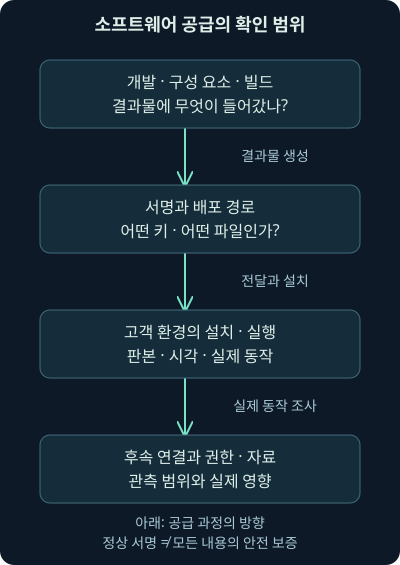
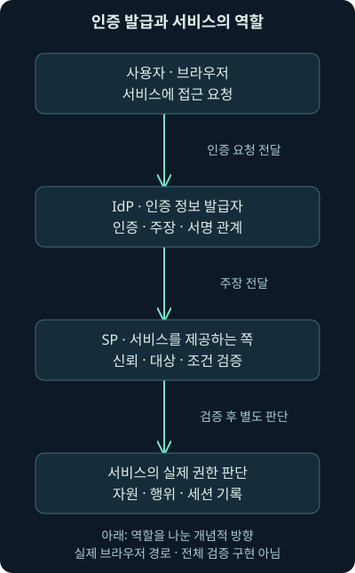
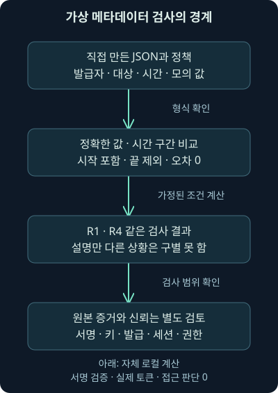

## 1. 정식 업데이트를 설치했는데도 왜 조사해야 할까요?

가상의 회사가 운영 중인 관리 소프트웨어를 정식 경로로 업데이트했습니다. 파일에는 제작사의 전자서명도 있습니다. 그런데 그 뒤 관리 서버에서 예상하지 못한 외부 연결이 나타났습니다. “공식 프로그램이니까 괜찮다”와 “연결이 새로 생겼으니 무조건 감염이다” 사이에서 무엇을 확인해야 할까요?

앞 강의는 정상 도구가 비인가 목적으로 쓰이는 경우를 다뤘습니다. 이번 24강은 **소프트웨어 전달 경로와 인증 발급의 신뢰가 영향을 받으면 무엇을 구분해야 하는지**를 SolarWinds 사례로 살펴봅니다. 역사적 연표, 지연된 후속 활동, 전자서명과 인증서·키, 온프레미스와 클라우드 기록의 연결이 범위입니다.

실제 사건의 원본 로그·악성 파일·패킷을 실행하거나 분석한 것은 아닙니다. 뒤의 자체 파일은 가상 메타데이터를 비교하는 교육 자료이며 실제 SAML 토큰·서명 검증·인증 구현이 아닙니다. 이 경계를 분명히 한 상태에서 원리를 따라가 보겠습니다.

## 2. 공급망은 상자를 받는 순간보다 앞에서 시작됩니다

봉인된 제품 상자를 받았다고 해봅시다. 운송 중 봉인이 훼손되지 않았는지 확인하는 것은 중요합니다. 하지만 공장에서 잘못된 물건이 들어간 뒤 정상적으로 봉인되었다면 봉인만 확인해서는 내부의 문제를 발견할 수 없습니다.

소프트웨어에서도 개발·**빌드**·배포·설치의 연결을 나눠 봅니다. 빌드는 소스와 필요한 구성 요소를 실제 설치·실행 파일로 만드는 과정입니다. **공급망 공격**은 제품·서비스를 제공하는 신뢰 관계나 전달 경로를 악용하는 활동입니다. 단순히 이용자에게 가짜 파일을 보낸 경우와 제작 과정에서 결과물이 영향을 받은 경우는 조사 범위가 다릅니다.

전자서명은 특정 키와 연결된 서명과 파일 내용의 관계를 확인하는 데 쓰입니다. 그것만으로 모든 코드의 의도와 동작이 안전하다고 보증하지는 않습니다. 빌드 과정에서 이미 문제가 들어갔다면 “전달 중 바뀌지 않았음”과 “안전한 내용임”이 달라질 수 있습니다. 비유의 봉인과 실제 암호 서명의 기술은 다르지만 확인 범위의 차이는 비슷합니다.



## 3. Orion과 SUNBURST와 행위자 이름은 다릅니다

**Orion**은 사건에서 영향을 받은 SolarWinds의 IT 관리 제품군입니다. **SUNBURST**는 당시 FireEye가 변조된 구성 요소의 백도어에 붙인 이름입니다. **백도어**는 정상 접근 절차와 다른 방식으로 접근·제어할 수 있도록 남겨진 기능을 이야기할 때 쓰는 말입니다. 회사 이름·제품 이름·악성 구성 요소 이름을 같은 대상으로 읽지 않습니다.

2020년 12월 13일 FireEye의 공개 분석은 Orion 업데이트를 통한 공급망 침해와 SUNBURST를 설명합니다. 현재 Google Cloud에 보존된 원문에는 2022년 5월 UNC2452 활동을 APT29에 병합했다는 후속 설명도 있습니다. 발표 당시의 임시 추적명과 뒤의 평가를 구별해야 합니다. 2026년 11월 6일 직접 확인했습니다. [당시 원분석과 후속 귀속 안내](https://cloud.google.com/blog/topics/threat-intelligence/evasive-attacker-leverages-solarwinds-supply-chain-compromises-with-sunburst-backdoor)

Microsoft의 과거 글에는 Solorigate와 NOBELIUM이 등장하고 현재 명명 문서는 Midnight Blizzard와 옛 이름의 관계를 설명합니다. 앞서 배운 것처럼 출처·날짜·활동 군집의 범위를 붙여 읽습니다. 이 이름들이 보고서에서 연결된다는 사실이 우리 조직의 새 경보를 해당 주체에 귀속시키는 증거는 아닙니다. [Microsoft의 현재 명명 문서](https://learn.microsoft.com/en-us/defender-xdr/microsoft-threat-actor-naming), 확인일 2026년 11월 6일.

## 4. 연표에서 발견·통보·공개를 구별합니다

SolarWinds의 2021년 1월 11일 조사 정리는 내부 시스템에서 당시 확인한 가장 이른 의심 활동을 **2019년 9월**로 설명합니다. 2020년 2월 20일부터 악성 코드 삽입 소스의 갱신본이 Orion 릴리스에 코드를 넣었다는 설명과, 이후 배포·6월 제거에 관한 설명을 나눕니다. 이를 모든 고객의 동일한 감염일이나 실제 최초 접근일로 바꾸지 않습니다. [제작사의 당시 조사 정리](https://www.solarwinds.com/blog/new-findings-from-our-investigation-of-sunburst), 확인일 2026년 11월 6일.

| 시기·날짜 | 읽어야 할 사건 유형 | 주의할 해석 |
| --- | --- | --- |
| 2019년 9월 | 제작사 내부에서 당시 확인한 의심 활동 | 모든 고객의 침해 시작 아님 |
| 2020-02-20 이후 | 제작사 설명의 코드 삽입 과정 | 고객별 설치·실행 시각과 구분 |
| 2020년 봄 이후 | 영향을 받은 업데이트와 선택적 후속 활동 | 모든 설치에서 같은 단계가 발생한 것 아님 |
| 2020-12-13 | FireEye의 공개 분석 | 발견·관계자 통보와 공개는 다른 시점 |
| 2020-12-14 | 제작사의 SEC 보고 | 사후 확인·보고 시점을 발생일로 바꾸지 않음 |

오래된 도식의 12월 12일을 “발견과 공개 발표가 모두 일어난 날”로 한 칸에 옮기지 않습니다. 이번 직접 확인한 공개 분석은 12월 13일이고, SEC 보고는 14일입니다. 관계자 통보·내부 발견의 정확한 세부 시각까지 이번 조사에서 모두 검증한 것은 아닙니다. 날짜에 붙은 동사를 함께 읽는 습관이 필요합니다.

## 5. 설치 가능성과 후속 침해 규모를 구별합니다

2020년 12월 14일 제작사의 SEC 보고는 문제가 있는 Orion 제품이 설치되었을 수 있는 고객 수를 **18,000 미만으로 당시 추정**합니다. 이것을 18,000개 조직에서 동일한 후속 침해와 자료 유출을 모두 확인했다는 숫자로 바꾸면 안 됩니다. “당시 회사가 보고한 설치 가능성의 범위”라는 조건을 유지합니다. [당시 제작사의 공식 보고](https://www.sec.gov/Archives/edgar/data/1739942/000162828020017451/swi-20201214.htm), 확인일 2026년 11월 6일.

우리 환경에서도 제품 보유, 영향을 받은 판본 보유, 설치, 실행, 외부 통신, 후속 제어, 자료 접근을 따로 확인해야 합니다. 같은 제품을 사용한다는 한 줄이 이 모든 단계를 증명하지 않습니다. 단말·서버의 판본·설치 기록과 파일 상태, 실제 동작을 차례로 대조합니다.

과거 수정판 번호가 알려져 있다는 사실도 지금 모든 운영 환경의 최종 복구 지침을 뜻하지는 않습니다. 현재 지원 판본·제작사 권고·신뢰 회복 절차를 실제 환경에 맞춰 확인해야 합니다. 이번 강의는 2020년의 수정 버전을 영구적인 최신판으로 권하지 않습니다.

## 6. 조용한 기간과 선택적 활성화는 관측을 어렵게 합니다

당시 분석은 설치 직후부터 큰 공격이 일괄 발생하는 구조가 아니라, 일정 기간 조용히 있다가 환경을 확인하고 후속 단계로 이어지는 행동을 설명합니다. **프로파일링**은 대상 환경의 특성을 파악해 분류하는 과정입니다. 공격자 관점의 대상 선택과 방어자의 자산 파악은 목적과 권한이 다릅니다.

Microsoft의 2021년 1월 20일 분석은 SUNBURST에서 후속 로더로 넘어가는 연결을 제한된 관측 사례에 근거해 설명합니다. **로더**는 다른 코드가 실행되도록 준비·불러오는 구성 요소입니다. TEARDROP·Raindrop은 그 후속 구성 요소를 이해할 때 만나는 이름이며, 모든 설치에서 둘 다 발견되었다고 읽지 않습니다. [Microsoft의 후속 단계 분석](https://www.microsoft.com/en-us/security/blog/2021/01/20/deep-dive-into-the-solorigate-second-stage-activation-from-sunburst-to-teardrop-and-raindrop/), 확인일 2026년 11월 6일.

이 글의 “5월 무렵부터일 수 있다” 같은 시간 추정도 근거와 추정이라는 성격을 유지합니다. 도식에 단정적인 실행일로 옮기지 않습니다. 새 프로세스가 기존 관리 프로그램의 자식으로 바로 이어지지 않을 수도 있어, 짧은 부모·자식 관계 하나만 보는 분석에는 빈칸이 생길 수 있습니다.

## 7. 이름 조회·통신·단말 흔적을 함께 봅니다

당시 보고서에는 정상 관리 통신처럼 섞이는 행동과 생성된 도메인 이름, 대상별 후속 구성 등이 설명됩니다. **DGA**, domain generation algorithm은 통신에 사용할 이름을 규칙으로 만들어 내는 방법을 가리킵니다. 길거나 낯선 이름이 보인다는 사실만으로 이 기법이나 감염을 확정하지 않습니다.

**OPSEC**는 operational security, 활동이 드러나지 않도록 노출과 흔적을 관리하는 관점을 뜻합니다. 모든 피해 환경에 반드시 완전히 고유한 지표가 사용되었다는 보편 규칙으로 바꾸지 않습니다. 정적 주소·해시와 함께 프로세스·파일·시각·인증·관리 기능 사용의 연결도 확인합니다.

패킷과 리졸버 기록은 이름 조회와 연결 경로를 보완합니다. 암호화된 통신 내용, 캡처되지 않은 방향, 지연된 활성화, 짧은 보존 기간 때문에 후속 행동을 놓칠 수 있습니다. 정상 관리 목적지·업데이트와 비교하고 단말의 실행·파일·설정 기록을 함께 대조하세요. 알려진 문자열을 찾지 못했다는 이유로 모든 후속 경로가 없었다고 말하지 않습니다.

## 8. 이번에는 인증의 신뢰 관계로 넘어가 봅시다

학교 행정실이 “이 학생은 확인을 마쳤다”는 확인서를 발급하고 도서관이 그것을 신뢰한다고 해봅시다. 도서관이 매번 같은 신원 확인을 반복하지 않고 필요한 이용 권한을 연결하는 구조입니다. 편리하지만 누가 확인서를 발급할 수 있고, 어느 도서관용이며, 언제까지 유효한지를 알아야 합니다.

**SAML**, Security Assertion Markup Language은 인증·속성 등 보안 정보를 주체 사이에 전달하는 표준입니다. **IdP**, identity provider는 인증 정보를 발급하는 역할이고, **SP**, service provider는 그것을 받아 서비스를 제공하는 역할입니다. **어설션**, assertion은 발급자가 어떤 주체에 관해 주장하는 내용을 담습니다. 이 주장을 담은 인증 자료를 문맥에 따라 토큰이라고 부르기도 합니다.

**SSO**, single sign-on은 한 번의 인증을 여러 서비스 이용과 연결하는 방식입니다. SAML만이 SSO의 유일한 방법은 아닙니다. 실제 브라우저 전달과 암호 서명·프로토콜 검증은 종이 확인서보다 복잡합니다. 이 비유가 실제 구현의 모든 안전 조건을 대신하지는 않습니다.



## 9. 서명이 맞는다는 사실만으로 충분할까요?

**전자서명용 개인 키**는 발급자의 서명을 만들 수 있는 비밀 값이고, 서비스는 신뢰하도록 구성한 공개 정보와 검증 절차로 서명을 확인합니다. **인증서**는 공개 키와 관련 정보를 묶는 자료입니다. 비밀번호와 인증서·개인 키는 같은 값이 아닙니다.

정상 키로 만든 서명인지 확인하더라도 그 키를 사용한 권한이 안전했는지, 해당 발급자를 신뢰하도록 한 설정이 올바른지 별도 문제가 남습니다. 발급 권한이나 키가 침해되면 겉으로 정상 조건을 갖춘 주장이 만들어질 수 있습니다. 반대로 서명 검증을 건너뛴다면 신뢰하지 않는 자료를 받아들이는 다른 문제가 생깁니다.

SolarWinds 관련 2020년 12월 Microsoft 분석은 SAML 서명 자료 노출과 비정상 인증·클라우드 활동의 연결을 조사할 필요를 설명합니다. 실제 모든 피해자가 같은 방식으로 키를 잃거나 모든 클라우드에서 관리자 권한을 얻었다고 확대하지 않습니다. [Microsoft의 당시 통합 조사 설명](https://www.microsoft.com/en-us/security/blog/2020/12/28/using-microsoft-365-defender-to-coordinate-protection-against-solorigate/), 확인일 2026년 11월 6일.

## 10. Golden SAML이라는 표현을 정확히 읽습니다

**Golden SAML**은 신뢰받는 발급 관계·서명 권한의 악용으로 인증 주장을 위조하는 기법을 설명할 때 쓰는 이름입니다. 단순히 비밀번호를 몰래 입력한 것과 조사할 기록이 달라질 수 있습니다. 정상 발급 경로의 로그인 기록과 서비스에서 받은 주장·세션이 맞는지 검토해야 합니다.

오래된 자료의 “최초 공개 사례”라는 수식은 여기서 확정하지 않습니다. 기법의 최초 소개와 실제 공격의 최초 관측, 특정 기관의 최초 공개는 서로 다른 주장입니다. 제작사 옛 Golden SAML 설명 경로는 이번 확인에서 현재의 다른 페이지로 이동해 원문 전체를 직접 대조하지 못했습니다. 이번 강의는 확인한 사건 분석과 표준의 원리에 집중하며 최초라는 비교 주장을 보류합니다.

이름이 강렬하다고 모든 인증 문제를 같은 기법으로 묶지는 않습니다. 계정 탈취·세션 자료 탈취·발급 설정 변경·키 침해는 서로 다른 근거와 복구 범위가 필요합니다. 비밀번호만 바꾸면 신뢰 관계와 이미 열린 세션까지 모두 회복된다는 결론도 피해야 합니다.

## 11. 발급자·대상·기간은 무엇을 제한할까요?

**Issuer**는 누가 주장을 발급했는지, **Audience**는 어떤 서비스·수신 대상에 사용할 주장인지를 나타내는 데 쓰입니다. 발급자 이름이 맞아도 다른 앱을 대상으로 한 자료를 우리 앱에서 받아들이면 안 됩니다. 단순 문자열 하나보다 프로토콜·등록 설정·신뢰 구성을 함께 확인해야 합니다.

시간 조건의 **NotBefore**는 그 시각 전에는 유효하지 않다는 뜻이고, **NotOnOrAfter**는 그 시각부터는 유효하지 않다는 뜻입니다. 2005년 3월 15일 OASIS SAML 2.0 Core 표준의 의미와 현재 Microsoft Entra ID의 SAML 설명을 2026년 11월 6일 대조했습니다. 표준의 발행 연도와 현재 서비스 구현 설명은 구별합니다. [OASIS SAML 2.0 Core](https://docs.oasis-open.org/security/saml/v2.0/saml-core-2.0-os.pdf), [Microsoft Entra ID의 SAML 프로토콜 설명](https://learn.microsoft.com/en-us/entra/identity-platform/single-sign-on-saml-protocol)

그러나 이 세 항목만 맞으면 실제 인증을 허용할 수 있다는 뜻은 아닙니다. 실제 구현은 서명 대상과 신뢰 키, 요청과 응답의 연결, 수신 위치·주체 확인, 재사용 방지, XML 처리 보안, 시계 편차 정책과 권한 등을 함께 검증합니다. **XML**은 자료 구조를 태그로 표현하는 형식입니다. 이 강의는 그런 전체 검증기를 새로 만드는 실습이 아닙니다.

## 12. 인증과 권한도 같은 판단이 아닙니다

서비스가 인증 자료를 받아들였다는 것과 그 계정이 제한 문서를 내려받거나 관리자 작업을 할 권한이 있다는 것은 다릅니다. **인가**, authorization는 특정 자원·행위를 허용하는 판단입니다. 앞서 배운 계정의 기술적 권한과 실제 업무 승인도 여기서 다시 연결됩니다.

가상의 `app.example`이 “사용자는 분석가”라는 속성을 받았다고 합시다. 그것을 어떤 역할과 연결하는지, 제한 자료에 실제 접근했는지, 기존 세션이 남아 있는지를 각각 봐야 합니다. “SAML 사용”이라는 설정 하나가 클라우드 관리자 권한이나 자료 유출을 증명하지 않습니다.

**온프레미스**는 조직이 직접 운영하는 환경을 가리킬 때 사용하는 말입니다. 온프레미스 인증 서버와 클라우드 서비스가 연동되면 한쪽 기록만으로는 전체 흐름이 보이지 않을 수 있습니다. 각 조직·서비스 영역을 구별하는 테넌트와 앱·계정·세션의 식별자를 함께 대조해야 합니다.

## 13. 작은 자체 예제로 검사 범위의 한계를 보겠습니다

이번 자료는 실제 토큰 대신 JSON에 몇 가지 비교용 값만 적은 **독립 가상 예제**입니다. `training-claims-v1`은 우리가 정한 교육용 자료 형식이며 SAML·XML·제품 API 형식이 아닙니다. 키·암호·실제 인증서를 넣지 않았고 서명을 만들거나 검증하지 않습니다.

비교 정책은 발급자로 `https://idp.example`, 대상으로 `https://app.example`을 기대합니다. `.example`은 문서용 이름이며 실제 접속하지 않습니다. 기준 시각은 가상의 2026년 11월 1일 11:00:00 UTC입니다. UTC는 시간 비교의 기준으로 쓰는 협정 세계시이며 파일의 `Z`로도 표시됩니다.

| 가상 기록 | 검사 대상 값의 차이 | 교육 조건에서 예상할 결과 |
| --- | --- | --- |
| R1 | 발급자·대상·기간 일치, 모의 서명 결과 true | 메타데이터 조건 일치 |
| R2 | 다른 앱 대상 | 대상 불일치 |
| R3 | 끝 시각이 기준 시각과 같음 | 기간 밖 |
| R4 | 검사 값은 R1과 같지만 키 신뢰 침해를 가정한 설명 | 검사만으로 R1과 구별 못 함 |

R4가 이 실습의 핵심입니다. 설명에는 발급 권한이 침해된 상황을 가정하지만, 프로그램이 보는 비교 값은 정상 예제 R1과 같습니다. 이 상황을 프로그램이 검증했다고 해서는 안 됩니다. 검사 범위 밖의 위험을 발견하는 데 어떤 증거가 필요한지 생각하는 예제입니다.

## 14. 실제로 실행한 결과를 하나씩 읽습니다

자료는 [가상 메타데이터](../../assets/network-security/lab24/metadata.json), [비교 프로그램](../../assets/network-security/lab24/check_metadata.py), [실행 설명](../../assets/network-security/lab24/README.txt), [필드와 한계](../../assets/network-security/lab24/field-notes.txt) 네 파일입니다. 같은 폴더에 두고 다음 명령으로 실행합니다. 이번 검증은 Python 3.12.14에서 수행했습니다.

```text
python check_metadata.py metadata.json
```

`python`은 실행기를 고르고, `check_metadata.py`는 실행할 파일, `metadata.json`은 읽을 자료입니다. 프로그램은 필요한 값·고유 기록 ID·시간대를 확인하고, 발급자·대상을 정확히 비교하며 시작 포함·끝 제외 기간을 적용합니다. 이 단순 비교를 실제 SAML 검증 규칙 전체와 같다고 부르지 않습니다.

실제 기본 실행에서는 R1과 R4가 `metadata_matches_training_policy`, 교육용 메타데이터 조건 일치로 나왔습니다. R2는 `audience_mismatch`, R3는 `outside_training_window`였습니다. R1과 R4가 같다는 결과는 R4가 안전하다는 뜻이 아닙니다. 코드가 검사한 값으로 두 가상 상황을 구별할 수 없다는 뜻입니다.

## 15. true라는 값을 읽은 것과 서명을 검증한 것은 다릅니다

자료의 `fixture_signature_ok`는 미리 적은 모의 결과입니다. fixture는 시험 조건을 위해 준비한 자료를 뜻하고, `true`·`false`는 참·거짓을 나타내는 불리언 값입니다. 이 값이 true라고 해서 Python이 어떤 암호 서명을 검증한 것은 아닙니다. 문자열 `"true"`와 실제 불리언 `true`도 구별합니다.

기본 결과의 `signature_checks_performed`, `real_tokens_processed`, `access_decisions_performed`, `external_actions`는 모두 0입니다. 실제 서명 검사·토큰 처리·접근 허용 판단·외부 조치가 없었다는 범위를 결과에서도 드러냅니다. 입력의 값을 읽어 놓고 실제 검증을 수행했다고 표현하지 않는 습관이 중요합니다.

R4의 설명을 지우거나 바꾼 임시 자료도 시험했습니다. 검사 대상 값이 같으므로 결과는 바뀌지 않았습니다. 사람이 설명으로 가정한 배경을 자동 검증기의 능력처럼 착각하지 않도록 확인한 것입니다. 실제 키 침해 탐지 성능을 평가한 시험이 아닙니다.



## 16. 시간 조건을 바꿔 보겠습니다

다음 명령의 `--now`는 비교 시각을 지정합니다. 실제 운영체제·서버의 시계를 바꾸지 않습니다. 끝의 `Z`는 UTC이고, 따로 시간대를 지정하지 않은 시각은 이 예제에서 오류로 구분합니다.

```text
python check_metadata.py metadata.json --now 2026-11-01T11:05:00Z
```

실제 실행에서 R1과 R4도 기간 밖이 됐습니다. 유효 끝 시각이 11:05:00이므로 그 시각에는 더 이상 포함하지 않는 조건입니다. 반대로 시작 시각인 10:55:00은 포함되는 것도 시험했습니다. 같은 순간을 `+09:00` 오프셋으로 표현해도 UTC로 정규화한 결과는 같았습니다.

이 예제는 시계 허용 오차를 0으로 두는 자체 규칙입니다. 실제 서비스에서 어떤 오차 정책을 쓰는지는 표준·제품·설정과 동기화 상태를 확인해야 합니다. 입력의 시간 범위와 현실 사건의 선후·인과·키 신뢰는 서로 다른 질문입니다.

## 17. 불일치와 오류를 구별합니다

자료의 대상이나 발급자가 기대값과 다르거나 모의 서명 결과가 false이면 비교 결과에 그 이유를 남깁니다. 정상 비교의 완료는 종료 값 0이며, 모든 기록이 안전하거나 인증이 허용됐다는 뜻이 아닙니다. 대상이 다르다는 유용한 결과도 정상 계산 결과입니다.

필수 값 누락·중복 ID·시간대 없는 시각·뒤집히거나 길이가 0인 기간·불리언이 아닌 모의 값·잘못된 정책·깨진 JSON은 오류로 끝납니다. 그때의 종료 값은 2입니다. 자료가 잘못되어 계산할 수 없는 상태와, 계산 결과 조건에 맞지 않는 상태를 섞지 않습니다.

하지만 형식이 맞다고 자료의 진실이 확인되는 것은 아닙니다. 이 프로그램은 원본 인증 로그·서명 키의 보관·발급자의 권한·XML 처리·세션·실제 인가를 조사하지 않습니다. 실서비스 인증 코드로 옮겨 쓸 예제가 아니라, 계산 범위를 설명하는 독립 학습 도구입니다.

## 18. 실제 조사에서는 어느 기록을 이어야 할까요?

관리 서버에서는 설치·판본·파일·프로세스·외부 연결을 봅니다. 인증 발급 환경에서는 키 접근·설정 변경·발급·관리 작업을, 서비스에서는 주장 수신·세션·자원 접근을 봅니다. 이름 조회·프록시·방화벽 기록은 그 사이의 경로를 보완합니다.

발급자의 로그인 기록이 없는데 서비스에 세션이 있으면 위조 가능성을 검토할 수 있지만, 수집 누락·보존 기간·비대화형 흐름·시간대·다른 인증 경로도 확인해야 합니다. 단순한 로그의 부재를 곧바로 Golden SAML 성공으로 바꾸지 않습니다. 실제 증거의 범위와 정상 설명을 함께 적습니다.

조치도 소프트웨어 업데이트 하나로 끝날지, 계정·세션·서명 키·신뢰 설정·복구 환경까지 검토해야 할지 달라집니다. 운영 중인 신뢰를 임의로 바꾸면 정상 서비스에도 영향을 줄 수 있으므로 담당 권한·절차와 실제 검증을 연결합니다. 이번에는 업데이트·키 교체·세션 종료·정책 변경을 실행하지 않았습니다.

## 19. 첫째 날의 공격자 모듈을 네 질문으로 연결합니다

첫 질문은 “상대가 무엇을 얻으려 할까?”입니다. 국가 연계·금전·이념·위탁·내부 접근은 서로 겹칠 수 있는 관점입니다. 둘째는 “어떤 자산과 경로를 선택했을까?”입니다. 기회형 유입이 이후 맞춤 활동으로 바뀔 수도 있어 최초 선택 방식만으로 최종 영향을 정하지 않습니다.

셋째는 “현재 무엇을 실제로 보았을까?”입니다. Mirai의 연결 시도, Colonial의 접속과 운영 중단, Conti 관련 도구·행위, 이번 사례의 제품·후속 활동·인증을 단계별로 나눕니다. 넷째는 “어느 기록과 통제가 그 질문을 더 확인하게 할까?”입니다. 단말·서버·인증·클라우드·방화벽·리졸버·업무 담당 자료를 연결합니다.

상대의 이름을 모른다고 확인된 영향을 기다릴 필요는 없고, 유명한 이름을 안다고 미확인 피해를 확정할 수도 없습니다. 조사·위험 완화·업무 연계와 귀속 판단을 구별하며 새 근거로 갱신하세요. 다음 25강은 첫째 날 전체를 연결하는 복습, 26강은 독립적인 종합 실습으로 이어갑니다. 아직 그 두 강의를 완료했다고 표시하지 않습니다.

## 20. 복습: 신뢰가 어디에서 성립했는지 설명해 보세요

### 질문 1. 정식 서명이 있는 파일은 내부 코드도 안전하다는 뜻인가요?

**해설:** 서명·내용의 관계와 제작 과정의 안전은 다른 확인 범위입니다. 빌드 과정에서 문제가 들어갔다면 정상 전달과 악성 내용이 함께 존재할 수 있습니다.

### 질문 2. 18,000 미만이라는 숫자는 모두 같은 자료 유출을 당했다는 뜻인가요?

**해설:** 당시 제작사가 보고한 설치 가능성의 추정 범위입니다. 설치·실행·후속 제어·자료 접근의 확인 단계와 같지 않습니다.

### 질문 3. 12월 12일을 발견·통보·공개 모두의 날짜로 옮겨도 되나요?

**해설:** 각 사건 유형을 나눠야 합니다. 이번 확인한 공개 분석은 13일, SEC 보고는 14일이며 세부 발견·통보 시각을 모두 검증한 것은 아닙니다.

### 질문 4. SUNBURST와 NOBELIUM과 Orion은 같은 대상의 이름인가요?

**해설:** 제품·악성 구성 요소·활동 주체의 추적명은 다릅니다. 출처와 날짜·후속 귀속의 범위를 함께 읽어야 합니다.

### 질문 5. 짧은 캡처에서 조용하면 지연된 후속 활동도 없나요?

**해설:** 활성화 시점·선택 대상·보존·센서·암호화 때문에 놓칠 수 있습니다. 기간과 출처를 넓히고 실제 실행·인증 기록을 대조합니다.

### 질문 6. 서명 검증이 맞으면 서명 권한의 침해도 배제되나요?

**해설:** 암호 검증과 키·발급 권한의 안전은 다릅니다. 신뢰 설정·키 접근·발급·서비스 세션을 추가로 조사해야 합니다.

### 질문 7. SAML 인증이 수락되면 모든 앱의 관리자 권한인가요?

**해설:** 인증·대상 서비스·역할·실제 인가는 별도입니다. 어떤 자원과 행위가 허용됐고 사용됐는지 확인해야 합니다.

### 질문 8. 자체 자료에서 R1과 R4 결과가 같으면 둘 다 안전한가요?

**해설:** 검사한 메타데이터 값이 같아 구별하지 못한 것입니다. R4의 키 신뢰 침해 가정은 이 코드의 검증 범위 밖입니다.

### 질문 9. fixture_signature_ok가 true면 실제 서명을 검사했나요?

**해설:** 미리 적은 모의 값을 읽었습니다. 실제 서명·토큰·접근 판단·외부 조치는 모두 0이며 결과 필드도 이를 밝힙니다.

### 질문 10. 끝 시각 11:05:00에 같은 시각으로 검사하면 유효한가요?

**해설:** 이 예제는 시작 포함·끝 제외라 기간 밖입니다. 실제 제품의 시계 정책까지 같은 것으로 가정하지 않습니다.

### 질문 11. 서비스 세션에 맞는 발급 로그가 없으면 위조 성공인가요?

**해설:** 위조 가설과 함께 수집·보존·다른 경로·시각의 대안을 확인해야 합니다. 기록 하나의 부재만으로 성공을 확정하지 않습니다.

### 질문 12. 프로그램이 종료 값 0이면 실제 로그인을 허용해도 되나요?

**해설:** 교육 자료의 비교 완료일 뿐입니다. 실제 인증 구현과 신뢰·권한·원본 증거 검증을 대신할 수 없습니다.
