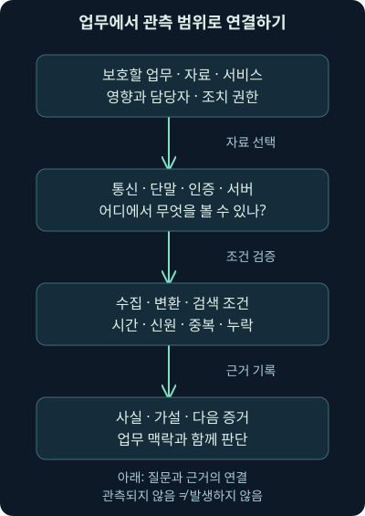
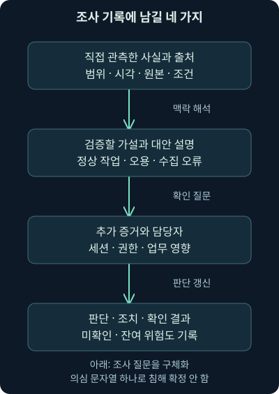
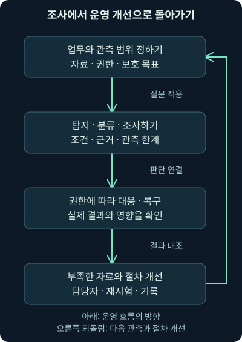

## 1. 여러 도구를 배웠는데 조사 문장은 어떻게 시작할까요?

가상의 회사에서 알림 세 개가 들어왔습니다. 원격 인증 실패가 반복됐고, 단말에서 새 프로그램이 실행됐으며, 외부 저장소 방향으로 큰 전송이 보인다고 합니다. 지금까지 배운 이름을 모두 적는 것보다 먼저 할 일이 있습니다. **무슨 업무를 보호하고, 어떤 사실을 어디까지 확인했는지** 설명하는 것입니다.

이번 25강은 첫째 날의 종합 복습입니다. 역할·권한·관측·경보·사건 기록·위협 정보·검색·자동화·공격자 관점을 하나의 독립 가상 조사로 연결합니다. 이전 강의의 세부 설명을 대체하는 축약본이 아니라, 여러 개념이 함께 필요한 상황에서 판단 순서를 연습하는 강의입니다. 다음 26강에서는 같은 질문을 실제 로컬 로그 검색으로 확인합니다.

이 강의의 회사·계정·기록은 직접 만든 예제입니다. 실제 조직을 조사하거나 원본 교재의 가상 환경을 실행한 결과가 아닙니다. 본 교재의 마지막 정리와 다음 실습 안내까지 확인했고, 원래 워크북·가상 위키의 실행 여부는 별도로 구분합니다.

## 2. 경보의 크기보다 보호할 업무를 먼저 정합니다

회사의 핵심 업무가 시간에 맞춘 출고라고 해봅시다. 재고 조회가 잠시 느려지는 일, 지급 정보가 바뀌는 일, 출고 지시가 잘못 전달되는 일은 서로 다른 영향을 줄 수 있습니다. 같은 경보 수라도 연결된 자산과 권한에 따라 우선순위가 달라집니다.

**임무**는 팀이 누구의 어떤 업무를 어떤 범위에서 보호하는지 정하는 방향입니다. **위험**은 불확실한 사건이 목표에 어떤 영향을 줄 수 있는지 생각하는 관점입니다. “모든 경보를 없애기”보다 중요한 업무의 손실 가능성과 영향을 줄이는 데 질문을 맞춥니다. 시그니처의 심각도는 참고 자료지만 업무 영향 전체를 대신하지 않습니다.

가상 조사에서 인증 대상이 연습용 서비스인지 출고 관리의 원격 접속 경로인지부터 확인합니다. 단말의 담당자와 실제 역할, 접근할 수 있는 자원도 알아야 합니다. 서버 이름에 `prod`가 들어갔다는 이유만으로 중요도가 검증되는 것은 아닙니다. 자산 목록·담당자·업무 흐름을 대조합니다.

## 3. 사람·절차·기술은 같은 문제를 서로 다른 쪽에서 봅니다

야간 접수 담당자는 경보를 보았지만 서비스 중단을 결정할 권한이 없다고 합시다. 도구의 차단 버튼이 보여도 누를 수 있다는 것과 해당 업무를 멈출 권한이 있다는 것은 다릅니다. 반대로 절차상 긴급 대응 권한이 정해져 있다면 모든 조사가 끝날 때까지 기다려야 한다고 단정해서도 안 됩니다.

**사람**은 관측과 업무 맥락을 판단하고 책임을 연결합니다. **절차**는 어떤 조건에서 누가 무엇을 확인·결정·기록할지 정합니다. **기술**은 자료 수집·탐지·조회·조치를 지원합니다. 한쪽의 기능만 늘려 다른 두 쪽의 빈칸을 자동으로 채울 수는 없습니다.

단계별 분석 조직, 구분이 약한 협업 조직, 작은 팀 모두 인계할 정보가 필요합니다. 현재 사실·미확인 가설·영향·다음 확인·담당자를 넘깁니다. “누가 이 티켓을 받았나?”와 “누가 실제 업무 변경을 승인·수행했나?”도 다른 질문입니다.

## 4. 위험을 수용한다면 무엇이 기록되어야 할까요?

가상 출고 장비가 오래되어 즉시 업데이트할 수 없다고 해봅시다. 사용을 멈출 때의 업무 영향과 계속 사용할 때의 위험을 함께 살펴야 합니다. “어쩔 수 없다”라는 한 문장으로 끝내지 않고 필요한 연결, 주변 통제, 관측, 복구 계획을 정합니다.

**보완 통제**는 직접 바꾸기 어려운 부분을 주변의 다른 통제로 보완하는 방식입니다. 불필요한 연결 축소·접근 제한·주변 관측이 도움이 될 수 있지만 원래 약점이 사라졌다고 보증하지 않습니다. 암호화된 내용이나 장치 내부의 동작을 주변 센서가 모두 볼 수도 없습니다.

위험 수용 기록에는 권한 있는 책임자, 판단 근거, 남는 위험, 적용 기간, 재검토 조건을 연결합니다. 구체적인 산업 장비의 안전 절차는 이 비유로 대신할 수 없습니다. 이번 강의는 장비 연결이나 보안 설정을 변경하지 않았습니다.

## 5. 동네 지도를 그리듯 관측 지도를 만듭니다

건물 밖의 경비실과 복도 카메라가 같은 모습을 볼 수는 없습니다. 네트워크 센서·단말 기록·서버 로그·클라우드 감사 기록도 각자의 위치와 의미가 있습니다. 어떤 질문을 어느 기록으로 확인할지 정하는 것이 관측 지도의 목적입니다.

네트워크 연결 요약은 누가 어디로 언제 얼마나 통신했는지 일부를 보여 줍니다. 패킷 원본은 더 자세한 구조를 볼 기회를 주지만, 암호화·누락·방향·재조립에 따라 내용이 보이지 않을 수 있습니다. 단말은 실행·파일·설정·사용자 활동을 보완하고, 서버·응용 기록은 실제 요청 처리와 결과를 보완합니다.

클라우드에서도 관리 작업·자료 접근·가상망 흐름이 같은 기록에 모두 들어간다고 가정하지 않습니다. 서비스 유형·리전·계정 영역·수집 설정·보존을 확인합니다. 기록이 중앙에 있다는 사실과 모든 필요한 동작이 원래부터 기록되었다는 사실은 다릅니다.

## 6. 자산 목록과 담당자도 분석 자료입니다

가상 단말 `workstation.example`의 외부 연결을 보았는데, 주소만 가지고는 출고 직원의 단말인지 공유 장비인지 알 수 없다고 해봅시다. 주소 할당 시각·장치 식별자·소유자·운영 담당자를 맞추어야 합니다. NAT처럼 여러 장치가 주소를 공유하는 조건도 고려합니다.

**자산 목록**은 이름과 주소를 나열하는 데서 끝나지 않습니다. 무엇이 어디에 있고 어떤 업무를 수행하며 누가 관리하는지, 어떤 상태가 정상인지 연결해야 합니다. 통제·노출 축소·약점 평가·갱신·측정도 이 맥락에서 이루어집니다. 갱신을 무조건 마지막까지 미루는 고정 순서로 읽지 않습니다.

담당자가 불명확하면 영향 확인과 대응도 지연됩니다. 관측 도구의 성능 문제처럼 보이는 일이 실제로는 업무 소유와 연락 경로의 문제일 수 있습니다. 사건 전에 연락·권한·복구 자료를 준비해야 하는 이유입니다.

## 7. 이벤트·경보·사건을 다시 나눠 봅시다

**이벤트**는 일어난 일을 이야기하는 단위이고, 로그는 그 일을 어떤 출처가 기록한 자료입니다. **경보**는 주의가 필요하다고 도구나 분석이 알리는 결과입니다. **사건**은 정해진 보안 기준과 대응 필요성에 연결되는 판단·관리 단위입니다. 제품마다 같은 단어의 화면 의미가 다를 수 있습니다.

원격 인증 실패 세 건이 발생했다는 사실과 계정 탈취 성공은 다릅니다. 경보를 케이스에 등록한 사실도 침해 확정과 같지 않습니다. 실제 또는 임박한 보안 영향의 기준에 따라 조사와 대응을 시작하며, 분류와 결론의 상태를 계속 갱신합니다.

2026년 11월 6일 확인한 NIST SP 800-61 Rev. 3은 2025년 4월 발행되어 이전 Rev. 2를 대체하고, 사건 대응을 위험 관리 전반에 연결합니다. 과거의 단순한 한 줄 순서도를 모든 상황의 고정 절차로 옮기지 않습니다. 조사·대응·복구·개선의 관계를 맥락에 맞게 읽어야 합니다. [NIST의 판본과 적용 취지](https://csrc.nist.gov/pubs/sp/800/61/r3/final)

## 8. 규칙이 맞았다는 말의 목표가 무엇인가요?

실패 인증을 세었다는 규칙이 있다면, 규칙의 첫 목표는 그 조건을 충족한 기록을 찾는 것입니다. 그 기록이 악성인지, 계정이 실제로 탈취되었는지는 다음 판단입니다. 조건 검증의 정답과 침해 판정의 정답을 섞으면 탐지 품질도 잘못 계산하게 됩니다.

**시그니처**는 미리 정한 특징을 찾는 방식이고, **이상 탐지**는 정한 기준에서 벗어난 모습을 찾는 방식입니다. 알려진 특징이 있다는 이유로 무조건 침해 성공이거나, 평소와 다르다는 이유로 악의라고 판단하지 않습니다. 정책 관련 특징을 규칙으로 찾는 경우도 있어 탐지 방법과 탐지 내용은 서로 다른 축입니다.

정밀도·재현율 같은 수치를 비교할 때도 무엇을 정답으로 삼았고 어떤 집단을 검토했는지 확인합니다. 미검토 항목을 정상으로 채우거나 서로 다른 기간·자산의 결과를 같은 분모처럼 비교하지 않습니다. 높은 숫자가 어떤 업무 개선을 의미하는지도 설명해야 합니다.

## 9. 가상 기록을 작은 사실부터 읽습니다

가상 인증 출처 A는 `corp.example` 영역의 사용자 `lee`에 대해 같은 출발 주소의 실패 기록을 세 건 남겼습니다. 출처 B에도 같은 사용자 문자열이 있지만 관리 영역과 출발 주소가 다릅니다. 단말·이름 조회·프록시에도 비슷한 시각의 관측이 있다고 합시다.

지금 사실은 각 출처가 그렇게 기록했다는 것입니다. 서로 같은 사람·계정·세션이라는 연결은 추가 증거가 필요합니다. 사용자 문자열만 같다고 A와 B의 실패를 합치면 다른 보안 영역의 계정까지 하나로 셀 수 있습니다. 시간과 주소 하나만으로 단말의 실제 사람을 단정할 수도 없습니다.

기록 식별자와 출처를 함께 보존하고, 원본·작업본·결과를 나눕니다. 복사 전후 해시가 같다는 사실은 바이트의 일치를 확인하는 데 도움이 되지만, 그 안의 주장과 기록 생성 과정이 진실이라는 보증은 아닙니다.

## 10. 원본·정규화·보강을 섞지 않습니다

서로 다른 필드 이름을 공통 질문으로 찾기 쉽게 바꾸는 작업이 **정규화**입니다. 문자열을 구조로 읽는 **파싱**, 외부나 내부 자료를 덧붙이는 **보강**과도 구별합니다. 변환한 값이 원래 어느 출처의 어떤 값에서 나왔는지 따라갈 수 있어야 합니다.

출발 주소에 위치 정보를 붙였다고 그 주소를 쓴 사람의 국적이 확인되는 것은 아닙니다. 외부 위협 목록에 주소가 있다고 우리 환경에서 접속이 일어났다는 뜻도 아닙니다. 원래 관측과 추가 설명의 출처·유효 시각·관계를 보존해야 합니다.

자료 형식이 제품과 비슷해 보여도 실제 제품 API나 표준과 같다고 주장하지 않습니다. 다음 실습의 JSONL도 직접 정한 교육 자료입니다. JSONL은 각 줄에 JSON 객체 하나를 적는 방식으로, 여러 기록을 한 줄씩 읽기 쉽게 만듭니다.

## 11. 시간은 한 개의 필드로 끝나지 않습니다

가상 실패 기록은 09:02에 발생했지만 수집기에 09:08에 도착했다고 합시다. 09:06에 조사하던 사람은 그 기록을 아직 볼 수 없습니다. 09:10에 같은 발생 시간 구간을 다시 검색하면 뒤늦게 포함될 수 있고요. 결과의 차이가 실제 새 공격의 발생을 뜻하는 것은 아닙니다.

**발생 시각**은 기록이 나타내는 사건의 시각이고, **수신 시각**은 해당 수집 단계에 도착한 시각입니다. 시계 편차나 수집 구조 때문에 두 값의 관계도 확인해야 합니다. 어느 시간 필드와 어떤 조사 기준 시각을 썼는지 함께 적습니다.

시각에 오차가 있다면 표시 순서와 실제 순서가 다를 수 있습니다. 시간 순서가 분명해져도 같은 세션·프로세스가 원인이라는 증거는 별도로 필요합니다. 앞 강의의 구간 비교와 이번 로그 검색을 연결하는 중요한 지점입니다.

## 12. 검색 결과를 세기 전에 무엇을 한 건으로 볼까요?

같은 출처의 같은 기록이 재전송되었다면 두 행을 두 사건으로 세면 안 됩니다. 그러나 다른 센서의 비슷한 기록은 같은 자료의 복사인지 독립 관측인지 먼저 확인해야 합니다. 무조건 값이 비슷하다는 이유로 지우면 중요한 차이를 잃을 수 있습니다.

**중복 제거 키**는 같은 기록을 알아보기 위해 사용하는 값의 조합입니다. 다음 실습에서는 출처와 기록 ID를 함께 사용합니다. 이것은 그 가상 자료가 정한 조건이며, 현실의 모든 로그 ID가 전역적으로 고유하다는 가정은 아닙니다. 같은 키인데 내용이 다르면 조용히 덮지 않고 충돌로 다룹니다.

또 신원이 비어 있는 인증 기록을 편리하게 다른 계정에 붙이지 않습니다. 누락 수를 따로 남기고 규칙에 쓸 수 있는 자료와 부족한 자료를 구별합니다. 결과에서 빠진 기록이 있다는 사실도 분석 결과의 일부입니다.

## 13. 사용 사례는 조건식보다 넓습니다

**사용 사례**, use case는 어떤 문제를 어떤 자료와 논리로 찾아 어떤 확인·행동으로 이어갈지 정한 작업 단위입니다. 임계값은 그중 한 조건일 뿐입니다. **임계값**은 검토 대상으로 삼을 경계를 정하는 수치로, 다음 가상 실습의 세 건은 공식 보안 기준이 아닙니다.

필요한 출처·필드·시간·개체를 먼저 정하고, 찾아야 할 예와 찾아서는 안 될 정상 예를 시험합니다. 범위 밖 값, 누락, 중복, 늦은 도착, 시간 경계도 바꾸어 봅니다. 제품 갱신이나 환경 변화 뒤에 다시 시험할 조건과 담당자도 남깁니다.

Elastic의 KQL은 자료를 좁히는 필터 언어이며 그 자체로 집계·변환·정렬을 수행하는 언어는 아닙니다. 2026년 11월 6일 공식 설명을 확인했습니다. 같은 화면에서 검색과 그래프가 함께 보여도 조건 필터와 집계의 역할을 구별해야 합니다. 다음 실습은 KQL을 실행한 것처럼 가장하지 않고 로컬 SQL을 사용합니다. [Elastic의 현재 KQL 설명](https://www.elastic.co/docs/explore-analyze/query-filter/languages/kql)

## 14. 케이스에는 결론뿐 아니라 다음 질문도 남깁니다

**케이스**는 관련 관측·작업·담당·판단을 이어 관리하는 기록입니다. 플레이북은 목표에 맞는 순서·분기·필수 확인을 돕고, 템플릿은 반복되는 형식과 시작 작업을 준비합니다. 템플릿의 체크 표시가 실제 증거 검토의 품질을 대신하지는 않습니다.

가상 케이스에는 “인증 실패 조건 일치”, “단말과 동일 세션 연결 미확인”, “업무 승인 확인 담당자”처럼 상태를 분리해 적습니다. 실제 영향이 진행 중이라면 영향 완화 검토를 병행하고 권한·수행 결과·부작용을 기록합니다. 모든 확인이 끝날 때까지 어떤 대응도 못 한다는 고정 규칙은 사용하지 않습니다.

## 15. 위협 정보의 값과 출처를 함께 보존합니다

**위협 정보**는 방어 질문에 도움이 되도록 출처·맥락·분석을 연결한 자료입니다. 주소·해시·도메인만 모은 목록과, 그 값이 언제 어떤 역할로 관측됐는지 설명한 자료는 다릅니다. 같은 값의 관련성도 유형·시각·관측 위치에 따라 달라집니다.

플랫폼의 이벤트·속성·객체·태그·관계는 맥락을 잃지 않도록 돕습니다. 같은 값의 상관관계가 보인다고 같은 공격자·침해 성공이 증명되지는 않습니다. 제공자의 관측 보고와 우리 환경의 관측도 구별합니다. 자동 보강 결과에는 실패·미확인·갱신·철회 상태가 필요합니다.

공유 범위를 나타내는 FIRST TLP 2.0 표시는 악성 심각도나 사실의 정확성 점수가 아닙니다. 2026년 11월 6일 공식 안내를 다시 확인했습니다. 전달 조건과 실제 공유 권한을 검토하고, 주소를 클릭되지 않게 표시하는 디팽을 외부 통신 차단이나 자동 통제라고 생각하지 않습니다. [FIRST TLP의 공식 안내](https://www.first.org/tlp/)

## 16. 자동화는 판단을 지우는 기능이 아닙니다

**자동화**는 반복 작업을 정한 조건에 따라 수행하도록 만드는 것이고, **오케스트레이션**은 여러 작업의 순서·분기·입출력을 연결하는 관점입니다. 조회·자료 전송·상태 변경·메시지 발송은 영향이 다릅니다. “자동 보강”이라는 이름만으로 모든 동작이 읽기 전용인 것은 아닙니다.

요청 수락·처리 완료·실제 효과·검증 결과를 나눠 확인합니다. 시간 초과가 곧 아무 효과도 없었다는 뜻은 아닙니다. 재시도와 중복 처리, 부분 실패, 권한·대상·입력의 변화를 고려해야 합니다. 조건 불일치와 도구 오류도 다른 상태로 남깁니다.

2025년 5월 27일 공동 SIEM·SOAR 지침도 계획·구현·유지 관리와 분석 기반을 함께 다룹니다. 2026년 11월 6일 다시 확인했으며, 제품 하나가 사람과 절차를 모두 대신한다는 뜻으로 확대하지 않습니다. [공동 실무 지침](https://www.cyber.gov.au/publication/implementing-siem-and-soar-platforms-practitioner-guidance)

## 17. 빠르다는 말에는 시작점과 결과가 필요합니다

경보를 받은 뒤 5분 만에 첫 검토를 했다면 그 시간을 잘 기록할 수 있습니다. 그러나 발생부터 수집까지 20분이 걸렸다면 발생부터 첫 검토까지는 25분입니다. 자체 가정의 합산이며 실제 조직의 성능 측정이 아닙니다. 어느 시간을 개선하려는지에 따라 수집·대기열·분석의 질문이 달라집니다.

**평균**은 합계를 개수로 나누는 값이고, **중앙값**은 정렬한 자료의 가운데를 나타내는 값입니다. 둘 다 미완료 건과 집계 범위, 시간 정의를 함께 봐야 합니다. 완료 건만 빨리 처리해 평균을 낮추고 오래 기다리는 건을 제외하면 실제 업무 상태를 오해할 수 있습니다.

보고에는 해결한 일과 남은 영향·위험·기록의 한계를 담습니다. 숫자가 좋아졌다는 사실이 실제 보호 업무도 좋아졌다는 뜻인지 확인해야 합니다. 다음 실습에서도 후보 수가 0이 되면 성공이라고 칭찬하지 않고 자료와 조건이 어떻게 바뀌었는지 먼저 읽겠습니다.

## 18. 공격자 이름보다 현재 가능한 행동을 봅니다

국가 연계·금전·이념·위탁·내부 접근은 서로 겹칠 수 있는 관점입니다. 기회형으로 발견한 접근이 이후 특정 조직에 맞춘 활동으로 이어질 수도 있습니다. 기술 수준·도구의 희귀함·유명한 이름이 업무 영향의 자동 점수는 아닙니다.

Mirai는 작은 장치의 분산 자원과 관측 방향을, Colonial 사례는 계정·인증·IT 위협과 운영 중단의 구별을 보여 주었습니다. Conti 관련 자료는 도구·절차와 실제 수행을, SolarWinds 사례는 공급·서명·인증 신뢰와 개별 피해 확인을 구별하게 했습니다. 역사적 사실의 출처와 날짜는 각 강의에 남겨 두었습니다.

여기서 가져갈 질문은 “지금 무슨 권한으로 어느 자산에 무엇을 할 수 있는가?”입니다. 주체 판명이 미완료여도 확인된 영향을 조사하고 절차에 따라 대응할 수 있습니다. 이름을 붙였다는 이유로 아직 없는 증거를 만들어내지 않습니다.

## 19. 가상 조사 메모를 한 번 완성해 봅시다

“09:00~09:06 발생 구간을 대상으로, 09:10까지 도착한 기록에서 출처 A의 같은 영역·사용자·주소에 대한 인증 실패 세 건을 확인했다. 중복 한 행은 별도 보존 후 계산에서 묶었다.” 여기까지는 범위와 계산을 설명하는 문장입니다.

다음 문장은 “같은 그룹의 성공 기록 한 건과 단말·외부 전송 관측이 있으나 동일한 실제 사람·단말·세션·전송 내용의 연결은 아직 미확인이다. 승인 작업·계정 오용·다른 주체의 활동이라는 대안을 비교한다”입니다. 숫자를 공격 성공 판정으로 바꾸지 않았습니다.

마지막에는 담당자와 다음 자료, 예상 업무 영향, 필요한 조치 검토의 권한, 갱신 시점을 남깁니다. 실제 조치가 있었다면 그 요청과 효과를 별도로 적어야 합니다. 이 메모는 직접 만든 예제이며 실제 회사 사건의 결과가 아닙니다.

## 20. 복구와 학습까지 이어져야 업무가 남습니다

파일 복구·서비스 복귀·신뢰 회복·잔여 접근 제거·자료 노출 평가·사건 종결은 서로 다른 상태입니다. 복구 버튼이나 티켓 종결 하나로 전부 확인됐다고 표시하지 않습니다. 원래 문제와 수집·절차의 빈칸을 다음 개선에 연결합니다.

그림에서 지식·코드·사용 사례의 판본과 다음 재시험까지 읽어 주세요. 기록의 출처·변경 이유·실행한 검사·미검증 항목이 있으면 다른 사람이 같은 질문을 이어갈 수 있습니다. 다음 26강은 이 습관을 작은 자료 파일과 실제 로컬 검색에 적용합니다. 그 뒤에는 네트워크의 통신 원리를 더 깊게 연결할 준비를 합니다.

## 21. 복습: 조건을 바꿔 설명해 보세요

### 질문 1. 같은 심각도 경보 두 개면 먼저 들어온 것부터 처리하면 되나요?

**해설:** 자산·업무 영향·진행 상태·권한과 가용 인력을 비교해야 합니다. 도착 순서와 제품 점수만으로 모든 우선순위를 정할 수 없습니다.

### 질문 2. 오래된 장비 주변을 제한하면 원래 약점이 없어지나요?

**해설:** 보완 통제로 위험을 줄일 수 있지만 잔여 위험은 남습니다. 담당·기간·관측·복구·재검토와 실제 효과를 확인해야 합니다.

### 질문 3. 케이스를 만들었으니 침해가 확정됐나요?

**해설:** 조사·관리의 시작과 침해 판정은 다릅니다. 사건 기준·현재 근거·분류 상태·다음 확인을 분리해 적습니다.

### 질문 4. 조회 조건이 정확히 맞았으면 악성 판정도 정확한가요?

**해설:** 조건 검증과 실제 악성 정답은 다른 목표입니다. 업무 맥락·후속 행동·영향과 정상 대안이 더 필요합니다.

### 질문 5. 출처가 다른 lee 기록을 전부 합쳐도 되나요?

**해설:** 영역·계정·주체가 다를 수 있습니다. 출처·신원 범위·시각·세션의 근거 없이 문자열만으로 연결하지 않습니다.

### 질문 6. 같은 시각을 검색했는데 늦게 다시 하니 결과가 늘었습니다. 공격이 늘었나요?

**해설:** 늦은 도착이나 수집·색인 변화일 수 있습니다. 발생 구간·수신 구간·조사 기준 시각과 도구 상태를 대조해야 합니다.

### 질문 7. 해시가 같으면 로그 내용도 사실인가요?

**해설:** 바이트 일치를 확인하는 데 도움이 됩니다. 출처의 진실·수집 과정·시간·사용자의 실제 행동은 별도 검증 대상입니다.

### 질문 8. TLP 표시와 디팽을 해두면 외부 행동도 허용되나요?

**해설:** 전달 조건·표시 방식·조치 권한은 다릅니다. 공유·조회·통신·차단 각각의 실제 범위와 권한을 검토합니다.

### 질문 9. 자동화 요청이 시간 초과면 아무 일도 없었나요?

**해설:** 실제 효과를 아직 모를 수 있습니다. 상태 조회와 중복 효과·재시도 조건을 확인하고 미확인을 남겨야 합니다.

### 질문 10. 미완료 건을 빼니 평균 시간이 줄었습니다. 개선인가요?

**해설:** 집단이 바뀐 효과일 수 있습니다. 분모·미완료 대기·시작/끝 정의와 업무 영향을 함께 봐야 합니다.

### 질문 11. 알려진 그룹 이름을 못 찾으면 대응도 기다려야 하나요?

**해설:** 확인된 영향과 필요한 증거·대응 권한으로 판단할 수 있습니다. 귀속과 실제 피해·위험 완화를 따로 진행합니다.

### 질문 12. 사건을 종결하면 학습도 끝났나요?

**해설:** 지식·사용 사례·수집·권한·복구의 개선과 재시험이 남을 수 있습니다. 완료한 일과 후속 담당·미검증을 연결해야 합니다.
