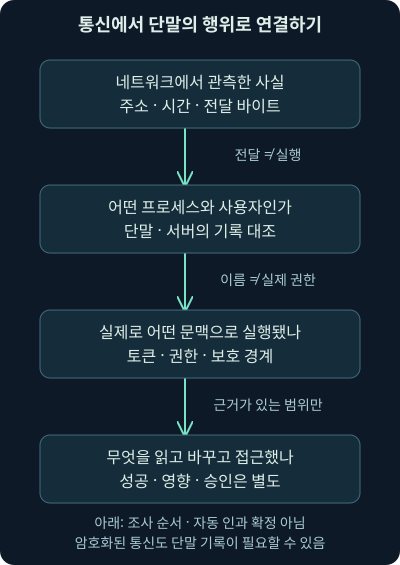
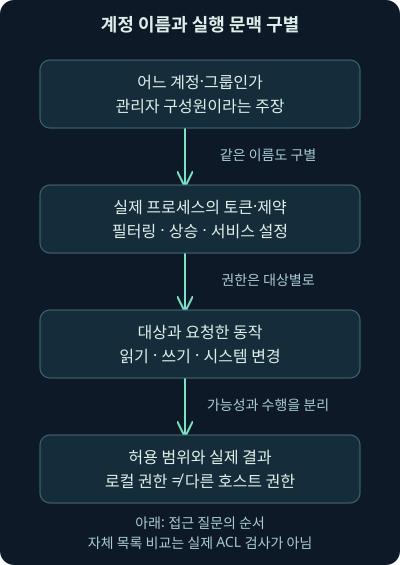
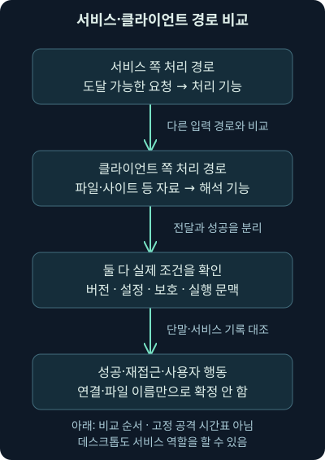

## 1. 파일이 들어왔습니다. 그다음에는 무슨 일이 있었을까요?

둘째 날에는 패킷과 통신 기록을 보며 “어디에서 어디로 무엇이 전달됐나?”를 물었습니다. 이제 가상 단말 `192.0.2.25`가 `download.example.org`에서 파일을 받았다고 해보죠. 다운로드 성공 응답과 파일 바이트가 보입니다. 그런데 이 사실만으로 파일이 실행됐고, 관리자 권한을 얻었으며, 내부 서버까지 장악했다고 적을 수 있을까요?

통신 기록이 대답한 범위는 전달입니다. 저장·열기·실행·권한·후속 접근은 단말과 서버의 기록으로 이어서 확인해야 합니다. **단말**은 사용자의 컴퓨터나 업무 장치처럼 실제 프로그램이 동작하는 끝 지점입니다. 서버도 실행 행위를 조사할 때에는 이런 관측 대상입니다. 단말이라는 말이 데스크톱만 뜻하지는 않습니다.

셋째 날 1강은 네트워크 관측에서 단말 관측으로 넘어가는 연결, 초기 접근과 실행의 차이, 실행 문맥과 권한, 서비스·클라이언트 쪽 입력 경로를 다룹니다. 2강에서는 실행·지속성·탐색을 서로 다른 조사 질문으로 나눕니다. 권한 상승·자격 증명·내부 이동·자료 반출은 뒤 강의에서 충분한 분량으로 이어갑니다. 이 강의의 사건과 비교 파일은 모두 자체 가상 사례입니다.

## 2. 현관 카메라와 방 안의 기록을 연결해봅시다

택배가 현관을 통과한 영상은 물건의 도착을 보여줍니다. 상자를 누가 열었고 내용물을 어디에 썼는지는 다른 기록이 필요하죠. 네트워크 센서는 통신의 문을 보고, 단말 기록은 프로그램이 안에서 한 일을 설명하는 데 도움을 줍니다. 어느 쪽이 무조건 더 우수한 것이 아니라 질문과 관측 지점이 다릅니다.

비유와 달리 컴퓨터에는 프로그램·계정·권한 경계가 여럿 있습니다. 통신 하나를 여러 프로그램이 나눠 쓸 수도 있고, 중계 프로그램이 대신 연결할 수도 있습니다. 따라서 “같은 주소에서 비슷한 시간에 일어났다”만으로 전달과 실행을 연결하지 않습니다. 당시 주소 사용 단말, 파일 식별 정보, 프로세스와 시각을 맞춰야 합니다.



그림에서는 마지막 상자로 바로 뛰지 말고 가운데 두 상자를 읽어주세요. 누가 어떤 프로그램을 어떤 제약 아래 실행했는지가 있어야 영향 범위를 설명할 수 있습니다. 시간의 단위는 실제 기록에서 초·밀리초 등을 확인하고 시간대와 오차도 맞춥니다. 그림 자체에는 사건의 측정 시간이 들어 있지 않습니다.

## 3. “처음 들어왔다”에도 여러 종류의 사건이 있습니다

**초기 접근**은 공격자가 대상 환경에 처음 접근할 발판을 얻는 목적을 말합니다. 취약한 외부 서비스를 악용할 수도 있고, 사람을 속여 자료를 열게 할 수도 있으며, 탈취한 계정으로 로그인할 수도 있습니다. **익스플로잇**은 취약점을 이용하는 동작입니다. 초기 접근 전체와 같은 뜻으로 쓰면 유효한 계정의 오용 같은 다른 경로를 놓칩니다.

예를 들어 가상 웹 서비스의 처리 결함을 이용해 의도하지 않은 코드를 동작시키는 경우와, 이미 알려진 비밀번호로 정상 로그인 절차를 통과한 경우를 나눠봅시다. 둘 다 조사할 초기 접근 후보가 될 수 있지만 원리와 필요한 증거가 다릅니다. 로그인 성공은 그 계정의 인증 절차 결과이지 메모리 취약점 악용이나 임의 코드 실행을 자동 증명하지 않습니다.

사회공학은 사람의 판단과 업무 절차를 이용하는 접근입니다. 문서를 열도록 속이는 경우에도 어떤 프로그램이 어떤 내용을 해석했고 실제로 무슨 동작을 했는지 확인해야 합니다. “수상한 첨부를 받았다”와 “첨부를 실행해 코드를 동작시켰다”는 다른 문장입니다. 조사 기록에도 이 차이를 남겨주세요.

## 4. 학습상의 출발점과 실제 사건의 입증을 나눕니다

단말 행위를 배우기 위해 “가상 프로그램이 이미 실행됐다고 가정하자”는 출발점을 둘 수 있습니다. 그러면 이후 무엇을 읽거나 바꿀 수 있는지 집중하기 쉽죠. 하지만 실제 경보에 이 가정을 그대로 붙이면 안 됩니다. 전달까지만 관측한 사건에 실행 성공을 추가한 셈이기 때문입니다.

앞에서 배운 공격 단계 모형도 조사 질문을 정리하는 지도입니다. 모든 공격자가 같은 순서로 같은 단계를 한 번씩 거친다는 시간표가 아닙니다. 이미 가진 계정을 다시 쓰거나, 한 단말에서 탐색한 뒤 다른 단말로 가서 다시 탐색할 수 있습니다. 어떤 단계를 보지 못했다면 생략됐는지 수집하지 못했는지부터 구별합니다.

## 5. 실행 중인 프로그램에는 자기 문맥이 있습니다

**프로세스**는 운영체제가 실행 중인 프로그램을 관리하는 단위입니다. 같은 프로그램 파일도 여러 프로세스로 실행될 수 있습니다. **실행 문맥**은 그 프로세스가 어느 계정·권한·제약을 가지고 동작하는지 설명하는 조건입니다. 파일 이름만 같은 두 프로세스가 같은 일을 같은 권한으로 할 것이라고 생각하면 안 됩니다.

회사 출입증을 떠올려보세요. 같은 복사기를 사용해도 직원·방문자·시설 관리자의 출입 범위는 다릅니다. 실제 컴퓨터는 출입증 하나보다 복잡합니다. 계정과 그룹뿐 아니라 대상 파일의 권한, 프로세스가 가진 보안 정보, 격리 환경과 보호 정책 등이 함께 작용합니다. “이 계정이면 무조건 모든 파일을 읽는다”처럼 한 조건으로 끝내지 않습니다.

취약점을 통해 어떤 프로세스 안에서 코드가 동작했다면 먼저 그 프로세스 문맥에서 가능한 일을 묻습니다. 새 관리자 계정이 저절로 생겼다고 가정하지 않습니다. 별도로 더 높은 권한을 얻는 과정인 권한 상승이나 다른 자격 증명 사용이 있었다면 그 동작을 지지하는 증거를 이어서 찾아야 합니다. 후속 동작이 새 프로세스를 만들지 않는 경우도 있으므로 시작 기록 하나만 유일한 관측 수단으로 삼지 않습니다.

## 6. 계정의 신원과 대상의 접근 허가는 다른 질문입니다

**인증**은 누구라는 주장이 맞는지 확인하는 절차이고, **인가**는 그 주체가 어떤 대상에 어떤 동작을 해도 되는지 결정하는 절차입니다. 회사에 로그인했다는 사실과 급여 문서를 수정할 권한은 다르죠. 읽기·쓰기·실행·설정 변경도 서로 다른 요청입니다.

Windows의 **접근 토큰**은 프로세스나 스레드의 보안 문맥을 표현하는 정보입니다. 계정과 그룹을 나타내는 식별자, 권한 등 접근 판단에 필요한 정보를 담습니다. **ACL**, 즉 접근 제어 목록은 대상에 대한 허용·거부 등의 규칙을 표현합니다. 실제 허용 여부는 요청한 동작과 대상, 유효한 문맥을 함께 대조해야 합니다. 이 강의의 단순 목록 실습은 토큰이나 ACL의 실제 판정을 재현하지 않습니다.

2026-11-07 [Microsoft 접근 제어 문서](https://learn.microsoft.com/en-us/windows/security/identity-protection/access-control/access-control)를 대조했습니다. 문서 적용 범위에는 Windows 11·10과 Server 2025·2022·2019·2016이 표시되어 있습니다. 이것은 해당 문서의 설명 범위이며 모든 버전의 현재 지원 상태나 조직의 실제 설정을 확인했다는 뜻은 아닙니다. 기본 원리는 유지되지만 대상별 권한과 제품 설정은 실제 환경에서 확인합니다.

## 7. 관리자 그룹에 들어 있으면 모든 프로그램도 관리자일까요?

Windows에서 관리자 그룹 소속이라는 사실만 보고 모든 프로세스를 상승된 권한으로 실행했다고 결론 내리면 안 됩니다. **UAC**, 사용자 계정 컨트롤은 관리자 권한 사용을 구분하는 Windows 기능입니다. 관리자 승인 모드의 대화형 로그인에서는 필터링된 토큰과 관리자 토큰의 차이가 중요합니다. 일반 실행과 권한 상승 후 실행을 나눠봐야 합니다.

예를 들어 가상 계정의 그룹 목록에는 관리자가 있지만 조사한 문서 뷰어는 제한된 문맥으로 동작했다고 해봅시다. 그 문서 뷰어에서 발생한 사건을 곧바로 전체 시스템 변경 가능성으로 확대하지 않습니다. 실제 프로세스 토큰·무결성 수준·상승 여부·보호 경계를 대조합니다. **무결성 수준**은 Windows에서 프로세스와 객체의 신뢰 수준을 구분하는 데 쓰이는 정보이며 계정 이름과 같은 값이 아닙니다.

2026-11-07 [Microsoft UAC 동작 설명](https://learn.microsoft.com/en-us/windows/security/application-security/application-control/user-account-control/how-it-works)을 확인했습니다. 여기서 설명하는 대화형 관리자 승인 흐름을 모든 서비스 계정·운영체제에 그대로 적용하지 않습니다. 정책과 로그인 종류도 확인해야 하며, 실제 토큰을 수집하지 않았다면 “그룹 소속은 확인했지만 해당 프로세스의 상승 여부는 미확인”이라고 적습니다.

## 8. 낮은 권한이면 피해가 없다는 뜻도 아닙니다

일반 사용자의 권한으로만 동작해도 그 사용자가 읽을 수 있는 업무 문서와 설정, 사용할 수 있는 업무 연결은 영향을 받을 수 있습니다. 시스템 전체 설정을 바꾸지 못한다는 사실과 중요 자료에 접근하지 못한다는 사실은 다릅니다. 공격 목적에 사용자 자료만 필요하다면 추가 권한 상승 없이도 피해가 생길 수 있죠.

서비스도 마찬가지입니다. **서비스 계정**은 특정 백그라운드 기능을 운영하는 계정입니다. 제한된 서비스가 전체 시스템을 변경할 수 없더라도 자기 업무 자료·설정·연결 권한을 가질 수 있습니다. 따라서 “관리자가 아니니 아무것도 못 한다”는 결론은 버립니다. 어떤 자료와 연결을 허용받았는지 구체적으로 적어야 위험을 평가할 수 있습니다.

최소 권한은 업무에 필요한 범위로 접근을 줄이는 원칙입니다. 피해 범위를 줄이는 데 도움을 주지만 실행된 코드의 의도까지 정상으로 바꾸지는 않습니다. 낮은 권한에서 무엇이 보호됐고 무엇은 노출될 수 있었는지 함께 설명하는 것이 정확합니다.

## 9. 로컬 관리자와 다른 호스트의 권한도 나눕니다

가상 단말 `192.0.2.25`에서 높은 권한을 얻었다고 해도 내부 서버 `192.0.2.60`의 모든 자료를 자동으로 읽는 것은 아닙니다. 다른 호스트에는 별도의 인증·인가·네트워크 경로·서비스 설정이 있습니다. 로컬 문맥으로 가능한 일과 원격 대상에서 허용하는 일을 따로 확인해야 합니다.

Linux의 **root**도 Windows 관리자라는 단어와 완전히 같은 구현은 아닙니다. 전통적인 사용자 식별자 0의 특권 모델과 함께, Linux 2.2 이후에는 특권을 나누는 **capability**, 즉 개별 능력의 구분이 있습니다. 2026-11-07 [Linux capabilities 매뉴얼](https://man7.org/linux/man-pages/man7/capabilities.7.html)을 확인했습니다. 이름만 번역해 모든 운영체제·격리 환경에서 무제한 접근이라고 가정하지 않습니다. 세부 구현은 해당 운영체제 강의에서 더 배웁니다.



그림의 세 번째 상자에서는 반드시 동사를 붙여보세요. “서버 권한이 있다”보다 “서버의 특정 공유에서 파일을 읽을 수 있는가?”가 검증하기 쉬운 질문입니다. 권한이 있다는 판단과 실제 읽기 성공 기록도 다시 나눕니다.

## 10. 서비스 쪽 입력은 어떤 길로 들어올까요?

서비스 쪽 경로에서는 외부의 요청을 기다리는 기능이 입력을 받아 처리합니다. **리스너**는 연결이나 요청을 받을 준비를 하는 기능입니다. 가상 서비스 `198.51.100.20`으로 클라이언트가 TCP 연결을 시작하고 서비스가 요청을 처리하는 상황을 떠올릴 수 있습니다. 이 TCP 사례는 방향 설명용이며 모든 서비스가 TCP를 쓰거나 같은 연결 절차를 갖는다는 뜻은 아닙니다.

데스크톱도 파일 공유나 관리 기능을 제공하면 서비스 역할을 합니다. 서버라는 장비 이름과 서비스라는 통신 역할을 섞지 마세요. 방화벽에서 해당 경로가 도달 가능하고, 실제 서비스·버전·설정에 이용 가능한 결함이 있으며, 입력이 필요한 처리 경로까지 들어가야 취약점 악용 가능성을 검토할 수 있습니다. 포트 하나가 열렸다는 사실은 이 조건들을 모두 확인한 결과가 아닙니다.

서비스가 외부에 노출됐다고 해서 항상 인증 없이 공격할 수 있는 것도 아닙니다. 인증 조건·권한·특정 기능·사용자 상호작용 여부는 취약점마다 다릅니다. 반복 요청이 가능할 수 있지만 이를 모든 서비스 취약점의 필수 속성으로 외우지 않습니다. 실패한 요청·차단·서비스 오류와 실제 실행 성공도 구별합니다.

## 11. 클라이언트 쪽 입력은 파일과 사이트의 해석으로 이어집니다

클라이언트 쪽 경로에서는 문서 뷰어·브라우저 같은 프로그램이 받은 자료를 해석하는 지점이 중요합니다. 사용자가 가상 문서를 열거나 사이트를 방문한 뒤 프로그램의 처리 결함이 작동하는 상황을 생각해볼 수 있습니다. 자료는 네트워크로 올 수도 있지만 이미 저장된 파일·이동식 매체 등을 통해 들어올 수도 있습니다.

그런데 반드시 사용자가 한 번 더 클릭해야 할까요? 경우에 따라 열기·미리 보기·자동 해석 과정이 계기가 될 수 있습니다. 반대로 자료를 받기만 하고 관련 해석이 일어나지 않았을 수도 있습니다. 필요한 사용자 동작은 프로그램·설정·취약점에 따라 달라지므로, 수신·렌더링·실행을 하나의 사건으로 합치지 않습니다.

외부로 재접속하는 통신이 관측되면 실행 후 제어 통신 같은 가설을 검토할 수 있습니다. 하지만 재접속이 모든 실행의 필수 조건은 아닙니다. 기록이 없다는 이유만으로 실행을 부정하지 않고, 기록이 있다는 이유만으로 특정 파일이 원인이라고 확정하지도 않습니다. 단말의 프로그램·파일·사용자 행동 기록으로 연결합니다.

## 12. 두 경로를 비교하면 방어와 조사 지점이 보입니다

서비스 쪽은 도달 가능한 요청 처리 기능, 클라이언트 쪽은 자료를 받아 해석하는 기능이라는 초점이 다릅니다. 둘 다 입력·실제 조건·실행 문맥·결과를 확인한다는 원리는 같습니다. 장비 이름만 보고 어느 경로인지 정하지 말고 당시 역할과 입력을 따라가세요.

| 비교할 질문 | 서비스 쪽 가상 사례 | 클라이언트 쪽 가상 사례 |
| --- | --- | --- |
| 입력은 어디로 들어왔나 | 도달 가능한 서비스 요청 처리 기능 | 파일·사이트 등을 해석하는 프로그램 |
| 무엇을 대조하나 | 서비스 버전·설정·인증·요청·응답 | 프로그램 버전·설정·자료·해석 계기 |
| 실행되면 어느 문맥인가 | 해당 처리 프로세스의 실제 문맥 | 해당 해석 프로세스의 실제 문맥 |
| 무엇이 아직 별도인가 | 악용 성공·실제 변경·업무 영향 | 열기·실행 성공·후속 동작·업무 영향 |



패치와 도달 경로 제한은 위험을 줄이는 중요한 수단입니다. 그래도 패치가 적용됐다는 기록만으로 과거 실행 여부를 판단하거나, 한 방화벽의 차단만으로 모든 다른 경로까지 안전했다고 결론 내리지는 않습니다. 2022년의 사례·보급 추세도 2026년의 공격 비율로 옮겨 적지 않습니다. 실제 제품의 현재 권고와 해당 시점의 설정이 필요합니다.

## 13. 작은 실습: 권한 이름 대신 허용 동작 주장을 비교합니다

이제 자체 파일을 실제로 읽어 비교해보겠습니다. 이것은 가상 허용 목록 비교기입니다. 운영체제의 ACL·토큰·권한 상속·거부 규칙·격리를 검사하지 않습니다. 단말을 공격하거나 파일 접근을 시도하지도 않습니다. 계정 이름만 보고 결과를 정하면 왜 틀리는지 보여주는 작은 모형입니다.

[비교 프로그램](../../assets/network-security/day03-lab01/compare_context.py), [가상 입력](../../assets/network-security/day03-lab01/cases.json), [실습 설명](../../assets/network-security/day03-lab01/README.txt)을 같은 폴더에 저장합니다. 작성 환경에서는 Python 3.12.14의 기본 라이브러리로 실제 실행했습니다. 아래의 `python`은 독자 환경에서 Python 3를 실행하는 이름이며 경로·설치 방식은 다를 수 있습니다.

```text
python compare_context.py cases.json
```

`compare_context.py`는 읽을 프로그램 파일이고, `cases.json`은 비교할 가상 자료입니다. JSON은 이름과 값으로 구조를 표현하는 텍스트 형식입니다. 프로그램은 `schema`로 교육용 자료 종류를 확인하고, `external_actions_allowed`가 `false`인지 확인한 뒤 목록만 비교합니다. `false`는 거짓, `true`는 참이며 이 파일에서 외부 동작 허용은 거짓으로 고정했습니다.

`allowed_actions_claim`은 허용된다고 가정한 동작 목록이고 `requested_actions`는 비교할 동작 목록입니다. `claim`은 주장이라는 뜻입니다. 요청 동작이 허용 목록에 있으면 비교 결과가 `true`, 없으면 `false`가 됩니다. 이것은 입력 주장의 관계를 계산한 결과이며 실제 운영체제의 허용·거부 응답을 받은 결과가 아닙니다.

`read-user-data`·`write-user-data`는 사용자 자료 읽기·쓰기, `read-service-data`는 서비스 자료 읽기 주장입니다. `change-machine-config`는 시스템 설정 변경, `connect-internal`은 내부 연결, `operate-other-host`는 다른 호스트 운영 주장입니다. 이름만 범위를 넓게 정한 교육용 동작이며 실제 파일 경로·원격 기능의 세부 권한을 검사하지 않습니다.

## 14. 조건을 바꿔보면 일반 사용자도 영향 범위가 있습니다

실제 자체 파일 실행에서 E1은 관리자 그룹 주장이 거짓이지만 사용자 자료 읽기·쓰기와 내부 연결의 비교가 참입니다. 시스템 설정 변경은 거짓입니다. 낮은 권한과 무영향이 같은 말이 아니라는 점을 읽어주세요. E2는 관리자 그룹 주장이 참이어도 허용 목록에 시스템 설정 변경이 없어서 그 비교는 거짓입니다. 이름이나 그룹 주장으로 목록에 없는 동작을 추가하지 않습니다.

E3는 제한된 서비스라는 가상 이름을 갖고 서비스 자료 읽기만 참입니다. 이것을 “아무것도 못 한다”라고 요약하면 그 자료의 위험을 지웁니다. E4는 로컬 관리자 범위를 가정했지만 다른 호스트 운영은 거짓입니다. 원격 권한을 로컬 이름에서 추정하지 않는 조건입니다. 다음 표는 이 파일에 선언한 조건일 뿐 Windows의 보편적 기본 권한표가 아닙니다.

| 가상 사례 | 입력에서 눈여겨볼 조건 | 실제 목록 비교에서 읽을 점 |
| --- | --- | --- |
| E1 | 일반 사용자·일부 자료와 연결 허용 주장 | 관리자 아님과 영향 없음은 다름 |
| E2 | 관리자 그룹 주장·제한된 동작 목록 | 그룹 주장만으로 권한을 더하지 않음 |
| E3 | 서비스 자료 읽기 허용 주장 | 제한된 서비스도 노출 범위가 있을 수 있음 |
| E4 | 로컬 동작 허용·다른 호스트 운영 제외 | 로컬 권한과 원격 권한 분리 |
| E5 | 허용 목록 `null` | 모르는 것을 거부로 바꾸지 않음 |
| E6 | 허용 목록 `[]` | 명시한 빈 목록과 미확인은 다름 |

E5의 `null`은 허용 목록 미확인이고 E6의 `[]`는 이 모형에서 명시한 빈 목록입니다. 따라서 E5의 비교는 `null`, E6는 `false`입니다. 실제 조사에서도 “권한을 수집하지 못했다”와 “검사한 요청이 거부됐다”를 같은 상태로 기록하면 안 됩니다. 두 상태는 다음 조사 행동이 다릅니다.

## 15. 실행한 비교와 실행하지 않은 검증을 분명히 합니다

출력의 `action_comparison`은 요청별 목록 비교입니다. `permissions_inferred_from_group_or_label`은 거짓으로 표시해 이름·그룹에서 권한을 추정하지 않았음을 나타냅니다. 실제 토큰·운영체제 권한·접근·취약점 악용·원격 인가를 검증했다는 항목은 모두 거짓이고, `incident_verdict`는 `unresolved`, 즉 사건 판단 미결입니다. 외부 동작 횟수도 0입니다.

작성 중에는 같은 입력의 그룹·이름만 바꾸는 경우, 허용 동작 하나만 바꾸는 경우, 미확인과 빈 목록, 잘못된 동작 이름 등의 조건도 실제로 비교했습니다. 이름을 바꿔도 동작 비교가 바뀌지 않는지와 잘못된 자료를 오류로 거부하는지를 확인하는 목적입니다. 이것을 실제 계정·서비스·파일의 권한 검사 결과로 표현하지 않습니다.

## 16. 실제 조사에서는 무엇을 더 모을까요?

첫째로 전달 경로를 확인합니다. 프록시·메일·리졸버·방화벽에서 같은 단말·시점·대상을 대조하고, 주소 임대나 변환이 있었다면 당시 자산과 연결합니다. 파일 바이트가 있으면 충분한 수집 범위에서 계산한 해시와 파일 식별 자료를 대조할 수 있습니다. 해시는 바이트 비교용 지문이며 출처·악성 여부·실행을 혼자 증명하지 않습니다.

둘째로 단말에서 프로세스·관련 파일·사용자 세션·실제 문맥을 찾습니다. EDR은 단말 탐지·대응 제품을 뜻하며, 제품이 있다는 사실만으로 필요한 모든 기록이 수집됐다고 가정하지 않습니다. 수집 설정·보존·중단·시간 오차·프로세스 내부 동작의 가시성을 확인합니다. 서버 쪽 입력이라면 애플리케이션 요청·오류·작업 기록도 대조합니다.

셋째로 영향과 승인을 확인합니다. 읽기·쓰기·설정 변경·다른 대상 접근의 성공 근거, 해당 자료의 중요성, 작업자의 승인과 변경 기록을 연결합니다. 관측 사실은 “프로세스 시작 기록이 있다”, 가설은 “그 파일과 관련된 실행일 수 있다”, 추가 입증이 필요한 결론은 “취약점 악용으로 중요 자료를 반출했다”처럼 층위를 나눠 적습니다.

기록이 없으면 수집한 단말과 시간·방향·로그 종류부터 확인하세요. 통신은 암호화돼 내용이 안 보였을 수 있고, 패킷이 누락·절단되어 재조립하지 못했을 수 있으며, 프로그램 내부 실행이 새 프로세스 기록을 만들지 않았을 수도 있습니다. 관측 공백을 무해함이나 실행 부재로 바꾸지 않습니다. 다음 강의는 이 원칙을 실행·지속성·탐색 기록의 차이에 적용합니다.

## 17. 복습: 단말의 문맥과 증거를 스스로 설명해봅시다

### 질문 1. 파일 다운로드 성공 응답이 있습니다. 실행 성공이라고 써도 될까요?

**해설:** 응답과 충분한 바이트는 전달의 근거입니다. 실행은 관련 단말·프로세스·파일의 연결이 필요합니다. 서버 성공 응답만 있다면 실제 바이트 수집의 완전성도 별도로 확인합니다.

### 질문 2. 탈취한 비밀번호로 로그인했습니다. 반드시 익스플로잇이 있었나요?

**해설:** 유효한 자격 증명 오용은 초기 접근 경로가 될 수 있지만 취약점 악용과 같은 원리가 아닙니다. 로그인 결과와 이후 실제 동작을 나눠 조사합니다.

### 질문 3. 같은 파일에서 실행한 두 프로세스는 항상 권한도 같을까요?

**해설:** 계정·토큰·상승 여부·격리·정책이 다를 수 있습니다. 프로그램 파일 이름이 같다는 사실만으로 실행 문맥을 합치지 않습니다.

### 질문 4. Windows 관리자 그룹 소속만 확인했다면 무엇이 미확인인가요?

**해설:** 해당 프로세스가 실제로 어떤 토큰과 무결성 수준으로 동작했는지 미확인입니다. UAC의 관리자 승인 모드에서는 그룹 소속과 상승된 실행을 구별해야 합니다.

### 질문 5. 일반 사용자 권한이면 중요 자료 피해는 불가능한가요?

**해설:** 그 사용자가 허용받은 중요 자료는 영향을 받을 수 있습니다. 시스템 전체 변경을 못 하는 것과 사용자 자료를 못 읽는 것은 다른 조건입니다.

### 질문 6. 제한된 서비스가 자기 업무 자료만 읽을 수 있습니다. 영향이 없나요?

**해설:** 그 자료의 중요성과 서비스가 사용할 수 있는 연결을 확인해야 합니다. 제한은 범위를 줄이지만 해당 범위의 피해까지 0으로 만들지는 않습니다.

### 질문 7. 로컬 관리자 권한을 확인했습니다. 내부 서버 운영 권한도 확인됐나요?

**해설:** 다른 호스트의 인증·인가·도달 경로는 별도입니다. 로컬 권한에서 원격 권한을 자동으로 더하지 않습니다.

### 질문 8. 데스크톱에 요청 대기 기능이 있습니다. 서비스 쪽 입력 경로가 될 수 있나요?

**해설:** 그렇습니다. 장비 이름보다 당시 통신 역할이 중요합니다. 다만 요청 도달·취약한 처리 조건·실제 성공은 이어서 확인해야 합니다.

### 질문 9. 포트가 열렸고 버전도 오래됐습니다. 악용 성공을 확정할 수 있나요?

**해설:** 취약점 적용 조건·설정·인증·보호·입력 처리·실제 결과가 필요합니다. 도달 가능성과 오래된 버전은 조사 단서이며 성공 증거를 대신하지 않습니다.

### 질문 10. 사용자가 클릭하지 않았다고 합니다. 클라이언트 쪽 처리는 없었다고 해도 될까요?

**해설:** 미리 보기·자동 해석 등 프로그램별 계기를 확인해야 합니다. 사용자 진술도 중요하지만 필요한 동작과 실제 프로그램 기록을 대조해야 합니다.

### 질문 11. 외부 재접속 기록이 없습니다. 단말 실행도 없었다고 해석할까요?

**해설:** 재접속이 모든 실행의 필수 조건은 아닙니다. 통신 경로·센서 범위·수집 시간과 단말 기록을 확인하고, 관측하지 못한 내용을 부재로 확정하지 않습니다.

### 질문 12. E2의 관리자 그룹 주장만 거짓으로 바꾸면 동작 비교가 달라질까요?

**해설:** 이 비교기는 허용 목록만 대조하므로 달라지지 않습니다. 이름과 그룹으로 실제 권한을 추정하지 않도록 만든 교육 조건입니다. 실제 운영체제의 권한 변경 실험은 아닙니다.

### 질문 13. E5의 `null`을 E6처럼 `[]`로 바꿔 적으면 무엇을 잃나요?

**해설:** 미확인과 명시한 빈 목록의 차이를 잃습니다. 실제 조사에서도 권한 자료가 없다는 상태와 확인한 접근이 거부됐다는 상태는 필요한 후속 조사가 다릅니다.

### 질문 14. 패킷에 파일이 있고 단말에 비슷한 시각의 프로세스가 있습니다. 다음 질문은요?

**해설:** 같은 자산·파일·프로세스인지 식별 정보와 시각 오차를 대조하고 실제 문맥·후속 동작·승인을 확인합니다. 가까운 시간은 연결 후보이지 자동 인과 증명이 아닙니다.
