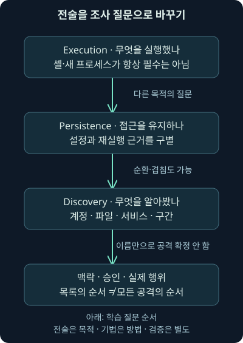
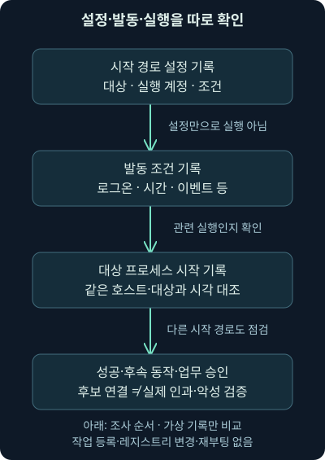
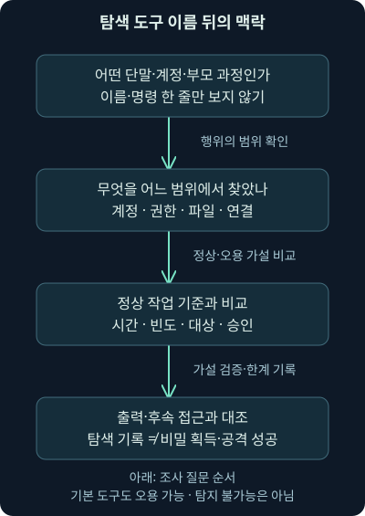

## 1. 프로그램 하나가 실행됐다고 모든 단계를 한 것은 아닙니다

앞 강의에서는 전달에서 실행으로, 계정 이름에서 실제 실행 문맥으로 내려가며 질문을 좁혔습니다. 이제 가상 단말에서 어떤 프로세스의 시작 기록을 찾았다고 해보죠. 이것만 보고 “지속성을 만들었고 내부 정보를 수집했다”라고 덧붙여도 될까요? 실행·재실행 경로 설정·정보 탐색은 서로 다른 행위입니다.

셋째 날 2강은 **Execution**, 즉 실행 목적, **Persistence**, 즉 접근이나 실행 발판을 유지하려는 목적, **Discovery**, 즉 환경을 알아보려는 목적을 구별합니다. 공격 기법 이름을 외우기보다 어떤 증거가 어떤 질문을 지지하는지 연습하겠습니다. 실제 공격 도구·지속성 설정·탐색 명령은 실행하지 않습니다. 뒤의 자체 JSON 비교 프로그램만 로컬에서 실제 실행했습니다.

2022년 설명에서 등장하는 명령 해석기·원격 제어 도구·운영체제 기본 기능·데이터베이스 명령 실행·애플리케이션 제어·시작 경로·계정 및 파일 탐색을 차례로 연결합니다. 권한 상승과 자격 증명 획득은 다음 강의의 독립 범위입니다. 이 구분은 깊이를 유지하기 위한 학습 순서이며 실제 공격의 필수 순서는 아닙니다.

## 2. “무엇을 위해”와 “어떤 방법으로”를 구별해봅시다

회사에 들어온 사람이 복사기를 썼다고 해보죠. 보고서를 출력하려는 것인지, 문서를 몰래 복제하려는 것인지는 기계 이름만으로 알 수 없습니다. 목적과 방법을 나눠봐야 하죠. 실제 보안 조사에서는 목적도 직접 보이는 값이 아닐 수 있으므로 관측 행위·주변 맥락·후속 증거로 가설을 세웁니다.

**전술**은 행위가 달성하려는 목적을, **기법**은 그 목적에 사용하는 방법을 설명하는 분류입니다. **MITRE ATT&CK**은 실제 관찰된 공격 행위를 정리하는 지식 체계입니다. 분류 이름을 붙였다고 사건의 악성 여부나 성공이 검증되는 것은 아닙니다. 같은 관리 기능이 정상 업무와 오용 양쪽에 사용될 수 있습니다.



그림의 마지막 상자를 먼저 기억해두세요. “실행을 관측했다”와 “공격자의 목적을 확정했다” 사이에는 맥락과 검증이 있습니다. 하나의 행위가 여러 목적에 관련될 수도 있고, 탐색을 반복하거나 지속성을 남기지 않는 사례도 있을 수 있습니다.

## 3. 오래된 전술 목록은 현재 이름과 버전을 대조합니다

2026-11-07 [ATT&CK 버전 기록](https://attack.mitre.org/resources/versions/)에서 당시 현행 표시가 v20.1, 시작일이 2026-10-13임을 확인했습니다. [Enterprise 전술 목록](https://attack.mitre.org/tactics/enterprise/)은 15개 전술을 표시합니다. 이 숫자를 영구적인 최신값으로 외우기보다 보고서에 사용한 버전과 확인일을 남겨야 합니다. 고정 비교가 필요하면 [v20 보존 사이트](https://attack.mitre.org/versions/v20/)도 참고할 수 있습니다.

예전 자료의 Defense Evasion이라는 이름을 현재 분류에 그대로 고정하면 혼동할 수 있습니다. 확인 당시 [TA0005는 Stealth](https://attack.mitre.org/tactics/TA0005/)라는 이름으로 은폐·정상 활동에 섞이는 목적을, [TA0112는 Defense Impairment](https://attack.mitre.org/tactics/TA0112/)로 방어 기능을 훼손하는 목적을 설명합니다. 여기서는 이름이 변할 수 있다는 필요한 차이만 짚습니다. 모든 분류를 이번 강의의 세 목적에 억지로 넣지 않습니다.

ATT&CK 전체를 침해 이후의 행위만 모은 목록으로 이해해서도 안 됩니다. 초기 접근 이전·접근·영향 등 다양한 목적의 질문이 있습니다. 이번에 실행·지속성·탐색을 집중해서 배우는 것과 전체 체계의 범위는 다른 문제입니다. 전술 표의 칸을 모두 채워야 실제 공격이 된다는 생각도 피하세요.

## 4. 실행은 반드시 새 창의 셸을 받는 모습일까요?

**셸**은 운영체제와 명령으로 상호작용하는 인터페이스이고, **명령 해석기**는 명령 문자열을 해석해 동작시키는 프로그램입니다. 눈에 보이는 터미널 창은 그 한 표현일 뿐입니다. 실행 목적에는 스크립트·애플리케이션 기능·이미 실행 중인 프로세스 안의 코드 동작 등도 관련될 수 있습니다.

PowerShell은 명령과 스크립트로 작업을 자동화하는 환경입니다. Meterpreter 같은 이름은 제어 기능을 제공하는 도구의 예로 등장하지만, 그 이름이 패킷이나 로그에 보인다는 사실만으로 실제 도구 실행·감염·제어 성공을 확정하지 않습니다. 도구 문자열·시그니처·프로세스·파일·행동 근거를 나눠 확인합니다. 이 강의에서는 해당 도구를 설치하거나 동작시키지 않습니다.

초기 접근이 성립했다고 곧바로 모든 운영체제 명령을 실행하는 셸을 얻었다고 가정하면 안 됩니다. 접근한 기능의 범위가 좁을 수도 있고, 원래 서비스 문맥에서 제한된 동작만 가능할 수도 있습니다. 새 파일 설치나 새 프로세스 생성이 실행의 필수 조건도 아닙니다. 그래서 프로세스 시작 기록이 없다는 결과만으로 모든 코드 실행을 부정하지 않습니다.

## 5. 데이터베이스 접속과 운영체제 명령 실행은 다릅니다

**SQL Server**는 데이터베이스를 제공하는 제품입니다. 여기에 로그인했다고 Windows 시스템 전체를 운영할 권한까지 자동으로 생기지는 않습니다. 데이터베이스의 권한과 운영체제(OS)의 문맥은 다릅니다. `xp_cmdshell`은 SQL Server에서 Windows 명령 셸로 명령을 전달하는 기능의 이름이며, 이름을 알아본 것과 실제 사용할 조건을 충족한 것은 별도입니다.

2026-11-07 [Microsoft xp_cmdshell 문서](https://learn.microsoft.com/en-us/sql/relational-databases/system-stored-procedures/xp-cmdshell-transact-sql?view=sql-server-ver17)를 `sql-server-ver17` 보기에서 확인했습니다. 기본적으로 비활성화되어 있고, 호출 권한·설정이 필요합니다. 높은 데이터베이스 권한으로 호출하는 경우 서비스 계정 문맥이 중요하며, 비관리 호출에는 별도로 구성한 프록시 계정과 권한 조건이 있습니다. 프록시 구성이 없으면 해당 경로는 실패할 수 있습니다.

따라서 “SQL 로그인 성공 → OS 관리자 명령 실행”처럼 한 화살표로 끝내지 않습니다. 기능 설정·호출 계정과 권한·실제 실행 문맥·실행 결과를 대조합니다. 문서의 버전 보기와 실제 설치 버전도 구별해야 합니다. 이 수업에서는 기능을 켜거나 SQL 명령을 실행하지 않았고, 운영체제 명령 전달 절차를 실습하지 않습니다.

## 6. 실행 제어는 차단과 기록과 경보를 나눠봅니다

**애플리케이션 제어**는 허용한 프로그램이나 코드만 실행하도록 정책을 적용하는 방어 수단입니다. 하지만 정책이 있다는 사실만으로 모든 실행이 차단됐다고 말하지 않습니다. **감사 모드**는 정책 영향을 관찰하는 방식이고, **강제 적용 모드**는 정책에 따라 실제 제한을 적용하는 방식입니다. 정확한 동작은 제품·정책 옵션·코드 종류에 따라 확인해야 합니다.

2026-11-07 [Microsoft App Control 규칙·정책 옵션](https://learn.microsoft.com/en-us/windows/security/application-security/application-control/app-control-for-business/design/select-types-of-rules-to-create)을 대조했습니다. 감사 모드에서는 일반적으로 허용하면서 관련 사건을 기록하는 목적이 있지만 일부 옵션은 동작에 영향을 줄 수 있어 검증이 필요합니다. 모든 애플리케이션 제어 제품에서 감사라는 단어가 완전히 같은 결과를 보장한다고 일반화하지 않습니다.

기록이 만들어지는 것과 SOC에 즉시 경보가 도착하는 것도 다릅니다. SOC는 보안 운영 조직을 말합니다. 기록 수집·전송·규칙·억제·보존 설정이 맞아야 분석가가 볼 수 있습니다. “도구가 실행되면 반드시 탐지된다”와 “메모리에서만 동작하면 탐지할 수 없다”는 양쪽 단정 모두 피하고 실제 센서와 수집 범위를 점검합니다.

## 7. 한 번 실행된 것과 다시 실행될 길을 남기는 것은 다릅니다

빌린 회의실에 한 번 들어간 것과 다음 주에도 들어갈 예약·출입 권한을 남긴 것은 다릅니다. 지속성도 비슷합니다. 접근이 끝나거나 사용자가 다시 로그인하거나 시스템이 재시작된 뒤에도 발판을 유지하려는 목적을 봅니다. 실제 컴퓨터에서는 시작 조건·계정·경로·보호 정책에 따라 재실행 가능성이 달라집니다.

공격자가 모든 상황에서 지속성을 남겨야 하는 것은 아닙니다. 이미 재사용할 수 있는 접근 경로가 있거나 짧은 시간 안에 목적을 끝내려 할 수도 있습니다. 반복 접근이 쉽다는 추정도 지속성 부재의 증거는 아닙니다. “새 프로세스가 있었다”, “재실행 설정이 있었다”, “그 설정으로 다시 실행됐다”를 각각 나눠 적어야 합니다.

## 8. 로그온 때의 시작과 부팅 때의 시작도 다릅니다

**레지스트리**는 Windows의 여러 설정을 보관하는 체계입니다. 그중 Run·RunOnce 같은 시작 관련 위치는 로그온 시 프로그램 실행에 관련됩니다. 이것을 모두 부팅 직후, 사용자와 상관없이, 항상 성공하는 실행으로 바꾸어 설명하면 틀립니다. 경로·계정·조건·정책·대상 파일 상태를 확인해야 합니다.

2026-11-07 [Microsoft Run·RunOnce 설명](https://learn.microsoft.com/en-us/windows/win32/setupapi/run-and-runonce-registry-keys)을 확인했습니다. 여기서 핵심은 로그온과 부팅의 차이, 반복 목적과 일회성 목적의 차이입니다. 값이 있다는 기록은 설정의 단서입니다. 실제로 그 조건이 발생했고 해당 대상을 실행했는지, 성공했는지, 승인된 설치 작업인지 더 확인합니다. 이 강의는 레지스트리에 값을 쓰지 않습니다.

## 9. 예약 작업은 조건·동작·실행 주체를 함께 읽습니다

**예약 작업**은 정한 조건에 맞춰 작업을 실행하도록 등록하는 기능입니다. **트리거**는 시작 계기, **동작**은 수행할 내용, **실행 주체**는 그 일을 수행하는 계정·보안 문맥입니다. 이름이 그럴듯한 작업이라고 정상인 것도, 낯선 이름이라고 악성인 것도 아닙니다.

매일 정해진 시간의 유지보수와 특정 사용자 로그온 때의 시작은 다른 트리거입니다. 등록이 성공했어도 트리거가 아직 발생하지 않았거나, 실행 계정의 조건·권한·대상 경로 문제로 동작이 실패할 수 있습니다. 모든 작업이 SYSTEM 계정으로 실행된다고 가정하지 않습니다. 2026-11-07 [트리거 문서](https://learn.microsoft.com/en-us/windows/win32/taskschd/task-triggers)와 [실행 보안 문맥 문서](https://learn.microsoft.com/en-us/windows/win32/taskschd/security-contexts-for-running-tasks)를 대조했습니다.



그림에서 세 번째 상자가 있어도 끝은 아닙니다. 정말 그 설정이 원인이었는지 프로세스 식별자·부모·명령행·대상 파일·작업 인스턴스 같은 연결 근거가 더 필요합니다. 부모 프로세스는 해당 프로세스를 만든 과정을, 명령행은 실행에 전달한 명령·인수를, 작업 인스턴스는 등록된 작업의 개별 실행을 가리킵니다. 여기서 인수는 프로그램에 넘기는 추가 입력입니다. 이번 자체 실습의 이름·시각 비교는 이 실제 연결을 대신하지 않습니다.

## 10. 파일 하나를 지웠는데 다시 보이는 이유를 조사합니다

가상 사건에서 의심 파일을 제거한 뒤 비슷한 파일이 다시 나타났다고 해봅시다. 지속성 경로가 남았다는 가설을 세울 수 있습니다. 하지만 정상 배포 도구·복구 기능·사용자 재다운로드·다른 단말의 동작도 후보입니다. 파일의 재등장만으로 특정 예약 작업을 범인으로 확정하지 않습니다.

시작 경로가 두 개라면 한 경로만 지워도 다른 경로가 남을 수 있습니다. 반대로 등록 설정은 남았지만 대상 파일이 없어 실행이 실패할 수도 있죠. 제거 대상·순서·시점·실제 재실행 결과를 연결해야 합니다. 경로를 하나 발견한 것과 전체 원인 제거를 검증한 것은 다릅니다. 이번에는 실제 파일 제거·설정 변경·재부팅을 하지 않습니다.

## 11. 탐색은 환경을 알아보는 목적입니다

처음 방문한 사무실에서는 내 좌석, 공유 프린터, 회의실 위치를 알아봅니다. 공격자도 접근한 환경의 계정·그룹·권한·파일·서비스·다른 호스트·설치 프로그램을 알아보려 할 수 있습니다. 하지만 정상 지원 담당자도 비슷한 정보를 확인합니다. 목록 조회라는 행위만 보고 의도를 확정할 수 없는 이유입니다.

프로세스 목록은 실행 중인 프로그램, 연결 목록은 통신 관계, 디렉터리 목록은 파일과 폴더 구조를 알아보는 데 도움을 줄 수 있습니다. 운영체제에 원래 있는 `netstat`·`dir` 같은 이름이나 PowerShell을 썼다고 자동으로 정상인 것은 아닙니다. 반대로 그 이름 하나가 공격의 증거도 아닙니다. 이 강의에서는 이름의 역할만 설명하고 해당 탐색 명령을 실행하지 않습니다.

**LOTL**, Living off the Land는 환경에 있는 정상 도구·기능을 오용하는 행위를 설명할 때 쓰는 표현입니다. 별도 악성 파일이 없다는 사실만으로 안전을 판단하면 이런 행위를 놓칠 수 있습니다. 그렇다고 기본 도구 사용은 탐지할 수 없다고 결론 내리지는 않습니다. 관측 가능한 실행 문맥과 행동의 조합을 봅니다.

## 12. 정상 작업의 기준을 먼저 만들어야 차이도 설명할 수 있습니다

가상 지원 담당자가 업무 시간에 승인된 단말에서 자기 계정과 서비스 상태를 확인했다고 해봅시다. 다른 사건에서는 문서 뷰어의 후속 과정에서 여러 계정·다른 호스트의 자료를 빠르게 찾았다고 합시다. 같은 도구 이름이어도 출발 과정·대상·범위·빈도·시각·승인·후속 접근이 달라집니다. 두 번째가 더 조사할 이유는 이런 맥락의 조합이지 이름 하나 때문이 아닙니다.

**기준선**은 정상이라고 비교할 업무·단말·계정·시간·대상 범위를 정리한 것입니다. 드물다는 판단에도 어떤 집단과 기간을 비교했는지 필요합니다. 기준선과 일치해도 계정 오용 가능성은 남고, 벗어났어도 긴급 지원이나 변경 작업일 수 있습니다. 승인 기록과 담당자 확인, 출력·후속 행위로 가설을 검증합니다.

2026-11-07 [호주 사이버 보안 센터의 LOTL 공동 권고 안내](https://www.cyber.gov.au/advisory/identifying-and-mitigating-living-off-the-land-techniques)를 확인했습니다. 2024년 공개된 권고의 행위·기준선·기록 중심 접근은 여기서도 유용합니다. 공개일을 현재 사건 발생일이나 제품의 최신 버전으로 오해하지 않습니다. 해당 안내를 확인한 것이 실제 조직의 탐지 능력을 시험한 결과는 아닙니다.



탐색 명령이 기록됐어도 출력이 없으면 실제 무엇을 알아냈는지는 미확인일 수 있습니다. 연결 목록 조회와 인증 정보 획득은 같지 않고, 파일 이름 조회와 파일 내용 읽기도 다릅니다. 결과를 확인하지 않았다면 “조회 시도 기록”처럼 좁게 적어주세요.

## 13. 실습 자료는 실제 Windows 로그가 아닌 가상 기록입니다

[비교 프로그램](../../assets/network-security/day03-lab02/compare_activity.py), [가상 입력](../../assets/network-security/day03-lab02/cases.json), [실습 설명](../../assets/network-security/day03-lab02/README.txt)을 같은 폴더에 저장합니다. 실제 Windows 이벤트 로그의 내보내기가 아니라 자체 교육 형식의 기록입니다. 작업 등록·레지스트리 쓰기·프로세스 생성·탐색·네트워크 접속을 실행하는 기능은 없습니다. Python 3.12.14 기본 라이브러리로 이 텍스트 비교만 실제 실행했습니다.

```text
python compare_activity.py cases.json
```

`python`은 Python 3 실행 이름, `compare_activity.py`는 가상 기록 비교 프로그램, `cases.json`은 입력 파일입니다. `schema`가 교육 형식과 맞는지, `external_actions_allowed`가 `false`인지 확인합니다. `records`는 기록 목록이고 `kind`는 기록 종류입니다. `process_start`는 시작 기록 주장, `startup_config`는 시작 경로 설정 주장, `trigger_event`는 발동 조건 기록 주장, `discovery_command`는 탐색 명령 기록 주장입니다.

각 기록에는 `time`·`host`·`subject`가 있습니다. 각각 시간대가 있는 시각, 호스트 표지, 비교할 대상 표지입니다. `2026-11-07T10:00:00+11:00`처럼 뒤의 `+11:00`은 UTC보다 11시간 빠른 시간대라는 뜻입니다. 서로 다른 표기가 같은 순간을 뜻할 수 있어 시간대가 필요합니다. 이 입력의 시각은 실측이 아니라 가상 조건입니다.

## 14. 작은 예제: 시작 기록 하나와 설정 하나를 나눠봅니다

실제 자체 비교에서 T1에는 프로세스 시작 기록만 있습니다. 시작 기록 식별자는 출력되지만 설정·트리거가 없어서 세 기록의 연결 후보는 없습니다. T2는 반대로 시작 경로 설정만 있습니다. 설정을 관측했다고 재실행을 관측한 것은 아니라는 차이를 보여줍니다.

T3에는 같은 호스트·대상 표지로 10:00 설정, 10:05 트리거, 10:06 시작 기록이 있습니다. 프로그램은 설정 시각이 트리거보다 늦지 않고, 시작 시각이 트리거보다 늦거나 같은 경우를 대조합니다. 이 조건을 쓰는 이유는 뒤에 생긴 설정을 앞선 시작의 근거로 잘못 붙이지 않기 위해서입니다. 시각만 맞는다고 인과가 입증되는 것은 아닙니다.

```json
"candidate_config_trigger_process_links": [
  ["cfg", "trig", "proc"]
]
```

이것은 실제 자체 파일의 T3 비교에서 나온 부분입니다. `candidate`는 후보라는 뜻이고 `cfg`·`trig`·`proc`는 가상 기록 식별자입니다. 실제 작업 인스턴스나 프로세스 식별자를 검증한 값이 아닙니다. 프로그램은 같은 `subject` 표지를 비교할 뿐 원인 관계를 분석하지 않습니다.

## 15. 조건을 추가하면 시간만으로 연결할 수 없는 이유가 보입니다

T4는 시작 기록의 호스트가 다릅니다. 시각이 그럴듯해도 같은 호스트·대상의 세 기록이 아니므로 연결 후보가 없습니다. 실제 환경에서는 원격 작업 같은 별도 관계가 있을 수 있지만 이 모형이 그것을 추적하지는 않습니다. 모형의 비교 실패를 실제 사건의 무관함으로 확대하지 않습니다.

T5는 탐색 명령 주장만 있습니다. 출력은 탐색 기록의 식별자를 보여주지만 실제 명령 실행·출력·공격 의도를 검증하지 않습니다. T6는 설정의 대상 표지가 트리거·시작의 대상과 달라 연결되지 않습니다. 다른 경로를 놓쳤거나 이름 표지만으로 같은 파일을 연결하지 못하는 실제 상황도 생각해볼 수 있습니다.

| 가상 사례 | 포함한 기록의 조건 | 실제 자체 비교 결과의 의미 |
| --- | --- | --- |
| T1 | 시작만 있음 | 실행 주장과 지속성 근거 분리 |
| T2 | 설정만 있음 | 설정과 발동·실행 분리 |
| T3 | 같은 호스트·대상, 설정→트리거→시작 | 세 기록의 연결 후보 한 개 |
| T4 | 시작 호스트가 다름 | 이 비교 조건에서는 후보 없음 |
| T5 | 탐색 명령 주장만 있음 | 탐색 기록 목록, 의도·출력 미확인 |
| T6 | 설정 대상 표지가 다름 | 이 비교 조건에서는 후보 없음 |

검증 중에는 트리거가 시작보다 늦은 경우, 시간대 표기만 달리한 같은 순간, 일부 기록 누락·다른 대상·추가 경로도 실제 비교했습니다. 시간대 없는 시각·잘못된 기록 종류·중복 식별자는 오류로 거부하는지 확인했습니다. 이 확인의 범위는 비교 프로그램과 가상 입력이며 실제 작업 스케줄러의 동작 검증이 아닙니다.

## 16. 결과가 없을 때는 수집 공백과 모형의 한계를 기록합니다

출력의 `actual_process_or_command_verified`·`actual_persistence_verified`·`actual_causality_verified`·`actual_attacker_intent_verified`는 모두 거짓입니다. 실제 프로세스·명령·지속성·인과·의도를 검증하지 않았다는 뜻입니다. `incident_verdict`는 미결이고 외부 동작은 0입니다. 후보가 하나 있다는 사실도 이 항목들을 참으로 바꾸지 않습니다.

실제 사건에서는 필요한 시작 경로가 이 네 기록 종류 밖에 있을 수 있습니다. 부모·프로세스 식별자·명령행·파일 해시·작업 인스턴스·실행 계정·성공 결과·변경 승인도 대조해야 합니다. 로그 시계가 틀리거나 수집 시작이 늦고 보존이 짧으면 순서와 부재를 잘못 해석할 수 있습니다. 가상 이름이 같은 것과 동일한 실제 파일·프로세스라는 확인도 다릅니다.

네트워크 결과가 없을 때도 암호화·관측 방향·잘린 패킷·재조립·도구 설정을 점검합니다. 단말 시작 기록이 없을 때에는 수집 정책과 기존 프로세스 내부 동작을 생각합니다. 예약 작업 기록만 있다면 발동·실행·실패 로그를, 탐색 기록만 있다면 출력·대상 접근과 승인 자료를 추가로 찾습니다. 관측한 사실과 그 사실이 지지하는 가설, 아직 필요한 결론을 분리하세요.

## 17. 실제 조사 메모를 세 줄의 다른 강도로 써봅니다

가상 메모의 첫 문장은 “같은 호스트에 설정·트리거·시작을 주장하는 기록이 시간 순서대로 있다”입니다. 이는 파일 내용과 비교 결과의 관측입니다. 둘째는 “이 설정에 의한 재실행일 가능성을 검토한다”입니다. 이는 가설입니다. 셋째의 “악성 지속성으로 재실행에 성공했다”는 아직 인과·실행 결과·업무 승인·악성 맥락이 필요한 결론입니다.

탐색도 같은 방식입니다. “계정 목록 명령 기록이 있다”에서 “공격자가 비밀번호를 획득했다”로 뛰지 않습니다. 실제 출력과 자격 증명 접근은 다른 근거입니다. 다음 강의에서는 높은 권한이 왜 필요한 경우가 있고 왜 모든 공격에 필수는 아닌지, 권한 상승 경로와 설정·취약점 조건을 이어서 살펴봅니다.

## 18. 복습: 설정과 행위와 목적을 나눠봅시다

### 질문 1. ATT&CK 전술 이름을 붙이면 악성 여부도 검증되나요?

**해설:** 전술은 목적을 설명하는 분류입니다. 정상 기능 오용 여부와 실제 의도·성공은 맥락과 증거로 판단해야 합니다. 이름은 검증 결과를 대신하지 않습니다.

### 질문 2. 2022년 전술 목록을 보고서에 그대로 써도 될까요?

**해설:** 역사적 설명으로 사용할 수 있지만 적용 버전과 확인일을 밝혀야 합니다. 2026-11-07 확인한 v20.1의 이름·구성과 과거 분류를 구별하고 영구적인 최신 목록처럼 적지 않습니다.

### 질문 3. 새 셸 창이 없으면 실행 목적의 행위도 없었다고 할까요?

**해설:** 기존 프로세스·스크립트·애플리케이션 기능에서도 코드가 동작할 수 있습니다. 새 창이나 새 프로세스 하나를 모든 실행의 필수 조건으로 삼지 않습니다.

### 질문 4. SQL Server 로그인에 성공했다면 xp_cmdshell도 바로 쓸 수 있나요?

**해설:** 기본 비활성화 여부·호출 권한·프록시 또는 서비스 계정 문맥·실행 조건을 확인해야 합니다. 데이터베이스 접속과 OS 명령 실행은 별도입니다.

### 질문 5. 감사 모드에서 정책 위반 기록이 있으면 차단됐다고 쓰나요?

**해설:** 일반적으로 감사와 강제 차단은 다릅니다. 실제 제품·옵션·결과를 확인하고 수집 기록과 SOC 경보 전달도 나눠봅니다.

### 질문 6. 초기 접근이 확인됐는데 지속성 설정이 없습니다. 공격이 불완전한가요?

**해설:** 모든 공격에 새 지속성이 필수는 아닙니다. 목적·다른 재접근 경로·관측 범위를 확인해야 합니다. 없다는 관측만으로 공격 여부를 결정하지 않습니다.

### 질문 7. Run 관련 값이 있습니다. 부팅 직후 실행됐다고 결론 내릴까요?

**해설:** 로그온과 부팅을 구별해야 합니다. 해당 위치의 조건·계정·대상과 실제 발동·실행·결과를 확인합니다. 값의 존재는 설정 근거입니다.

### 질문 8. 예약 작업 등록 기록과 프로세스 시작이 있습니다. 무엇이 더 필요하나요?

**해설:** 트리거·작업 인스턴스·실행 주체·대상·명령행·부모·성공 결과를 대조해야 합니다. 비슷한 시간과 이름만으로 실제 원인 관계를 확정하지 않습니다.

### 질문 9. 의심 파일 하나를 지웠는데 다시 나타났습니다. 원인은 확정됐나요?

**해설:** 다른 시작 경로뿐 아니라 정상 배포·복구·재다운로드도 후보입니다. 파일 식별과 재생성 과정·설정·시각을 대조해 원인을 검증해야 합니다.

### 질문 10. 운영체제 기본 도구로 탐색했으니 정상인가요, 아니면 탐지 불가능한가요?

**해설:** 둘 다 단정할 수 없습니다. 계정·출발 과정·대상·범위·시각·승인·후속 행동을 기준선과 비교합니다. 정상 도구도 오용 가능하고 행동 기록으로 조사할 수 있습니다.

### 질문 11. T3의 후보가 하나 나왔습니다. 실제 지속성이 검증됐나요?

**해설:** 가상 이름·호스트·시간 조건을 만족한 조합 하나입니다. 실제 프로세스·작업 인스턴스·인과·성공·악성 의도는 검증하지 않았으므로 관련 항목은 계속 거짓입니다.

### 질문 12. T3의 시작 시각을 트리거보다 앞으로 바꾸면 왜 후보가 사라질까요?

**해설:** 이 모형은 설정→트리거→시작의 시간 조건을 비교하기 때문입니다. 실제 사건에서는 시계 오차와 다른 경로도 확인해야 하므로 후보 부재를 실행 부재로 확대하지 않습니다.

### 질문 13. T4의 시작 기록이 다른 호스트에 있습니다. 실제로도 반드시 무관한가요?

**해설:** 이 비교기는 같은 호스트의 조합만 찾습니다. 원격 실행 같은 별도 관계는 분석하지 않으므로 실제 무관함을 증명하지 않습니다. 서버·단말·인증·네트워크 기록을 더 대조합니다.

### 질문 14. 계정 목록 조회 기록이 있으면 비밀 정보 획득도 확인됐나요?

**해설:** 명령 기록·출력·자료 접근·자격 증명 획득은 서로 다릅니다. 출력과 후속 동작이 없다면 확인 범위를 좁게 기록하고 다음 증거를 찾습니다.
