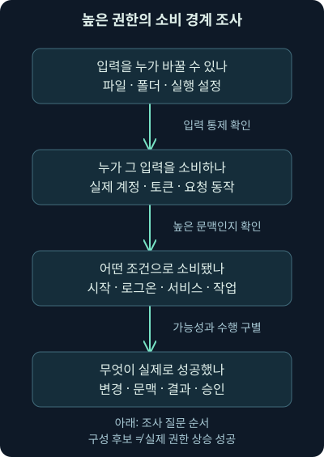
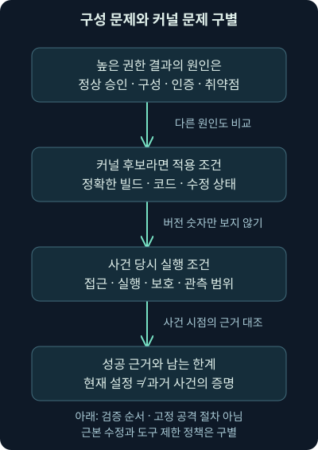
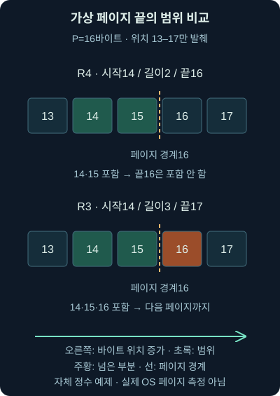

## 1. 실행은 확인했는데 원하는 동작은 거부됩니다

앞의 두 강의에서는 전달과 실행, 실행과 지속성을 나눴습니다. 이번에는 가상 프로그램이 사용자의 문서를 읽을 수 있지만 시스템 설정을 바꾸는 요청은 거부됐다고 해보죠. 프로그램이 이미 실행 중인데도 왜 못 하는 일이 있을까요? 운영체제가 실행 중인 주체와 대상별 권한 경계를 구분하기 때문입니다.

**권한 상승**은 현재 문맥보다 더 높은 권한이나 더 넓은 접근 범위를 얻는 행위를 말합니다. 사용자 권한으로 실행했다는 사실과 관리자 문맥을 얻었다는 사실은 다릅니다. 낮은 권한에서도 사용자 자료 피해는 가능하다는 앞 강의의 원칙도 그대로 유지합니다. 모든 공격이 관리자 권한을 얻어야만 완성되는 것은 아닙니다.

셋째 날 3강은 높은 권한의 프로그램이 다른 주체의 입력을 소비하는 구조, 시작 항목·서비스·경로·라이브러리·예약 작업의 구성 조건, 커널 취약점과 수정 상태 판단을 다룹니다. 마지막에는 자체 가상 조건과 바이트 범위만 실제 계산합니다. 실제 권한 변경·취약점 재현·서비스 조작을 수행한 강의는 아닙니다.

## 2. 계단보다 출입구와 열쇠의 지도를 그려보세요

방문증으로 회의실에 들어갈 수 있어도 전산실에는 들어가지 못할 수 있습니다. 그런데 전산실 담당자가 방문자가 바꿀 수 있는 지시서를 그대로 믿고 일을 한다면 어떤 문제가 생길까요? 방문자는 자기 출입증을 바꾸지 않고도 더 높은 권한을 가진 담당자의 행동에 영향을 줄 수 있습니다.

컴퓨터에서도 낮은 권한의 주체가 높은 권한의 프로그램에 영향을 주는 입력을 통제하는지 봅니다. 다만 비유의 담당자처럼 프로그램이 뜻을 이해하고 판단하는 것은 아닙니다. 파일·설정·실행 경로·요청을 정해진 로직으로 처리합니다. 그 처리에서 신뢰 경계가 잘못 연결되면 문제가 생길 수 있습니다.

사용자→로컬 관리자→여러 호스트 관리자→도메인 관리자라는 계단은 범위를 떠올리는 학습 그림으로 쓸 수 있습니다. **도메인**은 여러 계정·장치의 인증과 관리를 묶는 환경이고, 도메인 관리자는 그 환경에서 높은 관리 권한을 가진 역할입니다. 하지만 실제 권한은 일직선 서열이 아닙니다. 어느 자료·서비스·호스트에 어떤 권한이 있는지 지도로 봐야 합니다.

## 3. 권한 상승이 필요하지 않은 목표도 있습니다

가상 사용자가 읽을 수 있는 보고서가 공격자의 목표라면 시스템 전체 설정을 바꿀 필요가 없을 수 있습니다. 반대로 보안 설정 변경이나 다른 사용자의 보호된 자료 접근에는 추가 권한이 필요할 수 있죠. 목표와 현재 허용 범위를 먼저 비교해야 권한 상승을 왜 조사하는지 설명할 수 있습니다.

로컬 관리자라고 다른 서버의 관리자나 도메인 관리자가 자동으로 되는 것도 아닙니다. 다른 호스트의 인증·인가·서비스 설정·통신 경로는 별도입니다. 여러 호스트에서 같은 관리 비밀을 재사용하는 문제는 위험을 넓힐 수 있지만, 그런 구성이 실제로 있는지 확인해야 합니다. 다음 4강에서는 다른 계정의 인증 자료가 이 경계를 어떻게 연결할 수 있는지 배웁니다.

## 4. 높은 권한을 얻는 경로는 하나가 아닙니다

첫 경로는 높은 권한으로 동작하는 사용자·서비스·프로그램이 통제 가능한 입력을 처리하도록 만드는 경우입니다. 둘째는 다른 계정의 인증 자료를 확보해 그 계정의 허용 범위로 접근하는 경우입니다. 셋째는 프로그램이나 커널의 취약점을 이용해 원래 권한 검사를 벗어나는 경우입니다. 실제 사례에서는 경로가 겹칠 수도 있습니다.

**커널**은 메모리·프로세스·장치·입출력 같은 운영체제 핵심 기능을 관리하는 부분입니다. 커널도 코드이므로 결함이 있을 수 있습니다. 그러나 높은 권한의 결과가 보였다고 모두 커널 취약점이라고 결론 내리지는 않습니다. 정상 승인에 따른 권한 사용, 잘못된 구성, 자격 증명 오용도 비교해야 합니다.

권한을 가진 계정에 들어갔다고 그 권한이 영구히 유지되는 것도 아닙니다. 계정 비활성화·비밀 변경·정책·세션 종료·보호 조치가 영향을 줍니다. 권한 상승, 지속성, 재접근 가능성을 같은 말로 묶지 마세요. 각각 어떤 조건을 확인했는지 적어야 합니다.

## 5. 높은 권한의 소비 경로를 세 질문으로 나눕니다

첫 질문은 “낮은 권한의 주체가 그 입력을 바꿀 수 있나?”입니다. 파일 내용뿐 아니라 상위 폴더에서의 교체·이름 변경·설정 수정 가능성도 관련될 수 있습니다. 실제 권한은 ACL과 유효한 문맥을 확인해야 하며 파일 소유자 이름만으로 판정하지 않습니다.

둘째는 “그 입력을 실제로 높은 권한의 소비자가 사용하는가?”입니다. 읽는 기능인지 실행하는 코드인지, 어느 계정과 실제 토큰으로 동작하는지도 다릅니다. 셋째는 “언제 어떤 조건으로 그 소비가 발생했나?”입니다. 바꿀 수 있는 파일이 있다는 사실과 높은 권한으로 그 파일을 실행했다는 사실 사이에는 이 연결이 필요합니다.



그림의 마지막 상자에서는 가능성과 실제 결과를 나눠 읽어주세요. 취약한 구성 후보가 있더라도 해당 시점에 활성화되지 않았을 수 있습니다. 반대로 수집을 늦게 시작해 이미 일어난 소비 기록을 놓쳤을 수도 있습니다. 현재 구성과 사건 시점의 구성을 구별합니다.

## 6. 작은 사례: 높은 권한의 시작 항목과 바꿀 수 있는 파일

가상 조직의 유지보수 프로그램을 높은 권한으로 실행하는 시작 경로가 있다고 합시다. 일반 사용자가 그 프로그램 내용이나 실행 대상을 바꿀 수 있고, 해당 경로가 실제로 발동한다면 높은 권한의 소비 경계를 조사할 이유가 생깁니다. 여기서 특정 파일을 교체하거나 코드를 넣는 절차는 수행하지 않습니다.

조건을 하나 바꿔보죠. 같은 시작 위치라도 일반 사용자 문맥으로만 실행된다면 그것만으로 높은 권한을 얻었다고 볼 수 없습니다. 시작 경로 설정은 있지만 대상이 없거나 정책이 차단했다면 결과도 달라집니다. 앞 강의에서 배운 로그온·부팅·트리거·실제 실행의 차이가 여기에 다시 연결됩니다.

## 7. 서비스는 실행 파일과 설정의 권한을 함께 봅니다

서비스가 높은 권한으로 동작한다면 실행 파일과 그 파일을 선택하는 설정은 중요한 보호 대상입니다. 파일 자체를 수정할 수 있는지, 관련 폴더에서 바꿀 수 있는지, 서비스 설정의 실행 대상을 바꿀 수 있는지는 다른 질문입니다. 서비스 이름이 유명하거나 실행 파일에 서명이 있다는 사실만으로 이 권한들이 적절하다고 확정하지 않습니다.

실제 조사에서는 서비스 계정·실행 경로·설정 변경·파일 식별·시작과 실패 기록을 대조합니다. 서비스가 현재 중지됐거나 다시 시작되지 않았다면 설정 후보와 실제 소비의 차이를 기록합니다. 모든 서비스가 관리자나 SYSTEM으로 동작하는 것도 아닙니다. 높은 권한이라는 가정을 실제 문맥으로 확인해야 합니다.

## 8. 공백이 있는 경로에서는 어디까지가 프로그램 이름일까요?

가상 설정 문자열에 `C:\ExampleTools\Update Agent\agent.exe --check`가 있다고 해보죠. 이 문자열은 실행할 프로그램 경로와 인수를 함께 표현합니다. **인수**는 프로그램에 전달하는 추가 입력입니다. 경로에 공백이 있는데 프로그램 이름과 인수의 경계가 모호하면 실행 대상 해석에 문제가 생길 수 있습니다.

**따옴표 없는 서비스 경로**라는 조사 항목은 여기서 나옵니다. 그렇다고 공백이 있는 모든 문자열이 악용 가능한 것은 아닙니다. 실제 호출에서 실행 파일을 별도 인수로 지정했는지, 문자열을 어떻게 해석하는지, 다른 후보 위치에 쓰기 가능한지, 소비자의 권한과 실행 계기가 있는지까지 확인합니다. 탐지 도구의 경고는 이 조건을 확인할 출발점입니다.

2026-11-07 [Microsoft CreateProcessW 설명](https://learn.microsoft.com/en-us/windows/win32/api/processthreadsapi/nf-processthreadsapi-createprocessw)을 대조했습니다. 실행 파일을 별도로 지정하지 않는 호출에서는 공백과 따옴표에 따른 모호성이 중요합니다. 이 규칙을 모든 서비스·셸·운영체제의 문자열 해석에 그대로 적용하지 않습니다. 이 수업은 가상 경로를 설명했을 뿐 해당 경로에 파일을 생성하거나 서비스 설정을 바꾸지 않습니다.

## 9. DLL은 어느 위치에서 찾았는지까지 확인합니다

**DLL**, 동적 연결 라이브러리는 프로그램이 기능을 불러 쓰는 코드 모듈입니다. 프로그램이 모듈 이름만 지정하면 운영체제와 애플리케이션의 조건에 따라 찾는 위치가 결정됩니다. 높은 권한의 프로그램이 찾는 위치 중 일부를 낮은 권한의 주체가 통제할 수 있다면 신뢰 경계를 조사해야 합니다.

하지만 같은 이름의 DLL 파일이 있다는 것과 실제로 그 파일이 로드됐다는 것은 다릅니다. **로드**는 모듈을 프로그램의 실행 환경에 불러오는 동작입니다. 전체 경로·이미 로드된 모듈·알려진 시스템 DLL·애플리케이션 종류·검색 설정이 결과를 바꿀 수 있습니다. “현재 폴더가 항상 첫 번째”라는 한 줄 규칙으로 설명하지 않습니다.

2026-11-07 [Microsoft DLL 검색 순서](https://learn.microsoft.com/en-us/windows/win32/dlls/dynamic-link-library-search-order)를 확인했습니다. 패키지 앱과 비패키지 앱, 안전 검색 모드와 로드 방식에 차이가 있습니다. 실제 사건에서는 프로그램 버전·설정과 로드한 경로·해시·서명·문맥을 대조합니다. 이 강의에서는 DLL을 만들거나 로드 순서를 변경하지 않습니다.

## 10. 예약 작업도 등록된 이름보다 동작과 주체가 중요합니다

높은 권한으로 실행하도록 등록된 작업에서 낮은 권한의 주체가 동작·대상 파일·관련 설정을 바꿀 수 있는지 봅니다. 등록된 작업의 권한과 대상 파일의 권한은 별개일 수 있습니다. 트리거가 언제 발동하는지도 확인해야 합니다. 등록 성공만으로 높은 권한의 실행 성공을 대신하지 않습니다.

정상 배포나 관리 자동화가 변경했을 가능성도 비교합니다. 변경 주체·승인·시점·이후 실행·실제 결과를 연결해야 합니다. 앞 강의의 설정→발동→실행 후보에 이번에는 입력 통제와 높은 권한의 소비 조건을 더한 셈입니다. 기능 이름이 같다고 모든 작업의 위험이 같은 것은 아닙니다.

| 조사 대상 | 따로 확인할 입력 경계 | 실제 결과로 이어가기 위해 필요한 것 |
| --- | --- | --- |
| 시작 항목 | 설정·대상 파일·관련 폴더 | 발동 조건·실행 문맥·결과 |
| 서비스 | 실행 파일·폴더·서비스 설정 | 실제 서비스 계정·시작·소비 |
| 공백 경로 | 실제 호출의 경로 해석·관련 위치 권한 | 선택된 실행 파일·소비자·계기 |
| DLL | 해당 앱의 검색 경로와 통제 가능 위치 | 실제 로드 경로·해시·문맥 |
| 예약 작업 | 작업 동작·설정·대상 파일 | 트리거·실행 주체·실행 결과 |

이 표는 악용 절차가 아니라 조사 질문의 차이를 비교합니다. 어느 한 칸에 쓰기 가능이 있어도 나머지 조건이 저절로 참이 되지는 않습니다. 또한 표에서 확인하지 못한 다른 경로까지 안전하다고 확장하지 않습니다.

## 11. 자동 점검 도구가 알려주는 것은 확인할 후보입니다

PowerUp은 PowerSploit에 포함되어 알려진 권한 상승 구성 조건을 점검하는 데 쓰였던 스크립트 이름입니다. 2026-11-07 [원 제작 저장소](https://github.com/PowerShellMafia/PowerSploit)의 보관 상태를 확인했으며 archived로 표시됩니다. 이를 현재 모든 Windows 환경에 적용하는 최신 권고 도구로 소개하지 않습니다. 이번에는 설치·다운로드·실행하지 않았습니다.

자동 점검의 출력은 실제 권한·실행 경로·보호 설정·소비 조건을 대조할 후보입니다. 경고 한 줄이 권한 상승 성공은 아니고, 경고가 없다는 결과도 모든 경로를 검사했다는 증거는 아닙니다. 실행한 버전·설정·점검 범위·수집 시점을 기록해야 합니다.

메모리에서 처리하는 스크립트라고 탐지가 불가능한 것도 아닙니다. 2026-11-07 [Microsoft AMSI 설명](https://learn.microsoft.com/en-us/windows/win32/amsi/antimalware-scan-interface-portal)을 확인했습니다. AMSI는 애플리케이션과 보안 제품을 연결하는 검사 인터페이스이며 파일 외에 메모리·스트림 검사도 지원합니다. 실제 적용·수집·차단 여부는 프로그램·보안 제품·정책에 달려 있습니다. “메모리 안이므로 안 보인다”와 “반드시 차단된다”를 모두 피합니다.

## 12. 커널 취약점은 다른 층의 경계를 다룹니다

앞의 구성 문제는 높은 권한의 프로그램이 무엇을 신뢰하고 소비하느냐가 중심이었습니다. 커널 취약점은 운영체제 핵심 코드의 결함이 권한 경계를 무너뜨릴 수 있다는 문제입니다. 같은 높은 권한 결과가 나와도 원인이 다르면 확인할 자료와 수정 방법도 달라집니다.

취약한 코드 경로·해당 빌드·필요한 접근과 실행 조건·보호 설정·실제 성공을 따로 확인합니다. 취약점 식별자 하나와 버전 문자열 하나만으로 모든 조건을 확인했다고 말하지 않습니다. **CVE**는 공개 취약점을 식별하는 공통 번호입니다. 번호가 있다는 사실과 조사 단말에서 그 취약점이 실제 악용됐다는 사실도 다릅니다.

## 13. Dirty Pipe는 조건을 지운 “관리자 버튼”이 아닙니다

Dirty Pipe, CVE-2022-0847은 Linux의 파이프 버퍼 상태와 파일 페이지 캐시 처리의 결함과 관련된 2022년 사례입니다. **파이프**는 프로세스 사이의 데이터 전달 통로, **페이지 캐시**는 파일 자료를 메모리에 보관해 다시 쓰는 기능입니다. 쓰기 권한이 없는 파일의 캐시 내용까지 영향을 받을 수 있어 권한 경계 문제가 됐습니다. 이 개요는 2026-11-07 [Red Hat CVE 설명](https://access.redhat.com/security/cve/cve-2022-0847)과 대조했습니다.

2026-11-07 [발견자의 기술 설명](https://dirtypipe.cm4all.com/)에서 공개된 경로의 제한도 확인했습니다. 대상 읽기 권한이 필요하고, 시작 위치는 페이지 경계가 아니어야 하며, 한 쓰기 범위가 페이지 경계를 넘거나 파일 길이를 늘릴 수 없습니다. 파일의 어느 위치든 무제한 수정하거나 모든 프로세스에 자동으로 코드를 넣는 기능처럼 설명하면 이 조건들을 지웁니다.

같은 발견자 문서의 5.16.11·5.15.25·5.10.102는 당시 수정이 반영된 안정 커널 버전입니다. 2026년의 영구적인 최신 권장 버전이 아닙니다. 배포판의 수정 패키지·적용된 코드·실행 중인 커널을 별도로 확인해야 합니다. 여기서는 취약점 프로그램을 만들거나 실행하지 않습니다.



## 14. 버전이 낮아 보이는 것과 수정되지 않은 것은 다릅니다

**백포트**는 기존 버전 계열에 필요한 수정만 반영하는 방식입니다. 배포판이 이 방식을 쓰면 겉의 기본 버전 숫자가 낮아 보여도 수정이 반영됐을 수 있습니다. 반대로 업데이트 패키지를 설치했어도 현재 실행 중인 커널이 그 수정 상태인지 별도로 확인해야 합니다.

2026-11-07 [Red Hat의 해당 CVE 자료](https://access.redhat.com/security/cve/cve-2022-0847)에서 버전 숫자만 보는 스캐너와 백포트 차이를 확인했습니다. [2022년 보안 공지](https://access.redhat.com/security/vulnerabilities/RHSB-2022-002)도 제품별 코드와 알려진 경로의 차이를 설명합니다. 다른 배포판에 같은 제품 판정을 복사하지 않습니다. 패키지·제작사 권고·실행 상태를 맞춘 뒤 적용 여부를 기록합니다.

컴파일러를 운영 장비에서 줄이는 조치는 허용 소프트웨어 정책의 일부일 수 있습니다. **컴파일러**는 소스 코드를 실행 가능한 형태로 변환하는 도구입니다. 하지만 이것이 없으면 커널 취약점 악용이 불가능하다는 결론은 성립하지 않습니다. 미리 만들어진 프로그램 등 다른 실행 가능성을 생각해야 하며, 근본 수정과 실행 통제·최소 권한을 구별합니다.

## 15. 작은 계산으로 경계 조건을 눈에 익힙니다

이제 실제 파일 대신 정수로 된 가상 범위만 계산하겠습니다. 페이지 크기 `P`를 16바이트, 시작 위치 `o`를 14, 길이 `n`을 2바이트라고 놓습니다. **바이트**는 자료 크기 단위이며, 시작 위치는 파일의 처음을 0으로 센 번호입니다. 16바이트는 그림을 쉽게 읽기 위한 자체 조건이지 실제 장비의 페이지 크기를 측정한 값이 아닙니다.

끝 위치 `e = o + n`은 포함하지 않는 경계입니다. 14에서 2바이트면 실제 위치 14와 15를 포함하고 끝은 16입니다. 다음 페이지 경계 `b = (o // P + 1) × P`에서 `//`는 정수 나눗셈입니다. 14를 16으로 나눈 몫 0에 1을 더하고 16을 곱하면 경계는 16입니다.

```text
P = 16바이트, o = 14, n = 2바이트
e = 14 + 2 = 16
b = (14 // 16 + 1) × 16 = 16
o % P = 14        → 시작은 페이지 경계가 아님
e <= b           → 끝은 같은 페이지의 끝까지
e <= 파일 길이   → 선언한 파일 범위를 넘지 않음
```

`%`는 나머지 연산입니다. 시작 위치를 페이지 크기로 나눈 나머지가 0이면 경계에서 시작합니다. `<=`는 작거나 같다는 뜻입니다. 길이를 3으로 바꾸면 끝 17이 경계 16보다 커져 범위 조건이 달라집니다. 이 계산은 숫자의 관계일 뿐 실제 파이프·메모리·파일 변경을 수행하지 않습니다.



그림 위쪽에서는 14·15만 초록이고 끝 위치16은 포함하지 않습니다. 아래쪽에서는 위치16도 주황으로 포함되어 페이지를 넘습니다. 전체 파일을 그린 것이 아니라 경계 주변의 위치13–17만 발췌한 그림입니다.

## 16. 실습은 주장과 범위 비교만 실행합니다

[비교 프로그램](../../assets/network-security/day03-lab03/compare_boundaries.py), [가상 입력](../../assets/network-security/day03-lab03/cases.json), [실습 설명](../../assets/network-security/day03-lab03/README.txt)을 같은 폴더에 둡니다. 작성 환경에서는 Python 3.12.14 기본 라이브러리로 실제 실행했습니다. 운영체제 권한·실행 커널·실제 파일 범위를 조회하는 프로그램은 아닙니다.

```text
python compare_boundaries.py cases.json
```

`python`은 Python 3 실행 이름, `compare_boundaries.py`는 비교할 프로그램, `cases.json`은 가상 입력입니다. JSON은 이름과 값으로 구조를 표현하는 텍스트 형식입니다. `schema`는 이 연습 형식, `external_actions_allowed: false`는 외부 동작 허용이 거짓이라는 계약입니다. 입력 자료만 읽고 출력합니다.

`paths`에는 `writable_input_claim`·`privileged_consumer_claim`·`activation_link_claim`이 있습니다. 순서대로 입력 쓰기 가능·높은 권한의 소비자·발동 연결이라는 주장입니다. 셋이 모두 `true`, 즉 참일 때 후보가 참이고, 하나라도 `false`, 즉 거짓이면 후보는 거짓입니다. 거짓은 없지만 `null`, 즉 미확인이 있으면 후보도 미확인입니다. 실제 권한 검사 결과가 아니라 입력 주장의 조합입니다.

## 17. 조건을 바꾼 실제 자체 파일 결과를 읽습니다

P1은 세 주장이 모두 참이라 `candidate_path_under_claims`가 참입니다. P2는 쓰기 가능 주장이 거짓, P3는 높은 권한의 소비자 주장이 거짓이라 후보가 거짓입니다. P4는 발동 연결이 미확인이라 후보도 미확인이고, P5는 쓰기 불가와 발동 미확인이 함께 있어 후보가 거짓입니다. 한 조건이 이 모형의 경로를 막아도 다른 경로까지 안전하다는 뜻은 아닙니다.

`ranges`의 `page_bytes`·`offset_bytes`·`length_bytes`·`file_bytes`는 페이지 크기·시작 위치·길이·선언한 파일 크기입니다. `read_permission_claim`은 읽기 가능 주장입니다. 출력의 `end_exclusive_bytes`는 포함하지 않는 끝, `next_boundary_bytes`는 다음 페이지 경계입니다. `range_conditions_match`가 참이어도 실제 커널 취약점·파일 접근·변경·상승은 미검증으로 남습니다.

| 자체 사례 | 페이지·시작·길이·파일 크기, 바이트 | 실제 비교 결과와 이유 |
| --- | --- | --- |
| R1 | 16·1·3·40 | 참: 끝 4, 경계 16 안 |
| R2 | 16·0·3·40 | 거짓: 시작이 페이지 경계 |
| R3 | 16·14·3·40 | 거짓: 끝 17이 경계 16을 넘음 |
| R4 | 16·14·2·40 | 참: 끝 16은 포함하지 않는 경계 |
| R5 | 16·17·3·19 | 거짓: 끝 20이 파일 크기 19를 넘음 |
| R6 | 16·17·2·40 | 미확인: 숫자는 맞지만 읽기 주장 미확인 |
| R7 | 16·17·2·40 | 거짓: 읽기 불가 주장 |
| R8 | 8192·8191·1·16384 | 참: 끝 8192, 선언한 페이지 조건 적용 |

이 표는 실제 취약점의 재현 결과나 실제 장비의 페이지 크기표가 아닙니다. 직접 손으로 계산한 끝·경계와 프로그램의 숫자를 대조했습니다. 조건 변경 실험에서도 시작 경계·한 페이지 끝·파일 끝·미확인·잘못된 숫자 자료를 구별하는지 확인했습니다. 어떤 파일도 덮어쓰지 않았습니다.

## 18. 실제 사건에서는 가능한 경로와 성공 증거를 따로 적습니다

가상 보고서의 관측 사실은 “사건 시점의 설정과 권한 자료에서 낮은 문맥이 바꿀 수 있는 입력과 높은 문맥의 소비 경로가 확인됐다”처럼 근거를 붙입니다. 가설은 “이 경로를 통해 더 높은 권한으로 동작했을 가능성”입니다. 결론으로 상승 성공을 적으려면 실제 변경·소비·프로세스 문맥·성공 결과·승인을 더 연결해야 합니다.

단말의 파일 변경·서비스·작업·프로세스·모듈 로드 기록, 소프트웨어 배포와 변경 승인, 커널·패키지·업데이트 기록을 대조합니다. 네트워크 연결은 파일 전달이나 원격 요청의 맥락을 줄 수 있지만 로컬 권한 상승 자체를 패킷 하나로 설명하지 못할 수 있습니다. 시간대·시계 오차·식별자·보존 범위도 맞춥니다.

결과가 없으면 실제 실행된 프로그램 버전·수집 설정·필터·보존·시작 시점과 프로세스 내부 동작의 관측 한계를 확인합니다. 패킷 쪽은 방향·암호화·누락·절단·재조립도 점검합니다. 이번 실습의 모든 `actual_*` 검증 항목은 거짓, 사건 판단은 미결, 외부 동작은 0입니다. 후보 계산을 실제 상승 성공으로 바꾸지 않습니다.

## 19. 복습: 경계와 조건을 바꿔 설명해봅시다

### 질문 1. 일반 사용자의 보고서만 목표라면 관리자 권한이 반드시 필요한가요?

**해설:** 그 사용자가 이미 읽을 수 있다면 필요하지 않을 수 있습니다. 목표와 현재 허용 범위를 비교해야 합니다. 낮은 권한에서의 피해 가능성도 함께 평가합니다.

### 질문 2. 로컬 관리자 다음 단계는 언제나 도메인 관리자인가요?

**해설:** 실제 권한은 대상별 지도입니다. 다른 호스트와 도메인의 인증·인가·경로는 별도여서 일직선 승급표처럼 판단하지 않습니다.

### 질문 3. 바꿀 수 있는 시작 파일이 있으면 권한 상승 성공인가요?

**해설:** 높은 권한의 소비자와 실제 발동·소비·결과가 필요합니다. 일반 사용자 문맥의 시작 파일만 바꿨다면 높은 권한 결과가 자동으로 생기지 않습니다.

### 질문 4. 서비스 실행 파일이 보호됐으면 관련 경계는 모두 안전한가요?

**해설:** 폴더에서의 교체·서비스 설정·관련 모듈 경로도 따로 확인해야 합니다. 검사한 한 파일의 권한을 다른 입력 경계에 확대하지 않습니다.

### 질문 5. 공백과 따옴표 누락 경고만으로 악용을 확정할까요?

**해설:** 실제 호출·대상 해석·관련 위치 권한·높은 소비자·실행 계기가 필요합니다. 다른 인수로 실행 파일을 명시하는 방식 등 호출 조건도 구별합니다.

### 질문 6. 수상한 DLL이 있으면 높은 권한으로 로드됐다고 쓰나요?

**해설:** 실제 검색 조건과 로드 경로·프로세스 문맥을 대조합니다. 파일 존재와 로드, 로드와 악성 동작 성공은 각각 다릅니다.

### 질문 7. 예약 작업 등록과 높은 실행 주체가 있습니다. 무엇이 더 필요한가요?

**해설:** 통제 가능한 동작·대상, 트리거·실제 실행·성공·승인 근거가 필요합니다. 등록과 실행은 다른 사건입니다.

### 질문 8. 자동 점검 경고가 없으면 모든 권한 상승 경로를 배제할까요?

**해설:** 도구 버전·권한·설정·지원 범위·검사 시점을 확인합니다. 도구가 보지 않은 경로와 기록 공백을 무해함으로 바꾸지 않습니다.

### 질문 9. 스크립트가 메모리에서 동작하면 보안 제품은 볼 수 없나요?

**해설:** 메모리·스트림 검사와 행위 기록 같은 관측 수단이 있습니다. 실제 연동·정책·수집 상태에 따라 달라지므로 탐지 불가능도 반드시 차단도 단정하지 않습니다.

### 질문 10. Dirty Pipe의 옛 수정 버전을 현재 최신 권장 버전이라 적어도 될까요?

**해설:** 당시 수정이 반영된 버전이라는 역사적 의미를 적습니다. 현재 적용할 패키지는 배포판의 지원·수정 권고와 실행 중인 커널을 확인해야 합니다.

### 질문 11. 버전 숫자가 낮아 보이면 수정되지 않은 것이 확실한가요?

**해설:** 배포판이 수정을 백포트했을 수 있습니다. 기본 버전만 보지 말고 정확한 패키지·제작사 권고·실행 상태를 대조합니다.

### 질문 12. 컴파일러가 없으면 커널 취약점 위험은 없어지나요?

**해설:** 미리 만들어진 프로그램 등 다른 실행 경로가 있을 수 있습니다. 개발 도구 정책은 근본 수정과 동일한 보호가 아닙니다.

### 질문 13. P4와 P5에는 모두 미확인이 있는데 왜 결과가 다른가요?

**해설:** P4는 거짓 없이 미확인만 있어 후보가 미확인입니다. P5는 필수 조건 하나가 거짓이어서 이 모형의 조합은 거짓입니다. 실제 모든 공격 경로가 없다는 뜻은 아닙니다.

### 질문 14. R3의 길이 3을 2로 바꾸면 왜 결과가 달라지나요?

**해설:** 시작 14에서 길이 3은 끝 17로 경계 16을 넘습니다. 길이 2는 실제 위치 14·15만 포함하고 끝 16은 포함하지 않으므로 범위 조건을 만족합니다. 실제 취약점 검증은 아닙니다.

### 질문 15. R6은 숫자가 맞는데 왜 참이 아닌가요?

**해설:** 읽기 가능 주장이 미확인입니다. 이 연습은 필수 주장을 모르면 전체 조건도 미확인으로 남깁니다. 실제 읽기를 시도한 결과가 아닙니다.

### 질문 16. R8이 참이면 그 장비가 취약하다는 뜻인가요?

**해설:** 선언한 정수 범위만 맞습니다. 장비·실행 커널·수정·코드 경로·접근·실행·성공을 검증하지 않았으므로 취약점 존재나 상승 성공으로 해석하지 않습니다.
