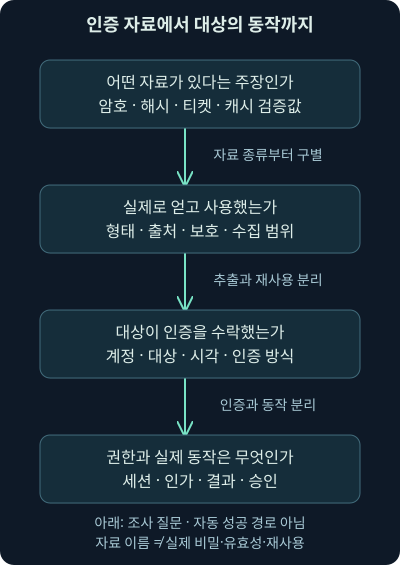
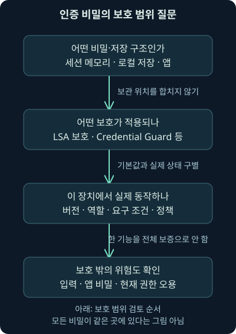
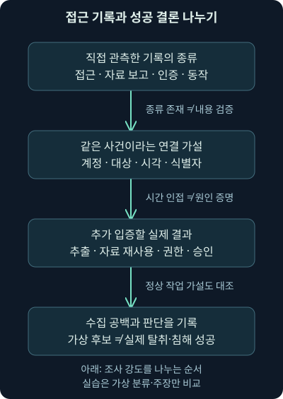

## 1. 이미 관리자라면 다른 계정의 자료를 왜 노릴까요?

앞 강의에서는 어떤 문맥이 어느 대상을 바꿀 수 있는지 봤습니다. 이번에는 가상 단말 `192.0.2.25`에서 높은 로컬 권한을 얻었다고 가정해봅시다. 그래도 다른 서버 `192.0.2.60`의 업무 자료에는 접근이 거부될 수 있습니다. 다른 호스트는 별도의 인증과 권한을 요구하기 때문입니다.

이때 다른 계정의 인증 자료가 새 경로를 열 수 있습니다. 현재 단말의 로컬 관리자라는 사실과 다른 서버가 받아들이는 계정이라는 사실은 다릅니다. **자격 증명**은 신원을 입증하는 데 쓰는 비밀이나 인증 자료를 뜻합니다. 암호만 가리키는 말이 아니며 형태와 적용 범위에 따라 의미가 달라집니다.

셋째 날 4강은 자격 증명 접근과 덤핑, Windows 인증·메모리·저장 자료, 암호·해시·티켓·캐시 검증값의 차이, 현재 보호 기능과 관측 한계를 다룹니다. 끝에서는 자체 가상 기록의 종류와 연결 주장만 실제 비교합니다. 실제 비밀·메모리 덤프·Windows 이벤트 로그는 포함하지 않습니다. 내부 이동의 전체 통신·실행 흐름은 다음 강의에서 이어갑니다.

## 2. 암호, 출입증, 방문 확인표는 같은 물건이 아닙니다

건물에서 암호를 말하는 방식, 특정 구역의 출입증을 보여주는 방식, 안내 데스크가 이전 방문을 확인하는 방식은 다릅니다. 모두 신원 확인과 관련돼도 다른 문에 그대로 쓸 수 있는 것은 아니죠. 컴퓨터의 인증 자료도 어떤 절차에서 누구에게 무엇을 증명하는지 구별해야 합니다.

비유의 출입증처럼 보이는 자료도 실제로는 암호학적 검증·대상·유효 기간·정책의 적용을 받습니다. 파일 이름이 ticket이라고 해서 유효한 티켓을 획득한 것도 아니고, 해시처럼 생긴 문자열이 있다고 실제 인증에 쓸 수 있다는 뜻도 아닙니다. 자료의 형태·출처·계정·수집 시점을 따로 확인합니다.

## 3. 자격 증명 접근과 권한 상승은 연결될 수 있지만 다른 목적입니다

**자격 증명 접근**은 인증 자료를 얻으려는 목적입니다. **덤핑**은 메모리·캐시·저장 구조 등에서 자료를 추출하는 행위를 설명할 때 쓰는 말입니다. 그 자료를 이용해 다른 계정이나 더 넓은 대상에 접근하면 권한 범위가 넓어질 수 있습니다. 하지만 접근 시도·추출·자료 재사용·인증 성공은 같은 단계가 아닙니다.

2026-11-07 [MITRE의 OS Credential Dumping, T1003](https://attack.mitre.org/techniques/T1003/)을 확인했습니다. Windows의 인증 프로세스 메모리뿐 아니라 여러 저장 구조와 다른 운영체제도 분류에 포함합니다. 이번에는 Windows 중심으로 원리를 배우지만 모든 자격 증명 접근이 Windows 메모리 덤핑이라는 뜻은 아닙니다. 도구 이름과 공격 목적도 동일하지 않습니다.

이미 관리자인데 이 행위를 조사하는 이유는 추가 계정·다른 호스트·다른 역할로 범위가 넓어질 수 있기 때문입니다. 다만 “로컬 관리자이므로 모든 사용자의 모든 암호를 반드시 얻는다”는 결론은 버립니다. 존재하는 세션·인증 방식·저장 형태·보호 기능·실제 접근 권한이 결과를 바꿉니다.

## 4. 한 번 로그인하고 여러 서비스를 쓰는 편의의 안쪽

사용자는 매번 파일 공유·메일·업무 서비스에 암호를 다시 입력하고 싶지 않습니다. **SSO**, 단일 로그온은 한 번의 인증을 바탕으로 여러 자원을 이용하게 하는 경험과 체계입니다. 그렇다고 운영체제가 모든 곳에 같은 사용자 암호를 그대로 보내는 것이라고 이해하면 안 됩니다. 인증 패키지와 프로토콜에 따라 다른 자료와 절차를 사용합니다.

Windows의 **LSA**, 로컬 보안 기관은 인증과 로컬 보안 정책에 관련된 체계입니다. **LSASS**는 그 기능과 관련된 시스템 프로세스이며 실행 파일 이름으로 `lsass.exe`가 보입니다. 이름이 있다는 것은 정상 시스템에서도 흔한 사실입니다. 그 이름만으로 탈취 사건을 확정하지 않습니다.

2026-11-07 [Microsoft Windows 인증 처리 설명](https://learn.microsoft.com/en-us/windows-server/security/windows-authentication/credentials-processes-in-windows-authentication)을 대조했습니다. 인증 자료는 세션과 방식에 따라 메모리나 보호된 저장 구조에 여러 형태로 관련될 수 있습니다. 이 문서에는 역사적 구성도 함께 있으므로 옛 구성의 세부 동작을 모든 현재 Windows의 기본값으로 옮기지 않습니다. 뒤에서 현재 보호 기능을 따로 확인합니다.



그림에서는 자료를 얻었다는 주장 다음의 문들을 따로 보세요. 다른 서버가 그 자료를 받아들였는지, 계정에 필요한 권한이 있는지, 실제 어떤 동작을 했는지가 남습니다. 패킷·인증·단말·서버 기록이 서로 다른 질문에 답합니다.

## 5. 평문 암호와 암호 해시는 다른 형태입니다

**평문 암호**는 원래 암호 문자열처럼 내용을 그대로 사용할 수 있는 형태를 말합니다. **암호 해시**는 암호에서 계산한 값입니다. 해시는 일반적인 복호화로 원문을 되돌리는 암호문과 다릅니다. 다만 약한 암호라면 후보를 계산해 비교하는 추측 위험이 있고, 어떤 인증 체계에서는 특정 해시 관련 자료 자체의 오용도 문제가 됩니다.

Windows 맥락의 **NT 해시**를 앞에서 파일 바이트를 비교할 때 계산한 SHA-256 지문과 같은 용도로 생각하면 안 됩니다. 둘 다 해시라는 단어를 쓰지만 인증 자료와 파일 식별 자료의 역할은 다릅니다. **Pass-the-Hash**는 관련 인증 체계에서 원래 암호를 알아내지 않고 그 인증 자료를 오용하는 공격 개념입니다. 모든 해시가 모든 서비스에 재사용 가능하다는 뜻은 아닙니다. 이 강의에서는 재사용 절차나 명령을 실행하지 않습니다.

따라서 분석 결과에 해시가 있다는 사실과 평문 암호를 복구했다는 사실을 나눠 적습니다. 계정·자료 형식·출처·유효한 인증 체계·대상 정책을 확인하지 않았다면 “인증에 재사용 가능”이라는 결론도 아직 이릅니다. 실제 비밀을 강의나 보고서 화면에 불필요하게 노출하지 않습니다.

## 6. 티켓도 어떤 티켓인지 구별해야 합니다

**Kerberos**는 티켓을 사용하는 인증 체계입니다. **TGT**, 티켓 발급 티켓은 이후 필요한 서비스 티켓을 얻는 절차에 관련되고, **서비스 티켓**은 특정 서비스에 제시하는 절차에 관련됩니다. 둘을 단순히 암호의 다른 표기라고 생각하면 목적·대상·유효 기간의 차이를 놓칩니다.

**Pass-the-Ticket**은 관련 티켓 자료를 오용하는 공격 개념입니다. 역시 어떤 티켓·계정·대상·시간·정책인지 확인해야 합니다. 티켓 이름을 파일에서 찾았다는 사실만으로 유효한 인증 자료를 얻었거나 특정 서비스가 수락했다고 결론 내리지 않습니다. 다음 실습은 실제 티켓 내용 없이 분류 표지만 사용합니다.

## 7. 캐시 로그온 검증값은 원격 로그인용 출입증이 아닙니다

조직의 인증 서버와 연결되지 않아도 이전 사용자가 자기 컴퓨터에 로그인할 수 있게 도와주는 **캐시 로그온 검증값**이 있습니다. 이것은 로컬에서 제시한 암호를 검증하기 위한 자료입니다. 이름에 credential이 붙었다고 NT 해시나 TGT와 같은 재사용 특성을 갖는다고 가정하면 안 됩니다.

2026-11-07 [Microsoft Credential Guard 동작과 보호 한계](https://learn.microsoft.com/en-us/windows/security/identity-protection/credential-guard/how-it-works)를 확인했습니다. 이 문서는 캐시된 도메인 로그온 검증값을 다른 컴퓨터에 제시해 인증하는 자료와 구별합니다. 그 값의 노출 위험이 0이라는 뜻은 아니지만, 발견 즉시 원격 인증 성공의 근거로 바꾸지 않습니다.

| 자료의 형태 | 먼저 이해할 역할 | 그 이름만으로 확정하면 안 되는 것 |
| --- | --- | --- |
| 평문 암호 | 원래 암호 내용 | 현재 유효성·대상 권한·인증 성공 |
| NT 해시 | 특정 Windows 인증 자료 | 평문 복구·모든 서비스 재사용 |
| TGT | 서비스 티켓 발급 절차에 관련 | 모든 서비스 동작 권한·실제 사용 |
| 서비스 티켓 | 특정 서비스 인증 절차에 관련 | TGT와 동일한 범위·후속 동작 성공 |
| 캐시 로그온 검증값 | 연결이 끊긴 상황의 로컬 검증 | 다른 호스트에 그대로 제시해 인증 |

이 표는 자료의 위험을 낮음·높음으로 줄 세운 표가 아닙니다. 자료 형태가 다르면 검증할 가설도 달라진다는 비교입니다. 실제 유효성이나 악성 사용을 알아내려면 수집한 구조와 인증·서버 기록을 더 대조해야 합니다.

## 8. 메모리, SAM, LSA 비밀은 같은 보관함이 아닙니다

LSASS 메모리의 세션 관련 자료, **SAM**, 로컬 계정 정보를 관리하는 데이터베이스, **LSA 비밀**, 재시작 후에도 필요한 일부 서비스 등의 비밀 자료는 서로 다른 구조입니다. 레지스트리는 설정과 저장 구조가 관련되는 장소이지만, 그 안의 값이 모두 평문 암호라는 뜻은 아닙니다. 어떤 저장 구조와 보호 경계를 조사하는지 명시해야 합니다.

또한 계정이 컴퓨터에 등록됐다는 사실, 현재 세션이 있다는 사실, 특정 인증 자료가 메모리에 있다는 사실은 다릅니다. 모든 등록 계정의 모든 비밀이 언제나 메모리에 모인다는 그림을 그리지 마세요. 현재 로그인 방식·세션·인증 패키지·운영체제 버전·보호 설정을 확인해야 합니다.

## 9. 관리자 권한은 중요한 위험이지만 접근 성공 보증서는 아닙니다

민감한 시스템 메모리·파일·설정에 접근하는 경로에는 높은 권한이 필요한 경우가 많습니다. 그렇다고 관리자 그룹 소속 하나가 모든 보호된 프로세스 메모리를 항상 읽게 해주는 것은 아닙니다. 실제 토큰·프로세스 보호·드라이버·정책·실행 방식이 중요합니다. 앞 강의의 그룹 소속과 실행 문맥 구분이 여기서 다시 필요합니다.

반대로 모든 자격 증명 접근에 로컬 관리자가 필수라고 일반화해서도 안 됩니다. 사용자에게 입력을 유도하거나 사용자 범위의 애플리케이션 저장 자료에 접근하는 경로 등은 다른 조건을 가질 수 있습니다. 이번 범위는 주로 운영체제 자격 증명 덤핑의 위험입니다. 다른 종류의 탈취까지 같은 전제에 넣지 않습니다.

## 10. LSA 보호는 읽기와 코드 주입의 경계를 강화합니다

**추가 LSA 보호**는 LSASS를 보호된 프로세스로 실행해 보호되지 않은 프로세스의 메모리 읽기와 코드 주입을 제한하는 Windows 기능입니다. **코드 주입**은 다른 프로세스 안에서 코드를 동작시키려는 행위를 말합니다. 이 보호는 “관리자면 무조건 읽는다”는 단순 설명을 수정해야 하는 이유 중 하나입니다.

2026-11-07 [Microsoft 추가 LSA 보호 문서](https://learn.microsoft.com/en-us/windows-server/security/credentials-protection-and-management/configuring-additional-lsa-protection)를 확인했습니다. Windows 8.1 이후의 보호 설명과, Windows 11 22H2 이후 새 설치·기업 가입·HVCI 가능 장치에 대한 자동 활성 조건이 나옵니다. **HVCI**는 가상화 기반 코드 무결성 보호 기능입니다. 버전 이름만으로 조사 장비의 실제 보호 상태를 확정하지 않습니다.

감사 모드의 관련 기록과 실제 보호 적용도 나눠야 합니다. 기록이 있어도 차단하지 않는 감사 상황이 있을 수 있습니다. 설치된 플러그인·드라이버 호환성과 보호 실행 상태도 확인해야 합니다. 이번 강의에서는 보호 기능을 켜거나 끄고 재시작하는 조작을 하지 않습니다.

## 11. Credential Guard는 비밀을 다른 보호 경계에 둡니다

**Credential Guard**는 VBS, 가상화 기반 보안을 이용해 특정 인증 비밀을 운영체제의 일반 실행 영역과 분리하는 기능입니다. 단순히 프로세스 이름을 숨기는 기능이 아닙니다. 보호 대상에는 NTLM 해시·Kerberos TGT·애플리케이션이 도메인 자격 증명으로 저장한 자료 등이 포함됩니다.

2026-11-07 [Microsoft 개요](https://learn.microsoft.com/en-us/windows/security/identity-protection/credential-guard/)를 대조했습니다. Windows 11 22H2 이후에도 라이선스·하드웨어·소프트웨어·기존 명시적 비활성 설정 같은 조건을 봐야 합니다. Enterprise·Education 등의 적용 범위와 일반 Pro를 같은 기본값으로 묶지 않습니다. Server 2025의 기본 활성 설명에도 요구 조건·도메인 가입·도메인 컨트롤러가 아닌 장치라는 구분이 있습니다. 이는 문서 확인이며 실제 설치 상태 검사는 아닙니다.

**도메인 컨트롤러**는 도메인의 계정 인증 등을 담당하는 서버입니다. 장치 역할과 버전·정책을 확인한 뒤 실제 실행 상태를 검증해야 합니다. “Windows 11이니 보호된다”처럼 버전 이름만으로 끝내지 않습니다. 정책을 등록했다는 사실과 보호가 실제 실행 중이라는 사실도 다릅니다.



## 12. 보호 기능 하나로 모든 비밀과 모든 행동이 사라지지는 않습니다

Credential Guard가 보호하는 TGT와 보호하지 않는 서비스 티켓을 구별해야 합니다. 로컬 계정·애플리케이션이 자체 관리하는 비밀·입력 순간을 노리는 키 입력 수집 등도 같은 범위로 가정하지 않습니다. **키로거**는 키 입력을 수집하는 프로그램이나 기능입니다. 비밀을 추출하지 않고 이미 가진 문맥의 권한을 오용하는 행위도 별도입니다.

2026-11-07 [보호 한계 설명](https://learn.microsoft.com/en-us/windows/security/identity-protection/credential-guard/how-it-works)과 [호환성·저장 자격 증명 고려사항](https://learn.microsoft.com/en-us/windows/security/identity-protection/credential-guard/considerations-known-issues)을 대조했습니다. 일반 애플리케이션 비밀까지 모두 보호한다고 말하지 않습니다. 보호를 우회하는 절차를 배우는 대신 어떤 자료·행위가 보호 범위 밖인지 정확히 기록하는 것이 이번 목적입니다.

높은 가치의 계정은 전용 관리 환경과 필요한 로그인 범위를 분리하고, 로컬 관리자 비밀 재사용을 줄이며, 최소 권한·패치·실행 통제·인증 정책을 함께 검토합니다. 구체적인 적용은 실제 제품과 호환성·업무 흐름을 확인해야 합니다. 이 수업에서 조직의 계정·정책·보호 상태를 바꾼 것은 아닙니다.

## 13. Mimikatz라는 이름보다 자료 접근과 행동을 봅니다

Mimikatz는 자격 증명과 Windows 인증 동작을 다루는 도구로 잘 알려진 이름입니다. 중요한 학습점은 한 실행 파일의 이름이나 해시만 막으면 모든 관련 행위가 사라지는 것이 아니라는 점입니다. 다른 구현·변형·정상 기능의 오용이 있을 수 있습니다. 반대로 이름 문자열 하나를 찾았다고 실제 비밀 추출이 성공한 것도 아닙니다.

메모리에서 동작하면 백신이 개입할 수 없다는 옛 단정도 그대로 사용하지 않습니다. 앞 강의에서 AMSI와 행위 관측을 봤죠. 파일·프로세스·스크립트·프로세스 접근·보호 상태·후속 인증을 함께 조사합니다. 도구를 재컴파일했다고 항상 탐지를 피한다는 주장도 실제 제품과 조건을 시험하지 않고 확정할 수 없습니다. 이번에는 해당 도구나 변형을 내려받거나 실행하지 않습니다.

## 14. 프로세스 접근 기록은 비밀을 훔쳤다는 출력이 아닙니다

2026-11-07 [Microsoft Sysmon 문서](https://learn.microsoft.com/en-us/sysinternals/downloads/sysmon)의 v15.22 표시와 이벤트 설명을 확인했습니다. Sysmon은 시스템 활동을 기록하는 도구이며 스스로 모든 사건의 악성을 분석해주는 것은 아닙니다. 이벤트 10, ProcessAccess는 한 프로세스가 다른 프로세스를 여는 동작을 보고하는 종류입니다. LSASS 대상 접근은 조사할 이유가 있지만 실제 추출 자료·성공·의도를 그대로 보여주는 결과는 아닙니다.

진단·보안 제품도 프로세스에 접근할 수 있으므로 출발 프로그램·서명·실제 경로·명령행·접근 종류·호출 맥락·승인·후속 자료를 대조합니다. 기록 필터와 보존도 확인합니다. 이벤트가 없다는 사실을 접근 부재로 확정하지 않고, 이벤트 하나가 있다는 사실을 모든 사용자의 평문 암호 획득으로 바꾸지 않습니다. 이 강의의 입력은 실제 Sysmon 이벤트를 수집한 파일이 아닙니다.

## 15. 스크립트 기록도 버전과 채널을 맞춰야 합니다

2026-11-07 [Windows PowerShell 5.1 기록 설명](https://learn.microsoft.com/en-us/powershell/module/microsoft.powershell.core/about/about_logging?view=powershell-5.1)을 확인했습니다. Script Block Logging은 처리한 스크립트 블록 내용을 기록하는 기능이며, 활성화된 경우 `Microsoft-Windows-PowerShell/Operational`의 4104 같은 기록을 볼 수 있습니다. 처리한 텍스트와 명령의 실제 성공·추출 자료·후속 인증은 다른 근거입니다.

[PowerShell 7.6의 Windows 기록 문서](https://learn.microsoft.com/en-us/powershell/module/microsoft.powershell.core/about/about_logging_windows?view=powershell-7.6)도 대조했습니다. 별도의 PowerShellCore 기록 체계를 확인해야 하므로 5.1의 채널만 수집하고 모든 PowerShell을 봤다고 가정하지 않습니다. 문서 보기 버전과 실제 단말의 버전을 구별합니다. 기록에 민감한 입력이 남을 수 있어 보존·접근·보호도 필요합니다. 여기서는 설정 변경이나 로그 수집을 실행하지 않았습니다.

## 16. 여러 사용자가 있는 단말에서는 노출 후보를 좁혀봅니다

가상 공용 관리 서버에 사용자 가·나의 세션이 있고, 나 계정은 다른 서버에서 높은 권한을 가진다고 해봅시다. 이 구성은 자격 증명 노출이 다른 대상의 위험으로 넓어질 수 있는 이유를 보여줍니다. 그러나 세션 존재만으로 두 사람의 평문 암호가 모두 있고 모두 추출됐다는 뜻은 아닙니다. 실제 세션 종류·시점·자료 형태·보호 상태가 필요합니다.

계정 나의 인증 성공 기록이 다른 서버에서 보이더라도 누가 어떤 자료를 사용했는지와 실제 동작은 더 확인합니다. 정상 관리 작업, 계정의 다른 세션, 시각 오차, 주소 변환·중계도 비교해야 합니다. 현재 서버에서의 덤핑 주장→다른 서버 인증→실제 권한·동작이라는 연결을 각각 입증해야 합니다.



## 17. 실습은 실제 비밀 없이 가상 근거의 빈칸을 찾습니다

[비교 프로그램](../../assets/network-security/day03-lab04/compare_evidence.py), [가상 입력](../../assets/network-security/day03-lab04/cases.json), [실습 설명](../../assets/network-security/day03-lab04/README.txt)을 같은 폴더에 둡니다. 작성 환경에서는 Python 3.12.14 기본 라이브러리로 실제 실행했습니다. 실제 암호·해시·티켓·덤프나 이벤트 로그가 아니라 가상 분류 표지와 기록 종류 목록입니다.

```text
python compare_evidence.py cases.json
```

`python`은 Python 3 실행 이름, `compare_evidence.py`는 비교 프로그램, `cases.json`은 입력 파일입니다. `schema`는 이 연습 형식을, `external_actions_allowed: false`는 외부 동작 허용이 거짓이라는 계약을 나타냅니다. 입력 텍스트만 읽고 출력하며 프로세스·메모리·레지스트리·비밀 파일·네트워크를 조회하지 않습니다.

`evidence_kinds`는 가상 근거 종류 목록입니다. `process_access`는 프로세스 접근, `material_report`는 자료 추출 보고 주장, `authentication_accept`는 인증 수락 기록, `session_record`는 세션 기록, `action_result`는 동작 결과 기록이라는 표지입니다. 이 연습의 특정 연결을 살펴보려고 정한 다섯 종류이며 모든 실제 탈취 사건에 이 순서와 자료가 필수라는 뜻은 아닙니다.

`same_account_link_claim`·`same_target_link_claim`·`time_order_link_claim`은 같은 계정·같은 대상·시간 순서라는 연결 주장입니다. 실제 식별자나 시각을 계산해 검증한 값이 아닙니다. `true`는 참, `false`는 거짓, `null`은 미확인으로 비교합니다. 모든 종류가 있고 연결 주장도 참이면 후보가 참이며, 필수 조건 하나가 거짓이면 거짓, 거짓 없이 미확인이 있으면 미확인입니다.

## 18. 작은 예제와 조건 변경 결과를 해석합니다

실제 자체 비교에서 C1은 접근 종류만 있고 나머지 네 종류가 빠져 있습니다. C2는 접근과 자료 보고 종류가 있지만 인증·세션·동작 결과가 빠져 있습니다. C3는 다섯 종류와 세 연결 주장이 모두 있어 후보가 참입니다. 그래도 실제 추출·자료 재사용·인증·동작·인과·공격 의도를 검증했다는 항목은 모두 거짓으로 남습니다.

C4는 같은 계정 연결이 거짓이라 후보도 거짓입니다. C5는 같은 대상 연결 미확인 때문에 후보가 미확인이고, C6는 대상 연결 거짓과 시간 연결 미확인이 함께 있어 후보가 거짓입니다. 자료 형태 표지를 평문으로 바꿔도 빠진 연결을 자동으로 채우지 않습니다.

| 자체 사례 | 가상 조건 | 실제 비교가 알려주는 범위 |
| --- | --- | --- |
| C1 | 접근 종류만 있음 | 나머지 네 종류 미포함 |
| C2 | 접근·자료 보고만 있음 | 인증·세션·동작 종류 미포함 |
| C3 | 다섯 종류·세 연결 주장 참 | 입력 주장 아래 연결 후보 참 |
| C4 | 같은 계정 연결 거짓 | 이 조합의 후보 거짓 |
| C5 | 같은 대상 연결 미확인 | 후보 미확인 |
| C6 | 대상 거짓·시간 미확인·평문 표지 | 평문 표지도 연결 결함을 채우지 않음 |
| C7 | 캐시 검증값 표지·다섯 종류·연결 참 | 종류와 주장 비교 참, 원격 재사용 검증 아님 |

`material_type_claim`은 `plaintext`·`nt_hash`·`tgt`·`service_ticket`·`cached_logon_verifier` 같은 분류 주장입니다. 앞에서 배운 평문·NT 해시·TGT·서비스 티켓·캐시 로그온 검증값에 대응하며 `none`은 없다는 표지, `unknown`은 미확인 표지입니다. 프로그램은 실제 자료를 분석하거나 원격 재사용 가능성을 계산하지 않습니다.

C7을 특히 주의해서 읽어주세요. 캐시 검증값이라는 표지와 인증 수락이라는 종류가 한 입력에 있어도 그 검증값을 원격 인증에 사용했다는 뜻은 아닙니다. 프로그램은 선언한 종류와 연결 주장만 묶습니다. `remote_reusability_inferred_from_material_label`은 거짓으로 고정되어 있고 실제 자료 재사용 검증도 거짓입니다. 결과의 참이 어느 질문의 참인지 읽는 연습입니다.

## 19. 실제 사건의 사실·가설·결론을 나눠 기록합니다

관측 사실은 “수집된 접근 기록의 대상이 LSASS로 표시된다”처럼 수집 자료에 근거를 둡니다. 가설은 “민감한 인증 자료 접근일 수 있다”입니다. “다른 계정의 평문 암호를 얻고 내부 서버에 성공적으로 사용했다”는 결론에는 실제 자료의 출처·형태·수집 범위·동일 계정과 대상·인증·세션·동작·승인 근거가 더 필요합니다.

단말에서는 출발 프로세스·실제 문맥·보호 상태·관련 파일과 메모리 관측을, 인증 서버와 대상 서버에서는 계정·시각·인증 방식·세션·권한·동작 결과를 대조합니다. 방화벽·주소 변환·프록시 기록은 어떤 단말의 연결인지 맞추는 데 도움을 줍니다. 보호된 원본 자료의 접근 범위와 처리 절차도 기록하고, 실제 비밀을 공개 자료로 복사하지 않습니다.

결과가 없으면 로그 채널·제품 버전·필터·보존·수집 시작·시간대·시계 오차를 확인합니다. 네트워크에는 방향·암호화·절단·누락·재조립의 한계도 있습니다. 등록 계정 전부, 현재 세션 전부, 메모리에 있었던 자료 전부를 같은 집합으로 가정하지 않습니다. 이번 자체 실습은 모든 실제 검증 항목 거짓·사건 미결·외부 동작 0이며 일반적인 탈취 탐지기를 구현한 것은 아닙니다.

## 20. 복습: 자료의 형태와 증거의 강도를 바꿔봅시다

### 질문 1. 이미 로컬 관리자인데 다른 계정 자료를 노리는 이유는 무엇인가요?

**해설:** 다른 호스트·역할에서 인정하는 계정과 권한이 다를 수 있습니다. 로컬 관리 권한과 다른 서버의 인증·인가를 구별해야 합니다.

### 질문 2. 자격 증명 접근은 모두 Windows LSASS 덤핑인가요?

**해설:** 여러 저장 구조·운영체제·접근 경로가 있습니다. 이번 Windows 중심 범위를 전체 자격 증명 접근으로 일반화하지 않습니다.

### 질문 3. SSO를 제공하려면 모든 서비스에 같은 평문 암호를 보낼까요?

**해설:** 인증 패키지·프로토콜에 따라 다른 자료와 절차를 사용합니다. 편의 경험과 실제 인증 자료의 형태를 구별합니다.

### 질문 4. NT 해시를 얻었다면 원래 암호도 복구한 것인가요?

**해설:** 해시와 평문은 다릅니다. 추측과 자료 오용 위험은 있을 수 있지만 원문 복구나 실제 인증 성공을 확인한 것은 아닙니다.

### 질문 5. 파일의 SHA-256 지문과 NT 해시는 같은 인증 자료인가요?

**해설:** 파일 식별과 인증 자료라는 역할이 다릅니다. 해시라는 이름만으로 같은 사용 가능성을 부여하지 않습니다.

### 질문 6. TGT와 서비스 티켓을 같은 범위의 출입증으로 보면 무엇을 놓치나요?

**해설:** 발급 절차와 특정 서비스 제시 역할, 대상·유효 조건의 차이를 놓칩니다. 티켓 존재와 실제 사용·동작 권한도 별도입니다.

### 질문 7. 캐시 로그온 검증값을 발견하면 원격 서버 인증도 확인됐나요?

**해설:** 그 값은 연결이 끊긴 상황의 로컬 검증과 관련됩니다. 다른 컴퓨터에 그대로 제시하는 원격 인증 자료와 구별해야 합니다.

### 질문 8. 등록 계정 세 개가 있으면 세 사람의 평문 암호가 모두 메모리에 있나요?

**해설:** 등록 계정·활성 세션·자료 형태·보호 상태는 다릅니다. 실제 로그인 방식·세션·수집 범위를 확인해야 합니다.

### 질문 9. 관리자 그룹 소속이면 보호된 LSASS 읽기는 항상 성공하나요?

**해설:** 실제 토큰·프로세스 보호·정책·실행 조건을 봐야 합니다. 그룹 소속만으로 모든 보호 경계를 통과했다고 가정하지 않습니다.

### 질문 10. Windows 11 22H2 이후라는 정보만으로 보호 상태를 확정할까요?

**해설:** 기능마다 요구 조건·에디션·라이선스·설치 및 가입 상태·기존 정책이 다릅니다. 등록 정책과 실제 실행 상태도 대조합니다.

### 질문 11. Credential Guard가 있으면 모든 비밀과 모든 계정 오용이 막히나요?

**해설:** 보호 자료와 범위가 정해져 있습니다. 서비스 티켓·애플리케이션 자체 비밀·입력 수집·현재 권한 오용 등은 같은 보호로 일반화하지 않습니다.

### 질문 12. Sysmon 이벤트 10의 LSASS 접근은 평문 추출 성공 증거인가요?

**해설:** 프로세스 접근 종류의 기록입니다. 정상 진단 가능성·접근 맥락·실제 자료·후속 인증과 동작을 더 확인해야 합니다.

### 질문 13. 5.1 로그 채널에 4104가 없으면 모든 PowerShell 실행을 배제할까요?

**해설:** 실제 버전·채널·기록 설정·필터·보존을 봐야 합니다. PowerShellCore 등 다른 체계를 놓쳤을 수도 있습니다. 처리 텍스트와 실제 성공도 다릅니다.

### 질문 14. C3이 참인데 왜 실제 인증 검증 항목은 거짓인가요?

**해설:** 참은 가상 종류·연결 주장 조합의 비교입니다. 실제 자료나 인증 서버를 검사하지 않았으므로 실제 검증은 계속 거짓입니다.

### 질문 15. C5의 대상 미확인을 참으로 바꾸면 무엇이 달라지나요?

**해설:** 다른 조건이 유지되면 모형의 후보가 참으로 바뀝니다. 입력 주장을 바꾼 결과이지 실제 사건의 미확인을 조사해 해결한 결과가 아닙니다.

### 질문 16. C7이 참이면 캐시 검증값을 원격으로 재사용한 모순이 생기나요?

**해설:** 프로그램은 종류와 연결 주장만 묶고 자료 재사용의 인과를 검사하지 않습니다. 캐시 검증값 표지와 인증 종류가 함께 있다는 결과를 그 값의 원격 재사용 증거로 해석한 것이 오류입니다.
