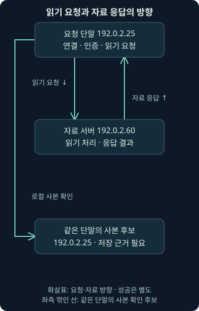
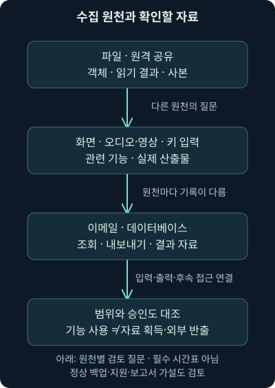
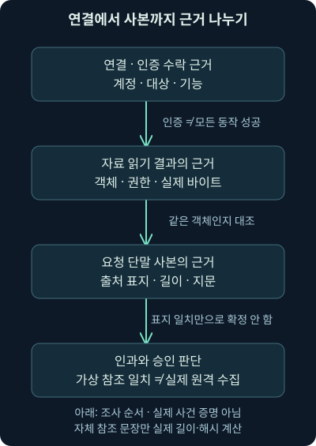

## 1. 다른 서버에 연결했습니다. 무엇이 실제로 가능해졌을까요?

앞 강의에서는 자격 증명 자료의 형태와 실제 인증 성공을 나눴습니다. 이제 가상 단말 `192.0.2.25`에서 서버 `192.0.2.60`으로 연결한 기록이 있다고 해보죠. “내부 이동에 성공해서 중요 문서를 수집했다”라고 적어도 될까요? 연결·인증·권한·자료 읽기·복사본은 서로 다른 근거가 필요합니다.

**내부 이동**, Lateral Movement는 환경 안의 다른 시스템이나 계정으로 접근 범위를 넓히려는 행위를 설명하는 말입니다. 단순히 패킷이 내부 주소 사이를 지났다는 뜻이 아닙니다. 정상 관리자가 원격 업무를 할 때도 같은 프로토콜과 도구를 쓸 수 있어 주체·대상·목적·실제 행위·승인을 함께 봐야 합니다.

셋째 날 5강은 원격 접근과 실행의 차이, 명령·화면 기반 관리 기능, 도구 준비와 자료 수집의 구별, 다양한 수집 원천, 읽기와 복사본의 증거 연결을 다룹니다. 마지막에는 자체 가상 주장과 34바이트 참조 파일을 실제 비교합니다. 원격 서버에 접속하거나 자료를 수집한 실습은 아닙니다. 외부로 나가는 반출은 다음 6강의 범위입니다.

## 2. 건물에 들어가는 것과 서류를 가져오는 것은 다릅니다

다른 부서의 문에 도착한 것, 출입증을 인정받은 것, 자료실에 들어간 것, 서류를 읽은 것, 사본을 만든 것은 서로 다릅니다. 마지막에는 그 일을 해도 되는 승인도 확인해야 하죠. 네트워크 조사에서도 이런 문들을 하나씩 나누면 과한 결론을 줄일 수 있습니다.

실제 컴퓨터에서는 출입증 하나보다 조건이 복잡합니다. 같은 계정도 서비스·공유·파일·명령 실행에 다른 권한을 가질 수 있습니다. 통신을 시작한 단말, 인증한 계정, 자료를 읽은 프로세스가 항상 단순하게 일치하지도 않습니다. 중계·서비스 계정·주소 변환이 있으면 기록을 더 맞춰야 합니다.

## 3. 첫 단말에서 목표 자료를 얻는 경우도 있습니다

어떤 사건에서는 다른 서버와 계정으로 이동해야 목표에 닿습니다. 하지만 처음 접근한 사용자의 자료가 바로 목표일 수도 있습니다. 클라우드 서비스 계정이나 기존 원격 세션이 경로가 될 수도 있죠. 모든 공격에 여러 단말을 차례대로 장악하는 과정이 필수라고 외우지 않습니다.

2026-11-07 [MITRE 내부 이동 전술 설명](https://attack.mitre.org/tactics/TA0008/)을 대조했습니다. 원래 있는 관리 기능·유효한 계정·별도 도구 등 여러 경로를 설명합니다. 분류는 조사할 목적을 정리하는 지도입니다. 정상 연결을 이 전술 이름으로 표시했다고 악성 목적이나 성공이 검증되는 것은 아닙니다.

## 4. 원격 기능을 다섯 질문으로 분리합니다

먼저 대상에 도달할 수 있었는지 봅니다. 다음으로 인증이 수락됐는지, 요청한 기능에 권한이 있었는지, 실제 동작이 무엇이었는지, 업무 승인이 있었는지 나눕니다. 인증 성공은 계정 확인 절차의 결과이지 모든 파일 읽기와 명령 실행의 성공이 아닙니다.

또한 **세션**은 상호작용을 유지하는 상태나 연결 맥락을 뜻합니다. 화면 세션, 명령 세션, 파일 서비스의 상태가 같은 것은 아닙니다. 파일 읽기에 항상 대화형 데스크톱 세션이 필요한 것도 아니죠. 필요한 기록 종류는 사용한 기능과 조사 질문에 따라 정합니다.



그림에서는 요청을 보낸 방향과 자료가 돌아오는 방향을 다르게 읽어주세요. 내부 서버로 향한 연결이라는 이유만으로 서버에 자료를 올린 것으로 해석하면 반대일 수 있습니다. 실제 바이트 방향과 애플리케이션의 요청·응답, 서버 작업 기록을 맞춰야 합니다.

## 5. 원격 접근은 항상 새 악성 프로그램 실행일까요?

원격 명령 실행을 조사한다면 어느 계정이 어느 프로그램을 실제로 동작시켰는지 필요합니다. 하지만 파일 공유에서 자료를 읽거나 원격 서비스의 기능을 쓰는 모든 행위를 “새 악성 실행 파일이 생성됐다”로 바꿀 수는 없습니다. 기존 기능·세션을 이용하는 경로도 있습니다.

반대로 새 파일이 없다면 아무 일도 없었다고 결론 내리면 안 됩니다. 원래 설치된 도구, 서버에 이미 있는 프로그램, 애플리케이션 기능이 사용될 수 있습니다. 새 파일·새 프로세스·기존 프로세스 안의 행위·자료 접근을 각각 확인합니다. 이번 강의에서는 원격 명령이나 프로그램을 실행하지 않습니다.

## 6. 명령 기반 관리 기능은 무엇이 다른가요?

**CLI**는 명령을 입력해 상호작용하는 방식입니다. SSH는 원격 로그인·명령 실행 등에 쓰이고, PowerShell 원격 기능은 다른 환경에서 명령과 개체를 다루는 관리 방식입니다. SMB는 파일 공유 기능에 쓰이지만 SMB 연결 하나가 모든 원격 실행을 의미하지는 않습니다. 둘째 날의 해당 프로토콜 원리를 여기의 조사 질문에 연결해보세요.

2026-11-07 [Microsoft PsExec 문서](https://learn.microsoft.com/en-us/sysinternals/downloads/psexec)의 v2.44 표시와 설명을 확인했습니다. 원격 프로그램 실행을 돕는 관리 도구로, 대상에 있는 프로그램을 쓰는 경우와 프로그램을 복사하는 경우를 구별합니다. 이 문서의 버전은 확인 시점의 표시이며 조사 장비의 설치 버전이나 영구적인 최신 버전이 아닙니다. 도구를 다운로드하거나 실행하지 않았습니다.

**WMI**, Windows Management Instrumentation은 Windows 관리 정보를 조회하고 작업을 수행하는 기반입니다. 2026-11-07 [Microsoft WMI 설명](https://learn.microsoft.com/en-us/windows/win32/wmisdk/about-wmi)을 대조했습니다. 원격 관리 경로로 DCOM, 즉 다른 컴퓨터의 프로그램 기능을 호출하는 Windows 기반과 WinRM, 즉 Windows 원격 관리 등의 구분이 있으며 실제 권한·공급자·설정에 따라 가능한 일이 다릅니다. WMI라는 기능 이름을 포트 하나나 특정 명령 한 줄과 같은 것으로 취급하지 않습니다.

## 7. 화면 기반 관리도 입력·표시·권한을 나눕니다

**GUI**는 창·버튼·화면으로 상호작용하는 방식입니다. RDP·VNC처럼 원격 화면과 입력을 다루는 기능에서는 로그인·세션 상태·화면 상호작용·후속 동작을 대조합니다. 화면 연결이 있다는 사실만으로 특정 문서를 열거나 파일을 반출했다고 확정하지 않습니다.

X11은 그래픽 애플리케이션의 표시와 입력을 다루는 체계입니다. SSH의 **X11 전달**은 그 통신을 SSH 채널을 통해 전달하는 기능입니다. 2026-11-07 [OpenSSH 공식 매뉴얼](https://man.openbsd.org/ssh.1)에서 원격 로그인·명령·X11 전달의 구별을 확인했습니다. 모든 설치 버전과 서버 설정에서 같은 기능이 켜져 있다고 가정하지 않습니다. 터널 안의 화면 동작이 경계 패킷에서 그대로 보이는 것도 아닙니다.

| 조사하는 기능 | 연결 이후 더 확인할 것 | 연결만으로 알 수 없는 것 |
| --- | --- | --- |
| 파일 공유 | 계정·공유·객체·읽기와 쓰기 결과 | 특정 자료 복사·명령 실행 |
| 원격 명령 관리 | 실제 실행 주체·대상·명령·결과 | 새 도구 설치·악성 의도 |
| 관리 정보 조회 | 요청한 기능·대상·조회 결과 | 모든 시스템 권한·후속 실행 |
| 원격 화면·표시 | 세션·입력·표시·후속 행위 | 특정 문서 열람·자료 반출 |

이 표는 도구를 CLI와 GUI로 영구히 가르는 분류가 아닙니다. 같은 전송에서 여러 기능을 쓸 수 있고, 한 관리 기능이 다른 통신으로 이어질 수도 있습니다. 기능의 실제 사용과 수집한 기록을 중심으로 읽어주세요.

## 8. 도구를 준비하는 것과 수집 자료를 모으는 것은 다릅니다

**스테이징**은 다음 동작을 위해 무언가를 임시 위치에 준비하는 일을 말합니다. 원격 실행에 쓸 프로그램을 준비하는 것과 수집한 자료를 모아두는 것은 대상과 목적이 다릅니다. 같은 stage라는 표현을 쓴다고 동일한 파일이나 같은 전술의 확정 증거는 아닙니다.

별도 도구가 필요한 경우에도 실제 파일이 전달됐는지, 어디에 저장됐는지, 실행에 사용됐는지 확인해야 합니다. 임시 폴더나 휴지통처럼 보이는 위치의 낯선 파일은 조사 단서가 될 수 있지만, 그런 위치가 곧 악성이거나 관측되지 않는 곳이라는 뜻은 아닙니다. 정상 설치·정리·업데이트 자료와 구별합니다.

실제 조사는 파일 생성·변경·프로세스·관리 서비스·배포 기록과 네트워크 전달을 연결합니다. 제품 이름·정식 서명·해시 평판 하나로 승인 여부를 대신하지 않습니다. 전달한 파일과 실행한 파일의 동일성, 당시 계정·실행 문맥·결과·업무 목적이 필요합니다.

## 9. 수집은 무엇을 모으려는 행위인가요?

**수집**, Collection은 목표에 관련된 자료를 모으려는 목적입니다. 로컬 파일·원격 공유·화면·오디오와 영상·키 입력·이메일·데이터베이스 등 원천이 다릅니다. 2026-11-07 [MITRE 수집 전술 설명](https://attack.mitre.org/tactics/TA0009/)을 대조했습니다. 가능한 원천의 목록이지 모든 공격에서 전부 사용한다는 절차가 아닙니다.

수집은 내부 이동 이후에만 시작하는 것도 아닙니다. 처음 단말에서 자료를 찾은 뒤 다른 대상을 알아보거나, 새로운 계정을 얻어 다시 접근·수집할 수 있습니다. 탐색·권한·계정·이동·수집이 반복되는 가설을 검토하되, 실제 관측이 없는 단계를 마음대로 채우지 않습니다.



그림의 마지막 질문은 어떤 원천에도 적용합니다. 실제로 자료를 얻었는지, 어느 범위였는지, 업무 승인이 있었는지를 확인해야 합니다. 수집 기능을 실행하려 했다는 기록과 결과 자료의 존재도 구별합니다.

## 10. 파일·화면·입력·이메일·데이터베이스는 증거가 다릅니다

파일 공유에서는 대상 객체·읽기 응답·바이트·복사본과 파일 식별 정보를 봅니다. 폴더 이름을 나열한 탐색은 파일 내용을 읽은 결과가 아닙니다. 화면·영상·오디오에서는 관련 애플리케이션·장치 사용·출력 자료를, 키 입력 수집에서는 수집 기능과 저장·전달 결과를 따로 확인합니다. 이 강의에서는 화면·소리·입력을 수집하지 않습니다.

이메일은 계정 접근·폴더 또는 메시지 조회·내보내기·사본·승인을 연결합니다. 데이터베이스도 접속과 질의, 결과 반환과 내보내기 파일은 다릅니다. 빈 결과나 권한 거부가 있을 수도 있고, 정상 보고서·백업 작업일 수도 있습니다. 특정 제품에 로그인했다는 사실을 전체 데이터베이스 반출로 바꾸지 않습니다.

여러 원천에서 유용한 계정 정보가 발견되면 다음 접근의 후보가 될 수 있습니다. 하지만 사용자 이름이 들어 있는 문서를 읽은 것과 사용 가능한 인증 비밀을 획득한 것은 다릅니다. 앞 강의에서 배운 자료 형태·유효성·인증·권한의 차이를 이어서 적용합니다.

## 11. 수집 자료의 임시 사본은 어디까지 증명할까요?

가상 단말에서 여러 자료를 한 폴더에 모았다고 합시다. 이것은 조사할 임시 저장 후보입니다. 2026-11-07 [MITRE Data Staged, T1074](https://attack.mitre.org/techniques/T1074/)의 로컬·원격 준비 구분을 확인했습니다. 하지만 사본 폴더만으로 외부 전달까지 완료됐다고 결론 내리지 않습니다.

수집 사본은 원래 파일과 바이트가 같을 수도 있고, 내보내기·변환·압축 때문에 다를 수도 있습니다. 이름·크기·시각만으로 동일한 자료라고 단정하지 않고, 가능한 경우 전체 바이트·해시·객체 식별·처리 과정을 대조합니다. 해시가 다르다고 무조건 다른 의미의 자료인 것도 아닙니다. 압축 전후에는 바이트 표현이 달라질 수 있기 때문입니다.

## 12. 작은 예제: 연결과 인증만 있다면 문장을 어디서 멈출까요?

가상 단말에서 서버로 연결한 흔적만 있다면 도달·통신 질문에서 멈춥니다. 인증 수락 기록이 더 있으면 해당 계정의 인증 절차에 관한 근거가 늘어납니다. 그래도 특정 파일 읽기·로컬 저장·프로그램 실행·외부 반출은 아직 별도입니다.

같은 계정과 대상의 파일 읽기 성공 주장이 있고, 요청 단말에 사본이 있다고 보고됐다면 연결 후보가 더 강해집니다. 이때는 객체가 같은지, 사본의 출처와 바이트가 어떤지, 시각이 맞는지, 중계나 다른 작업이 있었는지 확인합니다. “비슷한 시각에 파일 이름이 같다”만으로 자동 인과를 만들지 않습니다.



## 13. 자체 실습 파일을 실제 비교해봅시다

[비교 프로그램](../../assets/network-security/day03-lab05/compare_movement.py), [가상 주장](../../assets/network-security/day03-lab05/cases.json), [자체 참조 문장](../../assets/network-security/day03-lab05/reference-note.txt), [실습 설명](../../assets/network-security/day03-lab05/README.txt)을 같은 폴더에 둡니다. 작성 환경에서는 Python 3.12.14 기본 라이브러리로 실제 실행했습니다. 이 파일은 원격 서버에서 수집한 로그나 사건 자료가 아닙니다.

```text
python compare_movement.py cases.json reference-note.txt
```

`python`은 Python 3 실행 이름, `compare_movement.py`는 비교 프로그램입니다. `cases.json`에는 가상 주장이 있고 `reference-note.txt`에는 민감하지 않은 자체 영어 문장과 끝 줄바꿈이 있습니다. 프로그램은 두 입력 파일만 읽어 비교하고 출력합니다. 네트워크 연결·인증·서버 읽기·복사·실행 기능은 없습니다.

`schema`는 교육 형식이고 `external_actions_allowed: false`는 외부 동작 허용이 거짓이라는 계약입니다. `origin_host`는 요청 단말의 표지, `connection_claim`은 연결 주장입니다. `authentication_claim`·`read_claim`·`local_copy_claim`은 인증·읽기·로컬 사본의 주장입니다. 이 중 `null`은 해당 주장 자료를 제공하지 않은 상태이지 실제 행위가 없었다는 증거가 아닙니다.

## 14. 계정·대상·객체와 참조 바이트를 따로 대조합니다

인증 주장에는 `accepted`·`account`·`target`, 즉 수락 여부·계정·대상이 있습니다. 읽기 주장에는 여기에 읽기 성공을 뜻하는 `success`와 객체 표지 `object_id`가 있습니다. 프로그램은 수락·성공 주장과 계정·대상 표지를 비교합니다. 주소 임대·계정 별칭·시간 순서·실제 신원을 검증하는 기능은 아닙니다.

사본 주장에는 저장 단말 `host`, 원천의 계정·대상·객체인 `source_account`·`source_target`·`source_object_id`, 길이 `bytes_claim`과 지문 `sha256_claim`이 있습니다. **SHA-256**은 바이트 자료의 지문을 계산하는 해시 알고리즘입니다. 길이와 지문을 자체 참조 파일에서 실제 계산한 값과 비교합니다. 원격 원본의 바이트를 검증한 것이 아닙니다.

실제 자체 참조 파일은 줄바꿈을 포함해 34바이트였습니다. 출력의 `owned_reference_bytes`는 그 길이, `owned_reference_sha256`은 실제 읽은 파일의 지문입니다. 사본 주장이 이 값과 맞아도 “이 자체 참조와 길이·지문 주장이 맞는다”는 좁은 결과입니다. 해시는 실제 출처·승인·악성 의도·복사 원인을 증명하지 않습니다.

## 15. 조건을 바꾼 여덟 가상 사례의 결과를 읽습니다

실제 비교에서 M1은 연결 주장만 있고, M2는 인증 주장까지 있습니다. 둘 다 읽기와 사본을 연결할 자료가 부족해서 전체 후보가 거짓입니다. 이 거짓은 모형의 조합을 만들지 못했다는 뜻이며 실제 공격이 없었다는 판정이 아닙니다. `missing_claim_records`에서 어떤 주장 자료가 빠졌는지 읽습니다.

M3은 계정·대상·객체·사본 단말의 표지가 맞고 자체 참조의 길이·지문 주장도 맞아서 `candidate_chain_under_claims`가 참입니다. M4는 인증과 읽기의 계정이 다르고, M5는 지문 주장이 참조와 다르므로 후보가 거짓입니다. M6는 지문 미확인 때문에 후보도 미확인입니다. M7은 사본 단말 표지가 다르고 M8은 읽기 실패 주장이 있어 거짓입니다.

| 자체 사례 | 바꾼 조건 | 실제 비교에서 읽을 점 |
| --- | --- | --- |
| M1 | 연결 주장만 제공 | 인증·읽기·사본 주장 미제공 |
| M2 | 연결·인증 주장 제공 | 읽기·사본 주장 미제공 |
| M3 | 표지·길이·지문 주장 일치 | 입력 아래 후보 참, 실제 원격 행위 미검증 |
| M4 | 인증 계정과 읽기 계정 다름 | 계정 연결 불일치 |
| M5 | 사본 지문 주장이 다름 | 자체 참조 비교 불일치 |
| M6 | 사본 지문 미확인 | 후보 미확인 |
| M7 | 사본 단말 표지가 다름 | 이 단말 사본 연결 불일치 |
| M8 | 읽기 실패·지문 미확인 | 필수 조건 거짓이 있어 후보 거짓 |

일치가 참인 항목, 거짓인 항목, 미확인 항목을 따로 봐야 합니다. `authentication_read_link_under_claims`는 인증과 읽기 주장 연결, `read_copy_link_under_claims`는 읽기와 사본 주장 연결, `copy_claim_matches_owned_reference`는 자체 참조 비교입니다. 한 칸의 참을 모든 사건 단계의 참으로 옮기지 않습니다.

## 16. 실행한 검사와 하지 않은 검증을 분명히 남깁니다

조건 변경 실험에서는 계정·대상·객체·사본 단말·참조 바이트·길이·지문 미확인을 실제로 비교했습니다. 제공하지 않은 주장과 실패 주장을 나누고 잘못된 지문·자료형을 오류로 거부하는지도 확인했습니다. 이것은 자체 입력과 비교 프로그램 검사이지 실제 SMB·SSH·WMI·화면 연결을 시험한 결과가 아닙니다.

출력의 실제 네트워크·원격 인증·원격 읽기·사본·실행·인과·인가 검증 항목은 모두 거짓입니다. `incident_verdict`는 미결, `external_actions`는 0입니다. 기준 파일의 실제 길이·해시 계산과 사건의 실제 원격 원본 검증은 다른 작업입니다. 같은 영어 표지나 주소가 있다는 이유로 실제 자산을 조회했다고 해석하지 않습니다.

## 17. 실제 조사에서는 어느 기록과 대조할까요?

요청 단말에서는 관련 프로세스·실행 문맥·세션·파일 생성·복사본을, 대상 서버에서는 인증·요청 기능·공유 또는 객체·읽기·내보내기 결과를 대조합니다. 관리 도구·배포 작업·변경 승인·담당자의 정상 업무도 비교합니다. 같은 계정 이름이라도 도메인·로컬 계정·별칭을 구별해야 합니다.

네트워크에서는 당시 주소의 장치, 요청·응답 방향, 중계·주소 변환, 전송 바이트와 수집 범위를 맞춥니다. 암호화 때문에 읽기 대상이 안 보일 수 있고, 누락·절단·재조립 실패 때문에 바이트가 불완전할 수 있습니다. 단말 로그도 필터·보존·수집 시점·프로세스 내부 행위의 관측 한계가 있습니다. 기록이 없다는 결과를 자료 접근 부재로 단정하지 않습니다.

보고서에서는 “연결·인증 기록이 있다”라는 사실, “같은 계정의 자료 수집 경로일 수 있다”라는 가설, “중요 자료를 무단 수집하고 외부로 반출했다”라는 추가 입증이 필요한 결론을 나눕니다. 이번 강의는 사본까지의 근거를 연결했습니다. 다음에는 그 자료가 실제 경계를 넘어갔는지 물어보겠습니다.

## 18. 복습: 연결과 수집을 나눠 설명해봅시다

### 질문 1. 내부 주소 사이의 연결이면 모두 악성 내부 이동인가요?

**해설:** 정상 업무도 같은 경로를 사용합니다. 주체·대상·권한·기능·실제 행위·승인을 대조해야 하며 연결만으로 악성 목적을 붙이지 않습니다.

### 질문 2. 목표 자료가 처음 단말에 있다면 내부 이동이 반드시 필요한가요?

**해설:** 필요하지 않을 수 있습니다. 공격 목표와 현재 허용 범위가 중요하며 모든 사건에 여러 단말 이동을 끼워 넣지 않습니다.

### 질문 3. 인증 수락은 모든 파일 읽기와 원격 실행 성공인가요?

**해설:** 인증·인가·요청 동작·결과는 다릅니다. 대상 기능과 객체별 권한·실제 성공 기록이 필요합니다.

### 질문 4. 서버로 연결했으니 자료도 서버 쪽으로 보냈을까요?

**해설:** 요청은 서버로 가고 읽은 자료는 반대로 돌아올 수 있습니다. 연결을 시작한 방향과 자료의 실제 전송 방향을 구별합니다.

### 질문 5. 새 실행 파일이 없으면 원격 기능 오용도 없나요?

**해설:** 기존 도구·서비스·세션·애플리케이션 기능을 사용할 수 있습니다. 새 파일 하나를 모든 행위의 필수 조건으로 삼지 않습니다.

### 질문 6. SMB가 보이면 PsExec 실행을 확정할까요?

**해설:** SMB는 여러 파일 서비스 동작에 쓰입니다. 도구·관련 서비스·실제 프로세스·명령·결과 등 더 좁은 근거가 필요합니다.

### 질문 7. 화면 세션이 있으면 특정 문서도 읽었다고 할까요?

**해설:** 세션 존재와 화면·입력·문서 접근·복사 결과는 다릅니다. 실제 관련 활동과 승인 자료를 연결합니다.

### 질문 8. 임시 폴더의 파일은 자동으로 악성인가요?

**해설:** 정상 설치·업데이트도 사용합니다. 경로는 단서이며 파일의 출처·내용·실행·문맥·승인을 더 대조해야 합니다.

### 질문 9. 도구 준비와 수집 자료 준비는 같은 스테이징인가요?

**해설:** 준비라는 표현은 같아도 대상과 목적이 다릅니다. 실행 도구인지 수집 사본인지 구별하고 실제 사용 결과를 확인합니다.

### 질문 10. 폴더 목록 조회는 파일 내용 수집과 같은가요?

**해설:** 이름·구조 탐색과 내용 읽기는 다른 동작입니다. 조회 결과와 파일 접근·바이트·사본 근거를 따로 확인합니다.

### 질문 11. 자료를 모은 폴더가 있으면 외부 반출도 완료됐나요?

**해설:** 내부 준비와 경계 밖 전달은 다릅니다. 실제 외부 경로·전송·대상·자료 연결을 다음 단계에서 확인해야 합니다.

### 질문 12. M3 후보가 참이면 실제 서버에서 무단 복사한 것이 확인됐나요?

**해설:** 가상 주장 표지와 자체 참조의 길이·지문 비교만 맞습니다. 실제 서버·원본·인증·읽기·복사·인가·인과는 검증하지 않았습니다.

### 질문 13. M6의 지문 미확인을 참조 지문으로 채우면 어떤 검증이 된 것인가요?

**해설:** 입력 주장을 바꾼 조건 비교입니다. 실제 사건의 사본을 수집하거나 미확인을 해결한 검증이 아닙니다.

### 질문 14. M8에는 미확인이 있는데 왜 전체 후보는 거짓인가요?

**해설:** 필수 읽기 성공 주장이 거짓이기 때문입니다. 이 모형의 조합 실패를 실제 모든 공격 경로 부재로 해석하지 않습니다.

### 질문 15. 참조 파일에서 한 바이트를 바꾸면 무엇을 다시 비교해야 하나요?

**해설:** 실제 지문이 바뀌고 길이는 같을 수도 있습니다. 길이 일치만으로 바이트 동일성을 대신하지 않으며, 실제 원격 자료 출처는 여전히 별도입니다.

### 질문 16. 암호화된 내부 연결에 파일 이름이 안 보이면 자료를 안 읽었나요?

**해설:** 수집 위치·암호화·누락·재조립을 확인하고 단말·대상 서버의 객체 접근 기록을 대조합니다. 보이지 않는 내용을 부재로 단정하지 않습니다.
