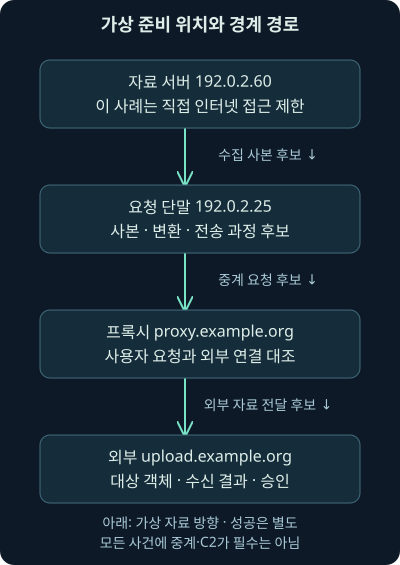
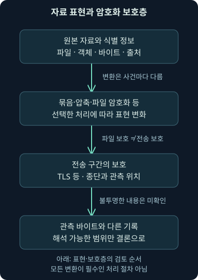
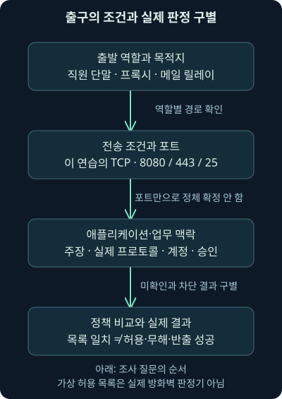

## 1. 사본을 찾았습니다. 경계 밖으로도 나갔을까요?

앞 강의에서는 연결·인증·읽기·사본을 나눴습니다. 이제 가상 단말 `192.0.2.25`에 서버 자료의 사본을 모은 흔적이 있고 외부 서비스로 통신한 기록도 있다고 해보죠. 이것만으로 그 자료가 외부로 반출됐다고 결론 내릴 수 있을까요? 사본의 출처와 전송 자료, 실제 경로와 결과를 연결해야 합니다.

**반출**, Exfiltration은 공격자가 목표 자료를 환경 밖으로 가져가려는 목적을 말합니다. **아웃바운드**는 어떤 호스트나 경계에서 밖으로 향하는 방향을 뜻합니다. 어느 경계를 기준으로 했는지에 따라 내부 프록시로 가는 호스트의 통신과 인터넷 경계를 넘는 통신은 다를 수 있습니다. 모든 아웃바운드 바이트를 자료 유출로 부르지 않습니다.

셋째 날 6강은 수집과 반출의 차이, 중간 준비 위치, 압축·암호화·분할의 의미, 역할별 경계 정책과 프록시, 관측 바이트의 속도와 해석 한계를 다룹니다. 마지막에는 자체 가상 허용 조건과 숫자를 실제 비교합니다. 실제 자료 전송·반출·방화벽 변경을 수행한 실습은 아닙니다.

## 2. 서류를 상자에 넣는 것과 건물 밖으로 보내는 것은 다릅니다

자료실에서 서류를 복사하고 복도에 상자를 모았다고 합시다. 아직 택배차에 실려 건물 밖으로 나간 것은 아니죠. 컴퓨터에서도 수집·임시 저장·자료 변환·전송 요청·수신 결과를 나눠야 합니다. 이 단계를 한 문장으로 합치면 실제 확인하지 않은 성공을 덧붙이기 쉽습니다.

비유의 상자와 달리 전자 자료는 사본이 여럿 생기고, 변환되거나 일부만 선택될 수 있습니다. 정상 백업·보고서·동기화도 비슷한 활동을 만듭니다. 자료의 민감도·계정·대상·양·시간·업무 승인·실제 객체를 함께 대조해야 합니다. 상자처럼 보이는 파일 이름 하나가 반출의 증거를 대신하지 않습니다.

## 3. 크고 느린 전송만 찾으면 무엇을 놓칠까요?

반출에 반드시 기가바이트 이상의 자료가 필요한 것은 아닙니다. 작은 문서나 짧은 비밀 자료도 중요할 수 있습니다. 큰 전송이 있어도 승인된 백업일 수 있고, 작은 전송이라고 무해한 것도 아닙니다. 자료의 가치와 전송량은 같은 척도가 아닙니다.

중간 서버·분할·느린 전송도 가능한 사례이지 모든 반출의 필수 조건은 아닙니다. 처음 접근한 단말에서 바로 보낼 수 있는 경로도 있고, 이미 허용된 서비스가 오용될 수도 있습니다. 2026-11-07 [MITRE 반출 전술 설명](https://attack.mitre.org/tactics/TA0010/)을 대조했습니다. 기존 제어 채널과 다른 채널, 여러 전달 방식이 있어 하나의 시간표로 고정하지 않습니다.

여기서 **C2**, 명령·제어는 공격자가 제어 대상과 지시·결과를 주고받는 관계를 뜻합니다. 자료가 반드시 대화형 C2를 거쳐야 나가는 것은 아닙니다. 모든 공격 단계가 같은 순서로 성공해야 반출이 가능하다는 가정도 하지 않습니다. 실제 관측과 확인한 경로에서 시작합니다.

## 4. 중간 준비 위치가 있으면 두 구간을 연결합니다

가상 자료 서버 `192.0.2.60`은 인터넷으로 직접 통신하지 않고, 요청 단말과 프록시를 거쳐 외부 서비스에 도달하도록 구성됐다고 합시다. 이는 이 사례의 가정입니다. 모든 내부 서버에 같은 통신 정책이 적용돼 있다고 주장하는 것은 아닙니다. 실제로는 필요한 업데이트·업무·중계와 장치 역할을 확인해야 합니다.

이 경우 서버→단말의 수집 사본과 단말→프록시→외부의 전달을 나눠봅니다. 각 구간의 계정·프로세스·객체·시각·크기·주소 변환·요청 식별자를 대조합니다. 비슷한 시각에 두 연결이 있다는 사실만으로 같은 자료가 이어졌다고 확정하지 않습니다. 중간에 가공·압축·암호화·선택이 있었다면 자료의 표현도 바뀔 수 있습니다.



그림에서는 첫 번째 구간과 마지막 구간을 별도로 읽어주세요. 서버 읽기와 외부 수신은 서로 다른 질문입니다. 서버가 인터넷에 직접 못 나가도 다른 단말·중계·클라우드 경로의 통제와 관측이 필요한 이유가 여기 있습니다.

## 5. 압축·암호화·묶음·분할은 서로 다른 기능입니다

**압축**은 반복과 구조를 이용해 자료 표현을 줄이는 처리입니다. 이미 압축됐거나 짧은 자료는 추가 압축으로 작아지지 않을 수 있습니다. **암호화**는 키 등 필요한 비밀 없이는 내용을 읽기 어렵게 보호하는 처리입니다. 암호화 자체가 크기를 항상 줄이는 것은 아닙니다. 형식의 부가 정보 때문에 크기가 늘 수도 있습니다.

여러 파일을 한 형식에 담는 **아카이브**와 한 자료를 여러 조각으로 나누는 **분할**도 구별합니다. 어떤 도구는 여러 기능을 함께 제공하지만 기능의 목적은 다릅니다. 2026-11-07 [7-Zip의 7z 형식 설명](https://www.7-zip.org/7z.html)에서 압축 방식과 AES-256 암호화 지원을 확인했습니다. 해당 형식의 기능 설명이지 이번 장비의 설치 버전·사용 옵션·실제 실행 결과는 아닙니다.

2026-11-07 [MITRE Archive Collected Data, T1560](https://attack.mitre.org/techniques/T1560/)도 대조했습니다. 수집 자료를 묶거나 압축·암호화하는 기능은 정상 백업과 공유에도 쓰입니다. 도구 실행·확장자·분할 이름만 보고 악성 반출을 확정하지 않습니다. 입력 파일·설정·산출물·후속 전송과 승인을 연결합니다.

## 6. 자체 짧은 문장의 압축 결과도 직접 확인해봅니다

다음은 실제 사건 자료를 다루지 않는 자체 예제입니다. Python의 기본 `zlib` 압축으로 짧은 문장을 처리합니다. `bytes`는 바이트 자료를, `len`은 길이를 뜻합니다. 첫 줄의 `import`는 압축 기능을 불러오며, `\n`은 끝 줄바꿈 한 바이트입니다. 프로그램을 불러오는 것과 외부 자료를 전송하는 것은 다릅니다.

```python
import zlib
sample = b'Fictional training material only.\n'
packed = zlib.compress(sample)
print(len(sample), len(packed))
```

작성 환경의 Python 3.12.14와 zlib 1.3.2에서 이 자체 예제를 실제 실행한 길이는 원문 34바이트, 압축 결과 41바이트였습니다. 작은 입력에 형식의 부가 정보가 붙어 오히려 커진 사례입니다. 7-Zip을 실행한 결과가 아니고, 다른 입력·방식·설정에서도 항상 같은 크기 관계라는 뜻도 아닙니다. 암호화나 네트워크 전송은 실행하지 않았습니다.

따라서 서버 원본 크기와 경계에서 센 바이트가 다르다는 사실만으로 일부 자료가 빠졌다거나 더 많은 자료가 유출됐다고 결론 내리지 않습니다. 압축·암호화·프로토콜 부가 정보·재전송·계층·수집 누락을 구별해야 합니다. 먼저 무엇의 크기를 비교하는지 이름을 붙이세요.

## 7. 암호화된 통신과 암호화된 파일은 다른 보호층입니다

TLS는 전송 구간을 보호하고, 파일 암호화는 그 안에 담긴 자료 자체를 보호할 수 있습니다. 프록시에서 어떤 TLS 구간을 해석할 수 있어도 내부의 파일이 별도로 암호화됐다면 내용은 여전히 안 보일 수 있죠. 반대로 네트워크에서 안 보이는 내용을 단말·원본 서버·애플리케이션 기록에서 확인할 수도 있습니다.

2026-11-07 확인 기준의 [TLS 1.3 규격 RFC9846](https://www.rfc-editor.org/info/rfc9846/)과 앞서 배운 전송 보호 원리를 여기에도 적용합니다. 2026년 규격 문서가 있다는 사실을 조사 장비가 그 구현을 사용했다는 증거로 삼지 않습니다. 암호화 여부·협상·종단·실제 관측 범위를 각각 확인해야 합니다.



그림에서 파일 보호와 전송 보호 상자를 합치지 마세요. 해시를 계산한 바이트가 원본인지 산출물인지도 중요합니다. 같은 자료에서 만들어졌더라도 변환 전후의 바이트 지문은 다를 수 있습니다. 원본과 산출물의 관계를 입증할 별도 기록이 필요합니다.

## 8. 명령행을 못 찾으면 내용 확인은 끝난 걸까요?

암호화에 사용한 명령행은 설정·대상·입력과 출력의 연결 단서가 될 수 있습니다. 그러나 필요한 키나 암호가 항상 명령행에 있다는 뜻은 아닙니다. 명령을 찾았다고 실제 암호문을 복호화하거나 전체 자료를 확인한 것도 아닙니다. 반대로 명령행이 없다고 모든 조사 가능성이 사라지는 것도 아닙니다.

원본 자료·단말 산출물·승인된 애플리케이션 기록·키 관리 정보·대상 서비스의 객체와 전달 기록 등 접근 가능한 근거를 대조합니다. 가능한 복호화는 필요한 비밀·형식·자료 완전성·권한이 있어야 합니다. 실제로 복호화하지 않았다면 “전송 내용 미확인”이라고 적습니다. 이번 강의는 암호·키를 수집하거나 암호문을 복호화하지 않습니다.

## 9. 포트 하나가 아니라 역할·대상·기능으로 출구를 봅니다

가상 정책에서 메일 릴레이만 특정 메일 대상의 TCP25로, 프록시만 특정 외부 대상의 TCP443으로, 직원 단말은 내부 프록시로 통신하도록 허용했다고 합시다. **메일 릴레이**는 메일을 다음 서버로 전달하는 역할, **프록시**는 요청을 중계하는 역할입니다. 이 정책은 뒤 실습의 자체 가정입니다.

표준 용도와 실제 통신의 정체도 다릅니다. 2026-11-07 [RFC9110의 HTTPS 설명](https://www.rfc-editor.org/rfc/rfc9110.html)을 대조했습니다. HTTPS URI의 기본 포트 설명이 있다고 모든 443 통신이 HTTPS이거나 정상 업무라는 뜻은 아닙니다. 애플리케이션 해석·종단·계정·인증·대상·요청과 실제 자료를 확인해야 합니다. 예시의 TCP 조건을 모든 HTTP 전송 방식에 일반화하지 않습니다.

출발지가 직원 단말인지 프록시인지도 중요합니다. 동일 목적지·포트라도 역할에 따라 정책이 다를 수 있습니다. 허용된 프록시와 메일 서버의 기능이 오용될 가능성도 있어 “허용 규칙에 맞는다”와 “정상 승인된 자료다”를 나눕니다.

## 10. 기본 거부는 정책의 선택이며 실제 적용 상태는 별도입니다

**기본 거부**는 명시적으로 허용하지 않은 통신을 거부하는 정책 방식입니다. 2026-11-07 [NIST SP800-41r1](https://nvlpubs.nist.gov/nistpubs/Legacy/SP/nistspecialpublication800-41r1.pdf)의 필요한 통신 식별·정책 관리·기본 거부 원칙을 확인했습니다. 2009년 문서의 정책 원리를 참고한 것이며 현재 모든 제품의 기능·기본값을 설명하는 문서로 취급하지 않습니다.

실제 적용에는 필요한 업무·대상·역할·프로토콜·예외·검사 지점·배포와 결과 검증이 필요합니다. 운영 정책을 적었다는 사실과 장비가 그 정책으로 실제 차단했다는 사실은 다릅니다. 여러 출구·호스트 방화벽·중계·가상·클라우드 경로와 당시 적용 상태를 대조해야 합니다. 이번 실습은 어떤 실제 정책도 변경하지 않습니다.

2026-11-07 [Microsoft Windows Firewall 규칙 설명](https://learn.microsoft.com/en-us/windows/security/operating-system-security/network-security/windows-firewall/rules)을 대조했습니다. 실제 제품에는 명시적 차단·허용·기본 동작 등의 우선 관계가 있습니다. 뒤의 작은 모형은 허용 목록 비교만 하므로 Windows Firewall의 전체 판정기를 재현하지 않습니다.



## 11. 차단 기록과 검사 경보도 각각 좁게 해석합니다

차단 기록이 있으면 그 기록이 설명하는 요청·방향·정책·결과부터 확인합니다. 그것만으로 같은 단말의 다른 경로도 차단됐다고 말하지 않습니다. 반대로 모든 반출 시도에 반드시 차단 기록이 먼저 생기는 것도 아닙니다. 이미 허용된 경로가 오용되거나 기록 설정·보존 때문에 보지 못할 수도 있습니다.

**IDS**는 침입 탐지 체계, **DLP**는 자료 유출 방지 체계를 말합니다. 각 체계가 보는 자료와 적용 조건이 다릅니다. 암호화·중계·자료 변환·수집 범위 때문에 내용 검사에 한계가 있을 수 있습니다. NIST의 방화벽 검사 한계 설명처럼 무엇을 해석할 수 있는지부터 확인해야 합니다. 경보가 없다는 결과를 자료 유출 부재로 바꾸지 않습니다.

통신량·빈도·대상·시간은 중요한 단서입니다. 다만 정상 백업·업로드·동기화·업무 제출의 기준선과 비교해야 합니다. 드물거나 큰 흐름 하나로 악성을 확정하지 않고, 흔한 서비스나 적은 바이트라는 이유로 무해함을 보증하지도 않습니다.

## 12. 바이트와 비트, 평균과 순간 속도를 나눕니다

가상 관측값 1000바이트를 10초로 나누면 평균 100바이트/초입니다. 한 바이트는 8비트이므로 평균 800비트/초입니다. **B/s**는 바이트/초, **bit/s**는 비트/초로 표기하겠습니다. 두 단위의 숫자를 그대로 비교하면 여덟 배 차이를 놓칠 수 있습니다.

```text
평균 바이트 속도 = 관측 바이트 ÷ 관측 구간의 초
1000 B ÷ 10 s = 100 B/s
평균 비트 속도 = 평균 바이트 속도 × 8
100 B/s × 8 = 800 bit/s
```

같은 1000바이트를 1000초로 나누면 평균 1B/s, 8bit/s입니다. 그렇다고 반드시 천천히 일정하게 보냈다는 뜻은 아닙니다. 짧은 전송과 긴 대기 시간이 같은 평균을 만들 수 있죠. 실제 패킷·시간 구간·순간 변화와 수집 누락을 확인해야 합니다. 이 숫자는 탐지를 피하는 속도 권고가 아니라 평균을 오해하지 않기 위한 자체 계산입니다.

## 13. 크기를 세기 전에 어느 계층과 구간인지 붙입니다

링크에서 센 바이트, IP 패킷 바이트, 전송 계층의 자료, 애플리케이션 객체, 원본 파일은 서로 다를 수 있습니다. 헤더·재전송·압축·암호화·분할 때문에 숫자 관계가 단순하지 않습니다. 여러 센서가 같은 구간을 중복 수집했거나 흐름이 나뉘는 경우도 생각해야 합니다.

관측 구간이 처음부터 끝까지인지, 전송 방향을 제대로 나눴는지, 샘플링이나 잘림이 있었는지 확인합니다. **샘플링**은 전체 중 일부만 선택해 관측하는 방식입니다. 선택 비율과 방식이 미확인인데 관측 숫자를 전체 자료량으로 곧바로 확대하지 않습니다. 큰 업로드 순위에 없다는 사실도 자료 반출이 없었다는 뜻이 아닙니다.

NetFlow 같은 흐름 기록은 주소·시간·양 등의 요약을 제공할 수 있습니다. 전체 패킷 바이트를 보관한 PCAP와 같은 자료는 아닙니다. 흐름 집계·샘플링·계층·관측 지점의 설정을 확인한 뒤 수치를 해석합니다. 요약 순위에 없다는 결과와 작은 중요 자료의 부재를 혼동하지 않습니다.

## 14. 실습은 정책 주장과 관측 숫자만 비교합니다

[비교 프로그램](../../assets/network-security/day03-lab06/compare_egress.py), [가상 입력](../../assets/network-security/day03-lab06/cases.json), [실습 설명](../../assets/network-security/day03-lab06/README.txt)을 같은 폴더에 둡니다. 작성 환경에서는 Python 3.12.14 기본 라이브러리로 실제 실행했습니다. 원본 로그·PCAP·프록시·방화벽 설정을 가져온 파일이 아닙니다.

```text
python compare_egress.py cases.json
```

`python`은 Python 3 실행 이름, `compare_egress.py`는 비교 프로그램, `cases.json`은 가상 입력입니다. `schema`로 교육 형식을, `external_actions_allowed: false`로 외부 동작 금지를 확인합니다. `default_action_claim: deny`는 이 연습의 기본 거부 가정입니다. `accounting_scope`는 가상 관측 계층 숫자라는 표지이며 실제 계층을 측정·인증한 값은 아닙니다.

`source_role`·`destination`·`transport`·`destination_port`·`application_claim`은 출발 역할·목적지 표지·전송 방식·목적지 포트·애플리케이션 주장입니다. 프로그램은 이 다섯 조건을 모두 비교합니다. `tcp`는 TCP를, `http-proxy`는 이 연습의 HTTP 프록시 기능 주장을 뜻합니다. 실제 패킷의 프로토콜을 자동 식별하거나 DNS로 목적지를 확인하지 않습니다.

`observed_bytes`는 이 예제에서 선언한 관측 바이트이고 `interval_seconds`는 그 숫자를 나눌 구간의 초입니다. 바이트는 0 이상의 정수 또는 미확인인 `null`, 구간은 양의 정수 초만 지원합니다. 실제 기록의 시각 차이나 전체 파일 길이를 자동으로 가져오는 기능은 아닙니다.

## 15. 허용 목록의 세 규칙을 차례로 읽어봅시다

규칙 A는 `workstation`이라는 직원 단말 역할에서 `proxy.example.org`의 TCP8080으로 가는 `http-proxy` 주장입니다. 규칙 B는 `proxy` 역할에서 `upload.example.org`의 TCP443으로 가는 `https` 주장입니다. 규칙 C는 `mail-relay` 역할에서 `mail.example.net`의 TCP25로 가는 `smtp` 주장입니다. 모두 문서용 예시 이름이며 실제 서비스에 접속하지 않습니다.

같은 규칙의 조건은 AND, 즉 모두 만족해야 합니다. 규칙들 사이는 어느 하나가 완전히 맞으면 허용 목록 일치입니다. 완전한 참은 없지만 일부 미확인 때문에 가능성이 남으면 미확인으로 두고, 모든 규칙이 불일치하면 미일치로 둡니다. 주장이 `null`이면 미확인, 다른 값이면 불일치입니다. 미확인을 실제 차단 결과로 바꾸지 않습니다.

이 모형에는 명시적 차단 규칙·연결 상태·사용자 인증·주소 변환·도메인 갱신·제품 우선순위가 없습니다. 실제 방화벽의 전체 결과를 예측하지 않습니다. 역할 표지도 입력을 믿고 비교할 뿐 실제 장치의 신원을 검증하지 않습니다. 이런 범위를 알고 읽어야 출력이 유용합니다.

## 16. 작은 예제와 조건을 추가한 결과를 읽습니다

X1은 직원 단말→프록시 규칙과 맞고, 가상 1000바이트/10초이므로 평균 100B/s입니다. X2는 직원 단말→외부443 직접 경로라 이 허용 목록에 맞지 않습니다. X3은 메일 릴레이의 조건과 맞고 평균 40B/s입니다. 규칙 일치와 양의 차이만 보였지, 정상 승인이나 실제 통신 결과를 확인한 것은 아닙니다.

X4는 프록시→외부443의 다른 조건이 맞아도 애플리케이션 주장이 미확인이라 정책 비교가 미확인입니다. X5는 허용 규칙에 맞지만 관측 바이트가 미확인이어서 속도도 미확인입니다. X6는 명시한 관측0이므로 평균0입니다. X7은 목적지 미확인, X8은 직원 단말이 메일 릴레이 역할 규칙에 맞지 않는 사례입니다.

| 자체 사례 | 실제 정책 주장 비교 | 가상 바이트·초에서 계산한 평균 |
| --- | --- | --- |
| X1 | 허용 목록 일치 | 1000/10 = 100B/s = 800bit/s |
| X2 | 미일치 | 1000/1000 = 1B/s = 8bit/s |
| X3 | 허용 목록 일치 | 40/1 = 40B/s = 320bit/s |
| X4 | 애플리케이션 미확인 | 1000/10 = 100B/s = 800bit/s |
| X5 | 허용 목록 일치 | 바이트 미확인 → 속도 미확인 |
| X6 | 허용 목록 일치 | 0/10 = 0B/s = 0bit/s |
| X7 | 목적지 미확인 | 80/2 = 40B/s = 320bit/s |
| X8 | 미일치 | 100/2 = 50B/s = 400bit/s |

출력의 `policy_match_under_claims`는 `allow_rule_match`·`no_rule_match`·`unverified`, 즉 허용 목록 일치·미일치·미확인입니다. `observed_bytes_per_second`와 `observed_bits_per_second`는 정확한 분수 문자열로 출력하므로 나눠떨어지지 않는 입력도 반올림하지 않습니다. 실제 자료 내용·전송 성공·방화벽 적용을 검증한 결과는 아닙니다.

## 17. 미확인과 관측0을 같은 값으로 채우지 않습니다

X5의 바이트를 모른다는 상태와 X6의 가상 구간에서 0바이트로 선언한 상태는 다릅니다. 실제 조사에서도 수집하지 못한 수치를 0으로 채우면 부재 증거를 만들어버립니다. 반대로 관측0도 정확히 그 구간·방향·계층의 조건으로 한정해야 합니다. 다른 경로·시간까지 통신이 없었다는 뜻은 아닙니다.

검증 중에는 역할·목적지·포트·전송 방식·애플리케이션 주장과 바이트·구간을 바꿔 실제 비교했습니다. 미확인과 명시적 불일치, 분수 속도, 잘못된 숫자와 계약을 구별하는지도 확인했습니다. 모든 실제 방화벽·프로토콜·내용·파일·반출 검증 항목은 거짓, 사건 판단은 미결, 외부 동작은 0입니다.

## 18. 실제 반출 판단에는 어느 자료가 더 필요할까요?

단말에서는 원본 접근·수집 사본·변환 산출물·전송 프로세스를, 원본 서버에서는 계정·객체·읽기·내보내기를 대조합니다. 프록시·메일·방화벽·리졸버에서는 대상·방향·인증·요청·정책·바이트와 성공·실패의 의미를 확인합니다. 외부 서비스의 승인된 감사·객체·업로드 결과가 있다면 실제 전달 범위를 좁힐 수 있습니다.

주소·계정·객체·시간을 맞추고, TLS와 파일 암호화·재조립·샘플링·보존·도구 설정의 한계를 기록합니다. “외부로 바이트가 관측됐다”는 사실, “수집 사본과 관련된 전송일 수 있다”는 가설, “그 중요 자료가 무단으로 완전히 유출됐다”는 추가 입증이 필요한 결론을 나눕니다. 전체·일부·미확인 범위를 구별해서 적어주세요.

## 19. 지금까지 배운 전술을 고정 시간표로 합치지 않습니다

실행·지속성·탐색·권한 상승·자격 증명 접근·내부 이동·수집·반출은 서로 다른 목적의 질문입니다. 하나의 기록으로 여러 가설을 세울 수 있고, 어떤 목적은 생략되거나 반복될 수 있습니다. 초기 접근이 취약점 악용이 아닌 경우도 있었죠. 옛 공격 단계 모형의 모든 단계를 필수 통과한 것으로 채우지 않습니다.

ATT&CK 전체를 침해 이후 행위에만 한정하지도 않습니다. 앞의 버전 확인 원칙과 함께 목적·방법·실제 근거를 구별합니다. 네트워크와 단말 어느 한쪽이 모든 사건을 완전히 보여주는 것도 아닙니다. 다음 강의부터는 이런 질문을 어디에서 관측·제어할지 단말의 다층 방어로 연결하겠습니다.

## 20. 복습: 반출·정책·숫자의 의미를 바꿔봅시다

### 질문 1. 수집 사본과 외부 연결이 있으면 동일 자료 반출이 확정됐나요?

**해설:** 사본·변환·전송 객체·경로·계정·시간·대상 결과를 연결해야 합니다. 가까운 시간의 두 사실만으로 자료의 동일성과 전달 성공을 확정하지 않습니다.

### 질문 2. 반출은 반드시 기가바이트 이상이고 느리게 진행되나요?

**해설:** 작은 중요 자료도 목표가 될 수 있고 속도·중계·분할은 사례별로 다릅니다. 크고 느린 흐름만 찾으면 다른 경로를 놓칠 수 있습니다.

### 질문 3. 내부 서버가 인터넷에 직접 못 나가면 다른 경로의 위험도 사라지나요?

**해설:** 단말·중계·클라우드 등 다른 경로를 확인해야 합니다. 한 장치의 직접 통신 제한을 전체 환경의 반출 불가능으로 확대하지 않습니다.

### 질문 4. 압축·암호화·분할은 모두 크기를 줄이는 같은 처리인가요?

**해설:** 표현 축소·내용 보호·조각 나누기는 목적이 다릅니다. 짧거나 이미 압축된 자료는 작아지지 않을 수 있고 부가 정보로 커질 수도 있습니다.

### 질문 5. 자체 34→41바이트 결과는 7-Zip의 일반 성능인가요?

**해설:** Python zlib로 처리한 짧은 자체 문장 한 사례입니다. 다른 도구·입력·설정의 보편 결과로 바꾸지 않습니다.

### 질문 6. TLS 내용을 해석했다면 내부 암호화 파일도 읽힌 것인가요?

**해설:** 전송 보호와 파일 보호는 다릅니다. 관측 종단과 내부 자료의 별도 암호화·형식·키·완전성을 확인해야 합니다.

### 질문 7. 암호화 명령행이 없으면 자료 확인은 불가능한가요?

**해설:** 명령행은 여러 단서 중 하나입니다. 접근 가능한 원본·산출물·애플리케이션·키 관리·대상 객체 기록을 대조하되 실제 복호화하지 않은 내용을 확인했다고 쓰지 않습니다.

### 질문 8. 443 허용 규칙에 맞으면 HTTPS와 정상 승인이 확인됐나요?

**해설:** 포트·프로토콜 정체·계정·대상·자료·승인은 다릅니다. 모형의 애플리케이션 표지도 실제 패킷 검증이 아닌 입력 주장입니다.

### 질문 9. 기본 거부 정책 문서가 있으면 실제 모든 출구가 차단되나요?

**해설:** 적용 장비·경로·예외·역할·현재 상태·결과를 검증해야 합니다. 정책 의도와 실제 적용은 별도입니다.

### 질문 10. 방화벽 차단 기록 하나가 있으면 반출 실패가 확정됐나요?

**해설:** 해당 기록의 요청과 경로만 먼저 해석합니다. 다른 허용 경로나 이전·이후 전송, 수집 공백을 확인해야 합니다.

### 질문 11. 1000바이트/10초는 몇 비트/초인가요?

**해설:** 먼저 100B/s이고 한 바이트가 8비트이므로 800bit/s입니다. 구간 평균이며 그 속도로 일정하게 보냈다는 뜻은 아닙니다.

### 질문 12. 원본 파일 길이와 관측 전송량이 다르면 일부 유실이 확실한가요?

**해설:** 계층·헤더·재전송·변환·암호화·수집 범위를 맞춰야 합니다. 무엇을 센 숫자인지 다르면 바로 비교할 수 없습니다.

### 질문 13. X4의 애플리케이션 미확인을 HTTPS로 바꾸면 어떤 일이 생기나요?

**해설:** 다른 조건이 유지되면 가상 허용 규칙 일치가 됩니다. 입력을 바꾼 비교이며 실제 프로토콜을 분석해 미확인을 해결한 것은 아닙니다.

### 질문 14. X5의 바이트 미확인을 0으로 채우면 무엇을 잃나요?

**해설:** 수치를 모름과 관측0의 차이를 잃습니다. 미확인을 부재로 만드는 오류이므로 속도도 미확인으로 남겨야 합니다.

### 질문 15. X1 규칙 일치는 실제 방화벽 허용이나 악성 여부인가요?

**해설:** 다섯 입력 조건이 자체 허용 목록과 맞는다는 결과입니다. 실제 제품 판정·통신 성공·자료 내용·승인·반출은 미검증입니다.

### 질문 16. 수집·반출 전에 모든 전술을 한 번씩 수행해야 하나요?

**해설:** 전술은 목적을 정리하는 질문입니다. 사건마다 생략·반복·다른 경로가 있으므로 관측하지 않은 단계를 필수 시간표로 채우지 않습니다.
