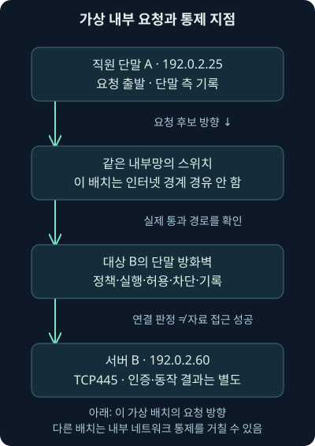
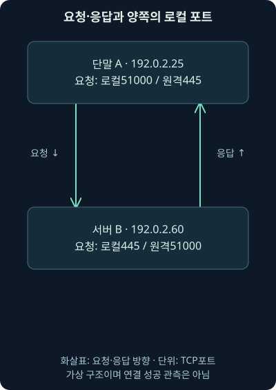
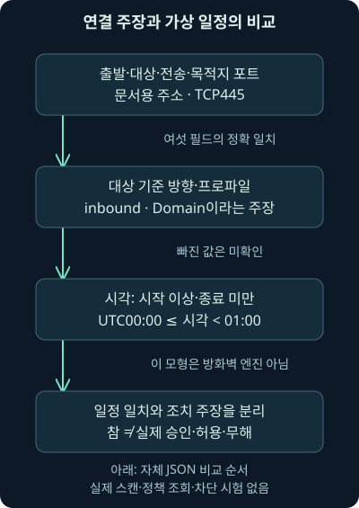

## 1. 인터넷 경계에는 기록이 없는데 내부 단말끼리 통신했습니다

앞 두 강의에서 자산·패치와 악용 완화·격리를 배웠습니다. 이제 가상 직원 단말 `192.0.2.25`가 내부 서버 `192.0.2.60`의 TCP445로 연결을 시도했다고 합시다. 인터넷 경계 방화벽에 기록이 없다면 시도 자체가 없었다고 판단할 수 있을까요?

같은 내부망에서 직접 오간 통신이라면 인터넷 경계를 지나지 않았을 수 있습니다. 어느 장치를 통과했고 어디에서 수집했는지부터 그려야 하죠. 이번 셋째 날 9강은 단말 방화벽의 필요성, 방향·프로파일·규칙·기록의 범위와 승인된 스캔을 대조하는 방법을 다룹니다.

실제로 수행하는 실습은 자체 JSON 연결 주장과 일정 조건의 비교입니다. 방화벽을 조회·변경하거나 포트를 연결·스캔·차단 시험한 결과는 아닙니다. 다음 10강에서는 연결 통제와 다른 관측인 백신의 탐지와 조치 기록으로 이어갑니다.

## 2. 정문 경비와 방마다 있는 출입 통제를 구별해봅시다

건물 정문을 지났다고 모든 방에 들어갈 권한까지 생기는 것은 아닙니다. 방마다 필요한 사람과 출입 목적이 다르기 때문입니다. 네트워크 경계의 통제와 각 단말의 통제를 함께 두는 이유도 비슷합니다.

**단말 방화벽**, 호스트 방화벽은 장비로 들어오거나 나가는 네트워크 통신을 조건에 따라 허용·제한하는 기능입니다. **네트워크 방화벽**은 자신을 통과하는 통신을 관측·제어합니다. 둘은 위치와 사용할 수 있는 문맥이 다릅니다. 단말 쪽은 해당 장비의 앱·서비스와 연결된 조건을 활용할 수 있지만, 실제 수집 필드는 제품과 설정에 따라 다릅니다.

비유의 방과 달리 컴퓨터에는 여러 네트워크 어댑터·가상 경로·중계가 있을 수 있습니다. 인터넷 경계 외에 내부 구간을 나누는 방화벽도 있고, 가상 스위치나 다른 보안 통제가 같은 내부 통신을 볼 수도 있습니다. “네트워크 방화벽이면 내부 이동을 전혀 못 본다”로 일반화하지 않습니다.



그림에서 내부 스위치와 대상 단말의 경계를 따로 읽어주세요. 경계 방화벽이 못 본 구간도 다른 센서·단말 기록으로 보완할 수 있습니다. 반대로 단말 센서가 설치됐다는 사실만으로 모든 통신을 기록했다고 보장할 수도 없습니다.

## 3. 방화벽은 여러 공격 경로를 줄일 수 있지만 성공을 보증하지 않습니다

필요하지 않은 서비스 연결을 제한하면 일부 악용·내부 이동의 기회를 줄일 수 있습니다. 허용되지 않은 외부 경로를 제한하면 명령·제어나 반출의 일부 경로에도 영향을 줄 수 있죠. 하나의 통제는 한 공격 단계에만 대응하는 것이 아닙니다.

그렇다고 연결 한 종류를 막으면 모든 악용·내부 이동·반출이 불가능해진다고 말할 수는 없습니다. 허용된 서비스와 계정이 오용되거나 다른 통로가 쓰일 수 있습니다. 방화벽의 범위·정책·실행 상태와 다른 통제를 함께 봐야 합니다.

예를 들어 직원 PC끼리 관리 목적의 SMB 접근이 필요 없다는 업무 가정이 있다면 해당 경로를 제한하고 관찰할 수 있습니다. 그 가정은 자산 역할·지원 업무·예외와 함께 검증해야 합니다. 같은 포트가 보인다는 이유만으로 감염이나 원격 실행의 성공을 확정하지 않습니다.

## 4. 들어옴과 나감은 어느 장비를 기준으로 할까요?

**인바운드**, 들어오는 방향과 **아웃바운드**, 나가는 방향은 관측한 단말을 기준으로 붙입니다. 가상 요청 `192.0.2.25:51000 → 192.0.2.60:445`에서 콜론 뒤의 숫자는 포트입니다. 앞 주소가 요청 출발지, 뒤 주소가 목적지입니다.

이 요청은 출발 단말 A에서 아웃바운드, 대상 B에서는 인바운드입니다. A 기준의 **로컬 포트**는 51000, **원격 포트**는 445지만 B 기준에서는 로컬이 445, 원격이 51000입니다. 로컬은 “이 장비 쪽”, 원격은 “상대 쪽”이라는 뜻입니다.

응답의 주소·포트 방향은 반대가 됩니다. 통신 상태를 추적하는 방화벽은 이미 허용한 통신에 속하는 응답을 별도로 다룰 수 있어요. 기본 인바운드 거부가 모든 요청의 응답까지 무조건 차단한다는 뜻은 아닙니다. 실제 상태·규칙·통신 종류를 확인해야 합니다.



| 요청을 읽는 위치 | 요청의 방향 | 로컬 / 원격 포트 |
| --- | --- | --- |
| A · 192.0.2.25 | 아웃바운드 | 51000 / 445 |
| B · 192.0.2.60 | 인바운드 | 445 / 51000 |

이 표는 요청 한 방향을 나란히 비교한 것입니다. 다른 로그의 `SourcePort`와 규칙의 로컬 포트를 이름만 보고 연결하면 실수하기 쉽습니다. 실제 제품의 필드 정의·방향·수집 장비와 원문을 대조하고, 정규화된 필드가 어떤 의미인지 확인하세요.

## 5. Domain·Private·Public은 모든 포트의 고정된 답이 아닙니다

Windows 방화벽의 **프로파일**은 네트워크의 종류에 맞춰 정책을 적용하는 묶음입니다. Domain·Private·Public은 각각 도메인 환경, 사설 환경, 공용 환경을 구별하는 이름입니다. 한 장비에서도 인터페이스와 당시 네트워크 판정·정책을 확인해야 합니다.

2026-11-07 [Microsoft의 현재 방화벽 개요](https://learn.microsoft.com/en-us/windows/security/operating-system-security/network-security/windows-firewall/)를 대조했습니다. Domain 판정은 도메인 환경의 감지 조건과 관련되고, Public은 공용·식별되지 않은 네트워크에서 더 제한적인 구성을 적용하는 관점입니다. 회사 PC라는 이유만으로 모든 연결이 항상 Domain이라고 읽지 않습니다.

“Public이면 모든 포트가 무조건 닫힘”이나 “Domain이면 SMB·원격 관리가 자동으로 허용됨”은 정확한 정책 설명이 아닙니다. 프로파일에 적용된 규칙·예외·서비스와 실제 실행 상태를 확인해야 합니다. 사용자가 업무 때문에 설정을 바꿨다는 주장도 실제 이력과 대조합니다.

## 6. 기본 동작과 명시 규칙, 실제 판정을 나눕니다

같은 날 확인한 Microsoft 개요는 Windows 방화벽의 기본 동작을 예외·요청에 대한 응답 등을 구별한 인바운드 차단, 규칙에 의해 제한되지 않은 아웃바운드 허용으로 설명합니다. 이는 실제 조직의 당시 구성을 조회한 결과가 아닙니다. 기본값과 운영 정책은 다를 수 있습니다.

**명시 규칙**은 특정 앱·서비스·주소·전송 방식·포트 등에 대해 정한 허용·차단 조건입니다. 2026-11-07 [현재 규칙 문서](https://learn.microsoft.com/en-us/windows/security/operating-system-security/network-security/windows-firewall/rules)에서 명시 허용과 기본 차단, 충돌하는 명시 차단과 허용의 우선순위를 확인했습니다. 일반적인 충돌에서는 명시 차단이 허용보다 우선하며 관리자가 줄 번호로 임의 우선순위를 매기는 방식으로 설명하지 않습니다.

실제 판정에는 적용 프로파일·인터페이스·앱·주소·활성 상태·정책 병합과 보안 연결 조건 등이 관련됩니다. 이 강의의 뒤 실습은 실제 Windows 규칙 엔진을 구현하지 않습니다. 단순 조건 비교의 참을 “실제 허용”이라는 출력으로 바꾸지 않는 이유입니다.

## 7. 아웃바운드 제한에는 업무 경로의 이해가 필요합니다

아웃바운드를 필요한 경로만 허용하는 설계는 일부 불필요한 외부 연결을 줄이는 데 도움이 됩니다. 하지만 무작정 모든 출구를 막으면 업데이트·시간 동기화·관리·업무가 중단될 수 있습니다. 자산의 역할과 필요한 중계·대상·인증·예외를 파악해야 합니다.

가상 단말이 처음 TCP4444로 통신했다고 해보죠. 새 포트라는 것은 조사 단서일 뿐, 특정 공격 도구의 정체나 명령·제어를 직접 증명하지 않습니다. 익숙한 TCP443도 정상 업무를 보증하지 않습니다. 프로세스·대상·프로토콜·시각·승인과 자료를 연결합니다.

“SSH나 FTP를 막았으니 반출도 없다”로 마무리하지 않습니다. 다른 허용 경로와 내부 중계, 실제 자료·수신 결과가 남아 있어요. 정책 설계와 조사 판단 모두 포트 이름 하나에서 끝내지 않는 원칙을 유지합니다.

## 8. 프로파일 조회 예시는 실제 과거 상태를 복원하는 명령이 아닙니다

다음은 해당 Windows 모듈이 지원될 때 읽는 문법 예시이며 이번 장비에서 실행하지 않았습니다. 설정을 변경하는 명령도 아닙니다.

```powershell
Get-NetFirewallProfile -PolicyStore ActiveStore
```

`Get`은 조회, `NetFirewallProfile`은 방화벽 프로파일 구성, `-PolicyStore`는 어느 정책 저장소를 읽을지 정하는 조건입니다. `ActiveStore`는 현재 적용되는 정책을 확인하는 목적의 값입니다. 2026-11-07 [NetSecurity 명령 문서의 Windows Server 2025 보기](https://learn.microsoft.com/en-us/powershell/module/netsecurity/get-netfirewallprofile?view=windowsserver2025-ps)에서 이 문법과 저장소 차이를 확인했습니다.

이 출력만으로 사건 당시의 정책을 복원하거나 모든 앱별 규칙과 연결 결과를 알 수는 없습니다. 현재 프로파일 구성과 당시 활성 인터페이스·정책 변경 이력·개별 규칙·로그·실제 요청의 결과를 따로 연결해야 합니다. 특정 Windows 빌드의 설치 상태와 현장 권한은 이번에 확인하지 않았습니다.

## 9. 기록을 켰다는 사실과 중앙에 남았다는 사실도 다릅니다

2026-11-07 [현재 Windows 방화벽 로깅 문서](https://learn.microsoft.com/en-us/windows/security/operating-system-security/network-security/windows-firewall/configure-logging)를 확인했습니다. 프로파일별로 버린 패킷·성공한 연결 기록, 파일 경로와 최대 크기 등의 설정을 구별합니다. 연결 통제와 기록 생성은 같은 스위치가 아니죠.

로컬 파일에 생성됐어도 수집기 권한·필터·전송 장애·보존 기간 때문에 중앙에 없을 수 있습니다. 기록량이 많으면 필요한 항목과 집계를 설계하되, 수집에서 버린 항목과 경보를 줄이기 위해 제외한 항목을 구별합니다. 나중에 무엇을 조사할 수 없는지도 남겨야 합니다.

관리 포트·예상하지 못한 내부 경로·역할별 외부 접근 같은 질문으로 시작할 수 있습니다. 그러나 흔한 포트 몇 개만 남기면 비표준 포트·다른 프로토콜을 놓칠 수 있습니다. 저장 비용과 위험·조사 필요를 맞춘 선택이지 “이 포트만 모으면 모든 공격이 보인다”는 보장은 아닙니다.

## 10. 방화벽 텍스트 로그와 보안 감사 이벤트를 구별합니다

Windows의 **WFP**, Windows Filtering Platform은 네트워크 필터링을 위한 기반입니다. 방화벽의 텍스트 기록과 Security 채널의 감사 이벤트는 별도 자료입니다. 한쪽 수집을 설정했다고 다른 쪽도 자동으로 완전하게 생겼다고 가정하지 않습니다.

2026-11-07 공식 [5156 허용 이벤트](https://learn.microsoft.com/en-us/previous-versions/windows/it-pro/windows-10/security/threat-protection/auditing/event-5156)와 [5157 차단 이벤트](https://learn.microsoft.com/en-us/previous-versions/windows/it-pro/windows-10/security/threat-protection/auditing/event-5157)를 확인했습니다. 두 문서는 이전 Windows 버전 자료이며 필터링 연결 감사의 의미와 프로세스·방향·주소·포트·필터 등의 필드를 설명합니다. 실제 OS·이벤트 판본·감사 정책·수집 원문을 확인해서 적용해야 합니다.

5156이 있으면 해당 연결 허용의 근거이지 파일 읽기·원격 명령·반출의 성공 증명이 아닙니다. 5157도 그 연결을 제한한 근거로 좁게 읽습니다. 프로세스 번호는 재사용될 수 있고, 필터 식별자는 당시 정책과 연결해야 합니다. 숫자 하나나 표시 문자열만으로 전체 침해 결론을 만들지 않습니다.

## 11. 패킷에는 시도가 보이는데 차단 로그가 없다면요?

대상 앞 수집 지점에서 요청을 보았어도 대상의 방화벽 판정·서버 처리를 전부 본 것은 아닙니다. 응답이 없으면 차단 외에도 서비스 미동작·라우팅·수집 누락·다른 경로·시간 제한을 검토합니다. 재전송 몇 번만으로 특정 장치의 차단을 확정하지 않습니다.

반대로 차단 이벤트가 있어도 같은 흐름·대상·시각인지 대조해야 합니다. 양쪽 단말·중간 통제·서버·주소 임대·이름 해석 기록을 함께 보면 주소 재할당·중계·시계 차이로 잘못 연결한 사례를 줄일 수 있습니다.

**관측 사실**은 확보한 패킷·이벤트의 내용입니다. **가설**은 그 내용이 지지하는 정책 적용·연결 경로의 설명입니다. 실제 로그인·자료 접근·악성 목적은 추가 근거가 필요한 결론으로 남깁니다. 없다는 결과에도 어떤 범위에 없었는지 붙입니다.

## 12. 승인된 스캐너를 무조건 무시하면 무엇을 놓칠까요?

앞 7강의 자산·취약점 평가 도구는 여러 대상에 요청을 보낼 수 있습니다. 이런 관리 활동을 고려하지 않으면 경보가 많아지겠죠. 하지만 스캐너 주소라는 이유만으로 기록 전체를 없애면, 주소 재사용·일정 이탈·계정 오용·장비 침해를 확인할 근거도 줄어듭니다.

가상 스캔 일정에 출발 `192.0.2.10`, 대상 `192.0.2.60`, TCP445, 대상 기준 인바운드, Domain, UTC00:00부터01:00 직전이라고 적었다고 합시다. 이는 이번 자체 예제의 가정입니다. 실제 조직의 승인 기록이나 실행된 스캔 로그가 아닙니다.

이 모든 조건에 맞는 기록과 그중 하나가 다른 기록을 구별해 검토할 수 있습니다. 경보 감소와 원문 보존도 분리합니다. 일정에 맞았더라도 실제 승인·실행 주체·스캐너 상태는 별도 근거가 필요합니다. 넓은 영구 예외로 바꾸지 않는 이유입니다.



## 13. 자체 실습의 일곱 조건을 차례로 읽어봅시다

[비교 프로그램](../../assets/network-security/day03-lab09/compare_connections.py), [가상 입력](../../assets/network-security/day03-lab09/cases.json), [실습 안내](../../assets/network-security/day03-lab09/README.txt)를 같은 폴더에 저장합니다. JSON의 이름과 값으로 연결·일정 주장을 표현했습니다. `true`·`false`는 참·거짓 주장, `null`은 미확인입니다.

```text
python compare_connections.py cases.json
```

`python`은 실행기, 뒤 파일은 자체 비교 프로그램과 입력 파일입니다. Python 3.12.14에서 실제 실행한 것은 이 자료 비교뿐입니다. 대상 장비에 접속하거나 실제 프로토콜·프로파일을 감지하지 않습니다.

`source`·`destination`은 출발·대상 주소, `transport`는 전송 방식 주장, `destination_port`는 요청 목적지 포트, `direction`은 대상 기준 방향, `profile`은 해당 프로파일 주장입니다. 주소·문자열·포트가 정확히 같은지 여섯 조건을 비교합니다. 실제 NAT, 즉 주소 변환이나 주소 임대 이력을 자동으로 해결하는 모형은 아닙니다.

일곱 번째는 시각입니다. `start ≤ time < end`, 시작 이상·종료 미만을 씁니다. 시각의 `Z`는 UTC이며 시간대가 포함돼 있어야 합니다. `schedule_match`는 조건이 모두 맞는지의 결과입니다. 하나라도 알려진 불일치가 있으면 거짓, 불일치가 없지만 값이 빠졌으면 미확인으로 냅니다.

## 14. 출발지는 같아도 시간·방향·프로파일이 다르면 달라집니다

F1은 시작 시각과 같고 여섯 필드도 맞아 일정 비교가 참입니다. F3은 정확히 종료 시각이어서 거짓입니다. 둘 다 경계지만 포함 여부가 다르죠. 겹친 시간 창에서 중복 집계하지 않도록 종료를 제외한 자체 선택입니다.

F2는 출발 주소, F4는 방향, F5는 프로파일이 다릅니다. F6·F7은 각각 프로파일과 시각이 빠져 미확인입니다. F8은 프로파일을 몰라도 출발 주소가 이미 달라 거짓입니다. 미확인을 무조건 예외로 통과시키지 않습니다.

| 자체 사례 | 달라진 조건 | 일정 비교 / 별도 차단 주장 |
| --- | --- | --- |
| F1 | 시작 시각 포함·모든 조건 일치 | 참 / 거짓: allow라는 입력 |
| F2 | 다른 출발 주소 | 거짓 / 참 |
| F3 | 종료 시각과 같음 | 거짓 / 참 |
| F4 | outbound | 거짓 / 참 |
| F5 | Public | 거짓 / 참 |
| F6 | 프로파일 null | 미확인 / 참 |
| F7 | 시각 null | 미확인 / 참 |
| F8 | 다른 출발·프로파일 null | 거짓 / 미확인 |

기본 입력을 실제 비교한 결과가 이 표입니다. `action_claim`은 allow·block·unknown이라는 별도 입력 주장이고 `block_claim`은 그중 차단 주장인지 구별한 값입니다. 일정 일치와 합쳐 실제 방화벽 성공을 판정하지 않습니다.

## 15. 결과가 거짓이거나 미확인이면 다음 질문을 적습니다

일정과 다른 기록이면 대상·범위·시각이 바뀐 정식 작업인지, 시계·주소·정규화 오류인지, 예상하지 못한 활동인지 확인합니다. 미확인이면 빠진 프로파일·시간·원문을 수집해야 합니다. 비교 거짓을 곧바로 공격으로, 비교 참을 정상으로 번역하지 않습니다.

입력 `schema`는 자체 자료 형식 표지입니다. `external_actions`가 거짓인 가상 계약만 받아들이며 실제 정책 조회·연결 시험·차단 검증은 하지 않았다고 출력합니다. 중복 사례 ID, 잘못된 포트·시간·프로파일·조치 값은 오류로 처리합니다. 이 엄격한 입력 조건도 실제 운영 로그가 모두 깨끗하다는 가정과는 다릅니다.

실제 조사에는 적용 정책과 당시 변경, 로그 생성·전달 상태, 양쪽 프로세스·계정·서버 기록, 스캐너의 작업·승인 근거가 필요합니다. 다음 강의에서는 단말의 다른 관측인 탐지 표지와 실제 파일·후속 조치를 나누어 읽습니다.

## 16. 복습: 경계와 방향을 바꿔봅시다

### 질문 1. 인터넷 방화벽에 내부 연결이 없으면 통신도 없었나요?

**해설:** 그 경계를 지나지 않았거나 수집하지 않았을 수 있습니다. 실제 내부 경로·센서·양쪽 단말을 확인합니다.

### 질문 2. 네트워크 방화벽은 내부 이동을 절대 볼 수 없나요?

**해설:** 내부 구간에 배치되어 그 경로를 통과하면 볼 수도 있습니다. 장비 종류보다 배치·통과 경로·수집 범위가 중요합니다.

### 질문 3. A:51000→B:445에서 B의 로컬 포트는 무엇인가요?

**해설:** 요청을 받는 B 쪽은 445입니다. A 기준 로컬 포트 51000과 같은 필드로 혼동하지 않습니다.

### 질문 4. 같은 요청이 양쪽에서 방향이 다른 이유는요?

**해설:** 들어옴·나감은 관측 단말 기준입니다. A에서는 나가고 B에서는 들어옵니다.

### 질문 5. 기본 인바운드 차단이면 요청의 응답도 전부 막나요?

**해설:** 허용된 통신에 속한 응답과 새 연결 요청을 구별해야 합니다. 실제 통신 상태·규칙을 확인합니다.

### 질문 6. Public이면 모든 포트가 무조건 닫히나요?

**해설:** 적용 규칙·예외·서비스가 남습니다. 프로파일 이름을 실제 연결 판정으로 바꾸지 않습니다.

### 질문 7. 회사 PC이니 항상 Domain이라고 써도 될까요?

**해설:** 당시 인터페이스와 네트워크 감지·적용 상태를 확인해야 합니다. 자산의 소유자와 활성 프로파일은 다른 질문입니다.

### 질문 8. Windows 규칙은 맨 위의 허용 줄이 항상 이기나요?

**해설:** 임의 줄 번호의 우선순위 방식으로 설명하지 않습니다. 일반적인 충돌에서는 명시 차단이 허용보다 우선하며 전체 적용 조건도 확인합니다.

### 질문 9. 새 TCP4444는 특정 공격 도구의 증거인가요?

**해설:** 새 포트는 단서입니다. 프로세스·대상·프로토콜·업무와 추가 증거 없이 정체나 침해를 확정하지 않습니다.

### 질문 10. ActiveStore 조회로 과거 사건의 모든 정책을 알 수 있나요?

**해설:** 현재 정책 조회와 과거 시점 복원은 다릅니다. 당시 변경 이력·프로파일·개별 규칙·실제 기록이 더 필요합니다.

### 질문 11. 방화벽 텍스트 로그를 모으면 Security 감사 이벤트도 같은 건가요?

**해설:** 별도 자료이며 생성·감사·수집 설정도 확인해야 합니다. 한쪽 존재가 다른 쪽의 완전성을 보증하지 않습니다.

### 질문 12. 5156이면 원격 명령도 성공했나요?

**해설:** 연결 허용과 인증·명령 실행은 다른 근거입니다. 대상의 계정·프로세스·서비스 기록을 대조합니다.

### 질문 13. 요청 재전송만 보이면 대상 방화벽이 차단한 걸까요?

**해설:** 서비스·경로·수집 손실 등도 가능합니다. 특정 장치의 판정 로그와 실제 흐름을 연결해야 합니다.

### 질문 14. 스캐너 주소는 모든 경보·원문에서 빼도 될까요?

**해설:** 일정·대상·방향·프로토콜·승인 범위를 좁혀 대조해야 합니다. 주소 재사용이나 장비 오용도 조사할 수 있게 보존과 경보 감소를 구별합니다.

### 질문 15. F1은 참인데 F3은 거짓인 이유는요?

**해설:** 자체 시간 창이 시작 포함·종료 제외입니다. 실제 실행에서도 정확한 종료 시각의 F3은 제외됩니다.

### 질문 16. F8처럼 모르는 값과 다른 주소가 함께 있으면요?

**해설:** AND 조건에 알려진 불일치가 있어 일정 비교는 거짓입니다. 실제 공격·승인·차단 여부를 확정한 결과는 아닙니다.
