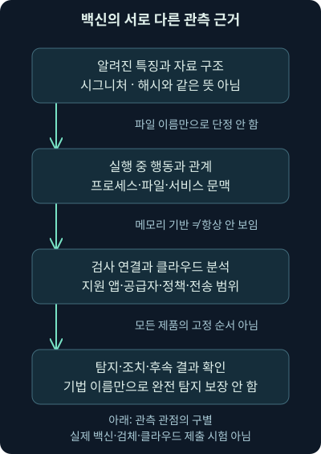
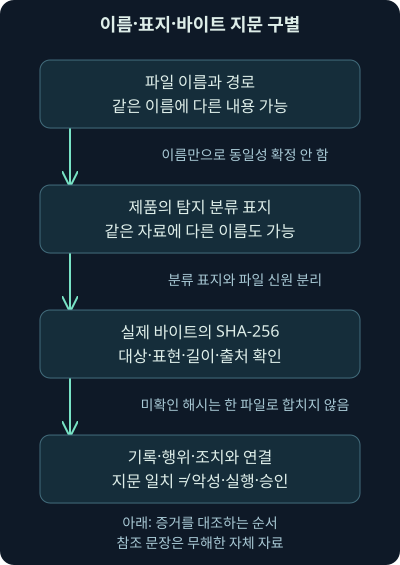
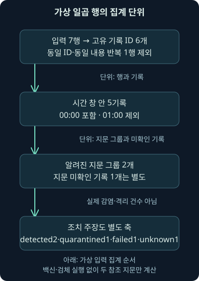

## 1. “트로이 목마 탐지”라는 한 줄 뒤에는 여러 질문이 남습니다

앞 강의에서 연결 허용·차단과 실제 로그인·실행의 결과를 나눴습니다. 이번에는 가상 보안 화면에 탐지 표지가 한 줄 떴다고 해봅시다. 파일이 악성이라는 확정일까요? 실행됐을까요? 격리됐을까요? 다른 단말에도 같은 자료가 있을까요? 화면의 짧은 제목만으로는 모두 답할 수 없습니다.

셋째 날 10강은 백신의 시그니처·행동·기계 학습 관점, 메모리와 클라우드 보호의 범위, 탐지 이름·파일 지문·경로·희소성·조치 결과를 연결합니다. 이어 자체 가상 기록을 집계하고 무해한 참조 문장 두 개의 실제 바이트 지문을 비교합니다.

실제 백신 검사나 악성 검체 실행·격리·외부 조회는 수행하지 않았습니다. 자체 입력의 `Training.*` 표지도 실제 제품의 탐지명이 아닙니다. 실제로 계산한 값과 가상으로 적은 주장을 분리해 읽는 연습입니다.

## 2. 경보기의 울림과 무엇이 일어났는지는 다른 질문입니다

건물에서 연기 경보기가 울리면 바로 확인해야 합니다. 그러나 경보기 제목만으로 어느 방에서 무엇이 탔고 누가 다쳤는지까지 알 수는 없죠. 조리 연기나 센서 문제도 있을 수 있고, 경보 후 환기했다고 모든 피해가 복구된 것도 아닙니다.

**백신**, Antivirus 또는 안티멀웨어는 악성 코드나 원치 않는 소프트웨어를 탐지·제한·조치하는 보호 기능을 가리킵니다. 탐지에 쓰는 자료와 검사 시점·조치 방식은 제품·플랫폼·정책에 따라 다릅니다. 파일을 실행하기 전 검사뿐 아니라 실행 중 행위와 여러 입력을 살피는 기능도 있습니다.

비유와 달리 컴퓨터에서는 같은 파일이 여러 이름·위치로 복사되고, 실행 중에 바뀌거나 메모리 자료로 나타날 수 있습니다. 한 줄을 세는 것과 고유 파일·단말·프로세스·사건을 세는 것은 다릅니다. 먼저 무엇을 세거나 확인하려는지 질문을 정해야 합니다.

## 3. 시그니처는 알려진 특징을 찾고, 행동 분석은 동작을 살핍니다

**시그니처**는 알려진 악성 자료의 특징을 식별하는 규칙이나 표지입니다. 바이트 패턴·구조 등 여러 형태가 가능하며 파일 전체의 해시와 반드시 같은 뜻은 아닙니다. 이미 알려진 것을 일관되게 찾는 데 도움이 되지만 새 변형·포장·환경 변화로 관측이 달라질 수 있습니다.

**행동 분석**은 프로세스·파일·서비스 등의 활동과 관계를 살펴 위험한 동작의 단서를 찾는 방식입니다. 이름을 바꿔도 비슷한 행위를 관측할 기회가 있다는 장점이 있죠. 하지만 정상 관리 도구도 비슷한 동작을 할 수 있으므로 문맥·정책·후속 자료를 함께 검토합니다.

2026-11-07 [Microsoft의 현재 행동 모니터링 설명](https://learn.microsoft.com/en-us/defender-endpoint/behavior-monitor)을 확인했습니다. 실시간 프로세스·파일·서비스 관측 등은 알려진 파일 특징만 확인하는 것과 다른 근거를 제공합니다. 해당 문서의 기능 설명이 모든 백신·모드·운영체제에서 같은 탐지를 보증하는 것은 아닙니다.

## 4. 기계 학습이 들어갔다고 모든 새 악성 코드를 아는 것은 아닙니다

**기계 학습**은 학습 자료에서 얻은 특징과 모델로 새 입력을 분류·평가하는 방법입니다. 예를 들어 구조·행위의 조합이 알려진 위험 사례와 닮았는지 살필 수 있습니다. 일치하는 특정 문자열 하나만 찾는 방식과는 다른 판단 근거입니다.

2026-11-07 [Microsoft의 현재 차세대 보호 개요](https://learn.microsoft.com/en-us/defender-endpoint/next-generation-protection)를 확인했습니다. 로컬·클라우드의 모델과 행동·휴리스틱 등 여러 기법을 함께 사용한다고 설명합니다. **휴리스틱**은 미리 정한 특징·경험적 규칙을 이용한 판단으로 이해하면 됩니다. “옛 제품은 모두 시그니처뿐, 새 제품은 전부 시그니처가 없음”이라는 이분법으로 설명하지 않습니다.

파일이 계속 달라지는 **다형성**도 특징 기반 검사의 어려움을 설명하는 개념입니다. 그러나 변화가 있다고 모든 보호를 쉽게 우회한다거나, 모델이 있으면 모든 변형을 차단한다고 단정하지 않습니다. 제품 상태·지원 기능·정책·업데이트·관측 범위와 실제 성능 근거가 필요합니다.

## 5. 메모리에만 있으면 백신이 절대로 못 볼까요?

파일이 디스크에 쓰이지 않으면 그 파일을 대상으로 한 디스크 검사의 기회가 달라질 수 있습니다. 하지만 메모리·스크립트·행동을 관측하는 다른 경로까지 자동으로 사라지는 것은 아닙니다. “메모리 기반=무탐지”는 정확한 등식이 아닙니다.

**AMSI**, Antimalware Scan Interface는 애플리케이션이 안티멀웨어 제품과 검사 자료를 연결할 수 있게 하는 Windows 인터페이스입니다. 2026-11-07 [공식 AMSI 설명](https://learn.microsoft.com/en-us/windows/win32/amsi/antimalware-scan-interface-portal)을 대조했습니다. 파일뿐 아니라 메모리·스트림 자료 등의 검사 연결을 지원한다는 점이 중요합니다.

그렇다고 AMSI가 장비의 모든 메모리를 완전하게 감시하거나 모든 실행 경로를 검사하는 것은 아닙니다. 호출하는 앱·검사 공급자·지원·정책·가시성을 확인해야 합니다. 이번에는 메모리나 스크립트를 백신에 제출하거나 우회·보호 해제 실험을 하지 않았습니다.



그림에서 여러 관측이 있다는 것과 해당 장비에서 모두 동작했다는 것을 나눠주세요. 예방·탐지·사후 조치의 시점도 다릅니다. 설치 단계 이전에만 백신이 의미 있다고 제한하지 않습니다.

## 6. 설치된 백신, 활성 보호, 중앙 센서는 같은 상태가 아닙니다

제품 목록에 이름이 있다는 사실은 출발점입니다. 실제 엔진·플랫폼·보안 정보 갱신, 실시간·행동 보호, 예외·오류·운영 모드와 중앙 전달 상태를 확인해야 합니다. 오래된 스캔 성공 보고가 현재의 모든 기능을 증명하지도 않습니다.

2026-11-07 [Microsoft의 다른 보안 제품과의 호환성 문서](https://learn.microsoft.com/en-us/defender-endpoint/microsoft-defender-antivirus-compatibility)를 확인했습니다. Defender의 활성·수동·사용 안 함 상태는 Windows 종류, 다른 제품과 관리 환경 등에 따라 달라질 수 있습니다. Windows 클라이언트와 Server, 관리 등록 조건을 한 줄로 합치지 않습니다.

**EDR**, Endpoint Detection and Response는 단말의 활동을 수집·탐지·조사·대응에 연결하는 기능 범주입니다. 백신 검사와 관련될 수 있어도 완전히 같은 이름은 아닙니다. 한쪽의 등록·센서 상태를 다른 쪽의 모든 예방 기능이 활성이라는 근거로 사용하지 마세요. 실제 설치·정책 변경은 이번에 수행하지 않았습니다.

## 7. 탐지명은 조사할 표지이지 파일의 신원 증명서가 아닙니다

백신 기록의 **탐지명**은 제품이 붙인 분류 표지입니다. 일반적인 이름이라고 중요하지 않은 것도 아니고, 유명한 이름이라고 특정 공격 조직·침해 경로가 확정된 것도 아닙니다. 엔진·판본·시점에 따라 같은 자료에 다른 표지가 붙을 수도 있습니다.

자체 예제로 `Training.Generic`이라는 표지가 한 줄 나오고, 처음 본 `Training.Rare`가 한 줄 나온다고 합시다. 두 이름은 여기서 만든 허구입니다. 이름의 희소성은 검토 순서를 정할 단서일 수 있지만 자료의 악성 여부·심각도·실행 여부를 결정하지 않습니다.

이름과 함께 대상 경로·파일 지문·프로세스·계정·시각·탐지 원천·엔진과 보안 정보 판본·조치 상태를 보세요. 이 필드가 모든 제품의 모든 기록에 항상 있는 것은 아닙니다. 비어 있는 값은 원문·제품 설명과 대조하고 추정으로 채우지 않습니다.

## 8. 같은 파일 이름과 같은 바이트를 구별해봅시다

서로 다른 두 파일이 모두 `report.txt`라는 이름일 수 있습니다. 반대로 같은 자료를 `report.txt`에서 `renamed.txt`로 이름만 바꿀 수도 있죠. 경로도 여러 계정·단말에서 겹칩니다. 이름과 위치는 중요한 문맥이지만 바이트의 동일성을 혼자 증명하지 않습니다.

**해시**는 바이트 자료에서 계산하는 고정 길이의 지문입니다. 이번에는 SHA-256을 사용합니다. 같은 입력 바이트라면 같은 계산 결과가 나오고, 한 바이트가 달라지면 대조 결과가 달라질 수 있습니다. 지문이 같다는 것은 내용 대조의 강한 근거이지만 출처·실행·악성 목적·업무 승인을 뜻하지 않습니다.

해시 비교 전에는 전체 파일·압축 내부 객체·메모리 영역 중 무엇을 계산했는지도 붙입니다. 서로 다른 표현을 해시했다면 원래 같은 자료에서 나왔어도 값이 다를 수 있습니다. 해시가 없다는 결과를 빈 문자열이나 공통 지문으로 채워 “동일 파일 한 개”로 묶지 않습니다.



## 9. 처음 보는 파일과 낮은 평판을 어떻게 읽을까요?

**평판**은 특정 수집 범위와 기준에서 그 자료가 얼마나 알려졌고 어떤 평가를 받았는지의 정보입니다. **처음 관측**이라는 말에도 “이 조직·이 센서·이 업체가 이 시각에 처음 봤다”는 범위를 붙여야 합니다. 전 세계 누구도 본 적 없다는 뜻은 아닐 수 있습니다.

새로 만든 사내 프로그램, 드문 전문 도구, 조직 내부에서만 쓰는 파일도 희소할 수 있습니다. 희소성을 무시하지 않되 악성으로 자동 번역하지 않습니다. 배포·서명·소유자·업무·수집 범위와 실제 동작을 확인합니다. 흔한 파일도 오용될 수 있어요.

서명도 게시자·서명 검증의 단서이며 모든 동작의 무해성을 보증하지 않습니다. 여러 엔진의 이름·탐지 수·평판을 대조하더라도 독립적인 근거인지, 같은 자료와 시각을 보는지 살핍니다. 이번에는 외부 평판 서비스를 조회하거나 자체 파일을 제출하지 않았습니다.

## 10. 클라우드 보호와 검체 전송은 무엇이 다를까요?

2026-11-07 [Microsoft의 클라우드 보호 설명](https://learn.microsoft.com/en-us/defender-endpoint/cloud-protection-microsoft-defender-antivirus)을 확인했습니다. 로컬 보호에 클라우드의 분석·갱신 정보를 더하는 원리입니다. “클라우드에 저장한 파일만 보호한다”는 의미가 아닙니다. 실제 효과에는 장비·정책·연결·지원 조건이 관련됩니다.

**검체**, 샘플은 분석 대상으로 다루는 자료 사본입니다. [현재 검체 제출 문서](https://learn.microsoft.com/en-us/defender-endpoint/cloud-protection-microsoft-antivirus-sample-submission)를 같은 날 확인했습니다. 메타데이터 질의와 파일 사본 요청·전송을 구별하고 제출 정책에 따른 동작을 설명합니다. **메타데이터**는 파일·프로세스 등에 관한 속성 정보입니다. 해시 조회와 실제 파일 업로드를 같은 공개 범위로 보지 않습니다.

실제 조사에서는 조직의 자료 취급·제출 정책, 개인·기밀 정보와 수신 서비스의 처리 범위를 확인합니다. 보호를 임의로 끄라는 뜻이 아니라 무엇이 어느 조건으로 나가는지 이해하자는 이야기입니다. 이 강의는 외부 파일 제출·클라우드 설정 변경을 수행하지 않았습니다.

## 11. 탐지·조치 시도·격리 결과·복구를 차례로 나눕니다

“탐지했다”는 기록은 제품이 어떤 자료나 행위를 분류했다는 근거입니다. “조치를 시도했다”와 “조치가 성공했다”는 또 다릅니다. 격리 성공이 있어도 이전 실행·다른 사본·계정 오용·지속 설정과 이미 전달된 자료의 영향이 모두 사라졌다고 결론 낼 수는 없습니다.

2026-11-07 [Defender 이벤트 설명](https://learn.microsoft.com/en-us/defender-endpoint/troubleshoot-microsoft-defender-antivirus)의 1116·1117·1118 항목을 대조했습니다. 탐지·조치·조치 실패를 구별하고, 1117도 실제 Action과 상태를 읽어야 합니다. 문서에는 허용 같은 비제거 조치 사례도 있으므로 숫자만 보고 “치료 완료”로 바꾸지 않습니다. 적용 OS·제품·이벤트 판본과 원문을 확인해야 합니다.

프로세스 종료·파일 격리·재부팅·추가 검사 중 무엇이 요구됐고 무엇을 완료했는지 따로 기록합니다. 성공 상태라면 어떤 객체에 대한 성공인지도 좁힙니다. 검체를 복원하거나 실행해 확인하는 행동은 이 강의의 실습에 포함하지 않습니다.

## 12. 조회 명령에서도 개별 탐지와 묶인 위협 목록이 다릅니다

다음은 지원되는 Windows 환경의 읽기 문법 예시이며 이번 작성에서 실행하지 않았습니다.

```powershell
Get-MpThreatDetection
```

`Get`은 읽기, `MpThreatDetection`은 Defender에 기록된 개별 탐지 정보를 조회하는 명령 이름입니다. 2026-11-07 [현재 스캔 결과 확인 문서](https://learn.microsoft.com/en-us/defender-endpoint/review-scan-results-microsoft-defender-antivirus)를 대조했습니다. 같은 위협의 여러 탐지를 각각 보여주는 것과 `Get-MpThreat`처럼 위협 단위로 묶인 목록은 다른 결과입니다.

이 명령을 읽었다고 장비의 실제 기록·검사 범위·조치 성공을 확인한 것은 아닙니다. 필요한 권한·모듈·장비 상태와 출력 필드를 확인하고 기록 시각·자산·탐지 식별자·원문을 남깁니다. 결과가 비어도 보존 기간·다른 제품·수집 범위·보호 모드·오류를 대조합니다.

## 13. 자체 실습: 탐지 기록을 세고 참조 바이트를 비교합니다

[비교 프로그램](../../assets/network-security/day03-lab10/compare_detections.py), [가상 기록](../../assets/network-security/day03-lab10/records.json), [참조 A](../../assets/network-security/day03-lab10/note-a.txt), [참조 B](../../assets/network-security/day03-lab10/note-b.txt), [실습 안내](../../assets/network-security/day03-lab10/README.txt)를 같은 폴더에 둡니다. 참조 두 개는 영문자·기호 등을 바이트로 표현하는 ASCII로 만든 무해한 자체 문장이고 악성 검체나 백신 테스트 문자열이 아닙니다.

```text
python compare_detections.py records.json note-a.txt note-b.txt
```

첫 파일은 프로그램, 다음은 가상 입력, 마지막 두 파일은 실제 바이트 지문을 구할 참조입니다. Python 3.12.14에서 이 파일들의 읽기·시간 비교·중복 집계·SHA-256 계산을 실제 실행했습니다. 백신 엔진을 호출하지 않습니다.

입력의 `id`는 이 연습에서만 중복을 구별하는 식별자, `time`은 시각, `sha256_claim`은 자료 지문 주장입니다. `name_claim`·`label_claim`은 파일 이름·탐지 표지 주장이고 `action_claim`은 조치 주장입니다. `detected`·`quarantined`·`failed`·`unknown`은 이 입력의 분류 값이며 실제 Defender 이벤트 값을 그대로 복제한 형식이 아닙니다.

같은 ID와 같은 내용의 반복 행은 한 번 세고, 같은 ID인데 내용이 다르면 오류로 남깁니다. 실제 운영에서는 단말·채널·기록 식별자·수집 경로·재생성 등을 함께 고려해야 합니다. 숫자 ID 하나가 전 환경에서 영구적으로 고유하다는 가정을 그대로 옮기지 않습니다.

## 14. 일곱 줄을 다섯 사건이나 두 파일로 읽을 때 질문이 달라집니다

시간 창은 UTC00:00 이상·01:00 미만입니다. `Z`는 UTC를 뜻합니다. 같은 순간을 다른 시간대로 적어도 동일하게 비교하며, 시각이 빠지면 창 밖이라고 단정하지 않고 별도 미확인 목록에 둡니다. 창의 종료를 제외하는 이유는 앞 강의와 같습니다.

| 자체 입력 | 지문·표지·조치 주장 | 집계에서 볼 점 |
| --- | --- | --- |
| D1 | A 지문·Generic·detected | 시작 시각 포함 |
| D2 두 번 | A 지문·Variant·quarantined | 같은 ID·같은 내용 반복은 한 번 |
| D3 | B 지문·Rare·failed | D1과 이름은 같고 바이트 지문은 다름 |
| D4 | A 지문·Generic·detected | 정확히 종료 시각이어서 제외 |
| D5 | 지문 null·Generic·unknown | 다른 지문과 묶지 않고 미확인으로 셈 |
| D6 | A 지문·Generic·detected | 같은 자료 주장이어도 별도 ID의 기록 |

기본 입력의 실제 집계는 입력 7행, 동일 반복 1행, 고유 기록 ID 6개, 시간 창 안 5기록이었습니다. 그 안에 알려진 지문 그룹은 2개이고 지문 미확인 기록은 1개입니다. `known_hash_groups`와 `unknown_hash_records`가 각각 그 수입니다. 미확인 1개를 세 번째 고유 파일이라고 확정하지 않습니다.

표지별로는 Generic 3·Variant 1·Rare 1, 조치 주장별로는 detected 2·quarantined 1·failed 1·unknown 1입니다. 이는 서로 다른 집계 축입니다. 한 줄의 격리 주장이 실제 감염 한 건을 해결했다는 계산으로 이어지지 않습니다.



## 15. 실제 계산한 두 참조 문장의 지문을 확인합니다

참조 A는 끝 줄바꿈 LF 한 바이트를 포함한 `Training example A.` 문장이고 B는 A 대신 B가 들어갑니다. 각 파일은 실제 20바이트입니다. 이름만 보지 않고 바이트를 읽어 SHA-256을 구했으며 두 값은 달랐습니다.

```text
A: 5724346e3411a70d66b12814df70ef062a060e6bb594dc6a38786d825e57cd6e
B: 4266dd9887b6a238860e24bf92b49685b13561b49c2ad698f384387b409269ae
```

`reference_files`는 실제 읽은 파일의 이름·길이·지문입니다. `reference_claim_matches`는 가상 기록의 지문 주장이 이 두 참조 중 하나와 같은지 비교한 값입니다. D1·D2·D3·D6은 참, 지문이 빠진 D5는 미확인이었습니다. 이름이 다르거나 같아도 이 비교는 바이트 지문에 근거합니다.

참조 A를 다른 이름으로 복사하면 바이트가 같아 대조가 유지되고, 한 글자를 C로 바꾼 자체 변형에서는 A를 주장하던 기록과의 대조가 거짓이 됐습니다. 실제 수행한 비교입니다. 그러나 그 변화가 바이러스의 생성·탐지·격리를 실험한 결과는 아닙니다. JSON에 지문을 적은 것이 원격 장비의 실제 파일 출처를 증명하지도 않습니다.

## 16. 결과가 드물거나 비어 있을 때도 관측 범위를 되짚습니다

평소와 다른 표지·경로·사용자·파일이나 조치 실패는 우선 검토할 단서가 될 수 있습니다. 먼저 원문과 식별자·시각을 보존하고, 자산 역할·배포·프로세스·파일·계정·후속 연결과 연관 단말을 대조합니다. 승인된 내부 도구라는 가설과 침해 가설 모두 근거로 검토합니다.

“검사에서 안 나왔다”면 어떤 범위·엔진·업데이트·모드·예외로 검사했는지 확인합니다. 파일이 이미 없어졌거나 다른 컨테이너·메모리·암호화 자료를 보지 못한 경우, 오류·전달·보존 문제가 있을 수 있습니다. 음성 결과는 그 검사 범위에서의 결과이지 전 환경의 무침해 증명이 아닙니다.

입력의 `schema`는 자체 형식 표지, `external_actions`는 외부 동작을 하지 않는 가상 계약입니다. 프로그램은 실제 검사·탐지·격리 값은 거짓, 사건 결론은 미결로 출력합니다. 실제 Defender EVTX나 원본 워크북을 분석한 결과로 표현하지 않습니다. 다음 회차에서는 파일의 존재와 실행 허용을 구별하는 실행 통제로 이어갑니다.

## 17. 복습: 이름·지문·기록·조치를 나눠봅시다

### 질문 1. 백신은 파일이 설치되기 전 단계에만 의미가 있나요?

**해설:** 검사 시점과 관측 기능은 다양합니다. 실행 중 행위·스크립트·여러 입력을 관측하는 기능도 있으며 제품과 모드별 범위를 확인합니다.

### 질문 2. 시그니처와 파일 전체 SHA-256은 항상 같은 뜻인가요?

**해설:** 시그니처는 알려진 특징을 식별하는 규칙·표지이고 전체 파일 지문보다 넓은 개념입니다. 어떤 대상을 검사·비교했는지 붙여야 합니다.

### 질문 3. 기계 학습 제품이면 처음 보는 악성 파일을 모두 차단하나요?

**해설:** 모델·입력·운영 상태·정책·가시성에 한계가 있습니다. 기법 이름만으로 모든 새 위협의 차단을 보증하지 않습니다.

### 질문 4. 메모리에만 있는 코드는 항상 안 보이나요?

**해설:** 디스크 파일 검사와 메모리·스트림·행동 관측은 다릅니다. 실제 앱과 검사 공급자가 어떤 자료를 볼 수 있는지 확인합니다.

### 질문 5. 제품이 설치돼 있고 중앙에 등록됐다면 모든 예방 기능도 켜졌나요?

**해설:** 설치·등록·활성 모드·개별 기능·업데이트·전달 상태가 다릅니다. 실제 지원 환경과 설정·오류를 확인합니다.

### 질문 6. Generic이라는 이름은 중요하지 않으니 무시해도 될까요?

**해설:** 분류 이름과 사건의 중요도는 다릅니다. 경로·지문·행동·계정·희소성·조치 실패 등 문맥을 함께 봅니다.

### 질문 7. 업체가 처음 봤다는 파일이면 전 세계 최초 악성 코드인가요?

**해설:** 관측 업체·조직·시간과 자료 범위를 붙여야 합니다. 새 사내 빌드 등 정상 가설도 확인해야 합니다.

### 질문 8. 같은 report.txt면 같은 바이트인가요?

**해설:** 다른 내용도 같은 이름을 쓸 수 있습니다. 자체 예제 D1과 D3은 같은 이름이지만 서로 다른 참조 지문을 주장합니다.

### 질문 9. 이름이 바뀐 D2는 D1과 다른 내용인가요?

**해설:** 가상 기록의 지문 주장은 같습니다. 실제 참조 파일도 이름만 바꾼 복사본은 바이트 대조가 유지됐습니다. 출처·실행 여부까지 증명한 것은 아닙니다.

### 질문 10. 해시가 없으면 모두 하나의 미상 파일로 묶나요?

**해설:** 동일성 근거가 없으므로 미확인 기록을 별도로 셉니다. 같은 파일일 수도, 여러 파일일 수도 있습니다.

### 질문 11. 클라우드 평판 질의와 파일 사본 제출은 같나요?

**해설:** 전송하는 자료와 처리 범위가 다릅니다. 실제 정책·자료 취급·수신 서비스의 범위를 확인해야 합니다.

### 질문 12. 1117이라는 번호만 있으면 치료 완료인가요?

**해설:** 조치 종류·상태·오류·대상을 읽어야 합니다. 허용 같은 비제거 조치도 가능하며 다른 사본·이전 실행은 별도 조사합니다.

### 질문 13. 입력 7행을 감염 7건이라고 보고하면 왜 틀리나요?

**해설:** 반복 행·종료 시각 제외·같은 자료의 여러 기록이 섞였습니다. 이 입력은 실제 감염 자료도 아니며 집계 단위부터 다릅니다.

### 질문 14. 알려진 지문 그룹 2개와 미확인 기록 1개면 고유 파일 3개인가요?

**해설:** 미확인 기록의 동일성을 모르므로 확정할 수 없습니다. 두 그룹과 미확인 한 기록이라고 범위 그대로 적습니다.

### 질문 15. 같은 ID인데 내용이 다르면 앞선 줄을 버려도 되나요?

**해설:** 자체 프로그램은 충돌 오류로 남깁니다. 실제 수집에서도 원문·수집 경로·복합 식별자를 대조해 조용히 다른 증거를 지우지 않습니다.

### 질문 16. 한 바이트 변경으로 지문이 달라진 실습은 백신 우회 실험인가요?

**해설:** 무해한 문장의 실제 바이트 지문 비교입니다. 백신을 호출하거나 악성 코드·탐지·우회를 시험하지 않았습니다.
