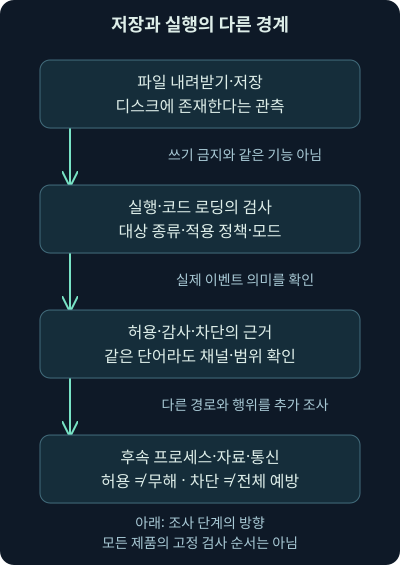
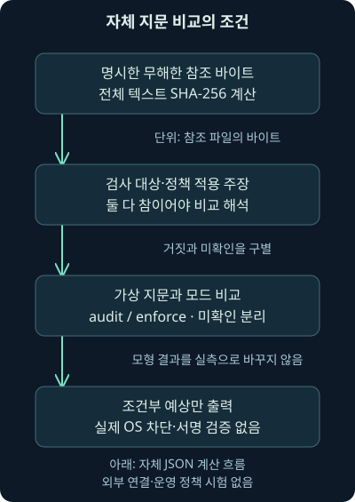
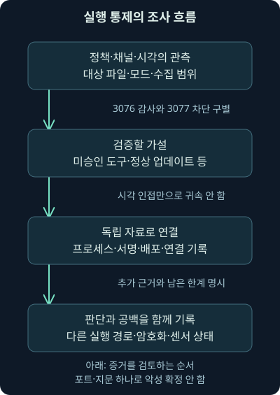

## 1. 내려받은 파일은 있는데 실행되지는 않았습니다

지난 10강에서는 백신의 탐지와 조치 기록을 나누어 읽었습니다. 이번에는 가상 직원 단말 `192.0.2.25`에 낯선 프로그램이 내려받아졌지만, 실행 통제가 작동했다는 보고가 들어왔다고 해봅시다. 파일이 존재하는데도 실행은 막힐 수 있을까요? 반대로 실행이 허용됐다면 안전한 프로그램이라는 뜻일까요?

이 질문을 풀려면 파일을 저장하는 행위, 프로그램을 시작하거나 코드를 불러오는 행위, 실행 뒤 자료에 접근하는 행위를 구별해야 합니다. 이번 셋째 날 11강의 범위는 실행 허용 기준과 적용 대상, 감사와 차단, 우회·오용의 원리, 그 결과를 조사하는 방법입니다. 다음 12강에서는 파일과 자동 실행 설정의 변화를 연결합니다.

여기서 제시하는 조직·주소·사건은 모두 자체 가상 사례입니다. 내려받는 실습은 무해한 문장의 바이트 지문과 가상 조건을 비교할 뿐입니다. 실제 App Control·AppLocker 정책을 조회·배포하거나 프로그램 차단을 시험한 결과로 읽지 마세요.

## 2. 공구실에서 사용할 도구를 정하는 이유

공구실에 들어갈 수 있는 직원이라고 모든 도구를 업무에 써도 되는 것은 아니죠. 용도가 확인된 도구만 쓰게 하고, 새 도구는 담당자가 검토한 뒤 추가할 수 있습니다. **애플리케이션 통제**, 이 강의에서 말하는 실행 통제도 조직이 정한 조건으로 코드의 실행·로딩을 제한하는 접근입니다.

**허용 목록**은 실행을 허용할 대상을 조건으로 정한 목록입니다. 알려진 나쁜 것을 찾아 막는 관점과 달리, 무엇을 허용할지 먼저 정합니다. 다만 “목록에 없으니 악성”은 아닙니다. 새 업무 도구나 아직 검토하지 않은 정상 업데이트도 목록 밖일 수 있습니다.

공구 비유와 다른 점도 있습니다. 프로그램 하나가 다른 모듈을 불러오거나 스크립트를 해석할 수 있고, 정상 도구도 잘못된 목적으로 사용될 수 있어요. 따라서 출입문 하나만 생각하지 말고 어떤 실행 경로와 코드 종류를 검사하는지 확인해야 합니다. 실행 통제가 일반적인 파일 쓰기 금지와 같은 기능인 것도 아닙니다.



그림에서 파일의 존재와 실행 판정을 별도 상자로 읽어주세요. 실행이 거부돼도 디스크에 파일이 남을 수 있습니다. 반대로 파일이 사라졌다는 사실만으로 실행 통제가 차단한 것이라고 결론 내릴 수는 없습니다. 삭제·격리·수집 누락이라는 다른 설명도 확인해야 합니다.

## 3. 파일 이름, 경로, 서명, 지문은 다른 질문에 답합니다

가상 도구의 표시 이름이 `report-helper.exe`라고 합시다. 이름은 사람이 파일을 찾기 편하게 붙인 표지입니다. 같은 이름에 다른 내용이 들어갈 수 있고 이름을 바꿔도 내용은 같을 수 있습니다. 이름만 비교하는 자체 규칙과 서명 안의 원래 파일 이름을 검증하는 제품 규칙을 혼동하지 마세요.

**경로**는 파일이 저장된 위치입니다. 승인된 설치 폴더에 있는지를 조건으로 삼을 수 있지만, 그 폴더를 누가 쓸 수 있는지도 중요합니다. 일반 사용자가 내용을 바꿀 수 있는 폴더를 넓게 허용하면 위치만으로 신뢰하는 설계에 빈틈이 생길 수 있어요. 파일뿐 아니라 상위 폴더와 실제 경로 해석도 살펴야 합니다.

**디지털 서명**은 키를 이용해 자료와 서명자의 관계를 검증하는 장치입니다. 게시자 이름이 문자열로 적혀 있다는 것과 검증된 코드 서명이 있다는 것은 다릅니다. 인증서의 신뢰·폐기 상태, 서명이 보호하는 범위와 정책 조건을 확인해야 합니다. 검증된 서명도 프로그램의 모든 기능이 업무 목적에 맞고 무해하다는 보증서는 아닙니다.

**해시**, 또는 바이트 지문은 알고리즘으로 자료를 고정된 길이의 값으로 바꾼 것입니다. 여기서는 SHA-256을 사용하며 결과는 보통 64개의 16진수 문자로 표시합니다. 어떤 바이트·형식에 적용한 값인지 명시해야 합니다. 실습의 전체 텍스트 바이트 지문은 Windows의 서명·실행 파일 전용 해시 처리 전체를 재현하지 않습니다.

| 기준 | 작은 예제에서 확인하는 것 | 추가로 필요한 확인 |
| --- | --- | --- |
| 표시 이름 | 이름 문자열이 같음 | 내용·서명·실행 대상의 신원 |
| 경로 | 지정 위치와 일치함 | 쓰기 권한·경로 해석·정책 범위 |
| 게시자 서명 | 서명 검증과 선택한 게시자 조건 | 제품·버전 범위·키와 인증서 상태 |
| 해시 | 지정 알고리즘·표현의 지문 일치 | 참조 자료의 출처·업무 승인·행위 |

이 표의 행들은 같은 강도의 네 가지 안전 등급이 아닙니다. 운영 목적에 따라 조건을 결합하거나 예외를 둘 수 있지만, 그 결합 방식은 실제 정책과 제품에 달려 있습니다. 지문 하나를 고정하면 업데이트 때 관리 작업이 늘고, 게시자를 넓게 허용하면 승인 범위가 커질 수 있다는 차이도 생각해보세요.

## 4. 조건을 하나 더하면 판단이 달라집니다

먼저 “승인된 참조 문장과 같은 바이트인가?”라는 작은 문제만 풉니다. 실습의 `note.txt`는 `Training reference A`라는 자체 문장과 줄바꿈으로 구성됩니다. 실제 그 바이트의 SHA-256을 계산하고, 가상 기록에 기재된 지문과 비교합니다. 파일 이름은 이 비교의 입력이 아닙니다.

이제 조건을 추가하죠. 가상 기록이 검사 대상이며 관련 정책이 적용됐다는 두 주장도 모두 참이어야, 이 모형에서 지문 비교를 해석할 수 있다고 정합니다. **참**은 조건을 충족한다고 기록됨, **거짓**은 충족하지 않는다고 기록됨, **미확인**은 값이 없어서 결정할 수 없다는 뜻입니다. 기록의 참 자체를 독립적으로 검증한 것은 아닙니다.

검사 대상이 아니라고 명시됐다면 `coverage_claim`은 거짓입니다. 값이 빠진 미확인과 구별합니다. 이때 모형은 허용·차단 결과를 예측하지 않습니다. “이 지문 기준으로 해석할 범위를 확인하지 못했다”라고 남깁니다. Windows 정책의 모든 우선순위와 예외를 모사하려는 계산이 아니기 때문입니다.



그림의 마지막 상자에서 계산 결과와 실제 결과를 다시 나눕니다. 같은 입력을 다른 모드로 비교해볼 수는 있지만 실제 차단 사건이 생기는 것은 아닙니다. 이 구분을 지키면 간단한 실습도 조사 보고서의 과장을 줄이는 훈련이 됩니다.

## 5. 감사 모드는 차단을 관찰한 기록이 아닙니다

**감사 모드**는 정책에 맞지 않는 실행을 곧바로 막는 대신 검사 결과를 기록하여 영향과 예외를 살피는 방식입니다. **적용 모드**, 또는 강제 모드에서는 범위에 포함된 실행을 실제로 제한할 수 있습니다. 모드가 다르면 같은 불일치라도 의미가 달라집니다.

예를 들어 새 정상 업데이트의 지문이 허용 목록과 다르다고 합시다. 감사 기간에 그 기록이 나왔다면 업무 영향과 승인 여부를 확인할 기회입니다. 기록에 “차단됐을 것”이 남았다는 이유로 당시 프로그램이 중단됐다고 쓰면 안 됩니다. 실제 실행도 다른 원인으로 실패했을 수 있으므로 반대 방향의 단정도 피합니다.

2026-11-07 확인한 [Microsoft App Control 이벤트 설명](https://learn.microsoft.com/en-us/windows/security/application-security/application-control/app-control-for-business/operations/event-id-explanations)은 CodeIntegrity Operational의 3076을 감사 정책에서 차단됐을 파일, 3077을 적용 정책에서 차단된 파일로 구별합니다. 스크립트·MSI 관련 기록은 AppLocker MSI and Script 채널의 다른 이벤트도 확인해야 합니다. 번호를 모든 채널에 공통 적용하지 않습니다.

실제 조사에서는 공급자·채널·이벤트 버전·시각·정책 식별자·대상 파일·모드·수집 범위를 함께 보세요. 3077 한 건은 해당 검사에서의 차단 근거가 될 수 있지만, 다른 실행 경로가 모두 막혔거나 침해가 전혀 없었다는 결론은 별도입니다. 현재 정책 화면과 사건 시점의 적용 정책도 다를 수 있습니다.

## 6. Windows의 두 기술과 과거 설명의 차이

과거 문서의 WDAC, Windows Defender Application Control은 현재 문서에서 **App Control for Business**라는 이름으로 설명됩니다. **AppLocker**도 존재하지만 두 기능의 적용 범위와 보안 설계·관리 방식은 같지 않습니다. 이름이 비슷하다고 설정·이벤트·우선순위를 섞지 마세요.

2026-11-07 [Microsoft 비교 문서](https://learn.microsoft.com/en-us/windows/security/application-security/application-control/app-control-for-business/appcontrol-and-applocker-overview)를 대조했습니다. App Control은 장비 전체에 적용하는 정책과 드라이버·앱 통제를 설명하고, AppLocker는 사용자·그룹별 조건도 다룹니다. Microsoft는 위협에 대한 강한 보호 목적에서 가능한 경우 App Control을 우선 검토하도록 안내합니다. 이는 실제 조직 장비의 구성을 확인한 결과는 아닙니다.

오래된 “AppLocker 적용은 특정 클라이언트 에디션에서만 가능”이라는 문장도 적용 시점을 확인해야 합니다. 같은 날 확인한 [AppLocker 요구 사항](https://learn.microsoft.com/en-us/windows/security/application-security/application-control/windows-defender-application-control/applocker/requirements-to-use-applocker)은 KB5024351 이후 Windows 10 2004 이상과 Windows 11의 에디션 제한 변경을 설명합니다. 이는 옛 운영체제의 지원 종료를 연장한다는 뜻이 아닙니다. 실제 OS 빌드·업데이트·지원 상태를 따로 확인하세요.

[현재 정책 규칙 문서](https://learn.microsoft.com/en-us/windows/security/application-security/application-control/app-control-for-business/design/select-types-of-rules-to-create)를 2026-11-07 확인하면 기능별 OS 조건도 나옵니다. 예컨대 App Control의 경로 규칙은 사용자 모드 코드에 대한 것이며 커널 드라이버 허용과 같지 않습니다. 기본적인 경로 쓰기 권한 검사와 이를 비활성화하는 옵션도 존재합니다. 경로 규칙이 항상 누구나 쓸 수 있는 폴더를 그대로 신뢰한다고 일반화하지 않습니다.

## 7. 스크립트·설치 관리자·라이브러리는 어디에서 검사될까요?

프로그램은 실행 파일 하나로 끝나지 않을 수 있습니다. **스크립트**는 다른 프로그램이 읽어 동작을 수행하는 코드이며, **라이브러리**는 프로그램이 기능을 빌려 쓰기 위해 불러오는 코드 묶음입니다. Windows의 DLL은 동적 연결 라이브러리입니다. 설치 관리자는 프로그램을 설치·변경하는 경로에 관여합니다.

검사 대상을 실행 파일로만 정했는데 허용된 해석기가 다른 코드를 읽는다면, 그 코드를 어느 기능이 검사하는지 질문해야 합니다. 제품·OS·규칙 모음·스크립트 호스트의 통합 여부가 중요합니다. 공식 이벤트 문서도 모든 제삼자 스크립트 호스트가 App Control과 통합되는 것은 아니라고 설명합니다.

따라서 “스크립트는 언제나 우회한다”와 “실행 파일 하나를 허용했으니 나중의 모든 코드도 검사된다”는 모두 과장입니다. 허용된 프로세스가 불러오는 코드와 동적으로 만들어지는 코드의 보호 조건을 따로 확인하세요. DLL·스크립트 규칙이나 별도 완화 기능의 유무를 실제 수집 자료에 연결해야 합니다.

## 8. 허용된 도구도 다른 목적으로 사용될 수 있습니다

운영체제에 원래 있는 도구로 파일을 옮기거나 다른 코드를 불러올 수도 있습니다. **정상 도구의 오용**은 파일 자체가 변조되지 않아도 발생할 수 있습니다. 허용 목록은 프로그램 신원에 대한 통제이며 모든 명령의 업무 목적까지 자동으로 증명하지는 않습니다.

가상 관리 도구가 원래 승인된 이름·서명·지문을 유지한 채 평소와 다른 사용자 문맥에서 실행됐다고 합시다. 지문 일치 사실은 남기되, 부모 프로세스·명령줄·대상 경로·접속 대상·업무 변경 기록을 이어서 확인합니다. 허용된 파일이라는 이유로 경보를 즉시 닫지 않습니다.

다른 프로세스의 메모리 안에서 코드가 동작하는 경우도 파일 시작 시점의 검사만으로 전부 설명할 수 없습니다. 그렇다고 “한 번 시작되면 어떤 제품도 다시 검사하지 않는다”로 일반화할 수는 없어요. 실제 코드 무결성·메모리 완화·행동 센서·검사 연결이 보호하는 경계를 각각 확인해야 합니다. 이 강의에서는 주입·우회 코드를 실행하지 않습니다.

## 9. 서명된 자료와 해시 충돌을 같은 문제로 묶지 마세요

신뢰한 게시자의 키가 탈취되거나 승인 범위 안의 취약한 도구가 오용되면, 단순히 “서명 있음”만 보는 판단은 부족합니다. 서명 검증·폐기·제품·버전 제한과 취약 드라이버 등 별도 통제를 함께 검토할 이유죠. 지문이 달라지는 업데이트를 정상 변경 절차와 연결하는 것도 필요합니다.

**충돌**은 서로 다른 두 자료의 해시값이 같아지는 경우입니다. 반면 이미 정해진 승인 파일과 같은 해시를 가진 다른 자료를 찾는 문제는 **제2 역상** 문제입니다. 둘은 공격자가 고를 수 있는 조건이 달라요. SHA-1 충돌 사례가 있다는 사실을 임의의 승인 파일을 손쉽게 대체할 수 있다는 말로 바꾸면 안 됩니다.

2026-11-07 [Google·CWI의 2017년 원 발표](https://security.googleblog.com/2017/02/announcing-first-sha1-collision.html)를 확인했습니다. 발표는 특정 SHA-1 충돌 계산의 두 단계에 CPU 6,500년과 GPU 110년 상당의 작업을 설명합니다. 이것은 현재 공격의 공통 소요 시간, SHA-256 공격 비용, 서명 개인 키를 찾는 시간과 같은 값이 아닙니다. 과거 숫자를 영구적인 보안 강도로 사용하지 않습니다.

실습은 충돌을 생성하지 않습니다. 서로 다른 무해한 문장과 참조 지문을 비교하여 무엇을 계산했는지 분명히 하는 데 집중합니다. 알고리즘이 적절해도 최초 참조 자료 자체가 오염됐다면 비교 결과가 사건의 진실을 대신할 수 없다는 점도 기억하세요.

## 10. macOS·Linux의 보호를 같은 목록으로 읽지 않습니다

2026-11-07 [Apple의 Gatekeeper 설명](https://support.apple.com/en-sa/guide/security/sec5599b66df/web)을 확인했습니다. App Store 밖에서 받은 앱 등의 개발자 신원·공증·변조 여부를 확인하는 경로를 설명합니다. **공증**, notarization은 Apple의 검사 절차와 관련됩니다. “App Store 밖이면 전부 unsigned”라는 과거식 단순화는 맞지 않습니다.

Gatekeeper가 조직의 모든 프로그램과 이후 행동을 동일한 허용 목록으로 통제한다는 뜻도 아닙니다. 파일을 받은 경로, OS 버전, 조직 정책과 런타임 보호를 확인해야 합니다. 공증 통과가 알려지지 않은 모든 악성 행동의 부재를 보증하지는 않습니다.

Linux의 **AppArmor**와 **SELinux**는 프로그램이 접근할 자원과 동작을 제한하는 **강제 접근 통제**, 운영체제 정책으로 접근을 제한하는 관점이 중요합니다. 2026-11-07 [SELinux 프로젝트의 설명](https://selinuxproject.github.io/)도 프로세스·파일 등 대상에 대한 정책 적용을 설명합니다. 단순 실행 파일 허용 목록과 일대일로 대응시키지 않습니다. Linux의 통제가 전부 외부 제품에만 의존한다는 설명도 적절하지 않습니다.

2026-11-07 [Ubuntu Server의 AppArmor 문서](https://ubuntu.com/server/docs/how-to/security/apparmor/)를 대조했습니다. 프로그램별 프로파일로 접근을 제한하고 complain과 enforce 모드를 구별합니다. complain을 Windows 감사 모드와 같은 구현이라고 부르지는 않습니다. 명시적 deny 등 세부 규칙과 실제 로그 조건은 해당 문서를 따라야 하며 프로파일이 없는 프로세스까지 자동으로 제한된다고 가정하지 마세요.

## 11. 자체 실습: 지문과 적용 범위 주장을 계산합니다

[비교 스크립트](../../assets/network-security/day03-lab11/compare_control.py), [가상 조건](../../assets/network-security/day03-lab11/cases.json), [무해한 참조 문장](../../assets/network-security/day03-lab11/note.txt), [실습 안내](../../assets/network-security/day03-lab11/README.txt)를 같은 폴더에 저장합니다. Python 3 표준 라이브러리만 사용하며 외부 연결·운영체제 정책 조회·프로그램 실행 기능은 없습니다.

```text
python compare_control.py cases.json note.txt
```

`python`은 스크립트를 읽는 실행기, `compare_control.py`는 자체 비교 코드입니다. 첫 인수 `cases.json`은 가상 주장, 둘째 `note.txt`는 실제 읽어 지문을 계산할 참조 바이트입니다. 인수 순서를 정한 이유는 정책 대상이라고 주장된 파일을 함부로 찾아 실행하지 않고, 우리가 지정한 무해한 참조만 읽기 위해서입니다.

코드는 `hashlib.sha256`으로 참조 지문을 계산합니다. `targeted`와 `policy_applied`는 각각 검사 대상과 정책 적용에 대한 가상 주장입니다. 두 값이 참인 경우에만 `hash_match`를 참조와 비교합니다. 어느 하나가 거짓이면 범위 주장은 거짓, 거짓 없이 미확인이 있으면 범위 주장은 미확인입니다. JSON의 `null`은 미확인으로 씁니다.

`mode`가 `audit`이고 불일치하면 출력 `projection`은 `would_block`입니다. `enforce`이고 불일치하면 `block_if_model`입니다. 이 문자열은 모형의 조건부 예상이며 실측 차단이 아닙니다. 일치하면 `passes_this_hash_check`로만 표시하여 다른 정책 조건까지 허용됐다는 오해를 막습니다.

## 12. 조건을 바꾸어 결과를 해석해봅시다

A1은 참조와 같은 지문에 범위 주장도 모두 참이므로 이 지문 조건을 통과합니다. A2는 다른 지문·감사 모드이므로 `would_block`, A3은 같은 다른 지문·적용 모드이므로 `block_if_model`이 됩니다. A2와 A3의 자료가 악성인지, 실제 코드가 시작됐는지는 이 계산에 들어 있지 않습니다.

A4는 다른 지문이지만 `targeted=false`입니다. 범위 주장은 거짓이고 지문 결과는 해석하지 않아 미확인으로 남깁니다. A5는 `policy_applied=null`이라 범위부터 미확인입니다. 불일치를 발견했더라도 적용되지 않은 규칙으로 실제 차단을 단정할 수 없다는 차이를 보세요.

| 사례 | 범위 주장 | 지문 일치 | 출력의 의미 |
| --- | --- | --- | --- |
| A1 | 참 | 참 | 이 지문 비교만 통과 |
| A2 | 참 | 거짓 | 감사 모형의 차단 예정 |
| A3 | 참 | 거짓 | 적용 모형의 조건부 차단 |
| A4 | 거짓 | 미확인 | 범위 밖이라는 입력 주장 |
| A5 | 미확인 | 미확인 | 적용 정보가 부족함 |

실제 실행한 결과도 자체 자료에 한정됩니다. 안내된 출력은 검증 과정에서 원본 입력의 지문을 보존해 확인합니다. 독자가 `note.txt`의 끝 줄바꿈이나 문자 하나를 바꾸면 실제 바이트 지문이 달라져 A1도 불일치할 수 있습니다. 파일 표시 이름만 바꾸고 같은 바이트를 인수로 주면 지문은 같습니다. 이 차이를 직접 설명해보세요.

## 13. 운영 배포와 사건 조사의 순서를 연결합니다

업무 목록을 파악하고 작은 검증 집단에서 감사 기록을 수집한 뒤 예외와 업데이트 절차를 정리합니다. 회계 마감처럼 평소에 안 쓰는 정상 기능을 놓치면 감사 기간이 길어도 실제 적용 때 문제가 생길 수 있습니다. 관측된 모든 프로그램을 자동 승인하면 이미 오염된 활동까지 기준으로 삼을 위험도 있죠.

실제 적용에는 정책 무결성·배포 상태·되돌릴 수 있는 복구 절차와 책임자가 필요합니다. 이 강의에서는 변경 명령을 실행하지 않았습니다. 업무 영향을 평가한 시험과 실제 배포의 성공 증거는 별도 작업으로 남겨야 합니다. 정책 파일이 저장됐다는 사실과 대상 장비가 그 정책을 실행한 사실도 다릅니다.



그림을 따라 관측 사실·가설·확인할 자료를 나누어 기록하세요. “감사 불일치 이벤트가 수집됐다”는 사실, “승인되지 않은 새 도구일 수 있다”는 가설, “비인가 실행·피해가 있었는가”라는 아직 확인할 결론을 섞지 않는 연습입니다. 파일 원본·배포 기록·서명 자료·프로세스와 센서 상태를 대조합니다.

## 14. 네트워크 기록이 보태는 것과 보태지 못하는 것

가상 단말에서 `updates.example.org` 조회와 `198.51.100.20` 연결이 보였다고 합시다. 연결이 실행 통제 경보 직후라는 사실만으로 차단 대상 파일이 통신을 만들었다고 할 수는 없습니다. 같은 단말의 다른 프로세스·프록시·업데이트 서비스가 원인일 수 있습니다.

단말 프로세스 신원·생성 시각·명령줄·연결 귀속과 서버·프록시·리졸버 기록을 대조해야 합니다. PID, 프로세스 번호는 시간이 지나 재사용될 수 있으니 번호 하나만 붙이지 마세요. 암호화된 패킷은 보통 프로그램의 업무 목적과 실제 처리 결과까지 보여주지 않습니다.

결과가 없다면 경보·프로세스·스크립트·네트워크 중 어떤 자료가 수집됐는지부터 확인합니다. 대상 제외·감사 모드·센서 중단·보존 기간·다른 경로·암호화·패킷 재조립과 필터 설정이 각각 관측 공백의 설명이 될 수 있습니다. “로그가 없으니 실행되지 않음”을 기본 답으로 삼지 않습니다.

## 15. 복습: 조건과 판단을 바꿔보세요

### 질문 1. 파일이 디스크에 있는데 실행 통제가 성공할 수 있나요?

**해설:** 가능합니다. 저장·쓰기와 실행·로딩은 다른 경계입니다. 해당 검사에서의 차단 근거와 다른 실행 경로를 확인해야 하며 파일 존재만으로 통제 실패를 확정하지 않습니다.

### 질문 2. 허용 목록에 없는 새 업무 도구는 악성인가요?

**해설:** 목록 밖이라는 사실은 미승인 또는 미검토 상태의 근거입니다. 정상 신규 도구·업데이트도 가능하므로 출처·승인·행위를 확인해야 합니다.

### 질문 3. 이름을 바꾸면 SHA-256도 바뀌나요?

**해설:** 같은 바이트만 해시한다면 바뀌지 않습니다. 이름 조건과 내용 지문 조건은 다릅니다. 실제 제품이 어떤 표현을 해시하는지도 확인해야 합니다.

### 질문 4. 참조 문장 끝의 줄바꿈 하나가 없어지면 어떨까요?

**해설:** 바이트가 달라져 지문이 달라질 수 있습니다. 화면에서 같은 문장처럼 보여도 전체 바이트 비교의 대상은 같지 않습니다. 실습 참조는 LF 줄바꿈을 포함합니다.

### 질문 5. 서명에 게시자 이름이 보이면 업무 승인이 끝났나요?

**해설:** 아닙니다. 서명 검증·인증서와 제품 범위·업무 승인이 각각 필요합니다. 이름 문자열만 있는 가상 기록은 실제 서명 검증도 아닙니다.

### 질문 6. 감사 이벤트 3076이 있으니 프로그램은 중단됐나요?

**해설:** 해당 채널의 3076은 적용 모드였다면 차단됐을 파일을 뜻합니다. 실제 차단·프로세스 시작·다른 실패 원인은 추가 기록으로 나누어 확인합니다.

### 질문 7. 3077 하나로 침해가 완전히 예방됐다고 써도 될까요?

**해설:** 해당 검사에서의 차단 근거와 전체 침해 여부는 범위가 다릅니다. 이전 실행·다른 파일·허용된 도구의 오용과 후속 행위를 확인해야 합니다.

### 질문 8. A3의 모드만 audit으로 바꾸면 무엇이 달라질까요?

**해설:** 다른 조건이 같다면 조건부 예상은 block_if_model에서 would_block으로 바뀝니다. 실습 모드를 바꾼 것이 실제 운영체제 정책을 바꾸지는 않습니다.

### 질문 9. A4에서 지문이 다르니 차단됐다고 할 수 있나요?

**해설:** 이 모형은 검사 대상이 아니라는 입력을 받아 결과를 해석하지 않습니다. 범위 밖과 적용 여부 미확인을 나누고 실제 다른 통제가 있었는지도 조사해야 합니다.

### 질문 10. 허용 폴더 안의 모든 파일을 신뢰해도 될까요?

**해설:** 누가 쓸 수 있는지와 실제 제품의 경로 규칙 보호가 중요합니다. 사용자 쓰기 가능 경로를 넓게 허용하는 설계와 기본 권한 검사가 있는 구성을 구별합니다.

### 질문 11. 허용된 도구의 지문이 같으면 의심할 필요가 없나요?

**해설:** 신원 일치와 사용 목적은 다릅니다. 부모·명령줄·사용자·대상과 승인 기록을 함께 보면 변조 없는 오용도 조사할 수 있습니다.

### 질문 12. 스크립트와 DLL은 무조건 통제 밖인가요?

**해설:** 아닙니다. OS·제품·규칙 모음·호스트 통합과 옵션에 따라 다릅니다. 반대로 실행 파일 허용만으로 모든 후속 코드를 검사한다고 가정해서도 안 됩니다.

### 질문 13. SHA-1 충돌의 과거 계산량을 SHA-256 대체 공격 시간으로 써도 되나요?

**해설:** 알고리즘과 공격 조건이 다릅니다. 두 자료를 고르는 충돌과 고정된 승인 파일에 대한 제2 역상을 구별해야 하며 서명 키 탈취와도 다른 문제입니다.

### 질문 14. Gatekeeper와 AppArmor는 같은 허용 목록인가요?

**해설:** 다운로드 앱의 신뢰 확인과 프로그램의 자원 접근 제한은 보호 경계가 다릅니다. 제품·OS별 적용 대상과 정책을 확인해야 합니다.

### 질문 15. 실행 경보 직후 HTTPS가 보이면 그 파일의 통신인가요?

**해설:** 시각상 인접만으로 귀속이 성립하지 않습니다. 단말의 프로세스·연결 기록과 프록시·서버 자료를 대조하고 암호화·수집 위치의 한계를 남겨야 합니다.

### 질문 16. 실습 출력으로 무엇을 보고서에 쓸 수 있을까요?

**해설:** 지정한 자체 참조 바이트의 SHA-256과 가상 입력 조건의 비교 결과입니다. 실제 Windows 차단·서명 검증·악성 판정·침해 예방 성공은 실행하지 않았으므로 결론으로 쓸 수 없습니다.
