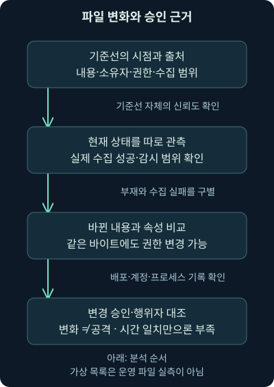
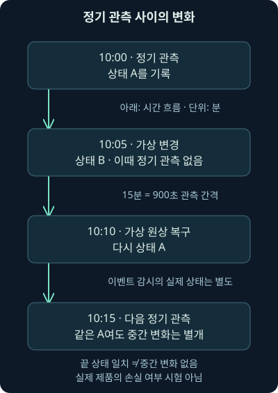
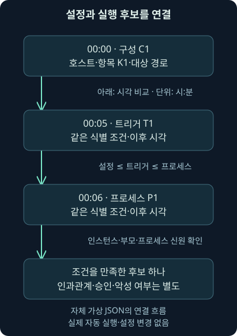

## 1. 정상 배포와 의심스러운 변경은 처음에는 닮아 있습니다

지난 11강에서는 실행을 허용하는 기준과 실제 차단의 증거를 구별했습니다. 그런데 프로그램을 실행하기 전후에 파일이 바뀌었다면 어떨까요? 가상 웹 서버 `192.0.2.60`의 안내 페이지가 어제와 달라졌다는 경보를 생각해봅시다. 정상 배포일 수도 있고, 실수나 비인가 변경일 수도 있습니다.

이번 셋째 날 12강은 파일 무결성 감시의 기준선·내용·속성·관측 공백과 자동 실행 설정 점검을 연결합니다. 변화가 있다는 사실에서 시작해 누가 무엇을 바꾸었는지, 그 설정이 언제 발동해 실제 실행됐는지까지 질문을 확장하겠습니다. 다음 강의의 별도 관리 작업 환경과 단말 방어로도 이어집니다.

자체 사례와 로그는 모두 가상입니다. 실제 실행하는 것은 두 무해한 텍스트 참조의 지문 계산과 JSON 기록의 비교입니다. 운영 파일·레지스트리·작업 스케줄러·서비스·자동 실행 설정을 읽거나 변경하지 않으며 원래 교재의 별도 워크북·VM 실습을 수행했다고 주장하지 않습니다.

## 2. 인수인계 사진과 기준선의 역할

창고를 인수받을 때 물품 사진과 수량, 보관 책임자, 출입 가능한 사람을 기록해두면 나중의 변화를 찾기 쉽죠. 파일도 비교할 출발점이 필요합니다. **기준선**, baseline은 특정 시점과 범위에서 확인해 보관한 참조 상태입니다. 사진을 찍었다는 사실과 창고가 정상이라는 검증은 다릅니다.

**파일 무결성 감시**, FIM은 파일·디렉터리의 내용이나 속성 변화를 감시하는 기능입니다. 해시·크기·소유자·그룹·권한·생성·삭제 같은 항목을 제품과 설정에 따라 비교합니다. **무결성**은 여기서 정한 내용과 상태가 기대대로 유지되는가라는 관점이며, 비밀을 지키는 기밀성과 같은 뜻은 아닙니다.

비유의 한계도 있습니다. 컴퓨터에서는 파일을 짧게 바꿨다가 되돌릴 수 있고, 파일 경로가 같아도 대상이 교체될 수 있습니다. 기준선을 만든 시점부터 이미 오염돼 있다면 나중에 “변화 없음”이 나와도 안전을 증명하지 못합니다. 기준선의 출처·승인·수집 시각·대상·보호 방법을 함께 남겨야 합니다.



그림에서 기준선과 현재 상태를 비교한 뒤 승인 기록을 추가합니다. 변경이 발견됐다는 이유만으로 공격이라고 쓰지 않고, 승인 기록이 있다는 이유만으로 실제 변경의 내용과 시각까지 맞다고 가정하지 않는 순서입니다. 기준선 자체의 신뢰도도 그림 바깥에서 반드시 확인해야 합니다.

## 3. 내용이 같아도 권한은 달라질 수 있습니다

먼저 파일 바이트의 SHA-256이 바뀌었는지 비교합니다. 앞 강의와 같은 알고리즘이지만 질문은 “승인된 실행 파일인가”에서 “이 참조 상태와 내용이 달라졌는가”로 바뀝니다. 같은 도구라도 무엇을 판단하려고 쓰는지 분명히 해야 하죠.

이제 내용 지문은 같지만 쓰기 권한이 넓어졌다고 합시다. **권한**은 누가 읽기·쓰기·실행 등의 동작을 할 수 있는지 정한 조건입니다. 내용 비교만 했다면 이 변화를 놓칠 수 있어요. 소유자·그룹·접근 통제 목록 등 실제 운영체제의 속성도 별도 관측해야 합니다.

실습의 `owner`와 `mode`는 가상의 소유자·권한 표지입니다. 예컨대 `read-only`와 `user-write`는 설명을 위한 문자열이며 실제 Windows ACL이나 Linux 모드 비트를 해석한 값이 아닙니다. 문자열이 바뀌었다는 계산 결과를 실제 권한 획득·침해 성공으로 확대하지 않습니다.

| 비교 대상 | 바뀌면 확인할 질문 | 비교만으로 알 수 없는 것 |
| --- | --- | --- |
| 내용 지문·크기 | 정상 업데이트·변조·다른 표현인가 | 행위자·의도·실행 여부 |
| 소유자·권한 | 관리 절차·쓰기 범위가 바뀌었나 | 실제 사용자가 수행 가능한 모든 동작 |
| 새 경로·삭제 | 배포·정리·수집 실패 중 무엇인가 | 새 파일의 악성 여부·삭제 원인 |
| 기준선과 수집 상태 | 참조가 신뢰 가능하고 수집이 완전한가 | 감시 사이에 일어난 모든 변화 |

표의 마지막 행은 비교 결과를 읽기 전에 필요한 조건입니다. 실패한 수집에서 파일이 안 보인다는 사실과 정상적으로 전체 목록을 수집해 파일 삭제를 확인했다는 사실은 증거의 강도가 다릅니다. 빈 목록을 곧바로 “아무 파일도 없다”라고 해석하지 마세요.

## 4. 정상 변경이 자주 일어나는 곳은 어떻게 볼까요?

가상 사이트 `docs.example.org`의 `/srv/www/notice.txt`가 배포 시간에 바뀌었다고 합시다. 참조 문장 A에서 문장 B로 바뀌고 배포 기록도 같은 대상·시각을 가리킨다면 정상 변경 가설을 지지합니다. 다만 승인 문서의 대상과 실제 바이트가 같은지는 추가로 확인해야 합니다.

시간만 맞으면 충분할까요? 다른 파일이 바뀌었거나 허용된 시간 밖에서 뒤늦게 변경됐을 수 있습니다. 변경 티켓의 대상·책임자·배포 산출물 지문·실제 실행 결과·되돌리기 기록을 함께 봐야 합니다. 웹 서버 접근 기록·배포 시스템·계정 인증과 단말 프로세스 기록이 도움이 됩니다.

새 파일 이름에 수상한 단어가 있거나 확장자가 서버 측 코드라는 사실만으로 웹셸이라고 확정하지 않습니다. **웹셸**은 웹 서버 경로에서 명령 등을 수행하도록 악용되는 코드라는 기능적 개념입니다. 파일의 내용·서버의 실행 처리·요청·프로세스·후속 행위를 확인해야 합니다. 이 강의는 웹셸 코드나 공격 요청을 만들지 않습니다.

## 5. 정기 비교와 이벤트 기반 관측의 빈칸

10:00과 10:15에만 상태를 비교한다고 해봅시다. 10:05에 파일이 변했다가 10:10에 원상 복구되면 두 비교값이 같을 수 있습니다. 이 가상 예의 관측 간격은 15분, 즉 `15 × 60 = 900초`입니다. 끝 상태가 같다는 사실은 중간에 아무 일도 없었다는 뜻이 아닙니다.

**실시간 감시**는 파일 시스템 등의 이벤트를 받아 더 가까운 시점의 변화를 관측하는 방식입니다. 이름에 실시간이 들어가도 손실·지연·범위 제한이 없는 완전한 기록은 아니에요. 감시 자원 한도·이벤트 누락·센서 중단·중앙 전송·보존 기간까지 확인해야 합니다.

2026-11-07 확인한 [Wazuh의 FIM 사용 사례](https://documentation.wazuh.com/current/getting-started/use-cases/file-integrity.html)는 정기·실시간·who-data 관측을 구별합니다. **who-data**는 누가 무엇으로 변경했는지 파악하는 감사 자료를 결합하는 기능입니다. 모든 FIM 결과에 행위자·프로세스가 항상 들어 있다는 뜻은 아닙니다.

같은 날 [Wazuh 기본 설정 문서](https://documentation.wazuh.com/current/user-manual/capabilities/file-integrity/basic-settings.html)는 정기 검사 간격의 초 단위 설정을 설명합니다. 강의의 900초는 원리를 위한 자체 간격이며 실제 설치값이 아닙니다. current 문서의 예시·기본값은 확인 날짜의 문서 값이고 조직의 에이전트 버전·운영 설정은 별도로 대조해야 합니다.



그림을 위에서 아래로 읽으면 시작과 끝이 같아도 중간에 다른 상태가 있었다는 점이 보입니다. 이 예에서 정기 비교가 놓친 것과 실제 제품의 이벤트 기반 감시가 놓쳤는지는 다른 질문입니다. 사건 당시 어떤 모드가 동작했고 건강 상태는 어땠는지 확인해야 합니다.

## 6. 파일 감시와 레지스트리 감시는 범위를 확인해야 합니다

Windows의 **레지스트리**는 운영체제와 프로그램의 구성 정보를 저장하는 체계입니다. 파일 내용을 감시하는 설정만으로 관련 레지스트리 값까지 모두 감시된다고 가정하면 안 됩니다. 제품의 기능과 감시 대상·필드·감사 조건을 확인해야 합니다.

일부 제품은 파일과 레지스트리 감시를 함께 제공합니다. 2026-11-07 [Wazuh FIM 기능 문서](https://documentation.wazuh.com/current/user-manual/capabilities/file-integrity/)를 확인했지만, 그 사실을 모든 감시 경로와 플랫폼에 동일하게 적용하지 않습니다. 파일 내용 비교·접근 감사·구성 변화·현재 상태 조회는 서로 다른 관측입니다.

민감한 구성 파일의 변경 전후 전문을 중앙에 보낼 때는 암호·토큰·개인 정보가 함께 수집될 수도 있습니다. 내용 차이 수집과 지문·속성 수집의 범위를 구별해 정책을 정해야 합니다. 여기서 제공하는 참조는 자체 무해한 문장뿐이며 실제 운영 파일을 업로드하지 않습니다.

## 7. 자동 실행 설정이 다시 접근할 길을 만들 수 있습니다

직원이 로그인할 때 메신저가 자동으로 시작되는 것은 편리합니다. 같은 자동 시작 기능이 비인가 프로그램을 다시 실행하는 데 쓰일 수도 있죠. **자동 시작 확장 지점**, ASEP는 시작·로그인 등 정해진 조건에 따라 코드를 불러오는 구성 지점을 가리킵니다.

시작 폴더·로그인 관련 레지스트리 값·서비스·예약 작업·일부 확장 기능은 살펴볼 후보입니다. **서비스**는 특정 계정 문맥에서 동작하는 관리 기능, **예약 작업**은 설정된 조건에서 동작을 시작하도록 정한 구성이라고 생각하면 됩니다. 모든 항목이 관리자 권한으로 실행되는 것도, 모두 부팅 때만 작동하는 것도 아닙니다.

**지속성**은 재시작이나 접속 중단 뒤에도 접근할 발판을 유지하려는 목적입니다. 2026-11-07 [MITRE ATT&CK Persistence](https://attack.mitre.org/tactics/TA0003/)에서 자동 시작 코드 외에 계정·자격 증명과 관련된 접근도 확인했습니다. 유효한 계정을 계속 쓴다는 것과 자동 시작 파일이 있다는 것은 같은 관측이 아닙니다. 고정된 기법 개수로 범위를 외우지 마세요.

## 8. 설정·발동·프로세스는 세 가지 증거입니다

가상 항목 K1이 로그인 시 `notice-helper`를 시작하도록 구성됐다고 합시다. 이 설정은 실행 기회의 후보입니다. 실제로 로그인 조건이 발생했는지, 항목이 활성 상태였는지, 계정·경로·인수가 맞는지 확인해야 합니다. 구성만으로 실행 성공을 확정하지 않습니다.

**트리거**, 발동 조건 기록이 같은 단말·항목을 가리키더라도 실제 프로세스 시작과 연결해야 합니다. 이번 자체 모형은 설정 시각 이후의 트리거, 그 이후의 프로세스 후보를 같은 호스트·항목·경로로 연결합니다. 시각 순서와 문자열 일치는 인과관계를 완전히 증명하지 않아요. 실제로는 작업 인스턴스·부모·프로세스 고유 신원·명령줄 등의 자료가 필요합니다.

권한도 따로 봅니다. 사용자 본인의 자동 시작은 그 사용자 범위에서 가능할 수 있고, 시스템 서비스나 다른 사용자의 설정에는 다른 권한 조건이 붙습니다. “지속성에는 무조건 관리자 권한이 필요하다”거나 “자동 실행 항목이 있으니 권한 상승도 성공했다”는 결론은 성립하지 않습니다.



그림의 각 상자는 다른 기록에서 확인할 사실입니다. 하나가 없으면 그 단계가 일어나지 않았다는 뜻인지, 원래 수집하지 않았는지 구별해야 합니다. 파일 변경 기록과 구성·프로세스 기록을 결합하면 조사 질문은 좋아지지만 빈칸을 사실처럼 채워서는 안 됩니다.

## 9. Autoruns가 보여주는 것은 무엇일까요?

**Autoruns**는 Windows의 여러 자동 시작 구성 위치를 살펴보는 Sysinternals 도구입니다. 2026-11-07 확인한 [공식 문서](https://learn.microsoft.com/en-us/sysinternals/downloads/autoruns)는 v14.3, 2026-06-17 게시로 표시됐습니다. 이는 확인 시점의 문서 표기이며 이 장비에 설치·실행된 버전이나 영구적인 최신 버전을 뜻하지 않습니다.

항목·대상 경로·게시자·서명 등은 조사 시작점입니다. Microsoft 항목 숨김이나 사용자별 보기 같은 표시 필터를 사용했다면 그 조건을 함께 보관해야 합니다. 필터로 숨겨진 항목을 수집되지 않은 항목과 혼동하면 전체 목록을 잘못 이해할 수 있죠. 서명 검증과 악성 여부도 별개입니다.

아래는 공식 옵션의 뜻을 읽기 위한 예시이며 이번 작업에서 실행하지 않았습니다. 도구의 사용 조건·권한·서명 검증의 부수적인 인증서 확인 통신 등은 실제 환경에서 별도로 검토해야 합니다. 여기서 선택하지 않은 VirusTotal 기능은 뒤에서 따로 구별합니다.

```text
autorunsc -a '*' -c -h -s
```

`autorunsc`는 명령줄 도구, `-a '*'`는 문서가 정의한 자동 시작 범주 전체 선택, `-c`는 쉼표로 구분한 CSV 출력, `-h`는 지문 표시, `-s`는 디지털 서명 검증입니다. 작은따옴표는 PowerShell 같은 셸에서 별표를 인수로 전달하려는 표기입니다. 다른 셸의 인수 처리와 해당 버전의 도움말도 확인하세요. 전체 범주 선택이 모든 사용자·모든 기법·전체 과거 이력 수집을 보장하지는 않습니다.

## 10. 조회와 변경, 해시 조회와 파일 제출을 구별합니다

자동 실행 항목의 체크를 해제하거나 삭제하는 기능은 현재 상태와 업무에 영향을 줍니다. 의심스러워 보인다는 이유만으로 먼저 지우면 정상 기능을 중단하고 조사할 설정을 잃을 수 있어요. 원본 상태·수집 조건·증거를 보존한 뒤 사건 대응 절차와 권한에 따라 조치해야 합니다. 이번 실습은 어떠한 자동 실행 항목도 변경하지 않습니다.

공식 Autorunsc 문서는 `-v` 계열의 VirusTotal 지문 조회와 `s`가 붙는 파일 제출 조건을 구별합니다. `-s` 단독 서명 검증과 `-v`에 결합하는 `s`는 문맥이 다릅니다. 옵션 글자 하나만 보고 같은 동작으로 외우지 마세요.

지문을 외부에 보내는 것과 알려지지 않은 파일 원본을 제출하는 것은 공개 범위가 다릅니다. 조직 파일에는 민감한 내용이 있을 수 있으므로 조회·제출 정책을 먼저 확인해야 합니다. 이 강의와 검증에서는 VirusTotal 조회·파일 전송·도구 내려받기·설치·실행을 수행하지 않았습니다.

## 11. 자체 실습: 파일 상태와 실행 후보를 함께 비교합니다

[비교 스크립트](../../assets/network-security/day03-lab12/compare_changes.py), [가상 상태와 기록](../../assets/network-security/day03-lab12/cases.json), [현재 참조 문장](../../assets/network-security/day03-lab12/note.txt), [실습 안내](../../assets/network-security/day03-lab12/README.txt)를 같은 폴더에 저장합니다. 앞 강의의 참조 문장 파일도 명시적인 인수로 사용합니다. 다른 운영 경로는 찾거나 읽지 않습니다.

```text
python compare_changes.py cases.json ../day03-lab11/note.txt note.txt
```

`cases.json`은 두 가상 목록과 설정·트리거·프로세스 기록입니다. `../day03-lab11/note.txt`에서 `..`는 상위 폴더로 이동한다는 뜻이며, 앞 강의 참조 A의 위치입니다. 마지막 `note.txt`는 이 강의의 참조 B입니다. 폴더를 다르게 저장했다면 두 인수를 실제 내려받은 무해한 참조 위치로 바꾸세요.

코드는 두 참조의 실제 SHA-256을 계산한 뒤 JSON의 `A`·`B` 표지를 그 지문으로 치환합니다. `before`와 `after`는 가상 기준선·현재 목록입니다. 존재하는 모든 파일이 확인됐다는 가정은 `collection_complete` 입력으로 분리합니다. `owner`·`mode`는 실제 운영 권한이 아닌 가상 표지입니다.

`changed`는 비교한 속성이 다른 경로, `added`는 현재 목록에만 있는 경로입니다. 기준선에만 있는 경로는 완전 수집 주장일 때 `missing_if_complete`에 넣고, 불완전 수집 주장일 때 `unresolved_absence`에 남깁니다. 완전 수집도 JSON에 주어진 주장일 뿐이므로 실제 삭제 원인까지 증명하지 않습니다.

## 12. 네 경로의 결과를 각각 읽어봅시다

기준 입력에서 `/srv/www/notice.txt`의 내용은 A에서 B로 바뀝니다. `/srv/app/settings.txt`는 A라는 내용 표지가 같지만 `mode`가 `read-only`에서 `user-write`로 바뀝니다. 둘 다 `changed`에 들어가지만 의미와 필요한 후속 증거는 다릅니다.

현재 목록에만 있는 `/srv/app/new-note.txt`는 `added`, 기준선에만 있는 `/srv/app/retired-note.txt`는 완전 수집 가정에서 `missing_if_complete`입니다. 수집 완전성을 거짓으로 바꿔 실행하면 마지막 경로는 `unresolved_absence`로 이동합니다. 결과를 지우는 대신 미확인 항목으로 보존하는 이유를 생각해보세요.

실제 두 참조 문장의 바이트 지문이 다르다는 결과는 확인할 수 있습니다. 그러나 가상 경로의 실제 파일 내용·권한·생성·삭제는 조회하지 않았습니다. 표지 A가 붙었다는 사실을 해당 운영 파일이 참조 A였다는 측정으로 바꾸지 않는 것이 이 실습의 핵심입니다.

## 13. 실행 후보 하나와 빠진 근거를 읽습니다

K1은 같은 가상 호스트·항목·대상 경로에서 설정 00:00, 트리거 00:05, 프로세스 00:06으로 주어집니다. 코드는 `설정 시각 ≤ 트리거 시각 ≤ 프로세스 시각` 조건을 비교하여 후보 하나를 만듭니다. `≤`는 왼쪽 시각이 같거나 더 이르다는 뜻입니다. 같은 시각도 포함하지만 실제 동작 순서를 그 정밀도로 안다는 뜻은 아닙니다.

K2에는 설정만 있고 대응 트리거가 없습니다. 후보가 없다는 사실은 이 입력에서 연결할 기록을 못 찾았다는 뜻입니다. 실행이 절대로 없었다거나 무해한 항목이라는 결론은 아닙니다. 모형은 활성화 상태·작업 인스턴스·자격 증명·프로세스 신원까지 검증하지 않습니다.

다른 호스트의 트리거, 다른 경로의 프로세스, 설정보다 이른 발동을 넣으면 후보에서 빠집니다. 시간대가 붙은 시각을 UTC라는 기준으로 변환하므로 `00:05+00:00`과 `11:05+11:00`은 같은 순간으로 비교됩니다. 시간대 없는 시각은 임의 지역으로 추정하지 않고 오류 처리합니다. 실제 장비 시계 오차와 수집 지연은 여전히 별도 조사 대상입니다.

## 14. 실제 조사에서는 변경 승인과 통신 결과를 더합니다

파일 변화와 실행 후보가 함께 보이면 배포 기록·계정 인증·설정 변경 감사·프로세스 트리·서버 요청을 이어서 확인합니다. 웹 서버의 응답 코드 200은 요청 처리의 한 관측이고 명령 실행·민감 자료 접근을 자동으로 증명하지 않습니다. 앞서 배운 네트워크의 전달·실행 구별과 같은 원리입니다.

통신이 암호화됐거나 센서가 한 방향만 봤다면 본문·요청과 응답·프로세스 귀속이 부족할 수 있습니다. 재조립 실패·표시 필터·기록 보존 기간·자동 실행 목록의 필터도 확인해야 합니다. 파일 감시 경보가 없을 때는 감시 경로·제외·초기 기준선·수집 성공·전송·에이전트 상태를 먼저 보세요.

보고서는 세 문장으로 나누어 쓸 수 있습니다. “수집된 두 가상 목록에서 내용 표지·권한 표지가 달라진 경로 두 개를 계산했다”가 관측 범위입니다. “배포 또는 비인가 변경일 수 있다”가 가설입니다. “실제 변경 원인과 실행·피해는 운영 로그와 산출물 대조가 필요하다”가 남은 결론입니다. 지금 가진 근거보다 넓게 쓰지 않는 습관이 중요합니다.

## 15. 복습: 변화와 지속성을 스스로 구별해보세요

### 질문 1. 기준선과 같으면 안전한가요?

**해설:** 기준선의 출처·시점·정상성부터 확인해야 합니다. 이미 오염된 기준선이나 관측 사이에 복구된 변경은 같은 값이어도 안전을 증명하지 못합니다.

### 질문 2. 내용 지문이 같으면 권한도 같은가요?

**해설:** 아닙니다. 바이트와 소유자·권한은 다른 속성입니다. 실습의 settings 경로는 내용 A가 같아도 권한 표지가 달라 changed로 나옵니다.

### 질문 3. 변경 경보만으로 웹셸을 확정할 수 있나요?

**해설:** 정상 배포·실수·비인가 변경이 모두 가능합니다. 코드 기능·서버 처리·요청·프로세스·후속 행동을 확인해야 하며 이름·확장자 하나는 충분하지 않습니다.

### 질문 4. 15분 간격이면 중간 변경도 모두 남을까요?

**해설:** 정기 상태 비교만으로는 그렇지 않습니다. 두 시점 사이에 바꾸고 복구하면 같은 끝값이 나올 수 있습니다. 15분은 900초이며 사건 당시 관측 모드를 따로 확인합니다.

### 질문 5. 실시간이라고 이벤트 손실이 없나요?

**해설:** 이름만으로 보장되지 않습니다. 감시 범위·제외·자원 한도·센서 상태·전송·보존 기간과 수집 성공을 확인해야 합니다.

### 질문 6. 모든 FIM 경보에 변경한 사용자가 나오나요?

**해설:** 아닙니다. 내용·속성 비교와 행위자 감사는 다릅니다. who-data 같은 기능도 플랫폼·버전·감사 설정과 실제 수집 여부를 확인해야 합니다.

### 질문 7. 빈 현재 목록이면 전부 삭제됐나요?

**해설:** 수집 실패일 수 있습니다. 완전 수집 여부를 확인하지 못했다면 부재는 미확인으로 남기고 실제 삭제 기록·오류를 대조합니다.

### 질문 8. 실습의 collection_complete를 false로 바꾸면 무엇이 바뀌나요?

**해설:** 기준선에만 있던 retired-note가 missing_if_complete에서 unresolved_absence로 이동합니다. 이미 관측한 변화·추가 경로까지 삭제하는 계산은 아닙니다.

### 질문 9. 변경 승인 시간이 맞으니 정상으로 종결할까요?

**해설:** 시간만으로는 부족합니다. 대상·배포 주체·산출물 지문·내용·실행 결과가 승인과 맞는지 확인해야 합니다. 다른 파일이나 추가 변경이 있을 수 있습니다.

### 질문 10. 자동 실행 항목이 있으면 실행도 성공했나요?

**해설:** 구성은 기회의 근거입니다. 발동 조건·활성 상태·실제 프로세스와 인과관계를 더 확인해야 합니다. 설정·트리거·프로세스를 나누는 이유입니다.

### 질문 11. 지속성은 항상 관리자 권한을 요구하나요?

**해설:** 사용자 범위의 자동 시작 등은 그 사용자 권한으로 가능할 수 있습니다. 시스템 전체 항목·다른 사용자·실제 동작마다 권한 조건이 다릅니다.

### 질문 12. 유효 계정 사용은 자동 시작 파일의 증거인가요?

**해설:** 아닙니다. 지속성 목적과 구성 방식은 구별합니다. 계정·인증 자료로 유지한 접근을 파일 ASEP 관측으로 바꿀 수 없습니다.

### 질문 13. Autoruns에서 Microsoft 항목을 숨겼다면 전체 목록인가요?

**해설:** 표시 필터가 적용된 결과입니다. 숨겨진 항목을 없다고 가정하지 말고 사용자·범주·필터·수집 권한을 함께 남겨야 합니다.

### 질문 14. autorunsc의 -s와 -vs는 같은가요?

**해설:** 단독 -s는 서명 검증이고 -v 계열에 결합한 s는 공식 문서가 설명하는 미검사 파일 제출 조건과 관련됩니다. 지문 조회·파일 제출의 공개 범위도 다릅니다. 이번에 실행하지 않았습니다.

### 질문 15. K1 연결 후보 하나는 실제 악성 지속성 한 건인가요?

**해설:** 가상 문자열·시각 조건을 충족하는 후보 하나입니다. 실제 작업 인스턴스·프로세스 신원·원인·승인·행위를 검증하지 않았으므로 악성이나 실행 성공 건수로 쓰지 않습니다.

### 질문 16. 입력에 K2 트리거가 없으면 무엇을 더 요청할까요?

**해설:** 해당 시점·사용자·호스트의 로그인·스케줄러·서비스·프로세스 기록과 센서 수집 상태를 요청합니다. 실행 부재와 기록 부재를 구별하고 필요한 경우 서버·프록시·리졸버 기록도 대조합니다.
