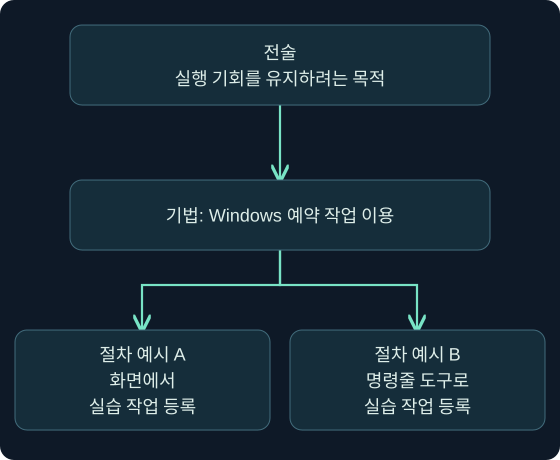

이번 강의에서는 **레드팀의 목적, TTP라는 공격 행동의 구분 방식, 공격자 모방과 시뮬레이션의 차이, 그리고 증거를 해석하는 기본 원리**를 배우겠습니다.

이 과정은 개념을 이해하고, 안내에 따라 적용한 뒤, 조건을 바꿔 판단하는 순서로 이어집니다. 이론 학습은 개념과 배경을 이해하는 단계이고, 안내에 따라 수행하는 실습은 그 원리를 적용하는 단계입니다. 스스로 해결하는 도전 과제에서는 안내 없이 조건을 해석하고 판단합니다. ‘이해하기 → 안내를 따라 적용하기 → 조건을 바꿔 판단하기’를 각각 연결하면서 공부해 보세요.

이 강의에는 별도의 워크북이나 패킷 캡처 파일이 제공되지 않습니다. 아래 사례와 관측 기록은 **설명을 위해 만든 가상 예제**이며, 실제 실습 환경에서 실행하거나 분석한 결과가 아닙니다.

---

## 1. 보안 장비가 많은데, 왜 레드팀 훈련이 필요할까요?

어떤 회사가 보안에 상당한 비용을 투자했다고 생각해 보겠습니다.

직원 컴퓨터에는 보안 프로그램이 설치돼 있고, 네트워크 경계에는 방화벽이 있습니다. 직원 로그인 기록도 수집하며, 의심스러운 활동을 조사하는 담당자도 있습니다.

그런데 담당 임원이 이렇게 묻습니다.

> “직원 계정 하나가 탈취되면, 공격자가 중요 문서에 접근하기 전에 우리가 발견하고 막을 수 있습니까?”

여기서 “보안 프로그램이 설치돼 있습니다”라는 답변만으로는 부족하겠죠. 질문은 제품의 설치 여부가 아니라, **실제 상황에서 방어가 작동하는지**에 관한 것이기 때문입니다.

이 차이는 소방 훈련을 떠올리면 이해하기 쉽습니다.

건물에 화재 감지기가 있다는 사실과, 화재가 발생했을 때 사람들이 안전하게 대피할 수 있다는 사실은 다릅니다. 감지기가 작동해도 경보가 전달되지 않을 수 있고, 경보가 전달돼도 누가 대피를 지시해야 하는지 모를 수 있습니다.

보안에서도 비슷한 문제가 생깁니다.

공격 행동이 기록되더라도 탐지 규칙이 반응하지 않을 수 있습니다. 경보가 발생해도 담당자가 중요하지 않다고 판단할 수 있고, 침해를 정확히 알아냈어도 단말을 격리할 권한이나 절차가 불분명할 수 있습니다.

**레드팀 훈련은 공격자의 행동을 활용해 이 연결이 실제로 작동하는지 평가하는 보안 활동**입니다. 조직의 탐지와 대응 능력을 평가하는 데 목적을 둡니다.

소방 훈련 비유와 실제 보안 훈련 사이에는 차이도 있습니다. 소방 훈련은 대개 정해진 상황을 반복하지만, 공격자는 방어자의 반응에 따라 다음 행동을 바꿀 수 있습니다. 그래서 레드팀 훈련에서는 개별 보안 기능뿐 아니라, 여러 상황을 연결해 판단하고 대응하는 능력이 중요합니다.

### 그러면 침투 테스트와는 어떻게 다를까요?

**침투 테스트, 즉 penetration testing**는 일반적으로 정해진 범위에서 취약점을 찾고, 실제 악용 가능성과 영향을 검증하는 데 초점을 둡니다.

레드팀 훈련은 합의한 공격 시나리오와 목표를 중심으로, 조직의 예방·탐지·대응이 얼마나 효과적인지 살펴보는 데 무게를 둡니다.

예를 들어 같은 서버 접근에 성공하더라도 질문이 달라집니다.

| 평가 관점 | 살펴보는 질문 |
|---|---|
| 침투 테스트의 관점 | 어떤 취약점 때문에 접근할 수 있었고, 어디까지 영향을 미치는가? |
| 레드팀 훈련의 관점 | 목표를 향해 진행하는 동안 조직은 어떤 행동을 발견하고, 어떻게 대응했는가? |

실무에서는 두 활동의 범위가 겹칠 수 있습니다. 침투 테스트에서도 탐지 능력을 검증할 수 있고, 레드팀 훈련에서도 취약점을 발견합니다. 명칭만 보기보다 **그 활동이 어떤 질문에 답하도록 설계됐는지**를 보는 편이 정확합니다.

---

## 2. “관리자 권한을 얻었다”와 “목표를 달성했다”는 왜 다를까요?

이제 앞의 회사 상황을 조금 더 구체적으로 만들어 보겠습니다.

회사가 걱정하는 것은 다음과 같습니다.

> “일반 직원 계정이 탈취되면, 제한된 재무 문서까지 접근할 수 있는가?”

여기서 레드팀이 중간에 강력한 관리자 권한을 얻었다고 해보죠. 이것은 중요한 결과입니다. 하지만 그것만으로 회사의 질문에 완전히 답한 것은 아닙니다.

실제로 재무 문서가 있는 시스템에 접근할 수 있었는지, 문서 접근 권한은 별도로 통제되는지, 접근 과정에서 경보가 발생했는지까지 확인해야 합니다.

“Domain Admin 획득” 자체를 일반적인 최종 목표로 삼지 않는 이유가 여기에 있습니다. **Domain Admin은 Windows 도메인이라는 중앙 관리 환경에서 매우 강력한 관리 권한을 가진 그룹**입니다. 이런 권한은 목표 달성의 수단이 될 수 있지만, 조직이 우려하는 업무상의 피해와 연결해서 해석해야 합니다.

반대 상황도 생각해 보겠습니다.

레드팀이 관리자 권한을 얻지 못했는데, 문서 서버의 권한 설정이 잘못돼 일반 직원 계정으로도 제한 문서에 접근할 수 있었습니다.

이 경우 관리자 권한을 얻지 못했으니 훈련이 실패한 것일까요?

그렇지 않습니다. 회사가 걱정하던 위험은 이미 드러났습니다. 높은 권한을 얻지 않고도 중요 자료에 접근할 수 있었기 때문입니다.

따라서 좋은 목표에는 **출발 조건, 보호할 대상, 검증할 행동, 성공을 판단할 증거**가 드러나야 합니다.

이번 강의의 자체 예제로는 다음처럼 표현할 수 있습니다.

> “일반 직원 계정에서 출발해, 사전에 지정한 재무 문서 서버의 시험용 문서에 접근할 수 있는지 확인한다. 접근 시도부터 보안 담당자의 인지와 대응까지의 과정을 평가한다.”

여기서 시험용 문서를 사용하는 이유도 있습니다. 실제 민감 자료를 대량으로 가져오지 않아도, 합의한 자료를 통해 접근 가능성을 검증할 수 있기 때문입니다. 다만 어떤 증거를 성공으로 인정할지는 훈련 전에 정해야 합니다.

이제 명령어를 배울 때도 질문이 달라집니다.

“이 명령이 실행됐는가?”에 더해, **“이 결과가 우리가 검증하려는 위험에 관해 무엇을 알려주는가?”**를 물어야 합니다.

---

## 3. 공격 행동을 설명하는 공통 언어: TTP

레드팀 보고서를 읽다 보면 **TTP**라는 표현이 자주 나옵니다.

TTP는 다음 세 단어를 묶은 표현입니다.

- **Tactic, 전술:** 무엇을 이루려고 하는가?
- **Technique, 기법:** 어떤 방식으로 이루려고 하는가?
- **Procedure, 구체적인 수행 절차:** 실제 환경에서는 어떻게 구현했는가?

MITRE ATT&CK도 전술을 행동의 이유, 기법을 목표를 달성하는 방법, 절차를 기법의 구체적인 구현이나 실제 사용 사례로 구분합니다. **MITRE ATT&CK은 실제 관측된 공격 행동을 체계적으로 정리한 지식 체계**입니다. [공식 근거: MITRE ATT&CK 기본 개념](https://attack.mitre.org/resources/)

정의만 읽으면 세 가지가 비슷하게 느껴질 수 있습니다. 하나의 상황으로 풀어보겠습니다.

### 3.1 먼저 “왜?”를 생각합니다 — 전술

공격자가 어떤 컴퓨터에서 프로그램을 실행할 수 있게 됐다고 가정해 보겠습니다.

그런데 컴퓨터가 재시작되면 프로그램이 종료됩니다. 공격자는 다음에도 다시 실행할 방법을 원합니다.

이 행동의 목적은 다음과 같습니다.

> “재시작이나 재로그인 이후에도 실행 기회를 유지하고 싶다.”

이처럼 접근이나 실행 능력을 유지하려는 목적을 **Persistence, 지속성**이라고 부릅니다.

여기서 지속성은 특정 프로그램 이름이 아닙니다. **공격자가 이루려는 중간 목적**입니다.

### 3.2 다음으로 “어떤 방식으로?”를 생각합니다 — 기법

Windows에는 특정 시간이나 조건에 맞춰 프로그램을 실행하는 **작업 스케줄러, Task Scheduler**가 있습니다.

정상적인 용도로는 정기적인 백업이나 유지보수 작업에 사용할 수 있습니다. 공격자도 이 기능을 악용해 프로그램이 반복 실행되도록 만들 수 있습니다.

이 경우에는 다음처럼 연결됩니다.

> 목적: 다시 실행할 기회를 유지한다.
> 방법: 예약 작업을 이용한다.

MITRE ATT&CK은 Windows 예약 작업 악용을 **T1053.005, Scheduled Task**라는 하위 기법으로 정리합니다. `T1053`은 상위 기법의 식별자이고, `.005`는 그 안의 Windows 예약 작업에 해당하는 하위 항목입니다. [공식 근거: Scheduled Task](https://attack.mitre.org/techniques/T1053/005/)

여기서 한 가지를 조심해야 합니다.

**예약 작업이 존재한다는 사실만으로 악성 지속성이 확인되는 것은 아닙니다.**

예약 작업은 정상적인 관리 기능이기도 합니다. 어떤 프로그램을 실행하는지, 누가 만들었는지, 업무상 필요한지까지 살펴봐야 합니다.

### 3.3 마지막으로 “실제로 어떻게 했는가?”를 생각합니다 — 절차

같은 예약 작업도 여러 방식으로 만들 수 있습니다.

화면에서 작업 스케줄러를 열어 설정할 수도 있고, 명령줄 도구인 `schtasks.exe`를 사용할 수도 있습니다. MITRE의 해당 기법 설명도 이러한 여러 접근 방식을 구분합니다. [공식 근거: Scheduled Task](https://attack.mitre.org/techniques/T1053/005/)

하지만 절차를 설명하려면 도구 이름만으로는 부족합니다.

이번 강의의 **가상 실습 절차**를 문장으로 표현하면 다음과 같습니다.

> “허가된 실습 VM에서 작업 스케줄러 화면을 열고, 실습 계정이 로그인할 때 무해한 표시 프로그램을 실행하도록 작업을 등록한다. 이후 로그아웃과 로그인을 수행해 실행 여부와 생성된 기록을 확인한다.”

**VM은 Virtual Machine, 가상 머신**의 약자입니다. 물리적인 컴퓨터 안에서 별도의 컴퓨터처럼 동작하는 실습 환경이라고 생각하면 됩니다.

이 예제의 절차에는 도구뿐 아니라 실행 대상, 실행 조건, 사용하는 계정, 확인 방법이 들어 있습니다. 실제로 어떤 일이 일어났는지 재현하려면 이런 맥락이 필요합니다.

### 그림 1. 전술·기법·절차의 관계

아래 화살표는 시간의 흐름이 아니라 **같은 행동을 점점 구체적으로 설명하는 관계**입니다.



위에서 아래로 읽으면 목적이 구체적인 구현으로 바뀝니다. 아래에서 위로 읽으면 관측한 행동이 어떤 방법과 목적에 연결될 수 있는지 생각하게 됩니다.

### 조건을 바꾸면 전술도 달라질까요?

예약 작업을 한 번만 실행하도록 만들었다고 해보겠습니다.

이 작업의 목적이 프로그램을 한 번 실행하는 것이라면 **Execution, 실행**의 관점에서 볼 수 있습니다. 다시 실행할 기회를 유지하려는 목적이라면 지속성에 연결됩니다. MITRE도 예약 작업 하위 기법을 실행·지속성·권한 상승 등 여러 전술과 연결합니다. [공식 근거: Scheduled Task](https://attack.mitre.org/techniques/T1053/005/)

따라서 “예약 작업은 언제나 지속성이다”라고 외우면 해석이 좁아집니다.

**기능의 이름과 행동의 목적을 함께 봐야 합니다.** 특히 방어자는 공격자의 의도를 직접 읽을 수 없으므로, 작업의 설정과 주변 행동이 어떤 해석을 지지하는지 판단해야 합니다.

---

## 4. TTP를 알면 블루팀의 조사가 어떻게 달라질까요?

**블루팀은 조직을 방어하고 보안 사고를 탐지·조사·대응하는 역할**을 합니다.

그 안에서 경보를 모니터링하고 조사하는 조직을 **SOC, Security Operations Centre, 보안관제센터**라고 부릅니다. 조직에 따라 별도 SOC가 있거나, IT 담당자 또는 외부 보안 서비스가 역할을 수행할 수 있습니다. 블루팀은 단말·서버·방화벽 등의 기록을 활용해 활동을 판단합니다.

앞의 예약 작업 사례로 돌아가 보겠습니다.

분석가가 오직 `schtasks.exe`라는 프로그램 이름만 찾는다면 어떻게 될까요?

그 도구를 사용한 경우에는 단서를 얻을 수 있습니다. 하지만 화면이나 다른 인터페이스를 통해 생성한 작업은 그 검색에서 빠질 수 있습니다.

반대로 “예약 작업을 등록하고 실행하는 행동”을 조사한다면 질문이 넓어집니다.

어떤 작업이 생겼는지, 무엇을 실행하도록 설정됐는지, 설정된 조건이 실제로 발생했는지, 실행 이후 어떤 활동이 이어졌는지를 살펴보게 됩니다.

이것이 **도구 이름을 아는 것과 행동을 이해하는 것의 차이**입니다.

다만 행동을 이해했다고 해서 모든 경우를 자동으로 탐지할 수 있는 것은 아닙니다. 필요한 기록을 수집해야 하고, 정상적인 관리 작업과 구분할 기준도 필요합니다.

예를 들어 백업 담당자가 승인된 백업 프로그램을 매일 실행하도록 등록한 작업과, 일반 직원 계정이 알 수 없는 프로그램을 로그인 때마다 실행하도록 등록한 작업은 조사 우선순위가 달라질 수 있습니다.

여기서도 작업 이름 하나만으로 판단하지 않습니다. 다음 문장이 더 정확합니다.

> “평소 해당 계정에서 관측되지 않던 예약 작업이 생성됐고, 실행 대상으로 지정된 프로그램의 출처가 확인되지 않아 추가 조사가 필요하다.”

관측 사실과 조사 이유가 드러나면서도, 아직 입증되지 않은 악성 여부를 확정하지 않는 표현입니다.

---

## 5. 공격자 모방과 공격 시뮬레이션은 무엇이 다를까요?

이제 레드팀이 어떤 행동을 선택하는지 살펴보겠습니다.

**Adversary Emulation**과 **Adversary Simulation**을 구분해 보겠습니다. 이 강의에서는 각각 ‘특정 공격자 행동의 모방’과 ‘가상 공격 시나리오의 수행’이라는 뜻으로 사용하겠습니다.

### 5.1 Emulation: 알려진 위협의 행동을 기준으로 검증합니다

어떤 업종을 노리는 공격자가 특정한 행동을 반복한다고 알려져 있다고 해보겠습니다.

조직은 이렇게 묻고 싶을 수 있습니다.

> “우리 회사를 겨냥할 가능성이 있는 그 공격자의 행동을, 우리는 발견할 수 있을까요?”

이때는 위협 보고서에 기록된 행동을 기준으로 훈련을 설계합니다.

단순히 같은 악성코드 파일을 사용하는 것이 핵심은 아닙니다. 검증하려는 행동을 얼마나 충실하게 재현하는지가 중요합니다. MITRE의 공격자 모방 계획도 알려진 행동을 바탕으로 방어를 시험하면서, 구체적인 구현에는 어느 정도 선택의 여지를 둡니다. [공식 근거: Adversary Emulation Plans](https://attack.mitre.org/resources/adversary-emulation-plans/)

예를 들어 알려진 공격자가 예약 작업을 악용했다면, 훈련에서는 무해한 프로그램을 사용해 그 행동과 관련 기록을 검증할 수 있습니다. 다만 대체 구현 때문에 생성되는 기록이 달라진다면, 원래 검증하려던 조건을 충족하는지도 확인해야 합니다.

### 5.2 Simulation: 합의한 가상 위협과 목표를 기준으로 검증합니다

이번에는 특정 공격자의 행동을 재현하는 것이 아니라 다음 질문을 평가한다고 해보겠습니다.

> “일반 직원 계정에서 출발한 공격자가 제한 문서에 접근하려고 할 때, 우리 방어는 어느 지점에서 작동할까요?”

이 경우 레드팀은 합의한 범위에서 여러 행동을 선택할 수 있습니다. 반드시 특정 공격자가 사용한 행동만 따라야 하는 것은 아닙니다.

두 접근의 차이는 다음 질문으로 구분하면 편합니다.

| 구분 | 중심 질문 |
|---|---|
| 공격자 모방 | 알려진 특정 위협의 행동에 대응할 수 있는가? |
| 공격 시뮬레이션 | 설정한 공격 조건에서 목표 달성을 막거나 발견할 수 있는가? |

여기서 “모방은 항상 범위가 좁고, 시뮬레이션은 항상 범위가 넓다”라고 단정하지는 마세요. **범위와 자유도는 실제 훈련 계획에 따라 달라집니다.**

또한 시뮬레이션이라고 해서 새로운 기법만 사용해야 하는 것도 아닙니다. 이미 알려진 기법을 조합할 수 있습니다. 구분의 중심은 기법의 새로움보다 **무엇을 기준으로 행동을 선택하고 평가하느냐**에 있습니다.

---

## 6. 같은 사건도 기록마다 보여주는 부분이 다릅니다

이제 개념을 실제 조사 방식에 연결해 보겠습니다.

다음은 **설명을 위해 만든 가상 조사 상황**입니다. 단말 주소는 `192.0.2.10`, 서버 주소는 `198.51.100.20`으로 표시하겠습니다. 이 주소들은 실제 접속 대상이 아니라 문서 예제용 주소 범위에서 가져왔습니다. [공식 근거: RFC 5737](https://www.rfc-editor.org/rfc/rfc5737.html)

조사자가 다음과 같은 자료를 받았다고 가정해 보겠습니다.

| 자료 | 가상 관측 내용 |
|---|---|
| 단말 기록 | 10:00에 새로운 예약 작업이 등록됨 |
| 프로세스 기록 | 10:01에 해당 작업의 실행 대상과 일치하는 프로그램이 시작됨 |
| 네트워크 기록 | 10:01 이후 단말과 서버 사이에 약 60초 간격의 통신이 나타남 |
| 서버 기록 | 아직 확보하지 못함 |

**프로세스는 실행 중인 프로그램의 인스턴스**입니다. 프로그램 파일이 디스크에 존재하는 것과, 그 프로그램이 실제 프로세스로 실행되는 것은 다릅니다.

여기서 다음 결론으로 바로 뛰어가고 싶을 수 있습니다.

> “예약 작업으로 악성코드가 실행됐고, 외부 서버에서 명령을 받고 있다.”

하지만 표에 있는 정보만으로는 그 결론을 확정하기 어렵습니다.

### 6.1 직접 확인한 사실부터 분리합니다

현재 주어진 자료에서는 예약 작업 등록, 프로그램 실행, 반복 통신이 관측됐습니다.

그러나 네트워크 기록이 단말 주소만 알려준다면, **그 통신을 해당 프로세스가 생성했는지까지 확인된 것은 아닙니다.**

비슷한 시간에 일어났다는 사실은 연결 가능성을 높이는 단서지만, 동일한 원인이라는 증명은 아닙니다. 단말에서는 여러 프로그램이 동시에 실행되기 때문입니다.

### 6.2 그 사실이 지지하는 가설을 세웁니다

다음은 가능한 가설입니다.

> “새로 등록된 작업이 프로그램을 실행했고, 그 프로그램이 주기적으로 서버에 접속했을 수 있다.”

여기에는 적어도 두 개의 연결을 확인해야 합니다.

첫째, 예약 작업이 그 프로그램을 실행했는가?

둘째, 그 프로그램이 관측된 통신을 생성했는가?

이후에는 프로그램의 용도와 서버의 역할을 확인해야 정상 활동인지 악성 활동인지 판단할 수 있습니다.

### 6.3 추가 증거로 연결을 확인합니다

조사에는 다음 자료가 도움이 될 수 있습니다.

- 예약 작업의 실행 대상·실행 계정·실행 조건
- 프로그램의 실행 경로와 실행 시 전달된 인자
- 프로세스와 네트워크 연결을 연결하는 단말 기록
- 서버의 접속·인증·요청 처리 기록
- 해당 작업의 승인 및 배포 내역

단말에서 프로세스와 연결 정보를 제공하는 보안 도구로는 **EDR, Endpoint Detection and Response**가 있습니다. 단말 활동을 수집하고 탐지·조사·대응을 지원하는 도구를 뜻합니다. 다만 제품과 설정에 따라 수집되는 항목은 다릅니다.

서로 다른 기록의 시각을 비교할 때는 시간대와 장비 시계의 차이도 확인해야 합니다. 단말의 10:01과 서버의 10:01이 실제로 같은 순간을 뜻하는지부터 맞춰야 하기 때문입니다.

### 6.4 주기적인 통신은 왜 조사 대상이 될까요?

악성 프로그램이 제어 서버와 반복적으로 연락할 수 있기 때문입니다. 공격자가 프로그램에 지시하고 결과를 받는 통신을 **C2, Command and Control, 명령 및 제어 통신**이라고 부릅니다.

하지만 정상적인 프로그램도 반복적으로 접속합니다. 업데이트 확인, 상태 보고, 연결 유지 같은 활동이 그렇습니다.

따라서 다음처럼 표현하는 편이 정확합니다.

> “약 60초 간격의 통신이 관측됐다. 자동화된 통신이라는 가설을 지지하지만, 악성 C2 여부를 판단하려면 생성 프로세스와 목적지의 역할을 추가로 확인해야 한다.”

이 문장에서는 **사실, 가설, 아직 필요한 증거**가 구분됩니다.

---

## 7. Wireshark 필터를 조사 질문과 연결해 봅시다

**패킷은 네트워크로 전달되는 데이터의 단위**입니다. 패킷을 저장한 파일을 패킷 캡처 파일이라고 하며, Wireshark는 이런 파일을 열어 내용을 살펴보는 분석 도구입니다.

이번에는 실제 파일이 없으므로 필터를 실행한 결과를 제시하지 않습니다. 아래는 앞의 가상 상황에서 사용할 수 있는 **표시 필터 예제**입니다.

표시 필터는 이미 확보한 패킷 중 무엇을 화면에 보여줄지 정합니다. 수집 전에 어떤 패킷을 저장할지 정하는 캡처 필터와는 용도가 다릅니다.

### 7.1 먼저 단말과 관련된 패킷을 찾습니다

```wireshark
ip.addr == 192.0.2.10
```

`ip.addr`는 IPv4 주소 필드입니다. `==`는 값이 같은지 비교하는 기호입니다.

이 식은 출발지나 목적지에 `192.0.2.10`이 포함된 패킷을 찾습니다. 단말이 보낸 패킷과 단말로 돌아오는 패킷을 함께 살펴보려는 목적입니다. [공식 근거: Wireshark 표시 필터](https://www.wireshark.org/docs/wsug_html_chunked/ChWorkBuildDisplayFilterSection.html)

### 7.2 조건을 추가해 TCP 443번 포트 통신을 살펴봅니다

**TCP는 전송 프로토콜**이며, **포트 번호는 한 호스트 안에서 통신을 구분하는 데 쓰이는 숫자**입니다.

```wireshark
ip.addr == 192.0.2.10 and tcp.port == 443
```

`and`는 양쪽 조건을 모두 만족해야 한다는 뜻입니다. `tcp.port == 443`은 TCP 출발지 또는 목적지 포트가 443인 패킷을 찾습니다. 이 역시 요청과 응답 양쪽을 보기 위한 조건입니다. [공식 근거: Wireshark 필터 문법](https://www.wireshark.org/docs/man-pages/wireshark-filter.html)

이 필터는 해당 단말의 여러 상대와의 통신을 포함할 수 있습니다. **가상 서버 `198.51.100.20` 하나로 제한한 식은 아닙니다.**

또한 443번 포트라는 사실만으로 HTTPS이거나 정상 통신이라고 확정할 수 없습니다. 포트는 조사 범위를 줄이는 조건이지, 통신의 성격을 증명하는 판정문이 아닙니다.

### 그런데 필터 결과가 없다면요?

“통신이 없었다”는 결론부터 내리면 안 됩니다.

우선 그 단말의 트래픽이 보이는 위치에서 수집했는지, 사건 시간대가 파일에 들어 있는지 확인해야 합니다. 주소가 변환되거나 중간 서버를 거치면 예상한 주소가 보이지 않을 수도 있습니다.

이번 필터는 IPv4와 TCP를 대상으로 합니다. IPv6 또는 UDP 통신은 이 조건에 포함되지 않습니다. **필터가 좁히는 범위만큼, 그 밖의 통신은 화면에서 빠진다**는 점을 기억하세요.

통신이 암호화돼 있다면 패킷이 보여도 요청 내용이나 명령을 읽지 못할 수 있습니다. 일부 패킷이 누락됐거나 여러 패킷에 나뉜 데이터가 제대로 재조립되지 않으면 상위 프로토콜 해석에도 한계가 생깁니다.

이때는 단말 기록, 중간 장비 기록, 서버 기록을 함께 확인해야 합니다. 한 자료에서 보이지 않는 부분을 다른 자료가 설명해 줄 수 있기 때문입니다.

---

## 8. 이번 회차의 원리를 적용해 봅시다

### 복습 1. 관리자 권한을 얻지 못했지만 시험용 제한 문서에 접근했습니다. 목표 달성으로 볼 수 있을까요?

**해설:** 사전에 합의한 목표와 성공 기준에 따라 달라집니다.

목표가 “일반 직원 계정에서 제한 문서에 접근 가능한지 검증”이었다면 목표 달성을 입증하는 결과가 될 수 있습니다. 높은 권한을 얻었는지보다, 보호하려던 대상에 어떤 영향을 줄 수 있었는지가 중요합니다.

다만 문서가 목록에 보인 것과 실제로 내용을 읽을 수 있었던 것은 다르므로, 합의한 접근 수준에 해당하는 증거를 확인해야 합니다.

### 복습 2. 예약 작업 등록 기록을 발견했습니다. 지속성 확보에 성공했다고 판단해도 될까요?

**해설:** 등록 사실만으로는 충분하지 않습니다.

실행 대상이 존재하는지, 실행 계정에 필요한 권한이 있는지, 설정된 조건에서 실제 실행되는지 확인해야 합니다. 잘못된 경로 때문에 실행되지 않는 작업일 수도 있습니다.

또한 정상적인 관리 작업일 가능성도 있으므로, 실행에 성공했다는 사실과 악성 지속성이라는 판단도 구분해야 합니다.

### 복습 3. `schtasks.exe`를 검색했는데 결과가 없습니다. 예약 작업이 생성되지 않았다고 볼 수 있을까요?

**해설:** 그렇게 단정할 수 없습니다.

예약 작업은 다른 인터페이스로도 생성할 수 있습니다. 프로세스 기록 자체가 수집되지 않았을 수도 있습니다. 사용한 도구 하나의 흔적이 없다는 사실을 전체 행동의 부재로 확대하면 안 됩니다.

작업 등록 기록과 현재 작업 설정 등, 다른 증거를 함께 살펴봐야 합니다.

### 복습 4. 단말에서 서버로 향하는 TCP 목적지 포트 443인 패킷만 골랐습니다. 응답도 모두 포함될까요?

**해설:** 일반적인 클라이언트·서버 통신에서는 그렇지 않습니다.

서버로 보낼 때 목적지 포트가 443이라면, 서버의 응답에서는 보통 **출발지 포트가 443**이 됩니다. 요청 방향의 조건만 사용하면 응답을 놓칠 수 있습니다.

앞서 `tcp.port`를 사용한 이유가 양쪽 방향을 함께 살펴보기 위해서였습니다.

### 복습 5. 60초마다 통신하지만 보안 경보는 없습니다. 정상 프로그램이라고 결론 내릴 수 있을까요?

**해설:** 경보가 없다는 사실은 정상임을 증명하지 않습니다.

정상 통신일 수도 있지만, 필요한 기록이 없거나 탐지 규칙이 적용되지 않았을 수도 있습니다. 먼저 생성 프로세스와 목적지의 용도를 확인해야 합니다.

레드팀 훈련이라면 행동이 실제 수행됐는지, 관련 기록이 수집됐는지, 탐지와 담당자의 대응이 이어졌는지를 나눠 평가해야 합니다.

---

## 9. 공식 자료를 대조한 범위

**확인일: 2026년 11월 2일**

이번 강의에서 다룬 레드팀의 목적과 TTP 구분은 공식 자료와 연결해 설명했습니다. 실제 온라인 실습에는 접속하지 않았습니다. 온라인 실습 환경의 버튼, 구동 시간, 계정별 이용 조건은 실제 사용하는 환경의 현재 안내를 확인해야 합니다.

| 확인 대상 | 이번 강의에 반영한 내용 | 공식 자료 |
|---|---|---|
| 훈련의 방향 | 공격 시뮬레이션과 모방 훈련의 역할 | [MITRE 공격자 모방 계획](https://attack.mitre.org/resources/adversary-emulation-plans/) |
| TTP 구분 | 행동의 목적·방법·구체적 구현을 구분 | [MITRE ATT&CK 기본 개념](https://attack.mitre.org/resources/) |
| 예약 작업 | T1053.005와 여러 전술의 연결 | [MITRE Scheduled Task](https://attack.mitre.org/techniques/T1053/005/) |
| 표시 필터 | 주소 비교, 포트 비교, 논리 조건 | [Wireshark 표시 필터 안내](https://www.wireshark.org/docs/wsug_html_chunked/ChWorkBuildDisplayFilterSection.html) |

다음 **2강**에서는 위협 인텔리전스를 이용해 훈련 시나리오를 구성하는 방법과 공격 생명주기 모델을 다루겠습니다. 이어지는 **3강**에서 활동 범위를 정하는 규칙, OPSEC, 작업 기록과 실습 준비를 연결하겠습니다.
