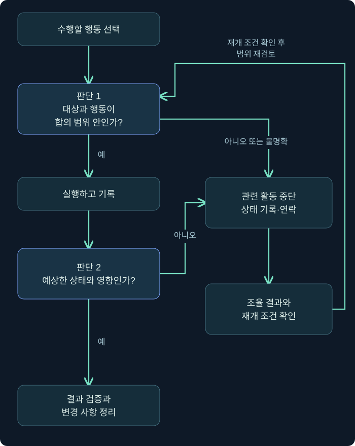

지난 강의에서는 위협 정보를 바탕으로 공격 시나리오를 구성하고, 관측한 행동을 공격 생명주기와 연결했습니다.

이제 시나리오를 실제 훈련으로 옮길 차례입니다.

그런데 기술적으로 실행할 수 있다는 사실만으로는 부족합니다. **어디까지 수행해도 되는지, 어떤 영향을 예상하는지, 결과를 무엇으로 입증하고 어떻게 원상 복구할지**가 함께 정해져야 합니다.

이번 강의는 **Engagement Planning, Rules of Engagement, OPSEC, 작업 원칙과 실습 환경 안내**를 다룹니다.

아래 훈련 계획, 주소, 기록과 명령어는 강의용 예제입니다. 실제 환경에서 실행하거나 확인한 결과는 아닙니다.

---

## 1. “접속에 성공했습니다” 다음에 생길 수 있는 문제

가상의 훈련 상황을 생각해 보겠습니다.

레드팀의 목표는 일반 직원 계정에서 출발해 지정된 시험 문서에 접근할 수 있는지 확인하는 것입니다.

그런데 문서 서버를 조사하던 중 다른 서버의 주소를 발견했습니다. 접속해 보니 계정도 사용할 수 있을 것 같습니다.

여기서 다음 행동을 결정하는 기준은 무엇일까요?

“접속할 수 있으니 확인해 보자”라고 생각하면 활동 범위가 계속 확대됩니다. 처음에는 시험용 문서만 확인하려 했는데, 어느새 운영 서버나 다른 조직이 관리하는 시스템을 건드릴 수 있습니다.

시설 점검을 떠올려 보겠습니다.

한 건물의 전기 설비를 점검하도록 출입증을 받았다고 해서, 열려 있는 옆 건물까지 점검할 수 있는 것은 아닙니다. 같은 통로로 연결돼 있어도 작업 대상과 권한은 별개입니다.

네트워크에서도 같습니다.

**접근 가능한 대상과, 활동이 허용된 대상은 다릅니다.**

또한 승인된 서버에서도 모든 행동이 허용되는 것은 아닙니다. 상태 확인은 허용돼도 서비스 중단이나 계정 변경은 제외될 수 있습니다.

그래서 실행 전에 다음 세 가지를 구분해야 합니다.

| 구분 | 답해야 하는 질문 |
|---|---|
| 목표 | 무엇을 검증하려는가? |
| 범위 | 어떤 대상과 행동이 포함되는가? |
| 수행 조건 | 언제, 어떤 제한과 절차에 따라 수행하는가? |

이 세 가지를 정리하는 과정이 **Engagement Planning, 활동 계획 수립**입니다.

---

## 2. 목표를 “확인할 수 있는 질문”으로 바꾸기

접근 가능성, 권한 확보, 내부 이동, 민감 자료 접근, 탐지와 대응, 업무 영향 등을 계획 단계에서 논의해야 합니다.

하지만 이런 항목을 그대로 나열하면 아직 실행 계획으로 쓰기 어렵습니다.

예를 들어 다음 목표를 보겠습니다.

> “우리 조직의 보안을 평가한다.”

너무 넓습니다. 어느 시스템에서 무엇을 확인해야 끝나는지 알 수 없습니다.

조금 더 좁혀 보겠습니다.

> “일반 직원 계정으로 제한 문서에 접근할 수 있는지 평가한다.”

이제 방향은 보입니다. 여기에 출발 조건과 증거 기준을 붙이면 더 구체적인 목표가 됩니다.

> “지정된 실습 단말에서 일반 직원 시험 계정을 사용해, 문서 서버의 시험 문서를 읽을 수 있는지 확인한다. 접근 통제 결과와 관련 탐지·조사 과정을 평가한다.”

이 문장을 실행 계획으로 발전시키려면 다음 질문이 남습니다.

어떤 문서가 시험 문서일까요? 파일 이름이 보이면 성공일까요, 내용을 읽어야 성공일까요? 접근이 차단되면 어떤 증거를 남길까요? 경보가 발생하면 담당자가 어느 정도까지 조사해야 할까요?

### 접근의 수준을 구분해야 합니다

문서에 관해서도 다음 결과는 서로 다릅니다.

| 확인한 결과 | 입증할 수 있는 범위 |
|---|---|
| 폴더 이름이 보임 | 해당 폴더의 존재를 확인함 |
| 문서 목록이 보임 | 문서 이름 등을 열람할 수 있음 |
| 문서를 열어 내용을 읽음 | 해당 내용에 대한 읽기 접근이 가능함 |
| 문서를 변경함 | 해당 대상에 대한 쓰기 권한을 행사함 |
| 외부 수신지로 전송함 | 정해진 경로를 통한 전송을 수행함 |

목표가 읽기 접근 검증이라면, 변경이나 외부 전송까지 할 필요는 없을 수 있습니다.

반대로 외부 전송 통제까지 검증하려는 훈련이라면 읽기 성공만으로 그 목표를 달성했다고 할 수 없습니다. 그 경우에는 별도로 합의한 시험 자료와 수신지를 사용해 검증해야 합니다.

**어떤 결과가 어떤 질문에 답하는지 먼저 정하면, 불필요한 행동을 줄이면서도 평가를 명확하게 할 수 있습니다.**

---

## 3. ROE: 허용된 활동의 경계를 문서로 정하기

**ROE는 Rules of Engagement의 약자**입니다. 보안 평가에서 수행할 활동과 제한 조건을 정하는 규칙을 뜻합니다.

승인된 대상, 제외할 대상이나 기법, 활동 목표 등을 ROE에 포함하고, 합의한 범위에서 활동해야 합니다.

NIST는 ROE를 시험 전에 정하는 구체적인 지침과 제약으로 설명합니다. 또한 정해진 활동을 수행할 권한을 부여하므로, 그 범위 안에서 매번 추가 허가를 받을 필요는 없다고 정의합니다. [공식 근거: NIST ROE 정의](https://csrc.nist.gov/glossary/term/Rules_of_Engagement)

따라서 ROE는 단순히 “하지 말아야 할 목록”이 아닙니다.

**수행자가 스스로 진행할 수 있는 범위와, 멈추고 조율해야 할 조건을 함께 정하는 문서**입니다.

### 가상의 훈련 조건을 만들어 보겠습니다

아래는 이해를 위한 예시이며, 실제 활동에 대한 승인 문서가 아닙니다. 주소는 문서용 주소입니다.

| 항목 | 가상 합의 내용 |
|---|---|
| 출발 조건 | 지정 실습 단말 `192.0.2.10`에서 시험 계정 사용 |
| 대상 | 문서 서버 `192.0.2.20`의 지정된 시험 공유 폴더 |
| 목표 | 시험 문서 읽기 가능 여부와 탐지·조사 과정 확인 |
| 허용 변경 | 지정한 무해한 실습 구성 요소만 생성·제거 |
| 제외 행동 | 운영 자료 변경, 보안 기능 중지, 무관한 서버 조사 |
| 자료 취급 | 시험 문서와 합의한 증거만 수집 |
| 중단 조건 | 서비스 이상, 예상 밖 자료 노출, 실제 침해 의심 |
| 종료 조건 | 증거 확보, 변경 사항 정리, 잔여 항목 확인 |

이 표에서 새로운 서버 `192.0.2.30`을 발견했다면 어떻게 해야 할까요?

같은 네트워크에 있다는 이유만으로 조사 범위에 포함되지는 않습니다. 발견 사실과 관련성을 기록하고, 합의된 범위 변경 절차로 넘겨야 합니다.

또한 승인된 문서 서버에 접근했더라도, 지정 폴더 밖에 실제 민감 자료가 보이면 “서버가 승인됐으니 모두 열어도 된다”고 해석하면 안 됩니다. **대상에 대한 승인과, 그 안에서 허용된 데이터·행동의 범위를 함께 봐야 합니다.**

### 도메인 이름이 같으면 같은 대상일까요?

예시 이름이 `files.lab.example.com`이라고 하겠습니다.

이 이름이 어떤 주소로 연결되는지 확인하는 것과, 그 주소의 시스템을 어떤 방식으로 시험해도 되는지는 별개의 문제입니다. 공유 서비스나 다른 운영 환경으로 연결되는 등 예상과 다른 상황이 있을 수 있기 때문입니다.

실행 직전에는 현재 대상이 계획에 포함된 시스템인지 확인해야 합니다. 새 시스템에 접근할 때 상황을 파악하고 범위를 재확인하는 이유도 여기에 있습니다.

---

## 4. 훈련 중 실제 사고가 발생하면 어떻게 구분할까요?

블루팀이 의심스러운 활동을 발견했습니다.

레드팀 훈련이 진행 중이라는 사실을 아는 담당자는 이렇게 생각할 수 있습니다.

> “훈련 때문에 발생한 경보겠지.”

그런데 실제 공격자가 같은 시기에 활동하고 있다면 어떨까요?

훈련 기간이라는 이유로 경보를 전부 훈련 활동으로 처리하면 실제 침해를 놓칠 수 있습니다. 반대로 모든 훈련 행동을 실제 사고로 처리하면 불필요한 업무 중단이 발생할 수 있습니다.

이런 혼선을 줄이기 위한 활동 확인과 조율을 **deconfliction**이라고 부릅니다.

실무적으로는 다음 질문에 답하는 과정입니다.

> “이 활동이 실제로 우리 훈련에서 수행한 것인가?”

이를 확인하려면 수행자 기록, 대상, 계정, 실행 시각과 행동이 필요합니다. 출발지 주소 하나만 같다고 모든 활동을 훈련으로 분류해서는 안 됩니다.

### 블루팀 전체가 미리 알아야 할까요?

탐지·대응 능력을 평가하는 훈련에서는 모든 분석가에게 세부 시나리오를 미리 알리지 않을 수 있습니다.

그렇더라도 활동을 통제하고 예상 밖 상황을 조율할 담당자는 필요합니다. 누구에게 연락하고, 무엇을 중단하며, 어떤 조건에서 재개할지 정해야 합니다.

NIST SP 800-115도 평가 중 사고를 발견하거나 유발했을 때의 연락, 중단과 재개 절차를 사전에 계획하도록 설명합니다. [공식 근거: NIST SP 800-115](https://nvlpubs.nist.gov/nistpubs/Legacy/SP/nistspecialpublication800-115.pdf)

여기서 중단은 곧바로 전체 시스템을 끄거나 임의로 복구한다는 뜻이 아닙니다.

예상 밖 문제가 생기면 **관련 시험 활동을 멈추고, 관측한 상태를 기록하며, 합의한 대응 절차를 따르는 것**이 우선입니다. 원인 확인 전에 여러 설정을 바꾸면 조사와 복구를 더 어렵게 만들 수 있습니다.

### 그림 1. 실행·중단·재개의 판단 흐름

화살표는 활동 결정 순서입니다. 범위가 명확하고 예상한 조건이 유지되면 계획에 따라 진행합니다.



그림의 핵심은 중단한 뒤에도 바로 같은 행동을 반복하지 않는다는 점입니다. 재개하려면 대상·행동·조건이 다시 명확해져야 합니다.

---

## 5. OPSEC: 자신의 행동이 어떻게 보이는지 이해하기

**OPSEC은 Operations Security, 작전 보안의 약자**입니다.

이번 강의에서는 레드팀 활동이 어떤 정보를 드러내고, 누가 이를 관측할 수 있으며, 그로 인해 활동과 평가에 어떤 영향이 생기는지 이해하고 관리하는 관점으로 설명하겠습니다.

행동이 남기는 흔적과 블루팀의 관측 가능성을 고려해야 합니다. 다만 “OPSEC은 시뮬레이션에서만 중요하다”고 좁게 받아들이지 않는 편이 좋습니다. **특정 공격자를 모방하는 훈련에서도 흔적을 이해해야 재현의 충실도와 평가 결과를 판단할 수 있습니다.**

이것은 실습 설계 관점에서 보완한 해석입니다.

### 같은 목적이라도 관측되는 정보는 달라집니다

지난 강의의 예약 작업 예제를 다시 생각해 보겠습니다.

화면에서 등록한 작업과 명령줄 도구로 등록한 작업은 같은 기능을 이용할 수 있지만, 실행된 프로그램이나 명령줄 등 주변 기록은 달라질 수 있습니다.

따라서 수행자는 다음을 이해해야 합니다.

- 어떤 프로세스와 파일이 생기는가?
- 어떤 계정과 권한을 사용하는가?
- 어떤 네트워크 통신이 발생하는가?
- 어떤 설정이 바뀌며, 실행 후에도 남는가?

도구의 대상 상호작용, 변경 사항, 통신과 잔여 흔적을 이해해야 합니다.

이 질문은 흔적을 무조건 줄이기 위한 것만은 아닙니다. 탐지 시험에서는 **예상한 흔적이 실제로 생성됐는지** 확인하는 데도 필요합니다.

### 탐지되지 않았다고 안전한 행동일까요?

탐지 가능성과 업무 영향은 다른 축입니다.

어떤 설정 변경은 조용히 수행되지만 중요한 서비스의 동작을 바꿀 수 있습니다. 반대로 무해한 시험 파일은 경보를 발생시켜도 서비스에는 영향을 주지 않을 수 있습니다.

| 판단 축 | 확인할 내용 |
|---|---|
| 관측 가능성 | 어떤 기록과 경보가 생길 수 있는가? |
| 운영 영향 | 서비스·계정·자료에 어떤 변화가 생기는가? |
| 복구 가능성 | 변경을 식별하고 되돌릴 수 있는가? |
| 평가 적합성 | 그 행동이 검증 목표와 조건에 맞는가? |

“아무 경보가 없었다”는 사실은 안전성이나 성공을 보증하지 않습니다. 기록이 수집되지 않았거나, 행동 자체가 실행되지 않았을 수도 있기 때문입니다.

### 도구가 차단되면 보안 기능부터 끄면 될까요?

보안 기능이 실제로 행동을 차단했다면 그것은 평가 결과가 될 수 있습니다.

그 기능을 끄고 다시 실행하면 시험 조건이 달라집니다. 이후 성공을 원래 조건의 성공처럼 보고하면 잘못된 결론이 됩니다.

다른 조건의 시험이 필요하다면 그 목적과 변경을 분리해 기록해야 합니다. 불필요하게 보안 기능을 중지해 대상의 위험을 높이지 않아야 합니다.

---

## 6. 도구를 이해한다는 것은 옵션을 외우는 것보다 넓습니다

도구 사용법을 안다는 말을 다음처럼 생각하기 쉽습니다.

> “필요한 명령어를 입력하면 결과가 나온다.”

하지만 실제 활동에서는 그 전후를 알아야 합니다.

예를 들어 한 도구가 시스템 상태를 확인한다고 하겠습니다. 겉으로는 조회 도구처럼 보여도, 내부적으로 임시 파일이나 서비스를 생성하거나 다른 호스트에 접속할 수 있습니다.

따라서 시험 환경에서 적어도 다음 흐름을 이해해야 합니다.

> **실행 전 상태 → 도구의 동작 → 생성된 결과와 변경 → 종료 후 잔여 상태**

### 공개 소스라면 바로 사용해도 될까요?

공개 소스라는 사실은 검토할 기회를 제공하지만, 모든 동작이 검증됐다는 뜻은 아닙니다. 내려받은 실행 파일이 검토한 소스와 대응하는지도 별개의 문제입니다.

공개 도구도 내부 검토와 시험을 거친 뒤 사용해야 합니다.

처음에는 다음 질문에 답해 보세요.

어떤 환경에서 시험했는가? 정확히 어떤 버전과 파일을 사용하는가? 어떤 권한이 필요한가? 실패하면 무엇이 남는가? 실행을 중지해도 이미 만든 설정은 계속 작동하는가?

특히 **실패한 실행도 변경을 남길 수 있습니다.**

파일을 생성한 뒤 다음 단계에서 오류가 발생했다면, 화면에는 실패가 표시돼도 생성한 파일은 남아 있을 수 있습니다. 복구 계획은 성공한 행동뿐 아니라 실패한 행동도 포함해야 합니다.

### 암호화된 통신이면 충분할까요?

제어 통신에서 민감한 정보가 평문으로 노출되지 않도록 해야 합니다.

여기에 상대 확인과 접근 통제도 함께 생각해야 합니다.

암호화는 내용을 보호하는 데 도움이 되지만, 연결한 상대가 올바른 시스템인지 또는 관리 인터페이스에 누가 접근할 수 있는지까지 자동으로 해결하지는 않습니다.

Cobalt Strike의 현재 Team Server 안내도 관리 접근 제한과 인증서 확인 등을 별도로 다룹니다. Team Server는 여러 운영자의 활동과 에이전트 통신을 관리하는 서버입니다. 자세한 구조는 뒤의 관련 강의에서 다루겠습니다. [공식 근거: Team Server 안내](https://hstechdocs.helpsystems.com/manuals/cobaltstrike/current/userguide/content/topics/welcome_starting-cs-team-server.htm)

---

## 7. 작업 기록: “무엇을 입력했는가”와 “무엇이 일어났는가”

명령 기록, 화면 자료, 수행 이유와 결과를 포함한 작업 기록이 중요합니다.

그런데 터미널 기록만 있으면 충분할까요?

다음 가상 기록을 보겠습니다.

> “10:00:00 — 운영자가 원격 작업을 요청함.”

이 기록만으로 대상에서 10:00:00에 작업이 실행됐다고 볼 수는 없습니다. 요청이 대기 중이었거나 전달되지 않았을 수도 있습니다.

### 세 가지 시각을 구분해 봅시다

| 사건 | 가상 시각 | 의미 |
|---|---|---|
| 작업 요청 | 10:00:00 | 운영자가 작업을 제출함 |
| 대상 실행 | 10:00:05 | 대상에서 동작이 시작됨 |
| 결과 수신 | 10:00:08 | 운영자가 결과를 받음 |

각각 다른 사건입니다. 원격 도구를 사용하면 통신 지연과 작업 대기로 차이가 생길 수 있습니다.

따라서 블루팀 기록과 대조할 때는 어느 시각을 기준으로 삼았는지 밝혀야 합니다. 실행 시각을 확인하지 못했다면 요청 시각을 실행 시각으로 바꾸어 적지 않습니다.

결과가 돌아오지 않았을 때도 마찬가지입니다.

> “실패했다”보다 “결과를 수신하지 못했으며 대상 실행 여부는 미확인”이라고 기록해야 하는 경우가 있습니다.

실행 여부를 확인하지 않은 채 같은 변경을 반복하면 중복 작업이 생길 수 있습니다.

### 자동 로그와 수행자 메모는 역할이 다릅니다

Cobalt Strike 4.13 사용자 가이드는 Team Server의 `logs/` 경로에 활동을 기록하며 로그 시간대의 기본값이 UTC라고 설명합니다. UTC는 장비 간 시각을 비교할 때 사용하는 기준 시간입니다. [공식 근거: Cobalt Strike Logging](https://hstechdocs.helpsystems.com/manuals/cobaltstrike/current/userguide/content/topics/reports-logs_logs.htm)

하지만 자동 로그가 수행자의 의도까지 설명하지는 않습니다.

좋은 메모는 다음처럼 작성할 수 있습니다.

> “시험 문서 읽기 가능 여부를 확인하기 위해 지정 경로에 접근했다. 서버 기록에서 읽기 성공을 확인했다. 외부 전송은 이번 시험 범위에 포함되지 않았다.”

여기에는 행동, 이유, 확인한 결과와 해석의 경계가 있습니다.

### 시각 표기와 시계 오차도 구분해야 합니다

다음 두 시각은 같은 순간을 나타내는 가상 예시입니다.

| 표기 | 시각 |
|---|---|
| UTC보다 11시간 빠른 시간대 | `2026-11-02T10:00:00+11:00` |
| UTC | `2026-11-01T23:00:00Z` |

10시에서 11시간을 빼면 전날 23시가 됩니다. 끝의 `Z`는 UTC 표기입니다.

다만 시간대를 맞췄다고 장비 시계도 정확해지는 것은 아닙니다. 서버 시계가 2분 빠르다면 그 오차를 별도로 고려해야 합니다.

**표기 정규화와 시계 정확도 확인은 다른 작업**입니다.

---

## 8. 작은 실습 예제: PowerShell 기록 준비하기

이번에는 운영자용 Windows 실습 VM에서 기록을 준비하는 예제를 보겠습니다.

**Windows의 PowerShell 7.5 문서 기준**이며, 아래 명령은 실제로 실행하지 않았습니다. `C:\LabNotes`에 쓸 권한이 있다고 가정합니다.

### 8.1 기록 폴더를 준비합니다

```powershell
New-Item -ItemType Directory -Path C:\LabNotes -Force
```

`New-Item`은 항목을 만드는 명령입니다. `-ItemType Directory`는 폴더를 만들겠다는 뜻이고, `-Path`는 경로를 지정합니다.

이 예제의 `-Force`는 같은 폴더가 이미 있는 경우에도 사용할 수 있게 합니다. 권한 제한을 무시하는 옵션은 아닙니다. [공식 근거: New-Item](https://learn.microsoft.com/en-us/powershell/module/microsoft.powershell.management/new-item?view=powershell-7.5)

### 8.2 세션 기록을 시작합니다

```powershell
Start-Transcript -Path C:\LabNotes\session-01.txt -NoClobber -IncludeInvocationHeader
```

`Start-Transcript`는 PowerShell 세션 기록을 텍스트 파일에 남깁니다.

`-NoClobber`는 같은 이름의 파일을 덮어쓰지 않도록 합니다. 파일이 이미 있으면 시작에 실패하므로 새 이름을 사용해야 합니다.

`-IncludeInvocationHeader`는 명령 호출 시각 정보를 기록하는 데 도움이 됩니다. 다만 원격 대상의 실제 실행 시각과는 구분해야 합니다. [공식 근거: Start-Transcript](https://learn.microsoft.com/en-us/powershell/module/microsoft.powershell.host/start-transcript?view=powershell-7.5)

### 8.3 현재 시각과 시간대를 확인합니다

```powershell
Get-Date -Format o
Get-TimeZone
```

`Get-Date`는 현재 시스템 시각을 가져옵니다. `-Format o`는 날짜·시각·UTC 오프셋을 포함하는 형식으로 표현합니다. 오프셋은 UTC와의 시간 차이입니다. [공식 근거: Get-Date](https://learn.microsoft.com/en-us/powershell/module/microsoft.powershell.utility/get-date?view=powershell-7.5)

`Get-TimeZone`은 Windows의 현재 시간대 설정을 확인합니다. 이 명령은 Windows 플랫폼용입니다. [공식 근거: Get-TimeZone](https://learn.microsoft.com/en-us/powershell/module/microsoft.powershell.management/get-timezone?view=powershell-7.5)

두 결과는 기록을 해석하는 데 도움이 되지만, 시계가 정확한 기준에 동기화됐다는 증명은 아닙니다.

### 8.4 작업을 마치면 기록을 종료합니다

```powershell
Stop-Transcript
```

앞에서 시작한 세션 기록을 종료합니다. [공식 근거: Stop-Transcript](https://learn.microsoft.com/en-us/powershell/module/microsoft.powershell.host/stop-transcript?view=powershell-7.5)

### Transcript는 모든 것을 기록할까요?

그렇게 가정하면 안 됩니다.

Microsoft는 PowerShell 출력과 기록 처리의 상호작용 때문에 일부 출력이 예상과 다르게 기록될 수 있다고 설명합니다. 별도 창의 활동이나 원격 대상의 모든 내부 동작을 완전하게 보여주는 기록도 아닙니다. [공식 근거: PowerShell 기록의 한계](https://learn.microsoft.com/en-us/powershell/scripting/learn/deep-dives/output-missing-from-transcript?view=powershell-7.5)

따라서 세션 기록, 대상 시스템 기록, 수행자 메모를 함께 사용해야 합니다. 화면 자료도 도움이 되지만, 한 화면만으로 전체 실행 과정이나 원인을 입증하기는 어렵습니다.

기록에는 계정 정보나 자료 내용이 포함될 수도 있습니다. 기록을 남기는 것과 함께 누가 접근하고 어디에 보관할지도 정해야 합니다.

---

## 9. 실습 환경을 준비할 때는 두 종류의 연결을 구분하세요

브라우저를 통해 실습 VM에 접속하는 환경에서는 안내 패널과 자원 목록에서 작업 및 계정 정보를 확인할 수 있습니다.

여기에는 서로 다른 연결이 있습니다.

첫째는 **내 브라우저에서 실습 화면에 접속하는 연결**입니다.

둘째는 **실습 VM에서 다른 실습 시스템으로 통신하는 연결**입니다.

화면이 검게 보인다고 대상 서버가 중지됐다고 판단하면 안 됩니다. 브라우저와 원격 화면 사이의 연결 문제일 수 있습니다.

반대로 화면이 정상이어도 VM과 대상 서버 사이의 통신은 실패할 수 있습니다.

| 증상 | 먼저 분리할 질문 |
|---|---|
| 실습 화면이 열리지 않음 | 브라우저·원격 화면 연결이 가능한가? |
| 키 입력이 늦음 | 화면 연결 지연이나 입력 문제가 있는가? |
| VM은 조작되지만 대상 접속 실패 | VM 내부 주소·경로·서비스 조건이 맞는가? |
| 명령 결과가 예상과 다름 | 올바른 VM·계정·실습 단계인가? |

Skillable의 현재 연결 요구사항 문서는 연결 확인용 실습을 제공하고, 브라우저·네트워크·프록시 조건을 구분합니다. 프록시는 다른 시스템을 대신해 통신을 중계하는 구성 요소로, 설정에 따라 원격 화면 연결에 영향을 줄 수 있습니다. [공식 근거: Skillable 연결 요구사항](https://docs.skillable.com/docs/lab-connectivity-requirements)

문제 해결을 위해 여러 보안 설정을 한꺼번에 바꾸면 원인을 구분하기 어려워집니다. 증상과 실패 구간을 기록하고 필요한 조건을 확인하는 편이 좋습니다. 관리되는 업무망에서는 해당 요구사항을 담당자와 확인해야 합니다. [공식 근거: Skillable 연결 문제 해결](https://docs.skillable.com/v1/docs/how-do-i-resolve-connectivity-issues)

실습 화면, 구동 시간, 종료 버튼 동작은 사용하는 환경과 계정에 따라 확인해야 합니다. 이번 강의에서는 실제 온라인 실습에 접속하지 않았습니다. 접속 후에는 **현재 실습 안내와 상태 표시**를 기준으로 사용해야 합니다.

---

## 10. 종료는 “접속 창을 닫는 것”보다 넓습니다

실습에서 시험용 예약 작업을 만들었다고 해보겠습니다.

화면을 닫으면 작업도 없어질까요?

그렇지 않을 수 있습니다. 설정은 남아 있고, 조건이 충족되면 프로그램이 다시 실행될 수 있습니다.

또한 파일을 지웠더라도 그 파일을 실행하려는 작업이 남아 오류를 만들 수 있습니다.

그래서 종료 시에는 **생성한 변경과 제거 결과를 대응시켜야 합니다.**

| 생성·변경한 항목 | 종료 시 확인할 사항 |
|---|---|
| 시험 파일 | 지정 위치의 파일 제거 여부 |
| 예약 작업 | 작업 제거와 재실행 가능성 해소 |
| 시험 계정·권한 | 합의한 계정 상태와 권한 복구 |
| 임시 설정 | 기존 값으로 복구됐는지 확인 |
| 수집 증거 | 합의한 위치에 보관하고 접근 제한 |
| 미완료 항목 | 남은 상태·영향·후속 담당 기록 |

이 표는 정리 방법의 예시입니다. 실제로 변경한 항목에 맞춰 작성해야 합니다.

정리와 증거 삭제도 구분해야 합니다. 시험용 설정은 제거하더라도, 조사에 필요한 원본 로그를 임의로 지우면 안 됩니다. 수집 자료의 보관·전송·종료 후 처리는 활동 계획에서 정해야 합니다. [공식 근거: NIST SP 800-115](https://nvlpubs.nist.gov/nistpubs/Legacy/SP/nistspecialpublication800-115.pdf)

복구하지 못한 항목이 있다면 “정리 완료”로 처리하지 않습니다.

> “시험 작업 제거를 시도했으나 결과를 확인하지 못했다. 대상 상태와 후속 확인이 필요하다.”

완료되지 않은 상태를 정확하게 넘기는 것도 작업의 일부입니다.

---

## 11. 가상 사례로 전체 흐름 연결하기

이번에는 앞의 내용을 하나의 훈련에 적용해 보겠습니다.

목표는 지정 단말에서 시험 문서를 읽을 수 있는지 확인하는 것입니다.

수행자는 먼저 현재 단말과 계정이 합의한 출발 조건과 일치하는지 확인합니다. 작업 기록을 시작하고 시간대와 필요한 도구 버전을 남깁니다.

그다음 지정 문서 경로에 접근합니다. 운영자 화면에서는 성공한 것처럼 보이지만, 서버 기록까지 대조해 읽기 결과를 확인합니다.

여기서 다른 공유 폴더가 보입니다.

수행자는 그 폴더를 추가로 열지 않고 발견 사실을 기록합니다. 이번 시험의 성공 기준은 이미 지정된 문서로 정해져 있기 때문입니다.

이후 블루팀 경보를 확인했더니 활동 시각과 비슷한 외부 접속 경보가 있습니다.

수행자는 “우리 훈련이다”라고 단정하지 않습니다. 자신의 기록에 해당 접속이 있는지 확인하고, 없거나 불명확하면 합의한 통제 담당자에게 전달합니다.

마지막으로 자신이 만든 시험용 변경을 정리하고 결과를 확인합니다.

보고서에는 다음이 분리돼 들어갑니다.

- 어떤 조건에서 무엇을 수행했는가?
- 어떤 자료로 결과를 확인했는가?
- 탐지와 대응은 어디까지 관측했는가?
- 어떤 부분은 범위 밖이거나 확인하지 못했는가?
- 정리하지 못한 변경이 있는가?

이렇게 해야 같은 활동을 레드팀의 실행 기록과 블루팀의 조사 기록 양쪽에서 검토할 수 있습니다.

---

## 12. 복습 질문과 해설

### 복습 1. 승인된 단말에서 다른 서버로 접속할 수 있습니다. 그 서버도 조사해도 될까요?

**해설:** 연결 가능 여부만으로 활동 권한을 판단할 수 없습니다.

현재 ROE의 대상과 허용 행동에 포함되는지 확인해야 합니다. 범위가 불명확하면 발견 사실을 기록하고 합의한 조율 절차를 따릅니다.

### 복습 2. 보안 기능이 도구를 차단했습니다. 기능을 끄고 성공한 뒤 “접근 성공”으로 보고해도 될까요?

**해설:** 변경한 조건을 구분해야 합니다.

원래 조건에서는 차단됐다는 결과가 있습니다. 별도의 승인된 조건에서 다시 시험했다면 그 결과를 분리해 보고해야 합니다. 변경 후 성공을 원래 방어 조건의 성공으로 표현하면 평가가 왜곡됩니다.

### 복습 3. 명령을 입력했지만 결과가 돌아오지 않았습니다. 같은 명령을 바로 반복해도 될까요?

**해설:** 대상에서 이미 실행됐을 가능성을 고려해야 합니다.

특히 설정을 생성·변경하는 명령이라면 중복 동작이 발생할 수 있습니다. 결과 미수신과 실행 실패를 구분하고, 가능한 기록으로 실행 여부를 확인해야 합니다.

### 복습 4. 도구가 오류를 표시했으므로 정리할 변경도 없다고 볼 수 있을까요?

**해설:** 그렇지 않습니다.

일부 단계에서 파일이나 설정을 만든 뒤 다음 단계에서 실패했을 수 있습니다. 실행 전후 상태와 도구 동작을 바탕으로 잔여 변경을 확인해야 합니다.

### 복습 5. 공격자를 모방하는 훈련이라 정해진 기법만 사용합니다. OPSEC은 고려하지 않아도 될까요?

**해설:** 모방 훈련에서도 행동의 관측 결과를 이해해야 합니다.

같은 기법이라도 구체적인 구현과 환경에 따라 기록이 달라질 수 있습니다. 무엇을 재현했고 어떤 흔적이 생성됐는지 알아야 탐지 결과를 정확하게 해석할 수 있습니다.

### 복습 6. 훈련 기간에 발생한 경보가 레드팀 기록에 없습니다. 훈련과 무관하다고 확정할 수 있을까요?

**해설:** 기록 누락이나 시각 차이가 있을 수 있으므로 곧바로 확정하지 않습니다.

대상·계정·시간·행동을 대조하고 통제 담당자를 통해 확인해야 합니다. 동시에 실제 침해 가능성도 배제하지 않고 합의한 사고 처리 절차를 따릅니다.

### 복습 7. 시험 파일을 삭제했습니다. 정리가 완료된 것일까요?

**해설:** 생성한 변경 전체를 확인해야 합니다.

예약 작업, 계정, 권한, 임시 설정 등이 별도로 남아 있을 수 있습니다. 파일 하나의 제거와 전체 활동의 정리 완료는 다릅니다.

---

## 13. 공식 자료 확인 범위

**확인일: 2026년 11월 2일**

| 자료 | 이번 강의에 반영한 범위 |
|---|---|
| NIST SP 800-115 | 사전 권한, 활동 경계, 사고 처리와 자료 취급 |
| Microsoft PowerShell 7.5 문서 | 세션 기록 명령과 한계, 시각·시간대 확인 |
| Cobalt Strike 4.13 가이드 | Team Server 활동 로그와 시간대 설정 |
| Skillable 연결 안내 | 브라우저 연결과 실습 환경 문제의 구분 |

NIST SP 800-115는 **2008년 문서**입니다. 이번에는 계획과 조율 원칙을 참고했으며, 당시의 도구나 설정을 현재 권고로 그대로 옮기지는 않았습니다.

관련 공식 문서입니다.

- [NIST SP 800-115](https://csrc.nist.gov/pubs/sp/800/115/final)
- [PowerShell Start-Transcript](https://learn.microsoft.com/en-us/powershell/module/microsoft.powershell.host/start-transcript?view=powershell-7.5)
- [PowerShell 기록의 한계](https://learn.microsoft.com/en-us/powershell/scripting/learn/deep-dives/output-missing-from-transcript?view=powershell-7.5)
- [Cobalt Strike 활동 로그](https://hstechdocs.helpsystems.com/manuals/cobaltstrike/current/userguide/content/topics/reports-logs_logs.htm)
- [Skillable 연결 요구사항](https://docs.skillable.com/docs/lab-connectivity-requirements)

여기까지로 **레드팀 기초의 첫 세 강의**를 마칩니다. 이어서 배울 범위는 **법과 준수 원칙**이며, 기술적으로 가능한 행동과 허용된 활동을 구분하는 원칙을 살펴보겠습니다. 후속 강의는 준비 중입니다.
