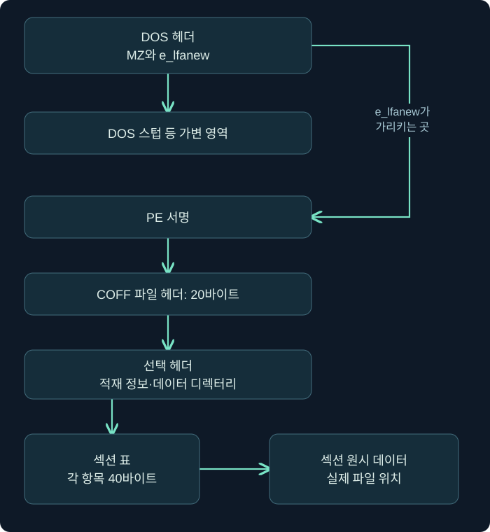
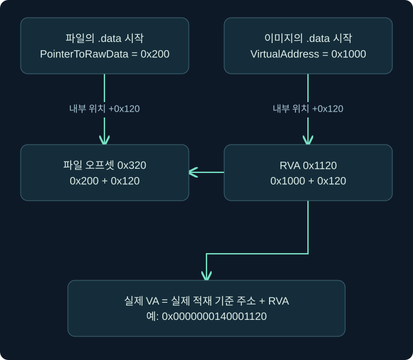

## 1. 실행 파일을 읽는다는 것은 무엇일까요?

메일에서 발견한 파일을 바로 실행하지 않고도 무엇을 알아낼 수 있을까요? 파일 앞부분의 바이트를 읽으면 어떤 형식인지, 어느 CPU 계열을 대상으로 하는지, 코드와 데이터가 어떻게 배치되어 있는지 살펴볼 수 있습니다. 이 강의에서는 파일을 실행하지 않고 구조를 읽는 방법을 배웁니다. 구조를 안다는 것은 악성 여부를 알아냈다는 뜻까지 포함하지는 않습니다.

실행 파일을 이삿짐 상자에 비유해 보겠습니다. 상자 겉면에는 운송 규격과 내용물 목록이 있고, 내부에는 물건이 종류별로 담겨 있습니다. 상자를 집 안에 풀어 놓을 때에는 상자 안 위치와 방 안 위치가 달라집니다. Windows의 PE 파일도 디스크에 저장된 배치와 프로세스 메모리에 올라간 배치를 구분해서 읽어야 합니다.

**PE는 Portable Executable의 약자**입니다. 이름에 Portable이 들어 있어도 모든 운영체제와 CPU에서 그대로 실행된다는 뜻은 아닙니다. Windows 실행 이미지의 형식이며, `.exe`와 많은 `.dll`이 이 형식을 사용합니다. `.dll`은 다른 프로그램이 불러 쓸 수 있는 기능을 담는 라이브러리입니다. 확장자만으로 형식을 확정하지 말고 실제 헤더를 확인합니다.

| 자료 형태 | 처음 확인할 것 | 이 사실만으로 알 수 없는 것 |
| --- | --- | --- |
| PE 실행 이미지 | MZ·PE 서명, Machine, 헤더와 섹션 | 정상 프로그램인지 악성 프로그램인지 |
| PowerShell 스크립트 | 텍스트 내용과 실행 문맥 | 확장자가 바뀐 파일의 실제 형식 |
| 셸코드라고 설명된 바이트 | 명령어 집합, 실행 조건, 데이터와 코드의 구분 | 헤더 없는 바이트의 목적과 실제 실행 여부 |

셸코드는 보통 특정 조건에서 실행하도록 준비한 기계어 바이트를 가리킵니다. PE처럼 로더가 읽는 표준 헤더를 갖춘 완성된 실행 파일과는 다릅니다. 주소·API·CPU 아키텍처 같은 전제가 맞아야 하므로, “파일이 아니니 어디서나 실행된다”라고 생각하면 안 됩니다.

## 2. 전체 구조부터 지도를 만듭니다

PE를 처음 볼 때 모든 필드를 외우려 하지 않아도 됩니다. 앞에서부터 헤더의 위치를 찾고, 헤더가 알려 주는 섹션 표를 읽은 다음, 필요한 데이터로 이동하면 됩니다. 아래 그림의 화살표는 파일을 읽는 순서와 위치 참조를 나타냅니다. 비율은 실제 파일 크기를 나타내지 않습니다.



DOS 헤더는 64바이트의 구조체입니다. 그 뒤에는 DOS 스텁이나 다른 내용이 있을 수 있습니다. PE 서명이 반드시 파일의 64번째 바이트에서 시작하는 것은 아닙니다. DOS 헤더 끝부분의 위치 필드가 다음 구조로 가는 길을 알려 줍니다.

초보자가 자주 하는 실수는 도구 화면의 숫자를 전부 “주소”라고 부르는 것입니다. 먼저 그 숫자가 파일의 위치인지, 메모리의 상대 위치인지, 실제 가상 주소인지 표시해 두세요. 같은 `0x1000`이라도 단위와 기준점이 다르면 다른 장소를 뜻합니다. 여기서 `0x`는 뒤의 숫자를 16진수로 읽는다는 표시입니다.

## 3. MZ와 e_lfanew로 PE 헤더를 찾습니다

파일 시작의 두 바이트가 `4D 5A`라면 ASCII 문자로 `MZ`입니다. DOS 헤더의 `e_magic` 필드에 해당합니다. MZ가 있다는 사실은 구조 검사를 시작할 단서입니다. 그것만 확인하고 정상 PE라고 결론내리면 잘린 파일이나 위조된 데이터를 놓칠 수 있습니다.

`e_lfanew`는 파일 오프셋 `0x3C`에 있는 4바이트 값입니다. **파일 시작을 기준으로 PE 서명이 있는 위치**를 나타냅니다. 이 값은 리틀 엔디언으로 저장됩니다. 작은 자릿수의 바이트가 먼저 오는 순서입니다.

```text
파일 오프셋 0x00: 4D 5A                  → MZ
파일 오프셋 0x3C: 80 00 00 00            → e_lfanew = 0x80
파일 오프셋 0x80: 50 45 00 00            → PE\0\0
```

위 예제에서 `80 00 00 00`을 `0x80000000`으로 읽으면 방향을 반대로 읽은 것입니다. 바이트 순서를 적용하면 `0x00000080`, 즉 십진수 128입니다. 따라서 파일의 128번째 위치부터 4바이트의 PE 서명을 확인합니다. 이 숫자는 이 강의의 가상 데이터에만 해당하며 실제 파일마다 달라집니다.

도구를 직접 만들 때에는 “위치가 있으니 이동한다”에서 멈추지 않습니다. 파일이 적어도 64바이트인지, `e_lfanew`가 음수이거나 파일 밖을 가리키지 않는지, 그 위치에서 PE 서명과 뒤의 헤더를 읽을 수 있는지 검사합니다. 분석 대상의 숫자를 믿고 읽기 범위를 정하면 잘못된 결론이나 파서 오류가 생길 수 있습니다.

## 4. COFF 헤더와 선택 헤더는 서로 다른 질문에 답합니다

PE 서명 뒤에는 20바이트 COFF 파일 헤더가 있습니다. 여기에서 대상을 대략 파악하고, 그다음 선택 헤더에서 메모리에 적재할 때 필요한 정보를 읽습니다. 이미지 파일에서 선택 헤더는 이름과 달리 중요한 적재 정보를 담습니다. COFF 오브젝트 파일의 경우와 혼동하지 마세요.

| 필드 | 답하는 질문 | 읽을 때의 주의점 |
| --- | --- | --- |
| Machine | 어떤 CPU 계열을 대상으로 하나요? | `0x8664`는 AMD64, `0x014C`는 I386의 예입니다 |
| NumberOfSections | 섹션 표 항목이 몇 개인가요? | 파일에 그만큼의 표가 실제로 있는지도 검사합니다 |
| SizeOfOptionalHeader | 선택 헤더가 몇 바이트인가요? | 고정 위치를 추측하지 않고 섹션 표의 시작을 계산합니다 |
| Characteristics | 파일 속성 비트는 무엇인가요? | 비트 조합이며 단일 분류 문자열이 아닙니다 |
| OptionalHeader.Magic | PE32와 PE32+ 중 어느 형식인가요? | 형식과 CPU 계열은 Machine과 함께 확인합니다 |
| AddressOfEntryPoint | 진입점의 RVA는 얼마인가요? | 파일 오프셋이 아니며 일부 이미지에서는 0일 수 있습니다 |
| ImageBase | 선호하는 적재 기준 주소는 무엇인가요? | 실제 적재 주소와 같다는 보장은 없습니다 |

PE32의 Magic은 `0x10B`, PE32+는 `0x20B`입니다. PE32+는 주소 관련 필드 등에서 PE32와 차이가 있습니다. “PE32+이므로 무조건 x64”라고 줄여 말하지 마세요. 실제 CPU 계열은 Machine을 확인해야 하며, ARM64 같은 다른 대상도 고려해야 합니다.

`AddressOfEntryPoint`는 “이 파일에서 처음 수행되는 모든 동작의 유일한 시작”이라는 뜻도 아닙니다. 로더의 준비 작업이나 스레드별 저장소(TLS) 초기화와 관련된 콜백 등 다른 실행 경로가 있을 수 있습니다. 콜백은 특정 시점에 호출하도록 등록한 함수입니다. 여기서는 헤더가 지정한 진입점을 찾는 필드라고 이해하면 충분합니다.

## 5. 파일 오프셋·RVA·VA를 따로 계산합니다

**파일 오프셋**은 파일 시작부터 센 바이트 위치입니다. **RVA(Relative Virtual Address)**는 메모리에 적재된 이미지의 시작부터 센 상대 위치입니다. **VA(Virtual Address)**는 그 프로세스의 가상 주소 공간에서 사용하는 주소입니다. 서로 바꿔 쓸 수 있는 이름이 아닙니다.

건물의 예로 보면 파일 오프셋은 운송 상자 안의 위치, RVA는 건물 입구에서 목적지까지의 상대 거리, VA는 실제 건물이 배치된 주소를 반영한 위치에 가깝습니다. 단, 실제 변환은 거리 비유가 아니라 헤더 값과 범위 검사로 합니다.



다음은 이 강의가 만든 계산용 예제입니다. 실제 사고 파일에서 측정한 값이 아닙니다.

| 항목 | 가상 값 |
| --- | --- |
| 실제 적재 기준 주소 | `0x0000000140000000` |
| `.data`의 VirtualAddress | `0x1000` |
| `.data`의 VirtualSize | `0x500` |
| `.data`의 PointerToRawData | `0x200` |
| `.data`의 SizeOfRawData | `0x200` |
| 조사할 RVA | `0x1120` |

먼저 `0x1120 - 0x1000 = 0x120`으로 섹션 안의 상대 위치를 구합니다. 이 값은 파일에 저장된 크기 `0x200`보다 작습니다. 따라서 파일에 대응하는 바이트가 있고, 파일 오프셋은 `0x200 + 0x120 = 0x320`입니다. 실제 적재 주소를 위 값으로 가정했으므로 VA는 `0x0000000140001120`입니다.

```text
섹션 내부 상대 위치 = 조사 RVA - 섹션 VirtualAddress
파일 오프셋          = PointerToRawData + 섹션 내부 상대 위치
VA                   = 실제 적재 기준 주소 + RVA
```

두 번째 식을 무조건 적용하면 안 됩니다. 조사 RVA가 해당 섹션 범위에 들어오고, 그 상대 위치가 실제 원시 데이터 크기 안에 들어오는지 먼저 확인합니다. 헤더 자체의 RVA, 정렬 경계, 겹친 섹션, 손상된 파일은 별도 처리가 필요합니다. 주소 공간 배치를 무작위화하는 ASLR(Address Space Layout Randomization) 등으로 실제 적재 주소가 바뀌었다면 VA 계산에는 선호 ImageBase 대신 관측한 실제 기준 주소를 사용합니다.

## 6. 섹션 이름보다 크기와 권한을 함께 봅니다

섹션 표의 각 항목은 40바이트입니다. 이름 필드는 8바이트이며, 이름이 항상 NUL로 끝난다고 가정하면 안 됩니다. 이름은 이해를 돕는 단서일 뿐입니다. 제작자가 임의로 정할 수 있어 `.text`라는 이름만 보고 무조건 정상 코드라고 판단할 수 없습니다.

| 자주 보는 이름 | 일반적인 용도 | 함께 볼 정보 |
| --- | --- | --- |
| `.text` | 실행 코드 | 실행 권한, 진입점과의 관계 |
| `.data` | 초기값이 있는 데이터 | 파일 크기와 메모리 크기 |
| `.bss` | 초기화되지 않은 데이터 | 파일에 대응하는 바이트 유무 |
| `.rdata` | 읽기 중심의 데이터 | 실제 섹션 속성, 참조 관계 |
| `.rsrc` | 아이콘·문자열 등 리소스 | 리소스 구조와 실제 내용 |

`VirtualSize`는 메모리상의 내용 크기를, `SizeOfRawData`는 파일에 저장된 원시 데이터의 크기를 설명합니다. 파일 정렬 때문에 원시 크기가 더 클 수도 있고, 메모리에서 0으로 채워지는 부분 때문에 가상 크기가 더 클 수도 있습니다. 두 값이 다르다는 이유만으로 악성이라고 판단하지 않습니다.

앞 예제에서 RVA를 `0x1350`으로 바꾸어 보겠습니다. 섹션 안 상대 위치는 `0x350`입니다. 메모리 크기 `0x500` 안에는 있지만 원시 크기 `0x200`을 넘습니다. 이 구간은 예제의 정상적인 배치 가정에서 0으로 채워지는 부분입니다. `0x200 + 0x350 = 0x550`을 계산해 파일에서 읽으면 전혀 다른 데이터나 파일 밖을 읽게 됩니다.

섹션 속성에는 읽기·쓰기·실행 등의 정보가 들어 있습니다. 파일 헤더의 속성이 실제 조사 시점의 메모리 보호 상태와 언제나 같지는 않습니다. 로드 이후 변경될 수 있으므로, 파일 분석 결과와 메모리 관측 결과를 구별해서 기록합니다.

## 7. 데이터 디렉터리로 필요한 구조를 찾아갑니다

선택 헤더의 데이터 디렉터리는 가져오기(Import), 내보내기(Export), 리소스, 재배치 등의 구조를 찾는 색인에 가깝습니다. 모든 내용을 헤더 안에 직접 담고 있는 것이 아니라 위치와 크기로 연결합니다. 엔트리 개수는 `NumberOfRvaAndSizes`와 실제 선택 헤더 길이를 함께 확인합니다.

가져오기 목록에서 파일 관련 API를 발견했다면 파일 작업 기능을 가진다는 가설을 세울 수 있습니다. 하지만 해당 코드가 실행되었는지, 어느 파일을 열었는지, 자료가 유출되었는지는 별도 증거가 필요합니다. 반대로 정적 가져오기 목록이 짧다고 기능이 없다고 단정할 수도 없습니다. 실행 중 함수를 찾는 방법도 있기 때문입니다.

**디렉터리의 위치를 모두 RVA로 처리하지 않는 예외도 기억하세요.** 인증서 테이블 항목의 위치는 파일 오프셋입니다. 이름이 VirtualAddress인 필드만 보고 모든 디렉터리에 같은 변환식을 적용하면 틀릴 수 있습니다. 구조마다 문서의 단위와 기준점을 먼저 확인하는 습관이 중요합니다.

## 8. 직접 실행한 읽기 전용 헤더 실습

이 강의에는 [읽기 전용 PE 검사기](../../assets/red-team-foundations/pe_inspect.py)를 제공합니다. Python 3.10 이상에서 동작하며 외부 패키지를 설치하지 않습니다. 파일을 실행하거나 프로세스에 접근하지 않고 바이트만 읽습니다. 완전한 PE 검증기나 악성코드 판별기는 아닙니다.

`--demo`는 메모리 안에 합성한 1,024바이트 교육 데이터를 사용합니다. 실행 가능한 프로그램을 생성하거나 저장하지 않습니다. 진입점도 0으로 놓았습니다. 아래 두 명령은 제작 과정에서 Linux의 Python으로 실제 실행해 결과를 확인했습니다. Windows 로더에서 적재하거나 실행한 결과는 아닙니다.

```bash
python3 pe_inspect.py --demo --rva 0x1120
python3 pe_inspect.py --demo --rva 0x1350
```

첫 번째 결과의 핵심은 다음과 같습니다. 전체 출력에는 섹션 크기와 위치도 포함됩니다.

```json
{
  "file_size": 1024,
  "pe_offset": "0x80",
  "machine": "0x8664",
  "format": "PE32+",
  "preferred_image_base": "0x140000000",
  "entry_rva": "0x0",
  "query_rva": "0x1120",
  "location": {"kind": "raw-backed", "section": ".data", "file_offset": "0x320"}
}
```

두 번째 결과는 `kind`가 `zero-filled`, `file_offset`은 `null`입니다. 이것은 파일에 직접 대응하는 바이트가 없다는 구분이며 파일에서 0을 읽었다는 관측은 아닙니다. 출력의 `preferred_image_base` 역시 실제 프로세스를 관측한 주소가 아닙니다.

자신에게 분석 권한이 있는 로컬 파일은 `python3 pe_inspect.py "sample.exe" --rva 0x1120`처럼 읽을 수 있습니다. 해당 명령은 사용자의 파일에서 실행하지 않았으므로 결과를 미리 제시하지 않습니다. 프로그램은 잘린 헤더·누락된 서명·범위 밖 데이터를 오류로 처리하지만, 모든 PE 예외와 로더 동작을 구현한 도구는 아닙니다. 파일이 매우 크면 전체 읽기로 메모리를 사용한다는 한계도 있습니다.

## 9. 결과를 사건 기록으로 바꾸는 연습

가상의 분석 담당자가 “AMD64용 PE32+ 파일이며 실행 가능한 섹션이 있으므로 악성이다”라고 보고했다고 해 보겠습니다. 앞부분은 구조에서 확인할 수 있는 사실이지만 뒤의 악성 판정은 그 사실만으로 지지되지 않습니다. 정상 프로그램도 같은 속성을 가집니다.

더 나은 기록은 “헤더의 Machine은 `0x8664`, Magic은 `0x20B`이다. 진입점 RVA와 섹션 범위를 추가 확인했으며, 파일 실행은 수행하지 않았다. 악성 여부는 행위와 출처 등 추가 분석이 필요하다”입니다. 관찰 도구·파일 해시·수집 시각도 실제 조사에서 함께 남겨야 재현할 수 있습니다. 이 수업의 합성 데이터에는 실제 사건의 해시나 실행 이력을 만들어 붙이지 않습니다.

## 10. 복습과 바로 읽는 해설

### 복습 1. MZ 두 바이트가 있으면 정상 PE 파일인가요?

**해설:** 아닙니다. 형식 검사의 시작 단서입니다. PE 서명, 헤더 크기, 섹션 표와 데이터 범위를 이어서 확인해야 합니다. 구조가 정상이라는 사실도 프로그램이 안전하다는 판정과 다릅니다.

### 복습 2. e_lfanew에 80 00 00 00이 있으면 어디로 이동하나요?

**해설:** 리틀 엔디언으로 `0x80`, 십진수 128입니다. 파일 시작부터 그 위치로 이동해 `PE\0\0`을 확인합니다. 메모리 주소 0x80에 접근한다는 의미가 아닙니다.

### 복습 3. PE32+라는 표시만으로 CPU가 x64라고 확정할 수 있나요?

**해설:** 확정하지 않습니다. PE32+는 헤더 형식이며 CPU 계열은 Machine을 함께 읽습니다. 형식과 명령어 집합을 구분해야 잘못된 분석 도구나 해석을 피할 수 있습니다.

### 복습 4. RVA 0x1120, 섹션 RVA 0x1000, 원시 시작 0x200이면 파일 위치는요?

**해설:** 상대 위치 `0x120`이 원시 데이터 크기 안에 있다는 조건을 확인한 후 `0x320`입니다. 범위 검사를 생략하고 식만 외우면 파일에 대응하지 않는 영역을 읽을 수 있습니다.

### 복습 5. RVA 0x1350의 파일 오프셋이 null인 이유는요?

**해설:** 예제에서는 메모리 크기 안에 있으나 원시 데이터 크기 밖인 0 채움 구간입니다. RVA가 있다는 이유로 반드시 파일의 특정 바이트에 대응하지는 않습니다.

### 복습 6. 모든 데이터 디렉터리의 위치는 RVA인가요?

**해설:** 아닙니다. 인증서 테이블의 위치는 파일 오프셋이라는 예외가 있습니다. 구조별 문서에서 기준점을 확인한 뒤 변환해야 합니다.

### 복습 7. Import에 파일 쓰기 API가 있으면 자료 유출을 입증하나요?

**해설:** 기능의 단서일 뿐입니다. 실행 여부, 대상 자료, 외부 전송 등을 별도로 확인해야 합니다. 정적 기능, 실제 행위, 피해 결과는 서로 다른 주장입니다.

### 복습 8. 이 강의에서 실제로 검증한 범위는 어디까지인가요?

**해설:** 합성 헤더를 Python으로 읽어 두 RVA를 분류한 결과입니다. Windows 프로그램 실행, 메모리 적재, 실제 악성 파일 판정까지 검증한 것이 아닙니다.

## 11. 공식 근거와 다음 학습

공식 자료 확인일은 **2026년 11월 2일**입니다. 다음 링크는 구조 정의와 필드 의미를 확인할 때 사용합니다. 이 강의의 계산 데이터와 검사기는 독립적으로 만든 교육 예제입니다.

- [Microsoft PE 형식 명세](https://learn.microsoft.com/en-us/windows/win32/debug/pe-format): 파일과 메모리 배치, RVA, 데이터 디렉터리와 인증서 테이블 예외.
- [IMAGE_FILE_HEADER](https://learn.microsoft.com/en-us/windows/win32/api/winnt/ns-winnt-image_file_header): COFF 파일 헤더의 필드.
- [IMAGE_OPTIONAL_HEADER64](https://learn.microsoft.com/en-us/windows/win32/api/winnt/ns-winnt-image_optional_header64): PE32+ 적재 정보.
- [IMAGE_SECTION_HEADER](https://learn.microsoft.com/en-us/windows/win32/api/winnt/ns-winnt-image_section_header): 섹션의 가상·원시 크기와 위치.

다음 강의에서는 파일이 실행된 뒤의 프로세스·스레드·메모리·접근 토큰을 배웁니다. 디스크 구조를 읽는 눈에서 실행 중 상태를 읽는 눈으로 범위를 넓혀 갑니다.
