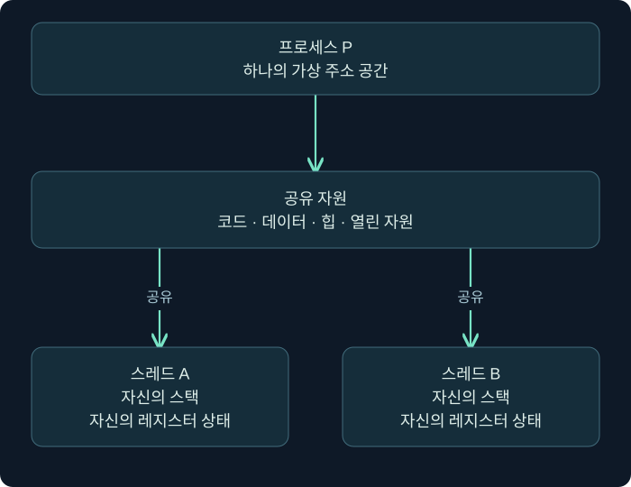
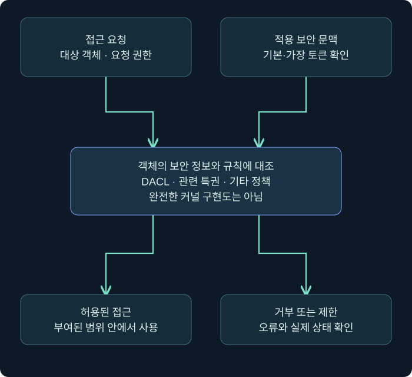

## 1. 파일을 두 번 실행하면 무엇이 두 개가 될까요?

같은 프로그램을 두 번 실행했는데 한쪽 창만 닫아도 다른 창은 계속 동작하는 경우가 있습니다. 디스크의 실행 파일은 같아도 실행 중인 상태는 따로 만들어졌기 때문입니다. 그 실행 상태의 중요한 단위가 **프로세스(process)**입니다. 다만 프로그램에 따라 기존 프로세스에 새 창을 요청할 수도 있어, 창의 개수와 프로세스 수가 언제나 같지는 않습니다.

파일을 건물 설계도에 비유한다면 프로세스는 설계도를 바탕으로 실제 운영 중인 작업장에 가깝습니다. 작업장은 주소 공간, 열린 자원, 실행할 일과 권한 정보를 관리합니다. **스레드(thread)**는 그 안에서 CPU 실행 시간을 배정받는 실행 흐름입니다. 건물 한 채에 여러 작업자가 있을 수 있는 것처럼 한 프로세스 안에 여러 스레드가 있을 수 있습니다.

| 구분 | 주요 의미 | 다른 항목과의 관계 |
| --- | --- | --- |
| 실행 파일 | 디스크에 저장된 코드와 데이터 | 실행 전에도 정적으로 분석할 수 있습니다 |
| 프로세스 | 실행 자원과 가상 주소 공간의 관리 단위 | 같은 파일로 여러 인스턴스를 만들 수 있습니다 |
| 스레드 | 스케줄러가 실행하는 단위 | 프로세스 자원을 공유하고 각자 실행 상태를 가집니다 |
| 핸들 | 열린 커널 객체를 참조하는 값 | 부여된 접근 권한과 수명을 확인해야 합니다 |

이 강의의 주소·상태·로그는 가상 사례입니다. Windows에서 명령을 실행하거나 실제 프로세스의 메모리·토큰을 조회한 결과가 아닙니다. 개념을 익힌 뒤 실제 관측에는 운영체제·아키텍처·수집 도구 버전을 함께 기록해야 합니다.

## 2. 프로세스와 스레드는 무엇을 공유할까요?

한 프로세스의 스레드들은 일반적으로 그 프로세스의 코드·데이터·힙 등 가상 주소 공간을 공유합니다. 반면 스레드는 각자의 레지스터 상태와 스택, 실행 상태를 가집니다. 그래서 한 스레드가 공유 데이터를 잘못 바꾸면 같은 프로세스의 다른 스레드도 영향을 받을 수 있습니다.

스택은 함수 호출의 복귀 정보, 일부 인자와 지역 데이터 등을 다루는 영역입니다. 스택을 “프로그램 명령어를 차례로 담아 놓은 목록”이라고 이해하면 혼동이 생깁니다. 일반적인 실행 명령은 코드 영역에서 가져오고, 현재 어디를 실행하는지는 명령 포인터 같은 레지스터 상태와 연결합니다.



스레드 시작 함수의 주소와 조사 시점의 명령 포인터도 구별해야 합니다. 시작 함수가 한 번 정해졌어도 스레드는 여러 함수를 호출하고 반환합니다. 나중에 관측한 명령 포인터가 처음 시작 주소와 다르다는 사실만으로 실행 흐름 변조를 입증할 수는 없습니다.

또한 CPU가 여러 개의 일을 동시에 처리하는 것처럼 보여도 한 코어에서 스레드 실행 시간을 나누는 경우가 있습니다. 실제 병렬 실행과 빠른 전환이 모두 가능하므로, 화면에서 동시에 움직였다는 관찰만으로 정확한 실행 순서를 추정하지 않습니다. 순서는 타임스탬프와 수집 지연까지 고려해 재구성합니다.

## 3. 프로세스 생성 API와 핸들을 읽는 방법

프로세스를 만드는 대표 API는 `CreateProcessW`입니다. 성공하면 새 프로세스와 기본 스레드에 대한 정보를 받습니다. 이미 토큰이 있는 경우나 다른 로그온 자격을 사용하는 경우에는 `CreateProcessAsUserW`, `CreateProcessWithLogonW`처럼 계약이 다른 API가 있습니다. 이름만 비슷하다고 동일한 권한·환경으로 실행된다고 가정하지 마세요.

특히 호출 스레드가 다른 사용자를 가장하고 있다는 이유만으로 `CreateProcessW`가 그 가장 토큰을 사용한다고 결론내리면 안 됩니다. 새 프로세스의 보안 문맥은 해당 API의 규칙을 따릅니다. 실제 조사에서는 부모 정보와 함께 새 프로세스의 사용자·토큰 정보를 확인해야 합니다.

핸들은 객체 자체가 아니라 객체에 접근하기 위한 참조입니다. `OpenProcess`는 이미 존재하는 프로세스에 요청한 접근 권한으로 핸들을 얻는 API입니다. **실패 반환값은 NULL**입니다. 다른 API에서 사용하는 `INVALID_HANDLE_VALUE`를 무조건 대입해 검사하면 오류를 놓칠 수 있습니다.

| 코드나 기록에서 볼 항목 | 확인할 질문 |
| --- | --- |
| 요청한 접근 마스크 | 조회만 필요한지, 변경까지 필요한지 |
| 반환값 | 해당 API의 성공·실패 규칙을 따랐는지 |
| 마지막 오류 | 실패 직후 올바르게 수집했는지 |
| 핸들 정리 | 소유한 핸들을 적절한 시점에 닫았는지 |
| 프로세스 식별 | PID뿐 아니라 생성 시각 등으로 동일 인스턴스인지 |

PID는 재사용될 수 있습니다. 오전에 PID 4200이었던 프로그램이 종료되고 오후에 다른 프로그램이 같은 번호를 받을 수 있습니다. 사건을 연결할 때 PID 하나만 일치한다고 같은 프로세스로 묶으면 안 됩니다. 시작 시각, 호스트, 가능한 경우 ProcessGuid 같은 식별자를 함께 사용합니다.

## 4. 가상 주소가 실제 RAM의 고정 위치는 아닙니다

가상 주소 공간은 프로세스가 메모리를 주소로 다루는 체계입니다. 두 프로세스에서 같은 숫자의 주소를 보았더라도 같은 물리 메모리를 뜻하지는 않습니다. 운영체제와 하드웨어가 각 문맥에 맞는 주소 변환을 수행합니다. 파일 매핑 등으로 일부 내용을 공유하는 경우도 있어 “항상 전부 별개”라고 단정해서도 안 됩니다.

**페이지(page)**는 메모리 관리와 보호의 중요한 단위입니다. 여기서는 계산을 위해 페이지 크기를 4,096바이트로 가정하겠습니다. 실제 크기와 큰 페이지 지원, 할당 단위는 시스템에서 확인해야 합니다. CPU 종류만 보고 모든 환경에 하나의 숫자를 고정하지 않습니다.

| 상태 | 쉬운 설명 | 주의할 점 |
| --- | --- | --- |
| Free | 아직 해당 예약 등에 사용하지 않는 주소 범위 | 사용 가능한 RAM의 양과 같은 숫자가 아닙니다 |
| Reserved | 주소 범위를 확보한 상태 | 예약만으로 바로 읽고 쓸 수 있다고 보지 않습니다 |
| Committed | 페이지에 대한 저장소 보장을 확보한 상태 | 모든 페이지가 즉시 물리 RAM에 올라왔다는 뜻은 아닙니다 |

페이지 크기를 위와 같이 가정할 때 6,000바이트를 페이지 단위로 덮으려면 최소 두 페이지, 8,192바이트 범위가 필요합니다. 다만 이것은 단순한 크기 계산입니다. 주소를 직접 지정하는 예약에서는 별도의 할당 단위 정렬 규칙이 관여합니다. 페이지 정렬과 예약 할당 단위를 같은 개념으로 외우지 마세요.

`VirtualAlloc`의 예약·커밋과 `VirtualProtect`의 보호 변경, `VirtualFree`의 해제는 서로 다른 작업입니다. 보호를 바꾸었다고 그 이전 바이트가 실행되었다는 뜻은 아닙니다. API 결과와 실제 메모리 상태, 실행 증거를 구별합니다.

## 5. 가상 할당·힙·파일 매핑을 구별합니다

메모리를 다루는 API는 하나가 아닙니다. 크고 직접적인 주소 범위를 관리할 때와 작은 객체를 반복 생성할 때, 파일 내용을 메모리에서 다룰 때에는 접근 방식이 달라집니다. 분석 중 “메모리를 할당했다”는 문장을 만나면 어떤 종류인지 한 단계 더 풀어 보세요.

| 방식 | 대표 API 계열 | 설명 |
| --- | --- | --- |
| 가상 메모리 관리 | VirtualAlloc·VirtualProtect·VirtualFree | 주소 범위의 예약·커밋·보호·해제를 다룹니다 |
| 힙 관리 | HeapAlloc·HeapFree | 힙 관리자가 작은 할당들을 관리합니다 |
| 파일 매핑 | CreateFileMapping·MapViewOfFile | 파일 또는 페이지 파일 기반 구역의 뷰를 주소 공간에 연결합니다 |

힙은 실행 중 필요한 데이터나 객체를 동적으로 할당하는 데 사용하는 메모리 관리 영역입니다. 정상 프로그램도 실행 가능한 메모리를 사용할 수 있습니다. 예를 들어 JIT(Just-In-Time) 컴파일러는 실행 중 필요한 시점에 코드를 생성할 수 있습니다. 따라서 쓰기 가능한 메모리가 실행 가능으로 바뀌었다는 단일 사건만으로 악성이라고 판정하지 않습니다. 누가 만들었는지, 어떤 바이트가 있는지, 어떤 스레드가 거기에서 실행했는지, 기능상 설명이 되는지 함께 봅니다.

반대로 파일 매핑이라는 이름 때문에 반드시 사용자가 볼 수 있는 디스크 파일이 있다고 생각하면 안 됩니다. 페이지 파일 기반 매핑도 가능합니다. “파일에 대응하지 않는 메모리”라는 표현만으로 이미 악성이라는 결론을 담지 않도록 용어를 정확하게 씁니다.

## 6. 접근 토큰은 계정 이름보다 많은 정보를 담습니다

접근 토큰에는 사용자 SID, 그룹, 특권 등 보안 문맥 정보가 들어 있습니다. **SID(Security Identifier)**는 Windows에서 보안 주체를 식별하는 값입니다. 화면에 보이는 사용자 이름이 같아도 토큰의 그룹 상태·제한·무결성 수준 등은 다를 수 있습니다.

프로세스에는 기본 토큰(primary token)이 연결됩니다. 스레드는 가장 토큰(impersonation token)을 사용해 특정 작업에서 다른 보안 문맥으로 행동할 수 있습니다. 모든 스레드가 반드시 별도 가장 토큰을 갖는 것은 아닙니다. 접근 판단에서는 해당 작업에 적용되는 토큰과 API의 규칙을 확인합니다.



대상 객체의 **DACL(Discretionary Access Control List)**은 허용·거부를 설명하는 접근 제어 항목들의 목록입니다. 개념적으로는 “어떤 문맥이 어떤 권한을 요청했으며 대상 정책이 이를 허용하는가”를 묻습니다. 실제 접근 검사에는 객체 종류와 특권·무결성 등 추가 규칙이 적용되므로, 그림을 커널 동작의 완전한 구현으로 읽지는 마세요.

비슷하게 들리는 용어도 구별해야 합니다. 빈 DACL은 항목이 없는 DACL이어서 접근을 허용할 항목이 없습니다. NULL DACL은 DACL 자체가 없는 경우로, 일반적인 DACL 검사에서 광범위한 접근 허용을 의미합니다. 이름에 “없다”가 들어간다는 이유로 두 설정을 같은 보안 상태라고 생각하면 위험합니다.

## 7. 특권이 있다는 것과 활성화되었다는 것은 다릅니다

**특권(privilege)**은 시스템 수준의 특정 작업에 영향을 주는 권리입니다. 파일 하나의 DACL 허용 항목과 같은 의미가 아닙니다. 관리자라는 이름만 보고 모든 특권이 현재 토큰에 들어 있고 활성화되었다고 가정해서는 안 됩니다.

| 특권 이름 | 이해할 핵심 | 피해야 할 단정 |
| --- | --- | --- |
| SeDebugPrivilege | 다른 프로세스 접근 검사에 큰 영향을 줄 수 있습니다 | 모든 보호 프로세스에 무제한 접근 가능하다는 단정 |
| SeTakeOwnershipPrivilege | 객체 소유권 취득과 관련됩니다 | 즉시 모든 파일 내용을 읽는 권한이라는 단정 |
| SeRestorePrivilege | 복원 작업의 보안 동작과 관련됩니다 | 모든 API에서 모든 검사 우회가 된다는 단정 |
| SeLoadDriverPrivilege | 드라이버 로드 권한과 관련됩니다 | 서명·플랫폼 정책까지 모두 사라진다는 단정 |
| SeCreateTokenPrivilege | 토큰 생성과 관련된 매우 강한 권리입니다 | 보통 계정이 쉽게 얻을 수 있다는 단정 |

`AdjustTokenPrivileges`는 토큰에 이미 있는 특권을 활성화·비활성화하는 등에 사용합니다. **없는 특권을 새로 추가하는 API가 아닙니다.** 반환값이 0이 아니어도 모든 요청이 충족되었다고 결론내리면 안 됩니다. `ERROR_NOT_ALL_ASSIGNED` 여부까지 확인해야 합니다.

```text
가상 요청: 현재 토큰에서 어떤 특권을 활성화
API 반환: 0이 아님
마지막 오류: ERROR_NOT_ALL_ASSIGNED
해석: API 호출 자체는 처리되었지만 요청한 특권이 모두 할당된 것은 아님
```

위는 오류 해석을 위한 가상 사례입니다. 실제 토큰 변경 명령을 실행한 결과가 아닙니다. 특권 이름을 나열했다는 이유로 활성화 상태를 확인했다고 기록하지 마세요.

`LsaEnumerateAccountRights`도 현재 실행 중인 토큰의 최종 접근 가능성을 통째로 판정하는 도구가 아닙니다. 계정에 할당된 권리를 조회하는 API입니다. 계정 설정, 로그온 시 만들어진 토큰, 현재 활성화 상태, 특정 객체에 대한 접근 결과를 각각 구분해야 합니다.

## 8. 종료와 정리는 다른 사건입니다

프로세스 종료에는 정상적인 종료 경로와 외부에서 강제로 종료시키는 경로 등이 있습니다. `ExitProcess`는 호출한 프로세스를 종료하는 API이며 DLL 종료 알림 등 정해진 동작이 있습니다. 그렇다고 모든 스레드의 모든 정리 코드가 원하는 순서로 실행된다고 보장하지는 않습니다.

`TerminateProcess`는 강제 종료 성격을 가지며 DLL의 정상 정리 동작을 기대할 수 없습니다. 다른 프로세스에 대한 호출은 비동기적으로 진행될 수 있어, 호출이 성공했다는 사실과 종료가 완료되었다는 사실을 구분해야 합니다. 이 차이는 로그와 파일이 중간 상태로 남은 이유를 해석할 때도 중요합니다.

**핸들을 닫는 것은 그 프로세스를 종료하는 것과 다릅니다.** 핸들 정리는 자신이 가진 참조를 해제하는 작업입니다. 정상적인 도구라도 핸들을 정리하지 않으면 자원 누수가 생길 수 있고, 핸들을 닫았다는 기록만 보고 대상 프로그램이 종료되었다고 보고하면 안 됩니다.

## 9. 가상 사건을 단계별로 읽어 봅니다

가상의 단말 로그에 다음 내용이 있다고 해 보겠습니다. 시간은 순서를 설명하기 위해 정했으며 실제 수집 로그가 아닙니다.

| 시각 | 관찰했다고 가정한 정보 | 그 정보만으로 확정할 수 없는 것 |
| --- | --- | --- |
| 10:00:00 | 프로세스 P가 생성됨 | 부모가 의도한 정확한 업무 목적 |
| 10:00:01 | P가 Q에 대한 핸들을 요청함 | 접근 성공 여부와 이후 실제 사용 |
| 10:00:02 | Q에 새 메모리 영역이 관측됨 | 누가 만들었고 실제 실행했는지 |
| 10:00:03 | Q가 종료됨 | P가 종료시켰는지, 자체 오류인지 |

여기에 “P가 Q를 공격해 종료시켰다”라는 문장을 붙이려면 연결 증거가 더 필요합니다. 핸들 권한과 반환 결과, 메모리 내용과 생성 주체, 스레드 실행 위치, 종료 관련 로그를 확인해야 합니다. 순서가 가깝다는 사실은 인과관계의 출발 단서이지 최종 입증이 아닙니다.

조사 메모에는 관측과 해석을 분리해 씁니다. “P의 접근 요청이 있었음”은 관측, “Q의 변경과 연관되었을 가능성”은 가설, “메모리 쓰기와 실행 증거를 추가 확인”은 다음 작업입니다. 앞 강의에서 배운 파일 구조와 이번 강의의 실행 상태를 연결하면, 단일 API 이름에서 너무 멀리 결론을 뻗는 실수를 줄일 수 있습니다.

## 10. 복습과 바로 읽는 해설

### 복습 1. 프로세스와 스레드의 핵심 차이는 무엇인가요?

**해설:** 프로세스는 주소 공간과 자원 관리의 단위이고 스레드는 CPU 실행을 배정받는 흐름입니다. 여러 스레드가 프로세스 자원을 공유하면서 각자의 스택과 레지스터 상태를 가집니다.

### 복습 2. 같은 가상 주소가 보이면 같은 물리 RAM인가요?

**해설:** 아닙니다. 프로세스별 주소 변환 문맥이 다릅니다. 공유 매핑 여부도 별도 확인해야 하므로 숫자 일치만으로 동일 데이터를 공유한다고 결론내릴 수 없습니다.

### 복습 3. 주소를 예약하면 바로 읽고 쓸 수 있나요?

**해설:** 예약은 주소 범위 확보입니다. 커밋과 적절한 보호 등 접근 조건을 구별해야 합니다. 커밋도 모든 페이지가 즉시 RAM에 상주한다는 뜻은 아닙니다.

### 복습 4. OpenProcess 실패를 INVALID_HANDLE_VALUE로만 검사해도 되나요?

**해설:** 안 됩니다. OpenProcess 실패 반환은 NULL입니다. API마다 계약이 다르므로 반환값과 오류 처리 규칙을 각각 확인합니다.

### 복습 5. 가장 중인 스레드가 CreateProcessW를 부르면 항상 가장 사용자로 실행되나요?

**해설:** 아닙니다. CreateProcessW는 호출 프로세스의 토큰을 사용하는 규칙을 따릅니다. 다른 보안 문맥의 프로세스 생성에는 목적에 맞는 별도 API와 권한 조건을 확인해야 합니다.

### 복습 6. AdjustTokenPrivileges가 0이 아닌 값을 반환하면 모든 특권이 활성화됐나요?

**해설:** ERROR_NOT_ALL_ASSIGNED까지 확인해야 합니다. 없는 특권을 추가하지 못하며 일부 요청만 반영될 수 있습니다. 성공처럼 보이는 반환값만 기록하면 실제 상태를 잘못 설명하게 됩니다.

### 복습 7. 빈 DACL과 NULL DACL은 같은가요?

**해설:** 다릅니다. 빈 DACL은 접근 허용 항목이 없는 목록이고, NULL DACL은 DACL이 없는 상태로 광범위한 허용을 뜻할 수 있습니다. 실제 객체의 다른 보안 규칙도 함께 봅니다.

### 복습 8. 핸들을 닫았다는 로그로 프로세스 종료를 확정할 수 있나요?

**해설:** 없습니다. 참조 해제와 프로세스 종료는 다른 사건입니다. 종료 API의 결과나 실제 종료 상태·시각을 확인해야 합니다.

## 11. 공식 근거와 다음 학습

공식 자료 확인일은 **2026년 11월 2일**입니다. 이 강의는 API의 개념과 해석 기준을 설명하며 Windows에서의 직접 실행 결과를 제시하지 않습니다.

- [프로세스와 스레드 개요](https://learn.microsoft.com/en-us/windows/win32/procthread/about-processes-and-threads), [가상 메모리](https://learn.microsoft.com/en-us/windows/win32/memory/virtual-memory).
- [VirtualAlloc](https://learn.microsoft.com/en-us/windows/win32/api/memoryapi/nf-memoryapi-virtualalloc), [메모리 보호 상수](https://learn.microsoft.com/en-us/windows/win32/memory/memory-protection-constants).
- [CreateProcessW](https://learn.microsoft.com/en-us/windows/win32/api/processthreadsapi/nf-processthreadsapi-createprocessw), [OpenProcess](https://learn.microsoft.com/en-us/windows/win32/api/processthreadsapi/nf-processthreadsapi-openprocess).
- [접근 토큰](https://learn.microsoft.com/en-us/windows/win32/secauthz/access-tokens), [DACL과 ACE](https://learn.microsoft.com/en-us/windows/win32/secauthz/dacls-and-aces), [프로세스 접근 권한](https://learn.microsoft.com/en-us/windows/win32/procthread/process-security-and-access-rights).
- [AdjustTokenPrivileges](https://learn.microsoft.com/en-us/windows/win32/api/securitybaseapi/nf-securitybaseapi-adjusttokenprivileges), [LsaEnumerateAccountRights](https://learn.microsoft.com/en-us/windows/win32/api/ntsecapi/nf-ntsecapi-lsaenumerateaccountrights).
- [ExitProcess](https://learn.microsoft.com/en-us/windows/win32/api/processthreadsapi/nf-processthreadsapi-exitprocess), [TerminateProcess](https://learn.microsoft.com/en-us/windows/win32/api/processthreadsapi/nf-processthreadsapi-terminateprocess).

다음 강의에서는 이 개념을 바탕으로 코드 주입을 구분하고, 실행 흐름이 바뀌었다는 주장을 어떤 증거로 확인할지 배웁니다.
