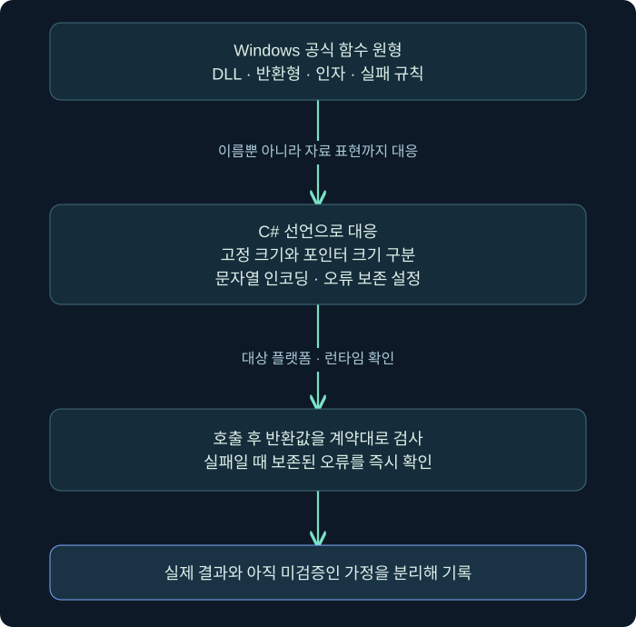
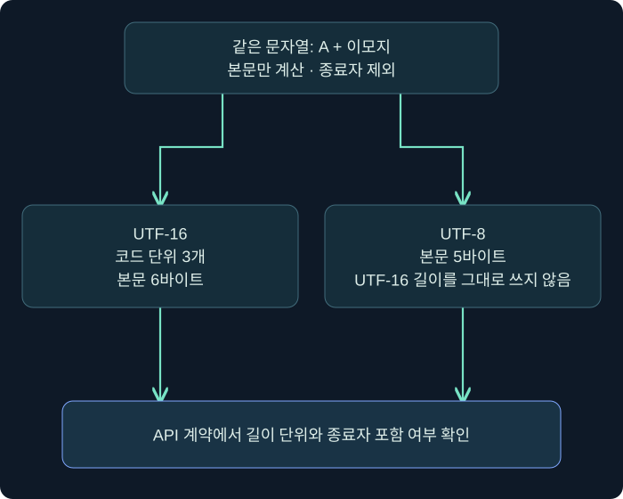

## 1. C#에서 Windows API를 부르면 무엇이 달라질까요?

C# 프로그램은 .NET이 제공하는 관리 환경에서 실행됩니다. Windows의 여러 저수준 기능은 네이티브 DLL의 함수로 제공됩니다. 두 세계가 만나는 호출 경계에서 **P/Invoke(Platform Invocation)**를 사용합니다. 함수 이름을 선언하는 것만으로 끝나지 않고 인자와 반환값, 문자열과 메모리의 표현을 서로 맞추어야 합니다.

통역을 통해 주문하는 상황을 떠올려 보세요. 같은 “큰 컵”이라는 말을 쓰더라도 양쪽에서 정한 단위가 다르면 다른 결과가 나옵니다. 함수 이름이 맞아도 숫자의 크기, 문자열 인코딩, 구조체 정렬, 실패 표시를 잘못 옮기면 호출은 잘못 해석됩니다.

이 강의는 프로세스를 변경하는 코드 대신 **현재 PID 조회와 로컬 파일 속성 조회**로 호출 계약을 읽는 법을 설명합니다. C# 코드는 Windows에서 실행하지 않은 교육용 예제입니다. 실제 PID나 파일 속성값을 실행 결과인 것처럼 제시하지 않습니다. 앞 강의의 Python 합성 데이터 검사만 별도로 실제 검증한 범위입니다.

## 2. 선언을 함수의 계약서로 읽습니다

전통적인 P/Invoke에서는 `DllImport` 특성으로 DLL과 진입 함수를 지정하고 `static extern` 메서드를 선언합니다. `extern`은 메서드 본문이 C# 파일 안에 없다는 뜻입니다. 런타임이 선언을 바탕으로 외부 함수를 호출합니다.



| 선언 요소 | 확인할 의미 | 틀렸을 때의 문제 |
| --- | --- | --- |
| DLL 이름 | 어느 모듈에서 찾나요? | 다른 모듈이나 잘못된 검색 경로를 사용할 수 있습니다 |
| EntryPoint·함수 이름 | 어떤 내보내기 함수를 부르나요? | A/W 변형이나 이름을 잘못 찾을 수 있습니다 |
| 반환 자료형 | 몇 비트를 어떤 의미로 읽나요? | 주소가 잘리거나 실패를 성공으로 볼 수 있습니다 |
| 인자와 방향 | 값·참조·버퍼 중 무엇인가요? | 잘못된 위치를 읽거나 길이를 오해할 수 있습니다 |
| 문자열 설정 | 어떤 인코딩으로 넘기나요? | 비ASCII 문자나 길이 계산이 깨질 수 있습니다 |
| 오류 설정 | 마지막 오류를 보존해야 하나요? | 원래 실패 원인을 잃을 수 있습니다 |

`SetLastError = true`는 그 API의 마지막 오류 값을 .NET이 보존하도록 요청하는 설정입니다. **오류를 자동으로 예외로 바꾸거나 성공을 보장하지는 않습니다.** 먼저 반환값을 계약대로 검사하고, 실패한 경우 필요한 오류를 바로 읽습니다. 성공 뒤에 남은 오래된 오류값을 현재 실패처럼 해석해서도 안 됩니다.

커뮤니티의 P/Invoke 선언 모음은 출발점이 될 수 있지만 최종 근거는 Windows 공식 함수 원형과 SDK 자료형입니다. 복사한 예제의 대상 .NET 버전·프로세스 비트 수·문자열 정책이 자신의 환경과 같은지 확인해야 합니다.

## 3. Windows의 LONG과 C#의 long은 크기가 다릅니다

이름이 비슷하다고 같은 자료형은 아닙니다. Windows의 `LONG`은 32비트이고 C#의 `long`은 64비트입니다. 64비트 Windows에서도 Windows `LONG`이 자동으로 64비트가 되지 않습니다. 네이티브 원형의 별칭을 실제 크기와 부호로 풀어 읽어야 합니다.

| 네이티브 쪽 개념 | Windows에서의 핵심 크기 | C# 대응을 검토할 때 |
| --- | --- | --- |
| DWORD | 부호 없는 32비트 | 보통 uint |
| LONG | 부호 있는 32비트 | 보통 int |
| BOOL | 보통 32비트 정수 기반 | Win32 BOOL로 명시적 마샬링을 검토합니다 |
| C++ bool·일부 BOOLEAN | 보통 1바이트 | Win32 BOOL과 섞지 않습니다 |
| HANDLE·포인터 | 프로세스 포인터 크기 | IntPtr·nint 또는 적절한 SafeHandle |
| SIZE_T | 포인터 크기의 부호 없는 정수 | UIntPtr·nuint 등 계약에 맞는 형식 |

`IntPtr`라고 선언했다고 모든 핸들의 수명을 자동 관리하지는 않습니다. 수명을 소유하는 자원은 적절한 `SafeHandle`을 사용하는 방식이 유용합니다. 반대로 단순 숫자 식별자인 PID는 핸들이 아니며 `CloseHandle`로 닫을 대상도 아닙니다.

구조체를 넘길 때는 필드 순서와 정렬도 맞아야 합니다. C#의 `[StructLayout(LayoutKind.Sequential)]`은 순차 배치를 지정하지만, 임의의 `Pack = 1`이 항상 답은 아닙니다. 네이티브 구조체의 정렬과 포인터 크기를 확인하고 `Marshal.SizeOf` 등으로 대상 환경의 크기를 검증합니다. 이 강의는 실제 구조체 호출을 실행하지 않았으므로 특정 크기의 실측 결과를 꾸며 제시하지 않습니다.

## 4. A는 항상 UTF-8이라는 뜻이 아닙니다

Windows API에는 문자열 인코딩을 구분하는 A와 W 변형이 자주 등장합니다. 예를 들어 `GetFileAttributesW`는 와이드 문자열을 받는 Windows API입니다. Win32의 W 문자열은 UTF-16을 사용합니다. A는 일반적으로 Windows의 ANSI 코드 페이지와 연결되며 **항상 UTF-8인 것은 아닙니다.** 설정에 따라 UTF-8 코드 페이지를 쓰는 환경도 있으므로 환경 의존성을 확인해야 합니다.

| 구분 | Windows에서 읽을 의미 | 주의점 |
| --- | --- | --- |
| W 함수·Unicode 마샬링 | UTF-16 문자열 계약 | 길이가 문자 수인지 바이트 수인지 별도 확인합니다 |
| A 함수·Ansi 마샬링 | 해당 계약의 ANSI 코드 페이지 | 한글 등이 모든 코드 페이지에서 표현된다고 보장하지 않습니다 |
| UTF-8 명시 계약 | UTF-8 바이트열 | API가 정말 UTF-8을 받는지 확인해야 합니다 |
| CharSet.Auto | 플랫폼·런타임 규칙에 따름 | 명시적인 W 호출을 읽을 때 임의로 바꾸지 않습니다 |

.NET의 마샬링 규칙은 운영체제에 따라서도 달라질 수 있습니다. Windows의 Ansi 설명을 Unix까지 그대로 확대하지 마세요. `CharSet`과 `MarshalAs`, 또는 `LibraryImport`의 문자열 설정을 해당 플랫폼 문서와 함께 확인합니다.



문자열 `A😀`를 예로 들면 C#의 `Length`는 UTF-16 코드 단위 기준으로 3입니다. 사람 눈에 보이는 두 기호의 개수와 다릅니다. UTF-16 본문은 6바이트, UTF-8 본문은 5바이트입니다. 이 값은 끝의 NUL 종료자를 포함하지 않습니다. 종료자가 필요한지, 버퍼 길이가 이를 포함하는지는 함수 계약에 따릅니다.

```csharp
string text = "A😀";
int utf16CodeUnits = text.Length;
int utf16Bytes = System.Text.Encoding.Unicode.GetByteCount(text);
int utf8Bytes = System.Text.Encoding.UTF8.GetByteCount(text);
// 인코딩 규칙상 각각 3, 6, 5. 이 코드는 Windows에서 실행한 결과가 아닙니다.
```

“문자열 길이를 넘긴다”라는 설명을 만나면 단위를 먼저 물으세요. 바이트 수인지, UTF-16 코드 단위 수인지, 종료자를 포함하는지에 따라 같은 값이 전혀 다른 범위를 뜻합니다. 버퍼 크기와 내용 길이를 같은 것으로 처리하는 것도 흔한 오류입니다.

## 5. 읽기 전용 예제의 네이티브 원형을 먼저 봅니다

현재 프로세스의 식별 번호를 가져오는 함수의 반환형은 `DWORD`입니다. 파일 속성 함수도 `DWORD`를 반환하지만 실패 규칙이 다릅니다. **같은 반환 자료형이어도 성공·실패의 의미가 같지는 않습니다.**

```c
DWORD GetCurrentProcessId(void);
DWORD GetFileAttributesW(LPCWSTR lpFileName);
```

`LPCWSTR`는 읽기 전용 와이드 문자열 포인터라는 의미로 풀어 읽을 수 있습니다. 여기서 W 문자열 계약에 맞춰 C# 문자열을 전달합니다. `GetFileAttributesW`는 파일 내용을 읽는 함수가 아니라 속성 비트를 조회하는 함수입니다. 실패하면 `INVALID_FILE_ATTRIBUTES`, 즉 `0xFFFFFFFF`를 반환합니다.

반환값이 `0`이 아닌지로만 성공을 판단하면 실패값 `0xFFFFFFFF`도 성공으로 오해할 수 있습니다. 반대로 모든 API에서 음수를 실패로 검사하는 방식도 부호 없는 반환형에는 맞지 않습니다. 성공 기준과 오류 조회 조건은 각각의 공식 문서에서 읽어야 합니다.

## 6. C# 예제를 한 줄씩 해석합니다

다음 예제는 Windows용 콘솔 프로그램의 `Program.cs`로 읽을 수 있는 코드입니다. `Marshal.GetLastPInvokeError`를 사용하는 부분은 .NET 6 이상을 전제로 합니다. 해당 대상 프레임워크를 지원하는 SDK와 Windows 실행 환경이 필요합니다. 이 게시 과정에서는 컴파일·실행하지 않았으므로 실제 환경의 성공을 검증한 코드로 표현하지 않습니다.

```csharp
using System;
using System.Runtime.InteropServices;

internal static class Program
{
    private const uint InvalidFileAttributes = 0xFFFFFFFF;

    [DllImport("kernel32.dll", ExactSpelling = true)]
    [DefaultDllImportSearchPaths(DllImportSearchPath.System32)]
    private static extern uint GetCurrentProcessId();

    [DllImport("kernel32.dll", EntryPoint = "GetFileAttributesW",
        ExactSpelling = true, CharSet = CharSet.Unicode,
        SetLastError = true)]
    [DefaultDllImportSearchPaths(DllImportSearchPath.System32)]
    private static extern uint GetFileAttributesW(string fileName);

    private static int Main(string[] args)
    {
        if (!OperatingSystem.IsWindows())
        {
            Console.Error.WriteLine("Windows 실행 환경이 필요합니다.");
            return 2;
        }

        if (args.Length != 1)
        {
            Console.Error.WriteLine("조회할 로컬 파일 경로 하나를 지정하세요.");
            return 2;
        }

        Console.WriteLine($"Current PID: {GetCurrentProcessId()}");
        uint attributes = GetFileAttributesW(args[0]);
        if (attributes == InvalidFileAttributes)
        {
            int error = Marshal.GetLastPInvokeError();
            Console.Error.WriteLine($"GetFileAttributesW failed: {error}");
            return 1;
        }

        Console.WriteLine($"Attributes: 0x{attributes:X8}");
        return 0;
    }
}
```

먼저 Windows 여부와 인자 개수를 검사합니다. 그 뒤 현재 PID를 조회하고, 지정한 파일의 속성값을 조회합니다. 프로세스 메모리를 변경하거나 다른 프로세스를 여는 함수는 없습니다. PID는 실행할 때마다 달라질 수 있으므로 고정 숫자의 “예상 실행 결과”를 붙이지 않았습니다.

`ExactSpelling = true`는 명시한 함수 이름을 정확하게 사용하도록 합니다. `EntryPoint`로 W 함수를 지정하고 `CharSet.Unicode`로 문자열 표현을 맞췄습니다. DLL 검색 경로는 이 시스템 DLL 호출에 맞춰 `System32`로 제한했습니다. 모든 제3자 DLL에 이 설정을 그대로 적용하라는 뜻은 아닙니다.

실패 분기에서는 다른 네이티브 호출을 끼워 넣기 전에 보존된 오류를 읽습니다. 성공 분기에서는 오류 숫자를 판정 근거로 삼지 않고 반환된 속성 비트를 출력합니다. 출력이 속성값이라는 사실과 파일의 정상·악성 여부도 구별해야 합니다.

## 7. LibraryImport는 언제 검토할까요?

.NET 7부터는 `LibraryImport`를 통한 소스 생성 방식도 제공됩니다. 빌드 때 호출 코드를 생성하는 방식으로, 호환되는 함수 서명과 프로젝트에서는 진단과 AOT(Ahead-Of-Time, 실행 전 미리 컴파일) 지원 등에 도움이 될 수 있습니다. 이것이 모든 `DllImport` 코드가 잘못되었다는 뜻은 아닙니다. 대상 런타임과 지원 범위를 확인한 뒤 선택합니다.

| 방식 | 코드 형태의 특징 | 확인할 조건 |
| --- | --- | --- |
| DllImport | 전통적인 static extern 선언 | 런타임 마샬링과 대상 플랫폼 |
| LibraryImport | 생성기가 구현할 static partial 선언 | .NET 버전, 생성기 지원, 프로젝트 설정 |

예를 들어 생성 방식에서 Unicode 문자열 계약은 `StringMarshalling.Utf16`처럼 명시적으로 표현할 수 있습니다. 하지만 특성 이름만 바꾸고 `extern`을 그대로 두는 식의 기계적인 치환은 올바른 전환이 아닙니다. `partial` 메서드와 이를 담는 형식, 필요한 빌드 설정, 지원되는 마샬링을 함께 검토해야 합니다.

새 프로젝트에 어느 방식을 사용할지와 기존 분석 대상 코드가 무엇을 했는지를 설명하는 일도 다릅니다. 분석에서는 과거 코드의 실제 호출 규칙을 먼저 해석합니다. 최신 방식으로 바꿔 적은 예제를 보고 원래 실행의 자료형·오류 처리가 같았다고 가정하면 안 됩니다.

## 8. 호출이 실패했을 때 질문하는 순서

P/Invoke가 실패하면 바로 관리자 권한으로 다시 실행하고 싶을 수 있습니다. 하지만 원인이 자료형·인코딩·함수 이름·경로라면 권한을 높여도 해결되지 않습니다. 먼저 계약을 확인하는 편이 원인을 정확하게 좁힙니다.

1. 공식 함수 원형과 DLL·진입 함수가 일치하는지 확인합니다.
2. 반환값을 해당 API의 실패 규칙과 비교합니다.
3. 오류 보존 설정과 오류를 읽는 시점이 올바른지 확인합니다.
4. 인자의 자료형·부호·포인터 크기와 문자열 인코딩을 확인합니다.
5. 경로·대상 객체·요청 권한·실제 보안 문맥을 확인합니다.
6. 검증한 환경과 아직 확인하지 못한 부분을 기록합니다.

가령 한글 파일명에서만 문제가 난다면 A/W 선택이나 코드 페이지가 우선적인 조사 대상이 될 수 있습니다. 64비트 프로세스에서만 주소가 이상하다면 포인터를 32비트 정수로 잘라 보관했는지 확인할 수 있습니다. 이것은 원인 후보를 좁히는 예이며 모든 실패를 인코딩이나 비트 수로 확정하는 규칙은 아닙니다.

## 9. 이번 단원의 개념을 하나의 분석 메모로 연결합니다

가상의 코드 조각에 파일 속성 조회, 프로세스 핸들 요청, 메모리 보호 변경이 함께 있다고 해 보겠습니다. API 이름을 모두 찾아 적는 것은 시작입니다. 그다음은 각 호출의 입력과 반환값을 확인하고, 결과가 다음 호출에 실제로 연결되었는지 확인해야 합니다.

PE 분석은 디스크 구조를 설명하고, 프로세스·토큰 분석은 실행 문맥과 접근 조건을 설명합니다. 메모리·스레드 관측은 어느 바이트가 어떤 문맥에서 실행되었는지를 좁힙니다. P/Invoke 해석은 관리 코드에서 네이티브 호출로 넘어갈 때 그 연결이 올바르게 선언되었는지를 확인합니다.

보고서에는 “코드에 함수 이름이 있었다”, “호출이 성공했다고 가정했다”, “로그에서 실제 결과를 확인했다”를 같은 수준으로 섞지 마세요. 실제 조사에서는 실행 경로와 도구의 관측 범위까지 검토해야 합니다. 이번 단원은 이 구분을 할 수 있는 기초 언어와 계산법을 익히는 과정입니다.

## 10. 복습과 바로 읽는 해설

### 복습 1. P/Invoke 선언의 함수 이름만 맞으면 충분한가요?

**해설:** 아닙니다. DLL과 진입점, 반환형, 인자, 포인터 크기, 문자열 인코딩, 오류 규칙이 함께 맞아야 합니다. 계약의 일부만 맞으면 실패나 잘못된 해석이 생길 수 있습니다.

### 복습 2. Windows LONG은 C# long에 대응하나요?

**해설:** 보통 아닙니다. Windows LONG은 32비트이므로 C# int가 대응합니다. C# long은 64비트입니다. 이름보다 비트 수와 부호를 확인합니다.

### 복습 3. HANDLE과 PID를 둘 다 닫아야 하나요?

**해설:** 아닙니다. 소유한 핸들은 계약에 맞게 정리하지만 PID는 숫자 식별자입니다. IntPtr로 표현했다는 이유만으로 자동 정리되는 것도 아니므로 수명 소유권을 따로 확인합니다.

### 복습 4. Windows A 함수는 항상 UTF-8을 받나요?

**해설:** 아닙니다. 일반적으로 ANSI 코드 페이지와 연결되며 환경 설정에 따라 달라질 수 있습니다. W는 UTF-16 계약을 확인합니다. Unix의 .NET 규칙도 Windows와 무조건 같다고 보지 않습니다.

### 복습 5. A😀의 C# Length가 3인 이유는요?

**해설:** UTF-16 코드 단위를 세기 때문입니다. A는 한 단위, 이모지는 서로게이트 쌍 두 단위입니다. 본문의 UTF-16 바이트 수는 6, UTF-8 바이트 수는 5이며 종료자는 포함하지 않은 값입니다.

### 복습 6. SetLastError=true는 실패 시 자동으로 예외를 던지나요?

**해설:** 아닙니다. 오류 값을 보존하도록 요청하는 설정입니다. 반환값을 검사하고 적절한 시점에 오류를 읽어 직접 처리해야 합니다.

### 복습 7. GetFileAttributesW가 0xFFFFFFFF를 반환하면 속성 비트가 전부 켜진 성공인가요?

**해설:** 아닙니다. INVALID_FILE_ATTRIBUTES라는 실패값입니다. 같은 DWORD라도 API마다 성공·실패 의미가 다르므로 공식 반환 규칙을 따라야 합니다.

### 복습 8. LibraryImport가 있으니 모든 DllImport를 그대로 이름만 바꾸면 되나요?

**해설:** 아닙니다. 소스 생성 방식의 partial 선언과 지원 서명, 대상 .NET 및 프로젝트 설정을 검토해야 합니다. 분석 대상의 기존 호출 의미도 먼저 정확히 읽어야 합니다.

## 11. 공식 근거와 검증 범위

공식 자료 확인일은 **2026년 11월 2일**입니다. C#·Windows 예제는 미실행이며 인코딩 수치는 규칙을 설명하기 위한 계산입니다. 실제 테스트를 마친 Python 합성 헤더 실습과 구별합니다.

- [P/Invoke와 문자 집합](https://learn.microsoft.com/en-us/dotnet/standard/native-interop/charset): 플랫폼별 Ansi·Unicode 규칙.
- [네이티브 상호 운용 권장 사항](https://learn.microsoft.com/en-us/dotnet/standard/native-interop/best-practices): 형식 대응과 수명·마샬링 고려사항.
- [P/Invoke 소스 생성](https://learn.microsoft.com/en-us/dotnet/standard/native-interop/pinvoke-source-generation): LibraryImport의 조건과 사용 방식.
- [GetCurrentProcessId](https://learn.microsoft.com/en-us/windows/win32/api/processthreadsapi/nf-processthreadsapi-getcurrentprocessid): PID 조회 계약.
- [GetFileAttributesW](https://learn.microsoft.com/en-us/windows/win32/api/fileapi/nf-fileapi-getfileattributesw): 파일 속성 조회와 실패값.

여기까지 세 번째 단원의 학습을 마쳤습니다. 파일 구조, 실행 상태, 보안 문맥, 메모리와 실행 흐름, 언어 간 호출 계약을 나누어 보고 필요한 증거로 연결하는 연습을 반복해 보세요.
