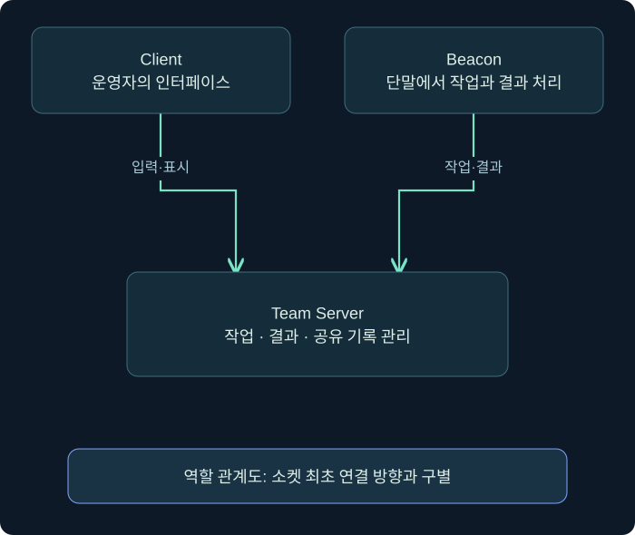
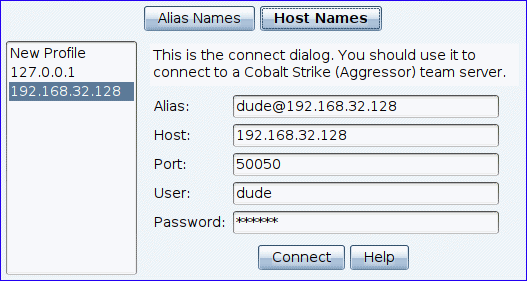
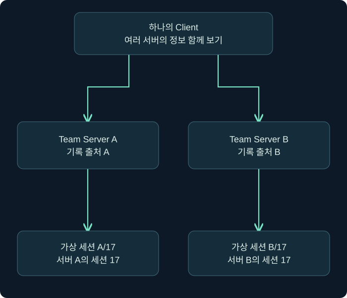

## 1. 이번 장에서는 무엇을 연결할까요?

앞 장에서는 실행 파일과 메모리, 프로세스와 스레드, 언어 사이의 API 호출을 배웠습니다. 이번에는 이런 실행 상태를 원격에서 관리하는 도구의 구조를 봅니다. 화면에 세션 하나가 나타났을 때 어느 프로그램이 어느 서버와 통신하는지, 입력한 작업이 언제 실행되는지, 방어자는 무엇을 확인할 수 있는지를 차례로 연결합니다.

**C2(Command and Control)**는 실행 중인 에이전트와 관리 측이 작업과 결과를 주고받는 통신·관리 체계를 가리킵니다. 이번 단원의 사례 도구인 **Cobalt Strike**는 승인된 보안 검증에서 공격자 행동을 모사하는 상용 플랫폼입니다. 실제 침해에서 악용되기도 하므로 도구 이름과 활동의 정당성을 같은 것으로 판단하지 않습니다. 합의된 대상·작업·기간은 앞 단원의 활동 계획과 연결합니다.

이 강의의 호스트·주소·세션·작업 기록은 독립적으로 만든 가상 사례입니다. 실제 제품을 설치하거나 에이전트를 생성·실행한 결과가 아닙니다. 원리를 설명하는 개념도는 새로 작성했고, 실제 설정 화면은 Fortra가 공개한 공식 안내서의 이미지를 출처와 함께 사용합니다. 화면 속 주소·계정은 공식 예시이며 이 과정의 실측 결과가 아닙니다. 공식 자료 확인일은 **2026년 11월 3일**이며, 확인한 현행 사용자 안내서는 4.13을 표시합니다.

## 2. Beacon·Team Server·Client를 나눠 봅니다

처음에는 세 이름이 모두 “프로그램을 조종하는 도구”처럼 들릴 수 있습니다. 택배 업무로 비유하면 현장에서 일하는 담당자, 접수와 기록을 모으는 배차 센터, 센터 화면을 사용하는 운영자가 다릅니다. 어떤 구성 요소가 사라졌을 때 무엇이 멈추는지 생각하면 구별이 쉬워집니다.

| 구성 요소 | 담당하는 역할 | 혼동하기 쉬운 점 |
| --- | --- | --- |
| Beacon | 단말 문맥에서 실행되는 에이전트로 작업 수신·수행·결과 전송을 담당합니다 | 운영자 PC에서 보이는 화면 자체가 아닙니다 |
| Team Server | 에이전트 통신과 작업·결과·공유 정보를 관리합니다 | 모든 통신을 단말과 직접 맺는다고 단정하지 않습니다 |
| Client | 운영자가 서버에 연결해 세션과 작업을 다루는 인터페이스입니다 | 단말의 Beacon이 Client에 직접 연결하는 구조로 읽지 않습니다 |

**에이전트(agent)**는 다른 구성 요소의 지시에 따라 정해진 작업을 수행하고 상태를 보고하는 프로그램입니다. Beacon이라는 제품 명칭과 일반적인 비커닝(beaconing), 즉 주기적으로 통신하는 현상도 구분합니다. 주기적인 업데이트 프로그램이 보였다고 Cobalt Strike Beacon이라고 확정할 수는 없습니다.

그림의 연결은 역할 관계를 단순화한 것입니다. 네트워크 세션의 최초 연결 방향이나 모든 패킷의 흐름을 한 화살표에 담지는 않았습니다. 특히 HTTP 계열에서 작업 응답은 Beacon이 먼저 보낸 요청에 실려 올 수 있습니다. “작업이 서버에서 왔다”와 “서버가 새 인바운드 TCP 연결을 시작했다”는 같은 말이 아닙니다.

### 실제 화면 1: Client의 접속 창에서 시작합니다

아래는 Fortra 공식 안내서의 실제 Client 접속 창입니다. 새로 그린 모형이 아닙니다. 문서의 화면을 읽는 연습이며 이 사이트 안에서 Cobalt Strike를 조작하는 화면은 아닙니다. 공개 안내서가 4.13이어도 일부 삽화는 이전 UI를 사용하므로, 설치 버전에 따라 버튼 위치·표현이 다를 수 있습니다.

출처: [Fortra — Starting a Cobalt Strike Client](https://hstechdocs.helpsystems.com/manuals/cobaltstrike/current/userguide/content/topics/welcome_starting-cs-client.htm). 공식 예시 이미지를 변경하지 않았습니다.

처음 Client를 열면 이 접속 창에서 시작합니다. 이미 한 서버에 연결했다면 상단 **Cobalt Strike → New Connection**으로 새 연결 창을 엽니다. 왼쪽의 저장된 프로파일을 선택하는 영역과 오른쪽의 현재 접속 정보를 구분하세요. **Host Names / Alias Names**는 저장된 연결을 어느 이름으로 표시할지와 관련되며, Beacon의 HTTP 호스트 순환 설정이 아닙니다.

| 화면 위치·항목 | 무엇을 넣거나 확인하나요? | 격리 실습망을 가정한 예시 |
| --- | --- | --- |
| 오른쪽 Alias | Client에서 이 연결을 구별할 표시 이름 | lab-team-a |
| Host | Team Server의 관리 연결 주소 | 192.168.56.10 |
| Port | Client가 접속할 Team Server 관리 포트 | 기본 구성 예시는 50050, 실제 서버 값 확인 |
| User | 서버에 접속하는 운영자의 식별 이름 | learner |
| Password | 관리자가 정한 해당 서버의 접속 암호 | 자신의 실습 서버 값 직접 입력 |
| 아래 Connect | 입력한 서버로 관리 연결 시도 | 접속 성공은 Beacon 실행 성공과 별개 |

표의 주소는 **Linux Team Server가 192.168.56.10, Windows 실습 단말이 192.168.56.20인 격리망을 만들었다는 가정**입니다. 자신의 환경에 이 주소가 배정되어 있지 않으면 그대로 입력해도 연결되지 않습니다. 공식 이미지의 다른 주소·사용자 이름을 옮겨 적는 실습이 아닙니다.

1. 자신의 실습 Team Server 주소와 관리 포트를 확인합니다.
2. Host와 Port를 넣고 운영자 User와 서버의 Password를 입력합니다.
3. Connect를 선택합니다. 서버 지문 확인 창이 나오면 관리자가 별도 경로로 알려 준 지문과 대조합니다.
4. 일치 여부를 확인한 뒤 연결을 완료하고, 현재 활성 서버의 이름을 확인합니다.

여기서 **50050은 관리 연결의 예시**입니다. 뒤에서 HTTP 리스너의 8080 포트를 설정하더라도 Client의 Port를 8080으로 바꾸는 것이 아닙니다. 반대로 Beacon이 Client 관리 포트로 접속하는 구조도 아닙니다. 같은 IP를 사용해도 서비스 역할과 포트는 구별해야 합니다.

### 실제 메뉴 동선: 연결한 뒤 무엇을 여나요?

| 목적 | 화면에서 여는 순서 | 그다음 확인할 것 |
| --- | --- | --- |
| 다른 Team Server에 연결 | Cobalt Strike → New Connection | 활성 서버와 연결 표시 이름 |
| 리스너 목록 열기 | Cobalt Strike → Listeners | 현재 서버의 리스너 목록과 아래쪽 Add |
| 표·그래프 보기 변경 | Cobalt Strike → Visualization | Sessions Table 또는 Pivot Graph |
| 특정 세션 콘솔 열기 | 세션 행을 오른쪽 클릭 → Interact | 콘솔 탭의 대상·사용자·PID |

**Client 연결 → 리스너 정의 → 생성물의 설정 확인 → 실제 세션 관측**은 서로 다른 단계입니다. 접속 직후 세션 표가 비어 있어도 정상일 수 있습니다. 현재 연결한 서버가 맞는지와 리스너가 있는지를 먼저 보고, 아직 에이전트를 실행하지 않았다면 세션이 생기지 않는다고 이해하세요.

## 3. 한 번의 작업은 여러 단계를 거칩니다

운영자가 콘솔에 글자를 입력했다고 단말이 즉시 그 일을 끝낸 것은 아닙니다. 접수된 작업이 대기열에 들어가고, Beacon의 통신 시점에 전달되고, 처리한 결과가 돌아오는 단계를 구분합니다. **대기열(queue)**은 아직 처리할 일을 보관하는 목록입니다.

식당 주문을 생각해 보세요. 주문을 받았다는 표시와 주방으로 전달했다는 표시, 요리가 끝났다는 표시가 다릅니다. 화면에서 “Tasked”처럼 작업 등록을 알리는 문구가 보이더라도 완료 결과를 확인하기 전에는 “실행 완료”라고 기록하지 않습니다.

| 단계 | 운영 측에서 확인할 것 | 아직 보장하지 않는 것 |
| --- | --- | --- |
| 입력 | 누가 무엇을 요청했는지 | 올바른 대상으로 전달되었는지 |
| 작업 등록 | 서버가 어떻게 해석해 보관했는지 | 단말이 이미 받았는지 |
| 전달 | 어느 세션에 언제 보냈는지 | 작업이 성공했는지 |
| 수행 | 단말에서 실제로 진행되었는지 | 모든 출력이 회수되었는지 |
| 결과 수신 | 어떤 출력·상태를 받았는지 | 업무 목표 전체가 달성되었는지 |

일부 콘솔 명령은 도움말 표시나 메모처럼 Client 또는 서버의 상태를 다루며, 단말 작업을 만들지 않습니다. 따라서 모든 입력 줄 뒤에 단말 프로세스 실행 이벤트가 생겨야 한다고 기대하면 잘못된 탐지 검증을 하게 됩니다.

## 4. 연결이 끊겼다는 말을 구체적으로 씁니다

Client와 Team Server의 연결이 끊기는 경우와 Beacon에서 서버로 가는 경로가 끊기는 경우는 다릅니다. 운영 화면이 잠시 사라져도 서버와 단말의 활동이 계속될 수 있습니다. 반대로 Client는 정상적으로 서버에 붙어 있어도 특정 단말만 통신하지 못할 수 있습니다.

| 상황 | 먼저 의심할 구간 | 확인할 증거 |
| --- | --- | --- |
| 운영자 한 명만 화면을 갱신하지 못함 | 해당 Client와 서버 사이 | 다른 운영자의 상태, 서버 로그, 재연결 시각 |
| 특정 세션만 오래 응답하지 않음 | 해당 Beacon과 상위 통신 경로 | 마지막 통신, 중계 관계, 단말·네트워크 상태 |
| 같은 서버의 세션들이 함께 갱신되지 않음 | 공통 서버나 공통 네트워크 구간 | 서버 상태와 여러 경로의 실패 시각 |
| 내부 연결 여러 개가 동시에 사라짐 | 부모 Beacon 또는 공통 내부 경로 | 세션 그래프와 부모의 통신 상태 |

이 표는 원인 후보를 좁히는 질문입니다. 여러 세션이 동시에 조용해졌다는 이유로 서버 장애를 바로 확정하지는 않습니다. 공통 프록시, 이름 해석, 수집 지연도 후보가 될 수 있습니다. “통신 미확인”이라는 관측을 “프로세스 종료”로 바꾸려면 종료 관련 증거가 더 필요합니다.

## 5. 여러 Team Server를 쓰면 무엇이 달라질까요?

큰 훈련에서는 역할이나 구간에 따라 Team Server를 나누는 구성을 생각할 수 있습니다. 접속 지점을 한 곳에 모을지 분리할지는 목표, 범위, 운영 책임과 정리 계획에 영향을 줍니다. 서버를 나누었다고 운영 체계가 자동으로 독립적이 되지는 않습니다. 같은 계정·네트워크·기록 체계에 의존하면 공통 실패 지점이 남을 수 있습니다.

Client는 여러 서버에 연결할 수 있고, 연결한 서버의 리스너나 보고 정보를 함께 다루는 기능을 제공합니다. 그러나 **화면에서 합쳐 보이는 것과 서버의 상태·식별자가 하나가 되는 것은 다릅니다.** 세션 번호가 같아도 서버가 다르면 같은 에이전트라고 가정하지 않습니다.

예를 들어 서버 A의 세션 17과 서버 B의 세션 17이 있다면 기록 키를 `A/17`, `B/17`처럼 출처와 묶어 읽습니다. 이 표기는 이 강의의 설명용 표기이며 실제 제품의 내부 ID 형식을 뜻하지 않습니다. 여러 자료를 병합할수록 원래 출처를 남기는 것이 중요합니다.

## 6. 리스너는 단순한 열린 포트일까요?

**리스너(listener)**는 이 제품에서 Beacon의 통신 방식과 관련 매개변수를 정의하는 이름 있는 구성입니다. 일반 네트워크 프로그래밍에서 “소켓이 연결을 기다린다”는 뜻의 listen과 겹치는 부분이 있지만 완전히 같지는 않습니다. 일부 리스너는 Team Server의 서비스와 연결되고, 일부는 단말 쪽 에이전트의 통신 구성을 정의합니다.

| 통신 계열 | 입문 단계에서 볼 역할 | 주의할 점 |
| --- | --- | --- |
| HTTP·HTTPS | 외부 경계로 나가는 egress 경로의 대표 사례 | 웹 포트라는 이유로 정상 통신은 아닙니다 |
| DNS | DNS 질의·응답을 활용하는 egress 경로 | 보통 재귀 리졸버가 중간에 있습니다 |
| SMB | 이름 있는 파이프를 이용하는 내부 중계 사례 | Team Server에 SMB 포트를 열었다는 뜻이 아닙니다 |
| TCP | 소켓을 이용하는 내부 중계 사례 | 어느 호스트에서 대기하는지 확인합니다 |

여기서 **egress**는 환경의 경계 밖으로 나가는 경로라는 의미로 사용합니다. **P2P(peer-to-peer)**는 다른 Beacon을 거쳐 통신하는 연결 관계를 설명합니다. 이 분류는 단순한 포트 목록보다 경로를 이해하는 데 도움이 됩니다.

이 다섯 프로토콜 이름이 모든 버전과 확장 기능의 완전한 목록은 아닙니다. 예를 들어 공식 변경 이력에는 4.11의 DNS over HTTPS와 4.12의 사용자 정의 C2 관련 기능이 나옵니다. 이번 단원에서는 기본 구조를 중심으로 설명하고 버전 차이는 필요한 위치에서 표시합니다.

## 7. 통신 방식과 실행 형식도 분리합니다

HTTPS로 통신하는 에이전트가 반드시 `.exe` 파일로만 제공되는 것은 아닙니다. 반대로 `.dll`이라는 파일 형식이 SMB 통신을 뜻하지도 않습니다. **실행을 시작하는 포장 방식**과 **실행 이후 사용하는 통신 방식**은 다른 축입니다.

음식을 도시락에 담았는지 접시에 담았는지와 배달 수단이 자동차인지 오토바이인지가 다른 질문인 것과 비슷합니다. 분석에서는 실행 파일 형식, 아키텍처, 로더, 통신 설정을 각각 확인한 뒤 연결합니다. 앞 장의 PE·RVA·프로세스 지식이 여기서 다시 쓰입니다.

따라서 “HTTPS 리스너를 보았으므로 실행 파일은 64비트 EXE였고 원격 스레드를 만들었다”는 식으로 다른 축의 결론까지 덧붙이지 않습니다. 실제 생성물과 실행 관측이 없다면 형식과 실행 경로는 미확인으로 남겨 둡니다.

## 8. 도구의 기록과 방어자의 기록은 서로 다른 창입니다

Team Server의 작업 기록은 훈련 참여자가 무엇을 요청하고 어떤 출력을 받았는지 설명하는 데 유용합니다. 단말의 이벤트와 네트워크 기록은 실제 환경에서 무엇이 관측되었는지 보여 줍니다. 둘을 같은 자료라고 생각하면 관측 범위를 과대평가하게 됩니다.

가상의 훈련에서 운영 기록에 작업 등록이 있고 EDR에는 관련 프로세스 이벤트가 없다고 합시다. 작업이 전달되지 않았을 수도 있고, 별도 프로세스를 만들지 않는 작업일 수도 있으며, 수집 규칙이 빠졌을 수도 있습니다. 먼저 해당 작업이 어떤 흔적을 만드는지와 작업 상태를 확인해야 합니다.

이와 반대로 운영 측 기록에 없는 이벤트가 있다고 실제 침해라고 즉시 단정하지도 않습니다. 정상 관리 도구나 다른 승인 활동을 확인합니다. 훈련 활동과 실제 침해를 구별해 조율하는 **deconfliction**은 기록의 출처·대상·시각을 정확히 남기는 것에서 시작합니다.

## 9. 작은 가상 사례로 역할을 점검합니다

운영자 민수가 Client에서 서버 A에 연결했고, 단말 LAB-PC1의 Beacon이 서버 A와 HTTPS로 통신한다고 가정하겠습니다. 민수의 노트북 네트워크가 끊어졌습니다. 이때 LAB-PC1이 자동으로 종료되었다고 말할 수 있을까요? 아닙니다. 끊긴 구간은 Client와 서버 사이이므로 단말 상태는 별도 확인해야 합니다.

이후 다른 운영자가 같은 서버에 연결해 결과를 보았다면, 서버가 작업·결과를 공유 관리한다는 설명과 맞습니다. 그래도 민수가 입력한 모든 작업이 실행되었다는 결론은 아닙니다. 각 작업의 전달과 결과를 확인해야 합니다. 이 사례는 개념 확인용이며 실제 접속 실험이 아닙니다.

## 10. 복습과 바로 읽는 해설

### 복습 1. Beacon과 Client는 같은 프로그램 역할인가요?

**해설:** 다릅니다. Beacon은 단말에서 작업을 처리하는 에이전트이고 Client는 운영자가 서버에 연결해 사용하는 인터페이스입니다. 역할을 분리하면 연결 장애와 관측 위치도 정확히 설명할 수 있습니다.

### 복습 2. 작업이 서버에서 전달되면 서버가 항상 새 TCP 연결을 시작하나요?

**해설:** 아닙니다. Beacon이 먼저 보낸 요청의 응답으로 작업이 전달될 수 있습니다. 논리적 작업 방향과 네트워크 연결 시작 방향을 구별합니다.

### 복습 3. Tasked 표시를 실행 완료로 기록해도 되나요?

**해설:** 안 됩니다. 등록·전달·수행·결과 수신은 별도 단계입니다. 작업 종류에 맞는 출력과 완료 상태를 확인해야 합니다.

### 복습 4. Client 창을 닫으면 Beacon이 종료되나요?

**해설:** 그 사실만으로 종료를 보장하지 않습니다. 운영 인터페이스의 접속과 단말 프로세스의 수명은 다릅니다. 서버와 단말의 실제 상태를 확인합니다.

### 복습 5. 서로 다른 서버에서 세션 번호가 같으면 같은 세션인가요?

**해설:** 아닙니다. 서버 출처와 세션 식별자를 묶어 읽습니다. 통합 화면에 보이는 정보도 원래의 출처와 시각을 유지해야 합니다.

### 복습 6. SMB 리스너를 만들었다면 Team Server가 445 포트를 열었나요?

**해설:** 그렇게 해석하지 않습니다. 리스너는 제품의 통신 구성 이름이며 SMB Beacon의 파이프와 부모 Beacon 연결을 정의하는 데 사용됩니다. 실제 대기 지점은 별도 확인합니다.

### 복습 7. HTTPS 통신이라는 사실로 EXE·DLL 형식을 알 수 있나요?

**해설:** 없습니다. 통신 방식과 실행 형식은 다른 축입니다. 실제 생성물과 실행 경로를 각각 분석해야 합니다.

### 복습 8. 운영 기록과 EDR 이벤트가 다르면 어느 쪽이 무조건 틀린가요?

**해설:** 그렇게 판단하지 않습니다. 서로 관측 범위와 의미가 다릅니다. 작업의 상태·흔적·수집 설정과 시각을 연결해 차이를 설명합니다.

## 11. 공식 근거와 다음 학습

확인일은 **2026년 11월 3일**입니다. 이 강의는 구조와 기록 해석을 설명하며 제품 설치·에이전트 실행을 검증한 실습은 아닙니다.

- [Fortra 사용자 안내서](https://hstechdocs.helpsystems.com/manuals/cobaltstrike/current/userguide/index.htm): 제품의 구성과 기능 범위.
- [Distributed and Team Operations](https://hstechdocs.helpsystems.com/manuals/cobaltstrike/current/userguide/content/topics/welcome_distributed-and-team-ops.htm): 다중 운영자·다중 서버와 정보 집계.
- [Everything Logs](https://hstechdocs.helpsystems.com/manuals/cobaltstrike/current/userguide/content/topics/blog_let-the-logs-out.htm): 서버 측 기록과 이벤트의 의미. 오래된 설명의 화면·형식은 현행 버전과 구별합니다.
- [공식 변경 이력](https://hstechdocs.helpsystems.com/releasenotes/Content/_ProductPages/Cobalt_Strike/Cobalt_Strike.htm): 버전에 따른 기능·작업 추적 변화.

다음 강의에서는 HTTP·HTTPS·DNS 경로를 펼쳐 보고, 목적지·중계·포트·재시도 설정을 읽는 방법을 배웁니다.
