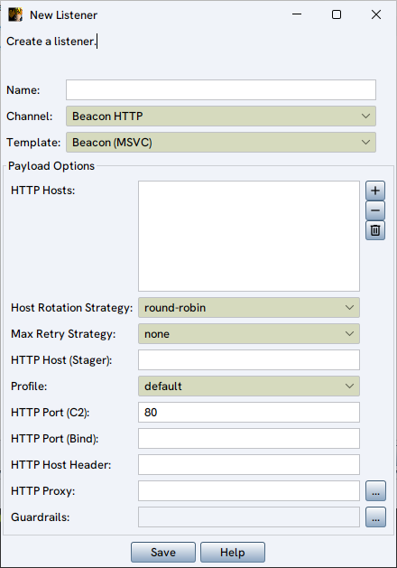
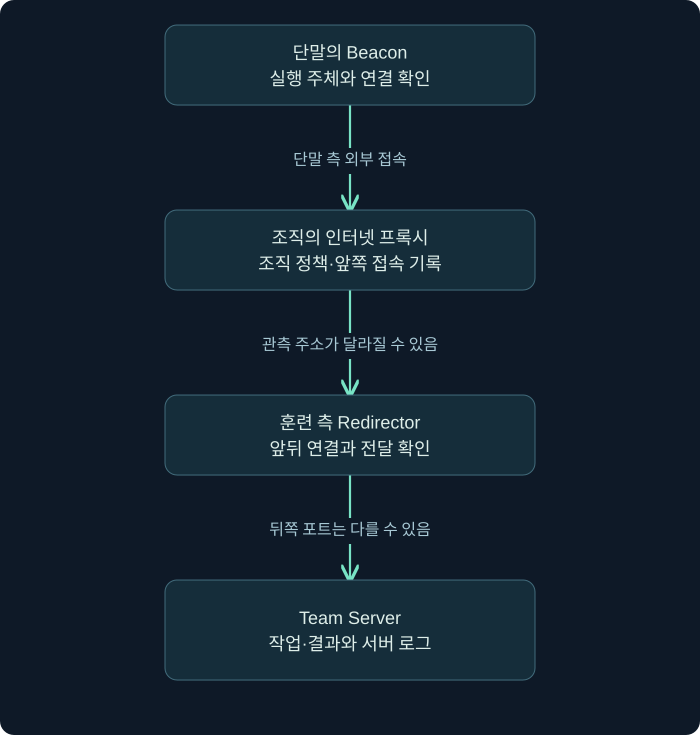
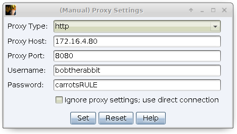
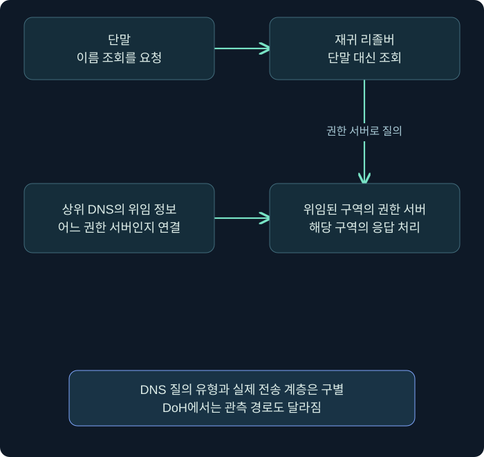
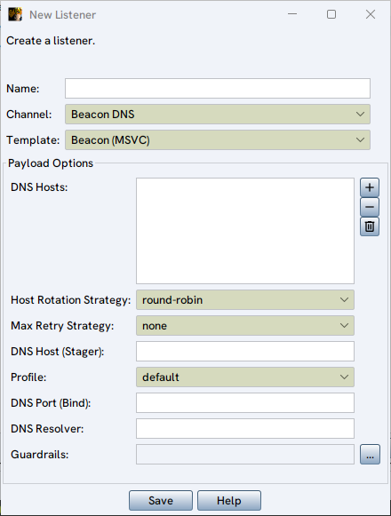
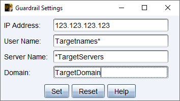

## 1. 같은 443 포트인데 왜 의미가 다를까요?

회사 프록시에서 어떤 단말이 443 포트로 통신한 기록을 보았다고 합시다. 이 숫자 하나로 정상 웹 접속인지 C2인지 알 수 있을까요? 없습니다. 프로토콜, 목적지, 단말의 실행 주체, 시간 관계와 실제 내용을 함께 봐야 합니다. 이번 강의는 Cobalt Strike의 HTTP·HTTPS·DNS 리스너를 통해 이런 구분을 연습합니다.

주소와 시간, 통신 예제는 가상입니다. `example.com` 계열은 문서용 도메인으로만 사용하며 실제 통신 대상으로 접속하지 않습니다. Beacon 생성이나 서버 배포, 실제 패킷 캡처를 수행하지 않았습니다. 특정 제품의 통신 특성을 설명하는 것과 실제 사건에서 그 제품을 식별했다는 주장은 다릅니다.

## 2. HTTP 요청·응답 안에서 작업이 오갑니다

HTTP는 클라이언트가 요청을 보내고 서버가 응답하는 응용 계층 프로토콜입니다. 기본적인 HTTP Beacon 설명에서는 GET으로 작업을 가져오고 POST로 결과를 보냅니다. 다만 프로파일에 따라 동작과 표시가 달라질 수 있어, 이 기본값을 모든 사례의 고정 탐지 조건으로 삼지 않습니다. Malleable C2 프로파일은 트래픽의 형식과 여러 동작을 기술하는 구성입니다. 한 파일 안에 여러 variant, 즉 변형을 정의하면 리스너에서 그중 하나를 선택할 수 있습니다. 구성 이름이 같아도 실제 내용과 생성물 반영 여부를 확인해야 합니다.

메타데이터가 URI·헤더·쿠키 같은 요청 요소에 담길 수 있으므로 눈에 보이는 경로 문자열 하나로 식별하지 않습니다. 메타데이터의 암호화와 HTTP에서의 배치 위치도 다른 문제입니다.

HTTPS는 HTTP 통신에 TLS 보안 계층이 더해진 경우입니다. **TLS(Transport Layer Security)**는 통신 구간의 암호화와 인증 등에 사용됩니다. 암호화되어 있다는 사실은 내용을 수동으로 읽기 어렵게 만들지만, 그 통신이 업무상 정당한지까지 보장하지는 않습니다.

| 구분 | 확인할 질문 | 단독으로 결론내리지 않을 것 |
| --- | --- | --- |
| HTTP 메서드 | 어떤 요청과 응답이 연결되나요? | GET이면 정상 조회라는 판단 |
| 목적지 | 이름·IP·실제 연결 대상은 무엇인가요? | 포트가 443이므로 정상이라는 판단 |
| 시간·크기 | 반복 간격과 송수신 크기는 어떤가요? | 규칙적 통신이므로 특정 도구라는 판단 |
| 실행 주체 | 어느 프로세스와 사용자 문맥인가요? | 브라우저처럼 보이는 이름만으로 신뢰 |

관측 위치도 중요합니다. TLS를 해독하지 않는 방화벽과 복호화 프록시, 단말 센서는 서로 다른 정보를 봅니다. 어느 장비의 어떤 필드인지 기록하지 않으면 “HTTP 내용을 확인했다”는 문장이 실제 관측을 넘어갈 수 있습니다.

### 실제 화면 2: HTTP 리스너를 여는 순서와 입력 위치

상단 **Cobalt Strike → Listeners**를 선택하고, 열린 Listeners 탭 아래쪽의 **Add**를 누르면 다음 **New Listener** 창을 엽니다. 현재 공식 이미지에는 프로토콜 선택 항목이 **Channel**로 표시됩니다. 일부 문서나 구버전의 **Payload type** 설명은 이 선택과 대응합니다.

출처: [Fortra — HTTP Beacon and HTTPS Beacon](https://hstechdocs.helpsystems.com/manuals/cobaltstrike/current/userguide/content/topics/listener-infrastructure_beacon-http-https.htm). 이 화면의 기본 80 포트와 아래 설명의 8080 실습 예시는 서로 다른 값입니다.

첫 연습은 **격리 실습망에서 중계 없이 HTTP를 사용하는 구성**을 가정합니다. Team Server에 192.168.56.10이 배정되어 있고 Windows 실습 단말에서 그 주소로 도달할 수 있어야 합니다. 외부 서비스나 제3자 호스트를 대상으로 하는 값이 아닙니다. 제품의 설정과 연결은 이 게시 과정에서 실행하지 않았습니다.

| 화면의 위→아래 순서 | 입력·선택 예시 | 이 칸에서 결정하는 것 |
| --- | --- | --- |
| Name | lab-http-01 | 나중에 생성 창과 목록에서 고를 리스너 이름 |
| Channel | Beacon HTTP | 통신 채널. HTTPS를 읽을 때는 Beacon HTTPS와 구별 |
| Template | Beacon (MSVC) 유지 | 생성에 사용할 Beacon 템플릿. 모든 버전에 같은 선택지가 있는 것은 아님 |
| HTTP Hosts | 오른쪽 + → 192.168.56.10 추가 | Windows 단말이 연락할 호스트 목록 |
| Host Rotation Strategy | round-robin 유지 | 여러 호스트를 고르는 전략. 첫 연습은 호스트 하나 |
| Max Retry Strategy | 현재 값과 의미를 확인 | none은 실패 때문에 자동 종료하지 않음. 단절 시 정리 완료를 기대하면 안 됨 |
| HTTP Host (Stager) | 별도 stager를 쓰지 않는 이번 읽기 예제에서는 비워 둠 | 본체를 가져오는 초기 단계의 호스트 |
| Profile | default | 선택한 프로파일 변형. 원하는 이름이 없으면 로드된 프로파일부터 확인 |
| HTTP Port (C2) | 8080 | 단말이 접속할 앞쪽 포트 |
| HTTP Port (Bind) | 8080 또는 해당 버전의 빈칸 기본 동작 확인 | 서버가 대기할 포트. 중계 없는 예제에서는 C2와 같은 포트 |
| HTTP Host Header | 별도 값 없이 기본 동작 사용 | HTTP 계층의 Host 정보. 서버 IP를 무조건 다시 넣는 칸이 아님 |
| HTTP Proxy | 직접 통신하는 격리망 예제에서는 별도 프록시 값을 넣지 않음 | 조직 프록시가 있다면 별도 창에서 설정 |
| Guardrails | 오른쪽 …에서 확인 | 생성 시 적용할 대상 조건의 기본값 |
| 아래 Save | 마지막에 저장 | 리스너 구성을 저장하며 오류 표시와 목록 반영을 확인 |

HTTP Hosts 옆의 **+**는 항목 추가, **−**는 선택 항목 제거, 휴지통은 목록 전체 비우기입니다. 여러 호스트를 다루기 전에 한 항목이 실제 목록에 들어갔는지 확인하세요. 이름 입력칸이나 HTTP Host Header에 주소를 넣는 것으로 HTTP Hosts 목록을 대신할 수 없습니다.

1. Name을 lab-http-01로 정하고 Channel이 Beacon HTTP인지 확인합니다.
2. HTTP Hosts 오른쪽 +로 실습 서버 주소를 추가합니다.
3. C2와 Bind의 포트가 의도한 8080인지 확인합니다. 현재 창의 기본값 80을 그대로 남기지 않았는지 봅니다.
4. Profile·stager·proxy·Guardrails를 각각 확인하고 Save를 누릅니다.
5. 리스너 목록에서 lab-http-01의 유형·주소·포트를 검토합니다. 오류가 있으면 이름만 다시 만들기보다 오류 내용을 확인합니다.

**설정 저장의 확인 지점은 리스너 목록입니다. 세션 생성의 확인 지점은 세션 표입니다.** Save 후 목록에 항목이 생겼다는 사실은 서버 구성이 반영되었다는 범위의 근거이며, Windows 에이전트 실행이나 통신 성공까지 확인한 것은 아닙니다.

HTTPS는 단순히 숫자만 443으로 바꾸는 것이 아닙니다. Channel, 접속 포트, 서버가 실제로 제공하는 TLS 서비스와 인증서·중계 구성이 함께 맞아야 합니다. 인증서가 맞지 않을 때 보안 검사를 끄는 방식으로 원인을 덮지 말고, 접속 이름과 TLS 종료 지점을 확인합니다.

## 3. 목적지 호스트·중계 서버·프록시를 구별합니다

**Redirector**는 Beacon과 Team Server 사이에서 트래픽을 전달하는 중간 시스템입니다. **프록시(proxy)**도 요청을 중계하지만, 회사의 인터넷 프록시처럼 단말의 외부 접속 정책을 적용하는 위치와 훈련 측 중계 서버의 위치는 서로 다를 수 있습니다. 둘을 한 호스트로 가정하지 않습니다.

그림은 가능한 경로 하나입니다. 모든 환경이 프록시와 redirector를 모두 사용하는 것은 아닙니다. 중요한 것은 이름으로 역할을 추정하기보다 실제 연결과 로그에서 어느 시스템이 무엇을 받았는지 확인하는 것입니다. 외부에서 관측한 IP가 Team Server의 실제 주소와 같다고 보장할 수 없습니다.

호스트 목록에는 에이전트가 접속할 이름이나 주소가 들어갑니다. 운영 문서에서는 생성 당시 구성, 실행 중 변경, 실제 관측된 목적지를 구별해 기록합니다. 현행 문서에는 실행 중 호스트 관련 구성을 다루는 기능도 있으므로 초기 설정 파일 하나가 전체 기간의 모든 목적지를 설명한다고 단정하지 않습니다.

### 실제 화면 3: HTTP Proxy 옆 … 버튼이 여는 창

New Listener의 **HTTP Proxy** 행 오른쪽 **…**를 누르면 아래의 수동 프록시 창을 엽니다. C2 포트를 입력하는 칸과 프록시 서버의 포트 칸을 구별하세요. 아래 계정·암호는 공개 공식 문서의 예시이며 사용자의 자격증명이나 이 강의의 접속 정보가 아닙니다.

출처: [Fortra — Manual HTTP Proxy Configuration](https://hstechdocs.helpsystems.com/manuals/cobaltstrike/current/userguide/content/topics/listener-infrastructure_beacon-http-https.htm).

| 이 창의 항목 | 실제로 확인할 대상 | 혼동하지 않을 것 |
| --- | --- | --- |
| Proxy Type | 실습망에서 제공하는 HTTP 또는 SOCKS 등 프록시 유형 | Beacon HTTP/HTTPS 채널 선택과 다른 칸 |
| Proxy Host·Port | 단말이 접속할 프록시 서비스 주소·포트 | Team Server의 Bind 주소·포트가 아님 |
| Username·Password | 해당 프록시가 요구할 때만 넣는 프록시 인증 정보 | Client의 Team Server 접속 암호가 아님 |
| Ignore proxy settings; use direct connection | 조직 프록시를 사용하지 않고 직접 연결할지 결정 | 통신이 안 된다고 무조건 켜는 해결 버튼이 아님 |
| Set | 입력값을 부모 설정창에 반영 | 리스너 전체의 Save와 별개 단계 |
| Reset | 기본 동작으로 되돌리는 선택 | 대상 단말의 네트워크 설정 전체를 초기화하는 기능이 아님 |

첫 HTTP 실습 예제처럼 프록시 없는 격리망이라면 이 창의 공식 예시를 그대로 복사하지 않습니다. 프록시를 쓰는 환경에서는 관리자에게 승인된 실습 프록시 정보를 확인하고 **Set → New Listener의 표시 확인 → Save** 순서로 반영합니다. 이 수동 설정이 작은 stager에도 그대로 적용되는 것은 아니라는 경계는 뒤의 staging 설명과 연결하세요.

## 4. C2 포트와 Bind 포트는 어디의 숫자일까요?

**HTTP Port (C2)**는 Beacon이 접속하려는 외부 측 포트이고 **HTTP Port (Bind)**는 Team Server 서비스가 대기하는 포트입니다. 중간 시스템이 포트를 전달하면 두 숫자가 달라질 수 있습니다. 이 관계를 설명할 때 사용되는 port bending은 외부에서 보이는 포트와 뒤쪽 대기 포트를 나누는 개념입니다.

가상 구성표를 읽어 보겠습니다. 이것은 실제 리스너 생성값이나 배포 절차가 아닙니다.

| 가상 관측 위치 | 표시된 값 | 읽을 의미 |
| --- | --- | --- |
| 단말의 외부 접속 | relay.example.com:443 | 단말이 접속한 앞쪽 목적지 |
| 중계 시스템 뒤쪽 연결 | 서버 A의 8443 포트 | 중계가 전달한 뒤쪽 서비스 |
| Team Server의 대기 상태 | Bind 8443 | 서버가 실제 연결을 받는 포트 |

두 포트가 다르다는 이유로 접속 실패라고 판단하면 안 됩니다. 반대로 숫자를 적어 두었다는 사실만으로 중계가 정상 동작한다고 검증한 것도 아닙니다. 앞뒤 연결, 정책 허용, TLS 종료 위치와 로그가 맞는지 확인해야 합니다.

`HTTP Host Header`는 HTTP의 호스트 정보와 관련된 설정입니다. DNS 이름 해석, TLS의 SNI(Server Name Indication), 인증서의 이름, HTTP Host는 서로 다른 계층의 정보입니다. 도메인 프런팅이라는 용어를 만나더라도 이 네 가지가 언제나 같은 값이거나 모든 제공자에서 같은 방식으로 동작한다고 생각하지 마세요. 이 강의에서는 계층을 구분하며, 실제 제공자의 우회 구성을 실습하지 않습니다.

## 5. 호스트 순환과 실패 대응을 따로 읽습니다

여러 호스트가 있을 때 **Host Rotation Strategy**는 다음 연결에서 어느 호스트를 고를지 정합니다. 여기에 실패 호스트를 임시 제외하는 처리 등이 더해질 수 있어, 이름만 보고 전체 동작을 단순화하지 않아야 합니다.

| 전략 | 성공 경로를 단순화한 설명 | 실패 시 확인할 사항 |
| --- | --- | --- |
| round-robin | 목록을 차례로 순환합니다 | 현행 문서의 실패 호스트 보류·재사용 규칙 |
| random | 시도마다 무작위로 고릅니다 | 무작위가 같은 선택의 재등장을 금지하는 것은 아님 |
| failover | 조건이 충족될 때까지 같은 호스트를 사용합니다 | 실패 횟수·연속 실패 시간 중 어떤 조건인지 |
| rotate | 정한 시간 구간 동안 호스트를 사용합니다 | 연결 횟수와 경과 시간을 혼동하지 않기 |

호스트 A·B·C가 모두 성공한다고 가정하면 round-robin은 A→B→C→A처럼 설명할 수 있습니다. random은 A→C→C→B처럼 같은 호스트가 다시 나오는 경우도 가능합니다. 예제 문자열은 원리를 보여 주기 위한 것이며 실제 난수 실행이나 Beacon 통신 결과가 아닙니다.

공식 현행 HTTP 안내서에는 round-robin과 random에서 실패한 호스트를 보류하고 모두 실패하면 다시 사용하는 규칙이 나옵니다. 이 문서의 기능 도입 버전 표기와 별도 변경 이력의 설명 위치가 완전히 일치하지 않는 부분이 있어, 여기서는 최초 도입 버전을 확정하지 않습니다. 조사 대상의 정확한 빌드와 실제 동작을 확인하는 편이 안전합니다.

반복 목적지가 바뀌어도 같은 활동일 수 있습니다. 반대로 같은 CDN·공유 서비스 IP를 사용하는 여러 프로그램을 하나의 활동으로 묶어서도 안 됩니다. DNS 결과와 시각, 프로세스·사용자, 연결 정보를 함께 봅니다.

## 6. Max Retry는 통신 단절 시 수명과 연결됩니다

호스트 선택과 별개로 **Max Retry Strategy**는 연속 연결 실패에 어떻게 반응할지 정합니다. `none`은 연결 실패만을 이유로 종료하지 않는 설정입니다. “통신이 안 되니 자동 정리되었다”라고 추정하면 안 되는 이유입니다.

종료 계열의 표기는 `exit-[최대 실패 횟수]-[대기 증가 기준]-[새 대기 시간]` 형태입니다. 숫자 읽기 연습으로 `exit-12-6-20m`을 가정하겠습니다. 6회 연속 실패를 기준으로 대기를 20분 수준으로 늘리는 동작을 검토하고, 12회 연속 실패에서 종료 조건을 검토한다는 뜻입니다. 실제 제품에 설정하거나 실행한 예제는 아닙니다.

하지만 “20분 × 12회 = 정확히 네 시간 뒤 종료”라는 계산은 맞지 않습니다. 기존 sleep이 더 길면 줄이지 않는 조건이 있고, jitter라는 대기 변동값의 영향과 연결 시도 자체의 시간이 있습니다. 성공한 연결은 실패 카운트를 초기화하고 이전 sleep으로 복귀하는 규칙도 있습니다. **연속 실패 횟수**와 단순한 총 실패 횟수를 구분하세요.

가상의 결과가 실패·실패·성공·실패라면 마지막 연속 실패 수는 1입니다. 실패가 전체 세 번 있었다는 사실만으로 세 번 연속 실패라고 기록할 수 없습니다. 이런 작은 차이가 단말 수명과 마지막 통신 시각을 해석할 때 중요합니다.

## 7. DNS는 재귀 리졸버와 권한 서버를 거칩니다

DNS 리스너에서는 도메인 질의·응답을 통신 경로로 사용합니다. **재귀 리졸버(recursive resolver)**는 단말 대신 이름을 조회해 주는 서버이고, **권한 서버(authoritative server)**는 특정 DNS 구역의 공식 응답 정보를 가진 서버입니다. 두 역할이 다릅니다.

도메인을 소유한다는 사실만으로 모든 질의가 원하는 서버에 도달하지는 않습니다. 구역 위임과 권한 관계가 연결되어야 합니다. TLD는 `.com` 같은 최상위 도메인입니다. 일반 등록자가 자기 도메인 이름을 등록했다고 TLD 전체의 권한 서버가 되는 것은 아닙니다. 강의에서는 위임의 원리를 설명하며 실제 DNS 레코드를 생성하지 않습니다.

A·AAAA·TXT는 DNS 레코드 유형입니다. 일반 DNS에서는 각각 IPv4 주소, IPv6 주소, 텍스트 데이터와 관련되지만, 이 제품의 DNS 통신에서는 작업 데이터 채널로 사용될 수 있습니다. AAAA가 보인다고 단말의 모든 C2 경로가 IPv6였다고 확정하지 않습니다. 레코드 유형과 전송 경로의 IP 계층은 다른 질문입니다.

기본 시스템 리졸버와 명시한 리졸버를 구별하고, stage와 stager에 설정이 똑같이 적용되는지도 확인합니다. 공식 DNS 문서는 지정 리졸버 설정이 stager에 적용되지 않는다고 설명합니다. HTTP의 수동 프록시 설정도 full stage와 stager 사이에 적용 차이가 있습니다. 한 설정 화면을 모든 단계에 일반화하지 않습니다.

### 실제 화면 4: DNS 리스너의 비슷해 보이는 칸들

**Cobalt Strike → Listeners → Add**에서 **Channel → Beacon DNS**를 선택하면 DNS용 항목이 표시됩니다. HTTP Hosts가 DNS Hosts로 바뀌었는지부터 확인하면 잘못된 채널을 설정하는 실수를 줄일 수 있습니다.

출처: [Fortra — DNS Beacon](https://hstechdocs.helpsystems.com/manuals/cobaltstrike/current/userguide/content/topics/listener-infrastructure_beacon-dns.htm).

| 화면 항목 | 넣는 정보의 종류 | 설정 뒤 확인할 질문 |
| --- | --- | --- |
| Name·Channel·Template | 리스너 이름과 DNS 채널·템플릿 | 다른 HTTP 항목을 편집 중인 것은 아닌가요? |
| DNS Hosts 오른쪽 + | 자신이 통제하고 올바르게 위임한 실습 구역의 이름 | 그 구역 질의가 지정 권한 서버에 도달하나요? |
| Host Rotation·Max Retry | 호스트 선택과 연속 실패 대응 | 서로 다른 두 설정을 같은 의미로 읽지 않았나요? |
| DNS Host (Stager) | 별도 TXT stager를 사용할 때의 초기 호스트 | 일반 DNS Hosts 목록과 적용 범위를 구별했나요? |
| DNS Port (Bind) | Team Server 측 DNS 서비스의 대기 포트 | 앞쪽 포트 전달이 있다면 실제 경로와 맞나요? |
| DNS Resolver | 단말이 조회를 맡길 리졸버를 명시할 때 사용 | 권한 서버 주소를 무조건 넣는 칸으로 오해하지 않았나요? |
| Guardrails 오른쪽 … | 생성물의 실행 조건 | 어떤 생성물에 반영되는지 확인했나요? |

문서용 이름 `beacon.lab.example.com`을 칸의 종류를 설명하는 데 사용할 수는 있지만, 그 문자열을 입력하는 것만으로 구역 위임이 생기지는 않습니다. DNS 연습에서는 **자신의 실습 DNS 구역·권한 위임을 먼저 준비하고 확인한 뒤** 해당 이름을 목록에 넣어야 합니다. DNS Resolver를 바꾸는 것 역시 위임을 대신하지 않습니다.

설정을 저장한 뒤에는 리스너 목록과 서버 오류 기록을 먼저 확인합니다. 이후 실제 단말을 실행한 실습에서만 질의 도착·메타데이터·작업 결과를 확인했다고 기록할 수 있습니다. 이 페이지의 화면은 그 실행 결과를 보여 주는 것이 아닙니다.

## 8. 빈 세션 행·DoH·Guardrails를 해석합니다

DNS Beacon에서는 초기 통신만으로 전체 메타데이터가 바로 표시되지 않을 수 있습니다. 사용자·컴퓨터·프로세스 칸이 비어 있다는 사실만 보고 실행 실패로 단정하지 않습니다. 공식 문서의 `checkin`은 다음 통신에서 메타데이터 확인을 요청하는 동작과 연결됩니다. 이 강의는 명령을 실행하지 않았습니다.

**DoH(DNS over HTTPS)**는 DNS 메시지를 HTTPS 경로로 전달하는 방식입니다. DNS의 의미가 사라지는 것이 아니라 전송과 관측 지점이 달라집니다. 일반 UDP 53 로그만 보는 센서에서는 같은 가시성을 기대할 수 없습니다. 반대로 HTTPS라는 이유로 단말의 프로세스·목적지 정보까지 전부 사라지는 것은 아닙니다.

**Guardrails**는 IP·사용자·호스트·도메인 같은 조건으로 실행 대상을 제한하려는 제품 기능입니다. 리스너의 기본값과 생성 시 선택한 값, 실제 생성물에 반영된 값을 나눠 봅니다. stageless 생성물의 조건을 작은 stager에도 동일하게 적용했다고 가정하지 않습니다.

Guardrails는 범위 준수를 돕는 한 장치이며 문서화된 허가, 대상 식별, 실제 검증을 대신하지 않습니다. 예를 들어 호스트명이 같아도 재설치나 복제 때문에 원래 승인한 자산과 다를 수 있습니다. 조건 설정 화면을 보았다는 사실과 대상 범위가 확인되었다는 사실은 별도로 기록합니다.

### 실제 화면 5: Guardrails를 별도 창에서 확인합니다

New Listener의 **Guardrails → …**를 선택하면 아래 창이 열립니다. 화면의 **Server Name은 실행 대상 컴퓨터 이름 조건**입니다. Client가 접속하는 Team Server 주소를 넣는 칸과 다릅니다.

출처: [Fortra — Guardrail Settings](https://hstechdocs.helpsystems.com/manuals/cobaltstrike/current/userguide/content/topics/listener-infrastructure_beacon-http-https.htm). 이미지 속 와일드카드는 문서 예시입니다.

| 항목 | 격리 실습의 설명용 값 | 뜻 |
| --- | --- | --- |
| IP Address | 192.168.56.20 | 미리 배정해 확인한 대상 주소 조건 |
| User Name | learner | 대상에서 실행할 계정 이름 조건 |
| Server Name | LAB-WIN01 | 대상 Windows 컴퓨터 이름 조건 |
| Domain | 실제 실습 환경을 확인해 결정 | 가입 도메인 조건. 도메인이 없는 실습에 임의 값을 만들지 않음 |

이 값들은 하나의 가상 환경을 설명하기 위한 예입니다. 실제 대상의 주소·이름·도메인이 다르면 실행 조건이 맞지 않을 수 있습니다. **Set으로 부모 창에 반영 → 부모 창 Save → 이후 생성 창에서도 조건 확인** 순서로 읽으세요. 생성 시 덮어쓸 수 있는 버전·작업 흐름에서는 리스너 기본값만 확인하고 끝내지 않습니다.

Reset은 조건을 다시 설정할 때의 UI 선택이지 승인 범위 검증을 자동으로 수행하는 버튼이 아닙니다. 여러 조건의 실제 판정과 생성물 적용은 대상 빌드에서 확인하고, 조건을 넓혀서 문제가 사라졌다는 사실을 실행 대상 확인의 대체로 사용하지 않습니다.

## 9. 가상 장애를 구간별로 좁힙니다

가상 훈련에서 DNS 이름은 조회되는데 HTTPS 세션이 갱신되지 않는다고 합시다. 이름 해석 성공은 경로의 한 단계만 확인합니다. TCP 연결, TLS 협상, 프록시 정책, 중계 전달과 서버 처리가 모두 성공했다는 뜻은 아닙니다.

HTTP 경로라면 단말→조직 프록시→중계→Team Server 순으로 어느 구간까지 근거가 있는지 정리합니다. DNS 경로라면 단말 질의, 리졸버 처리, 위임과 권한 응답을 나누어 봅니다. 모든 경로가 실제로 관측되지 않았다면 빈칸을 “정상”으로 채우지 말고 미확인으로 남겨 둡니다.

## 10. 복습과 바로 읽는 해설

### 복습 1. GET·POST의 기본 역할만으로 모든 Beacon을 탐지할 수 있나요?

**해설:** 없습니다. 프로파일과 버전에 따라 달라질 수 있고 정상 웹 프로그램도 같은 메서드를 사용합니다. 목적지·실행 주체·시간·내용과 관측 위치를 함께 확인합니다.

### 복습 2. C2 포트가 443, Bind가 8443이면 반드시 오류인가요?

**해설:** 아닙니다. 중계 시스템이 앞뒤 포트를 연결하는 구성이 가능합니다. 다만 설정표만으로 정상 전달을 검증한 것은 아니므로 실제 연결 증거가 필요합니다.

### 복습 3. random은 같은 호스트를 연속 선택하지 않는다는 뜻인가요?

**해설:** 아닙니다. 무작위 선택에는 같은 값의 반복도 가능합니다. 실패 호스트 보류 같은 추가 규칙과 대상 버전도 확인해야 합니다.

### 복습 4. 실패·실패·성공·실패에서 마지막 연속 실패 수는요?

**해설:** 성공 뒤 다시 한 번 실패했으므로 1입니다. 총 실패 수 3과 연속 실패 수를 구분합니다. 대기 변화·재시도 수명 해석에 영향을 줍니다.

### 복습 5. DNS를 쓰면 단말이 Team Server로 직접 UDP 53 연결을 맺나요?

**해설:** 반드시 그렇지 않습니다. 보통 재귀 리졸버와 권한 서버의 경로를 고려해야 하며 DoH 같은 전송 방식도 있습니다. 관측한 연결과 논리적인 데이터 경로를 구별합니다.

### 복습 6. AAAA 질의가 있으면 전체 통신이 IPv6였나요?

**해설:** 확정할 수 없습니다. AAAA는 질의한 레코드 유형입니다. DNS 데이터 채널과 실제 패킷의 IP 계층은 따로 확인합니다.

### 복습 7. DNS 세션의 정보 칸이 비면 에이전트 실행 실패인가요?

**해설:** 그 사실만으로 단정하지 않습니다. 메타데이터가 아직 전달되지 않은 초기 상태일 수 있습니다. 통신·메타데이터·작업 상태를 나눠 확인합니다.

### 복습 8. Guardrails를 설정하면 승인 범위 검증이 끝났나요?

**해설:** 아닙니다. 실행 조건은 범위 준수를 돕지만 허가 문서와 자산 식별·실제 반영 확인을 대체하지 않습니다. 생성물 유형별 적용 범위도 확인합니다.

## 11. 공식 근거와 다음 학습

확인일은 **2026년 11월 3일**입니다. 현재 문서의 기본 동작과 개념을 설명하며 실제 네트워크 실험은 수행하지 않았습니다.

- [HTTP Beacon and HTTPS Beacon](https://hstechdocs.helpsystems.com/manuals/cobaltstrike/current/userguide/content/topics/listener-infrastructure_beacon-http-https.htm): 호스트·포트·프록시·재시도·Guardrails 설정의 의미.
- [DNS Beacon](https://hstechdocs.helpsystems.com/manuals/cobaltstrike/current/userguide/content/topics/listener-infrastructure_beacon-dns.htm): 데이터 채널, 메타데이터, 리졸버와 위임 관계.
- [공식 변경 이력](https://hstechdocs.helpsystems.com/releasenotes/Content/_ProductPages/Cobalt_Strike/Cobalt_Strike.htm): DoH와 실행 중 구성 등 버전별 변화.

다음 강의에서는 외부로 직접 연결하지 않는 P2P 관계를 살펴보고 SMB 파이프와 TCP 소켓, 표 보기와 그래프 보기의 차이를 배웁니다.
