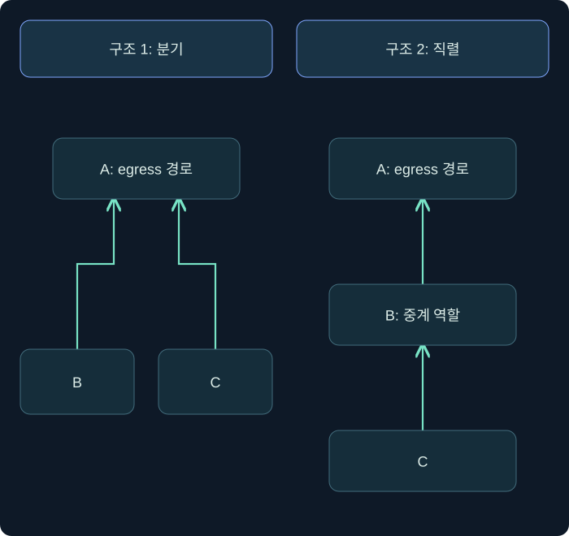
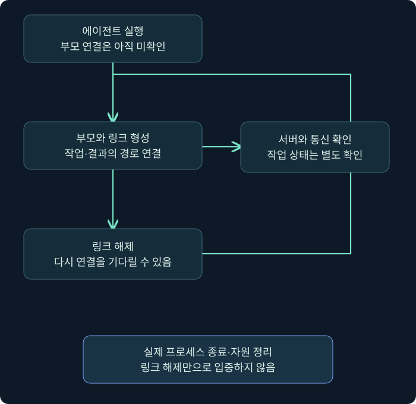

## 1. 외부 연결이 없는 단말도 작업을 받을 수 있을까요?

단말 B의 외부 방화벽 기록에는 직접적인 인터넷 접속이 없습니다. 그렇다면 B가 C2 작업을 받을 가능성도 없을까요? 다른 단말 A가 내부 연결을 통해 B의 통신을 중계한다면 이야기가 달라집니다. 외부 경계만 보는 센서와 내부 연결·단말 상태를 보는 센서의 차이를 이해해야 합니다.

이번 강의의 **P2P(peer-to-peer)**는 Beacon이 다른 Beacon을 통해 서버와 작업·결과를 주고받는 관계를 뜻합니다. 서버가 전혀 없는 분산 파일 공유망이라는 일반적인 P2P 이미지와는 다릅니다. 끝에는 작업을 관리하는 Team Server로 이어지는 경로가 필요합니다.

단말 A·B·C와 연결 상태는 가상입니다. 실제 에이전트를 실행하거나 연결 명령을 수행하지 않았습니다. 그림은 가능한 관계를 설명하며 실제 네트워크에서 관측한 토폴로지로 제시하지 않습니다. **토폴로지(topology)**는 구성 요소가 어떻게 연결되어 있는지를 나타내는 구조입니다.

## 2. 부모·자식은 운영체제 프로세스 관계와 다릅니다

P2P 설명에서 **부모 Beacon**은 다른 Beacon의 통신을 전달하는 쪽을 가리킵니다. 이 용어가 Windows 프로세스의 부모 PID 관계와 자동으로 일치하는 것은 아닙니다. A가 B의 C2 통신을 중계한다는 사실과 A의 프로세스가 B의 프로세스를 생성했다는 주장은 다릅니다.

| 관계 | 의미 | 확인하는 자료 |
| --- | --- | --- |
| 프로세스 부모·자식 | 운영체제의 프로세스 생성 관계 | 프로세스 생성 이벤트와 관련 식별자 |
| Beacon 부모·자식 | P2P 통신의 중계 관계 | 세션 연결 정보와 중계 기록 |
| 서버·세션 | 작업을 관리하는 출처와 에이전트 | Team Server 출처와 Beacon 식별자 |
| 네트워크 연결 주체 | 소켓을 연 프로세스와 대상 | 단말·네트워크 연결 관측 |

예를 들어 서로 다른 호스트에 있는 A와 B는 하나의 프로세스 트리로 설명할 수 없습니다. 반대로 같은 호스트의 두 에이전트도 P2P로 연결될 수 있습니다. “같은 호스트”와 “같은 프로세스”, “같은 세션”을 차례로 구분하세요.

## 3. 세 노드의 표만으로는 연결을 알 수 없습니다

표에 A·B·C라는 세션이 나열되어 있고 A만 HTTPS라고 해 보겠습니다. B와 C가 모두 A에 붙었는지, A→B→C로 이어지는지 표의 단순 목록만으로 확정할 수 없습니다. 연결 관계를 보려면 그래프나 명시적인 링크 정보가 필요합니다.

화살표는 **서버에 이르는 논리적 상위 경로**입니다. 소켓 연결을 시작한 방향이나 모든 데이터의 단방향 흐름을 뜻하지 않습니다. 작업과 결과는 경로를 통해 양쪽으로 오갈 수 있습니다. 그림을 읽을 때 화살표의 정의부터 확인해야 합니다.

왼쪽 구조에서 B의 링크가 끊어져도 C의 경로는 남을 수 있습니다. 오른쪽 구조에서 B가 중계 역할을 수행하지 못하면 C도 영향을 받을 수 있습니다. 공통 경로를 확인하면 여러 세션이 동시에 갱신되지 않는 현상을 더 정확하게 해석할 수 있습니다.

## 4. SMB Beacon은 이름 있는 파이프를 사용합니다

**이름 있는 파이프(named pipe)**는 프로세스 사이에서 데이터를 주고받는 Windows의 통신 수단입니다. 로컬에서도 사용할 수 있고, 원격 호스트와의 파이프 통신은 SMB를 통해 전달될 수 있습니다. **SMB(Server Message Block)**는 파일 공유 등에도 쓰이는 프로토콜이므로 SMB가 관측되었다고 곧바로 에이전트 통신이라고 볼 수는 없습니다.

SMB 리스너의 파이프 이름은 에이전트가 사용할 통신 지점을 정의하는 구성입니다. 부모 Beacon이 이 지점과 연결되어 작업과 결과를 전달하는 관계를 봅니다. 리스너 이름을 등록했다고 Team Server VM에 SMB 대기 서비스를 새로 만들었다고 해석하면 안 됩니다.

| 항목 | 어떤 질문을 하나요? | 해석의 한계 |
| --- | --- | --- |
| 파이프 이름 | 어느 이름의 IPC 지점을 사용하나요? | 이름은 변경 가능하므로 고정 문자열만으로 식별하지 않습니다 |
| 파이프 생성 주체 | 어느 프로세스가 지점을 만들었나요? | 정상 서비스도 파이프를 생성합니다 |
| 연결 주체 | 누가 그 지점에 접속했나요? | 접속 사실만으로 내용·목적은 모릅니다 |
| 원격 SMB 경로 | 다른 호스트에서 접근했나요? | 로컬 통신까지 모두 네트워크 445로 나가는 것은 아닙니다 |

**IPC(Inter-Process Communication)**는 프로세스 간 통신이라는 뜻입니다. 이 용어가 나온다고 프로세스 주입이 이미 입증된 것은 아닙니다. 통신과 메모리·실행 흐름 변경은 다른 행위이므로 앞 장의 증거 구분을 유지합니다.

기존 설명에서 `msagent_` 계열 이름을 예로 만날 수 있어도 이를 모든 버전과 구성의 필수 이름으로 외우지 않습니다. 조사에서는 이름과 함께 프로세스 출처·연결 관계·시각을 확인합니다. 예제 이름을 악성 여부의 단독 기준으로 만들면 이름이 다른 사례와 정상 파이프를 잘못 판단할 수 있습니다.

## 5. TCP Beacon에서는 대기 위치를 먼저 찾습니다

TCP 계열은 부모 Beacon과의 통신에 TCP 소켓을 사용합니다. 공식 기본 리스너 설명에서 이는 연결을 기다리는 **bind payload**입니다. 여기서 bind는 소켓을 특정 주소·포트에 연결해 대기 지점을 마련한다는 의미입니다. 리스너의 포트 값은 단말에서 실행되는 해당 Beacon의 대기 지점과 연결됩니다.

| 대기 주소 | 의미 | 보장하지 않는 것 |
| --- | --- | --- |
| 127.0.0.1 | IPv4 루프백, 같은 호스트의 접근을 위한 주소 | 같은 호스트의 어떤 프로세스가 접속했는지 |
| 0.0.0.0 | 모든 로컬 IPv4 인터페이스에서 대기하는 와일드카드 | 방화벽·경로·정책을 통과한 외부 접근 성공 |
| 특정 인터페이스 주소 | 그 로컬 주소와 연결된 대기 | 다른 인터페이스나 IPv6에도 동일하게 열렸다는 보장 |

`0.0.0.0`은 접속 상대에게 그대로 전달하는 일반 원격 목적지 주소로 읽지 않습니다. 대기 설정의 의미입니다. `127.0.0.1` 역시 다른 컴퓨터의 루프백을 가리킬 때 사용하는 주소가 아닙니다. 어느 호스트에서 숫자를 읽고 있는지 먼저 확인합니다.

루프백에서 대기한다고 자동으로 권한 상승이 생기는 것도 아닙니다. 대기 주소는 접근 범위를 설명하고, 권한 상승은 실제 실행 문맥과 권한 변화로 입증합니다. 다른 호스트가 접속할 수 있는 구성이더라도 그것만으로 내부 이동이 완료되었다고 보고하지 않습니다.

## 6. 링크 등록·통신 가능·프로세스 수명을 나눕니다

SMB와 TCP 에이전트는 실행만 되었을 때 부모와 아직 연결되지 않은 상태일 수 있습니다. 제품의 어떤 작업 흐름은 생성 이후 연결까지 수행하려고 시도하고, 별도로 시작한 경우에는 추가 연결이 필요할 수 있습니다. 이 차이 때문에 “프로세스가 있는데 세션 결과가 없다”는 관찰만으로 즉시 실패 원인을 확정할 수 없습니다.

또한 **링크 해제와 에이전트 종료는 다릅니다.** 공식 SMB 안내서는 링크를 끊어도 에이전트가 종료되지 않고 다른 연결을 기다릴 수 있다고 설명합니다. TCP 안내서도 연결을 해제한 뒤 다시 연결하는 문맥을 설명합니다. 그래프에서 선이 사라졌다는 이유로 단말 정리가 끝났다고 기록하면 안 됩니다.

이 그림은 상태를 구별하는 교육용 모델입니다. 모든 구현의 내부 상태와 정확한 전이 이벤트를 정의한 제품 명세는 아닙니다. 종료 완료 여부는 실제 프로세스·스레드·자원 상태와 작업 결과를 확인합니다. 네트워크 차단은 정리의 한 부분일 수 있지만 단말의 모든 실행 상태를 제거했다는 증거는 아닙니다.

## 7. 표 보기와 그래프 보기는 서로 보완합니다

표는 사용자·호스트·PID·아키텍처·마지막 통신 같은 속성을 비교하기 좋습니다. 그래프는 어느 세션이 어떤 경로에 의존하는지 파악하기 좋습니다. 그래프가 더 단순하게 보인다고 표의 세부 정보가 불필요해지는 것은 아닙니다.

기존 화면 설명에서는 HTTP/S의 녹색 점선, DNS의 노란색 점선, SMB의 노란색 실선, TCP의 녹색 실선 같은 표기를 만날 수 있습니다. 이것은 제품 화면의 범례로 읽어야 합니다. 색상·테마·버전이나 설정이 다를 수 있으므로 색만으로 프로토콜을 확정하지 말고 실제 범례와 세션 정보를 확인합니다.

이 강의의 그림은 색 구분에만 의존하지 않고 노드와 링크의 뜻을 글자로 표시합니다. 그래프의 자동 배치 방향도 네트워크 인바운드·아웃바운드를 뜻하지 않습니다. 노드가 왼쪽에 있다고 패킷이 반드시 왼쪽에서 시작하는 것은 아닙니다.

## 8. 방어 관측을 경계·내부·단말로 연결합니다

가상으로 A가 외부 서버와 통신하고 B가 A의 중계를 이용한다고 합시다. 경계 방화벽에는 A의 외부 연결이 주로 보일 수 있습니다. 내부 센서에는 A·B 사이의 통신이 보일 수 있고, 단말에는 연결한 프로세스·파이프·소켓 정보가 남을 수 있습니다. 어느 자료도 모든 관계를 혼자 보여 주지는 않습니다.

| 관측 지점 | 기대할 수 있는 단서 | 빠질 수 있는 것 |
| --- | --- | --- |
| 외부 경계 | 외부 목적지와 egress 주체 | 내부 자식 세션들의 직접 식별 |
| 내부 네트워크 | 호스트 간 SMB·TCP 관계 | 암호화·캡슐화된 실제 작업 내용 |
| 부모 단말 | 중계 프로세스와 연결 | 자식 내부에서 수행한 모든 작업 |
| 자식 단말 | 실제 실행 문맥과 로컬 통신 | 전체 상위 서버 경로 |
| 운영 기록 | 세션 링크와 작업 관계 | 방어 센서가 실제로 수집했는지 |

SMB의 445 연결이나 이름 있는 파이프 이벤트는 정상 환경에서도 흔할 수 있습니다. 수집을 켰는지, 필터가 어떤지, 같은 호스트 통신을 어떻게 관측하는지도 확인하세요. 이벤트 하나에 제품명을 붙이기보다 여러 증거의 시간·식별자·행위를 연결합니다.

## 9. 가상 문제를 스스로 풀어 봅니다

A는 마지막 통신이 갱신되고 B와 C만 멈췄다고 합시다. B와 C가 A의 독립 자식인지, B를 거쳐 C가 연결된 것인지에 따라 조사 순서가 달라집니다. 먼저 그래프와 링크 상태로 공통 구간을 확인하고, 그다음 단말과 내부 연결 증거를 봅니다. A의 외부 경로가 보인다는 이유로 A의 모든 내부 중계 기능까지 정상이라고 단정하지 않습니다.

B의 링크를 해제한 뒤 그래프에서 사라졌다면, B의 프로세스와 대기 지점이 실제로 종료되었는지 확인해야 합니다. 이 구분은 방어자의 격리 효과 검증과 훈련 종료 후 정리 양쪽에 필요합니다. 명령 접수 기록 대신 결과와 실제 상태를 기록하세요.

## 10. 복습과 바로 읽는 해설

### 복습 1. 부모 Beacon은 Windows 부모 프로세스와 같은 뜻인가요?

**해설:** 아닙니다. 중계 관계와 프로세스 생성 관계는 다릅니다. 호스트·PID·세션·서버 출처를 따로 연결해야 합니다.

### 복습 2. A·B·C 세션 목록만으로 직렬·분기 구조를 알 수 있나요?

**해설:** 없습니다. 명시적인 링크 정보나 그래프가 필요합니다. 연결 구조에 따라 장애 영향 범위도 달라집니다.

### 복습 3. SMB 파이프 통신은 항상 다른 호스트의 445 포트를 거치나요?

**해설:** 아닙니다. 같은 호스트의 이름 있는 파이프 통신도 가능합니다. 원격 SMB 경로와 로컬 IPC를 구분합니다.

### 복습 4. TCP 리스너를 정의하면 Team Server가 해당 포트에서 대기하나요?

**해설:** 이 기본 P2P 구성에서는 단말의 TCP Beacon이 연결을 기다립니다. 제품 리스너의 구성과 서버 측 대기 소켓을 같은 것으로 보지 않습니다.

### 복습 5. 0.0.0.0 대기는 외부에서 반드시 연결 가능하다는 뜻인가요?

**해설:** 아닙니다. IPv4 로컬 인터페이스의 대기 범위를 뜻합니다. 방화벽·경로·접근 정책 등은 별도 조건입니다.

### 복습 6. 루프백 대기는 자동 권한 상승인가요?

**해설:** 아닙니다. 주소 범위는 통신 조건입니다. 권한 상승은 실제 토큰·실행 문맥의 변화로 확인해야 합니다.

### 복습 7. unlink와 같은 링크 해제가 정리 완료를 보장하나요?

**해설:** 보장하지 않습니다. 에이전트가 대기 상태로 남을 수 있습니다. 종료 결과와 실제 프로세스·대기 자원을 확인합니다.

### 복습 8. 그래프 선의 색만으로 프로토콜을 확정해도 되나요?

**해설:** 안 됩니다. 해당 버전·테마의 범례와 실제 세션 정보를 함께 확인합니다. 이 강의의 그림도 링크의 정의를 글자로 읽어야 합니다.

## 11. 공식 근거와 다음 학습

확인일은 **2026년 11월 3일**입니다. 실제 P2P 연결을 수행하지 않았으며, 그래프·주소·장애 사례는 가상입니다.

- [SMB Beacon](https://hstechdocs.helpsystems.com/manuals/cobaltstrike/current/userguide/content/topics/listener-infrastructure_beacon-smb.htm): 파이프와 부모 관계, 로컬·원격 통신, 링크 해제 뒤 수명.
- [TCP Beacon](https://hstechdocs.helpsystems.com/manuals/cobaltstrike/current/userguide/content/topics/listener-infrastructure_beacon-tcp.htm): bind 에이전트, 루프백 대기와 연결 관계.
- [공식 사용자 안내서](https://hstechdocs.helpsystems.com/manuals/cobaltstrike/current/userguide/index.htm): 실제 설치 버전의 세션 표시와 관련 메뉴 확인.

다음 강의에서는 Beacon의 실행 포장과 로더, staged·stageless의 차이, 종료 설정과 생성물 유형을 배웁니다.
