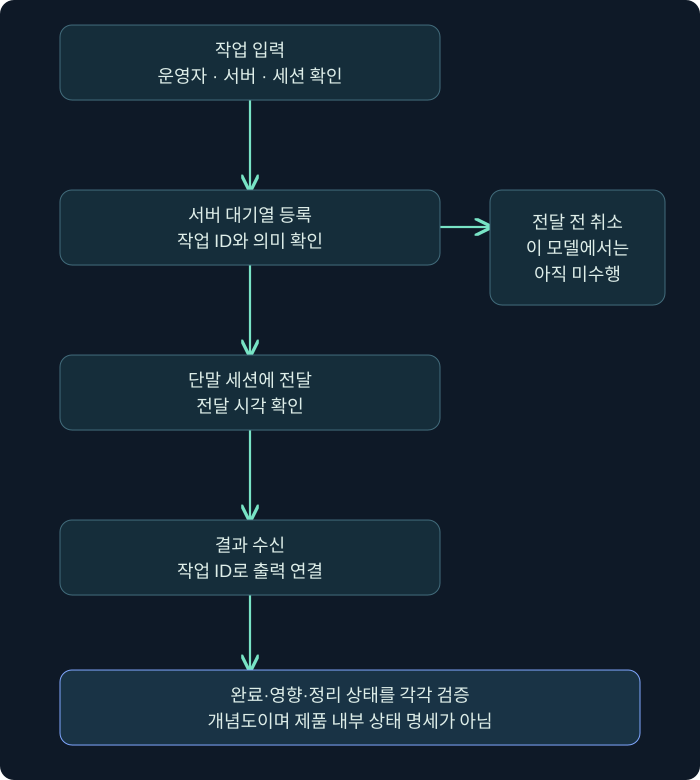
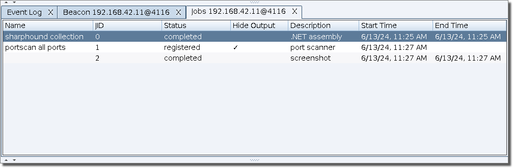
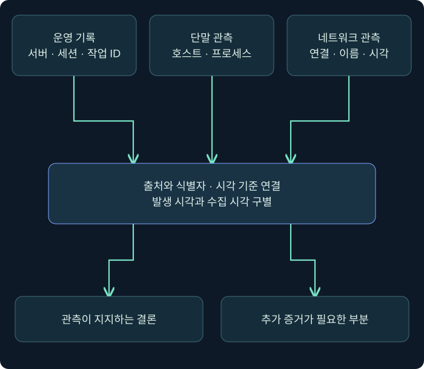

## 1. 세션 한 줄에서 무엇을 알 수 있을까요?

운영 화면에 새 세션이 나타났다는 것은 중요한 시작점입니다. 하지만 그 한 줄이 모든 작업의 성공이나 현재 권한, 단말의 완전한 상태를 증명하는 것은 아닙니다. 이 강의에서는 세션 표와 콘솔·작업·출력 기록을 읽고, 방어자의 자료와 연결하는 연습을 합니다.

**세션(session)**은 특정 에이전트와 관리 측의 상호작용을 구별하기 위한 단위입니다. 호스트 하나에 여러 세션이 있을 수 있고, 같은 프로세스에 관련된 상태도 시간에 따라 바뀔 수 있습니다. 세션 번호 하나를 호스트나 사용자 자체와 동일하게 취급하지 않습니다.

이 강의의 이름·PID·시각·작업 ID와 출력은 가상입니다. 실제 제품 콘솔과 에이전트를 실행하지 않았습니다. 마지막 Python 연습은 이 강의가 만든 가상 이벤트 목록을 오프라인에서 처리하는 예제로, 게시 전에 실행해 출력을 확인했습니다. 실제 Cobalt Strike 로그 형식을 파싱하는 프로그램은 아닙니다.

## 2. 호스트·사용자·프로세스 필드를 함께 읽습니다

세션 표의 핵심 속성을 세 묶음으로 나누면 편합니다. 어느 자산인지, 어떤 실행 문맥인지, 어느 통신 경로인지입니다. 필드 하나만 읽으면 같은 이름을 쓰는 다른 호스트나 PID가 재사용된 다른 프로세스를 잘못 연결할 수 있습니다.

| 필드 | 입문 단계에서 읽을 의미 | 추가 확인 |
| --- | --- | --- |
| computer | 보고된 호스트 이름 | 자산 식별자·수집 시각·복제 여부 |
| user | 표시된 계정 또는 보안 문맥 | 기본 토큰·가장 토큰과 실제 작업 시점 |
| process | 에이전트가 동작하는 프로세스 이름 | 경로·생성 시각·서명·실제 메모리 |
| pid | 프로세스 식별 번호 | 호스트와 프로세스 인스턴스를 함께 확인 |
| arch | 표시된 Beacon 아키텍처 | OS 비트 수와 자동으로 같다고 보지 않기 |
| note | 운영자가 덧붙인 메모 | 실제 관측 필드와 수동 해석을 구분 |

가령 64비트 운영체제에서 32비트 프로세스가 동작할 수 있습니다. `arch`가 x86이라고 OS까지 32비트라고 결론내리면 안 됩니다. 반대로 사용자 이름에 Administrator라는 문자열이 있다고 모든 특권이 활성화되어 있다고 보지도 않습니다.

이전 화면 설명에서 관리자 문맥을 표시하는 색이나 별표를 만날 수 있습니다. 그것만으로 SYSTEM 계정이라고 확정할 수는 없습니다. Windows의 high integrity와 SYSTEM 수준은 구분해야 하며, 화면 아이콘은 토큰의 모든 필드를 대신하지 않습니다. 실제 버전의 표시 의미와 대상 문맥을 확인합니다.

### 실제 화면 11: Sessions Table을 여는 위치와 열 읽기

상단 **Cobalt Strike → Visualization → Sessions Table**을 선택합니다. 툴바의 세션 표 보기 버튼으로 전환할 수도 있습니다. 다음은 공식 문서의 실제 표 예시입니다. 이 이미지에 나오는 호스트·사용자·PID는 이 강의의 실행 결과가 아닙니다.


출처: [Fortra — Session and Target Visualizations](https://hstechdocs.helpsystems.com/manuals/cobaltstrike/current/userguide/content/topics/ui_session-target-visualizations.htm). 넓은 표이므로 모바일에서는 화면 안을 가로로 스크롤하거나 이미지를 눌러 원본을 확인하세요.

화면에서 한 행을 읽는 순서를 정해 보겠습니다. **computer → process·pid → user·arch → listener → last → 주소** 순으로 보면 “어느 실행 문맥을 보고 있는가”를 먼저 확인할 수 있습니다. external만 보고 행을 고르면 중계 주소가 같은 여러 세션을 잘못 선택할 수 있습니다.

| 실제 화면 위치 | 확인 행동 | 확인 뒤 기록할 것 |
| --- | --- | --- |
| computer 열 | 의도한 실습 단말의 행을 찾음 | 호스트 이름과 서버·세션 출처 |
| process·pid 열 | 실행 프로세스와 번호를 대조 | PID가 재사용될 수 있으므로 생성 시각 등 별도 정보 |
| user·arch 열 | 사용자 문맥과 에이전트 아키텍처 확인 | 관리자·SYSTEM·OS 비트 수를 과도하게 추정하지 않음 |
| listener 열 | 어느 외부 통신 경로인지 읽음 | P2P의 바로 앞 부모는 그래프로 추가 확인 |
| last 열 | 마지막 통신으로부터의 경과 확인 | 화면을 본 시각과 실제 로그 시각 구별 |
| 행을 한 번 선택 | 선택 강조가 의도한 행에 있는지 확인 | 여러 행 선택 여부도 확인 |
| 선택 행 오른쪽 클릭 | 해당 세션 메뉴 열기 | 아래 Interact가 어느 세션에 적용되는지 확인 |

열 머리글을 이용한 정렬과 선택 행은 별개입니다. 표 정렬 순서를 바꾸었다고 작업 대상이 자동으로 올바르게 정해지는 것은 아닙니다. 여러 세션을 선택한 상태의 메뉴 동작은 여러 대상에 적용될 수 있으므로 현재 선택 상태를 읽어야 합니다.

## 3. 주소·리스너·last·sleep에는 기준점이 있습니다

주소 필드에는 값이 어디에서 온 것인지가 중요합니다. `internal`은 단말 쪽 내부 주소 정보이고, `external`은 HTTP 계열에서 서버 측이 통신을 보며 얻은 외부 주소일 수 있습니다. NAT·조직 프록시·훈련 중계 구조가 있으면 이것을 단말의 유일한 공인 IP로 단정할 수 없습니다.

| 필드 | 읽을 질문 | 흔한 오해 |
| --- | --- | --- |
| external | 서버 관측에서 어느 주소가 보였나요? | 단말이 직접 보고한 고유 공인 IP라는 오해 |
| internal | 어떤 내부 주소를 보고했나요? | 항상 하나뿐인 고정 자산 식별자라는 오해 |
| listener | 어떤 외부 통신 리스너와 연결되나요? | P2P의 바로 앞 부모까지 이 값 하나로 확정 |
| last | 마지막 통신으로부터 얼마나 지났나요? | 고정된 절대 시각·현재 프로세스 생존 판정으로 사용 |
| sleep | 설정된 대기 간격은 무엇인가요? | 모든 요청의 실제 간격이 언제나 정확히 같다는 오해 |

sleep과 jitter, 처리 시간과 네트워크 지연 때문에 관측 간격이 달라질 수 있습니다. 마지막 통신이 오래되었다는 사실은 조사 단서이지 종료 판정 자체가 아닙니다. 정확한 마지막 접속 시각이 필요하면 화면을 본 시각과 서버 로그를 함께 확인합니다.

P2P 세션은 부모의 경로에 의존할 수 있습니다. 자식의 `last`가 변하지 않을 때 자식 프로세스만 조사하면 공통 부모나 내부 연결 문제를 놓칠 수 있습니다. 앞 강의의 그래프와 세션 표를 함께 읽는 이유입니다.

## 4. 도움말과 조회 명령부터 의미를 확인합니다

세션의 Interact 창은 선택한 세션에 대한 상호작용을 다루는 위치입니다. 명령을 넣기 전에는 서버·세션·호스트가 의도한 대상인지 확인합니다. 여러 서버를 연결한 상태에서는 화면의 활성 서버와 세션 출처도 기록합니다.

```text
beacon> help
beacon> help getuid
beacon> getuid
```

위 세 줄은 읽는 법을 설명하는 미실행 예제입니다. `help`는 도움말 목록, `help getuid`는 특정 명령의 사용법을 확인하는 입력입니다. `getuid`는 현재 토큰과 관련된 사용자 정보를 요청하는 명령으로 설명됩니다. 정확한 표시·작업 상태는 설치 버전과 실제 실행 문맥에서 확인해야 합니다.

도움말·메모·대기열 관리처럼 모든 콘솔 입력이 단말 작업을 만들지는 않습니다. `getuid`의 경우도 결과를 보기 전에는 “현재 사용자가 확인되었다”라고 기록하지 않습니다. 토큰 가장 상태와 작업 시점에 따라 정적 세션 메타데이터와 다른 문맥을 설명할 수 있어 필드와 출력의 시점을 구별해야 합니다.

가상 출력이 `LAB\learner`라면 그 작업이 반환한 사용자 식별 결과라고 읽습니다. 관리자 권한이나 다른 사용자로의 접근이 확인되었다는 뜻을 덧붙이지 않습니다. 단순 조회의 결과를 권한 상승 성공 보고로 바꾸지 않는 것이 기본입니다.

### 실제 화면 12: Interact를 누른 뒤 어디에 입력하나요?

**세션 행 오른쪽 클릭 → Interact**로 콘솔을 엽니다. 제품에 따라 행 더블 클릭으로 상호작용 창을 여는 흐름도 있지만, 여기서는 메뉴 이름을 확인할 수 있는 경로로 설명합니다.


출처: [Fortra — The Beacon Console](https://hstechdocs.helpsystems.com/manuals/cobaltstrike/current/userguide/content/topics/post-exploitation_main.htm). 이미지에 이미 표시된 pwd·getuid·sleep 입력과 결과는 공식 예시이며 이 과정에서 수행한 작업이 아닙니다.

| 화면의 위치 | 읽거나 사용하는 방법 |
| --- | --- |
| 위쪽 탭 제목 | 어느 세션 콘솔인지 확인. 여러 콘솔을 열었으면 활성 탭을 다시 확인 |
| 검은 출력 영역 | 이전 입력, Tasked 같은 등록 기록, check-in·결과를 구별 |
| 출력과 입력 사이 상태줄 | 호스트·사용자·PID·마지막 통신 등 현재 문맥 확인 |
| 맨 아래 beacon 프롬프트 | 새 명령을 입력하는 위치. 위쪽의 오래된 로그 줄에 입력하는 것이 아님 |
| Enter | 입력을 제출. 명령 종류에 따라 로컬 표시 또는 단말 작업 등록으로 이어짐 |

처음 연습은 아래쪽 입력줄에서 `help`와 `help getuid`로 명령의 의미를 확인하는 흐름으로 읽습니다. 자신의 승인된 실습에서 `getuid`를 수행했다면 **입력 접수 → 전달 기록 → 사용자 출력**을 구별해 확인합니다. 이 페이지는 실제 에이전트를 실행하지 않았으므로 새 실행 결과를 만들어 제시하지 않습니다.

공식 이미지에서는 입력 후 **Tasked beacon to get userid**, 그다음 통신과 사용자 결과가 보입니다. 이 순서를 화면 위치와 연결해 보세요. 프롬프트가 다시 보인다는 이유만으로 모든 작업이 끝났다고 보지 말고, 무엇을 요청했고 어떤 작업의 결과가 왔는지 확인해야 합니다.

## 5. 작업 등록·전달·출력·완료를 연결합니다

다음은 실제 로그 형식을 흉내 내지 않고 단계만 적은 가상 타임라인입니다. 시각은 UTC로 가정한 절대 시각이며, 화면의 `last` 같은 경과 시간과 구별합니다.

| 시각 | 가상 사건 | 확인한 범위 |
| --- | --- | --- |
| 09:00:00 | 운영자 A가 T01 조회를 입력 | 입력의 의도와 대상 |
| 09:00:01 | 서버가 T01을 대기열에 등록 | 서버가 작업을 해석·접수 |
| 09:00:05 | S01에 T01을 전달한 기록 | 통신 시점의 전달 |
| 09:00:06 | T01의 사용자 결과가 도착 | 특정 작업의 출력 수신 |
| 09:00:07 | 완료 상태가 기록 | 제품이 표시한 상태와 의미 확인 |

구버전 설명에서는 input·task·checkin·output 같은 유형을 만나고, 최신 버전에서는 작업 ID와 상태 추적이 더 보강되었습니다. 공식 변경 이력에는 4.12의 작업 ID와 4.13의 상태·기록 추적 개선이 나옵니다. 서로 다른 버전의 형식을 섞어 필드가 반드시 존재한다고 가정하지 않습니다.



같은 통신에서 여러 작업이 전달될 수 있습니다. 기본 대기열 순서를 이해하는 것과 모든 작업의 완료·출력이 입력 순서대로 온다고 가정하는 것은 다릅니다. 장기 작업이나 비동기 처리에서는 완료 순서가 달라질 수 있습니다. **작업 ID와 세션·서버 출처를 기준으로 결과를 연결**해야 합니다.

## 6. 대기열을 지우는 것과 실행을 되돌리는 것은 다릅니다

잘못 입력한 작업이 아직 서버 대기열에 있다면 대기열 관리 기능으로 제거할 수 있는 경우가 있습니다. 그러나 이미 단말에 전달된 작업과 끝난 작업을 같은 방식으로 다루면 안 됩니다. `clear` 같은 대기열 정리를 “이미 실행한 변경을 복구한다”는 의미로 읽지 않습니다.

현재 제품에서 취소 상태나 cancel 기능을 보더라도 적용 대상과 시점을 확인합니다. 대기 작업을 canceled로 표시하는 것, 실행 중인 특정 작업에 취소를 요청하는 것, 수행 결과가 되돌아가는 것은 서로 다른 사건입니다. 작업의 성격에 따라 별도의 복구가 필요할 수 있습니다.

| 상태 | 확인할 질문 | 과도한 결론 |
| --- | --- | --- |
| queued | 아직 서버에 대기 중인가요? | 이미 단말이 수행 중이라는 단정 |
| sent·dispatched | 어느 세션에 언제 전달했나요? | 성공 완료라는 단정 |
| output received | 어느 작업의 어떤 출력인가요? | 전체 작업의 모든 단계 완료라는 단정 |
| completed | 그 버전에서 완료의 의미는 무엇인가요? | 모든 업무 목표·정리까지 완료라는 단정 |
| canceled | 어느 시점에서 무엇을 취소했나요? | 과거 변경이 모두 복구되었다는 단정 |

여기서 상태 이름은 개념 비교를 위한 일반 표기입니다. 아래 Python 연습도 이 표의 단순한 모델을 사용합니다. 실제 Cobalt Strike의 모든 내부 상태·API 필드·취소 구현을 재현하지는 않습니다.

### 실제 화면 13: Jobs와 All Jobs는 어디서 여나요?

특정 세션의 작업 창은 **세션 행 또는 열린 콘솔 오른쪽 클릭 → Jobs**로 엽니다. 전체 세션을 보는 창은 상단 **View → All Jobs**입니다. 아래 공식 예시는 Jobs 탭의 위치와 열을 보여 줍니다. 이미지 자체의 예시 날짜는 이전 버전의 자료일 수 있으며 현재 사이트에서 실행한 결과가 아닙니다.



출처: [Fortra — Job Browser](https://hstechdocs.helpsystems.com/manuals/cobaltstrike/current/userguide/content/topics/job%20browser.htm).

| 열·기능 | 화면에서 확인할 내용 | 구별할 점 |
| --- | --- | --- |
| Name·ID | 어떤 작업 항목인지 식별 | 이 ID를 모든 로그의 task ID와 자동으로 같은 것으로 보지 않음 |
| Status | registered·completed 등 표시된 상태 | 등록 표시와 완료 표시가 다름. 실제 버전의 의미 확인 |
| Description | 작업의 종류 설명 | 이름만 보고 상세 실행·성공을 확정하지 않음 |
| Start Time·End Time | 해당 항목의 표시 시각 | 시간대와 시간 의미를 확인. CPU 실행 시간으로 단정하지 않음 |
| Interact | 해당 작업의 출력 콘솔 열기 | Beacon 콘솔 전체와 특정 작업 출력의 문맥 구별 |
| Name | 작업에 알아보기 쉬운 이름 지정 | 시스템 실행 파일 이름을 바꾸는 기능이 아님 |
| Hide/Show Output | 콘솔에 해당 출력이 보이는 방식 | 작업 중단·로그 삭제와 다름 |
| Kill | 실행 중 작업에 대한 종료 동작 | Beacon 프로세스 전체 종료·모든 변경 복구와 다름 |

Jobs는 단순히 아직 보내지 않은 콘솔 입력을 나열하는 대기열 화면과 같은 개념이 아닙니다. 어떤 작업이 이 브라우저에 나타나는지와 상태·취소의 의미를 버전에서 확인해야 합니다. 위 표의 Kill을 누르는 것을 “모든 queued 입력 지우기”로 안내하면 잘못된 효과를 기대하게 됩니다.

상태를 확인할 때는 **해당 세션의 Jobs 선택 → 작업 항목·ID 대조 → Interact로 출력 확인 → 시작·종료 시각과 서버 기록 대조** 순서로 읽습니다. 결과 숨기기·이름 변경 같은 화면 관리와 단말의 실행 수명 변경은 별도로 기록합니다.

## 7. 오프라인 가상 기록 실습

다음 Python 코드는 네트워크와 파일·프로세스에 접근하지 않습니다. 직접 만든 이벤트 목록만 읽어 작업 상태를 묶습니다. `sent`는 전달 시점, `completed`는 완료 결과가 들어온 시점으로 정의합니다. 차이는 **전달에서 결과 수신까지의 경과 시간**이며 단말 CPU 실행 시간의 실측값이 아닙니다.

T01·T02는 가상의 비동기 작업으로 가정해 T02 결과가 먼저 도착하도록 만들었습니다. T03은 전달되기 전에 취소된 사례입니다. 이 순서는 실제 제품에서 측정한 동작이 아닙니다.

```python
events = [
    (0, "T01", "queued"),
    (1, "T02", "queued"),
    (2, "T03", "queued"),
    (3, "T01", "sent"),
    (3, "T02", "sent"),
    (4, "T03", "canceled"),
    (5, "T02", "completed"),
    (8, "T01", "completed"),
]

tasks = {}
for second, task_id, state in events:
    if state == "queued":
        assert task_id not in tasks
        tasks[task_id] = {"state": state, "sent": None, "finished": None}
        continue
    record = tasks[task_id]
    allowed = {"queued": {"sent", "canceled"}, "sent": {"completed"}}
    assert state in allowed.get(record["state"], set())
    record["state"] = state
    if state == "sent":
        record["sent"] = second
    elif state == "completed":
        record["finished"] = second

for task_id, record in sorted(tasks.items()):
    elapsed = "-"
    if record["finished"] is not None:
        elapsed = str(record["finished"] - record["sent"]) + "s"
    print(task_id, record["state"], elapsed)
```

게시 과정에서 위 코드를 Python으로 실행해 다음 출력을 확인했습니다. 실제 서버 로그를 읽거나 단말에 명령을 전달한 결과가 아닙니다.

```text
T01 completed 5s
T02 completed 2s
T03 canceled -
```

T01은 3초에 전달되어 8초에 결과를 받았으므로 5초입니다. T02는 같은 3초에 전달되었지만 5초에 결과를 받아 2초입니다. T03은 전달 전 취소되어 측정할 전달→결과 구간이 없습니다. 이를 0초 실행 성공이라고 쓰지 않고 `-`로 구분했습니다.

한 단계 더 생각해 보세요. 실제 여러 서버에서 같은 작업 ID가 나올 수 있다면 사전 키에 서버·세션 출처를 추가해야 합니다. 로그가 중간부터 수집되면 queued가 없는 결과도 만날 수 있습니다. 이 코드는 그런 실제 로그의 예외를 처리하는 완성 도구가 아니며, 상태와 시간의 뜻을 연습하는 작은 모델입니다.

## 8. 운영 기록을 방어 증거와 대조합니다

운영 기록은 훈련의 기준 자료를 제공하지만, 방어 센서가 실제로 무엇을 수집했는지는 별도로 확인합니다. 작업 ID와 전달·결과 시각을 단말의 프로세스 인스턴스, 네트워크 연결, 파일·메모리 변화와 연결하면 탐지 공백을 구체적으로 설명할 수 있습니다.



먼저 시각 기준을 맞춥니다. 서버가 UTC, 단말 로그가 현지 시각, 수집 플랫폼이 수신 시각을 표시할 수 있습니다. 타임존을 표시하고 이벤트 발생 시각과 수집 시각을 분리하세요. 매우 가까운 두 이벤트의 순서는 시계 오차와 지연을 고려해 표현합니다.

그다음 주장에 맞는 증거를 고릅니다. 조회 작업은 새 외부 프로세스를 만들지 않을 수 있으므로 자식 프로세스 이벤트가 없다는 이유만으로 미실행을 단정하지 않습니다. 자료 접근과 유출처럼 다른 행위를 한 결론으로 합치지 않습니다. “사용자 조회 결과 수신”은 사용자 조회 결과에 관한 증거입니다.

## 9. 보고와 정리를 마치는 질문

가상의 운영 메모에 “세션 세 개 종료 완료”라고 적혀 있는데 실제 근거가 그래프에서 링크 세 개를 지운 화면뿐이라면, 앞 강의에서 배운 대로 수명 증거가 부족합니다. 단말 프로세스·대기 지점·관련 작업의 종료와 남은 변경을 확인해야 합니다.

보고서는 호스트·프로세스·세션·서버·작업의 식별 관계, 수행 시각, 결과와 영향, 미확인 범위를 담습니다. 도구의 보고 기능이나 ATT&CK 매핑은 정리를 돕지만 실제 효과 검증을 대신하지 않습니다. 누락된 자료와 수집 설정도 적어야 다음 사람이 같은 결론을 검토할 수 있습니다.

이번 단원의 핵심 연습은 “설정이 있다”, “작업을 보냈다”, “통신이 있었다”, “실행 결과를 확인했다”를 구별하고 연결하는 것입니다. 이 구분을 유지하면 도구를 사용하는 쪽과 방어하는 쪽 모두 더 정확한 질문을 할 수 있습니다.

## 10. 복습과 바로 읽는 해설

### 복습 1. arch가 x86이면 운영체제도 32비트인가요?

**해설:** 확정할 수 없습니다. 표시된 Beacon·프로세스 아키텍처와 OS 아키텍처를 구분합니다. 64비트 OS에서 32비트 프로그램이 동작할 수 있습니다.

### 복습 2. external은 단말이 직접 보고한 고유 공인 IP인가요?

**해설:** 반드시 그렇지 않습니다. 서버 측 관측 주소와 중계·프록시·NAT의 영향을 고려합니다. 주소의 출처와 경로를 확인합니다.

### 복습 3. last가 오래되면 프로세스가 종료되었나요?

**해설:** 그 사실만으로 종료를 확정하지 않습니다. 대기·실패·부모 링크·네트워크 상태와 수집 지연 등이 원인일 수 있습니다. 종료 증거는 별도입니다.

### 복습 4. help 입력 뒤 단말 프로세스 이벤트가 없으면 탐지 누락인가요?

**해설:** 단정할 수 없습니다. 도움말 등은 단말 작업을 만들지 않는 입력입니다. 작업 종류와 예상 흔적을 확인한 뒤 수집·탐지 여부를 판단합니다.

### 복습 5. 두 번째 출력은 언제나 두 번째 입력의 결과인가요?

**해설:** 아닙니다. 비동기 작업과 지연 때문에 순서가 달라질 수 있습니다. 서버·세션 출처와 작업 ID로 연결해야 합니다.

### 복습 6. clear나 canceled 표시는 과거 변경 복구를 보장하나요?

**해설:** 보장하지 않습니다. 대기열 제거·취소 요청·완료·복구는 다른 상태입니다. 이미 전달되거나 수행된 작업의 영향은 별도로 검증합니다.

### 복습 7. 실습의 5s는 단말 CPU 실행 시간인가요?

**해설:** 아닙니다. 가상 모델에서 전달 시점부터 완료 결과 수신까지의 차이입니다. 실제 통신과 처리 지연이 포함될 수 있는 경과 시간 개념이며 CPU 실측이 아닙니다.

### 복습 8. 오프라인 Python 실습은 실제 Cobalt Strike 로그 분석을 검증했나요?

**해설:** 아닙니다. 합성 이벤트의 상태·식별자·시각 계산만 검증했습니다. 실제 로그 형식·제품 상태·네트워크·Windows 동작은 이 실습의 검증 범위에 포함되지 않습니다.

## 11. 공식 근거와 단원 마무리

공식 자료 확인일은 **2026년 11월 3일**입니다. Python 합성 이벤트 처리는 실행 확인했고 실제 제품·단말·네트워크 명령은 미실행입니다.

- [Everything Logs](https://hstechdocs.helpsystems.com/manuals/cobaltstrike/current/userguide/content/topics/blog_let-the-logs-out.htm): input·task·checkin·output과 서버 측 기록의 목적. 역사적 형식 설명임을 함께 고려합니다.
- [Beacon Command Behavior](https://hstechdocs.helpsystems.com/manuals/cobaltstrike/current/userguide/content/topics/appendix-a_beacon-opsec-considerations.htm): 단말 작업을 만들지 않는 명령 등의 차이.
- [공식 변경 이력](https://hstechdocs.helpsystems.com/releasenotes/Content/_ProductPages/Cobalt_Strike/Cobalt_Strike.htm): 작업 ID·완료 상태·취소 기록 등 4.12·4.13의 변화.
- [Sessions Report](https://hstechdocs.helpsystems.com/manuals/cobaltstrike/current/userguide/content/topics/rpt-log4_sessions%20report.htm): 경로·지표·활동 타임라인을 묶는 보고 기능.
- [공식 사용자 안내서](https://hstechdocs.helpsystems.com/manuals/cobaltstrike/current/userguide/index.htm): 실제 버전의 세션 화면·명령 계약 확인.

4장은 여기까지입니다. 구성 요소와 경로, 실행 포장, 세션·작업 상태를 구별한 뒤 관측한 증거로 연결하는 순서로 복습해 보세요.
