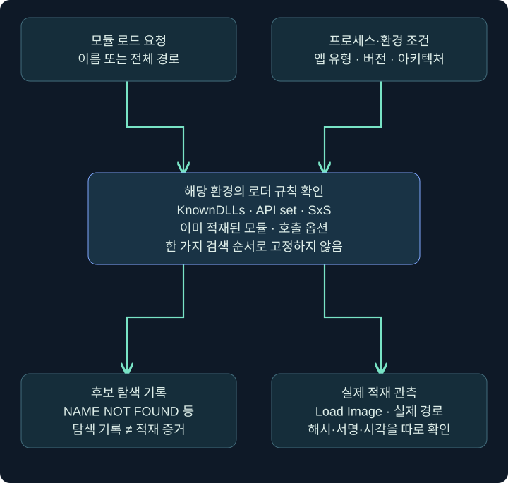
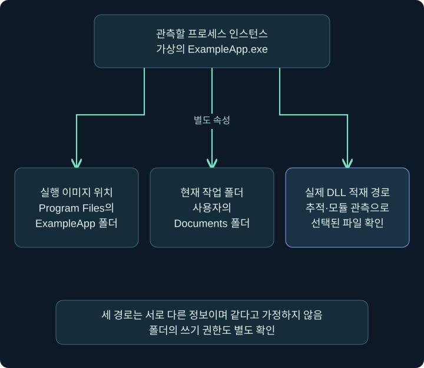
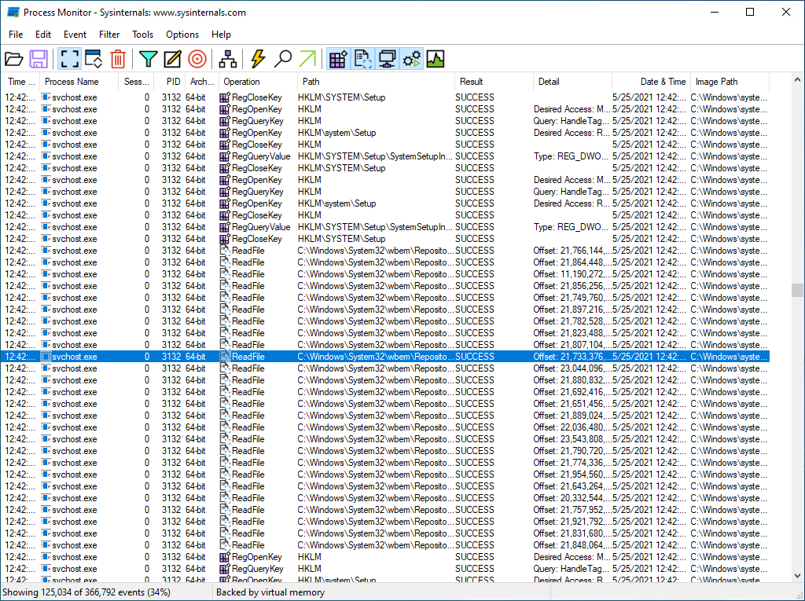
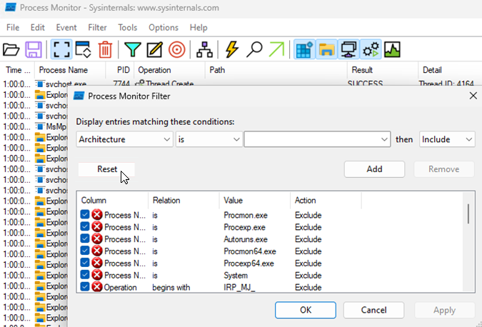
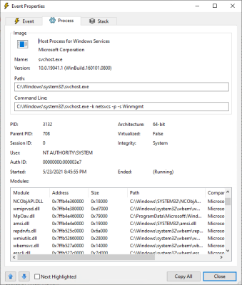
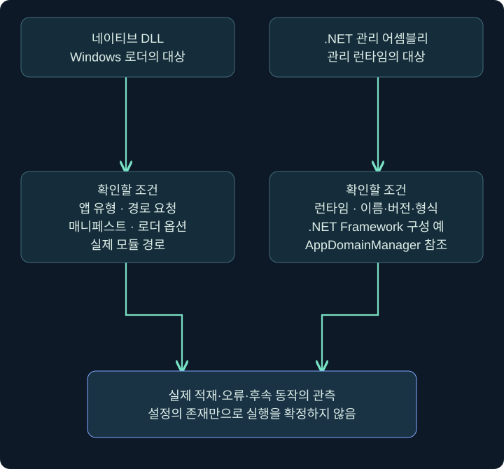

## 1. 정상 실행 파일 옆의 DLL도 정상일까요?

정상 서명이 있는 프로그램이 실행됐는데, 같은 폴더의 낯선 DLL을 불러왔다는 기록이 발견됐습니다. 실행 파일의 서명만 확인하면 조사를 끝내도 될까요? 아닙니다. 실행 파일과 그 프로그램이 실제로 불러온 모듈은 각각 출처를 확인해야 합니다. 이번 강의는 ‘어떤 이름을 찾았는가’와 ‘어느 파일을 실제로 적재했는가’를 구별하는 수업입니다.

DLL은 프로그램이 함께 사용하는 기능을 담을 수 있습니다. 하지만 ‘함께 사용한다’는 뜻이지 아무 폴더의 같은 이름 파일을 신뢰해도 된다는 뜻은 아닙니다. 도서관에서 책 제목이 같더라도 저자·판본·소장 위치가 다른 것처럼, 모듈 이름과 실제 전체 경로·해시·서명은 서로 다른 단서입니다.

이 강의의 ProcMon 화면은 공개 Microsoft 문서의 실제 제품 삽화입니다. 여기서 새로 실행한 공격 실험이나 DLL 적재 결과가 아닙니다. 별도 PML 추적 파일은 제공되지 않았으므로 아래 필터 값과 가상 로그를 실제 추적 결과처럼 해석하지 않습니다.

## 2. 검색 순서를 한 줄 목록으로 고정하지 않습니다

프로그램이 전체 경로 대신 DLL 이름으로 로드를 요청하면 로더가 여러 규칙을 적용해 대상을 찾을 수 있습니다. 그러나 ‘프로그램 폴더 → 시스템 폴더 → 현재 폴더’만 외우면 실제 환경의 중요한 조건을 놓칩니다. 앱 유형, Windows 버전, 이미 적재된 모듈, KnownDLLs, API set, SxS 매니페스트, 호출 옵션 등이 관여합니다.

| 분석에서 확인할 조건 | 중요한 이유 |
| --- | --- |
| 전체 경로인가, 이름만 지정했는가 | 후보를 찾는 방식이 달라질 수 있습니다 |
| 패키지 앱인가, 비패키지 앱인가 | 적용 검색 규칙이 다릅니다 |
| 매니페스트·로더 옵션이 있는가 | 기본 순서보다 먼저 적용되는 규칙이 있습니다 |
| 실제 프로그램 버전과 아키텍처 | 같은 이름이어도 동작과 종속성이 다릅니다 |
| 후보 폴더의 실제 쓰기 권한 | 폴더 이름만으로 누구나 파일을 쓸 수 있다고 판단하지 않습니다 |



그림 중앙의 규칙 확인은 생략 가능한 장식이 아닙니다. 환경마다 다른 검색 행동을 ‘한 가지 순서’로 바꾸지 않도록 놓은 질문입니다. 실제 적재 경로는 추적 결과나 메모리·모듈 관측으로 확인합니다.

## 3. 실행 파일 위치와 현재 작업 폴더를 구별합니다

실행 파일은 `C:\Program Files\ExampleApp\app.exe`에 있어도 현재 작업 폴더는 `C:\Users\Student\Documents`일 수 있습니다. 두 위치는 다른 개념입니다. 바로가기의 ‘시작 위치’나 실행한 부모 프로그램이 작업 폴더에 영향을 줄 수 있어 파일 경로 하나만 보고 모두 같은 폴더라고 가정하지 않습니다.



가상 예제에서 세 칸의 내용이 모두 다를 수 있다는 점을 먼저 보세요. ‘app.exe가 있는 곳에서 DLL을 읽었다’와 ‘현재 폴더의 DLL을 읽었다’는 다른 문장입니다. 폴더에 쓰기 권한이 있다는 사실도 그 프로그램이 해당 후보를 선택했다는 증거는 아닙니다.

**DLL hijacking**은 의도하지 않은 모듈 선택을 유도하는 문제를, **side-loading**은 신뢰되는 실행 파일과 함께 준비된 모듈이 로드되는 상황을 설명할 때 쓰입니다. 용어가 겹치는 사례도 있으므로 보고서에는 이름보다 실제 실행 파일·모듈 경로·선택 규칙을 먼저 적습니다. 오래된 실행 파일의 특정 동작이 현재 모든 Windows에 존재한다고 일반화하지 않습니다.

원본에서 다루는 **WinSxS**도 이 문맥에서 이해할 수 있습니다. Windows 구성 요소와 나란히 존재하는 버전·매니페스트를 관리하는 역할이 있으며, 이름이 같은 실행 파일도 실제 전체 경로와 버전이 다를 수 있습니다. WinSxS에 이전 버전이 있다는 사실만으로 지금 그 프로그램을 사용했거나 취약한 로딩이 재현됐다는 증거가 되지는 않습니다. 경로·파일 버전·해시와 관측한 로딩 동작을 함께 비교합니다.

.NET의 **GAC(Global Assembly Cache)**는 관리 어셈블리와 관련된 캐시입니다. 이를 네이티브 DLL 검색 목록의 일반 폴더 하나처럼 취급하지 않습니다. ‘동일 이름·다른 버전’ 문제를 설명하더라도 네이티브 로더, SxS, 관리 런타임의 규칙을 나누는 이유입니다.

## 4. 실제 화면에서 Process Monitor의 열을 읽습니다

### 실제 화면 14: ProcMon 메인 창



출처는 [Microsoft Process Monitor](https://learn.microsoft.com/en-us/sysinternals/downloads/procmon)입니다. 공식 페이지의 현재 제품 설명과 삽화의 촬영 시점은 다를 수 있습니다. 그림은 과거의 정상 svchost 활동 예시이며, 이 강의의 `.dll` 필터가 적용된 화면이 아닙니다.

승인된 기존 추적 파일이 있다면 **File → Open**에서 그 PML을 엽니다. 실시간 캡처 중이라면 **Ctrl+E**로 캡처 상태를 먼저 확인하고 중지할 수 있습니다. 원본 추적은 보존하고 필요한 작업 사본에서 확인하세요. 도구 실행·실시간 캡처에는 환경의 권한과 운영 영향도 고려해야 합니다.

| 화면의 열 | 먼저 읽을 질문 |
| --- | --- |
| Process Name·PID | 어느 프로세스 인스턴스인가요? 생성 시각도 확인했나요? |
| Operation | 파일 접근인가요, 이미지 적재인가요? |
| Path | 요청·대상이 되는 전체 경로는 무엇인가요? |
| Result | 성공인가요, 이름 없음인가요, 접근 거부인가요? |
| Detail | 요청 방식이나 추가 설명은 무엇인가요? |

한 줄의 `CreateFile`은 새 파일을 디스크에 썼다는 뜻으로만 읽지 않습니다. Windows의 파일 열기·조회 요청에서도 이 이름이 나타날 수 있습니다. Operation, Result, Detail을 함께 읽어야 하는 이유입니다.

## 5. 필터를 어느 칸에 넣을까요?

### 실제 화면 15: Filter 창의 Column·Relation·Value·Action



출처는 [Microsoft의 ProcMon 문제해결 안내](https://learn.microsoft.com/en-us/troubleshoot/windows-client/shell-experience/troubleshoot-apps-start-failure-use-process-monitor)입니다. 그림에는 Architecture 조건과 기본 Exclude 목록이 있습니다. 아래 조건을 이미 입력한 결과가 아닙니다. 원본의 Reset 강조도 공식 이미지에 포함된 것입니다.

**Filter → Filter**에서 조건 창을 엽니다. 기존 분석 필터가 있다면 먼저 기록해 두고, 아래와 같이 한 줄씩 선택한 뒤 **Add**를 누릅니다. 여기의 프로세스 이름은 가상 값이므로 실제 추적에서 선택한 정상 프로그램 이름으로 바꾸어 읽습니다.

| 찾을 목적 | Column | Relation | Value | Action |
| --- | --- | --- | --- | --- |
| 대상 프로세스로 좁히기 | Process Name | is | ExampleApp.exe | Include |
| DLL 이름 요청 보기 | Path | ends with | .dll | Include |
| 이름을 찾지 못한 요청 | Result | is | NAME NOT FOUND | Include |

조건을 추가한 뒤 아래 목록의 값과 Include/Exclude를 다시 확인하고 **OK**를 누릅니다. 서로 다른 속성의 Include 조건을 함께 적용하면 결과를 더 좁히는 방식으로 읽고, 같은 속성의 여러 Include·기존 Exclude가 있으면 조합도 확인합니다. 결과가 없다고 바로 활동이 없었다고 결론내리지 마세요. 필터가 너무 좁거나 다른 프로세스 인스턴스를 골랐을 수 있습니다.

**중요한 전환:** 이 보기는 실패한 탐색을 찾기 위한 것입니다. 실제 적재를 볼 때에는 `Result is NAME NOT FOUND` 조건을 유지하지 않습니다. 해당 조건을 제거하고 `Operation is Load Image` 등 적재 관점으로 바꾼 뒤 경로·결과·시각을 확인합니다. 실패만 보면서 성공한 모듈 적재를 찾으려는 실수를 피하는 방법입니다. 관측 자료를 버리는 Drop Filtered Events 같은 설정은 이 조회 예제에 필요하지 않습니다.

## 6. NAME NOT FOUND 뒤에서 멈추지 않습니다

프로그램이 선택 기능을 찾다가 없는 DLL 이름을 조회하는 것은 정상 동작에서도 나타납니다. 따라서 이름을 찾지 못했다는 기록만으로 취약점이나 침해 성공을 입증할 수는 없습니다. 그 후보 위치가 영향을 줄 수 있는 위치인지, 실제 다른 DLL이 선택됐는지, 선택된 파일이 실행과 연결됐는지 이어서 확인합니다.

### 실제 화면 16: 이벤트 속성의 Process 탭



출처는 [Microsoft Process Monitor](https://learn.microsoft.com/en-us/sysinternals/downloads/procmon)입니다. 이벤트 줄을 더블클릭해 속성을 열고 **Process** 탭을 선택하면 프로세스 문맥을 확인할 수 있습니다. 이벤트 자체의 작업·결과를 읽는 **Event** 탭과 구별합니다. 그림 하단의 Modules는 모듈 정보이며, 그 목록만으로 특정 모듈의 모든 적재 시각이나 실행 내용을 입증하지는 않습니다.

가상 추적에 `A.dll / NAME NOT FOUND`와 나중의 `B.dll / SUCCESS`가 있다면 두 파일명이 다른 이유부터 확인합니다. 실패한 A가 나중에 적재됐다고 문장을 바꾸면 안 됩니다. 같은 이름이라도 다른 프로세스나 다른 경로의 기록을 섞지 않습니다.

## 7. 네이티브 DLL과 .NET 관리 어셈블리는 구별합니다

네이티브 DLL의 함수 로딩과 .NET 관리 어셈블리의 로딩은 같은 설명으로 모두 처리할 수 없습니다. 어셈블리는 이름·버전·형식과 런타임의 로딩 규칙을 가집니다. ‘DLL 확장자’만 같다고 기본 DLL 검색 목록 하나로 모든 .NET 동작을 설명하지 않습니다.



**AppDomainManager**는 .NET Framework의 애플리케이션 도메인 관리자 형식입니다. 관련 구성에는 `appDomainManagerAssembly`와 `appDomainManagerType` 같은 이름이 등장합니다. 조사에서는 어느 어셈블리와 형식을 지정했는지, 해당 설정을 어느 프로세스가 읽었는지 확인합니다. 설정 이름의 존재만으로 사용자 정의 코드가 실행됐다고 단정하지 않습니다.

이 .NET Framework 구성 요소를 현대 .NET의 모든 앱에 동일하게 적용하지 마세요. 런타임 버전과 호스팅 방식이 중요하며, startup hook 같은 다른 메커니즘은 별도의 조건을 가집니다. 이번 강의는 구성과 적재 증거를 읽으며, 모듈을 강제로 로드시키는 실행 패키지를 작성하지 않습니다.

## 8. 구성 파일과 환경 정보를 읽는 예제

다음 PowerShell은 승인된 분석 사본의 텍스트와 **현재 PowerShell 프로세스**의 관련 환경 변수만 조회하는 예입니다. Windows에서 실행한 출력은 제공하지 않습니다.

```powershell
Get-Content -LiteralPath 'C:\Lab\review\ExampleApp.exe.config'
Get-ChildItem -Path 'Env:APPDOMAIN_MANAGER_*'
```

첫 줄의 `Get-Content`는 파일 내용을 읽습니다. `-LiteralPath`는 경로의 대괄호 등을 와일드카드로 해석하지 않고 지정한 경로 그대로 취급하기 위해 사용합니다. XML 텍스트를 읽는 것과 프로그램을 시작해 설정을 적용하는 것은 다릅니다.

둘째 줄의 `Env:`는 현재 세션의 환경 변수 공급자이고, `APPDOMAIN_MANAGER_*`는 이름 필터입니다. 값이 없다면 ‘현재 조회 프로세스에 해당 변수가 보이지 않았다’까지 말할 수 있습니다. 종료된 다른 프로세스의 과거 환경이 없었다는 증거로 확대하지 않습니다. 설정 파일과 환경 변수 중 무엇이 영향을 주었는지는 런타임·버전과 실제 생성 문맥을 확인해야 합니다.

## 9. 조건을 바꿔 결론을 비교합니다

| 가상 사례 | 지금 가능한 해석 | 다음 확인 |
| --- | --- | --- |
| DLL 후보가 없다는 요청만 관측 | 검색 시도 확인 | 실제 적재·실행·폴더 권한 |
| 서명된 EXE와 미확인 DLL이 같은 폴더에 있음 | 배치 관계 확인 | EXE가 그 DLL을 적재했는지 |
| 예상 밖 경로에서 DLL 적재가 관측됨 | 선택된 경로가 조사 대상 | 파일 해시·서명·정상 기준선·호출 문맥 |
| .config에 관리자 형식 이름이 있음 | 설정 참조 확인 | 대상 런타임·실제 로딩·오류·후속 동작 |

세 번째 사례에서 DLL의 해시가 승인된 배포물과 일치한다면 정상 설명을 지지하는 근거가 하나 추가됩니다. 그래도 현재 경로가 변경 가능한 위치인지, 배포 방식이 맞는지까지 확인할 수 있습니다. 반대로 디스크의 DLL이 악성이어도 추적 시점에 적재되지 않았다면 그 프로세스에서 실행했다고 보고하지 않습니다.

## 10. 복습과 바로 읽는 해설

### 복습 1. DLL 검색 순서를 짧은 고정 목록으로 외우면 충분한가요?

**해설:** 아닙니다. 앱 유형·버전·매니페스트·KnownDLLs·API set·로더 옵션 등 조건을 먼저 확인합니다. 실제 선택 경로는 관측으로 확인합니다.

### 복습 2. 프로그램 폴더와 현재 작업 폴더는 같은가요?

**해설:** 다를 수 있습니다. 실행 이미지 경로와 작업 폴더를 별도로 기록해야 어떤 경로의 모듈을 찾았는지 정확하게 설명할 수 있습니다.

### 복습 3. NAME NOT FOUND가 있으면 DLL hijacking 성공인가요?

**해설:** 탐색 실패의 단서입니다. 쓰기 가능성·실제 선택·적재·실행과 정상 동작 여부를 추가 확인해야 합니다.

### 복습 4. 성공한 적재를 찾는데 NAME NOT FOUND 필터를 유지해도 되나요?

**해설:** 그 조건이 성공 기록을 숨길 수 있습니다. 실패 탐색 보기와 Load Image 같은 실제 적재 보기를 구별해 조건을 바꿉니다.

### 복습 5. 서명된 EXE가 불러온 DLL도 자동으로 안전한가요?

**해설:** 아닙니다. 실제 모듈의 경로·내용·서명·배포 출처를 별도로 확인합니다. EXE의 서명이 다른 파일의 신뢰를 대신하지 않습니다.

### 복습 6. Process 탭은 무엇을 돕나요?

**해설:** 이미지 경로·명령줄·사용자·생성 문맥 등 프로세스 정보를 확인합니다. 이벤트 작업과 결과를 읽는 Event 탭과 구별합니다.

### 복습 7. 현재 Env: 조회에 변수가 없으면 과거 대상 프로세스에도 없었나요?

**해설:** 그렇게 확대할 수 없습니다. 조회한 프로세스와 시각의 환경 정보일 뿐입니다. 과거 대상의 생성 문맥·설정·관측이 필요합니다.

### 복습 8. AppDomainManager 설명을 모든 현대 .NET 앱에 적용할 수 있나요?

**해설:** 아닙니다. .NET Framework의 해당 구성과 다른 런타임의 로딩 메커니즘을 구별해야 합니다. 런타임·버전·호스팅 조건을 확인합니다.

## 11. 공식 근거와 다음 학습

공식 자료 확인일은 **2026년 11월 3일**입니다. 스크린샷은 공개 공식 원본이며 구버전 삽화일 수 있습니다. 필터·구성 조회는 미실행 예제입니다.

- [Microsoft DLL 검색 순서](https://learn.microsoft.com/en-us/windows/win32/dlls/dynamic-link-library-search-order), [DLL 보안](https://learn.microsoft.com/en-us/windows/win32/dlls/dynamic-link-library-security): 로더 규칙과 조건.
- [Process Monitor](https://learn.microsoft.com/en-us/sysinternals/downloads/procmon), [공식 추적 안내](https://learn.microsoft.com/en-us/troubleshoot/windows-client/shell-experience/troubleshoot-apps-start-failure-use-process-monitor): 실제 화면과 필터·속성.
- [appDomainManagerAssembly](https://learn.microsoft.com/en-us/dotnet/framework/configure-apps/file-schema/runtime/appdomainmanagerassembly-element), [appDomainManagerType](https://learn.microsoft.com/en-us/dotnet/framework/configure-apps/file-schema/runtime/appdomainmanagertype-element): .NET Framework 구성의 의미와 조건.

다음 강의에서는 MSI와 Excel 추가 기능의 동작 단계를 나누고, 코드 서명이 무엇을 확인해 주며 무엇을 보장하지 않는지 배웁니다.
