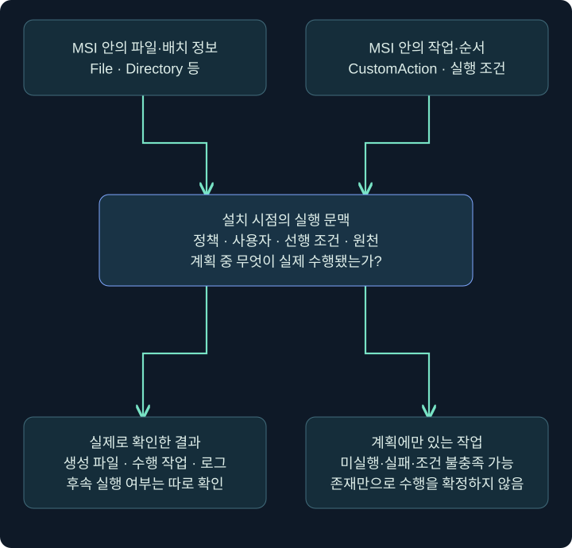
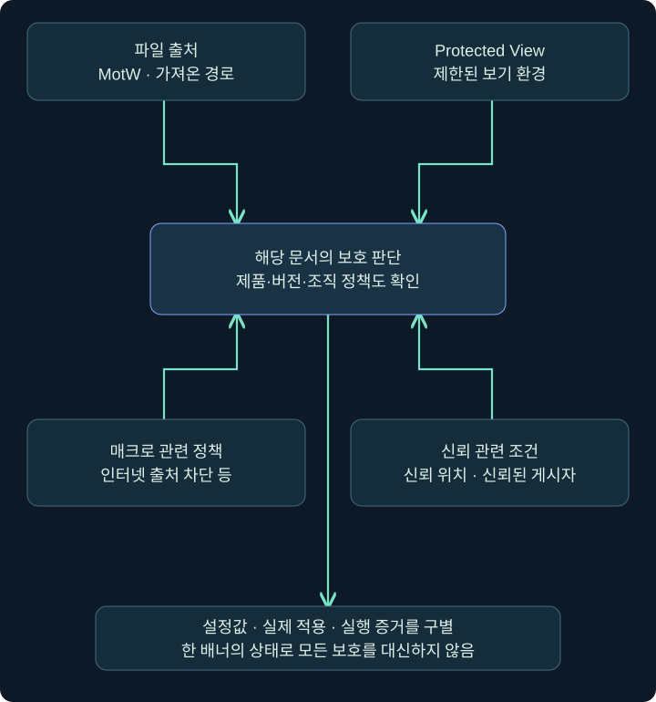
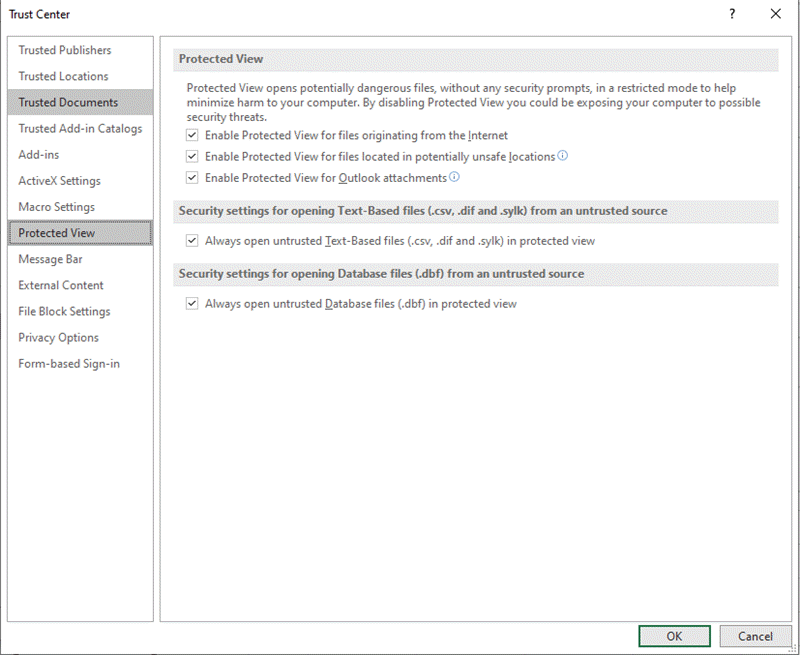
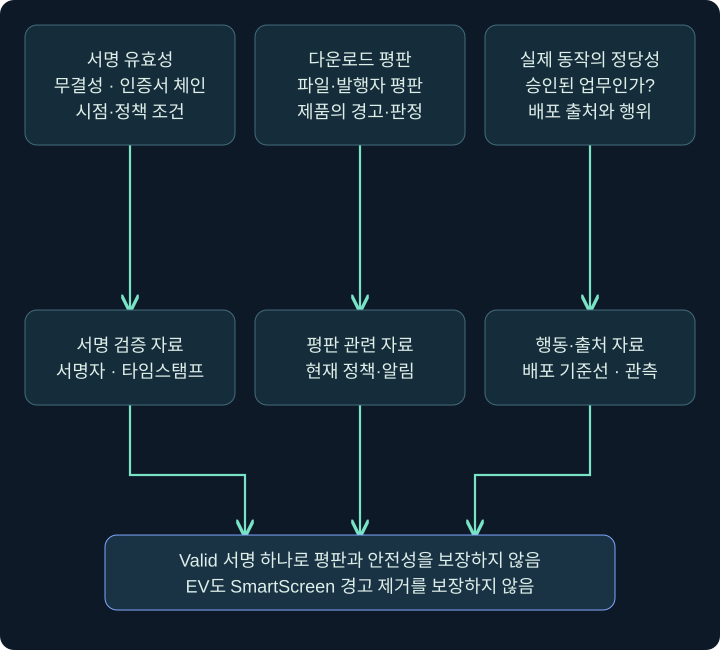

## 1. 설치 프로그램은 파일을 복사하기만 할까요?

설치 파일을 열었더니 프로그램 폴더가 생기고 시작 메뉴에 아이콘이 추가됐습니다. 눈에 보인 변화는 두 가지지만 설치 과정에서는 종속성 검사, 설정 변경, 추가 작업과 되돌리기까지 일어날 수 있습니다. 그래서 ‘MSI가 있었다’라는 한 줄로는 실행 내용을 설명하기 어렵습니다.

이번 강의에서는 **Windows Installer 패키지**, **Excel 추가 기능**, **코드 서명**을 다룹니다. 세 가지 모두 정상 소프트웨어 배포에서 사용됩니다. 분석의 핵심은 형식 자체를 악성으로 분류하는 것이 아니라, 어떤 구성과 동작이 실제로 연결됐는지 확인하는 것입니다.

설치 파일·추가 기능은 실행하지 않습니다. 공식 화면의 위치를 읽고 승인된 분석 사본에서 메타데이터를 조회하는 예제를 사용합니다. 아래 PowerShell과 Windows 도구 절차는 이 게시 과정에서 실행하지 않았습니다.

## 2. MSI의 내용·실행 순서·결과를 분리합니다

MSI는 Windows Installer가 읽는 패키지 형식입니다. 포함된 파일뿐 아니라 설치에 필요한 정보와 작업 구성을 담습니다. 패키지를 내려받은 상태, 설치 서비스를 호출한 상태, 작업이 실제 수행된 상태는 각각 다른 사건입니다.



그림은 패키지에 적힌 ‘계획’과 설치 시점의 ‘실행’을 분리합니다. **Custom Action**은 기본 작업 외의 추가 동작을 정의하는 기능입니다. 존재 자체가 악성의 증거는 아니며 작업 형식·원천·대상·순서·조건을 함께 봅니다. 다른 프로세스 실행과 연결될 가능성이 있기 때문에 파일 목록만 확인하고 끝내지 않는 것입니다.

가령 가상 패키지에 `CheckPrerequisite`라는 작업 이름이 있다면 이름은 설명용 식별자입니다. 이름이 그럴듯하다는 이유로 실제 동작도 선행 조건 검사라고 단정할 수 없습니다. 반대로 업무용 설치 프로그램의 정상 검사가 스크립트를 사용한다는 사실만으로 침해라고 기록하지 않습니다.

## 3. 설치하지 않고 어느 정보를 확인할까요?

승인된 분석 사본과 Windows SDK의 **Orca**가 준비된 환경이라면, 도구에서 **File → Open**으로 MSI 데이터베이스를 열어 테이블을 살펴볼 수 있습니다. Orca는 편집 기능도 있는 도구이므로 분석 중 셀 변경·저장을 하지 않고 확인 후 닫는 방식으로 사용합니다. 패키지 열람과 `msiexec`를 통한 설치 실행은 다른 작업입니다.

| 테이블·정보 | 읽을 내용 | 해석할 때의 질문 |
| --- | --- | --- |
| Property | 제품명·제조사 등 표시 정보 | 스스로 적은 이름과 검증된 발행자를 구별했나요? |
| File·Directory | 파일과 배치 위치 | 설치 후 실제 생성 경로와 일치하나요? |
| CustomAction | Type·Source·Target 등 작업 정의 | 각 필드가 어느 작업 형태를 뜻하나요? |
| InstallExecuteSequence | Action·Condition·Sequence | 작업이 언제, 어떤 조건에서 예정되나요? |
| 기존 설치 로그 | 실행한 작업과 반환·오류 | 계획 중 실제 수행된 부분은 어디인가요? |

이 표는 모든 MSI 내부를 빠짐없이 검증하는 절차가 아닙니다. 변환 파일·정책·외부 원천·실행 문맥 등이 결과에 영향을 줄 수 있습니다. 설치 로그가 있다면 패키지 정보와 시각·제품 식별자를 연결하고, 성공 표시 하나만으로 모든 후속 실행까지 정상이라고 보지 않습니다.

64비트 여부도 파일 하나의 속성으로 끝나지 않습니다. 패키지 대상 플랫폼, 구성 요소, 호출되는 실행 파일, 실행 문맥을 함께 확인합니다. 구버전 설치 프로젝트의 `Run64Bit` 예시를 모든 설치 도구의 공통 버튼처럼 설명하지 않습니다.

## 4. Excel 추가 기능과 일반 통합 문서는 다릅니다

**추가 기능(add-in)**은 Excel의 기능을 확장하는 구성 요소입니다. `.xlam`은 매크로 사용 Excel 추가 기능 형식이고, 일반 문서 `.xlsx`와 구별합니다. 다만 확장자 확인만으로 실제 내용·신뢰·활성화 여부를 모두 판정할 수는 없습니다.

Excel에는 시작 시 읽는 위치와 신뢰 관련 설정이 있습니다. ‘시작 폴더에 파일이 있다’, ‘추가 기능으로 등록됐다’, ‘코드가 실행됐다’는 별개의 주장입니다. 제품 버전, 배포 채널, 조직 정책, 파일 출처가 함께 영향을 줍니다.

승인된 사본의 **Excel → 파일(File) → 옵션(Options) → 추가 기능(Add-ins)**에서 표시 목록과 아래 **관리(Manage)** 선택을 확인합니다. **Excel 추가 기능(Excel Add-ins) → 이동(Go)**는 해당 관리 목록을 여는 경로입니다. COM Add-ins 등 다른 형식의 목록과 섞지 않습니다. 분석 중 새 항목을 추가하거나 체크 상태를 바꾸지 않고 현재 등록 상태·파일 위치를 기록합니다. 이 경로는 데스크톱 Excel 기준이며 웹 추가 기능의 Home → Add-ins 화면과 다릅니다.

## 5. Protected View와 매크로 차단은 같은 기능이 아닙니다

### 실제 화면 17: Office의 매크로 차단 배너


출처는 [Microsoft의 인터넷 매크로 차단 안내](https://learn.microsoft.com/en-us/microsoft-365-apps/security/internet-macros-blocked)입니다. 배너는 해당 파일의 매크로 실행이 출처 신뢰 문제로 차단됐다는 안내입니다. ‘문서를 전혀 볼 수 없다’, ‘모든 종류의 실행을 차단했다’, ‘이전에 아무것도 실행되지 않았다’라는 뜻까지 자동으로 포함하지 않습니다.

**Protected View**는 신뢰하지 않는 파일을 제한된 보기 환경에서 여는 보호 기능입니다. 인터넷 출처 매크로 차단, 신뢰할 수 있는 위치, 신뢰된 게시자와 각각 다른 판단 요소입니다. 사용자가 ‘편집 사용’을 눌렀다고 모든 매크로 정책이 해제됐다고 해석하지 않습니다.



그림의 여러 입력은 하나의 체크박스를 뜻하지 않습니다. 어떤 보호가 적용됐는지 각각 확인해야 배너가 사라진 이유와 코드 실행 여부를 구별할 수 있습니다. 설정 화면을 열어 본 사실만으로 특정 문서에 적용된 최종 정책을 측정했다고 기록하지 않습니다.

## 6. 실제 Trust Center에서 확인할 위치

### 실제 화면 18: Trust Center의 Protected View



출처는 [Microsoft Protected View 안내](https://support.microsoft.com/en-us/office/collab-files/what-is-protected-view)입니다. 공식 삽화에는 Excel의 추가 옵션도 표시돼 있으므로 모든 Office 앱에서 같은 항목이 나온다고 일반화하지 않습니다.

데스크톱 Excel에서 **파일 → 옵션 → 보안 센터(Trust Center) → 보안 센터 설정(Trust Center Settings)**을 엽니다. 왼쪽의 **제한된 보기(Protected View)**에서 어느 출처에 대해 보호가 선택돼 있는지 읽습니다. **매크로 설정(Macro Settings)**, **신뢰할 수 있는 위치(Trusted Locations)**, **추가 기능(Add-ins)**도 각각 다른 범주입니다. 현재 상태와 관리 정책 때문에 바꿀 수 없는 항목을 기록하고 **취소(Cancel)**로 닫습니다.

특히 신뢰 위치는 편의용 폴더 목록 이상의 의미가 있습니다. 해당 위치에 누가 파일을 쓸 수 있는지, 하위 폴더도 포함하는지, 네트워크 경로인지 확인해야 합니다. 사용자 쓰기 가능한 위치에 파일을 옮기기만 하면 언제나 실행된다는 단순 규칙으로 가르치지 않습니다. 신규 위치 추가나 보호 설정 해제는 이 조회 실습에 필요하지 않습니다.

시작 폴더의 기존 항목을 텍스트로 확인할 때에는 다음과 같이 목록만 읽을 수 있습니다. 경로가 없으면 오류가 날 수 있으며 여기서는 실제 목록을 수집하지 않았습니다.

```powershell
Get-ChildItem -LiteralPath "$env:APPDATA\Microsoft\Excel\XLSTART" -Force |
    Select-Object Name, Extension, Length, LastWriteTime
```

`$env:APPDATA`는 현재 사용자 환경의 경로입니다. `-Force`는 숨김 항목도 목록에 포함시키는 옵션이고 파일을 실행하거나 속성을 바꾸는 옵션이 아닙니다. `Select-Object`는 표시할 속성만 고릅니다. 수정 시각은 복사·복원 등에 영향을 받으므로 생성·실행의 확정 시각으로 사용하지 않습니다.

## 7. 코드 서명이 확인하는 것과 보장하지 않는 것

**Authenticode 서명**은 파일의 서명 정보와 무결성·인증서 신뢰를 확인하는 데 사용됩니다. 서명자 이름, 인증서 체인, 타임스탬프, 유효성 판단의 시점과 정책을 함께 봅니다. 서명이 유효한 파일도 기능상 위험하거나 악용될 수 있습니다.



**EV 인증서가 SmartScreen 경고를 자동으로 없애 준다는 설명은 현재 기준으로 사용하지 않습니다.** Microsoft의 현행 문서는 OV·EV 서명 파일도 평판에 따라 경고가 나타날 수 있다고 설명합니다. 서명 유효성, 발행자 표시, 파일 평판, 보안 제품의 판정은 같은 지표가 아닙니다.

서명자가 알려진 회사라고 해도 ‘해당 회사가 이 업무용 파일을 실제 배포했는가’를 확인해야 합니다. 인증서 도용이나 서명된 정상 도구의 악용 같은 설명도 고려할 수 있습니다. 인증서 이름만 맞으면 조사를 종료하거나, 유효한 서명을 곧바로 악성 부재의 증명으로 쓰지 않습니다.

## 8. 서명과 해시를 읽는 PowerShell 예제

다음은 Windows용 읽기 전용 조회 예제이며 실제 파일에서 실행한 결과는 아닙니다. `Get-AuthenticodeSignature`는 Windows 플랫폼의 해당 기능을 사용합니다.

```powershell
Get-AuthenticodeSignature -LiteralPath 'C:\Lab\review\ExampleApp.exe' |
    Select-Object Status, StatusMessage, SignerCertificate, TimeStamperCertificate

Get-FileHash -LiteralPath 'C:\Lab\review\ExampleApp.exe' -Algorithm SHA256
```

첫 명령은 지정한 파일의 서명 정보를 읽습니다. `Status`가 `Valid`라고 나왔다는 가정만으로 ‘프로그램의 동작이 안전하다’고 출력 내용을 바꾸지 않습니다. 서명 검증 환경·체인·카탈로그 서명 여부 등도 해석에 영향을 줄 수 있습니다. 인증서 객체는 필요한 경우 발행 대상·발급자·유효 기간을 이어서 확인합니다.

둘째 명령의 `SHA256`은 파일 내용을 식별하기 위한 해시 알고리즘입니다. 같은 해시의 승인 배포물과 대조하면 출처 확인을 도울 수 있지만 해시를 계산한 행위 자체가 악성 판정은 아닙니다. 파일 본문 해시가 같아도 MotW 같은 별도 스트림의 상태까지 같다고 할 수는 없으며, 이 차이는 5강에서 다룹니다.

## 9. 드로퍼의 배치와 실행을 증거로 연결합니다

드로퍼가 파일을 리소스에서 꺼내거나 외부에서 가져올 수 있다는 원리를 기억해 보세요. 조사에서는 원본 프로그램, 작성된 파일, 작성 시각, 작성 주체, 그 뒤의 프로세스 생성 관계를 연결합니다. 내장 리소스의 존재만으로 해당 리소스를 추출·실행했다고 보고하지 않습니다.

스크립트형 드로퍼를 읽을 때는 **스크립트 호스트 → 관리 런타임·어셈블리 → 내장 자료·생성 파일 → 이후 실행**이라는 층을 구별합니다. 원본에서 등장하는 GadgetToJScript는 이러한 스크립트와 .NET 구성 요소의 연결을 이해하는 역사적 도구 사례입니다. 이름이 보인다는 사실만으로 해당 변환이나 후속 실행이 성공했다고 판단하지 않습니다.

직렬화는 객체나 구조를 저장·전달할 표현으로 바꾸는 과정이고 역직렬화는 그 표현을 읽는 과정입니다. 일부 경로에서 객체 생성·초기화가 동작과 연결될 수 있어, 생성자나 초기화 메서드에 적힌 기능을 따로 읽어야 합니다. 모든 DLL이 열리는 즉시 모든 생성자를 실행한다는 뜻은 아닙니다. 실제 런타임·호출 경로·버전의 조건이 필요합니다.

어셈블리의 내장 리소스는 파일·문자열 같은 데이터를 포함할 수 있습니다. `GetManifestResourceStream` 같은 이름을 발견했다면 어느 리소스를 읽었는지 확인할 단서입니다. 메모리에서 읽기, 디스크에 쓰기, 새 프로세스로 실행하기는 세 가지 다른 작업입니다. 여기서는 이러한 연결을 분석하며 변환된 실행 스크립트나 드로퍼를 생성하지 않습니다.

`C:\ProgramData` 같은 경로도 전체가 모든 사용자에게 동일하게 쓰기 가능한 것은 아닙니다. 실제 하위 폴더와 ACL, 실행 사용자의 문맥을 확인해야 합니다. 위치가 익숙하거나 회사 제품명처럼 보인다는 사실은 작성 주체와 정당성의 증거를 대신하지 않습니다.

| 가상 관측 | 추가 확인할 연결 |
| --- | --- |
| MSI 안에 EXE가 포함됨 | 설치 후 그 EXE가 실제로 생성·실행됐는지 |
| XLSTART에 XLAM이 있음 | 배치 주체·등록·정책·해당 시각의 실행 |
| 서명은 Valid이나 배포 출처 미확인 | 승인 배포 해시·발행자·행위와의 일치 |
| ProgramData에 파일이 생김 | 실제 작성 프로세스·폴더 ACL·후속 실행 |

## 10. 복습과 바로 읽는 해설

### 복습 1. MSI 파일 목록만 확인하면 설치 동작을 모두 설명하나요?

**해설:** 아닙니다. 작업 정의·실행 순서·조건·문맥과 실제 로그를 함께 확인합니다. 패키지 계획과 수행 결과는 구별합니다.

### 복습 2. Custom Action이 있으면 악성 설치 파일인가요?

**해설:** 정상 설치에서도 사용할 수 있습니다. 정의된 작업과 실제 동작, 배포 목적·출처를 확인해야 합니다.

### 복습 3. Orca에서 MSI를 여는 것과 설치 실행은 같은가요?

**해설:** 다릅니다. 데이터베이스 열람과 Windows Installer를 통한 실행을 구별합니다. 편집 가능한 도구이므로 분석 사본과 변경·저장 여부도 관리합니다.

### 복습 4. Protected View와 인터넷 매크로 차단은 같은 기능인가요?

**해설:** 다른 보호 요소입니다. 보기 환경·매크로 정책·파일 출처·신뢰 위치와 실제 실행 여부를 나누어 확인합니다.

### 복습 5. XLSTART의 XLAM 존재만으로 매크로 실행을 입증하나요?

**해설:** 파일 배치의 단서입니다. 해당 버전·정책·실행 문맥과 실제 로딩·실행 기록이 더 필요합니다.

### 복습 6. EV 서명은 현재 SmartScreen 경고를 없애 주나요?

**해설:** 그렇게 보장하지 않습니다. 서명 파일도 파일·발행자 평판과 정책에 따라 경고가 나타날 수 있습니다. 서명 유효성과 평판은 별도입니다.

### 복습 7. SHA256이 같으면 MotW도 같나요?

**해설:** 일반적인 파일 본문 해시만으로 별도 스트림의 동일성을 보장할 수 없습니다. Zone.Identifier 등 출처 정보는 따로 확인합니다.

### 복습 8. ProgramData라는 이유만으로 쓰기 권한을 확정할 수 있나요?

**해설:** 없습니다. 실제 하위 경로의 ACL과 해당 사용자의 문맥을 확인해야 합니다. 경로 이름과 권한·정당성은 다른 정보입니다.

## 11. 공식 근거와 다음 학습

공식 자료 확인일은 **2026년 11월 3일**입니다. MSI·Office·서명 조회는 미실행 절차입니다. 공식 삽화의 버전과 사용자 설치 버전은 다를 수 있습니다.

- [Orca](https://learn.microsoft.com/en-us/windows/win32/msi/orca-exe), [Custom Actions](https://learn.microsoft.com/en-us/windows/win32/msi/custom-actions): 패키지 데이터베이스와 설치 작업.
- [인터넷 출처 매크로 차단](https://learn.microsoft.com/en-us/microsoft-365-apps/security/internet-macros-blocked), [Protected View](https://support.microsoft.com/en-us/office/collab-files/what-is-protected-view), [Trusted Locations](https://learn.microsoft.com/en-us/microsoft-365-apps/security/trusted-locations): 각각의 보호 조건.
- [SmartScreen 평판](https://learn.microsoft.com/en-us/windows/apps/package-and-deploy/smartscreen-reputation): 현행 서명·평판 구별.
- [Get-AuthenticodeSignature](https://learn.microsoft.com/en-us/powershell/module/microsoft.powershell.security/get-authenticodesignature), [Get-FileHash](https://learn.microsoft.com/en-us/powershell/module/microsoft.powershell.utility/get-filehash): 읽기 전용 조회 계약.

다음 강의는 사용자의 클릭이 어떻게 실행 대상과 연결되는지, 배치 파일·바로가기·MSC의 차이를 읽는 방법입니다.
